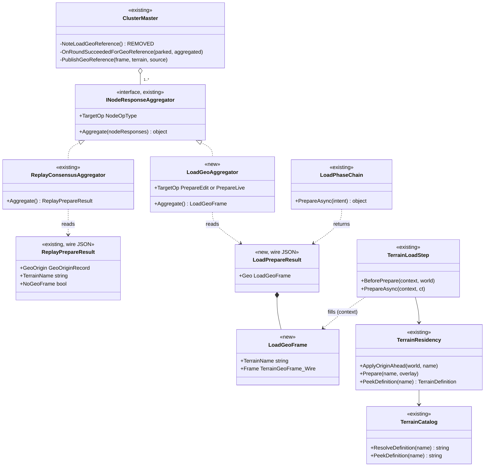
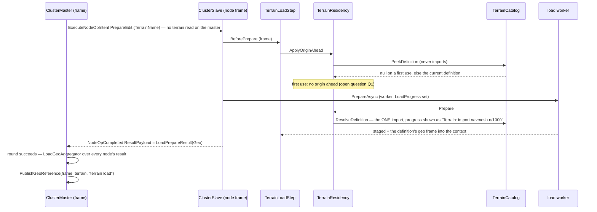
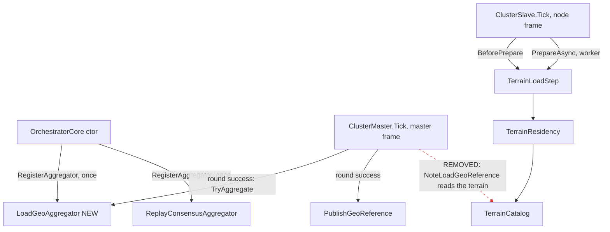

<!--STATUS
state: LIVE
build-state: DESIGN — not dispatched (user, 2026-11-26: "write it as a design, do not send to backend"); an independent review is folded in §8
updated: 2026-11-26 (first version, terrain lane — CE-5060)
current-answer: §2 the decision · §3 the UML · §5 the claim table · §6 the open questions · §8 the review
stale-below: nothing
known-rot: none
known-conflict: DESIGN_Geo_Origin.md §4 ⑩ says the master publishes "the loaded terrain's declared origin" read by the master itself (AQ107 C, ClusterMaster.GeoReference.cs) — this design moves that read to the nodes; not reconciled until approved
related-designs:
  - DESIGN_Geo_Origin.md — OWNS where the origin comes from and §4 ⑨ (the origin set ahead of the bake on a world boundary, CE-2242) and ⑩ (the master publishes); this changes WHO reads the load's origin for ⑩, and what ⑨ does on a first use
  - blueprints/Architect_Question_107_NED_Wire_Frame_And_Names.md — OWNS the retained GeoReference topic and its publisher (the master); unchanged here: still the master, still on round success
  - DESIGN_Terrain_Import_UTM.md §13 — OWNS the import on first use (CE-11037/11039/11061) and CE-5060, the defect this design removes
  - DESIGN_Cluster_Load_Phase.md — OWNS the load transaction, ILoadPartProvider.BeforePrepare / PrepareAsync / Commit and the per-node LoadProgress (§12) the stall check and the heartbeats read
-->
# The load's geo-reference comes from the nodes — no terrain import on the master (CE-5060)

## 1. The problem (measured `2026-11-26`)

📐 A probe in `TerrainCatalog.ResolveDefinition` on a `stechovice-battle` editor load: the terrain is resolved **four** times.

| # | caller | thread | `LoadProgress.Current` | can import? |
|---|---|---|---|---|
| ① | `ClusterMaster.NoteLoadGeoReference` (`ClusterMaster.GeoReference.cs:50`) ← `ExecuteTransitionTrajectory` (`ClusterMaster.cs:1731`) | **master, frame** | ⛔ none — no load step exists yet, the gate still open | ⭐ **yes — and it is FIRST** |
| ② | `TerrainLoadStep.BeforePrepare` → `TerrainResidency.ApplyOriginAhead` (`TerrainResidency.cs:982`) | node, **frame** | set | yes, if ① did not |
| ③ | `TerrainLoadStep.PrepareAsync` → `TerrainResidency.Prepare` (`TerrainResidency.cs:200`) | node, **worker** | set | yes, if ①② did not |
| ④ | `StaticObstacleBakeSystem` → `TerrainResidency.ExpansionBase` | node, worker | none | no (imported by then) |

⇒ a first-use or stale import (CE-11037 / CE-11061) runs in ①: on the master's frame thread, minutes long, before any progress source exists — so the director's 30 s stall check fails the load (CE-5060), and the master's frame (its heartbeat processing, its HTTP) is blocked for the whole import. ① exists only to read the terrain's ORIGIN for the `GeoReference` it publishes when the round succeeds (AQ107 C, `DESIGN_Geo_Origin.md` §4 ⑩).

## 2. Decision

⭐ **Each node puts its terrain's geo frame in its load prepare result; the master aggregates the results (`INodeResponseAggregator`, as the replay already does with `ReplayPrepareResult.GeoOrigin`) and publishes on round success. The master never resolves the terrain.** And the node's frame-thread read ② never imports: the one import of a load runs in ③, on the worker, with the load's progress.

| rejected | the one fact |
|---|---|
| the master reads the origin WITHOUT importing, at round success | 📐 the nodes import into their MACHINE's root (`SharedImportTarget`): a master-only machine of a dev-checkout cluster, or any cluster with a read-only NAS, finds nothing and publishes no GeoReference (the gateway — Unreal — loses its frame) |
| attach a progress around ① | the gate is not loading yet (measured: `localPhase Ready`, gate open) — the stall check still reads nothing, and the master's frame stays blocked for minutes |
| move the import off the frame inside the catalog | hides the caller instead of removing it; a resolve that may take minutes would still sit under the master's transition |

## 3. The UML

### 3.1 Classes — existing (plain) beside proposed (`<<new>>`)

*What the picture shows that prose hid:* the load gains NO new transport — `LoadPrepareResult` rides the same `NodeOpCompletedEvent.ResultPayload` JSON (`NodeOpSlaveTranslator.SerializeResultPayload`) that `ReplayPrepareResult` already rides, and `LoadGeoAggregator` sits beside `ReplayConsensusAggregator` behind the one interface. `PeekDefinition` is the only new catalog surface (a resolve that never calls the import hook).

### 3.2 Sequence — a world-boundary load, first use on this machine

*What the picture shows:* the import moves from the master's frame (before the gate) to the node's worker (inside the Terrain step, where `LoadProgress` and the gate's progress text already work — measured: *"Terrain: navmesh 10885/30951"*).

### 3.3 Modules — who runs what, and who calls it each load

*Caption:* the red dashed edge is the one this design deletes — the master's only path into the terrain catalog. ⚠ Every master hosts an `OrchestratorCore`, so the aggregator is registered on every master by construction (`OrchestratorCore.cs:119-127`, the existing list).

## 4. INVENTORY

| query | total | what it found |
|---|---|---|
| `search_graph name_pattern ".*GeoReference.*" label Class` | 2 | `OrchestrationMessages.GeoReference` (the wire), `GeoReferencePublishedEvent` |
| `… ".*GeoReference.*" label Interface` | 0 | — |
| `… ".*GeoOrigin.*" label Class` | 2 | `RecordingMetadata.GeoOriginRecord`, `TerrainDefinition.TerrainGeoOrigin` |
| `… ".*PrepareResult.*" label Class` | 1 | `ReplayPrepareResult` — ⇒ no load result type exists |
| `… ".*LoadPhase.*Result.*" label Class` | 0 | — |
| `… ".*Aggregator.*" label Class` | 12 | the master's 9 (`CheckpointRestore`, `DiagnosticsConsensus`, `EpisodeConsensus`, `LiveBranch`, `ReplayConsensus`, `ReplaySeek`, `StorageConsensus`, `UnsavedCheck`) + 3 unrelated (blackboard, utility) — ⇒ none for a load |
| `… ".*Aggregator.*" label Interface` | 2 | `INodeResponseAggregator` (the seam), a blackboard one (unrelated) |
| grep `TryImport(` / `ResolveDefinition(` callers | 4 resolves on a load | the table in §1 (a probe, not committed) |

⚠ `check_index_coverage` is not available through the CLI — the absence claims ("no load result type", "no load aggregator") rest on the graph plus grep, not a coverage check.

## 5. Claim table

| the decision rests on | code — how it IS | design — how it was MEANT to be |
|---|---|---|
| ① is the first resolve and the one that imports | ✅ measured probe (§1); `ClusterMaster.cs:1731` | ✅ `DESIGN_Geo_Origin.md` §4 ⑩ (the master reads the terrain header — AQ107 C "the orchestrator can load the terrain header") |
| a node's prepare result reaches the master as JSON with no new transport | ✅ `ClusterSlave.cs:740` (`ResultPayload = result`), `ReplayPrepareResult.cs:14` (serialiser named) | ✅ `INodeResponseAggregator.cs` doc (aggregators over TransitionState rounds) |
| load rounds return nothing today | ✅ `LoadPhaseChain.PrepareAsync` returns `null` on every path (`LoadPhaseChain.cs:202-303`) | ⛔ searched `DESIGN_Cluster_Load_Phase.md` for a load result — none found |
| the master's aggregators run on load rounds | ⚠ `TryAggregate` (`ClusterMaster.cs:2274`) runs for a tracker with neither `SuccessResult` nor `ResultFromResponses` (`:2607`) — ⛔ **not measured that a load's tracker takes that path** | `INodeResponseAggregator.cs` doc: "after all node ACKs for a TransitionState round" |
| a master-only machine / a read-only NAS cannot see the nodes' import | ✅ `TerrainCatalog.SharedImportTarget` (machine root first), `ForNode(null, nas)` on the master | ✅ `DESIGN_Terrain_Import_UTM.md` §13.2 (once per MACHINE) |
| the node's frame-thread read ② would import next once ① stops | ✅ measured order (§1) | ✅ `DESIGN_Geo_Origin.md` §4 ⑨ ("reads just the definition") — ⭐ an import there was never intended |
| an import on the node's worker keeps the node's heartbeat alive | ⛔ **assumed** — the pump beats only when `LoadProgress.MovedWithin(1 s)` (`NodeOpSlaveTranslator.cs:160`); the import reports `ReportDetail` only (`SourceImport.LoadDetailProgress`), and `SetDetail` does NOT advance the count (`LoadProgress.cs`) — whether the navmesh prefill advances it is not measured | `DESIGN_Cluster_Load_Phase.md` §12: "all loaders need to report progress" |
| the proven solution | ⭐ distributed systems publish a fact from the party that HOLDS it (here: the node that loaded the terrain), aggregated by the coordinator — the same as this codebase's replay prepare | adopt: the replay already does it here (ruling 9 — one mechanism) |

## 6. Open questions (with leans)

| # | question | lean |
|---|---|---|
| **Q1** | ⑨ on a FIRST use: ② (`PeekDefinition`) finds no current terrain, so the origin is not set ahead of the bake; CE-2242's race (entities arriving from other nodes before this node's commit) returns for that one load | ⭐ accept for a first use only, AND let ③ hand the definition back so the chain sets the origin on the frame as soon as the worker finishes the Terrain step, before `ScenarioEntities` (the chain's step order is serial on one node) — measure CE-2242's rail under a first use |
| **Q2** | a STALE copy (an older importer revision) at ②: `PeekDefinition` cannot tell stale from current without the hook — ⑨ would set the stale copy's origin | ⭐ the peek returns the definition anyway: an importer revision does not move the origin (it is the input set's corner); only a changed INPUT can — and then ③'s import changes it and `Commit` re-sets it (③ holds: a no-op when equal) |
| **Q3** | nodes that disagree (two terrains or two origins in one cluster) | ⭐ the aggregator warns and takes the lowest node id's frame — the same tie rule as the replay's (`ReplayConsensusAggregator`, earliest first frame) |
| **Q4** | roles that do not load terrain (no Terrain step) | ⭐ they return no `Geo`; the aggregator ignores them. No node with a terrain ⇒ `Frame = none` (CE-4396 UE-e, as the replay) |
| **Q5** | the heartbeat during a multi-minute import on the worker (claim row 7) | ⭐ measure first; if the prefill does not advance the count, `SourceImport.LoadDetailProgress` also calls `LoadProgress.Report()` per stage step |

## 7. Acceptance (rails + scenario)

| rail | asserts |
|---|---|
| `LoadGeoAggregatorTests` | one node / three nodes agree / two disagree (warn, lowest id) / none carries a terrain (`Frame = none`) |
| `TerrainResidencyTests.CE5060_ApplyOriginAhead_NeverImports` | a missing terrain with an input set: `ApplyOriginAhead` returns with no import (the hook's count 0); `Prepare` imports once |
| `ClusterMaster` rail | a load round publishes the aggregated frame; ⛔ no `TerrainCatalog` resolve on the master (a counting hook) |
| `scripts/scenario-regression.sh stechovice-battle` on a machine with no import | the load passes the 30 s stall check (the step text moves through the import) |

## 8. Independent review

*(folded in below when it returns)*
