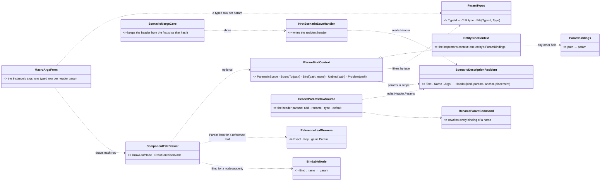
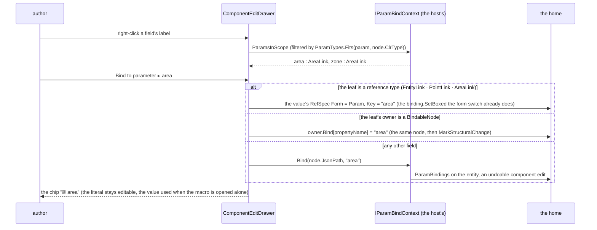
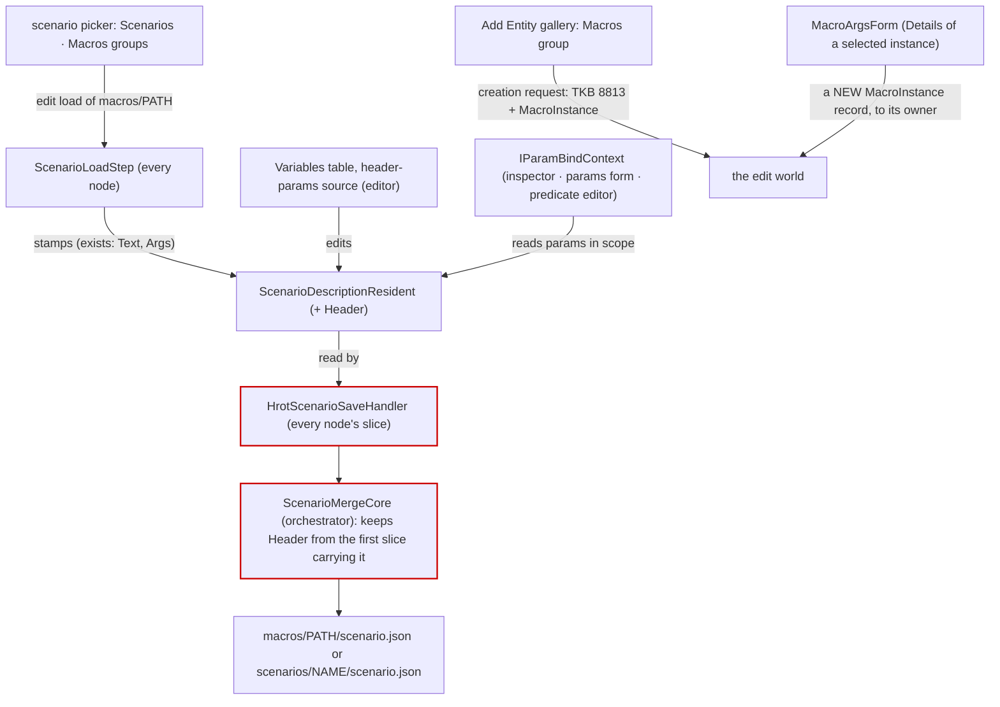
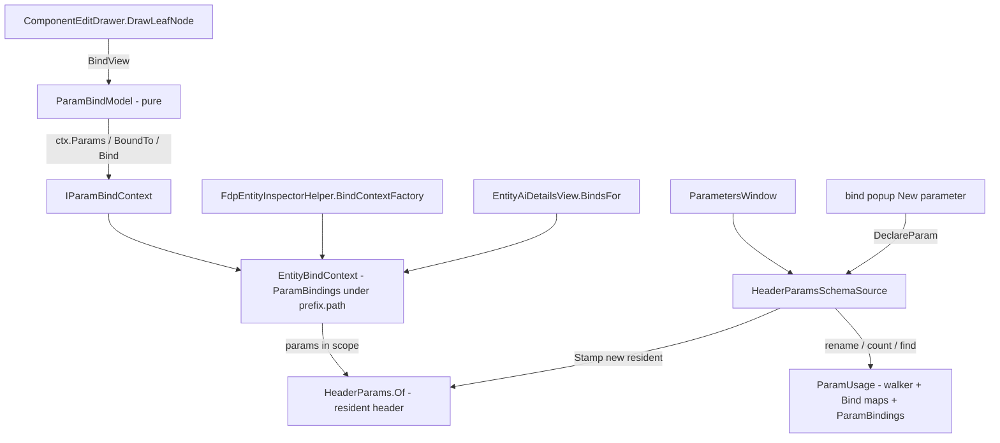

<!--STATUS
state: LIVE — ✅ APPROVED 2026-11-02 (user: "then approved", with MA-1's always-visible button); P1 building
updated: 2026-11-03 (§7 P2 as built)
build-state: BUILDING — P1 (MA-4, MA-3) built §6 · P2 (MA-1, MA-2, MA-5) built §7
current-answer: §7 the P2 AS BUILT · §6 the P1 AS BUILT · §3 (decisions) · §4 (phases)
stale-below: nothing
known-rot: none
related-designs:
  - docs/DESIGN_Scenario_Macros.md — OWNS the macro model: §5.1 the three binding homes (SR-159…SR-166), §5.1.3 the binder as built, SR-39a the instance in Details, §14 SR-173 the macros/ layout; this doc owns only the EDITOR surfaces over it
  - docs/blueprints/DESIGN_Map_Picking_Unification.md — §6 CE-4206: the reference leaves (EntityLink/PointLink/AreaLink, Exact · Key); MA-2 adds the Param form to the same leaf drawer
  - docs/DESIGN_Entity_Hierarchy_Views.md — the Scenario view (macro entities under their instance); the instance is selected there and edited here
  - docs/DESIGN_Add_Entity_Picker.md — §2g/§2h the gallery groups; MA-8 adds a Macros group
  - docs/DESIGN_Node_Features.md — not affected
-->

# DESIGN — **authoring macros in the editor** *(CE-4210 + the editor half of SR-39a, SR-104 Z1, §14 "Save selection as macro")*

[CE-4210](blueprints/Blueprint_Issues_Tracker.md) (feed a field from a parameter) · dispatched by
[HANDOFF_Coordinator_To_Ui_Scenario_Authoring](blueprints/batches/HANDOFF_Coordinator_To_Ui_Scenario_Authoring.md) ⑤ and ⑧.
The model is [`DESIGN_Scenario_Macros.md`](DESIGN_Scenario_Macros.md); nothing here changes it.

## 1. INVENTORY *(`2026-11-02`)*

**Queries:**
- graph (⚠ the index pre-dated today's merges; re-indexed in the background, so the gaps were filled by grep):
  - `.*Param(s)?(Form|Table|Editor|Panel|Window|Drawer)$` Class → 2 (`BehaviorParamsForm`, `BehaviorParamsEditor`);
  - `.*Predicate.*(Builder|Editor|Panel|Window|Composer)$` → 1 (`PredicateValueFieldEditor`);
  - `.*(Header|Scenario)(Params|Properties|Settings)(Panel|Window|Form|Editor)$` → **0**;
  - after the re-index: `.*(Header|Scenario)(Params|Parameters|Properties|Settings|Header)(Panel|Window|Form|Editor|Resident)?$` → 1 (`ScenarioHeader`, the record — no editor of it) · `.*Macro.*` Class → 19, all the BLUEPRINT graph macros (`MacroCallNode`, `Stage2_5_ExpandMacros`, …), a different concept with no scenario UI.
- grep: `new ComponentEditDrawer` (8 production sites) · `ScenarioHeader` in the editor (2) · `EnumerateRelPaths` (2) · `TypeId` mapping (none) · the save handler · `ScenarioMergeCore` · `EntityWriteRouter`.
- ⚠ Coverage was not checked: `check_index_coverage` is not in the CLI.

| measured | where | so |
|---|---|---|
| ⭐ **ONE field drawer** draws every editable value in the editor: the inspector (`ComponentReflector`), the ONE params form (`BehaviorParamsForm.DrawFields`), the params defaults, the Replay Search predicate editor, the node properties, the variable modal | `FDP/Engine/Fdp.Presentation/ImGui/Editing/ComponentEditDrawer.cs` (`DrawLeafNode` :253, `DrawContainerNode` :134); 8 `new ComponentEditDrawer` sites | ⭐ the bind affordance is ONE change here, and every editor gets it by construction |
| the reference leaves (CE-4206) are drawn by ONE class through the same drawer; each leaf knows its `JsonPath` | `ReferenceLeafDrawers.cs` :166, :352 | the `Param` form is one more arm of an existing form switch |
| the drawer's optional host services come in through ONE context (`IMapPickContext`), and a host that has none passes null | `ComponentEditDrawer` ctor | a bind context comes in the same way (⚠ the silent-default rule: every editor host that HAS a scope must pass it) |
| the binder, its three homes and `ParamBindings` (469) are built; `BindableNode.Bind` is settable; `SearchPredicateDto : BindableNode` | `Fdp.Toolkits/Scenario/ParamBinding.cs`; DESIGN_Scenario_Macros §5.1.3 | the editor only WRITES the homes; it never applies them (SR-168: the binder is non-destructive) |
| a param is `ScenarioParamDecl(Name, TypeId, Default, Comment)`; `TypeId` is a free string (`"AreaLink"`, `"float"`, `"ForceId"`); ⛔ **no table maps a TypeId to a CLR type** — the binder converts to the TARGET field's type | `ScenarioHeader.cs:73`; grep | the bind menu cannot filter params by type, and an args form cannot draw a typed row ⇒ MA-3 |
| 🔴 **an editor SAVE drops the macro header**: the save handler builds `new ScenarioHeader(docType, TerrainName, Description)` — no `Kind`, `Params`, `Anchor`, `MaxShift`, `Relocatable` — and the slice merge's canonical header keeps only `TerrainName`, `World`, `Description` | `HrotScenarioSaveHandler.cs:98-100`; `ScenarioMergeCore.cs:98-188` | ⛔ opening a macro and saving it turns it into a plain scenario with no params; a scenario's own params (SR-41) are lost the same way ⇒ MA-4. Note: the serializer CAN write the macro header (`ScenarioSerializer.cs:273-279`, `ScenarioHeaderJson.Write`); nothing passes it |
| ⚠ the save handler's slice path is `scenarios/<name>/.slices`, while the merge reads `ResolveScenarioDirectory(name)` | `HrotScenarioSaveHandler.cs:102`; `StorageProcessManager.cs:217` | for `macros/x` the slices land under `scenarios/macros/x/.slices` and are not cleaned up; the canonical file is right ⇒ fixed with MA-4 |
| the load stamps the scenario's text and args resident (`ScenarioDescriptionResident {Text, Name, Hash, Args}`); the save reads `Description` back from it | `ScenarioDescription.cs:16-29`; save handler :100 | ⭐ the ONE owner of "the header of the scenario being edited" already exists — it just holds too little |
| the resolver opens any `macros/<path>` name (`ResolveScenarioDirectory` arm); `ContentLayout.MacroName` / `IsMacroName` / `Macros(root)` exist | `Fdp.Toolkits/Orchestration/ContentLayout.cs:58-164` | Open / New / Save of a macro needs no new path code |
| the scenario listing enumerates `scenarios/` only | `ScenarioEnumeration.EnumerateRelPaths`; `EditorSubsystem.cs:1376`; `CgfSubsystem.cs:2620` | a Macros group in the picker = the same enumeration over `ContentLayout.Macros(root)` |
| the instance is TKB 8813 (`TkbEntityTypes.ScenarioMacro`), drawn today with the cultural-feature outline; the worker gives it its own marker (W-M1, SR-178) | `EntityClassShapeLibrary.cs:28` | Add Entity ▸ Macro creates an 8813 + `MacroInstance` |
| ⚠ an args edit over the debug API (`POST /entities/{id}/component {"Args":…}`) answers ok and changes nothing | DESIGN_Scenario_Macros §15.4 (live) | the args form writes a NEW `MacroInstance` record (immutable, SR-175), never a patch |
| the attribute write router is numeric (`Write(entity, attributeId, double)`); a managed record has no attribute route | `EntityWriteRouter.cs`, `IEntityComponentWriter.cs:40-55` | ⛔ unmeasured: how the editor's inspector commits a MANAGED component on an entity another node owns. MA-9 measures it first (§5) |

## 2. The shape

*What the picture shows that prose hid:* the drawer picks the binding's HOME from the node it is drawing (a reference leaf, a property
of a `BindableNode`, or neither). So the host passes only the params in scope and a place to write `ParamBindings`; no host can put a
binding in the wrong home. And the header has ONE owner, the resident the load already fills, which the save writes back.

*What the picture shows that prose hid:* the two red boxes are where the header is dropped today (§1). Every editor surface reaches
the header through the resident, so no surface can keep a copy of its own.

## 3. Decisions

| # | decision | ⭐ lean | blast radius |
|---|---|---|---|
| **MA-1** *(amended — user, `2026-11-02`: "right-clicking a field name … doesn't sound like something intuitive. How the user gets feedback …? There needs to be either some icon … or the field needs to respond to hovering")* | the ONE affordance — VISIBLE | ⭐ in `ComponentEditDrawer`, every BINDABLE row (a type that fits at least one param in scope) gets a small **⛓ button at the row's right edge**: ① **always drawn, faint**, on every bindable row — so the user sees which fields can be fed without hovering any of them (user, `2026-11-02`: *"If the field will indicate, even without hovering, that there is something to be clicked … then approved"*); hovering the row brightens it and shows the tooltip *"Feed from a parameter"*; ② **always shown, solid**, when the field is bound, as the chip *⛓ name* in front of the value; ③ red, with the validator's reason as its tooltip, when the name is not declared or the type does not fit (SR-149). Clicking it opens *Bind to parameter ▸ (the params whose type fits)* · *New parameter…* · *Unbind*. ⭐ Hovering a bindable row also tints its label, so the row says "something is here" before the button is found. Right-click on the label opens the same menu as a SHORTCUT, never as the only way. The literal stays editable (the value used when the macro is opened alone, SR-168). ⭐ Only when the host passes an `IParamBindContext` with params in scope ⇒ a field outside any macro or scenario-with-params shows nothing new | one class (the drawer) + one optional ctor argument; every drawer host keeps compiling. ⚠ The row's right edge already holds the array *X* (delete) button — the ⛓ sits left of it |
| **MA-2** | where the write goes | ⭐ decided by the DRAWER from the node, never by the host: a reference leaf ⇒ the value's `Param` form (the CE-4206 form switch gains *Param*); a property of a `BindableNode` (the nearest container's value is one) ⇒ that node's `Bind`; anything else ⇒ `context.Bind(path)`, which the inspector's context writes to the entity's `ParamBindings` (`"<Component>.<field path>"`) as an undoable component edit | ⛔ never a key inside params JSON. ⭐ The params form's field paths step into a params blob (`Behavior.Params.Speed`, the binder's own path form) |
| **MA-3** | params by type | ⭐ ONE `ParamTypes` table in `Fdp.Toolkits/Scenario`: `TypeId ↔ CLR type` (`EntityLink`, `PointLink`, `AreaLink`, `Bearing`, `WorldRotation`, `float`, `int`, `bool`, `string`, and enums by their registered name, e.g. `ForceId`), plus `Fits(typeId, Type)`. Used by the bind menu, the args form and the declaration editor's type combo — ⭐ and offered to the validator for SR-162's type half (backend's file; said in the note, not done here). ⚠ Measured: the three declaration lists spell types differently — scenario params short names (`"float"`, `"AreaLink"`), `.params.json` CLR names (`"System.Single"`). ⇒ the table reads BOTH spellings and writes each list's own, so no file changes | a new small table; an unknown TypeId fits nothing and is shown as such |
| **MA-4** | 🔴 the header is dropped on save | ⭐ the resident is the ONE owner: `ScenarioDescriptionResident` gains `Header` (the macro fields: kind, params, anchor, placement, relocatable), stamped at load from the file. The save handler passes it to the serializer (which already writes it). `ScenarioMergeCore` keeps it from the first slice that carries it (the `Description` rule, CE-3288). The save handler's slice path goes through `ContentLayout` (the `macros/` arm). ⭐ Rail: load a macro → save → `Kind`, `Params`, `Anchor` are still in the file | ⚠ cross-lane: `ScenarioMergeCore` is in `Fdp.Toolkits` (backend). Small, symmetric with `Description`, said in the commit and the note |
| **MA-5** *(amended — user, `2026-11-02`: "similar to not yet existing parameter DTO editor or a generic structure editor … this editor should be shared for both purposes" · "there is already a blackboard variables editor. Maybe this is just another instance of a generic editor")* | editing the params — ONE declaration editor, three lists | ⭐ the scenario/macro params are NOT a new panel: they are one more ROW SOURCE of the existing Variables table (`VariableTableControl` + `VariableEditModal` + `VariableRenameCommit`, over `IVariableRowSource`) — the editor the blackboard already uses. ⭐ Three lists of the SAME shape (name · type · default as JSON · comment), measured: blackboard variables (exists) · `ScenarioParamDecl` (`ScenarioHeader.cs:73`) · `ParamsDtoFieldDto` (`*.params.json`, CE-2136 — ⛔ **no editor today**: only the generator and `ParamsDtoStaleness` read it). ⇒ one source per list (`HeaderParamsRowSource` over the resident's `Header.Params`; `ParamsDtoAssetRowSource` over an opened `.params.json`), each with its write-back. ⭐ **Rename** of a scenario param is the shared rename commit plus one step: it rewrites every binding of the name in the edit world (the walker's `Param` leaves, every `BindableNode.Bind`, every `ParamBindings` entry, `ParamBinder.BindingsOf`). Delete is refused while bound, naming the bindings | ✅ **measured `2026-11-02`**: the Variables panel (`VariablesPanelControl`) draws any `IVariablesSchemaSource` (`Hrot.Editor.AiShared/Blackboard/VariablesPanelControl.cs`) — Add · Remove · Rename · Move · default JSON · properties · a reference count — implemented today by `BTreeHsmSchemaSource`, `BlueprintVariablesWindow`'s source and `BlueprintLocalVariableSchemaSource`; `SectionVariableRowSource` already runs with no entity at authoring time (U-6). ⇒ the scenario params are a FOURTH `IVariablesSchemaSource` (`HeaderParamsSchemaSource`), and the reference count is the binding count. ⭐ The `.params.json` editor comes for free with the same source; it is the asset CE-2136 left without a UI |
| **MA-6** | Open / New macro | ⭐ the scenario picker (CE-4141) gains a **Macros** group = `ScenarioEnumeration` over `ContentLayout.Macros(root)`; a pick is an edit load of `ContentLayout.MacroName(path)` (the resolver arm exists). The title says *Macro: forces/RedQRF*. *New macro…* = a new scenario under `macros/` with `kind = macro` and the anchor at the origin, heading north | the picker's group list + one enumeration root; the load and save paths are unchanged |
| **MA-7** | Add Entity ▸ Macro (SR-104 Z1) | ⭐ the Add Entity gallery gains a **Macros** group (`GalleryGroups` data, the same enumeration as MA-6). Placing one is the ordinary placement tool and creation request: TKB 8813 + `MacroInstance {Macro = path, ArgsJson = "{}"}` at the click, the heading from the tool. The edit world expands it (S3a), and the worker's member lines and dimmed members show what it put in | no new creation path; `MacroInstance` is saved by its translator |
| **MA-8** | the instance in Details (SR-39a) | ⭐ the inspector draws a **Macro** section for an entity with `MacroInstance`: the macro (the same picker, Macros group) + `MacroArgsForm` — one row per header param of the picked macro (read through the content source): its default greyed until overridden, *reset to default*, each row drawn by the ONE drawer over a one-field typed holder (`ParamTypes` gives the type). A change builds a NEW `MacroInstance` record and writes it to the owner (S3a reconciles). The expansion status (`Done` / `Failed` + reason) is shown at the top | needs MA-3. ⚠ the owner write route for a managed record is measured first (§1 last row) |
| **MA-9** | Save selection as macro (§14) | ⭐ one SAVE path, not a second serializer: the save payload gains `OnlyGuids` + a target name `macros/<path>` + a header (`kind = macro`, anchor = the selection's centroid, heading north). Each node writes only the selected entities it owns. ⭐ Before saving, the editor walks the selection's references (the S0 walker) and lists every reference to an entity OUTSIDE the selection. For each, either turn it into a param (default = its current key or GUID, type from the field) or cancel — a macro is closed (SR-58). v1 leaves the selection in place; *replace with an instance* is a later item | the save payload grows by optional fields; a node that ignores them would save everything ⇒ a rail per host (the silent-default rule) |
| **MA-10** | Preview of an `InsertMacro` (SR-189) | ⏳ waits for behaviors' S2 (the `do`-list editor). The button calls MA-7's creation with `IsTransient`; noted, not designed further here | — |

**Rejected — one line each:**
- *A bind button in each editor (inspector, params form, predicate builder)* — three copies; the drawer is the one place every editor passes through.
- *The host decides the home* — a host can then write `ParamBindings` for a reference leaf, which the next typed save keeps but the walker never reads.
- *Keeping the header in the editor session* — a second owner beside the resident the load already fills; it also leaves CGF's and IG's slices without it.
- *Patching `MacroInstance.ArgsJson` through the attribute route* — measured: the patch is accepted and changes nothing; the record is immutable by design.
- *Save selection by serializing the editor's replica* — the editor does not own every selected entity (split authority); the ONE save path asks each owner.

## 4. Phases

| phase | items | gate |
|---|---|---|
| **P1** | MA-4 (the header owner + merge + slice path) · MA-3 (`ParamTypes`) | rail: macro load → save keeps the header; merge keeps it from the first slice; `ParamTypes` round-trips every shipped TypeId |
| **P2** | MA-1 · MA-2 · MA-5 | rails: each home written by its node kind; the chip; rename follows all three homes; a frame rail of the bind menu under `xvfb-run -a` |
| **P3** | MA-6 · MA-7 · MA-8 | rails: the Macros group lists `macros/`; placing creates 8813 + `MacroInstance`; the args form writes a new record; live check on `test/fire-team` |
| **P4** | MA-9 | rails: an outside reference is listed; turned into a param; the file holds only the selection |

## 5. Claim table *(the leans rest on)*

| claim | code | design basis |
|---|---|---|
| every editor field goes through `ComponentEditDrawer` | ✅ 8 `new ComponentEditDrawer` sites | ✅ CE-1023 "the ONE params form" |
| the header is dropped on save | ✅ `HrotScenarioSaveHandler.cs:98`, `ScenarioMergeCore.cs:98-188` | ✅ SR-163 says the save writes bindings "with no extra step" ⇒ the header must survive |
| no TypeId → CLR table exists | ✅ grep, none | ⛔ searched `docs/` for one, none found |
| the binder is non-destructive, so the editor may hold bound values | ✅ §5.1.3 | ✅ SR-168 |
| a managed record can be written to its owner from the inspector | ⛔ **unmeasured** — MA-8 only; P3 measures it before building | ✅ SR-175 (routes an args edit to the owner, `EntityWriteRouter`) |

## 6. AS BUILT — P1 *(ui, `2026-11-03`; MA-4 the header owner, MA-3 `ParamTypes`)*

| decision | as built | deviation |
|---|---|---|
| MA-4 the ONE owner | `ScenarioDescriptionResident.HeaderJson` (a flat string: exactly the object `ScenarioHeaderJson.Write` produces for Kind · Params · Anchor · Placement · Relocatable; empty = none). `ScenarioDescription.Stamp(…, headerJson)` · `HeaderJsonOf(ScenarioHeader / json)` · `HeaderOf(world)` (a `ScenarioHeader` with only those fields). `ScenarioLoadStep` stamps it from the loaded file's header (`_pendingHeaderJson`, with the description). A later stamp replaces the whole resident (`SetSingletonManaged`) | the design's `Header` property is a STRING (`HeaderJson`), not a typed record: the resident stays flat (CLAUDE.md "NEW COMPONENTS"); the typed view is `HeaderOf` |
| MA-4 the save writes it | ONE helper, `ScenarioSaveCore.HeaderOf(world, docType)` (`Hrot.Core/Scenario/Map`): terrain + description + the resident's macro fields. Its two callers are the only production `new ScenarioHeader(` save sites — `HrotScenarioSaveHandler` (every host registers it: editor, CGF, SimHost, IG) and `ScenarioFileService.SaveScenario` (the editor's shim) | the other `new ScenarioHeader(` in production is `ScenarioHeaderJson.Read` (a reader) |
| MA-4 the merge keeps it | `ScenarioMergeCore` (⚠ backend's, `Fdp.Toolkits`): the macro fields of the first slice that has any are written through `ScenarioHeaderJson.Write`; a differing later slice WARNS and the first is kept (the CE-3288 Description rule). No macro fields ⇒ the output is byte-for-byte today's | — |
| MA-4 the slice path | `HrotScenarioSaveHandler.SliceRelativePath` builds `<folder>/.slices/node_N.json` from the new `ContentLayout.ScenarioRelativeFolder(name)` (the resolver against a virtual root: `scenarios/x`, `macros/x`, `recipes/scenarios/x`, `opened/…`) — the folder the merge reads and cleans. `StorageProcessManager.MergeScenarioSlices` is now `internal` for its rail | — |
| MA-3 `ParamTypes` | `Fdp.Toolkits/Scenario/ParamTypes.cs`: `TryResolve(typeId, out Type)` (either spelling, case-insensitive) · `IdOf(Type, ParamTypeSpelling.Short \| Clr)` · `Fits(typeId, Type)` (the SAME type, or `Nullable<>` of it — nothing is converted) · `RegisterEnum`. Short: `EntityLink PointLink AreaLink Bearing WorldRotation float int bool string double` · CLR: their `FullName`s (`System.Single` …). Unknown id ⇒ resolves to nothing, fits nothing, never throws | ➕ `Vector3` / `System.Numerics.Vector3` (a `.params.json` field — `T41Params.Home` — has no other spelling). **Enums: ONE rule** — an enum is a param type when REGISTERED (`RegisterEnum`), found by name (`ForceId`) or full name; `Fdp.Core.ForceId` (what the macro samples and §5.1.1 spell) is registered; another enum is registered once by the feature that declares it. ⛔ not a scan of loaded assemblies (two enums of one name would resolve by load order). The validator's SR-162 type half (backend's file) is NOT changed — offered, not done |

Rails (each in its feature's suite): `ScenarioMergeCoreTests` +3 · `HrotScenarioSaveHandlerTests` +2 · `ScenarioLoadStepTests` +1 · `StorageProcessManagerTests` +1 · `ContentLayoutTests` +1 · `ParamTypesTests` (new: no suite existed). Red-proofs: the merge not writing the fields · `HeaderOf` ignoring the resident · the load not passing `headerJson` — each fails its rail.

## 7. AS BUILT — P2 *(ui, `2026-11-03`; MA-1 the affordance, MA-2 the three homes, MA-5 the params source)*

*Caption: who feeds the drawer its context (every host that holds the world), and the ONE scan (`ParamUsage`) behind the count, the remove refusal and the rename.*

**As built, and where it differs from §2/§3:**
- `IParamBindContext` + `ParamBindModel` (pure: bindable, home, chip/button/red, bind/unbind) + `EntityBindContext` live in `Fdp.Presentation/ImGui/Editing/`. The drawer takes the context as the **4th** optional ctor argument (not the 3rd — a 3rd would break positional `customDrawers` callers); `ComponentEditWindow` and `BehaviorParamsForm.DrawFields` forward it. Unbound bindable row: a faint drawn chain button at the right edge (the font has no ⛓); bound: solid chip in front of the value; red chip with the reason on a problem; click / label right-click opens *Bind to ▸ · New parameter… · Unbind*. A field whose path has an index is not bindable (SR-161).
- Homes decided by the drawer: link leaves (`EntityLink`/`PointLink`/`AreaLink`) → Param form via new `BindToParam/UnbindParam` on the link types (`Links.cs`); nearest container a `BindableNode` → its `Bind` map (+ `MarkStructuralChange`); else `ctx.Bind(path)`.
- Hosts: the diagnostics bundle (`FdpEntityInspectorHelper.WireInspectorWithInspectContextMenu` now takes the world getter, required) wires the panel's and every watch window's reflector, so IG/CGF/SimHost/Editor agree by construction; `EntityAiDetailsView` gives the task / SOP params forms prefixes `Behavior.Params` / `Sop.Params` (instance rows and mission/order forms have no entity ⇒ none).
- ⚠ **Deviation — undo of an inspector bind:** no component-edit undo seam exists in the inspector (`IInspectableSession.SetComponent` is the one write path), so a bind/unbind there is one `SetComponent` of a NEW `ParamBindings` (not on an undo stack). The Parameters window has its own history (`ParamsEditHistory`): add/remove/move/edit/rename are undoable, a rename (declaration + every binding in all three homes) is ONE step.
- MA-5: `HeaderParamsSchemaSource : IVariablesSchemaSource` over the resident header's `Params` (each edit stamps a NEW resident); Remove is refused while bound, naming the bindings; the reference count is the binding count (cached ≤ 1 s). Opened from *Scenario ▸ Parameters…* and by the popup's *New parameter…* (`DiagnosticsHostServices.DeclareParam`, only the editor passes it). `ParamTypes.All()` supplies the type choices. ⛔ The `.params.json` source is not built.
- Live check (real editor under Xvfb, `macros/test/fire-team`): the Scenario menu shows *Parameters…*, the window lists `side : ForceId` from the loaded macro, the entities carry `EntityInfo.ForceId → side`, and a save to a copy wrote the 4 bindings back with `Header.Params`. ⚠ The popup click and the in-table rename could not be driven by xdotool (ImGui double-click timing); both are railed instead.

