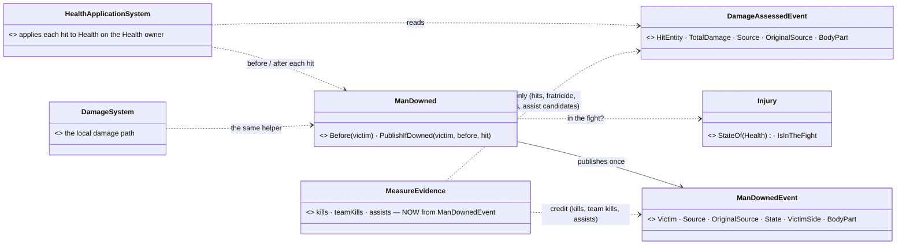
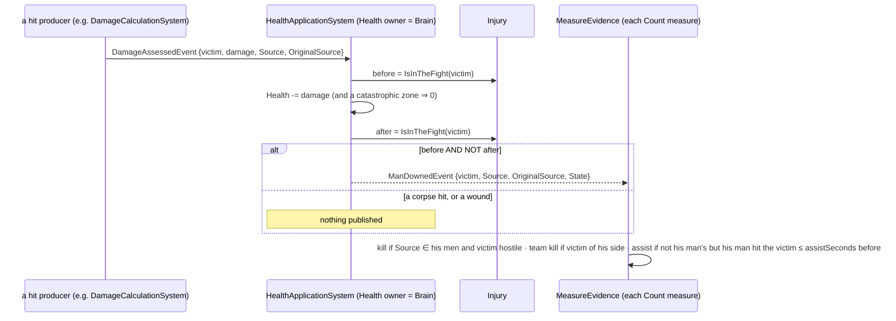
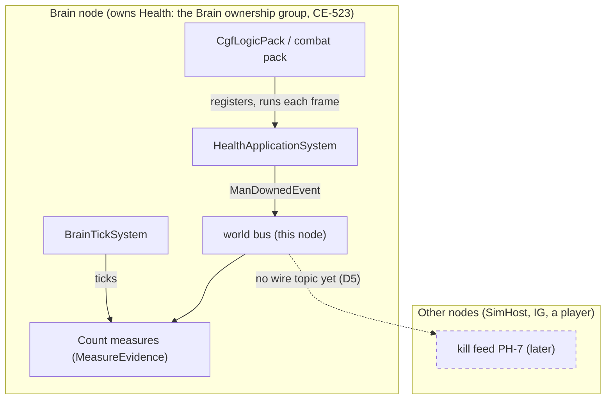

<!--STATUS
state: LIVE
updated: 2026-11-03
build-state: BUILT — CE-3364 (behaviors; user, 2026-11-03: "Approved add that event")
current-answer: §1 the picture · §2 the rule · §3 decisions · §5 as built
stale-below: nothing
known-rot: none
known-conflict: none
related-designs:
  - DESIGN_Injury_States.md — OWNS the four human states and the derived "in the fight" test (I4); this event is the moment a HIT moves a man across that line
  - DESIGN_Scenario_Rules.md — §00.11 S4 measures (Count kills / assists / team kills) and §00.13 S7 the per-player game score (backend) are the first READERS; P-3 reads this event
  - designs/hit-location/DESIGN_Body_Parts_And_Hit_Location.md — OWNS the body part a hit lands on; the event carries the part of the downing hit
  - DESIGN_Player_HUD_And_Debrief.md — PH-7 the kill feed (ui) is a later reader; it needs the wire topic §3 D5 defers
-->
# DESIGN — **one kill authority: `ManDownedEvent`**

**Problem** *(CE-3364, found live by backend in Crossfire S7)*: Blue's men held **20 kills** while Red's scores showed **9 deaths**. Every `Count`
measure decides for ITSELF whether a hit killed a man, so a second man who shoots a body that is already down gets a kill too.
**Answer:** the ONE system that applies damage says, once, *"this hit took him out of the fight, and this is who fired it"*; every counter reads that.

## 1. The picture

*What the picture shows that prose hid:* there are five PRODUCERS of hits (gunfire, blast, cloud, melee, drone) but ONE applier. The downing is
decided at the applier, so no producer and no reader decides it.

*What the sequence shows:* the corpse hit is filtered by `before`, which only the applier sees. A reader that sees the hit after the
application cannot tell a killing hit from a hit on a body: the victim is down in both cases.

*What the module diagram shows:* the event is raised where Health is owned, and that is the same node where the measures run. So it
needs no wire today. The dashed edge is the one reader that WILL need a wire.

## 2. The rule

| | |
|---|---|
| **when** | a damage application takes a man from *in the fight* (`Injury.IsInTheFight`: Ok or Wounded) to *out of it* (Incapacitated or Dead) |
| **once** | the `before` test is taken before the Health write of THAT hit ⇒ a body hit again publishes nothing; a revived man who is downed again publishes again |
| **not** | bleed-out (Incapacitated → Dead): he was already out — no new downing. An authored body (Health 0 at load), a debug edit: not a hit ⇒ no event |
| **who** | the hit's `Source` / `OriginalSource` (CE-4155 attribution); the measure's `attribute` (last / original / both) picks, by the ONE choice NoHarm uses |
| **readers** | `Count kills`, `teamKills`, `assists` (S4 / S7) — and later the kill feed and kill cam. Harm counts (hits, fratricide, civiliansHarmed) stay on `DamageAssessedEvent` |

## 3. Decisions *(user approved the event, 2026-11-03)*

| # | decision | rejected (one line each) |
|---|---|---|
| D1 | the event is raised by the **applier** (`HealthApplicationSystem`), through one helper `ManDowned` that any other applier (`DamageSystem`, the FDP examples' local path) also calls | raise it in each producer: five copies, and a producer does not know the Health after the hit |
| D2 | a **new event**, not a flag on `DamageAssessedEvent` | a `Downed` flag: the flag would be set after the event is published, which needs a second publication or a mutable event |
| D3 | readers **drop their own downing guesses** (`Foes` / `Settle` / the revive bookkeeping in `MeasureEvidence`) | keep both: two kill authorities is the defect |
| D4 | assists = a downing whose credited source is NOT one of his men, after one of his men hit the victim within `assistSeconds` | assists from a per-measure credit list: the same corpse ambiguity |
| D5 | **no wire topic now**: Health is applied on the Brain, where the measures run | a topic now: no reader on another node yet; PH-7 adds it (one egress / ingress pair, `dtManDowned`) |

## 4. INVENTORY *(graph + grep, 2026-11-03)*

- `search_graph` `.*(Downed|Killed|Kill|Death|Fatal).*` Class → `DeathEvent` / `EntityDeathEvent` (FDP **examples** only, Showcase), `MobilityKill` (a vehicle's mobility, not a man), `KillZone` (side test). ⇒ **no downing event in the engine.**
- `search_graph` `.*HealthApplication.*` → `HealthApplicationSystem` (the applier) + its tests. `.*DamageSystem.*` → `DamageSystem` (the local path, registered only by `FDP/Examples` — `HeadlessDemoApp.cs:360`, `UrbanCombatNewScenario.cs:608`, `BallisticsAndHitScenario.cs:160`).
- `search_graph` `.*(Injury|CombatLife|HealthOwnership|BleedOut).*` → `Injury` (derived state), `CombatLife` (capabilities at a kill), `HealthOwnership` (who applies), `BleedOutSystem` (Incapacitated → Dead, not a downing).
- `search_graph` `.*(HitFeedback|HitMarker|KillCam).*` → `HitFeedback` (presentation; reads hits, no kill) ⇒ the kill cam / feed have no source of truth yet.
- grep `ReadEvents<DamageAssessedEvent>` (production): `HealthApplicationSystem.cs:86` · `MeasuresEvidence.cs:85` · `NoHarmBehavior.cs:53` · `TrafficPanic.cs:101`.
- ⚠ `check_index_coverage` is not available through the CLI: the absence of a downing event rests on the graph AND the grep above.

| the lean rests on | code — how it IS | design — how it was MEANT |
|---|---|---|
| one applier for every hit on the Health owner | ✅ `HealthApplicationSystem.cs:86-140`, `HealthOwnership.AppliesHere` | ✅ BS-1 §6.4a (a hit applied once, by its owner — CE-3246) |
| Health is applied on the Brain node | ✅ `HrotOwnershipGroups` rail: `GroupOf(CombatHealth) == Brain`; header note CE-523 | ✅ DESIGN_Ownership_Groups_And_Grants.md §5.6 S8 |
| "in the fight" is derived from Health | ✅ `Injury.cs:24-68` | ✅ DESIGN_Injury_States.md I1 / I4 |
| no downing event exists today | ✅ graph + grep above | ⛔ searched `docs/`: none — PH-7 (kill feed) names the need without a source |

## 5. ⏳ As built

**Matches §1** (every box and edge). Built: `ManDownedEvent` (`Combat/Events/ManDownedEvent.cs`, id `CombatConstants.ManDownedEventId` = 5017, registered beside `DamageAssessedEvent` in `CombatComponentRegistry` (SimHost) and `CgfComponentRegistry`); `ManDowned` (`Combat/ManDowned.cs`: `Before`, `PublishIfDowned` with a `DamageAssessedEvent` overload and a Source/OriginalSource overload); called by `HealthApplicationSystem` (`before` taken ahead of the Health write, publish after the catastrophic-zone 0 and the capability strip) and by `DamageSystem` (Source = the bullet's `Shooter`). Publishing is skipped when the event is not registered on the world (a host that does not read it).

**Other writers of `Health.Current`, enumerated** (grep `Health>(` + `GetComponentRW<Health>`): `HealthApplicationSystem` (a hit, publishes) · `DamageSystem` (a hit, FDP examples only, publishes through the same helper) · `BleedOutSystem` (Incapacitated → Dead: not a downing) · `EntityDamageIngressTranslator.cs:80/94` (replicates Health on a node that does not own it: not a hit here) · tests / debug edits (no event, by §2).

**Readers.** `MeasureEvidence.Update`: kills / team kills from `ManDownedEvent` (credited by the measure's `attribute` through `NoHarmBehavior.Sources(Entity, Entity, …)` — the ONE choice, now an overload shared with the `DamageAssessedEvent` one); assists = a downing credited to nobody of his, with his man's last harm on the victim in `FireTally.Helped` within `assistSeconds`. Deleted: `Foes` / `Friends` / `Killed` / `TeamKilled` / `Settle` / `Remember` / `Forget`. `FireTally` stays unmanaged. `Deaths` kept as it was: it is STATE (his man out of the fight by ANY cause, incl. an authored body or an edit, read from the replicated Health), while the event is the downing BY A HIT on the Health owner — a different question, so not folded in.

**Cross-node.** The event is raised on the Health-owning node = the Brain (Health is in the Brain group, §4 row 2), where the measures run; no wire topic (D5).

**Rails.** `HealthApplicationSystemTests` (Fdp.Toolkits.Tests): `CE3364_AKillingHit_PublishesOneManDowned_ACorpseHitAndAWoundNone`, `CE3364_IncapacitatedIsTheDowning_TheBleedOutToDeadIsNot` (red-proof: the `before` guard removed ⇒ both red). `ScenarioRulesTests.CE3364_AKillIsCreditedToTheHitThatDownedHim_NotToASecondManShootingTheCorpse` (SimHost; red-proof: kills credited from the `DamageAssessedEvent` + health ⇒ red). The S4/S7 rails that downed a man by editing Health now go through `ObjWorld.Kill` (the production helper).
