<!--STATUS
state: LIVE
build-state: BUILDING — S1 BUILT 2026-10-10 (§6a), every host by construction (§6b), air kits (§3.5), articulated kit parts (§3.11; the pose's SOURCE awaits M23–M26); S2 BUILT (§6d); S3 BUILT 2026-10-11 (§6e); S4 BUILT 2026-10-11 (§6f); S5b (the card) BUILT 2026-10-11 (§6g); S5c local part BUILT (§6h, network half CE-1047); S5 BUILT 2026-10-11 (§6i, R-260); CE-1064 the crouched figure (kneel / crouched run) BUILT 2026-10-13 (§6j); CE-1068 doors as hinged leaves BUILT 2026-10-14 (§6k); CE-1071…1073 smooth flying, no frame overflow, the eye in the head BUILT 2026-10-14 (§6l); CE-1081…1084 held figures BUILT (§6m); CE-1085…1094 weapon systems, launchers, guns, drone, attack plane DESIGN 2026-10-14 (§6n), building. ALL leans M1–M22 APPROVED (U21, U22, U23).
updated: 2026-10-21 (§6ab-i the film director drives it — newest shot per camera update, captions and cards, /film/shot {spec}, CE-4038) · 2026-10-21 (§6ab filming — a director camera and a clean scene capture, CE-3289, R-3032, backend cross-lane) · 2026-10-21 (§6q O-4a — a soldier's side picks his CLOTH, friend woodland / hostile desert, CE-1235, R-1020) · 2026-10-20 (§6z CA-4 — one ground depth bias for the SUMO roads and the draped gizmo fills, CE-1196) · 2026-10-16 (§6z the 3-D marquee, camera acceleration, FPS counter + render telemetry; §6aa the weather in first person, CE-1146 simple slice; 2026-10-19 the free camera too) · 2026-10-10 (rev 10 — U23: M17–M22 approved; terrain is NEVER assumed flat (R-248) — draping follows the surface
  (subdivided), "level 0" = the ground surface at each point, areas keep a LEVEL not a height, §3.10. Rev 9 — U22: M15 approved and reshaped on the affiliation pattern (§3.7); §3.9 height in gizmos and
  areas (M21, M22); M16 counts THREE palettes; §3.8's "no code" claims for measurement / area authoring corrected. Rev 8 — U21: leans APPROVED; §3.8 picking, handles and 3-D-aware tools (M17–M20); cards unclickable. Rev 7 — U20: the card is a small CANVAS any gizmo draws into, created on first use, no header/bar shapes —
  §3.6 and M14 rewritten. Rev 6 — U19: §3.6 the entity CARD as a new anchoring mode (M14), §3.7 entity colour under R-136 (M15), one
  side palette (M16). Rev 5 — U18: vehicles and aircraft as multi-part SHAPE KITS (M7), one visual-family classifier shared with the icons. Rev 4 — U17: M10 APPROVED, one camera entity; U16: §3.4 labels in 3-D, M13. Rev 3 — U15: every map host gets 3-D; the switch is an ANIMATED camera transition (M12); M10 restated: one
  camera entity for the map in both modes. Rev 2 — U14: block figures)
current-answer: §6ab filming (CE-3289) · §1 what the user asked · §3 the module / class / sequence diagrams · §4 the reuse ledger · §5 decisions
  with leans · §6 slices · §6a S1, §6d S2, §6e S3, §6f S4 as-built · §6j the crouched figure · §6k doors · §6l smoothness, frame overflow, the FPS eye · §6m the carried / dragged, wounded, seated riders, the jump down · §6n weapon systems, gunners, launchers, mortars and guns, trails, the drone, the attack plane, rotors · §7 what is NOT verified.
stale-below: the HISTORY heading at the end (rev 6's CardHeader/CardBar card).
known-rot: ⚠ 2026-10-17 — the door row's *"a '2-D only' target (none exists…)"* is overtaken: `PipelineTarget.FlatOnly` now exists (AQ93 §12.4, R-4058) — a primitive carrying it is culled by the 3-D triage whatever else it says; `Map2D` itself still means both modes (§7). · earlier: ⛔ RESOLVED 2026-10-11 (CE-1040): §3.3 / M10 said the 2-D map is "north up" while S1 measured it drawing north DOWN; DESIGN_Map_North_Up.md made it north-up, so the swap keeps orientation and those sections are TRUE again.
known-conflict: none. It REPLACES DESIGN_Godot_3D_Viewer.md as the current approach; that file is DEFERRED, not
  withdrawn (U13: "put godot aside but keep its design as deferred").
related-designs:
  - docs/DESIGN_Film_Director.md — OWNS who holds a camera SCRIPT and when the shot changes (takes, reels, paced real-time play, the /director routes); drives §6ab's FilmStudio
  - docs/Editor_Headless_Xvfb.md — OWNS the headless launch (Xvfb + Mesa) that §6ab's filming runs under
  - docs/RUNBOOK_Filming.md — OWNS HOW to film (film.py, plans, finding the moments, the traps); §6ab here is the design
  - blueprints/Architect_Question_93_Sumo_Traffic_Node.md §12.4 — OWNS the SUMO road layer: a 2-D symbol carrying PipelineTarget.FlatOnly, so the 3-D pass shows only the road meshes (R-4058); §15.8 (CE-4031) OWNS how SUMO's far people and cars (no entities) reach EntityBodyLayer3D's ambient pass — drawn with this design's figures, outfits (§6q) and car kits
  - docs/designs/weather/DESIGN_Weather_And_Time.md — S3: the sun, the sky, fog and cloud layers come from WeatherField
  - designs/audio/DESIGN_FPS_Audio.md — OWNS the AudioLayer the pack attaches beside PossessionStation, and the audio files' CC0 licence table (AU-8)
  - designs/airborne/DESIGN_Airborne_Insertion.md — OWNS the descent (rope, canopy) the map draws (U-1); ⚠ its D-8 keeps §6m C-4 only for a hop ≤ 3 m and SIMULATES rope / parachute descents
  - designs/hit-location/DESIGN_Body_Parts_And_Hit_Location.md — OWNS the kits' GEOMETRY half once moved sim-side (HL-1: the hit lands where the part is drawn) and HitMarks, the real hit points §6p asked for
  - docs/designs/indirect-fire/DESIGN_Indirect_Fire.md — OWNS the mortars and guns (IF-G) and the fire mission; §6n here draws the tubes, the howitzers, their laid elevation and blast
  - docs/designs/vehicle-tactics/DESIGN_FPV_Drone.md — OWNS the drone (type 403, its flight body); §6n here draws it as a quadcopter
  - docs/DESIGN_Entity_Interactions.md §7.5 — OWNS the team carry (R-2017): the stretcher drawn between the two carriers, a two-man weapon carried by the pair
  - docs/designs/weapons/DESIGN_Weapon_Systems.md — OWNS the weapon deploy state the map draws (stowed / deployed) and a gunner at his weapon (R-2016)
  - docs/designs/air-attack/DESIGN_Air_Operations.md — OWNS the aircraft attitude the map draws (bank, pitch, tilt in SimTransform.Rotation) and the air-assault scenarios that use §6m's riders (R-2015)
  - docs/DESIGN_Entity_Interactions.md §7.4.8-§7.4.10 — OWNS carrying as embarkation (PassengerBuffer.Modes, IsEmbarkedTag) and seats (CarrierSeats, Exposure); §6m here draws them (C10's "its pose is a later presentation item")
  - docs/DESIGN_Injury_States.md — OWNS the injury states (derived from Health) and slice I-b (wounded speed), which §6m builds
  - docs/DESIGN_Orders_Params_Entity_Classes.md §13.12 — the order form's map picks rely on §3.8's unchanged input chain in 3-D
  - docs/DESIGN_Orders_Params_Entity_Classes.md — C2 (CE-2138): VisualFamilies grows into the shared hard-coded entity class table
  - docs/blueprints/Architect_Question_90_Unit_Orders_Carry_Capacity.md — §2.3o (lean): VisualFamilies grows into the hard-coded entity CLASS table (named DIS masks) that the behaviour lookup also uses; units get their own DIS Kind, so the composite special case becomes a DIS match
  - DESIGN_Visual_Effects.md §7 (R-269 (ui)) — the destroyed look in this map: a near-black wreck, flames and smoke particles, the `Dead` figure posture (VE-N..VE-S).
  - DESIGN_Weapon_Layers.md — which weapon layer on which node aims the turret (behaviour brain, weapon brain, weapon muscle) and
    the TurretPose / WeaponTask wire; §3.11 here keeps the part, the pose and the drawing.
    ⭐ W-13 (R-272) owns the WEAPON POSTURE (at ease / ready / aimed) that §3.5's block figure draws (WL-6).
  - PLAN_3D_World_And_Realism.md — the programme index (roadmap A1…E2 across this design, effects, turret, aircraft, sound).
  - blueprints/Architect_Question_88_Soldier_Speed_And_Retreat_Under_Fire.md — R-265: WHO moves crouched and how fast (the crouched run §6j draws)
  - DESIGN_Building_Interiors.md §3j — OWNS the door ENTITY, its state and its leaf geometry; §6k here only draws it (a hinged slab)
  - designs/gizmos-1/DESIGN.md §11.11 — CE-1071: the frame buffer refuses hidden layers at emit and never drops its meta primitives
  - DESIGN_Terrain_Combat_Tuning.md §5d — CE-1065: which gizmo layers and families are ON by default (most off — the 3-D clutter), and the live layer panel
  - DESIGN_Terrain_Combat_Tuning.md §5e — CE-1203 (R-1011, approved, not built): a layer set PER VIEW (2-D / 3-D), remembered per user, and FL-7 — a 2-D symbol of what 3-D draws itself (the round markers) is FlatOnly, extending R-4058
  - DESIGN_Map_North_Up.md — CE-1040: the 2-D map north-up at its camera seam, so the 2-D ↔ 3-D swap keeps orientation.
  - DESIGN_Visual_Effects.md — muzzle fire, explosions and impact decals as TKB-typed temporary entities; the 3-D map draws them
    (S3b) and places a muzzle flash on the posed barrel (§3.11).
  - DESIGN_Body_Geometry_And_Ground_Contact.md — owns Body.Geometry: an aircraft's size, box offset and landing-gear points
    relative to its CG; the kits are placed by it and the gear is drawn at its points (CE-1041).
  - DESIGN_World_Query_Seam.md — the 3-D map's picking and terrain geometry go through IWorldQuery.Pick and
    ITerrainRenderGeometry (WQ-G), so the editor is not bound to the stand-in.
  - DESIGN_Map_Rendering_And_Interaction.md — owns MapCanvas, IMapLayer, the render frame (§2.3) and the input chain
    (§3) this design extends with a camera subclass and a 3-D draw path; its "dumb terminal" rule holds in 3-D.
  - DESIGN_Godot_3D_Viewer.md — DEFERRED: the Godot-process alternative, the twenty requirements V-01..V-20 this file
    answers, and the user rulings U1..U12.
  - DESIGN_Terrain_World.md — owns TerrainWorld and TerrainWorldMesh; this file adds an optional per-triangle tag
    output to the mesher (the navmesh output stays byte-identical).
  - DESIGN_Stride_Node_Modes.md — owns §8, the 3-D gizmo triage in DebugPrimitiveRenderer3D, which this file EXTRACTS
    into shared code both Stride and the 3-D map use.
  - UX/UX_Feature_Selection.md — owns UXI-11; picks in 3-D reach the one store through the unchanged input chain.
  - designs/gizmos-1/DESIGN.md — owns the primitive stream and §10 context menus; both are reused unchanged in 3-D.
  - DESIGN_Building_Interiors.md — owns wall panels, openings, materials; the 3-D terrain colours by its materials.
  - DESIGN_Terrain_Height.md — supplies the ground height behind §3.10's two seams (the mesh, level 0).
  - designs/tkb-1/DESIGN.md — owns §6.6a, the [PerInstanceValue] rule (a TKB default that the per-spawn value beats)
    that affiliation follows and the entity colour copies (§3.7).
  - designs/promote-to-3d/3D_Cognitive_Spatial_Awareness_Promotion_Design_v1_1.md — owns Tier 2, the generators that
    stop flattening Z (EntitiesInArea); §3.9's "area on a level" relies on it.
  - DESIGN_Ownership_Groups_And_Grants.md — owns descriptor ownership and PARTS (F-6: mount parts never created); §3.11's
    turret part (M23) is a part of that model — one owner per descriptor instance.
  - DESIGN_Entity_Control.md — OWNS the FPS view: an ICameraDriver on MapCamera3D that never saves into the scenario camera (M-9, C-1)
  - docs/blueprints/Architect_Question_93_Sumo_Traffic_Node.md — the CityLib-styled traffic road layer (R-4024) drapes through this mode's ground rule; bridges use the lane height.
  - docs/DESIGN_Civilians_And_Crowd_Control.md — CV-1: the new civilian family keeps §6q's outfits and child bodies.
-->

# DESIGN — a 3-D mode for the map

## Headline

⭐ **The existing map gets a 2-D / 3-D switch.** Same window, same `MapCanvas`, same layers, same selection, same
context menu, same tools — in 3-D the camera is a `MapCamera3D` subclass and each layer draws through an optional 3-D
path. Built on the Raylib the hosts already run. Godot is deferred.

| in 3-D | |
|---|---|
| terrain | lit, colour-shaded polygons from `TerrainWorld` (ground, surfaces, water, roads, buildings by material); textures later |
| entities | **shape kits** — each kind of entity is a few boxes, cylinders and wedges scaled to its TKB size: tank, APC/IFV, car, truck, helicopter, jet; humans as **Minecraft-style block figures** posed by stance |
| interaction | click-select, right-click menu, tools — through the **unchanged** input chain |
| gizmos | the 3-D subset of the gizmo stream (lines, arrows, spheres, semantic shapes) — fire traces and detonations included |
| camera | Unity-style free camera; an **animated** 2-D ↔ 3-D transition (M12); the camera entity (V-12..V-15, M10) |
| hosts | ⭐ **every host that has the 2-D map**: Editor, CGF, SimHost, ReplayBrowser, IG — one wiring site, `MapInteractionPack` |

---

## 1. What the user asked — `2026-10-10`

| # | 🔒 user | consequence |
|---|---|---|
| **U12** | *"check alternative idea of building own simple in-process 3d viewer … simple planes, boxes, human as cylinder (horizontal if prone, lower if crouched) … with imgui on top for menus?"* | measured in `DESIGN_Godot_3D_Viewer.md` §8 — lean B |
| **U13** | *"The internal 3d solution could be switchable 2d/3d instead of current 2d only map so no new 3d window would be required. I think we should focus on B … Lets put godot aside (but keep its design as deferred). We need the simple renderer to handle the terrain geometry, use lighting color shaded polygons to give it some usable feeling of a real world, if not some freely available texture pack."* | ⭐ this file: a **mode of the map**, not a window; **lit, colour-shaded terrain**; textures as a later slice |
| **U15** | *"Every host having the 2d map will get simple 3d, correct? Not just IG. … The current 2d map can be switched to 3d view and back (some camera animation between 2d camera and 3d camera or something)."* | ✅ yes, all five map hosts — by construction since U25 (§6b). ⭐ M12: the switch is an animated camera move, not a cut |
| **U29** | *"S5 approved. We can build weapons here, no handoff necessary. 1047 approved."* (`2026-10-11`) | ✅ §3.12 Q-S5a..c RULED as leaned (R-260): one camera entity per scenario, owned by the saving node, the eye in `SimTransform`, the mode from the pitch · B1 (the live turret) is built in the ui lane · `CE-1047` (the colour's network half) approved for the backend lane |
| **U28** | *"M23 - approved · M24 - yes the weapon side (the weapon logic) moves the turret - knows how to aim, brain just specifies the target · M25 - approved · M26 - solved already by multi-instance descriptors in NED/BDC (similar stuff as already used for sensor sub-entities)"* — and the effects: *"fire effect (from the barrel…), explosion effect (at hit position…), decal effect … temporary entities (counting their lifetime…) … so no gizmos as such - pls add those to the plan"* | ✅ §3.11 ruled (R-255); effects planned in [`DESIGN_Visual_Effects.md`](DESIGN_Visual_Effects.md) |
| **U27** | *"each effect entity has its TKB type of course defining the effect"* | ⚠ recorded as a constraint on S3's effects (§6c) — 📐 today's effect entities carry NO TKB type (`CE-1042`) |
| **U26** | *"It would be great if you built the heli and jet and cargo plane models including their mapping so we do not need to think about that later."* | ✅ built: three air kits + the SISO-REF-010 platform/air category mapping (§3.5) |
| **U25** | *"ad 'the 3-D mode on the other four hosts' - this sounds alarming, we should be unifying and sharing from the day zero so something like 'not on all host' can not happen by construction"* | ✅ §6b: one shared attach + one shared menu item + a rail; S6 withdrawn |
| **U24** | *"the tank models need the turret to be movable left/right as well as the barrel (up/down) as articulated part - tank entity needs a way describing the orientation of its turret+barrel (maybe a sub-entity with component containing turret hull relative azimuth and turret-relative barrel elevation - there used to be a multi-entity tank demo)"* | ✅ articulated kit parts built; ⭐ where the pose lives: §3.11 M23–M26, leans awaiting the user |
| **U23** | *"Leans accepted. Terrain needs height. Current flat terrain bed is unbearable. never count with terrain being flat, this is just current simplification that should be removed soon."* | ✅ M17–M22 approved; 🔒 `R-248`; ⭐ §3.10 — every rule here reworded for terrain with relief |
| **U22** | *"What are height 0 gizmos? Maybe some might become height aware? Some 2d only stuff areas might be turned into 3d, like area with height? Approval covered m15, color would be then similar to attribute like affiliation - runtime stuff (i hope affiliation is runtime stuff, nothing tkb static). Pls summarize the 3d editing concepts with gizmos"* | ✅ M15 approved; ⭐ §3.7 colour follows `EntityInfo.ForceId`'s pattern; ⭐ §3.9 + M21–M22 |
| **U21** | *"Approved. The 3d entities need to support hit tests so clicking entity (some invisible simple oriented box collider on it) can select it - the same raycast machinery as for simulation can be reused maybe … 3d stays mostly rendering only. I think card should remain unclickable. The map tools like measurement and placement tool and area authoring tool should be made 3d aware so same tool can be used in both environments. So gizmo based handle points and hit testing them etc should still be supported just in 3d, rendered in a way clickable and draggable in 3d (draggable to new location using raycast from camera to the terrain...)"* | ✅ M1–M16 approved; ⭐ §3.8 + M17–M20 |
| **U20** | *"unify the 2d text gizmos and the card gizmos so we use same mechanism for both 2d and 3d. The card concept might work well in 2d as well as 3d, being a small canvas for gizmos. The card would not need any special header, if a gizmo uses card anchor, card will be created if not existing yet … what to allow to be anchored, how to achieve the desired health bar, entity name and card frame colored by affiliation … Still supporting the loose text gizmos for special purposes"* | ⭐ §3.6 rewritten: card = canvas, implicit creation, rows by `ZIndex`, row 0 card-wide, `%` of the card; frame / bar / name are ordinary gizmos; no new shapes (M14) |
| **U19** | *"The entity 3d mode color needs to be somehow settable (from scenario - special component) with tkb default color. Entity needs to support some label rectangle on top of it, with thin line down to entity model, showing health bar on top of entity name and lines for extra colored text info, all together framed in a rectangle with line colored according entity side … switchable on/off (layer for labels) … maybe the label area is just another mode of anchoring the 2d gizmo graphics?"* | ⭐ §3.6 card = a new anchoring mode (M14); §3.7 colour = a published descriptor under R-136 (M15) |
| **U18** | *"Vehicles and aircraft should be also composed of multiple pieces to resemble what they are in real world, still cheap."* | ⭐ M7 rewritten: **shape kits** (§3.5), chosen by one visual-family classifier the icons already use |
| **U16** | *"The 3d entities will need some label system so that we can show various texts provided by gizmos. So far gizmos were using 2d text, how to adapt to text for entities in 3d?"* | ⭐ §3.4 + M13: the same text primitives, projected; one overlay pass |
| **U17** | *"ok one camera entity."* | ✅ M10 approved |
| **U14** | *"Human characters as simple as in minecraft would be a bit nicer and still feasible i guess."* | ⭐ M7 rewritten: a **six-box figure**, stance poses blended by the transition, limb swing from speed |

The requirements V-01..V-20 live in `DESIGN_Godot_3D_Viewer.md` §1. ⭐ What changes under U13: **V-09** (own window) →
the map's own area, switched; **V-17** holds (render only); **V-18** (network) → an IG node with the map in 3-D;
**V-03/V-04** → primitives (U5/U12).

---

## 2. INVENTORY — measured `2026-10-10`, branch `ui` (graph + grep; `check_index_coverage` not run)

| query | total | what it settled |
|---|---|---|
| `search_graph(name_pattern="^(MapCanvas\|MapCamera\|IMapLayer\|…)$")` | **17** | `MapCanvas` (`Fdp.Presentation/Vis2D/MapCanvas.cs:12-265`), `MapCamera` (`…/Components/MapCamera.cs:13-383`), `IMapLayer`, `TerrainWorldMesh` |
| `search_graph(relationship=IMPLEMENTS, name="IMapLayer")` + grep | **6 / 6** | production layers: `GridMapLayer`, `DebugGizmoLayer`, `SelectionRenderSystem`, `PerceptionMapLayer` (+2 in `FDP/Examples`) |
| grep `MapInteractionContext` constructors | **5 hosts** | Editor, CGF, SimHost, ReplayBrowser, IG all build the map through `MapInteractionPack` |
| grep `BeginMode3D\|Camera3D\|DrawCube(` in `Hrot/ FDP/` | **0** | ⛔ no 3-D Raylib code exists yet |
| restored `Raylib-cs 7.0.2` / `rlImGui-cs 3.2.0` assemblies | — | 3-D API present (`BeginMode3D`, `DrawCylinderEx`, `DrawCubeWires`, `DrawMeshInstanced`, `UploadMesh`, `GetScreenToWorldRay`, `GetRayCollisionBox/Mesh`, `LoadRenderTexture`) |
| grep TKB dimension fields | **3 types** | `VehicleParametersDto` L/W, `SimVehicleDef` L/W/H, `StaticObstacleDto` L/W/H; ⛔ none for infantry |

---

## 3. THE ARCHITECTURE

### 3.1 Modules — who builds, who ticks, what is dead in 3-D

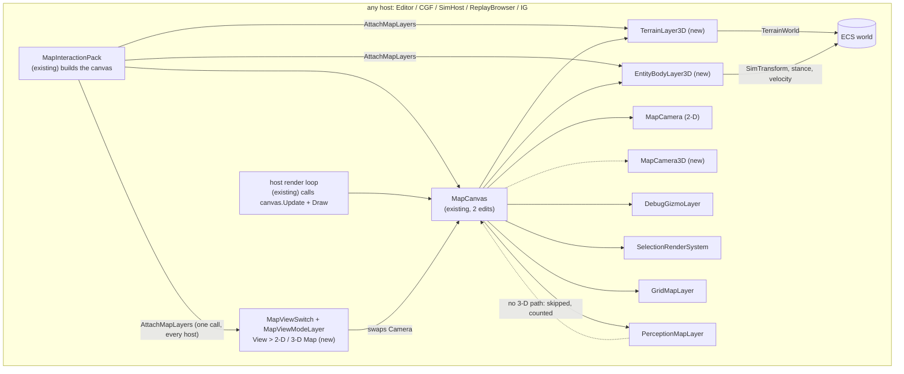

*What the picture shows that prose hid:* **no new composition root and no new tick** — the host loop that draws the
2-D map draws the 3-D one; the pack attaches the gizmo layer, both 3-D layers and the switch in ONE call
(`MapInteractionPack.AttachMapLayers`), which all five hosts make — so no host can be "2-D only" (§6b).
`PerceptionMapLayer` has **no 3-D path** in slice 1 — drawn as a dead edge so its absence is visible, not silent.

### 3.2 Classes — existing (with file) vs new

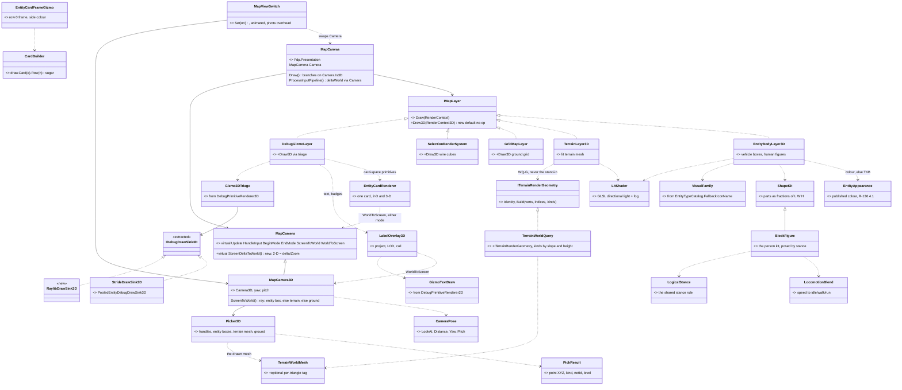

*What it shows:* the 3-D mode is **one camera subclass, two layers, one shader and one sink**; everything else is an
existing class gaining one method. The gizmo triage gets a **second sink, not a second interpreter** — Stride and the
map share it.

### 3.3 Sequences

**A 3-D frame — the same frame, a different branch**

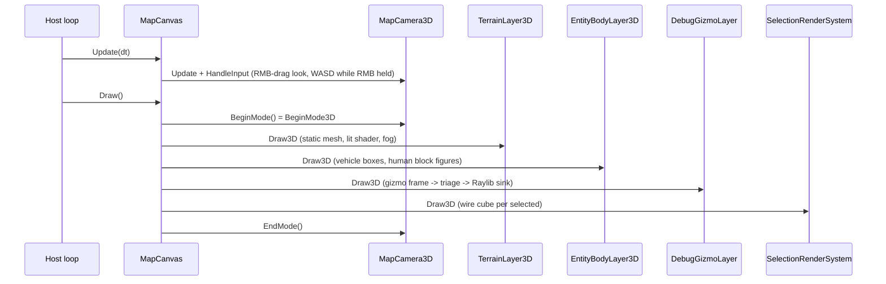

**A click in 3-D — the input chain is unchanged**

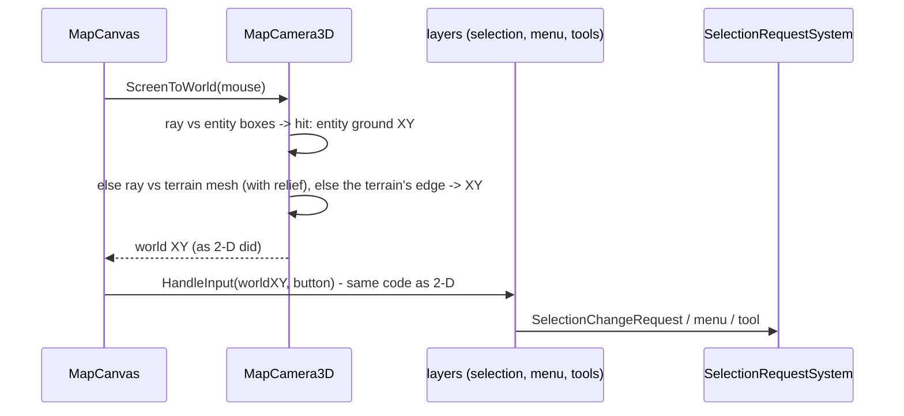

**Switching 2-D ↔ 3-D — an animated camera move, not a cut (M12)**

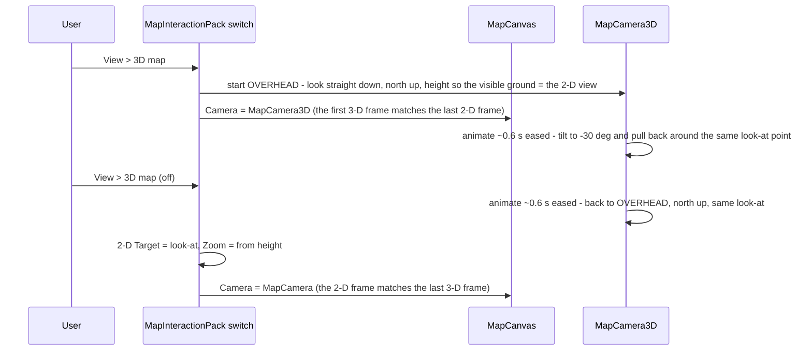

*What it shows:* the 2-D map **is** a 3-D camera looking straight down. Both swaps happen at that overhead pose, so
neither one jumps; the tilt in between is ordinary camera animation. The only thing that changes at the swap is what
is drawn (2-D symbols ↔ 3-D bodies), and the motion masks it.

### 3.4 Labels in 3-D — the same gizmo text, projected *(U16)*

📐 Measured `2026-10-10` in `DebugPrimitiveRenderer2D.cs`: ⭐ **every gizmo text is already a constant-PIXEL label at a
world point** — *"All gizmo text is rendered at a constant on-screen pixel size regardless of camera zoom"* (`:390`);
badges are already drawn in screen space after `GetWorldToScreen2D` (`:437-447`); stacked lines use a pixel offset
(`LineOffsetPx`, `:413-429`); the anchor cache already keeps **Z** (`:58-69`). ⇒ In 3-D only the **world → screen** step
changes; the text drawing itself is reused.

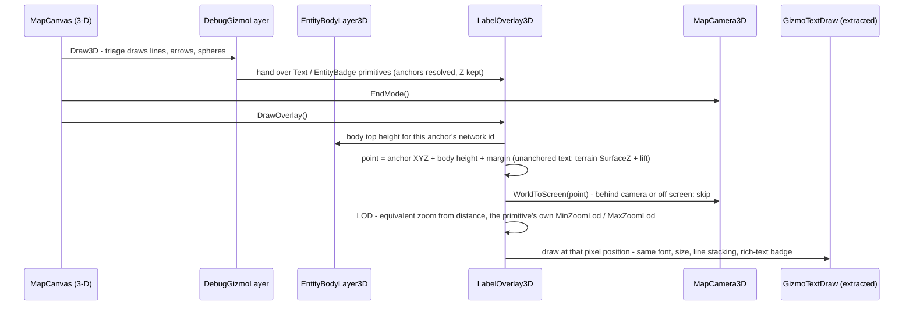

*What it shows:* gizmo authors change **nothing** — the same `Text` / `EntityBadge` primitives. The 3-D mode adds one
overlay pass after the 3-D pass; the drawing code is the 2-D renderer's screen-space branch, extracted so both modes call it.


### 3.5 Shape kits — what each kind of entity looks like *(U18)*

📐 Measured `2026-10-10`: ⭐ the question *"what kind of thing is this type"* is **already answered once**, for the
icons — `EntityTypeCatalog.FallbackIconName` (`EntityTypeCatalog.cs:128-143`) maps DIS kind / domain / category (or
being a composite unit) to a family: person, tank, AFV, wheeled, unit. ⇒ that logic is **extracted** into one
`VisualFamily.Of(TkbTemplate)`; the icon fallback and the 3-D kit choice both call it.
⭐ **CE-2138 (2026-10-12):** that one function now reads the shared hard-coded entity class table (named DIS masks, R-279/R-280 (behaviors)) — the family is a property of a class, so the 3-D kit, the icon, the 2-D avatar, the picker folder and the behaviour lookup classify from ONE table ([DESIGN_Orders_Params_Entity_Classes.md](DESIGN_Orders_Params_Entity_Classes.md) §2). The table below still states which DIS values give which family.

| family *(DIS)* | built-in types today | kit — parts, as fractions of the type's L × W × H |
|---|---|---|
| **person** *(kind 3)* | Rifleman, InfantrySoldier, Grenadier, MortarTeam, Insurgent, CivilianPedestrian | the block figure; **rifle** part for soldiers (category 1), none for civilians; body in the entity colour (§3.7), side shown by the card frame. ⭐ **WL-6 (`2026-10-11`, R-272):** arms in two segments (elbows); a soldier holds the rifle in the weapon brain's `WeaponPosture` — at ease low, ready at the chest, aimed shouldered with the upper body turned and pitched toward the target — and his arms do not swing; running leans the upper body forward. ⭐ **WL-6c:** legs with knees (thigh + shin, IK); aimed standing = the athletic fighting stance, aimed moving = the combat glide; every walker's knees bend; ⭐ **WL-6d:** a prone figure that moves crawls (elbows and opposite knees, rifle carried); drawing only, the logical stance is unchanged. ⭐ **CE-1064 (§6j):** crouched and still he KNEELS; crouched and moving he runs crouched (legs swinging, upper body leaning). 📄 `DESIGN_Weapon_Layers.md` W-13 / §5h |
| **tank** *(1.1, cat 1)* | M1 Abrams, T-72 | lower hull · two track blocks (dark) · turret box set back · barrel cylinder forward |
| **AFV / APC** *(1.1, cat 2)* | Bradley, MilitaryAPC | hull with a sloped front wedge · tracks or wheels (dark) · small turret · thin barrel |
| **wheeled — car** *(1.1, cat 81)* | CivilianCar | lower body · cabin (glass) · four wheels (roll with speed) |
| **wheeled — utility** *(1.1, cat 3/6/7)* | HMMWV | wide low body · cab (glass) · rear bed · four wheels |
| **helicopter** *(1.2, cat 20–25)* | ⛔ none in the built-in TKB | fuselage · cockpit glass · tail boom · swept fin · tail rotor · mast · two crossed main blades (spin: S4) · skids on struts — ✅ built |
| **jet** *(1.2, cat 1, 2, 6, 7, 40, 47, 50)* | ⛔ none in the built-in TKB | fuselage + nose cone · canopy · swept wings and tailplanes · swept fin · nozzle · gear — ✅ built |
| **cargo plane** *(1.2, cat 3, 4, 5, 8, 57)* | ⛔ none in the built-in TKB | round fuselage + nose · cockpit glass · straight high wing · four engines · raised tail, fin, tailplane · gear pods — ✅ built |
| **unit** *(kind 11 — ⭐ CE-2139; was: any composite)* | tank platoon, infantry squad | **no body** — its members are entities and draw themselves; its symbol shows as a label |
| unknown | — | one box, the TKB size |

⭐ **Cost:** 6–12 parts per vehicle, each one draw of a shared unit mesh through the lit shader — hundreds of vehicles
stay cheap; instancing per part shape is the later lever. ⭐ **Size:** length / width / height from
`VehicleParametersDto` / `SimVehicleDef`; a per-family default where the TKB has none. ⭐ **Motion is presentation
only** — rotor spin from time, wheel roll from speed; the turret follows the hull (no aim component is read).
✅ **Built-in aircraft, `2026-10-10` (CE-1041):** UH-60A, F-16C and C-130H carry `Body.Geometry` — the kit is placed by its
box offset from the CG and the gear is drawn at the TKB's contact points (the kit's generic gear, `PartRole.Gear`, steps aside);
retractable gear is hidden when clearly airborne. 📄 [`DESIGN_Body_Geometry_And_Ground_Contact.md`](DESIGN_Body_Geometry_And_Ground_Contact.md).
✅ **Air, `2026-10-10`:** the three air kits are built and railed, and the platform/air categories are mapped from the
IEEE 1278.1 enumerations (JDBE DIS data dictionary, the SISO-REF-010 lineage) — also added to `DisNames.json` for the picker. For
aircraft the kit's y extent is the **span** (wing or main rotor). ⚠ No built-in type is in the air domain yet; the frame rail
draws test types on those categories.

### 3.6 The entity CARD — a small canvas for gizmos, the SAME in 2-D and 3-D *(U19, reshaped by U20)*

📐 Measured `2026-10-10`: the card's content **already exists as gizmos drawn as loose text** — `EntityEditorLabelGizmo`
stacks id / behaviour / `HP:x/y` lines at the entity point (`EntityEditorLabelGizmo.cs:61-100`), `HealthBarGizmo` draws a
text badge (`HealthBarGizmo.cs:54`). ⭐ **U20: the card is a small canvas any gizmo can draw into; it exists because a
gizmo drew into it — no header, no special shape.** Loose text keeps working for special purposes.

#### What a card is

```text
    card for entity #1043 — created this frame because ≥ 1 visible primitive targets it
    ┌──────────────────────────┐   row 0  (card-wide)  frame + background  ← EntityCardFrameGizmo, side colour
    │ ███████████████░░░░░░░░░ │   row 10             health bar           ← HealthBarGizmo: two Box2D, widths in % of the card
    │ T-72 #1043               │   row 20             name                 ← EntityNameGizmo: Text
    │ Attack (moving)          │   row 40             behaviour            ← EntityEditorLabelGizmo: Text, own layer
    │ ammo 34/40   [icon]      │   row 50             any other gizmo      ← Text + Icon in one row
    └────────────┬─────────────┘
                 │                 leader line, drawn by the card renderer
               [entity]            2-D: its symbol · 3-D: the top of its body
```

| rule | carried by | ⭐ why it needs no new field |
|---|---|---|
| ⭐ **a card exists iff a visible primitive targets it** — anchor = the entity's network id | `Space = EntityCard` (a 4th value) · `AnchorIndex` = network id | `Space` byte at offset 1 uses values 0–2 today; `AnchorIndex` already is the network id (`DebugPrimitive.cs:24,63`) |
| ⭐ **rows**: primitives sharing an order key form one row; rows stack top-down by key; ties broken by gizmo type | `ZIndex` | `ZIndex` byte at offset 15 is already *"intra-layer sort"* — in a card the sort is the row order |
| ⭐ **row 0 is card-WIDE** — not in the flow; drawn over the whole card after layout (frame, background, a badge in a corner) | `ZIndex = 0` | `ZIndex` already says *"0 = background"* |
| ⭐ **coordinates are card-local pixels**, origin at the row's top-left | the shape's own x/y fields (`TextX/Y`, `BoxCenter/Extent`, `LineStart/End`, `IconWorldPos`) | the same fields the screen space uses |
| ⭐ **"% of the card"** for widths/heights that should fill (a bar, the frame) | `SizeMode = ScreenPercent` | it already means *"fraction of the container"* (the viewport for screen panels, `ImGuiPropertyTreeAdapter.cs:92`) — the container is now the card |
| ⭐ **on / off per row** | `DebugLayer` | each gizmo keeps its own layer; a card with no visible rows disappears |
| card width | the widest row, measured; a minimum width | — |

#### What may be drawn into a card

| ✅ allowed | use |
|---|---|
| `Text` | names, values, coloured info lines |
| `Box2D` (filled / outline) | bars (health, fuel, ammo), swatches, the frame |
| `Line` | separators, small indicators |
| `Icon` | status icons |
| `EntityBadge` (rich text) | coloured runs inside one line |
| `MilStd2525` | the unit's symbol inside the card |
| `FilledTriangle` | arrows / markers |
| ⛔ ignored, counted | `Sphere`, `Arrow`, `SemanticShape`, `SpatialAnchor`, bindings, `StructInspector` — they are world or panel things |

#### How the three things you asked for emerge — all as ordinary gizmos

| wanted | gizmo *(host side, reads ECS)* | emits into the card |
|---|---|---|
| **frame coloured by side** | `EntityCardFrameGizmo` *(new; `NetworkIdentity` + `EntityInfo`)* | row 0: an outline `Box2D` 100 % × 100 % in the side colour (one palette, M16) + a translucent filled one behind it |
| **health bar** | `HealthBarGizmo` *(existing, re-targeted)* | row 10: a dark `Box2D` 100 % wide + a coloured one `Current / Max` wide, both `ScreenPercent` |
| **entity name** | `EntityNameGizmo` *(new, or split from `EntityEditorLabelGizmo`)* | row 20: `Text` from `EntityInfo.Name` |
| extra lines | any gizmo | rows 30+ on their own layers |

⭐ The leader line is the **card renderer's**, because only the terminal knows where it placed the card; ⭐ it takes the
colour of the card's row-0 outline when there is one (so it matches the frame), else grey.

#### One renderer, both modes — only "where is the entity on screen" differs

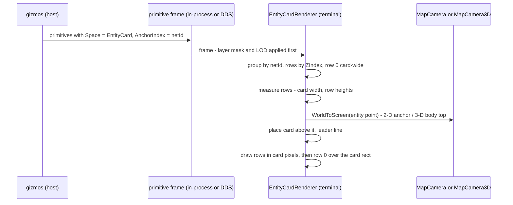

*What it shows:* the renderer never asks which mode it is in — it asks the camera for a screen point, and the camera
classes already answer that in both modes (`MapCamera.WorldToScreen` is virtual, `MapCamera.cs:354`). ⭐ So a card gizmo is
written **once** and appears identically in 2-D and 3-D, in-process and on a remote IG.

#### Gizmo-author API — sugar over existing primitives

```csharp
var card = draw.Card(entity);                    // sets Space = EntityCard, AnchorIndex = netId on everything below
card.Row(10).Bar(fraction: hp, fill: Green, back: DarkGrey, heightPx: 4);   // two Box2D, ScreenPercent widths
card.Row(20).Text("T-72 #1043", White);
card.Row(0).Frame(sideColour);                   // outline + translucent fill, 100 % x 100 %
```

⭐ No new primitive kind travels on the wire — only a new `Space` value, so DDS and the IG need nothing extra.

#### Loose text stays

`World` / `EntityLocal` text is untouched: in 2-D it draws as today; in 3-D it is projected (§3.4, M13). ⭐ A gizmo chooses
per call — card when it describes *the entity*, loose when it marks *a place* (a measurement, a waypoint label).

#### Later, cheap options

- **declutter** overlapping cards; hide cards below a zoom (2-D) or beyond a distance (3-D) — card-level LOD on top of each row's own.

### 3.7 Entity colour — a scenario-settable value with a TKB default *(U19)*

📐 Measured `2026-10-10`: a TKB colour **already exists** — `VisualData.ColorHex`, filled from the TKB visual definition
at spawn (`PresentationTkbTranslator.cs:65`; e.g. `#2E4057` for the M1, `BdcTkbCatalog.cs:30`), already used by IG's 2-D
style as a tint (`StyleResolutionSystem.cs:103`).

🔒🔒 ⛔ **But it may NOT be overridden in place.** `R-136`: *"entity state has exactly two legal sources: the TKB, or a
published TransientLocal descriptor; anything in neither must not exist as durable state"*
(`DESIGN_Entity_State_Sourcing.md` §1). `VisualData` is TKB-derived, and saving TKB-derived components into a scenario is
an error (§3 ②). ⇒ ⭐ **the user's "special component" is exactly what the rule demands** — and its only legal shape is
§4.1's recipe, with `SimTransform` → `dtWorldPos` as the worked example:

| step *(§4.1)* | for the colour |
|---|---|
| ① classify it as published state | ⭐ a new component `EntityAppearance { ColorRgba }` — authored, so it MAY live in the scenario |
| ② a descriptor arm | `EDescriptorType` / `EntityDescriptorUnion` |
| ③ its own topic, `Reliable` + `TransientLocal` | ⭐ what makes a late-joining IG see the colour |
| ④ egress + ingress translators, gated on authority | the established pattern |
| resolution at draw time | `EntityAppearance` if present → else `VisualData.ColorHex` (TKB) → else the family default |

✅ **Approved (U22)** — *"color would be then similar to attribute like affiliation - runtime stuff"*.

📐 **Affiliation is exactly that shape already, measured `2026-10-10`** — so the colour copies it field for field and is
**not** the first of its kind (an earlier revision said it was):

| | affiliation today | the colour |
|---|---|---|
| ECS component | `EntityInfo.ForceId`, `[PerInstanceValue]` (`EntityInfo.cs:3-16`) — *"authored PER SPAWN … the template value is a placeholder that must lose"* | `EntityAppearance.ColorRgba`, `[PerInstanceValue]` |
| TKB default | stamped only if absent: `BehaviorTkbTranslator.cs:61-62`, `PresentationTkbTranslator.cs:70-73` | `VisualData.ColorHex` → stamped only if absent (`PresentationTkbTranslator`) |
| per-spawn value wins | `NetworkSpawningSystem.cs:207-209` applies `InitialComponents` after the TKB translators | same path, unchanged |
| saved in the scenario | `"EntityInfo": { "ForceId": "Friend" }` (`scenarios/hill-attack/scenario.json:123-126`) | `"EntityAppearance": { … }` |
| network | DDS `EntityInfo` descriptor, `Reliable`/`TransientLocal` (`GenericDescriptors.cs:146-171`; translators `EntityInfoEgress/IngressTranslator`) | its own descriptor arm, same QoS, same translator pair |
| runtime change | attribute `"Affiliation"` → `UpdateEntityAttributeRequest`, authority-checked (`AttributeIds.cs:49`, `UpdateEntityAttributeRequestSystem.cs:24-59`) | attribute `"Color"` through the same path |
| design basis | `docs/designs/tkb-1/DESIGN.md` §6.6a (`:828`, `:845`) | the same section's `[PerInstanceValue]` rule |

⭐ **Its own descriptor, not a field on `EntityInfo`**: `EntityInfo` is a wire descriptor other nodes already read; a
separate arm adds a topic and changes no existing message. ⚠ The NED part is the backend lane's area — named, not a stop.

### 3.8 Picking, handles and tools in 3-D — the same tools, the same handles *(U21)*

⭐ **Goal (U21):** click an entity to select it (an invisible oriented box, no new raycast engine); measurement, placement
and area-authoring tools work in both modes; gizmo handles are clickable and draggable in 3-D, dragged along the
terrain; **cards are not clickable**; the 3-D map stays mostly rendering.

📐 **What was measured `2026-10-10`, and what it decided**

| question | measured | ⇒ |
|---|---|---|
| reuse the simulation's raycasts for picking? | ⛔ `RaycastSolverSystem` is **asynchronous** — a `RaycastRequestEvent` now, its `RaycastResultEvent` on a later tick (`RaycastSolverSystem.cs:13-21`) — and runs in the sim schedule, which is often **paused** while authoring; its entity collider is a **2-D circle + height** (`PhysicsCollider`, `PhysicsComponents.cs`) | ⛔ not for clicks: a click needs its answer in the same frame, paused or not |
| …the terrain's own segment query? | `TerrainWorld.QuerySight` is synchronous and knows walls, panels, doors, slabs, ramps — ⚠ but for a prism it reports where the ray's **footprint** enters it (`t0 * length`, `TerrainWorld.cs:400-405`), not where it meets a roof from above, and its own doc calls it a **diagnostic** that allocates (R-220) | ⛔ not for the hit POINT; ✅ the sim's `SurfacesAt` / `ResolveLevel` (`:241,283`) say **which floor** a point is on |
| what geometry to hit? | the terrain we draw **is** `TerrainWorldMesh` — the same soup the navmesh is baked from (`TerrainWorldMesh.cs:31`) | ⭐ ray vs **that mesh** (Raylib `GetRayCollisionMesh`) — exact, allocation-free, the simulation's own geometry |
| where does height get lost today? | five sites build the 3-D event position with `z = 0`: `DebugGizmoLayer.cs:122`, `GizmoInteractionProxyTool.cs:42,61,75`, `EntityPlacementGizmo.cs:236` — while the interaction API is **already 3-D** (`IGizmoInteractionHandler.OnDragUpdate(Vector3)`, `GizmoDragUpdateEvent.WorldPos`) | ⭐ feed those five from the pick, and every handle and tool gets real height for free |

#### The pick — one function in `MapCamera3D`, nearest hit wins

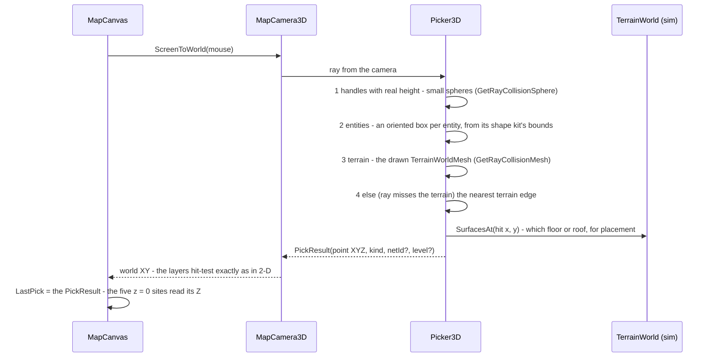

*What it shows:* the layers still receive world X/Y and run their **2-D hit tests unchanged**. ⭐ An entity hit returns the
entity's own ground position, so its existing 2-D pick box contains it; ⭐ a handle or pick box lying on the ground is found
because the ray lands on the ground exactly under it. Only height is new, and it reaches the gizmos through one value.

#### The rules

| # | rule | why |
|---|---|---|
| **P1** | ⭐ **entity hit volume = an invisible oriented box from the entity's shape-kit bounds** (TKB length / width / height, the entity's heading) — not the sim's collider | the box is **what the user sees**; the sim collider is a bounding circle (a 10 m tank gets a ~5 m radius, so clicking empty ground beside it would select it) and not every entity has one |
| **P2** | ⭐ **while dragging, the ray hits terrain and ground only** — not entities, not the handle being dragged | a handle follows the terrain under the cursor; `MapCanvas` asks `Camera.ScreenToWorldForDrag` when it routes a drag (2-D: same as `ScreenToWorld`) |
| **P3** | ⭐ **the dragged point takes the terrain's height** at the cursor; on a building, the roof or floor the ray hit | real `Z` in `GizmoDragUpdateEvent.WorldPos` |
| **P4** | ⭐ **2-D-authored shapes are draped onto the surface — and FOLLOW it**: a world-space shape whose points all have `z = 0` (a pick box, an area, a measurement line, a route) is drawn on **level 0 at each point** — the ground surface there, `ResolveLevel(x, y, 0)` — plus a few cm. ⭐ Lines and fills are **subdivided** (a segment split every few metres, a fill tessellated) and every vertex draped, so a line crosses a hill instead of cutting through it (§3.10). A shape with real height is drawn as given | handles, areas and lines lie on the terrain in 3-D without touching their gizmos; level 0 keeps a ground shape on the ground under a roof, not on the roof. ⛔ (rev 9 said `SurfaceZ(x, y, zHint = 0)` — a constant hint is wrong once the ground has height, R-248) |
| **P5** | ⭐ **cards are not pickable** — renderer only | U21 |
| **P6** | ⭐ hover runs the same pick every frame; clicks reuse it | one code path |

#### The three tools — what changes

| tool | in 3-D | code change |
|---|---|---|
| **measurement** | endpoints are pick points with real height; the line drawn in 3-D between them; distance as today (a slant distance can be shown too) | ⚠ corrected rev 9: `MeasureGizmo` stores `Vector3` points but **draws** at `z = 0` (`:122-136`) and measures in 2-D (`:140,172-174`) ⇒ a small edit to draw at the stored Z (§3.9 H1) |
| **area authoring** | points picked on the terrain; the polygon draped (P4) | ⚠ corrected rev 9: `PointSequenceGizmo` keeps only `Vector2` (`:134`) and `AreaAuthoringArm` forces the anchor to `z = 0` (`:198`) ⇒ an area drawn on a roof would drape to the ground. Fixed by §3.9 M22 step 1 (the anchor keeps the picked height) |
| **placement** | a translucent **shape-kit ghost** at the pick point instead of the 2-D ghost; ⭐ clicking a **roof or upper floor** chooses that level, through the sim's `SurfacesAt` / `ResolveLevel` and the existing `SpawnHeight` request (CE-1017 S2) | the ghost's 3-D draw; the level from `PickResult.Level` |

⭐ **Gizmo handles generally** — any `IStatefulGizmo` with pick boxes keeps working: its pick boxes and handles drape onto
the ground (P4), clicking lands under them (the pick), dragging follows the terrain (P2/P3), and `OnDragUpdate` now
receives real height. ⛔ No gizmo is rewritten; ⚠ the few that should SHOW height get small edits (§3.9).

⚠ **What "the five `z = 0` sites" means** (rev 9): those five build the 3-D position that goes INTO a gizmo. Many more
gizmos DRAW at `z = 0` — they are §3.9's group B, and draping covers them.

### 3.9 Height — which gizmos have it, which should get it, and areas with height *(U22)*

📐 **Measured `2026-10-10`.** The primitive format mixes kinds that carry a Z for each point (`Line`, `Arrow`, `Sphere`,
`SpatialAnchor`) and kinds that have **no Z field at all** (`Box2D`, `FilledTriangle`, world `Text`, `Icon`, `MilStd2525`;
`DebugPrimitive.cs:99-235`). There is no polygon kind (a polygon is lines + filled triangles) and no volume kind. The
graph lists 73 `*Gizmo` classes (tests and examples included). ⚠ The ground is flat **today only** — `TerrainWorld` has one
`GroundZ` (`:93`, *"until a heightfield exists"* `:319`). 🔒 **`R-248`: nothing here may rely on that** (§3.10).

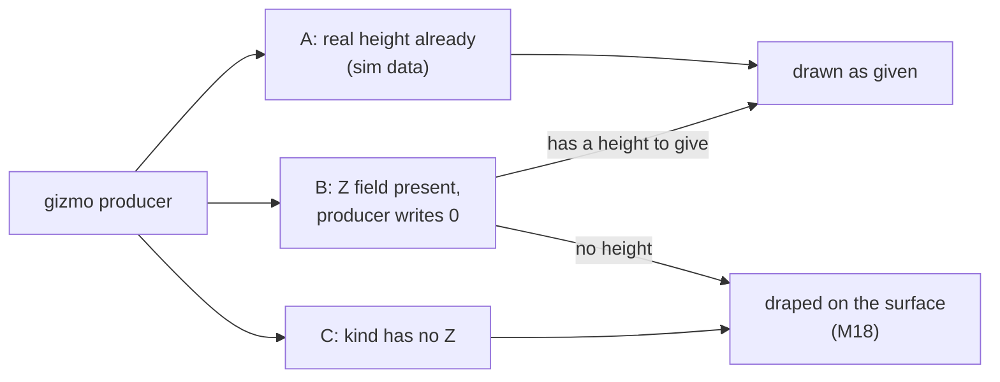

*What the picture shows:* only group B is a choice. A is already right, and C cannot carry height without changing the
64-byte wire struct.

| group | examples, measured | in 3-D |
|---|---|---|
| **A — real height already** | fire traces (`FireTraceGizmo.cs:82-94`), detonation bursts (`DetonationGizmo.cs:40-44`), door leaves (`DoorLeafGizmo.cs:47-62`), visibility cones (`VisibilityConeGizmo.cs:40-58`); everything anchored to an entity (bodies, badges, labels, cards) through `SpatialAnchor` | drawn as given |
| **B — could carry height, writes 0** | measurement (`MeasureGizmo.cs:122-136`), area outline (`PointSequenceGizmo.cs:95-108`), vertex edit (`VertexEditGizmo.cs:122-123`), routes (`AuthoredRouteGizmo.cs:70`, `RouteGizmo.cs:37`), entity-drag marker (`EntityDragGizmo.cs:89`), terrain outlines (`TerrainWorldGizmo.cs:125`), rubber band, pickers; the danger area draws at its centre height and **ignores its own height band** (`DangerAreaGizmo.cs:47-55`) | draped, unless H1 gives it a height |
| **C — no Z in the kind** | pick boxes and handles (`Box2D`), area and terrain fills (`FilledTriangle`, `MapOverlayGizmo.cs:34-41`), loose world text, icons, 2525 symbols | always draped |

| # | rule |
|---|---|
| **H1** | ⭐ a group-B producer becomes height-aware **when it has a real height to give**: tools take it from the pick (measurement endpoints and its slant distance; area points), routes from their waypoints, the danger area from its band. Everything else keeps writing 0 and is draped — **no blanket conversion** |
| **H2** | ⭐ group C stays draped; the 64-byte primitive is not widened. One cheap exception, to confirm first: `FilledTriangle` seems to leave bytes 48-51 unused, enough for one **flat fill height**, so an area's fill can sit on a roof |
| **H3** | ⭐ the danger area shows its band in 3-D: bottom outline, top outline and corner edges as `Line`s at `ZFloor` / `ZCeiling` (all already in `DangerAreaDescriptor`, `:44`). In 2-D the extra lines lie on top of each other, so it looks the same |

#### Areas with height

📐 **Measured: no authored area has a height today.** The tactical area (`TacGraphic_Area`) and the terrain zone store
2-D point offsets (`EditablePolyline`, `List<Vector2>`, `EditablePolyline.cs:39`) around an anchor forced to `z = 0`
(`AreaAuthoringArm.cs:198`). The "is it inside" test is 2-D (`EntitiesInAreaGenerator.cs:66-107`). The network form
carries an altitude per point (`GeoPoint`), but the receiver throws it away (`MapVisualOverlayIngressTranslator.cs:196-211`).
The only height bands in the code are runtime ones: the danger area's `ZFloor`/`ZCeiling`, and a no-fly box used only
in navigation tests. ⛔ A **terrain zone** is a load window (R-146), not a tactical area — it never gets a height.

| step | what | basis |
|---|---|---|
| **1 — an area on a level** *(with S2)* | the area sits on the **level that was clicked** — 0 = the ground, n = the n-th surface above it (a roof, a deck, an upper floor). ⭐ It is a LEVEL, not a height: the anchor keeps the picked height, the level is read back from it (`SurfacesAt` at the anchor), and every point is draped to that level **at its own (x, y)** — so a ground area over a hill follows the hill (R-248). No new field. `EntitiesInArea` stops flattening Z and tests "same level" | `docs/designs/promote-to-3d/3D_Cognitive_Spatial_Awareness_Promotion_Design_v1_1.md` Tier 2 (`:115-122`): *"stop flattening SimTransform's 3D position"*, *"no new vertical-band parameter needed"* |
| **2 — an area with a height band** *(only when something needs it)* | an optional `{ Floor, Ceiling }` relative to the anchor — the danger area's pattern; drawn as a wire prism (H3); the inside test checks the band | `docs/designs/group-maneuvers/Squad_Coordination_Design_v1_1.md` §5.2 (`:201-205`): *"2.5D extent — OBB footprint + height band (multi-level: street vs. deck = two areas, same X/Y, disjoint Z)"* — written for danger areas |

⚠ Step 2 has **no consumer yet**. A translucent filled prism would need triangles with height, which the format does
not have, so the first version is wireframe only. Step 1 is what the 3-D tools need; step 2 waits for a real use
(airspace for helicopters, a defended rooftop).

### 3.10 Terrain with relief — what the 3-D map assumes *(U23, R-248)*

🔒 **User:** *"never count with terrain being flat, this is just current simplification that should be removed soon."*
⇒ the 3-D map never reads `GroundZ`. It asks the terrain only these questions, which mean the same thing on a flat bed
and on hills:

| the 3-D map needs | asked through | over relief |
|---|---|---|
| what does the terrain look like | `TerrainWorldMesh`, drawn as-is (M4) | ⭐ the relief is in the mesh the moment the mesher emits it — no renderer change |
| where did the click land | ray vs that mesh (M17) | ⭐ exact on any shape; nothing assumes a plane |
| where is the ground at (x, y) | `ResolveLevel(x, y, 0)` — level 0 | ⚠ today returns `GroundZ`; with terrain height it must return the ground height there |
| which floor or roof is this | `SurfacesAt(x, y)` / `ResolveLevel(x, y, n)` | ⚠ today counts level 0 as `GroundZ`; same change |
| draping a line or fill | level 0 per vertex, **subdivided** (P4) | ⭐ follows hills; on a flat bed it collapses to the old result |
| the 2-D ↔ 3-D swap pivot | the look-at point at its ground height | ⭐ pivots on a hilltop correctly |
| spawning on the clicked spot | the existing `SpawnHeight` + `ResolveLevel` | ⭐ unchanged |

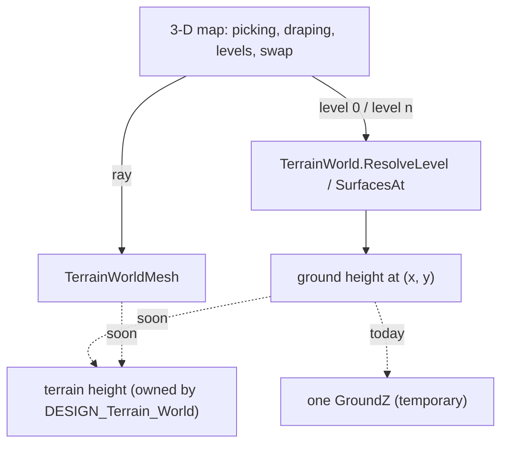

⭐ **`R-250` (`2026-10-10`):** the two seams are **interfaces**, not the stand-in's classes — `IWorldQuery` (pick, level 0) and
`ITerrainRenderGeometry` (the mesh), [`DESIGN_World_Query_Seam.md`](DESIGN_World_Query_Seam.md) WQ-G — so a production
engine can stand behind the editor's 3-D view too.

*What the picture shows:* the 3-D map touches the ground through two seams only — the mesh and level 0. Replacing the
flat bed changes what is behind the dashed edges; nothing on the map side changes. ⭐ **Proven before the flat bed goes**:
S1/S2 run on a small sloped test terrain, so the map is never built against the simplification.

⚠ Supplying terrain height (file format, mesher, navmesh, sensors, ballistics) is planned in
[`DESIGN_Terrain_Height.md`](DESIGN_Terrain_Height.md), extending `DESIGN_Terrain_World.md` — not in this file.

### 3.11 Articulated parts — the turret traverses, the gun elevates *(U24)*

🔒 **User, `2026-10-10`:** *"the tank models need the turret to be movable left/right as well as the barrel (up/down) as
articulated part - tank entity needs a way describing the orientation of its turret+barrel (maybe a sub-entity with component
containing turret hull relative azimuth and turret-relative barrel elevation - there used to be a multi-entity tank demo)."*

📐 **Measured, `2026-10-10` (graph + grep + a corpus sweep of `docs/`, `.dev/`, `FDP/Docs`):**

| what exists | where | live? |
|---|---|---|
| the PART link `PartMetadata { ParentEntity, InstanceId }`, children destroyed with the parent | `Replication/Components/PartMetadata.cs:13` · `SubEntityCleanupSystem` (`NedReplicationModule.cs:467`) | ✅ production (EQS sensors, weapon mounts) |
| a child entity per extra weapon mount, carrying `PartMetadata` | `CombatTkbTranslator.cs:95-122` | ⚠ **designed, never created in production** — `WeaponMountInfo` is registered only in tests (`DESIGN_Ownership_Groups_And_Grants.md` F-6, re-grepped `2026-10-10`) |
| the multi-instance wire pattern: key `(EntityId, InstanceId)`, per-instance authority | `MultiInstanceCycloneTranslator.cs:19-151` · `docs/reference/BDC_NED_SST_Descriptor_Rules.md:49` | ⚠ tests only (`Q79` §0.10) |
| a turret angle anywhere | — | ⛔ **none**: fire computes the shot direction per shot and drops it (`FireProcessingSystem.cs:132-150`); the brain's aim state is a timer |
| the "multi-entity tank demo" | `.dev/_DONE/demos-1/FDP-demos-all.md:921-1025` (spec: a turret entity with a parent link, yaw 90 vs hull 0) | ⛔ never built as specified — `DistributedTankScenario` has a turret entity with no link and no angle |
| `TurretState`, `TurretRotation`, "✅ Production" multi-turret | `FDP/Docs/projects/examples/Fdp.Examples.NetworkDemo.md:173` · `Fdp.ModuleHost/docs/UserGuide/08_NetworkIntegration.md:4073` · `FDP.Toolkit.Replication.md:1048` | ⛔ **known-rot**: those types do not exist |

✅ **Built now (map side):** a kit part has a ROLE — hull, turret or gun — and the kit names its turret axis and gun trunnion
(`KitPivots`). `EntityBodyLayer3D` poses them from an `ArticulationPose` (turret azimuth relative to the hull, gun elevation
relative to the turret) taken from ONE seam (`poseOf`). ⭐ **WL-1a (`2026-10-11`):** the seam is fed in production by
`TurretPoseSource` — turret 0's `TurretPose`, wired once in `MapInteractionPack` (DESIGN_Weapon_Layers §5a). ⛔ SUPERSEDED: "null in
production until M23 is ruled".

| # | decision | ⭐ lean | rejected — one line each |
|---|---|---|---|
| **M23** ✅ *(U28)* | where the pose lives | ⭐ **a part child per turret**: `PartMetadata { Parent = hull, InstanceId = turret index }` + a new `TurretPose { float Azimuth; float Elevation; }` (radians; azimuth counter-clockwise from the hull's forward, elevation up from the turret plane) — the turret and its gun are ONE assembly | a component on the hull — one turret only, and no separate owner for a gunner node (`R-168`) · one entity per joint (turret + gun) — elevation only ever means "relative to its turret" |
| **M24** ✅ *(U28, reworded)* | who writes it | ⭐ the **weapon side — the weapon logic** turns the turret and gun: it knows how to aim (TKB rates and limits); the brain only names the TARGET, never an angle | the brain writing angles — kinematics in the brain (`R-252`) · fire writing its shot direction back — per shot and dispersed |
| **M25** ✅ *(U28)* | the TKB | ⭐ a turret descriptor per turret part: pivot offset, traverse and elevation limits, slew rates; weapon mounts name the turret they sit on | angles with no limits — a turret could aim through its own hull |
| **M26** ✅ *(U28: "solved already")* | the wire | ⭐ the NED/BDC multi-instance descriptor pattern the sensor sub-entities already use in production — 📐 `EqsSensorConfigTopic { ParentNetworkId, LocalChildIndex }` with the child identified by `PartMetadata` (`EqsSensorConfigEgressTranslator.cs:99,237`); a DIS gateway maps it to the articulated parts 4107 (turret 1 azimuth = 4096 + 11) and 4429 (gun 1 elevation = 4416 + 13) | putting the angles into the hull's geo descriptor — breaks the one-descriptor-per-concept rule and multi-turret vehicles |

⚠ **As built (WL-1a, `2026-10-11`) — M23's part id is `2000 + turret index`, not the bare index** (`TurretParts.FirstPartId`):
on the wire a part id is scoped to its descriptor (`dtTurretPose` cannot collide with the sensor descriptor), so the offset is not
needed there; it keeps a parent's part ids unique ACROSS part classes locally (mounts `1…N`, TKB sensors `1000 + index`), which costs
nothing. 🔒 **User, `2026-10-11`:** *"Part ids are usualy scoped to their careying NED descriptor types … But keeping unique ids
independently on part class of course does not do any harm."* The index is recoverable (`TurretParts.IndexOf`).

✅ **Ruled `2026-10-10` (U28, R-255) ⇒ READY-TO-BUILD.** ⚠ The turret part, the weapon-side slew and the descriptor are the
combat / network lanes' code; the map reads the pose through `EntityBodyLayer3D`'s one `poseOf` seam once the component exists.

---

### 3.12 The camera entity (S5) — ✅ RULED `2026-10-11` (U29, R-260): all three leans approved *(measured `2026-10-11`)*

📐 **Inventory** (graph `search_graph .*Camera.*` label Class: 20 results, `has_more:false`, plus grep; `check_index_coverage`
not available through the CLI): no code saves or restores the map view today. The scenario JSON has only `header` +
`entities` (all 21 scenarios grepped). There is no camera / viewpoint ECS component on any host. The only "camera" a scenario
carries is ExCon's fake observer slice (`ExConScenarioSaveHandler.cs:63-65`). Stride's `CameraBookmarkStore` is per-user,
not per-scenario. The requirement record is `DESIGN_Godot_3D_Viewer.md` V-12..V-15, U3, U7 and D7 (`:69-72, :85, :89,
:445`): one ordinary spatial entity of a camera TKB type per launching host, its pose in the usual position component.

| the question | what the code does | design basis | ⭐ lean |
|---|---|---|---|
| **Q-S5a: who owns a saved camera after a reload?** | on load every saved entity is re-spawned through `EntityCreationRequest` (`ScenarioLoadStep.cs:129,152-154`), with ownership stripped (`StagingEntityExtractor.cs:49-60`) ⇒ the LOADING node owns it, not the map host that made it | V-13: *"owned by the host that created"* · 🔒 **R-140**: IG never owns persistable entities | ⭐ **the camera is a SCENARIO entity, owned by the saving node** (Editor / Brain), like a tactical graphic. Every map host READS it when the scenario opens (V-12), and a map host that is not the owner only asks for it to move (`UpdateEntityAttributeRequest`, D7). ⇒ ⚠ **this reads V-13 differently**: the creator asks for the camera, it does not own it. IG never saves one (R-140) |
| **Q-S5b: one camera per scenario, or one per host?** | nothing exists; any map host can make one (the Editor, CGF, SimHost, IG; never ReplayBrowser) | U3: *"one per launching host"* | ⭐ **one per scenario: "the view the scenario opens in".** Per-host cameras would save N views and leave it unclear which one opens. ⚠ This changes U3 for the map case; Godot's per-viewer camera was a different situation, a separate window per host |
| **Q-S5c: where do distance and the 2-D / 3-D mode live?** | `SimTransform` has a position + rotation. `CameraPose` is (look-at, distance, yaw, pitch) (`MapCamera3D.cs:13`) | U7: *"usual world position component"* · M10: *"look-at, distance, yaw, pitch and the mode"* | ⭐ **no new component**: `SimTransform.Position` = the EYE, `Rotation` = yaw and pitch. Look-at and distance follow from the eye and the ground. Mode = 2-D iff the pitch is overhead (M10: *"the 2-D map is simply that camera at pitch −90°"*), so an overhead 3-D view reopens as 2-D, the same picture |

⚠ **Also found:** `EntityBodyLayer3D` would draw a camera entity as an "Unknown" box (`EntityBodyLayer3D.cs:249-261`), so a
camera type must be excluded the way effect types are. And no "camera moved" event exists (grep `CameraMoved|ViewChanged`: 0).
⭐ **The build shape, once ruled:** a `MapViewModeLayer`-style layer added in `AttachMapLayers` (every host by construction).
It adopts the camera entity's pose and mode once when the scenario opens (`MapCamera3D.Pose`,
`MapViewSwitch.Set(on, animate: false)`, `MapViewSwitch.cs:44`) and asks for a move when the user leaves the camera still.

## 4. THE REUSE LEDGER

| piece | verdict | evidence |
|---|---|---|
| `MapCanvas` — layers, input routing, right-drag vs right-click | ✅ reused; **2 edits**: `Draw()` branches to `Draw3D` when the camera is 3-D; `deltaWorld` comes from the camera instead of `delta / Zoom` (2-D result unchanged) | `MapCanvas.cs:115-140` (Draw), `:168` (`deltaWorld = delta * (1/Camera.Zoom)`) |
| `MapCamera` | ✅ reused as the base — its `Update`, `HandleInput`, `BeginMode`, `EndMode`, `ScreenToWorld`, `WorldToScreen` are already `virtual` | `MapCamera.cs:144-354` |
| `IMapLayer` | ✅ + one **default** method `Draw3D` (no-op) — no existing layer is forced to change | `CoreInterfaces.cs:37-92` |
| `DebugGizmoLayer`, `SelectionRenderSystem`, `GridMapLayer` | ✅ + a `Draw3D` each | — |
| the whole input side: selection store + request, `ContextMenuAdapter`, tools | ✅ **unchanged** — they receive world XY as today | §3.3 |
| `MapInteractionPack` | ✅ builds the 3-D camera and the two new layers for all five hosts | 5 host call sites |
| `DebugPrimitiveRenderer3D` triage + `IDebugDrawSink3D` | 🔁 **extract** to a shared net8 assembly; Stride keeps its sink, the map adds a Raylib sink | `Stride/Hrot.Stride.Core/DebugPrimitiveRenderer3D.cs:50-292,373-392` |
| `TerrainWorldMesh.Build` | ✅ + an **optional** per-triangle tag output (ground / surface / roof / wall / slab + material) — verts and indices unchanged, so the navmesh is unaffected | `TerrainWorldMesh.cs:31` |
| fire / detonation visuals | ✅ **free in S3** — `FireTraceGizmo` / `DetonationGizmo` already emit 3-D lines and spheres | gizmo sweep 2026-10-10 |
| vehicle sizes | ✅ `VehicleParametersDto` / `SimVehicleDef` | TKB |
| stance | ✅ `LogicalStance.Of` for the pose; `StanceStatus.Phase` / `TransitionProgress` to blend into it | `Tkb/Domain/StanceComponents.cs:58,82` |
| `LocomotionBlend` (speed → idle/walk/run weights, pure `System`) | 🔁 **extract** beside the gizmo triage — drives the limb swing | `Stride/Hrot.Stride.Animation/LocomotionBlend.cs:99-145` |
| 2-D renderer's screen-space text + badge drawing | 🔁 **extract** to `GizmoTextDraw` — the 2-D screen-space branch and the 3-D overlay both call it | `DebugPrimitiveRenderer2D.cs:388-447` |
| icon fallback's "what kind of thing is this type" | 🔁 **extract** to `VisualFamily.Of` — the icons and the 3-D kits both call it | `EntityTypeCatalog.cs:128-143` |
| `MapCamera3D`, `TerrainLayer3D`, `EntityBodyLayer3D`, `LabelOverlay3D`, `ShapeKit` + the kit table, `BlockFigure` (the six-box pose math, unit-tested), `RaylibDrawSink3D`, the lit shader, the switch | 🆕 new | — |

---

## 5. DECISIONS

| # | decision | ⭐ lean | rejected — one line each |
|---|---|---|---|
| **M1** | where 3-D lives | ⭐ a **mode of the existing map** (U13) — camera swap + `Draw3D` | a separate panel/window — a second map, second input chain |
| **M2** | 3-D input | ⭐ `MapCamera3D.ScreenToWorld` = ray → entity box (→ that entity's ground XY) → terrain → ground plane; every layer keeps its 2-D input code | 3-D-specific input per layer — rewrites selection, menus and tools |
| **M3** | 3-D drawing | ⭐ `IMapLayer.Draw3D` default no-op; layers opt in; `PerceptionMapLayer` skipped and **counted** | a parallel 3-D layer list — two lists to keep in step |
| **M4** | terrain mesh | ⭐ extend `TerrainWorldMesh` with optional tags; the renderer adds what navigation does not need (water surface, surface colours, road ribbons) beside it | a second mesher for rendering — duplicates prisms/walls/slabs |
| **M5** | lighting | ⭐ **one small GLSL shader** (330): vertex colour × (ambient + sun·N), distance fog to a sky colour; flat normals by un-indexing triangles | CPU-baked vertex lighting — entities rotate, so it would need re-baking every frame |
| **M6** | textures | ⭐ a later slice: **CC0** packs only, mapped in the shader from **world position** (triplanar) so the mesh needs no UVs | UV-unwrapping terrain — work the triplanar trick avoids |
| **M7** | entities | ⭐ **shape kits** (§3.5): a kit is a short list of parts (box / cylinder / cone / wedge) placed as fractions of the type's length, width and height, each with a colour role (body = the entity colour, §3.7; dark; glass; metal) and an optional cheap motion (rotor spin, wheel roll, limb swing). The kit is chosen by **one visual-family classifier** extracted from the icon fallback. **Humans are the person kit** — the six-box block figure (U14), posed by the shared stance rule `LogicalStance.Of` (`StanceComponents.cs:82`), blended by `StanceStatus.TransitionProgress`, limbs swinging via `LocomotionBlend.FromSpeed`; a rifle part when the entity is a soldier (DIS life form, category 1), none for civilians | one box per vehicle (rev 1) — U18 · real models — U12 · a second classifier for 3-D — the icon fallback already answers "what is this type" · showing `StanceStatus.CurrentStance` alone — would disagree with `LogicalStance` readers |
| **M8** | free camera | ⭐ Unity scene view: **RMB-drag** look, **WASD/QE only while RMB is held** (so tools keep their keys), wheel dolly, MMB pan, **F** frames the selection; right-**click** stays the context menu (the canvas already tells drag from click) | always-on WASD — collides with tool keyboard input |
| **M9** | coordinates | ⭐ one transform: HROT `(x, y, z)` → Raylib `(x, z, −y)`, quaternion `(x, y, z, w)` → `(x, z, −y, w)` (det +1, no flip) | — |
| **M10** | the camera entity (V-12..V-15) — **what it stores** | ✅ **APPROVED (U17): one camera entity for the map, in both modes**: look-at point, distance, yaw, pitch and the mode. The 2-D map is simply that camera at pitch −90°, north up. An ordinary spatial entity (U7), owned by the host, saved with the scenario, created on the first camera move — so a saved scenario reopens the map where it was looking, in the mode it was in | 3-D pose only (rev 2's lean) — two camera states for one map · no entity at all — simpler, but drops V-12's "saveable to scenario" |
| **M11** | network viewer (V-18) | ⭐ an IG node with the map in 3-D — nothing extra | a dedicated viewer node — IG already is one |
| **M12** | the 2-D ↔ 3-D switch (U15) | ⭐ an **animated camera move** pivoting at the overhead pose (§3.3): both swaps happen where 2-D and 3-D look the same | a hard cut — the user asked for animation · morphing orthographic into perspective — needless; overhead perspective at matched height is close enough |
| **M13** | labels in 3-D (U16) | ⭐ a screen-space `LabelOverlay3D` pass after the 3-D pass: the existing `Text` / `EntityBadge` primitives, anchors resolved with Z, lifted to the top of the entity's 3-D body, projected by `MapCamera3D.WorldToScreen`, drawn by the 2-D renderer's screen-space text code (extracted, one implementation). Far labels hide by the primitives' own `MinZoomLod` / `MaxZoomLod`, using an equivalent zoom = pixels per metre at the label's distance. Drawn always on top first (name-tag style); hiding labels behind buildings by a ray test is a later option; decluttering overlaps later | 3-D text meshes (billboarded geometry in the scene) — a second text renderer, unreadable at distance · a new label primitive — every gizmo would have to change |
| **M14** | the entity card (U19, U20) | ⭐ **a small canvas per entity**: a 4th anchoring mode `CoordinateSpace.EntityCard`; the card **exists iff a visible primitive targets it**; rows by `ZIndex`, row 0 card-wide; card-local pixels, `ScreenPercent` = % of the card; frame, health bar and name are **ordinary gizmos** (`EntityCardFrameGizmo`, re-targeted `HealthBarGizmo`, `EntityNameGizmo`); one `EntityCardRenderer` for 2-D and 3-D asking the camera for the screen point; **no new primitive kind**; loose text unchanged (§3.6) | dedicated `CardHeader` / `CardBar` shapes (rev 6) — U20: a header is not needed and shapes would be card-only · absolute card pixels per gizmo — independent gizmos would collide · a card drawn by the terminal from ECS — not network-capable, not extensible |
| **M15** | entity colour (U19) | ✅ **APPROVED (U22)**: `EntityAppearance { ColorRgba }`, built **like affiliation** (`EntityInfo.ForceId`, §3.7): `[PerInstanceValue]`, TKB default `VisualData.ColorHex` stamped only if absent, saved in the scenario, its own `Reliable`/`TransientLocal` descriptor arm (`R-136` §4.1), changeable at runtime through the `"Color"` attribute | writing the override into `VisualData` — illegal under R-136 (TKB-derived, §3 ②) · a command to set it — §5: unreconstructible by a late joiner |
| **M16** | side colours | ⭐ **one palette**: friend / opposing / neutral colours defined once, looked up by `ForceId` (the card frame, placement ghost) and by the 2525 affiliation letter (the symbol renderer) | ⚠ today there are **three** mappings and they disagree: IG's `ResolvedStyleConstants.cs:29-67` (by `ForceId`; its `ResolvedStyle.Tint` is read by no renderer), `EntityPlacementGizmo.cs:278-283` (by the placement JSON) and `MilStd2525Renderer.cs:84-96` (by symbol code). The 2-D map's entity shape ignores side altogether — fixed cyan (`EntityPresentationGizmoShared.cs:247`) |
| **M17** | picking (U21) | ⭐ one `Picker3D` in `MapCamera3D`: handles (spheres with height) → entities (an **oriented box from the shape-kit bounds**) → terrain (Raylib ray vs the drawn `TerrainWorldMesh`, the sim's own geometry) → ground; the floor from the sim's `SurfacesAt`/`ResolveLevel`; the layers keep their 2-D hit tests | the sim's `RaycastSolverSystem` — asynchronous and tick-driven (`:13-21`), no answer while paused · its `PhysicsCollider` — a bounding circle, too wide for long vehicles, absent on some types · `TerrainWorld.QuerySight` for the hit point — reports the footprint entry for prisms (`:400-405`), allocates (R-220) |
| **M18** | draping (U21, U23) | ⭐ a world-space shape whose points are all `z = 0` is drawn on **level 0 at each point** (`ResolveLevel(x, y, 0)`), **subdivided** so it follows relief; a shape with height is drawn as given | skipping 2-D shapes in 3-D (Stride's triage) — handles, areas and measurement lines would vanish |
| **M19** | height into gizmos (U21) | ⭐ `MapCanvas.LastPick` carries the 3-D hit; the five `z = 0` sites read its Z (2-D: 0, byte-identical); dragging hits terrain only (`ScreenToWorldForDrag`) | widening `IMapLayer.HandleInput` to `Vector3` — six implementers changed for one number |
| **M21** | height in gizmos (U22) | ⭐ §3.9 H1–H3: group B gets a height **only where it has one** (tools from the pick, routes, the danger band); groups B (no height) and C drape; the wire struct unchanged | converting every producer to 3-D — dozens of edits for shapes that mean "on the ground" · widening `Box2D` / `Text` — breaks the 64-byte DDS invariant |
| **M22** | areas with height (U22) | ⭐ **step 1 now** (the anchor keeps the picked height; same-level inside test); **step 2 on demand** (an optional floor/ceiling band, danger-area pattern, wireframe) | a band on every area now — no consumer; R-150 (complexity an author must understand is a cost) · authored per-point Z — a ramp-shaped area nobody asked for |
| **M20** | 3-D-aware tools (U21) | ⭐ measurement and area authoring need no code beyond M19; placement shows a **shape-kit ghost** and takes the clicked roof/floor as the spawn level via the existing `SpawnHeight` | per-tool 3-D variants — two tools per concept |

---

## 6. SLICES

| slice | delivers | proves |
|---|---|---|
| **S1** | `MapCamera3D` + the animated switch (Editor); `TerrainLayer3D` from `TerrainWorldMesh` as-is, one colour per kind, lit shader + fog; `EntityBodyLayer3D` with `VisualFamily` + the shape kits for every built-in type (static) and block figures in their three stance poses; free camera; **Xvfb screenshot of the editor in 3-D on `test-town`** | the render path, the shader on the cloud's software GL, M8 |
| **S2** ✅ *(§6d)* | `Picker3D` (handles → entity boxes → terrain mesh → ground, `SurfacesAt` level); `ScreenToWorldForDrag`; `MapCanvas.LastPick` feeding the five `z = 0` sites; draping (M18); `SelectionRenderSystem.Draw3D` wire cubes; the placement ghost + roof/floor level (M20); measurement drawn at its picked height; **areas on a level** (M22 step 1); the danger band (H3); ⭐ every rail also runs on a **sloped test terrain** (R-248) | select, context menu, measurement, area authoring, placement and handle drags work in 3-D — the same tools (U21) |
| **S3** ✅ *(§6e)* | triage extracted (Stride re-pointed, its compile gate green); `DebugGizmoLayer.Draw3D` with skip counters; **labels**: `GizmoTextDraw` extracted, `LabelOverlay3D` with projection + LOD | gizmos, fire traces, detonations and gizmo text in 3-D (U16) |
| **S3b** | ⭐ **realism effects** — muzzle fire, explosions, impact decals as temporary TKB-typed entities with two map layers, on every host: [`DESIGN_Visual_Effects.md`](DESIGN_Visual_Effects.md) slices E1–E4 | U27, U28 |
| **S3c** | ⭐ **the articulated turret, live** — the turret part + `TurretPose` (M23), the weapon-side slew (M24), the TKB turret descriptor (M25), the sensor-style multi-instance descriptor (M26); the map plugs `poseOf` | §3.11, R-255 |
| **S4** ✅ *(§6f)* | mesh tags; colours by surface and material; water; road ribbons from the road network; **things come alive**: stance blending + limb swing (`LocomotionBlend` extracted), wheel roll, rotor spin | "a usable feeling of a real world" (U13), U14 |
| **S5** ✅ *(§6i, ruled U29)* | camera entity — ONE per scenario, owned by the saving node, the eye in `SimTransform`, the mode from the pitch; map hosts adopt it on open and request moves | V-12..V-15 |
| **S5b** ✅ *(§6g)* | **the card**: `CoordinateSpace.EntityCard`; `EntityCardRenderer` (rows by `ZIndex`, row 0 card-wide, `%` of the card, leader line) in 2-D and 3-D; `CardBuilder` sugar; `EntityCardFrameGizmo` + one side palette (M16); `HealthBarGizmo` re-targeted to a bar row; `EntityNameGizmo`; `EntityEditorLabelGizmo` rows moved in; a "Labels" layer default | U19, U20 |
| **S5c** 🟡 *(§6h)* | **entity colour**: `EntityAppearance` per M15 — local part BUILT; descriptor arm + `"Color"` attribute = backend (`CE-1047`) | U19 colour |
| ~~**S6**~~ | ⛔ **withdrawn `2026-10-10` (U25)** — every host gets 3-D from the shared attach; see §6b | V-01, V-18 (IG) — met by §6b |
| **S7** | CC0 textures, triplanar | U13's texture wish |

⭐ Gates per slice: the touched suites + the map's own rails (T-1), a frame rail per R-124, and the Xvfb screenshot.

---

### 6a. S1 — AS-BUILT `2026-10-10`

📸 Rendered on the cloud's Mesa software GL by the frame rail: test-town's terrain (ground green, roofs red-brown, walls lit
grey) and one entity of every built-in kit — tanks, AFVs, utility truck, car, soldiers standing / crouched / prone, a civilian.

| piece | where | note |
|---|---|---|
| `MapCamera3D` + `CameraPose` | `FDP/Engine/Fdp.Presentation/Vis3D/MapCamera3D.cs` | Unity scene-view camera (M8); `ScreenToWorld` = the plane at the look-at height (the mesh pick is S2's `Picker3D`); 2-D `Zoom`/`Target` kept at their equivalents; refuses a non-finite pose |
| `MapViewSwitch` | `…/Vis3D/MapViewSwitch.cs` | M12: snap overhead at the 2-D centre and scale, swap, tilt to −35° in 0.6 s; back: overhead, then the 2-D camera at the same centre and scale |
| `LitShader` | `…/Vis3D/LitShader.cs` | M5: GLSL 330, vertex × material colour, ambient + one sun, two-sided, exp² fog; sky gradient drawn by the camera |
| `HrotToRaylib` | `…/Vis3D/HrotToRaylib.cs` | M9, plus `ModelFromHrot` — a transform written in HROT terms, basis-changed and transposed for Raylib |
| `TerrainLayer3D` | `…/Vis3D/TerrainLayer3D.cs` | draws `ITerrainRenderGeometry` (WQ-G), never `TerrainWorld`; flat-shaded by un-indexing; rebuilt when `Identity` changes |
| `ITerrainRenderGeometry` + `TerrainWorldQuery.Build` | `FDP/Toolkits/Fdp.Toolkits/World/`, `…/Terrain/TerrainWorldQuery.cs` | the stand-in hands its navmesh soup unchanged, each triangle classed **wall** (steep), **roof** (> 0.3 m over the ground) or **ground** |
| `VisualFamily` / `VisualFamilies` | `Hrot/Engine/Hrot.Presentation/Map3D/VisualFamily.cs` | extracted; `EntityTypeCatalog.FallbackIconName` now calls it — output unchanged for every built-in type (railed against the old body). ⭐ **CE-2138 (2026-10-12):** the DIS switches are gone — `Of(dis)` walks the type's chain in the shared `EntityClassTable` (Hrot.Core) from the most specific class up and takes the first class in `FamilyOfClass` (`Tank`, `Afv`, `Car`, `WheeledUtility`, `Helicopter`, `Jet`, `CargoPlane`, `Person`); the composite check stays until C3. Railed: a sweep over the whole DIS space against the old switch, and the built-in golden |
| `ShapeKits`, `KitPart`, `BlockFigure` | `…/Map3D/ShapeKit.cs` | §3.5 kits for tank, AFV, car, utility, unknown; the six-box person in three stance poses, rifle for soldiers |
| `EntityBodyLayer3D` | `…/Map3D/EntityBodyLayer3D.cs` | every entity with `SimTransform` + `TkbIdentity`; size from `SimVehicleDef` → `VehicleParametersDto` → `ShapeHeight` → family default; colour from `VisualData.ColorHex` → the TKB visual → family default; units draw nothing · ⭐ **CE-1058 (2026-10-12):** a passenger inside an ENCLOSED vehicle draws nothing and has no box (no pick, no selection cube) — `PhysicalPresence.IsEnclosedPassenger`, the passenger half of the engine's one hidden rule (R-271); an EXPOSED rider (TKB `PassengerExposure = Open`: a motorcycle, a bike, an open-door helicopter) is drawn, at the vehicle's transform (carried), in its own stance — no seat pose or seat offset yet (seats are R-274, later). The 2-D symbol, anchor, pick box and label card follow the same rule (`EntityPresentationGizmo`, `EntityEditorLabelGizmo`). 🔴 Before, nothing in Presentation read embarkation: a squad aboard an APC stood at its centre, through any hull lower than a man |
| canvas hooks | `MapCanvas.Draw3D`, `IMapLayer.Draw3D`/`Has3D`, `MapCamera.Is3D`/`ScreenDeltaToWorld`, `MapCanvas.LayersWithout3D` | as §4 planned — the 2-D path is byte-identical |
| editor | `EditorSubsystem`: the switch, both layers, **View › 3D map** (checkable) | ⛔ SUPERSEDED the same day by §6b — every host, one shared call and one shared menu item |

| ⚠ deviation / finding | why |
|---|---|
| 🔴 **the 2-D map draws north DOWN** — it is a mirror of the view from above (`MapCamera` maps world Y screen-down and `DebugPrimitiveRenderer2D.cs:273` draws world XY straight). §3.3 and M10 assumed "north up" | a camera above the ground cannot show a mirror ⇒ **3-D is north-up, east-right, and the switch flips north–south** (scale, centre and east-is-right are kept). ⚠ Whether the 2-D map should become north-up is a separate question for the user — it touches every 2-D gizmo |
| ~~air kits not built~~ | ✅ built the same day (§3.5): helicopter, jet, cargo plane, with the DIS air mapping |
| **F** (frame the selection) not built | it needs the selection — S2, with picking |
| the editor's `MapCullingModule` still reads the 2-D camera's rectangle | culling is off by default (`map.entity.cullOffscreen`); in 3-D it would cull by a stale rectangle — S2 |
| test-town shows a HOLE where its water is | the navmesh soup has no water (M4) — water surfaces are S4 |
| the frame rail drives the production canvas, switch, shader and layers in a window — **not the whole editor shell** | a full-editor screenshot needs a launch path under Xvfb; the menu item is built but not driven |
| `UiFrameSession.Screenshot` wrote to the wrong folder | Raylib's `TakeScreenshot` uses its START-UP directory, not the current one — fixed in the harness (read the screen, export to the absolute path) |

**Gates** (feature suites first, T-1): `Map3DTests` + `Map3DFrameRail` **29/29** under Xvfb (the frame rail skips where there is
no display); `Hrot.Presentation.Tests` **405/405** (the catalog's own suite included); `Hrot.Editor.Tests` **474/476** (2 skips);
`Fdp.Toolkits.Tests` terrain query / height / mesh **12/12**; the Blueprints frame rails **8/8** on the fixed screenshot harness;
`Fdp.Presentation.Tests` **563/572** — its 8 reds are the pre-existing set `CE-259aa` names, identical at `2e90e208f`.
⚠ **Under a display, `Hrot.Presentation.Tests` aborts in about one run in three** (test host crash between tests, no test left
incomplete — `--blame`); without a display it is clean 3/3. ✅ **Pre-existing:** the base commit `2e90e208f` (no 3-D code, no
window rail) crashes the same way, 1 run in 5 under Xvfb — filed `CE-1039`.

### 6b. Every host, by construction — AS-BUILT `2026-10-10` *(U25)*

🔒 **User, `2026-10-10`:** *"we should be unifying and sharing from the day zero so something like 'not on all host' can not
happen by construction."* ⇒ ⛔ S6 ("all five hosts") is **withdrawn as a slice** — there is nothing left to roll out.

| piece | where |
|---|---|
| `MapInteractionPack.AttachMapLayers(canvas, buffer, bus, world, tkb?)` — gizmo layer, draw buffer, `TerrainLayer3D`, `EntityBodyLayer3D`, `MapViewSwitch`, `MapViewModeLayer`; returns `MapLayers` | `Hrot/Engine/Hrot.Presentation/ScenarioEditor/Map/MapInteractionPack.cs` |
| the five hosts' three hand-written lines (`BuildRenderLayer` → `AddLayer` → `DrawBuffer`) replaced by that one call | Editor, CGF, IG, SimHost, ReplayBrowser |
| **View › 2-D / 3-D Map** in the shared View menu (`LayerControlGizmo`, every host) → `GlobalActionIds.ToggleMap3D` → `ToggleMap3DEvent` on the interaction bus → `MapViewModeLayer` toggles the switch | the editor's own S1 menu item is removed — one menu path for one concept |
| rail `EveryMapHostAttachesTheSharedLayersTests`: every subsystem that calls `MapInteractionPack.Build(` also calls `AttachMapLayers(`; nothing outside the pack builds a gizmo layer, a 3-D layer, a switch or a mode layer | `Hrot/Engine/Hrot.Presentation.Tests/Map3D/` |

⚠ The TKB the bodies are classified from defaults to the world's `ITkbDatabase` singleton — IG, CGF, SimHost and the editor set
one; the editor passes its own. ⚠ **ReplayBrowser sets none** (searched its subsystem) ⇒ replayed entities draw as unknown
boxes until a replay carries or loads its TKB — a finding, not fixed here.

**Gates:** `Hrot.Presentation.Tests` **427/428** (1 skip — the frame rail without a display), the frame rail **1/1** under Xvfb;
`Hrot.Editor.Tests` **474/476**; `Hrot.IG.Tests` **461/462**; `Hrot.ReplayBrowser.Tests` **34/34**; `Hrot.SimHost.Tests`
**1177/1180** (3 skips); all five hosts build. 📌 The existing pack suites caught one real defect on the way — the new
`ToggleMap3DEvent` lacked its `[EventId]`, which would have thrown at every host's start-up.

### 6c. Effects come from their TKB type *(U27)* — constraint on S3, measured `2026-10-10`

🔒 **User:** *"each effect entity has its TKB type of course defining the effect."* ⇒ the 3-D map draws an effect (explosion,
tracer, later smoke and flashes) from the effect entity's **TKB type**, exactly as a vehicle's kit comes from its TKB type.

| 📐 today | where |
|---|---|
| effect entities are made by IG's `EventToEffectSystem` with a hard-coded `EffectType` enum (Explosion, Tracer) and constants — **no `TkbIdentity`** | `Hrot.IG/Systems/EventToEffectSystem.cs:72-111`, `VisualEffectState.cs` |
| the 2-D map draws them from that enum | `EffectPresentationGizmo` |
| the munition TKB names no effect | `MunitionTkbCatalog.cs` (no match for "effect") |

➡️ **Planned in [`DESIGN_Visual_Effects.md`](DESIGN_Visual_Effects.md) (U28: muzzle fire, explosions, decals — temporary TKB-typed entities, no gizmos).** The original lean, kept for the record —
⭐ **Lean (`CE-1042`):** an effect entity carries `TkbIdentity`; a TKB descriptor on the
effect type says what it looks like (kind, duration, colour, size); the munition / warhead type names the effect type it makes;
both maps draw from the TKB. ⛔ The S3 3-D effects are not built on the enum.

### 6d. S2 — AS-BUILT `2026-10-11` (picking in 3-D)

| piece | where |
|---|---|
| `IPicker3D`, `PickResult` (point WITH height, kind, network id), `PickFilter` (P2), `TerrainPicker` (ray vs the drawn `ITerrainRenderGeometry`: uniform grid + Möller–Trumbore, pure C#, no allocation per pick), `RayBox` | `FDP/Engine/Fdp.Presentation/Vis3D/Picking.cs` |
| `MapCamera3D.Pickers` / `Pick` / `LastPick` / `ScreenToWorld3D(forDrag)` / `ZoomAt`; one pick per pixel per frame (cached) | `Vis3D/MapCamera3D.cs` |
| `MapCamera.ScreenToWorld3D` / `ScreenToWorldForDrag` / `ZoomAt` — 2-D: the old answer at Z = 0 (byte-identical) | `Vis2D/Components/MapCamera.cs` |
| `EntityBoxPicker` — the entity's DRAWN box (P1); answers with the entity's own position, so its 2-D pick box contains it; `EntityBodyLayer3D.TryGetBox` (min half-extent 0.4 m) | `Hrot.Presentation/Map3D/` |
| drags follow the terrain: `MapCanvas` routes `HandleDrag` through `ScreenToWorldForDrag` (P2) | `Vis2D/MapCanvas.cs` |
| the gizmo input carries height: the inner `DebugGizmoLayer.HandleInput` takes the live camera's `screenToWorld` / `zoomAt` (pick for presses, terrain for drags, pick boxes sized at the hit's distance); `GizmoInteractionProxyTool` reports the Z in Started / DragUpdate / Commit — ⭐ **the five `z = 0` sites of §3.8 are now fed** (four in those two classes; the fifth, placement, below) | `GizmoMap.Presentation/Layers/DebugGizmoLayer.cs`, `Gizmos/GizmoInteractionProxyTool.cs`, `Vis2D/Layers/DebugGizmoLayer.cs` (`CurrentCamera`) |
| placement on a roof / upper floor: the clicked height → `Levels.LevelOf` → `SpawnHeight(OnLevel, n)`; a 2-D click (Z = 0) stays on the ground (M20) | `Fdp.Toolkits/World/Levels.cs`, `EntityPlacementGizmo.cs` |
| measurement drawn between the PICKED points with their heights, label adds the slant distance (§3.9 H1) | `MeasureGizmo.cs` |
| the danger area draws its height band as a wire prism (§3.9 H3) | `DangerAreaGizmo.cs` |
| selected entities: a wire box (green primary, yellow others) | `EntityBodyLayer3D` |

⚠ **Left for S3 (they need gizmos DRAWN in 3-D first):** draping of 2-D shapes (M18/P4), areas on a level (M22 step 1 — the
anchor's height + EQS's same-level test), the placement ghost as a translucent shape kit.
**Gates:** `Map3DPickingTests` 6/6 (roof vs ground with heights, slanted ray stops at the first surface, entity box hit vs a
miss 2.5 m beside the hull, the camera picks the entity but a drag follows the terrain, the proxy carries Z);
`Hrot.Presentation.Tests` **443/444**; `Hrot.Editor.Tests` 474/476; `Hrot.IG.Tests` 461/462; `GizmoMap.Presentation.Tests` 41/41;
`Fdp.Presentation.Tests` 563/572 (the pre-existing 8, `CE-259aa`); all five hosts build.

### 6e. S3 — AS-BUILT `2026-10-11` (gizmos and labels in 3-D)

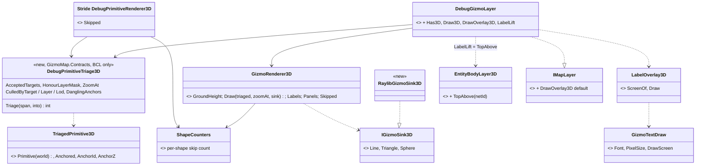

*What the picture shows that prose hid:* ONE triage serves both 3-D consumers (the Stride shell and the map) — Stride keeps
its own drawing and its filters stay off, so it draws exactly what it drew before; the map turns the filters on. And the
label path crosses two layers: the gizmo layer knows the label, only the body layer knows how tall the body is.

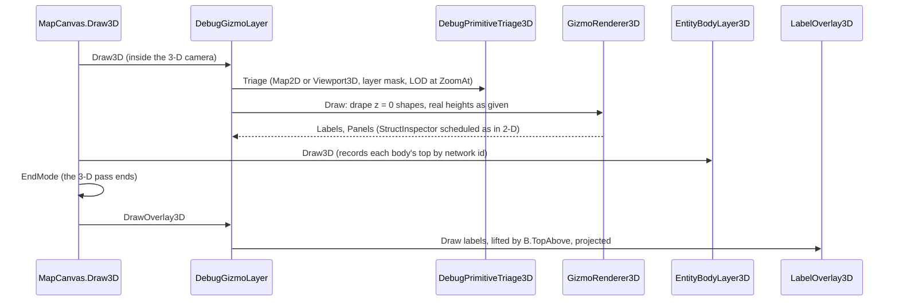

*What it shows:* the body layer draws AFTER the gizmo layer, so a label's lift is read in the overlay pass, not while the
gizmos are triaged.

| built | where |
|---|---|
| the shared triage (anchors, `LayerControlMask`, target / layer / LOD filters, `EntityLocal` resolved in 3-D — the 2-D `ApplyAnchor2D` plus the anchor's Z), `TriagedPrimitive3D`, `ShapeCounters` | `FDP/ExtDeps/GizmoMap/GizmoMap.Contracts/Primitives/DebugPrimitiveTriage3D.cs` |
| Stride re-pointed — its private anchor cache deleted, `Skipped` counters added (DESIGN_Stride_Node_Modes.md §8 Q5) | `Stride/Hrot.Stride.Core/DebugPrimitiveRenderer3D.cs` |
| the drawer: draping per vertex, subdivided every 3 m (M18, R-248); un-anchored sphere with height = a sphere, ground / anchored = a ring; pixel sizes become metres at the shape's distance; dashes in pixels; gradients along the line; `SemanticShape` and `MilStd2525` counted, not drawn | `FDP/Engine/Fdp.Presentation/Vis3D/GizmoRenderer3D.cs` |
| the Raylib sink and the label overlay (M13: projected, constant pixel size, lifted to the body top, on top; behind the camera ⇒ not drawn) | `Vis3D/RaylibGizmoSink3D.cs` |
| `GizmoTextDraw` extracted — the 2-D renderer's screen text goes through it, so both maps draw text one way | `GizmoMap.Presentation/Rendering/GizmoTextDraw.cs` |
| `IMapLayer.DrawOverlay3D` + `MapCanvas.Draw3D`'s screen pass; `DebugGizmoLayer` 3-D path; `EntityBodyLayer3D.TopAbove`; the pack wires the ground and the lift on every host | `Vis2D/`, `Map3D/`, `MapInteractionPack.AttachMapLayers` |
| ⭐ M22 step 1 — an area drawn on a roof keeps the roof's height (`PointSequenceGizmo.AreaHeight` → the anchor); a ground area keeps 0 and drapes; `TacticalAreaGizmo` / `MapOverlayGizmo` draw on the level through `LevelHeightOf` (the raw Z only when it is level ≥ 1, so a ground area on a slope never floats flat) | `PointSequenceGizmo.cs`, `AreaAuthoringArm.cs`, `EntityPresentationGizmoShared.cs` |
| M20 — the placement ghost: a wire box of the type's drawn size standing on the picked surface (in 2-D: its footprint) | `EntityPlacementGizmo.DrawGhostBox` |

⚠ **Deviations, argued:** the ghost is a **wire box**, not the translucent shape kit — a gizmo emits primitives and a kit
mesh is not one; a kit ghost would need a seam into the body layer for one tool. · Lines are **1 px** in 3-D (a road's metre
width is not honoured yet). · An area's FILL under a roof still drapes to the ground: `FilledTriangle` has no Z and its bytes
48–51 are **not free** (§7). · EQS's **same-level inside test** (M22 step 1's second half) is the behaviours lane's code and
is not built — named in the tracker.
**Gates:** `Map3DGizmoTests` 10/10 · `AreaAuthoringArmTests` (+ the M22 rail) · frame rail shot ⑦ `map3d-7-gizmos.png`.

⭐ **CE-1160 (`2026-10-16`) — a dashed path draws at most `GizmoRenderer3D.MaxDashesPerPath` (1 024) dashes; a longer one gets longer
dashes.** 📐 Measured: a selected tank's EQS search ring (12 km radius) is ~3 600 lines from most cameras, but the dash length is taken
from the zoom at the path's MIDDLE point, so with the camera near that point 8 px became a few centimetres and one ring drew 101 232
lines. Rail `Map3DGizmoTests.CE1160_AHugeDashedRing_IsCapped_WhereverTheCameraIs`. ⚠ Not shown to be the user's multi-second freeze on
selection (not reproduced in four scenarios, see the tracker row).

### 6f. S4 — AS-BUILT `2026-10-11` (the world by surface and material, things come alive)

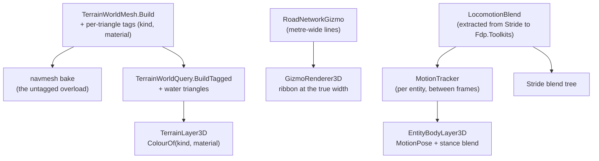

*What the picture shows that prose hid:* the navmesh and the 3-D map still read ONE mesh builder — the tags ride alongside and
the bake takes the untagged overload, so the walkable soup cannot drift from what is drawn; the road ribbons are not a road
layer but the road GIZMO's own metre-wide lines, drawn at their width; and the gait rule is shared with Stride, not copied.

| built | where |
|---|---|
| `TerrainWorldMesh.Build(…, out TerrainTriangleTag[] tags)` — kind (ground, wall, roof, slab) and material (a prism's material, `"forest"` ground) per triangle; the untagged overload returns the same soup (rail: identical verts and indices) | `Fdp.Toolkits/Terrain/TerrainWorldMesh.cs` |
| `ITerrainRenderGeometry.BuildTagged` (default: no materials, no water) and `TerrainWorldQuery`'s: materials + water surfaces as flat triangles a little below their lowest bank, filling the hole the soup leaves; `TerrainSurfaceKind.Water` | `Fdp.Toolkits/World/ITerrainRenderGeometry.cs`, `Terrain/TerrainWorldQuery.cs` |
| `TerrainLayer3D.ColourOf(kind, material)` — forest, water, brick, glass, steel, wood, chain-link, hedge, sandbags, berm, car body; concrete and brick roofs keep the roof colour | `Vis3D/TerrainLayer3D.cs` |
| road ribbons: `GizmoRenderer3D` draws a `WorldMeters` line ≥ 0.5 m wide as a draped strip at that width | `Vis3D/GizmoRenderer3D.cs` |
| things come alive: `PartRole.Rotor / WheelSpoke / LegLeft / LegRight / ArmLeft / ArmRight` and `MotionPose`; `MotionTracker` — wheels roll by the distance driven along the body (back in reverse; a teleport does not spin them), limbs swing by `LocomotionBlend`'s walk/run weights, one cycle per 1.6 m, a main rotor turns at 4.3 rev/s of SIM time while airborne; all read from the entity's own position, so every host shows the same and a pause freezes it | `Map3D/ShapeKit.cs`, `Map3D/MotionTracker.cs`, `EntityBodyLayer3D` |
| stance blend: while `StanceStatus` reports a transition, the figure interpolates from the stance it leaves to the logical one by `TransitionProgress` | `BlockFigure.Blend`, `EntityBodyLayer3D.FigurePose` |
| `LocomotionBlend` extracted from `Stride/Hrot.Stride.Animation` to `Fdp.Toolkits/Animation` (namespace `Fdp.Toolkit.Animation`); Stride re-pointed by a `using` (its two projects build) | — |

⚠ **Left, named:** the tail rotor is a disc — its spin cannot be seen, so it is not animated · gear up / down still follows the
airborne guess (no gear-state component exists — PLAN D1) · a road ribbon lies under the 2-D road's centre line, which stays
a one-pixel line · water and forest come only from the terrain's surfaces; materials only where a prism names one (test-town
names none — every wall there is concrete).
**Gates:** `Map3DTests.S4_*` (wheel roll, gait swing, rotor on sim time, stance blend, terrain tags + forest + water) ·
`Map3DGizmoTests.S4_*` (ribbon width on a slope) · the terrain / navmesh suites in `Fdp.Toolkits.Tests` (336/336) · Stride builds.

### 6g. S5b — AS-BUILT `2026-10-11` (the entity card, 2-D and 3-D)

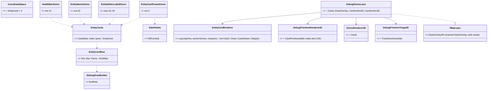

*What the picture shows that prose hid:* the four card gizmos never meet each other — they meet only in the renderer, by
network id and row number, so a fifth line on the card is one more gizmo and touches nothing here. Neither map renderer draws
a card: each only SETS CARD PRIMITIVES ASIDE after its own layer mask and LOD, and the one card renderer draws them.

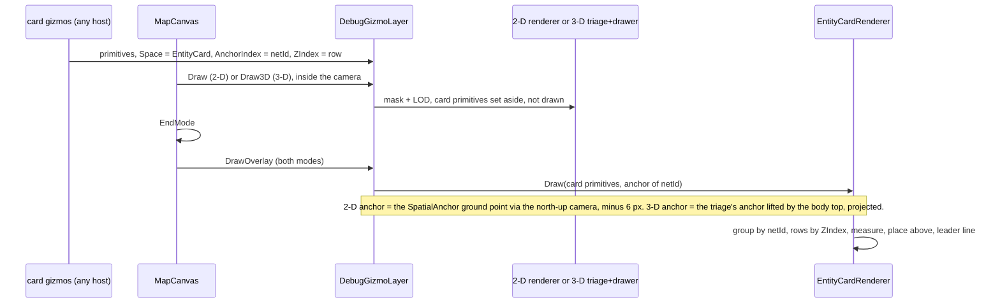

*What it shows:* the only mode-specific thing is the anchor function the layer hands the renderer; layout and drawing are
one code path, which is why `Layout` is a pure function railed without a window.

| built | where |
|---|---|
| `CoordinateSpace.EntityCard = 3`; the author sugar `draw.Card(netId, layer).Row(n).Text / Bar / Frame` — ordinary primitives through `EmitRaw` | `GizmoMap.Contracts/Primitives/CoordinateSpace.cs`, `Fdp.Diagnostics.Contracts/EntityCards.cs` |
| `EntityCardRenderer` — rows by `ZIndex`, row 0 card-wide (backgrounds under, outlines over), `ScreenPercent` = fraction of the card (row 0: both axes; a row: the inner width), width = the widest row ≥ 72 px, a 20 px leader in the outline's colour; disallowed shapes counted | `GizmoMap.Presentation/Rendering/EntityCardRenderer.cs` |
| the 2-D renderer and the 3-D drawer set card primitives aside (`CardPrimitives`, `Cards`); `TryGetAnchor`; `IMapLayer.DrawOverlay` (renamed from `DrawOverlay3D`) called after `EndMode` in BOTH modes; the gizmo layer's card pass | `DebugPrimitiveRenderer2D` (GizmoMap + Fdp wrapper), `GizmoRenderer3D`, `DebugPrimitiveTriage3D`, `MapCanvas`, `DebugGizmoLayer` |
| the gizmos — frame in the side colour (one `SidePalette`, M16), name `"T-72 #1043"`, the health bar re-targeted from a text badge to row 10, the editor label's hit points (row 30) and behaviour (row 40) moved in; all on the new **Labels** layer (`DebugTraceLayers.Labels = 11`, `LayerControlDto.Labels`, default on) | `Hrot.Common/Diagnostics/Gizmos/EntityCardGizmos.cs`, `HealthBarGizmo.cs`, `ScenarioEditor/Gizmos/EntityEditorLabelGizmo.cs`, `LayerControlGizmo.cs` |

⚠ **Deviations, argued:** the sugar takes the **network id**, not the entity (§3.6 sketched `draw.Card(entity)`) — the draw
builder is a primitive buffer with no world to resolve an id from, and every card gizmo already reads `NetworkIdentity`.
· A `MilStd2525` in a card is **counted, not drawn** (§3.6 allows it) — the 2525 renderer draws in world space and has no
screen-space entry yet; `Icon` draws as a dot. · The editor label's separate **id line is gone** — the id is in the name row.
· In 2-D the card sits over the symbol's centre (there is no body height in 2-D). · `HealthBarGizmoSettings.BarWidth` is
now dormant (the card's width governs); kept registered so saved settings stay readable. · `AnchorIndex` is an `int`, as for
`EntityLocal` — a network id above 2³¹ would wrap there too. · Declutter (§3.6 "later") is not built.
**Gates:** `Map3DGizmoTests.S5b_*` (6: sugar, layout, skipped shapes + min width, the 3-D hand-off + anchor, the 2-D north-up
anchor, the gizmos) · `DebugPrimitiveRenderer2DTests.CE1033_S5b_*` (set aside after the mask) · IG `HealthBarGizmoTests` (bar
row) · `HostOnlyWiringTests.CE3123_*` (hit points row) · frame rails: shot ⑦ and `map2d-north-up.png` each draw one card.

### 6h. S5c — AS-BUILT `2026-10-11` (the entity colour, its local part)

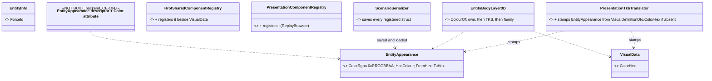

*What the picture shows that prose hid:* the colour reaches the scenario with NO new save code (the serializer saves every
registered struct), and the network half is a separate box. Until that box exists each node stamps the TKB colour for
itself, so a replica shows the TKB colour, not the authored one.

| built | where |
|---|---|
| `EntityAppearance { ColorRgba }` — `[PerInstanceValue]` like `EntityInfo`; alpha 0 = no colour; `#RRGGBB` / `#RRGGBBAA` in and out | `FDP/Engine/Fdp.Core/Components/EntityAppearance.cs`, `GlobalComponentIds.EntityAppearance = 348` |
| the TKB default, stamped ONLY IF ABSENT (a per-spawn value wins: `NetworkSpawningSystem` applies `InitialComponents` over the translators) and ALWAYS when the template has a visual, even with no colour — so once its descriptor exists, no ghost waits forever | `PresentationTkbTranslator.Inject`, `GetProducedComponents` |
| registered on every host — the shared registry (IG, Stride, CGF, SimHost, the Editor via CGF) and the presentation one (the ReplayBrowser) | `HrotSharedComponentRegistry`, `PresentationComponentRegistry` |
| the 3-D body: its own colour → the TKB's `VisualData.ColorHex` → the family default | `EntityBodyLayer3D.ColourOf` |

⚠ **Left, named ([`CE-1047`](blueprints/Blueprint_Issues_Tracker.md)):** the descriptor arm and the runtime `"Color"`
attribute (backend lane), plus a latent defect found on the way: the attribute-ack mask is 256 bits and would throw for
id 348. · No UI sets a colour yet, so an authored colour comes only from a scenario file, until the `"Color"` attribute
exists (`get_attributes_schema` / `patch_attribute` pick it up by construction). · Child entities do not inherit the
parent's colour. · The 2-D map does not use it: 2-D tints by side (M16). · ⚠ `VisualData` itself has no `[DataPolicy]`
and is still saved into scenarios (`scenarios/hill-attack/scenario.json:117-122`), which conflicts with R-136 §3 ②. So a
reloaded `VisualData.ColorHex` can be stale, and that is why the colour reads `EntityAppearance` first.
**Gates:** `Map3DTests.S5c_*` (stamp-if-absent + per-spawn wins + always stamped · the colour order · the scenario round trip).

### 6i. S5 — AS-BUILT `2026-10-11` (the scenario's camera entity, R-260)

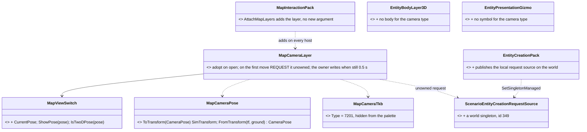

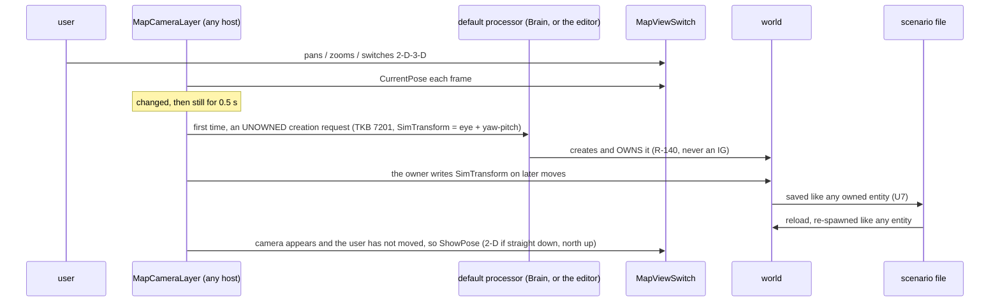

*What the pictures show that prose hid:* the camera needs NO save or load code — it is saved and re-spawned as any entity, and
NO host wiring at all: the layer is added by the shared map attach, and it asks through the request source the shared `EntityCreationPack` puts on the world — so every creating host can ask, the replay browser (no creation) can only adopt, and ownership falls where R-140 puts it, on the default processor.

| built | where |
|---|---|
| the camera TKB type (7201, `HideFromPalette`), registered in `HrotEnvironment.CreateTkb` | `Hrot.Core/Tkb/MapCameraTkb.cs` |
| the pose in an ordinary `SimTransform`: position = the EYE, rotation turns +X onto the view direction (+Z = camera up); the look-at and distance come back by casting the view ray onto the ground (bracket + bisect on relief, R-248); looking level or up falls back to 300 m | `Map3D/MapCameraLayer.cs` (`MapCameraPose`) |
| `MapCameraLayer` on EVERY map host (the shared attach): adopts the scenario's camera when it appears and the user has not moved the map since the world was emptied (a load / New); on the first move with none, REQUESTS one unowned (owner 0, no reliable init) and retries after 5 s if none appears; the owner writes its pose after 0.5 s of stillness; the lowest network id wins if two exist | same file, `MapInteractionPack.AttachMapLayers` |
| the request path: `EntityCreationPack` (composed by IG, Stride, CGF, SimHost, Editor) publishes its local `ScenarioEntityCreationRequestSource` as a world singleton (id 349) — so the default processor creates and OWNS the camera (R-140), never an IG; zero per-host lines, pinned by a source rail | `Hrot.Common/EntityCreation/EntityCreationPack.cs` |
| `MapViewSwitch.CurrentPose` / `ShowPose` / `IsTwoDPose` — the 2-D map is the pose straight down, north up (M10) | `Vis3D/MapViewSwitch.cs` |
| never drawn or picked: no 3-D body, no 2-D symbol / anchor / pick box | `EntityBodyLayer3D.LookOf`, `EntityPresentationGizmo.Draw` |
| ⭐ `CE-1221` (`2026-10-19`) — a scenario with NO saved camera: once its load settles (the world's entity count unchanged for `LoadSettleSeconds` = 1 s — the same on every host, the networkless editor included, so no cluster-state hook is needed), and the user has not moved the map, the 2-D map frames every placed entity (`FramePose`: the bounding box's middle, filling `FrameFill` = 80 % of the view, at least `FrameMinExtent` = 200 m across; the camera itself, SUMO's traffic — `ReplicationRoute.SumoSharp` — and non-finite positions left out). Framing is not a move: no camera is requested or saved. Rail `Map3DTests.CE1221_AScenarioWithNoSavedCamera_IsFramedIn2D_OnceItsLoadSettles` | `MapCameraLayer.Update` / `FramePose` |

⛔ **Superseded the same day:** the first build had each host pass a `MapCameraOwnership` argument (Editor / CGF saved it). Measured wrong: every host, IG included, registers the SAME scenario save handler and saves what it OWNS (`IgNodeBootstrapper.cs:435-440`, CE-275), so "saves the scenario" is not a host property; and the user ruled out per-host wiring. ⚠ **Left, named:** a host that does not OWN the camera does not move it — a change request would need a pitch path the
attribute vocabulary lacks (geodetic position + heading only); folded into [`CE-1047`](blueprints/Blueprint_Issues_Tracker.md).
⛔ *Corrected `2026-10-16` (user):* ~~in a cluster the Brain owns the reloaded camera, so the Editor's own moves are not saved there~~ — the Editor is networkless, and in a cluster the CGF IS the editor, so its moves are saved. The one open case is several CGF nodes ([CE-1149](blueprints/Blueprint_Issues_Tracker.md); lean: the smallest node id owns it). · Moves during
Live/Preview are written too (the camera is the view, not simulation state). · Field of view stays a viewer setting (D7).
**Gates:** `Map3DTests.S5_*` (6: pose round trip on a slope and overhead · adopt in 3-D and in 2-D · the first move requests ONE
unowned camera, the creator owns it, its pose is kept and saved · no request source ⇒ never made, a moved view not taken over ·
a camera owned elsewhere is not moved · no body, no symbol, hidden type) ·
`EveryMapHostAttachesTheSharedLayersTests` (no host builds its own camera layer; no host mentions the camera at all).

### 6j. CE-1064 — the crouched figure: a kneel when still, a crouched run on the move — AS-BUILT `2026-10-13` (ui)

🔒 *User, 2026-10-13: "Check how a character in crouched position is animated — first his position look very weird and second
he does not move his legs when moving in crouched position."* 📐 Measured with a frame rail before the change:
- **Still:** the crouch was a squat. Its thighs were level, its knees stuck out 0.4 m ahead of the hips, and its upright torso sat behind both feet, so it read as a man sitting on an invisible chair.
- **Moving:** `CrouchedBody` built its legs with `swings: false`, so no part had a leg role. A crouched mover — R-265's crouched run at the stance's 0.5 speed cap, 3 m/s — slid along with frozen legs.

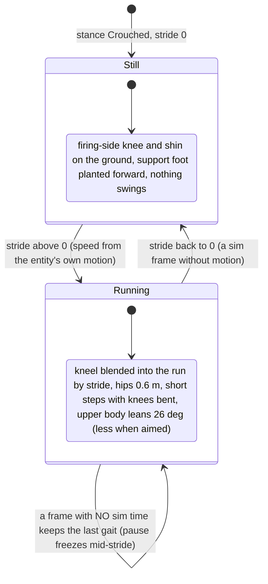
*What the picture shows that prose hid:* "crouched" is two drawings chosen by the GAIT, not by the stance. Only the stance is
replicated, so the choice comes from the same motion every host already reads, and a frame with no sim time must not count as
stopping.

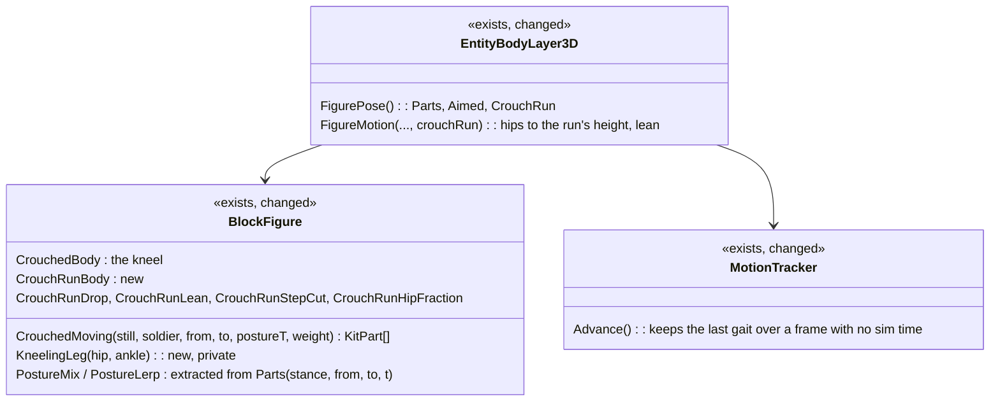

| decision | why | rejected (one line each) |
|---|---|---|
| still = a **kneel** | its head stays at the crouched stance's 1.1 m eye (`EngineFallbacks.EyeHeightCrouched`) and its upper body is unchanged, so the rifle postures (WL-6), the aim shoulder (`TryAim`, 0.98 m) and the stance blends keep working | a corrected squat with the torso leaning forward (its head drops below the eye perception uses) |
| moving = the **crouched run**, mixed in by `MotionPose.Stride` like the glide | the stance is the only replicated fact; the gait already comes from each entity's own motion, so every host draws the same | a separate "moving crouched" stance (not on the wire, and R-265 keeps the stance as the sim's single fact) |
| the run's steps are 35 % shorter (`CrouchRunStepCut`, like the glide's) | the full gait swing from bent knees threw the back shin out flat behind him (a lunge) — seen in the frame rail | the upright gait's swing |
| the run's lean shrinks while aimed | an aimed rifle is pitched by the aim (`Lean − pitch`), and the run lean would push it into the ground | a lean regardless of posture |
| a frame with **no sim time** keeps the last gait | it carries no motion information; snapping to the still pose turned a runner into a kneel for a frame, and a pause into a kneel (the design says a pause freezes him, R-143) | gait smoothing over time (it would change every walker's swing timing) |
| each kneeling leg keeps one `y` from hip to ankle, and the down shin is built foot → knee | no segment has a sideways yaw, so a Standing ↔ Crouched blend turns each leg in its own plane | the IK's free yaw (the blend swept the shin sideways) |

⚠ **Left, named:**
- The run's head is about 1.2 m, 0.1 m above perception's crouched eye. The drawing approximates the logical stance; it doesn't define it.
- A crouched runner's Ready rifle points about 50° down: low ready, carried with the lean.
- Stopping pops from run to kneel in one sim frame. This matches the standing walk's pop from swing to still, which isn't eased either.
- The Stride shell has its own animation clips and is not changed here.

**Gates:**
- `Map3DTests.CE1064_*` (3): the kneel has its hips and torso over its feet and nothing swings; the crouched run's legs swing with knees bent and stay low; a frame with no sim time keeps the gait and a stop ends it.
- `Map3DFrameRail.CE1064_ACrouchedFigure_StillAndRunning` (Xvfb screenshots `crouch-1…4`).
- `Map3DTests` whole.

### 6k. CE-1068 / CE-1069 — doors as they really are: a hinged leaf, locked tinted, gone when destroyed — AS-BUILT `2026-10-14` (ui)

🔒 *User, 2026-10-14: "The building doors are visualized as weird pink boxes in 3d map and likely also in 2d map (in 2d there was nice
simple gizmo and the pink box is undesired - doors should not be shown as unknown entity). I would like to see doors in 3d map as in
reality - rectangle that rotates around hinges and can be destroyed (=missing from view)."*

📐 **Measured cause.** A door is an ENTITY: the load makes one per terrain door with a bare `Door` TKB template, `DoorState`,
`TerrainObjectKey` and a `SimTransform` at the doorway (`TerrainObjectRequests.cs:51-60`).
- **3-D:** `EntityBodyLayer3D` drew every `SimTransform`+`TkbIdentity` entity, and a bare template resolves to `VisualFamily.Unknown`: the unknown box.
- **2-D:** `EntityPresentationGizmo` emitted a semantic shape for it, and the renderer's fallback for an unknown profile is magenta.
- **Design intent:** both contradict the door design, which says the entity is selectable with *"no symbol, no palette entry"* (`DESIGN_Building_Interiors.md` §3j 5b).

**INVENTORY** *(grep + read, codebase-memory MCP not connected this session)*. Doors are drawn by:
- `DoorLeafGizmo`, the 2-D line on the Doors layer;
- `NavmeshGizmo`, the doorway polygons;
- `EntityPresentationGizmo`, the unknown symbol;
- `EntityBodyLayer3D`, the unknown box.

The leaf's geometry already exists in `TerrainWorld.DoorLeaves`: hinge → closed tip, sill → head, 5 cm thick (`TerrainWorld.cs:166`). Nothing drew it as a solid.

```mermaid
classDiagram
  class DoorLeaf3D {
    <<new, static>>
    OpenAngle = 90 deg
    SwingSeconds = 0.8
    TargetAngle(state) float?
    IsDoor(world, e) bool
    TryLeaf(world, e, out leaf, out state) bool
    Box(leaf, angle) centre, rotation, half
    ColourOf(state) wood, locked tinted
  }
  class DoorSwing {
    <<new>>
    Angle(e, target, simTime) float
    Current(e, fallback) float
    EndFrame(drawn)
  }
  class EntityBodyLayer3D {
    <<exists, changed>>
    DrawDoor() the leaf, wood, selection box
    TryGetBox() a door's box = its leaf
    LookOf(Door) no kit
  }
  class EntityPresentationGizmo {
    <<exists, changed>>
    a TerrainObjectKey entity: anchor + pick box, no symbol
  }
  class DoorLeafGizmo {
    <<exists>>
    the 2-D door picture: one line per state
    ColorOf(state) shared with the 3-D tint
  }
  DoorLeaf3D ..> DoorLeafGizmo : ColourOf reads ColorOf(Locked)
  class TerrainWorld { <<exists>> DoorLeaves, DoorIndexOf(key) }
  EntityBodyLayer3D --> DoorLeaf3D
  EntityBodyLayer3D *-- DoorSwing
  DoorLeaf3D ..> TerrainWorld
  EntityBoxPicker ..> EntityBodyLayer3D : TryGetBox
```
*What the picture shows that prose hid:* the door ENTITY stays the one thing the maps draw, pick and select. Its key finds the
terrain's leaf, so no second door list is kept. The 3-D slab and the 3-D click share one box: `TryGetBox`, which `EntityBoxPicker` already reads.

```mermaid
sequenceDiagram
  participant B as EntityBodyLayer3D.Draw
  participant D as DoorLeaf3D
  participant S as DoorSwing
  participant P as EntityBoxPicker
  B->>D: IsDoor(e)? TryLeaf(e): leaf + DoorState
  D-->>B: Closed/Locked 0 deg, Open 90 deg, Destroyed none
  B->>S: Angle(e, target, simTime)
  S-->>B: eased toward target, a pause holds it
  B->>D: Box(leaf, angle): turned about the hinge
  B->>B: draw a wood slab (+ selection wire box)
  P->>B: TryGetBox(e)
  B-->>P: the same leaf box (false when destroyed)
```

| decision | ⭐ lean | rejected (one line each) |
|---|---|---|
| what a door is in 3-D | the leaf as a slab, turned about its hinge: shut and locked in the wall, open 90° to the side the 2-D door layer opens it to (`DoorLeafGizmo.OpenTip`), destroyed not drawn | a shape kit for the `Door` type (the leaf is terrain geometry with a real width and height; a kit would be a second, guessed size) |
| the swing | eased on SIM time, a quarter turn in 0.8 s; first seen = in its state; a pause freezes it (R-143, like `PostureBlend`) | snap (an open order would pop) · replicating an angle (the state is the fact; the picture times itself) |
| where it is drawn | the body layer, beside the entities, because a door IS an entity: one box for drawing, picking and the selection outline | a separate door layer (a second pick path for the same entity) |
| 2-D | no symbol for a terrain object (anchor and pick box kept: a door is selectable, §3j 5b); the door layer's line stays the 2-D picture | hiding the door entity entirely (its commands hang off the selection) |
| the 2-D door line in 3-D | ⛔ **CORRECTED by CE-1069:** it stays — the 3-D pass draws `Map2D` primitives too (§7, `Map3DGizmoTests`), so retargeting it changed nothing; the line lies at the slab's foot and the Doors toggle hides it | a '2-D only' target (none exists; redefining `Map2D` would also drop the contact lines from 3-D) |
| locked vs closed in 3-D | ⭐ **CE-1069** (🔒 user: *"Maybe we can indicate locked unlocked by color in 3d?"*): a locked leaf's wood is tinted half-way to the 2-D door layer's locked purple (`DoorLeaf3D.ColourOf` reads `DoorLeafGizmo.ColorOf`) — one colour language on both maps; shut and open stay plain wood | ⛔ ~~drawn the same~~ (SUPERSEDED, the user asked for it) · a separate 3-D palette (two legends for one fact) |

⚠ **Left, named:**
- A host with door entities but no terrain draws no door (there is no leaf to place).
- A destroyed door vanishes at once (no falling slab).
- The terrain mesh's doorway is the opening the leaf fills, and the leaf is not part of the terrain picker, so a click on a shut door hits the door entity.

**Rails:**
- `Map3DTests.CE1068_ADoorLeaf_TurnsOnItsHinge_AndADestroyedDoorIsNotDrawn`, `CE1068_ADoorSwings_OnSimTime_AndIsFirstSeenInItsState` and `CE1068_ADoorEntity_HasNoKit_AndIsPickedByItsLeaf`.
- `EntityPresentationGizmoTests.CE1068_ADoor_HasAnAnchorAndAPickBox_ButNoSymbol`.
- `Map3DFrameRail.CE1068_Doors_ShutOpenAndDestroyed` (Xvfb screenshots `door-1…4`: shut, open, the shut one destroyed, the open one shut and locked).
- CE-1069: `Map3DTests.CE1069_ALockedDoor_IsTintedWithTheTwoDLockedColour`, and `DebugTraceGizmoTests.CE1069_EveryDoorStillDrawsItsStateLine_On2D`, which pins the 2-D open / shut / locked / destroyed picture now that the door entity has no symbol.

### 6l. CE-1071 … CE-1073 — smooth flying, a frame that does not overflow, the eye in the head — AS-BUILT `2026-10-14` (ui)

> 🔒 **User, `2026-10-14`:** *"when i switch to 3d map view and use the wsad camera flying and RMB mouse look, it is far from smooth, even
> on minimalistic scenes … especially the scroll button based camera moving forwards and backwards jumps with each click instead of being
> a smooth flight. When i switch to FPS mode … every next shot makes the whole experience way worse … till almost complete freeze. When
> moving forward the character leans a bit forward basically putting his head in front of the FPS camera so i see nothing — the camera
> should rather be bound to character's head/eyes position wise."*

📐 **Measured, not guessed — the live editor under Xvfb**, driven by real X input (XTest) and timed by the new opt-in frame log
(`HROT_FRAME_STATS=1`, `Hrot.ClusterRunner/Presentation/FrameStats.cs`: frame mean / p50 / p95 / max and the update / draw / UI split),
profiled with `dotnet-trace` while firing:

| finding | where | fix |
|---|---|---|
| 🔴 the frame was FULL: 4 096 primitives, 400–700 dropped, rising with every shot; the drops took the layer mask (so the 3-D triage drew EVERY hidden layer — 612 cover spheres, 2 255 draped navmesh lines), the View menu and the RTS tool's input capture | `DebugPrimitiveBuffer` | ⭐ `CE-1071` — hidden layers refused at emit, meta primitives never dropped (📄 [gizmos-1 §11.11](designs/gizmos-1/DESIGN.md)) |
| 🔴 62 % of a 3-D frame went to gizmos; 13 % to `MapCamera3D.Viewport` asking the window, once PER PRIMITIVE (`ZoomAt`) | profile | ⭐ `CE-1072` — the viewport read once a frame |
| 🔴 a wheel click set the distance at once (12 %) — a jump | `MapCamera3D.HandleInput` | ⭐ `CE-1072` — the click owes eye travel; `Update` glides it out (τ = `WheelGlideSeconds` 0.12 s); past the pivot the look-at point flies too |
| ⚠ W/A/S/D went from 0 to full speed in one frame | same | ⭐ `CE-1072` — eased (τ = `FlyEaseSeconds` 0.08 s) |
| 🔴 in first person the hidden cursor's position wandered: over a docked panel ImGui claimed the mouse and the view froze; the gizmo terminal also took every shot as a map click | `RaylibInputProvider`, `DebugGizmoLayer` | ⭐ `CE-1072` — a locked cursor is never "captured" and ImGui ignores the mouse meanwhile; a camera driver holds the map's input (the terminal skips) |
| 🔴 the eye was a fixed height above the reference point; a run's forward lean put the drawn head in front of it | `FpsCameraDriver.Update` | ⭐ `CE-1073` — the eyes of the DRAWN head (part `BlockFigure.HeadIndex`), kept in the body frame and put on the unit's CURRENT pose; that head is not drawn; the mouse look shows in the same frame |

```mermaid
sequenceDiagram
    participant C as MapCanvas (each frame)
    participant K as MapCamera3D
    participant D as FpsCameraDriver
    participant B as EntityBodyLayer3D
    C->>K: Update(dt) — the viewport re-read once, a wheel glide step (free camera)
    K->>D: Update — eye = unit pose ⊗ B.TryGetEyeLocal(unit)
    C->>K: HandleInput — wheel adds travel, W/A/S/D eased (free) · look, keys, frame, Place again (driver)
    C->>B: Draw3D — figures, head part HeadIndex ⇒ the eye (body frame), FirstPerson's head skipped
```

*What the picture shows that prose hid:* the driver's `Update` runs BEFORE the input of the same frame — so the look was a frame late until
`HandleInput` placed the camera again — and the eye read in `Update` comes from the PREVIOUS draw, which is why it is kept in the body's
frame and put on the current transform (a running man moves ~8 cm a frame).

| after, same machine and scenario | |
|---|---|
| primitives / dropped | 238–361 / **0**, firing included |
| 3-D draw (software GL) | ~45–65 ms, was ~195 ms |
| View menu | *Tactical Map Layers… · 2-D / 3-D Map · RTS Command Mode* back |
| first person | eye in the drawn head standing, crouched and prone (screenshots below) |

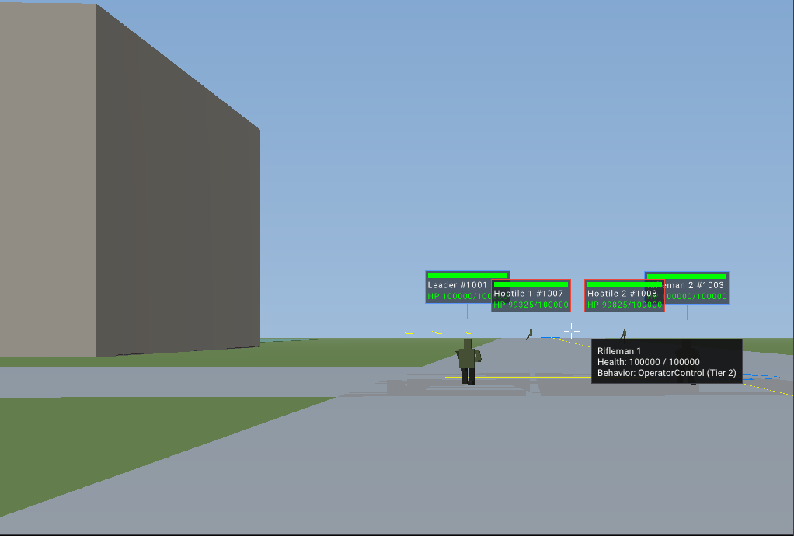

⚠ **Stated:** the absolute times are a software renderer's (no GPU in the container); the shares and the drop counts are what carry over.
The free camera's feel was not seen with a real mouse — the wheel glide and the eased fly are railed by their numbers.

**Rejected — one line each:**
- *Smoothing the mouse look* — adds lag to the one input that must not have it.
- *A bigger primitive buffer* — moves the cliff (gizmos-1 §11.11).
- *Keeping the eye above the reference point and hiding the whole upper body* — the eye would still not crouch or crawl with the figure.

📐 Rails: `Map3DTests.CE1072_*` ×3 (the wheel glides, keeps flying at the pivot, the fly eases) + `CE1044_FlySpeed_*` (re-read once the ease
has settled — the speeds are unchanged) · `Map3DTests.CE1073_*` ×2 (the head is part `HeadIndex` in every pose; the eye follows a lean, a
crouch and prone) · `PossessionStationTests.CE1073_*` (the eye on the current pose, the head hidden while held, the look the same frame).

### 6m. CE-1081 … CE-1084 — the carried and the dragged, the wounded, riders in their seats, the jump down — DESIGN + AS-BUILT `2026-10-14` (ui)

🔒 **User, `2026-10-14`:** *"the soldiers now can drag or carry another soldier (wounded one), using pick and drop action. can you pls render
in 3d map the carried/dragged one? Also when soldier is wounded his motion pattern could be degraded (limping, bent etc.) also vehicles got
seats (slots) to be occupied and some helicopters might not have side doors (existing setting in tkb) so passenger soldiers can be shown
there (and when dismounting they could jump down to ground)"* — the four leans and the 0.6× wounded speed: *"Approved"*.

📐 **INVENTORY** *(an Explore sweep of `docs/`, `.dev/` and the code, then the load-bearing lines re-read by hand)*:

| fact | where | so |
|---|---|---|
| carrying IS embarking: the carrier is the "vehicle", the casualty its passenger; `PassengerBuffer.Modes` (2 bits a seat) says Seated / Carried / Dragged; the casualty's `IsEmbarkedTag { VehicleEntity, Exposed, Seat, Mode }` is re-derived on EVERY node (map hosts too) | `InteractionComponents.cs:14-80`, `EmbarkedStateSystem.cs:48-70` | ⭐ the renderer can read who carries whom on any host — no new wire |
| the casualty's transform = the carrier's position − its forward × (carried: `CarryBehindMetres` 0 m · dragged: 1 m), the carrier's heading; Z not lifted | `EmbarkedStateSystem.cs:115-123`, `CarrierDefDto.cs:53-63` | a carried man stands INSIDE his carrier today; the pose must lift and turn him (presentation only — C10: *"its pose is a later presentation item"*) |
| a person is drawn in his logical stance, his gait from his own position change | `EntityBodyLayer3D.FigurePose`, `MotionTracker` | a carried / dragged man would WALK; his figure must replace the stance pose |
| injury is DERIVED: `Injury.StateOf` from replicated `Health` + `InjuryThresholds` (type data) | `Injury.cs:8-56`, `DESIGN_Injury_States.md` I1 | every host knows wounded / incapacitated — no new wire |
| speed = `StanceSpeed × CarryLoad`; the wounded factor is slice **I-b**, open | `CarKinematicsSystem.cs:149-153`, Injury §I-b | ⭐ the 0.6× is ONE more factor there, its value a TKB field beside the thresholds |
| a seat knows its role and whether it is exposed — **no position** | `CarrierSeats`, `SeatDto { Role, Exposed }`, `DESIGN_Map_3D_Mode.md:817` | `SeatDto` grows a place, a facing and a pose |
| "no side doors" = `CarrierDefDto.Exposure = Open` → `IsEmbarkedTag.Exposed`; ⚠ no production type is Open but the person carrier; the UH-60 has no `Gen.Carrier` at all | `CarrierTkbTranslator.cs:64-82`, `BdcTkbCatalog.cs:376` | a new type **UH-60A (doors off)**, 8 door seats |
| an exposed rider is drawn at the vehicle's reference point in his stance; an enclosed one not at all | `EntityBodyLayer3D.cs:101`, `PhysicalPresence.IsEnclosedPassenger` | the seat's place puts him where he sits |
| dismount: a column beside the vehicle at the vehicle's Z; the pedestrian clamp then puts him on the surface | `Embarkation.DismountPoint`, `CarKinematicsSystem.cs:464` | the jump is a DRAWING of that drop, from the seat he left |

```mermaid
classDiagram
    direction LR
    class EntityBodyLayer3D { <<existing, grows>> Draw3D · FigurePose · FigureMotion · + Carriage(world, e) }
    class Carriage { <<NEW static, Map3D>> Of(world, e, tkb) FigureCarriage · Placement(...) Matrix4x4 }
    class FigureCarriage { <<NEW record struct>> Kind : Free · Carried · Dragged · Carrying · Dragging · Seated · Jumping · Downed · Wounded ; Vehicle ; Seat }
    class BlockFigure { <<existing, grows>> + Draped · Towed · CarrierArms(drag) · Seated(legsOut) · Downed — 10/11 parts, the shared order }
    class DismountDrop { <<NEW, beside DeathFall>> Riding(e, seatWorld, now) · Left(e, now) (t, height) }
    class DeathFall { <<existing>> a second instance: the incapacitated collapse }
    class Injury { <<existing, grows>> + SpeedFactor(world, e) }
    class InjuryThresholds { <<existing, grows>> + WoundedSpeedFactor }
    class InjuryDefDto { <<TKB, grows>> + WoundedSpeedFactor = 0.6 }
    class SeatDto { <<TKB, grows>> + X Y Z · FacingDegrees · Pose (Sit · SitLegsOut) }
    class CarKinematicsSystem { <<existing>> × Injury.SpeedFactor }
    class IsEmbarkedTag { <<existing, every node>> VehicleEntity · Exposed · Seat · Mode }
    class BdcTkbCatalog { <<existing, grows>> + UH-60A (doors off), 8 open door seats }
    EntityBodyLayer3D ..> Carriage
    Carriage ..> IsEmbarkedTag : reads
    Carriage ..> SeatDto : the seat's place
    Carriage ..> Injury : wounded / down
    EntityBodyLayer3D ..> BlockFigure
    EntityBodyLayer3D *-- DismountDrop
    EntityBodyLayer3D *-- DeathFall
    CarKinematicsSystem ..> Injury
    InjuryDefDto ..> InjuryThresholds : stamped
    BdcTkbCatalog ..> SeatDto
```

*What the picture shows that prose hid:* ONE classifier (`Carriage`) answers "how is this man held?" from facts every host already has, and
every answer is a figure + a placement — so no new wire, no new simulation state, and the only sim change is one speed factor.

```mermaid
sequenceDiagram
    participant L as EntityBodyLayer3D (each frame, each person)
    participant C as Carriage
    participant F as BlockFigure
    participant D as DismountDrop
    L->>C: Of(world, e)
    alt carried (tag Mode Carried, a person carrier)
        C-->>L: Carried, the carrier
        L->>F: Draped
        L->>L: placed across the carrier's shoulders, no gait
    else dragged
        C-->>L: Dragged
        L->>F: Towed (on his back, arms up to the carrier)
    else he carries / drags someone
        C-->>L: Carrying or Dragging
        L->>F: CarrierArms, the body leaning under the load
    else in an exposed seat with a place
        C-->>L: Seated, the vehicle and seat
        L->>F: Seated (legs in, or out over the sill)
        L->>D: Riding(e, the seat in the world)
    else just left a raised seat
        L->>D: Left(e, now)
        D-->>L: t, the height he dropped from
        L->>L: drawn that much higher, landing crouched
    else incapacitated
        L->>F: Downed (fallen into it over 0.6 s)
    else wounded
        L->>L: the limp: one stiff leg, shorter steps, bent 15 deg
    end
```

```mermaid
graph TD
    CAN[MapCanvas, every 3-D frame] --> EBL[EntityBodyLayer3D.Draw3D, every map host]
    ESS[EmbarkedStateSystem, every node with Interactions] -->|IsEmbarkedTag| EBL
    DMG[EntityDamage ingress] -->|Health| EBL
    TKB[CarrierTkbTranslator / InjuryTkbTranslator, every node] -->|CarrierSeats, InjuryThresholds| EBL
    KIN[CarKinematicsSystem, the muscle] -->|0.6x when wounded| POS[SimTransform, replicated]
    POS --> EBL
```

*Caption:* every input the drawing needs already reaches every map host each frame; the one simulation edit sits where speed is already
scaled, on the node that moves the man.

| decision (✅ user, `2026-10-14`) | rule |
|---|---|
| **C-1 carried / dragged** | DRAWING only. Carried: limp across the carrier's shoulders, crosswise, head to his left; the carrier leans forward, both hands on the load, rifle slung. Dragged: on his back ~1 m behind (the sim's place), head to the carrier, arms up to the carrier's hand; the carrier reaches back with his right arm. Neither casualty plays a gait |
| **C-2 wounded** | WOUNDED: a limp (right leg stiff, steps shorter, upper body bent ~15°, also standing still). INCAPACITATED: lying on his back, one knee up, a hand on his chest, fallen into it over 0.6 s. ⭐ **+ slice I-b**: a wounded man moves at `WoundedSpeedFactor` (TKB `Gen.Injury`, default **0.6**) |
| **C-3 seats** | `SeatDto` gains a place (`X, Y, Z` from the reference point), `FacingDegrees` and a `Pose`; a rider in an EXPOSED seat with a place is drawn sitting there. New type **UH-60A (doors off)** (`Heli_UH60_DoorsOff`, 404): 8 seats, 4 in each door, legs out over the sill |
| **C-3b the open cabin** ⭐ *(`CE-1209`, `2026-10-19`)* | 🔒 user: *"no problem if you draw uh60 without side door always"* — the ONE `Helicopter` kit (only the two UH-60s use it) is drawn doors-off: a closed rear section and a short closed front behind the cockpit, the cabin between them only a floor and a roof, so it is seen through from the side and the door riders and door gunners sit in its openings. The sim's boxes are regenerated from it (`VehicleBody.Tables.g.cs`, CE-3214 parity; part ids rear / front / floor / roof = Fuselage) — rounds pass the open doors. Frames `held-3-doors-off.png`, `stream-3-door-gun.png` |
| **C-4 the jump** | DRAWING only: a rider who leaves a seat more than 0.5 m above the ground drops over 0.5 s from it and lands crouched. ⚠ **Amended `2026-10-16` (§6w AB-V6, Airborne D-8):** only for a hop ≤ 3 m — a rope or parachute descent is SIMULATED and drawn from its `Descent`, never as a jump |

**Rejected — one line each:**
- *A `Carrying` / `CarriedBy` component* — rejected before (Entity_Interactions §7.4.8): embarkation already says it, on every node.
- *Lifting the casualty in the SIMULATION* — his true place is the carrier's; the shoulder is a look (C10).
- *A limp in the gait SOLVER* — the gait is the muscle's; the limp is a drawing over the same stride.
- *Doors-off on the existing UH-60* — it would make every Black Hawk open; a type per configuration keeps scenarios explicit.
- *A jump in the simulation* — the dismount already lands him; only the drop between seat and ground is missing, and it is a look.

#### 6m as-built `2026-10-14` (ui)

⭐ **Built as the three diagrams above draw it** — `Carriage` (+ `FigureCarriage`, `CarriageKind`), `DismountDrop` (in `Carriage.cs`), the
`BlockFigure` poses, `EntityBodyLayer3D.HeldFigure` / `Burdened`, `Injury.SpeedFactor`, `SeatDto` place / facing / pose, the new type. No
box moved. The details the diagrams do not carry:

| as-built detail | why |
|---|---|
| a man dying while held (carried, dragged, seated, down) falls from a LYING figure (`DeathFall.Alive(…, Prone)` / `Crouched` for a rider) | the death fall blends from his last stance; he would otherwise stand up to fall |
| the downed collapse is a second `DeathFall` instance (`_down`) and `BlockFigure.Collapse` (the same blend as a death fall) | one blend mechanism, two meanings |
| the wounded limp and the carrier's arms apply to a STANDING man only | a crouched / prone man keeps his stance's figure (a limp on a crawl reads as noise) |
| the jump: `DismountDrop` — a rider seen riding within 0.5 s whose seated hips were more than 0.5 m above his standing hips now; the lift falls as 1 − t² over the free-fall time (min 0.3 s), then 0.3 s crouched | measured on the doors-off Black Hawk: its door hips sit 0.9 m above the tyres — standing hips — so a LANDED helicopter's dismount is a step, a hovering one a jump |
| `Heli_UH60_DoorsOff` = **404** (401 is the F-16); the UH-60's geometry moved into `Uh60Geometry()`, shared by both | ⚠ the design said 401 — corrected before building |
| ⚠ the wounded factor scales the person's TOP speed (the 6 m/s sprint), like the stance and carry factors: asked 5 m/s, a wounded man makes 3.6 | one rule for every speed factor (`CarKinematicsSystem`) |
| the type golden (`EntityTypeCatalogTests.BuiltInGolden`) gained the 404 line | a deliberate new type |
| ⚠ the carried figure reads BULKY side-on (his torso crosses the carrier's shoulders, his legs and arms hang either side) — legible, not pretty | block figures; a rounder look waits for the mesh kits |

📐 **Rails:** `Map3DTests.CE1081_*` ×3 + `CE1082_*` + `CE1083_*` + `CE1084_*` (the classifier; the shoulders; the part order; the
limp and the carrier's lean; the door seats, legs out; the jump) · `CarKinematicsSystemTests.CE1082_*` ×3 · `InjuryTests.CE1082_*` ·
`Map3DFrameRail.CE1081_V_*` (the real frame, below).

✅ **(V) — a real frame under Xvfb** (`Map3DFrameRail.CE1081_V_*`):

| | |
|---|---|
| 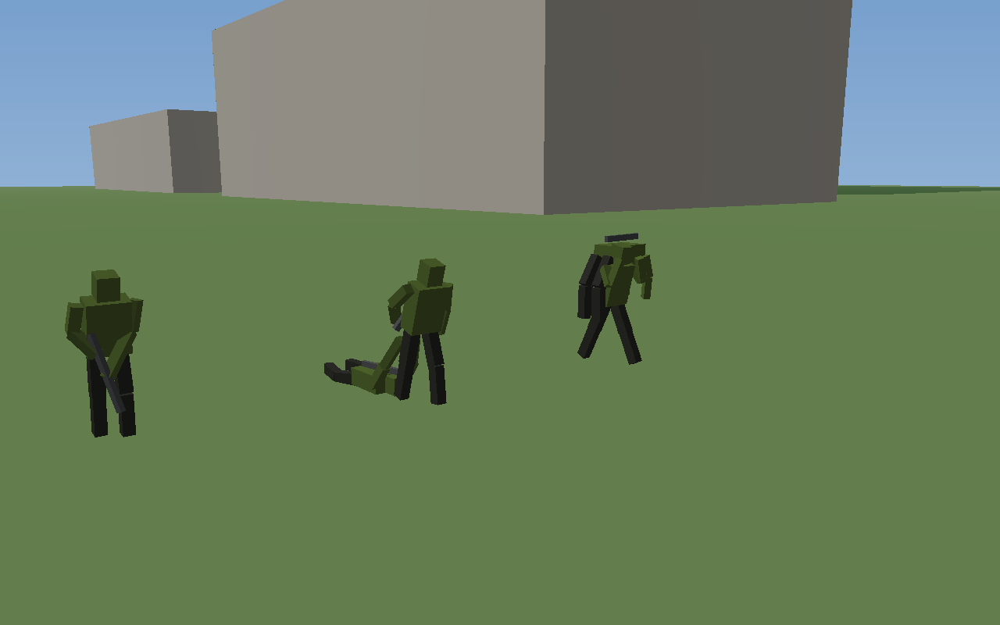 | 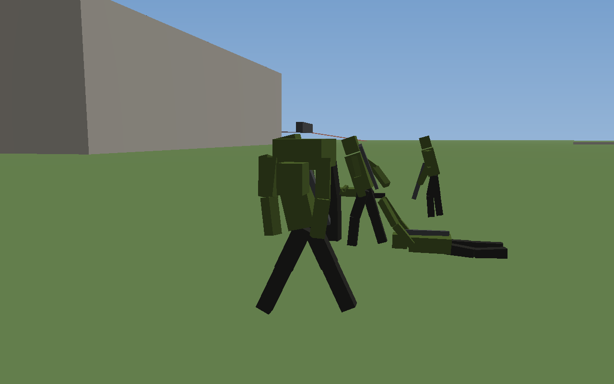 |
| 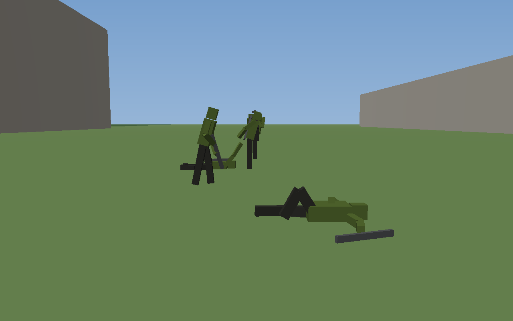 | 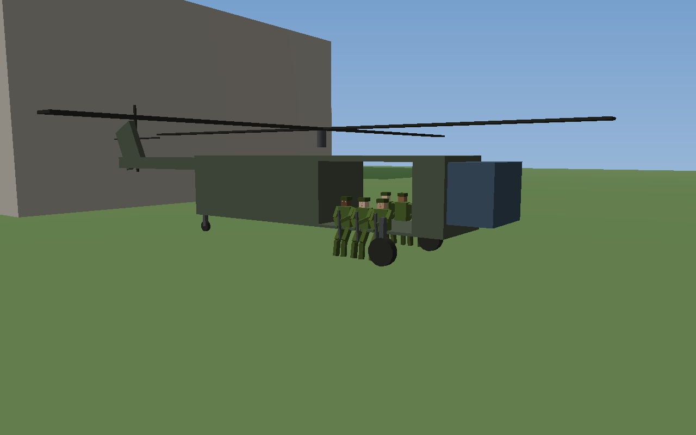 |
| 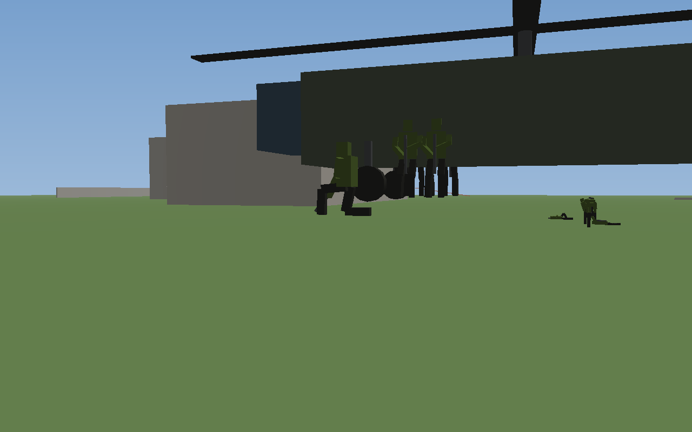 | *the forward left rider, 0.23 s after leaving his seat in a Black Hawk hovering 2 m up: crouched, about 1.7 m in the air below the door* |

### 6n. CE-1085 … CE-1094 — weapon systems, launchers, mortars and guns, the drone, the attack plane — DESIGN `2026-10-14` (ui)

🔒 **User, `2026-10-14`:** *"new type of missile system like NLAW or LAW or Javelin, and new type of weapons like heavy machine gun M2 and the
minigun … mounted to a vehicle with a gunner position … located on the ground, placeable standalone with an operator, or we can carry those
weapons by one or multiple men … two soldiers carrying a stretcher … new types of bombs and aircraft types that can drop bombs and fire the
cannon or a mounted minigun. All those would need map 3d visualization. Pls check and suggest."* → the plan → *"The stuff before approved"*;
the indirect-fire part (R-2018) and its barrel-elevation lean → *"Approved"* → *"Ok go"*.

📐 **INVENTORY** *(graph `search_graph` `.*WeaponSystem.*` Class = 10, `.*ShapeKit.*` = 2, `.*VisualFamil.*` = 1, `.*(Trail|Blast).*` = 7 —
none in Presentation; three Explore sweeps of `docs/` + `.dev/`; the load-bearing lines re-read by hand)*:

| fact | where | so |
|---|---|---|
| a weapon system is an ENTITY (class `WeaponSystem` 1.1.*.50, subclasses HMG .1 · Minigun .2 · ATGM .3 · Launcher .4 · Sentry .5); a mortar is class `Mortar` 1.1.*.10, a towed gun `TowedArtillery` 1.1.*.5, an SP gun `SelfPropelledArtillery` 1.1.*.4 | `EntityClassTable.cs:130-145`, Indirect Fire IF-G | none has a visual family ⇒ an unknown purple box today |
| its deploy state `WeaponSystemState { Deploy, Until }` is replicated to every node | `WeaponSystemComponents.cs` (WS-1) | the drawing reads it on any host — no wire |
| a STATION weapon's transform is placed at its seat by the sim; a CARRIED one sits at the carrier's feet (carry-station place 0,0,0); a gunner in a weapon's own `Gunner` seat stands AT the weapon's origin | `EmbarkedStateSystem.CarryAndKill` (WS-2) | ⭐ station weapons draw where they are; a carried weapon and a gunner need a drawn placement (as §6m's casualty did) |
| ⛔ `Carriage.Of` reads `ModeOf(0)` whenever the carrier's list is not empty — a man with only a weapon in his carry station (seat 1) is drawn CARRYING a casualty | `Carriage.cs:74` (CE-1081, mine) | fix: the casualty seat and the carry station are read separately |
| a weapon system turns on its OWN turret part; its fire is the weapon entity's (`WeaponFireNotification.Shooter` = the weapon) | WS-3, `f656cb38b` | the kits articulate (§3.11) with `_poseOf`; the muzzle flash finds the weapon |
| no replicated "which mount is in his hands"; `WeaponFireNotification { Shooter, WeaponIndex }` reaches every map host (NED ingress on the IG) | `WeaponPosture.cs` (Kind, Target, Point), `WeaponFireIngressTranslator.cs` | ⭐ the launcher in hands follows the LAST SHOT |
| the FPV drone (403) is class `Uav` (1.2.*.50) ⇒ family Jet ⇒ a 15 m F-16; its body is 0.3 m (`Gen.Flight` body radius / height) | `BdcTkbCatalog.DefineFpvDrone`, `EntityBodyLayer3D.Resolve` | a `Drone` family for a ROTORCRAFT Uav, sized from its flight body |
| the A-10 (405) is class `AttackAircraft` (1.2.*.2) ⇒ family Jet; its bombs count down in the replicated `WeaponAmmo` mirror | `BdcTkbCatalog.DefineAttackPlane`, CE-1079 | an attack-plane kit with pylons; the bombs drawn = rounds left |
| a bomb release goes through the ordinary fire path ⇒ a muzzle flash at the nose | `EffectSpawnSystem.cs:63-74` | skip the flash for a `Bomb` mount |
| a smoke trail runs STRAIGHT back to the muzzle (combat node) or along the velocity (viewer) | `ProjectileLayer.TrailOf`, `:130` | a remembered path ⇒ a curved trail on every host |
| a rotor turns only while ≥ 5 m above its resting height | `EntityBodyLayer3D.IsAirborne`, `MotionTracker` | the rotor follows movement too, and spins up / down |
| on the combat node a round knows its `Shooter`; a viewer's round does not | `BallisticProjectile.Shooter`, LR-3 | the gun's laid elevation is exact where combat runs, a default elsewhere (until backend's IF-1 field) |

```mermaid
classDiagram
    direction LR
    class EntityBodyLayer3D { <<existing, grows>> Draw3D · + a second pass for carried weapons · + gunner placement }
    class VisualFamilies { <<existing, grows>> + WeaponSystem · SpArtillery · Drone · AttackJet }
    class WeaponKits { <<NEW static, Map3D>> KindOf(dis) WeaponKind · Stowed(kind) · Deployed(kind) · Blend(t) · GunnerSpot(kind) · OnBack(...) }
    class WeaponKind { <<NEW enum>> Hmg · Minigun · Atgm · Launcher · Sentry · Mortar · TowedGun }
    class ShapeKits { <<existing, grows>> + SpArtillery · Drone · AttackJet (+ pylon bombs, gun) }
    class Carriage { <<existing, FIXED>> Of: casualty seat and carry station apart · + Manning (at his weapon) }
    class FigureCarriage { <<existing, grows>> + Load (the weapon he carries) }
    class BlockFigure { <<existing, grows>> + AtWeapon(kneel) · Shouldered (a tube on the shoulder) · Seated + Stand / Kneel }
    class SeatPose { <<TKB, this lane's CE-1083, grows>> Sit · SitLegsOut · + Stand · Kneel }
    class RecentShots { <<NEW managed singleton>> Last(shooter) (mount, at) }
    class EffectSpawnSystem { <<existing, grows>> writes RecentShots · no flash for a Bomb · + backblast / blast }
    class ProjectileLayer { <<existing, grows>> + RoundTrails (a remembered path) }
    class MotionTracker { <<existing, grows>> rotor spin-up / down, tail rotor, drone rotors }
    class WeaponSystemState { <<existing, replicated>> Deploy · Until }
    class WeaponAmmo { <<existing, replicated>> AmmoOf(mount) }
    EntityBodyLayer3D ..> WeaponKits
    EntityBodyLayer3D ..> VisualFamilies
    EntityBodyLayer3D ..> Carriage
    EntityBodyLayer3D ..> RecentShots : the launcher in hands
    EntityBodyLayer3D ..> WeaponSystemState : stowed / deployed
    EntityBodyLayer3D ..> WeaponAmmo : bombs left
    EntityBodyLayer3D *-- MotionTracker
    WeaponKits ..> WeaponKind
    Carriage --> FigureCarriage
    EffectSpawnSystem --> RecentShots
    BlockFigure ..> SeatPose
```

*What the picture shows that prose hid:* every new look is a KIT or a POSE chosen from facts every host already has (class, deploy state,
seats, ammo mirror, fire notifications) — the only new state is presentation memory (`RecentShots`, `RoundTrails`, the rotor's spin), and
the only TKB change is two more seat poses in the enum this lane added.

```mermaid
sequenceDiagram
    participant L as EntityBodyLayer3D (each frame)
    participant K as WeaponKits
    participant C as Carriage
    participant S as RecentShots
    L->>L: pass 1, every entity
    alt a weapon system on the ground or in a station
        L->>K: Stowed / Deployed / Blend(deploy state, Until)
        L->>L: drawn at its own transform, turret posed (§3.11)
    else a weapon system carried by a man
        L->>L: deferred to pass 2
    else a man in a weapon's Gunner seat
        L->>C: Of = Manning, the weapon
        L->>K: GunnerSpot(kind), turned with the weapon's turret
        L->>L: AtWeapon (kneeling or standing, hands on the grips)
    else a soldier
        L->>S: Last(him) a launcher within 4 s and aimed?
        L->>L: Shouldered (the tube replaces the rifle), else the rifle
    end
    L->>L: pass 2, carried weapons
    L->>K: OnBack(carrier as drawn) — or hidden while he shoulders it
```

```mermaid
graph TD
    CAN[MapCanvas, every 3-D frame] --> EBL[EntityBodyLayer3D, every map host]
    CAN --> PL[ProjectileLayer, every map host]
    CAN --> EL[EffectLayer, every map host]
    WDS[WeaponDeploySystem, the weapon's owner] -->|WeaponSystemState, replicated| EBL
    ESS[EmbarkedStateSystem, every node] -->|IsEmbarkedTag, station transforms| EBL
    MIR[WeaponAmmoMirrorSystem, the brain] -->|WeaponAmmo, replicated| EBL
    FIRE[FireProcessingSystem, the muscle] -->|WeaponFireNotification, NED to every host| ESP[EffectSpawnSystem, every map host]
    ESP -->|RecentShots| EBL
    ESP -->|flash, backblast, blast entities| EL
    LR[LightweightRound ingress, every host] --> PL
```

*Caption:* nothing here runs on the simulation side — every input already reaches every map host; ⚠ `EffectSpawnSystem` is skipped during a
replay (`IsReplayActive`), so in a replay the launcher stays slung and no backblast is drawn (the recorded effects still are).

| decision (✅ user, `2026-10-14`) | rule |
|---|---|
| **N-1 weapon systems** (CE-1087) | one family `WeaponSystem`; the kind from the class chain (HMG, Minigun, ATGM, Launcher, Sentry; + `Mortar`, `TowedArtillery`); each kind a STOWED and a DEPLOYED kit with the same parts in the same order, blended over `Deploying` / `Packing` by `Until`; a station weapon is drawn where the sim put it; its turret and gun articulate |
| **N-2 gunners** (CE-1088) | a man in a weapon's `Gunner` seat is drawn at the kind's operator spot (behind a tripod HMG / ATGM, beside a mortar, left of a howitzer's breech), turned with the weapon's traverse, kneeling or standing with his hands on it, rifle on his back; a seat that declares a place wins. `SeatPose` gains `Stand` (a pickup's pintle gunner) and `Kneel` | ⭐ **As built `CE-1202` (`2026-10-21`)** — 🔒 user, live: *"the gun operator on a mounted weapon is not moving when the weapon turns"*. Measured: the gunner of a VEHICLE STATION (the technical's bed pintle, the HMMWV ring — a `Gunner` seat with its own place, `CarriageKind.Seated`) was placed by his seat alone, and a weapon's own seat with a place ignored the traverse too; only the kit's gunner spot turned. Now both are swung about the weapon's traverse pivot (the kit's, placed by the weapon's transform) by its published azimuth once deployed — `EntityBodyLayer3D.StationTurn` / `TurnedWithStation`, the station found by `SeatSwitch.StationOf` (the seat that OPERATES it). Rails `Map3DTests.CE1202_*`, frame `Map3DFrameRail.CE1202_V_*` (`docs/assets/map-3d/ce1202-gunner-turns.png`).
| **N-3 carried** (CE-1085) | the classifier fix; a carried stowed weapon is drawn slung across the back |
| **N-4 launcher in hands** (CE-1090) | a soldier AIMED within 4 s of firing a launcher (an ATGM mount, or a carried ATGM / Launcher weapon) holds the tube on his shoulder instead of the rifle (the carried weapon is not drawn twice); the flash leaves the tube's front; a recoilless launcher throws a BACKBLAST cone behind it; a mortar / gun throws a ground BLAST ring |
| **N-5 indirect** (CE-1089) | mortar tube at 60°; towed / SP howitzer at 25°; after a shot, on the node running combat, the newest round fired by that gun sets the elevation for 60 s (its launch direction). ✅ `2026-10-15` backend P2 (`b6ad14c83`): mortars 609–611 and the towed 612 have a laying turret, and every indirect gun is LAID (W-9 `TurretPose`) before it fires — `LaidPose` already reads the turret pose first, so a laid tube shows the mission's azimuth and elevation on every node before its first round; the defaults are only for a gun nobody has laid. ⭐ **CE-1114 (`2026-10-15`, user: "the barrel elevation needs to be read and used")** — ⛔ it read the elevation only when NON-ZERO and otherwise guessed it from the gun's newest round on the combat node (60 s): a published level gun (a ZU-23 on the horizon) drew at the default, and the guess existed only where combat runs. Now `ArticulationPose.Published` (set by `TurretPoseSource`) ⇒ the replicated pose is used as is, azimuth and elevation, a 0 included; only a gun with NO turret part gets the default. The round guess (`UpdateLaid`, `RememberLaid`, `LaidSeconds`) is retired — SUPERSEDED by W-9's replicated pose, as this row foresaw. Rail `Map3DTests.CE1114_*`. SP howitzer: a tank hull, a big boxy turret, a long barrel |
| **N-6 trails** (CE-1091) | the smoke trail follows the round's REMEMBERED path (sim time, every host), so a top-attack climb and dive shows; a shell or mortar bomb draws a faint thin streak of its last 2 s |
| **N-7 drone** (CE-1086) | family `Drone` = a `Uav` that flies as a `Rotorcraft`: an X frame, four motor pods, four rotors spinning; sized 2·radius × 2·radius × height from `Gen.Flight` |
| **N-8 attack plane** (CE-1092) | family `AttackJet` (class `AttackAircraft`): straight wings, two engines on the rear fuselage, twin fins, the nose gun, pylons; a bomb per round left on its `Bomb` mount (`WeaponAmmo`) |
| **N-9 rotors** (CE-1093) | a rotor runs while airborne OR moved within the last 20 s, and spins up / down over 3 s; the tail rotor spins about its axle |
| **N-10 bomb release** (CE-1094) | no muzzle flash for a `Bomb` mount |

**Rejected — one line each:**
- *A per-weapon `VisualFamily` (seven new families)* — the families key the icon and size fallbacks; one family + a kind keeps those tables short.
- *Drawing the carried weapon from the figure's parts list* — the weapon is its own entity (picked, selected, killed); it stays its own draw.
- *A replicated "active mount" for the hands* — a wire change (backend's); the last shot is on every host already. ⏭ asked of backend as an improvement.
- *Matching a viewer's new shell to the nearest muzzle for the elevation* — two guns side by side break it (approved lean).
- *A trail in the SIMULATION* — a look; the round's own positions over time are enough.

#### 6n as-built `2026-10-14` (ui)

⭐ **Built as the three diagrams draw it** — `WeaponKits` / `WeaponKind` / `FiringBlast` (`Map3D/WeaponKits.cs`), `RecentShots`
(`Effects/RecentShots.cs`), the four families, `ShapeKits.Drone` / `SpArtillery` / `AttackJet` (+ `AttackJetBombs` / `AttackJetPylons`),
`BlockFigure.AtWeapon` / `Shouldered`, `Carriage` (fixed, + `Manning`, + `Load`), `ProjectileLayer.RoundPath` / `TrailOf(r, path)` /
`StreakOf`, `MotionTracker`'s spool, `PartRole.TailRotor`, `SeatPose.Stand` / `Kneel`. The details the diagrams do not carry:

| as-built detail | why |
|---|---|
| ⚠ `RecentShots` lives BESIDE the world (a `ConditionalWeakTable<EntityRepository, …>`), not as a managed singleton in it | ⛔ a managed singleton needs a central component id (FDP `GlobalComponentIds`) — for one host's drawing memory that must never be saved, recorded or replicated. ⭐ The class diagram's «managed singleton» is SUPERSEDED by this |
| the backblast and gun blast are two new built-in EFFECT TYPES of the existing `Explosion` kind (**7161** Backblast — a 2.6 m dust cloud, **7162** Gun blast — 6 m), no new effect kind; the backblast sits 2.2 m behind the shooter on the line of fire, 1.3 m up | the effect layer already draws a world-fixed expanding cloud; a type is data |
| a gunner at his weapon is drawn at the kind's GUNNER SPOT scaled to the weapon's size and turned with its traverse; a gunner seat that declares a place wins (`Kneel` / `Stand` ⇒ the place is his feet) | ⚠ the spot is the KIT's, not the TKB's: the WS-4 weapon types may later give their gunner seat a place, and then it wins |
| a carried weapon is drawn in a SECOND pass, on its bearer's figure frame as drawn (`OnBack`: its length from the right hip to the left shoulder) | the bearer may be drawn after the weapon in the query order |
| the launcher-on-the-shoulder rule: AIMED and a launcher shot (an `Atgm` mount, or one firing a `Rocket` / `Missile` round — the RPG) by him or by the launcher he carries within **4 s** | ✅ `2026-10-15` CE-1107: ALSO the replicated `WeaponPosture.ActiveMount` (backend P4) — a launcher SELECTED (his own mount, or a carried launcher by its controlled index 32 + k) is shouldered while he aims, before the first shot, on every node |
| the shouldered tube's front is the weapon tip (the muzzle flash), and also the CARRIED weapon's tip — its shot is the weapon entity's (WS-3) | the flash would otherwise leave the weapon at his feet |
| a laid gun: ⭐ CE-1114 — its turret part's replicated pose, as published (a level gun included); with no turret part, **60°** mortar / **25°** howitzer. ⛔ SUPERSEDED: *"else the elevation its newest round left at (seen on this node, 60 s)"* | N-5 |
| ⚠ the A-10's bombs read the `WeaponAmmo` mirror (CE-1079) — present only where a brain mirrors it; elsewhere the full load | an editor's placed plane shows four |
| the rotor: spools over **3 s**; runs while airborne or for **20 s** after it last moved (> 2 cm a frame); a helicopter first seen airborne is at speed. The tail rotor: two crossed blades at **4.7×** the main rotor; the tail-rotor DISC is gone (a spinning disc shows nothing) | ⚠ the old S4 rail's "parked ⇒ rotor 0 at once" moved to "parked ⇒ it runs on, spools down, stands" |
| ⭐ CE-2172 fixed in ALL THREE route gizmos (`RouteWaypointGizmo`, `RouteGizmo`, `AuthoredRouteGizmo`), not only the one the row named — the same Z-as-north read; one helper `RouteGizmo.PointOf` (a flyer's waypoint at ground + `HeightAgl`, else its own Z — 0 drapes) | three copies of one rule had one bug; now one rule |
| the type golden moved on exactly two lines (403 Jet → Drone, 405 Jet → AttackJet) and the class-table sweep on the five classes that now have a family | deliberate |
| ⚠ **finding for backend (WS-4):** a weapon type's `Gen.Carrier` must be `Exposure = Open` (and a pickup's bed station / gunner seat exposed) — the engine's one rule hides an ENCLOSED passenger, so a gunner at a tripod, or the M2 in a bed, of a type left enclosed is neither drawn nor seen | `PhysicalPresence.IsEnclosedPassenger` |

📐 **Rails:** `Map3DTests.CE1085_*` · `CE1086_*` · `CE1087_*` · `CE1088_*` · `CE1090_*` · `CE1091_*` · `CE1092_*` · `CE1093_*` ·
`EffectTests.CE1094_*` · `RouteWaypointGizmoTests.CE2172_*` (+ RWG-002 / RWG-003 and `AuthoredRouteGizmoTests` re-pinned Z-up) ·
`Map3DFrameRail.CE1085_V_*` (the real frame, below).

✅ **(V) — a real frame under Xvfb** (`Map3DFrameRail.CE1085_V_*`):

| | |
|---|---|
| 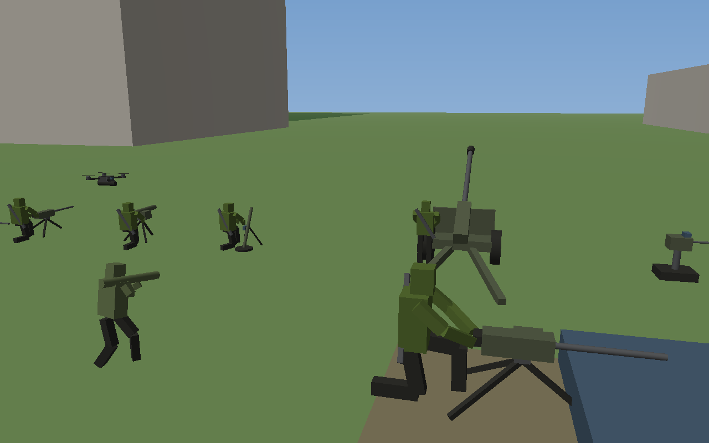 | 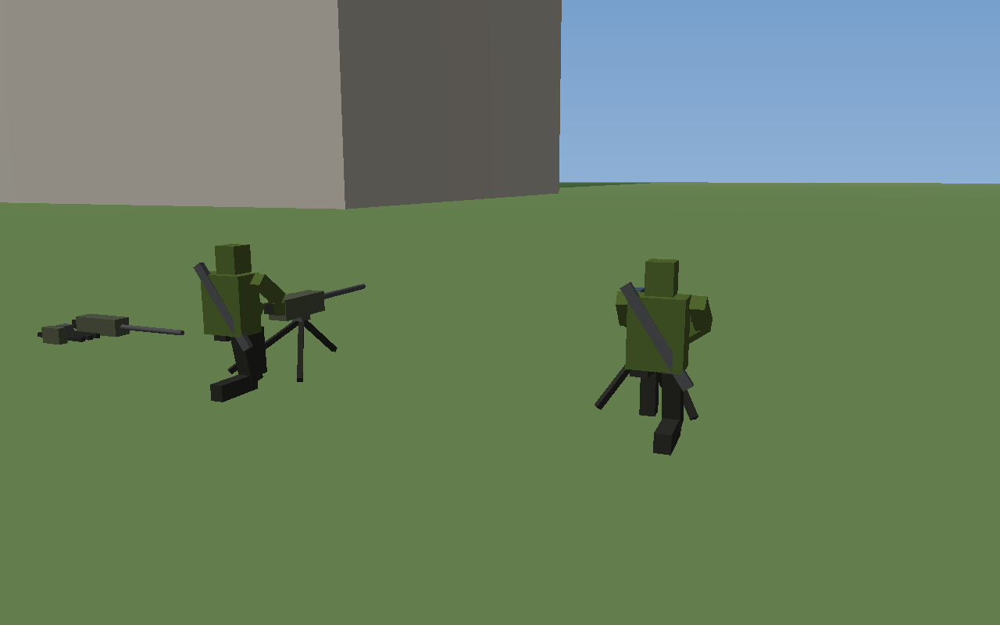 |
| *the row: kneeling gunners at an HMG, a Kornet and a mortar, a towed howitzer with its trails spread, a sentry gun; the Javelin shooter's tube; the drone; the technical's gunner at its bed M2 (front)* | *an HMG stowed (lying) beside one deployed, its gunner at the grips* |
| 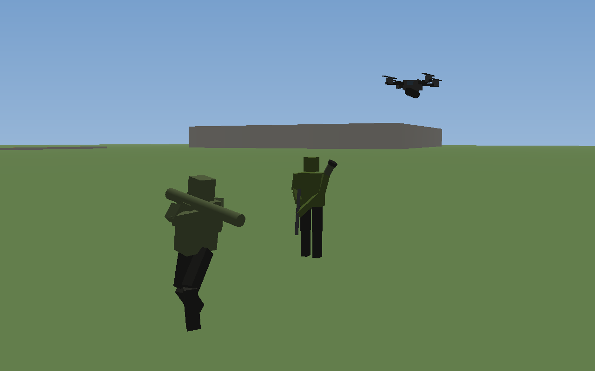 | 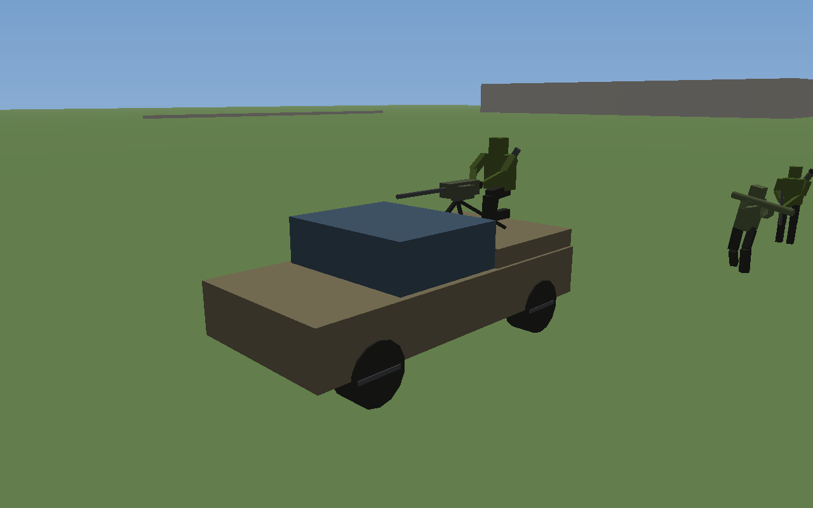 |
| *a Javelin slung across a back; a launcher on the shoulder just after firing; an FPV drone* | *the M2 in the bed's station, its gunner kneeling behind it* |
| 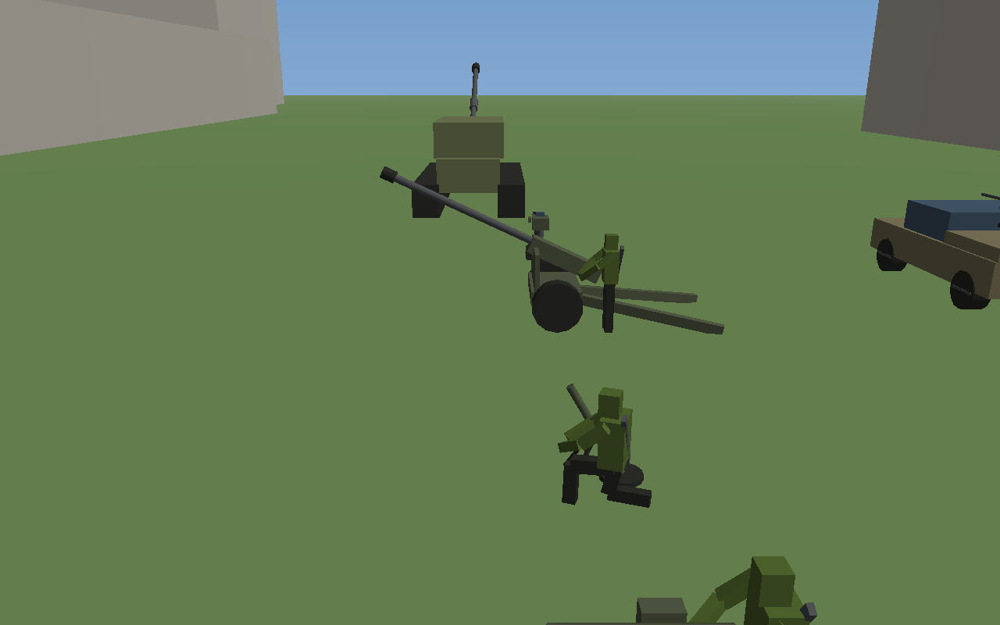 | 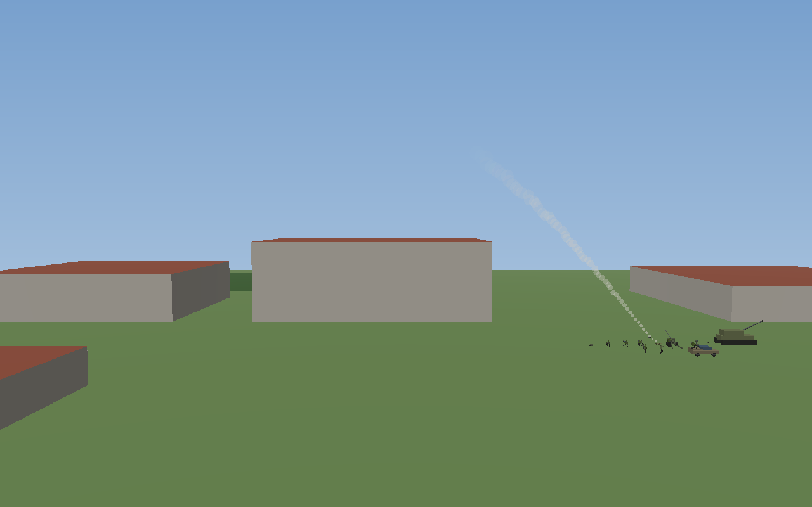 |
| *the howitzer laid at 25°, a man at its breech; the mortar at 60°, its gunner beside it* | *a missile's top-attack trail arcing onto the SP howitzer* |
| 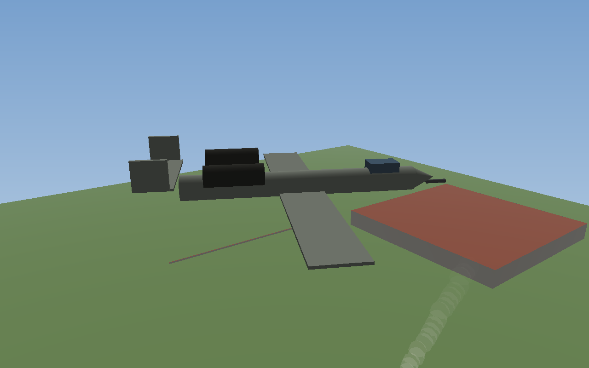 | *the A-10's own airframe: straight wing, engines on the rear fuselage, twin fins, the nose gun* |
| 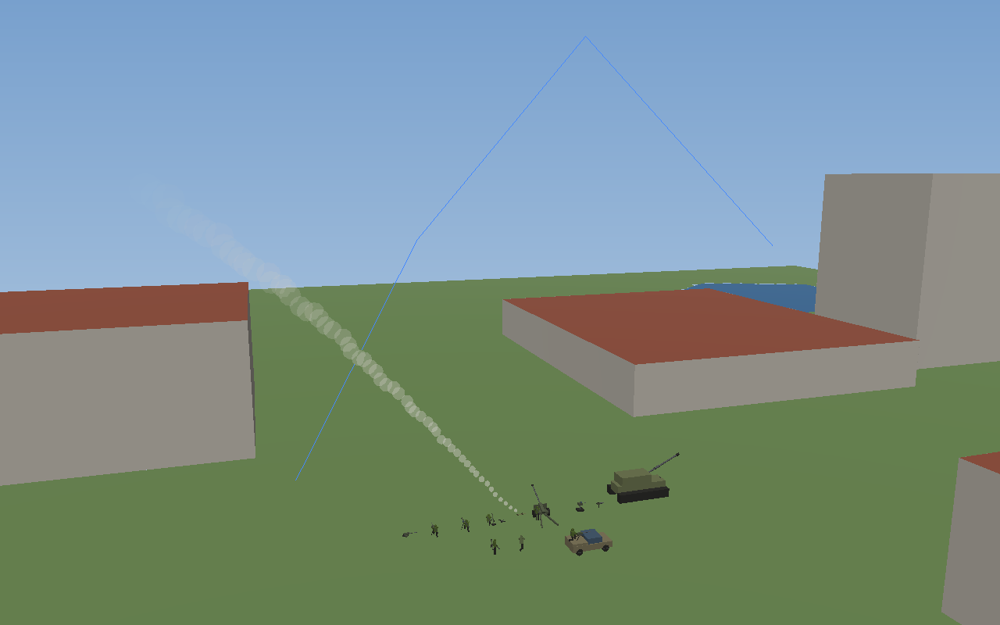 | *a flyer's route drawn Z-up (CE-2172): from its ground start it climbs to each waypoint's height above the ground (CE-1096)* |

⏭ **Built in their OWN designs, not here:** the route gizmo Z-up and the waypoint heights (air hand-off U1 / U2 — CE-2172 / CE-2173,
[DESIGN_Air_Operations.md](designs/air-attack/DESIGN_Air_Operations.md) §5), the pilot station (U3, §6 there and
[DESIGN_Entity_Control.md](DESIGN_Entity_Control.md)), placing a weapon into a station in the editor (weapon-systems hand-off U2, CE-2174). ⏸ **Blocked on
other lanes:** the stretcher / two-man carry poses (team carry T-a), the attack helicopter, door guns, minigun / GAU-8 tracer streams, Hydra
salvoes (air weapons F1–F4), the fire mission's aim points (IF-2), real gun types (IF-1 / WS-4).
⭐ **`2026-10-15` — after merging `behaviors` (T-a, F1–F4, IF-1, WS-4 landed):** UNBLOCKED — the stretcher and the two-man weapon (T-b:
a casualty with `IsEmbarkedTag.Mode == Stretcher` and the `IsAssistingTag` second man), the attack helicopter 406's own kit (it resolves
to the generic helicopter), the door gunners (404's seats 8–11 — ✅ CHECKED `2026-10-15` in `CE1105_V`: they draw through the station path, but the gunner's seat sat inside the fuselage; CE-1106 moved it into the door, §6u), a dense
stream for the M134 / GAU-8 (the clients see only every 5th M134 round, at the behaviour's cadence), the real gun types (600–612 resolve to
the weapon-system kits, 107 to the SP-artillery kit — verified in the picker golden). ~~STILL BLOCKED — the sheaf aim points and the
fire-mission form (behaviors' IF-2).~~ ✅ **DONE `2026-10-16` — §6x** (CE-1121). ⭐ HANDED TO BACKEND (`CE-1102`, [handoff](blueprints/batches/HANDOFF_Ui_To_Backend_Presets_Elevation_Attitude.md)): the laid elevation (P2), pitch and roll (P3), the active weapon (P4), and the weapon presets that replace the editor placement (P1, 🔒 R-1001). ✅ **DELIVERED `2026-10-15` (`b6ad14c83`, merged into ui `103c9903a`)**: P1 / P2 / P3 need no ui change (the HMMWV and the new technicals 108 / 109 draw through the station path; the laid tube through `LaidPose`; the attitude arrives in `SimTransform.Rotation`); ✅ **P3 live-verified `2026-10-16`** (CE-1123: an A-10 in a −60° turn, the same roll and pitch on the IG node as on SimHost); P4 is CE-1107. ⚠ Left: a heading-only attribute patch still levels a banked body ([steer](blueprints/batches/STEER_Backend_P3_Every_Ingress_Restores_Attitude.md) row 7).

⭐ **CE-1108 — found checking P1 in a frame (`CE1102_V`):** the technicals' gunner seat (104 / 105 / 108 / 109) had **no place**, so its
rifleman was drawn at the pickup's reference point, inside the body; the HMMWV's ring gunner sat at 1.2 m and only his head cleared the roof.
Now the pickup gunner KNEELS in the bed behind his pintle (x −2.0, feet at 0.85 m) and the HMMWV's STANDS in the hatch (feet at 0.7 m) — the
gun's pivot at his chest. A gunner seat's place and pose are read only by the 3-D drawing (the sim reads a STATION's place, unchanged). ⚠ A
cross-lane data edit to backend's `BdcTkbCatalog` (`Pickup`, `HmmwvSeats`). Rails `Map3DTests.CE1108_*` (×5), `CE1107_*`; frame rail
`CE1102_V` crews each preset from its own catalogue seats:

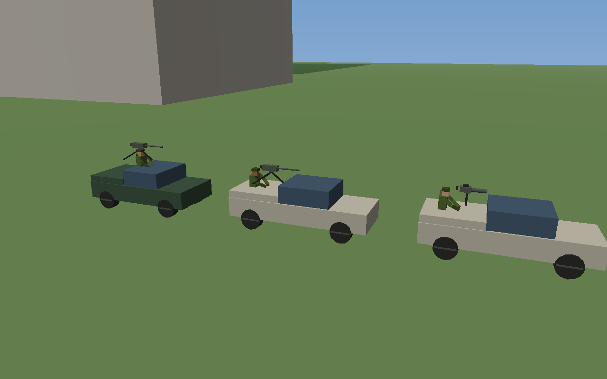

### 6o. CE-1097 — a face: skin, eyes, nose and mouth, a soldier's helmet — DESIGN + AS-BUILT `2026-10-14` (ui)

🔒 **User, `2026-10-14`:** *"give the soldiers some face, now it is just a green expressionless cube, there should be some skin color and
symbolic eyes and nose and mouth and green helmet on the top"*.

📐 **INVENTORY** *(graph `search_graph .*(BlockFigure|ShapeKit|PartColour|KitPart).*` = 7; grep `BlockFigure.|ColourRole.|PartColour(` = 5
files)*: the head is ONE `ColourRole.Body` box in every pose (`BlockFigure`, `ShapeKit.cs` — standing, athletic, crouched, crouched run,
prone, crawl, dead, downed, draped, towed, seated); `EntityBodyLayer3D` is the ONLY renderer of the kits; every pose keeps one part ORDER
(`HeadIndex` 5, `WeaponIndex` 10) that the blends, the first-person eye and the muzzle tip rely on. ⛔ No design in `docs/` or `.dev/`
covers a face (searched `helmet`, `face`, `skin`; the TKB `Accessory` idea is a data idea, not a drawing).

```mermaid
classDiagram
    direction LR
    class KitPart { <<existing, grows>> + Face FaceOn }
    class FaceOn { <<NEW enum>> None · Front · Up · Down }
    class ColourRole { <<existing, grows>> + Skin }
    class BlockFigure { <<existing, grows>> every pose's head Skin with its FaceOn · FaceParts · FaceFrame }
    class FacePart { <<NEW>> Centre · Extent in the head box · Shade }
    class FaceShade { <<NEW enum>> Eye · Nose · Mouth · Helmet · Hair }
    class EntityBodyLayer3D { <<existing, grows>> draws the face on the head part · FaceDetailsDrawn }
    KitPart --> FaceOn
    BlockFigure ..> FacePart
    FacePart --> FaceShade
    EntityBodyLayer3D ..> BlockFigure
    EntityBodyLayer3D ..> KitPart
```

```mermaid
sequenceDiagram
    participant L as EntityBodyLayer3D
    participant F as BlockFigure
    participant H as the head part
    L->>H: BodyTransform, with lean, twist, stance blend
    L->>L: draw the head box in skin
    L->>F: FaceFrame of the head's FaceOn, FaceParts soldier or civilian
    L->>L: draw each face part in the head box's frame, then the head's transform
```

*Caption:* the face is drawn ON the head part, in the head box's own frame, so it follows every lean, twist, stance blend and fall for
free, and the shared part order does not move (no new kit part). The only new fact a pose states is WHICH side of its head box is the face.

| decision | rule |
|---|---|
| **F-1 skin** | every head is `ColourRole.Skin`, one fixed tone |
| **F-2 the features** | two dark eyes, a nose a shade darker than the skin and a dark red mouth, standing a little proud of the face so they read at a distance |
| **F-3 the helmet** | a soldier wears a helmet over the top of the head, a little wider than it, in his UNIFORM colour a step darker — green for the default soldier; a civilian has dark hair instead |
| **F-4 which side is the face** | `FaceOn` on the head part: `Front` (upright, prone, seated), `Up` (on his back — dead, downed, dragged), `Down` (draped over a shoulder); a fall or blend switches it halfway |
| **F-5 the first-person head** | the face is not drawn for the possessed unit's own head (it is not drawn now) |

**Rejected — one line each:** *new kit parts for the eyes and helmet* — every pose's part order (the blends, `HeadIndex`, `WeaponIndex`)
would move; *a fixed olive helmet* — from above the helmet is most of what is seen of a man, and a fixed colour would hide his side;
*rotating the head box in the lying poses instead of a tag* — face-up with the top of the head away from the body needs a turn of 180°
about a diagonal, and the fall blends yaw and pitch linearly, so the head would spin as he falls.

**AS-BUILT** — as drawn above. Rails `Map3DTests.CE1097_*` ×2 (every pose's head and its face side; the face's place, the helmet's colour),
frame rail `Map3DFrameRail.CE1097_V` (`face-*.png`). ⚠ `TkbEntityTypes.CivilianPedestrian` (501) is drawn as a box, not a person —
the civilian figure is `UrbanCombatTkbCatalog.TkbCivilianPedestrian` (1001).

| | |
|---|---|
| 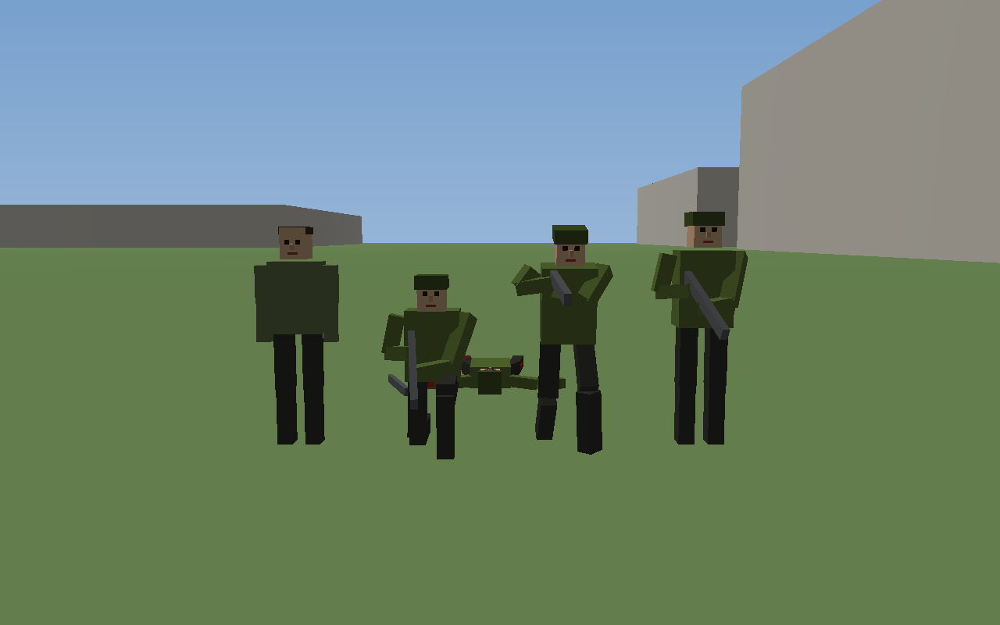 |  |
| *a civilian (hair), riflemen crouched, aimed and ready (helmets in the uniform darker), a dead soldier looking up* | *close: eyes, nose, mouth, the helmet's brim over the brow* |

### 6p. CE-1098 — blood: spots on a hurt man, more as his health drops — DESIGN + AS-BUILT `2026-10-14` (ui)

🔒 **User, `2026-10-14`:** *"Some red blood stains where soldier was hit would also be great … or just repeatably random spots based on
health level"*.

| the choice rests on | code — how it is | design basis |
|---|---|---|
| the sim knows where a bullet struck | ✅ `HitEvent` carries the bullet segment and `HitT` (`FDP/Toolkits/Fdp.Toolkits/Combat/HitEvent.cs`) | ⛔ searched `docs/`, `.dev/` for blood / wound marks: none found |
| …but no node is told where | ✅ the wire carries the damage (`EntityHitDamage`: id + HP) and the health (`EntityDamage`: `Current`, `Max`), no point | `docs/DESIGN_Injury_States.md` owns the injury states (from health), not marks |
| every node has the health | ✅ `EntityDamage` → `Health{Current, Max}` | — |

⇒ the user's second option, which needs nothing new on the wire: **repeatably random spots by health.** The real hit point is a
follow-up if backend ever puts it on the hit message.

```mermaid
classDiagram
    direction LR
    class BlockFigure { <<existing, grows>> MaxStains · StainCount · StainOf · StainDetail }
    class Stain { <<NEW>> Part · Centre · Extent · Fresh }
    class Health { <<existing, replicated>> Current · Max }
    class EntityBodyLayer3D { <<existing, grows>> Bloodied · draws each spot on its part · StainsDrawn }
    BlockFigure ..> Stain
    EntityBodyLayer3D ..> Health
    EntityBodyLayer3D ..> BlockFigure
```

```mermaid
sequenceDiagram
    participant L as EntityBodyLayer3D
    participant F as BlockFigure
    L->>F: StainCount of his health
    L->>F: StainOf his network id, k, for k below the count
    L->>L: draw the figure part by part
    L->>L: after each part, its spots, carried by that part's transform
```

*Caption:* a spot belongs to a PART (by the shared part order) and sits in that part's own frame, so it moves with the limb through every
gait, blend and fall; its place comes only from the man's network id and its number, so every node draws the same spots and a spot never
jumps when another appears.

| decision | rule |
|---|---|
| **B-1 where** | on the torso (three times as often; there the chest twice as often as the back, a side or the shoulders) or a thigh, shin, upper arm or forearm; never the head or the rifle |
| **B-2 how many** | none unhurt, one after any hit, up to 8 at no health left (a dead man shows them all) |
| **B-3 the same everywhere** | seeded by the network id (the entity index where there is none); spot k never changes |
| **B-4 colour** | a fresh red or a dried darker red, half and half |

**Rejected — one line each:** *spots where he was hit* — no node but the one that resolved the hit knows where (a wire change, backend's);
*a random draw per frame* — the spots would flicker; *more spots the longer he is hurt* — health is what every node shares, time since the
hit is not.

**AS-BUILT** — as drawn. Rails `Map3DTests.CE1098_*` ×2 (how many; repeatable, per man, on the body), frame rail `Map3DFrameRail.CE1098_V`
(`blood-*.png`).

| | |
|---|---|
| 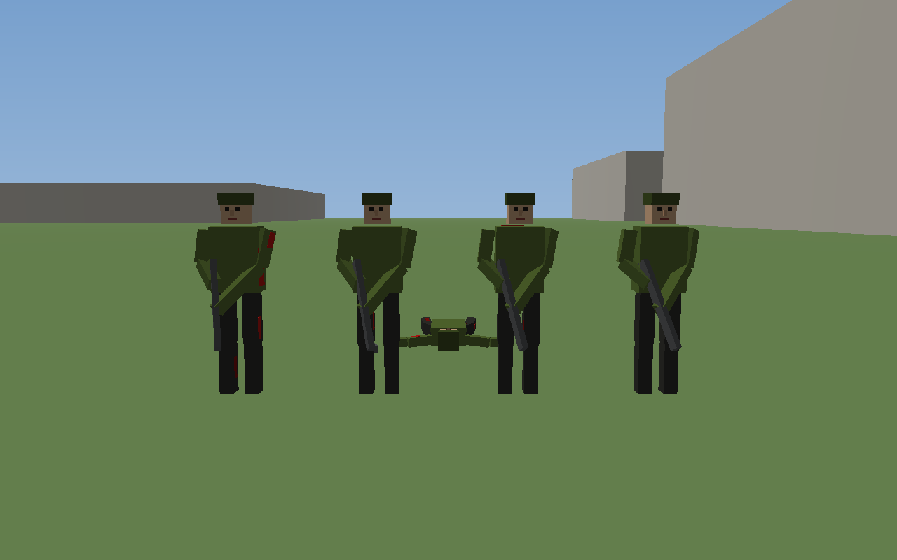 | 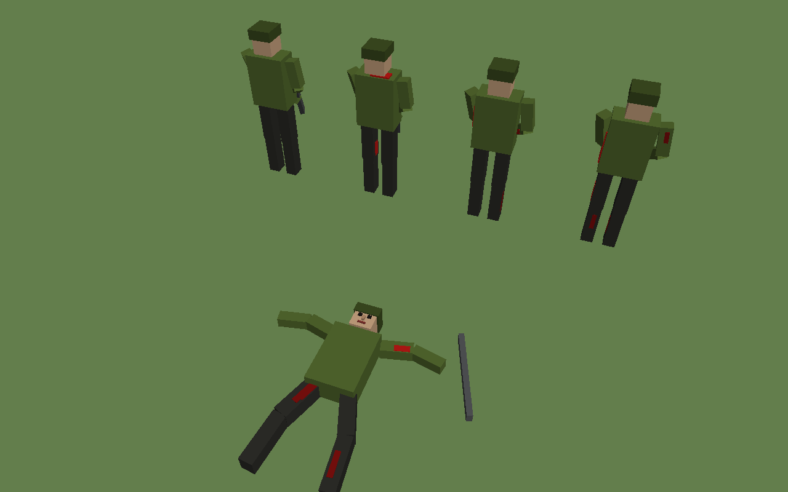 |
| *health 15, 50, 85, 100 (left to right) — the more hurt, the more spots* | *from above; the dead man shows all 8 (some on the sides he lies on)* |

### 6q. CE-1099 — what people wear: civilians in varied clothes, children, a soldier's camouflage by his side — DESIGN + AS-BUILT `2026-10-15` (ui)

🔒 **User, `2026-10-15`:** *"Pedestrians body should not be green, color should vary, derived from tkb type, also some variation of dresses,
short sleeves, skirts, shorts, suits etc. Children also needed. Soldiers also need to differ a bit based on their affiliation, maybe by
different texture of their body uniform?"*

| the design rests on | code — how it is | design basis |
|---|---|---|
| a pedestrian is green because his TYPE has no colour | ✅ `CivilianPedestrian` (1001) has no `VisualDefinitionDto` (`UrbanCombatTkbCatalog.cs`), so `Resolve` falls to `DefaultColour(Person)` = green | ⛔ searched `docs/`, `.dev/` for clothing / camouflage / children: none found |
| a figure's height comes from its type | ✅ `Resolve` scales the figure by `StrideRenderModelDefDto.ShapeHeight` | — |
| every node knows a man's side | ✅ `EntityInfo.ForceId` (Neutral / Friend / Hostile) crosses the wire (`EntityInfoIngressTranslator`) | §3.7 M15 / M16 (the side palette) |
| a soldier is told from a civilian by his type | ✅ `VisualFamilies.IsSoldier`: DIS 3.x.x.1 | — |
| per-man detail can be repeatable on every node | ✅ the blood (§6p) seeds by the network id | §6p B-3 |

```mermaid
classDiagram
    direction LR
    class Outfits { <<NEW static>> For seed, soldier, child, type colour, side · ColourOfPart · Details }
    class Outfit { <<NEW>> Top · Sleeve · Bottom · Shin · Skin · Hair · HairStyle · Legwear · Suit · Camo · Child }
    class PartDetail { <<NEW>> Part · Centre · Extent · Colour · Frame }
    class TypeLook { <<existing, grows>> + TypeColoured · Child }
    class EntityBodyLayer3D { <<existing, grows>> each part in its outfit colour · the outfit's details · DetailsDrawn }
    class UrbanCombatTkbCatalog { <<existing, grows>> + CivilianChild 1003 }
    class EntityInfo { <<existing, replicated>> ForceId }
    Outfits ..> Outfit
    Outfits ..> PartDetail
    EntityBodyLayer3D ..> Outfits
    EntityBodyLayer3D ..> TypeLook
    EntityBodyLayer3D ..> EntityInfo
```

```mermaid
sequenceDiagram
    participant L as EntityBodyLayer3D
    participant O as Outfits
    L->>O: For his network id, soldier or not, child or not, his type's colour, his side
    O-->>L: the outfit, every choice drawn from the seed
    L->>L: draw each part in its outfit colour
    L->>O: Details of the outfit
    L->>L: after each part, its details in that part's frame
```

*Caption:* the outfit (and a car's paint, O-6) is one value computed from facts every node already has, so a man looks the same everywhere and from frame to frame; the
kit and its part order do not change — the outfit only colours the parts and adds details in their frames (as the face and the blood do).

| decision (⭐ lean, built) | rule |
|---|---|
| **O-1 a civilian's colours** | his TYPE's colour when it has one (each man a little lighter or darker, the hue nudged); a type with none picks from a palette of everyday clothes — tops in many colours, trousers in jeans blue, khaki, grey, black, brown |
| **O-2 what a civilian wears** | per man: long or short sleeves (short = skin-coloured forearms); trousers, shorts (skin shins) or — for a woman — a skirt to the knee; sometimes a dark suit with a white shirt and a tie; hair short, long or none, in a natural colour; skin in one of several tones |
| **O-3 children** | a new type `CivilianChild` (1003): a pedestrian 1.25 m tall, slower; drawn smaller with a larger head, in brighter clothes |
| **O-4 a soldier's side** | the uniform keeps its type's colour (or the authored one); trousers the same cloth a shade darker (were black); his SIDE adds a camouflage pattern of patches: Friend — woodland (large brown, dark green and black blotches); Hostile — ~~fleck (many small tan, brown and green spots)~~ ⛔ SUPERSEDED by O-4a: desert; Neutral — plain |
| **O-4a the side picks the CLOTH** (`CE-1235`, `2026-10-21`, R-1020, R-1021) | with no colour of his own (none authored on HIM — ⭐ R-1021: a TYPE colour no longer counts for a soldier), a soldier's cloth is his SIDE's: Friend green-olive `(96,110,72)` + woodland (denser than O-4's), Hostile desert khaki `(190,170,125)` + a desert pattern (large tan, brown and pale-sand patches), Neutral plain olive. A colour authored on him still wins; police keep navy (Civilians U-1). See the note below the table |
| **O-5 the same everywhere** | every choice is seeded by the network id (the entity index where there is none) and the type id |
| **O-6 personal cars** (`CE-1100`, user *"And we need personal car with similar color variety"*) | a car (the `WheeledCar` family) with no colour of its own gets a street paint by its seed — mostly white, black, silver and grey, then blue and red, a few green, beige, yellow, brown; one with its own colour keeps its hue, lighter or darker per car. Glass and wheels keep their shades |

**Rejected — one line each:** *a real texture on the uniform* — the bodies are lit flat-coloured cubes with no texture binding in the shader;
patches in the block style need no shader change and read the same at every distance the boxes do; *colour by side for the whole uniform* —
the side palette is the 2-D map's symbol code, and a red or blue soldier stops reading as a soldier *(⚠ narrowed by O-4a, not
reversed: the side now picks a real uniform's cloth — woodland or desert — never the map's blue or red)*; *the outfit stored as a component* —
nothing would write it on a replica, and the seed already makes it the same everywhere.

**AS-BUILT (`CE-1099`, `CE-1100`)** — as drawn above. Measured on the first frames and changed: dark camouflage patches on olive vanished
under the shading, and a patch on ONE side of a part mostly faced away from the camera ⇒ each pattern mixes light and dark tones, a patch goes
THROUGH its part (it shows on two opposite sides) and a woodland patch on a limb is a band round it; Friend 18 woodland patches, Hostile 30
sand-heavy fleck (a hostile reads paler). ⚠ The fleck stays subtler than the woodland. The blood (§6p) and the camouflage share one
placement of a box on a part's side (`BlockFigure.SpotOnSide`) for the blood; the camouflage places its own through-boxes. Cross-lane:
`Hrot.Core` `UrbanCombatTkbCatalog` gains `CivilianChild` (1003); `UrbanCombatCatalogRails` (SimHost) counts 10 types; the picker golden
lists 1003. Rails `Map3DTests.CE1099_*` ×4, `CE1100_*`; frame rail `CE1099_V` (`dress-*.png`); red-proved 6 ways.

| | |
|---|---|
| 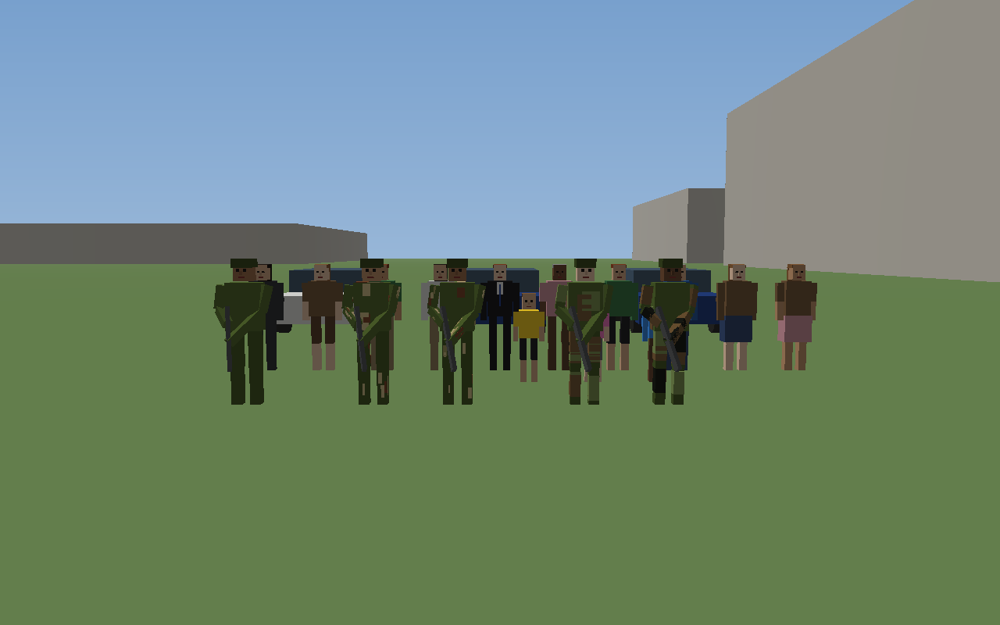 | 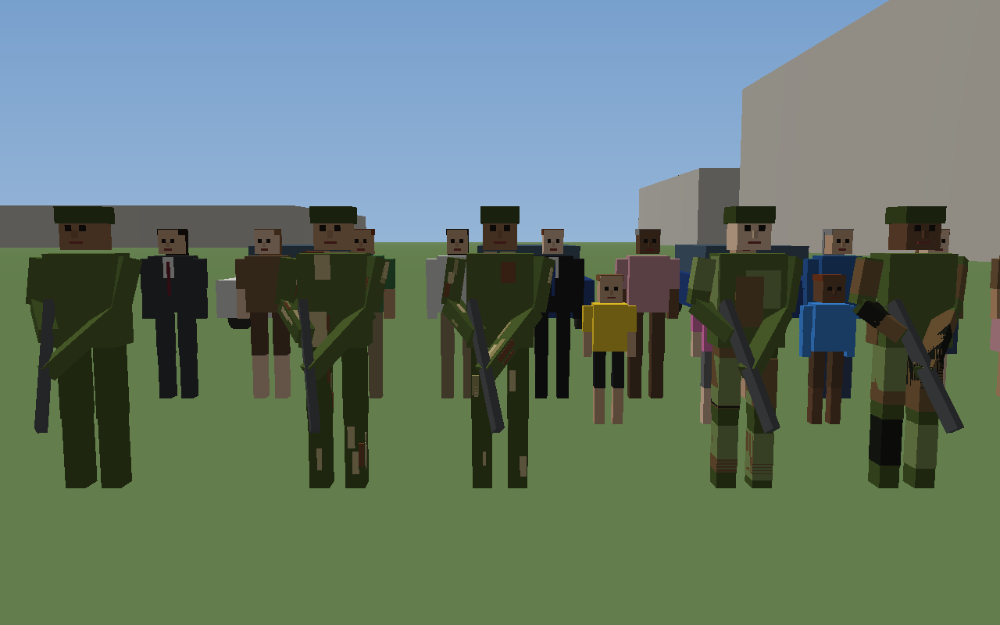 |
| *civilians (suits, skirts, shorts, short sleeves, varied hair and skin), three children, soldiers behind, three cars* | *soldiers by side, right to left: two friends (woodland), two hostiles (sand fleck), a neutral (plain)* |
| 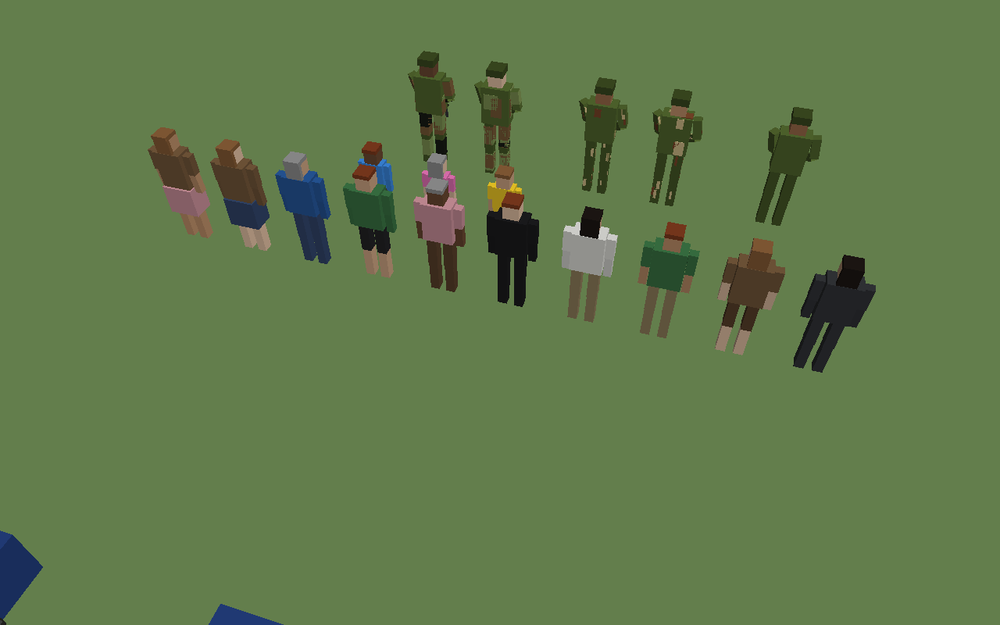 | |

#### 6q.1 O-4a — the side picks the cloth (`CE-1235`, `2026-10-21`, ui) — DESIGN + AS-BUILT

🔒 **User, `2026-10-21`:** *"In the PC House Defend demo, there are two teams, blue one and red one. They are identified by the label card on
top of their head, but their uniforms looks pretty same. … Maybe one team could have a European uniform and the other could have desert
uniforms or something. This could be made generic, like by affiliation. Enemies could could wear a desert uniform?"* — on the lean: *"Yes"*.

📐 **Why they looked alike** (measured): `pc-defend-house` is 18 Friend + 18 Hostile, all soldiers type 2002 with no colour of their own
(`UrbanCombatTkbCatalog.cs:222`), so both wore the default olive; only the pattern differed, and the hostile fleck (S-2: *"small and
sparse"*) covered ~10 % of the cloth in ~6 cm spots — invisible at room distance. O-4 changed the PATTERN by side, never the CLOTH.

```mermaid
graph TD
  EI["EntityInfo.ForceId (scenario)"] --> L3["EntityBodyLayer3D.SideOf"]
  OWN["own colour: entity VisualData / EntityAppearance, or the TKB type"] --> OF
  L3 --> OF["Outfits.For (soldier)"]
  OF -->|"own ?? side cloth"| TOP["Outfit.Top / Bottom"]
  OF -->|"Friend Woodland · Hostile Desert · Neutral None"| CAMO["Outfit.Camo"]
  CAMO --> BS["BodySurface.Camouflage: SurfaceKind.Woodland / Desert (bodyPattern 1 / 4)"]
```

*Caption:* the one input that changed is the cloth's default — `own ?? side cloth` — so an authored or type colour (and the police kit) is
untouched, and a scenario that wants a desert-clad friendly force names the colour on the type or the entity.

| as built | |
|---|---|
| cloth | `Outfits.WoodlandCloth (96,110,72)` for Friend and Neutral, `Outfits.DesertCloth (190,170,125)` for Hostile; trousers ×0.85 as before |
| pattern | `CamoPattern.Desert` / `SurfaceKind.Desert` (shader `bodyPattern 4`): tan / pale sand / brown at a 4.5 per-metre scale (larger than woodland's 5.5); woodland's thresholds lowered 0.60/0.62/0.64 → 0.56/0.58/0.60 (denser). `Fleck` stays a pattern, no longer any side's |
| rails | `Map3DTests.CE1235_ASoldiersSide_PicksHisCloth_*` (cloth gap > 90, trousers > 70, own colour wins, police navy); `CE1099_ASoldiersSide_*` now expects Desert |
| not measured | ⚠ the look in a real dim room — a Windows visual check is owed |
| ~~⚠ found while building~~ ✅ resolved `2026-10-21` (R-1021) | the BDC catalogue's soldier types carry a TYPE colour, olive `#556B2F` (`BdcTkbCatalog.cs:105,281,313`) ⇒ under "the type's colour wins" their men kept olive cloth. A type colour is per type, never per side (one type serves both sides), so it can only make the sides alike. 🔒 User, `2026-10-21`, on the lean to let the side beat it: *"Yes. Another topic."* ⇒ **a SOLDIER's cloth ignores his type's colour; only a colour HE names wins** (`EntityBodyLayer3D.OwnColourOf`). ⚠ The type's colour is stamped onto every spawned entity (`PresentationTkbTranslator.cs:59-69`, `VisualData` + `EntityAppearance`), so "his own" is an entity colour that DIFFERS from his type's. Civilians (O-1) and police keep their type's colour. Rail `Map3DTests.CE1235_ASoldiersTypeColour_*` |

### 6r. CE-1101 — camouflage and faces drawn by the SHADER, not by boxes — DESIGN + AS-BUILT `2026-10-15` (ui)

🔒 **User, `2026-10-15`:** *"Isnt the camouflage build from geometry? Isnt this performance unfriendly? Wouldnt a procedurally generated
texture work better?"* · *"Same for the human faces a guess texture can add same variety and remove unnecessary geometries"*.
⛔ **SUPERSEDES** §6q's camouflage PATCHES (O-4's drawing, and its rejected line *"a real texture … patches need no shader change"*) and
§6o's face FEATURE boxes (F-2). The helmet, the hair and the outfit details (tie, skirt, long hair) stay boxes: they change the outline.

| the change rests on | code — how it is | design basis |
|---|---|---|
| every patch and feature was its own draw call | ✅ `EntityBodyLayer3D` draws each with its own `DrawMesh` (no instancing): a soldier was 11 parts + 5 face + 18 / 30 patches | §6q counted none of it |
| the shader sampled no texture | ✅ `LitShader.cs`: no texture coordinates in, colour = vertex × material | M5: one shader for the 3-D map |
| a part's own frame reaches the shader | ✅ the mesh's local axes are HROT axes behind a fixed basis change (`HrotToRaylib.ModelFromHrot`: raylib-local → HROT-local is `(x, −z, y)`), and a part's size is the length of each model-matrix column | — |
| a texture on the cube would stretch | the cube's texture coordinates run 0–1 on every face; a limb face is 0.12 × 0.44 m | — |

```mermaid
classDiagram
    direction LR
    class LitShader { <<existing FDP, grows>> UseSurface glsl · passes each fragment its part-local unit position, metres and normal · default surface returns the colour }
    class BodySurface { <<NEW Hrot.Presentation>> Glsl · Woodland · Fleck · Face · Plain · uniforms set only on change }
    class FaceLook { <<NEW>> EyeSpacing · MouthWidth · Beard · Brow · EyeColour · Lips }
    class Outfit { <<existing, grows>> + Face FaceLook }
    class EntityBodyLayer3D { <<existing, shrinks>> sets the surface per part · no patches, no feature boxes }
    LitShader ..> BodySurface : the host's surface function
    EntityBodyLayer3D ..> BodySurface
    Outfit --> FaceLook
```

```mermaid
sequenceDiagram
    participant L as EntityBodyLayer3D
    participant S as BodySurface
    participant G as the GPU
    L->>S: a uniform part of a soldier: his pattern, its tones, his seed
    L->>G: draw the part, one call
    G->>G: each fragment: noise in the part's own metres picks a tone
    L->>S: his head: the face side, his face look, hair, eyes, lips
    L->>G: draw the head, one call
    L->>S: anything else: plain
```

*Caption:* the pattern is computed per fragment from the part's OWN frame in metres, so a patch is the same size on a torso and a forearm, it
moves with the limb, and it covers every side; a soldier is back to ~16 draw calls. With the surface plain the shader's output is unchanged,
so the terrain and every other body draw exactly as before.

| decision | rule |
|---|---|
| **S-1 where the code lives** | `LitShader` (FDP) stays generic: a host registers ONE surface function (`UseSurface`); the body patterns are Hrot's (`BodySurface`) |
| **S-2 camouflage** | 3-D value noise in the part's metres, three tones over the uniform: woodland large (a ~0.18 m feature), fleck small and sparse, seeded per man |
| **S-3 faces** | on the head's face side (its `FaceOn`): eye whites with a coloured iris, brows in the hair colour, a nose shade, a mouth; per man the eye spacing, mouth width, brow weight, eye colour, lips, and a moustache or a beard for some men |
| **S-4 what stays geometry** | the helmet, the hair, a skirt, a tie, long hair, the blood spots (≤ 8, only on the hurt) |

**Rejected — one line each:** *a small image on the cube's texture coordinates* — it stretches on limbs and needs the shader changed anyway;
*a texture projected by world position* — the pattern would slide over a walking man; *keep the boxes and skip them far away* — the layer does
not know the camera, and a crowd close up pays in full.

**AS-BUILT (`CE-1101`)** — as drawn above. The pattern runs in the part's own frame in METRES (`LitShader`'s vertex stage passes the
mesh-local position, its size from the model-matrix column lengths, and the normal, all in HROT axes), so a patch keeps its size from torso to
forearm. Measured: the face pass leaves terrain, vehicles and weapons pixel-identical in the existing frame rails (`ws-*`, 15 of 16 green; the
red one, `CE3174_V`, was CE-1079's HUD renumbering, a display-only rail that had not run since — its expectation now reads the HUD as numbered).
A frame rail asserts the shader compiled AND carries the body surface, since otherwise the C# counters would count paint the GPU never did.
Rails `Map3DTests.CE1101_*` (faces vary, only grown men wear beards), `CE1097_*` / `CE1099_*` rewritten for painted features and patterns,
frame rails `CE1097_V` / `CE1099_V` (`FacesPainted`, `CamoPainted`).

| | |
|---|---|
| 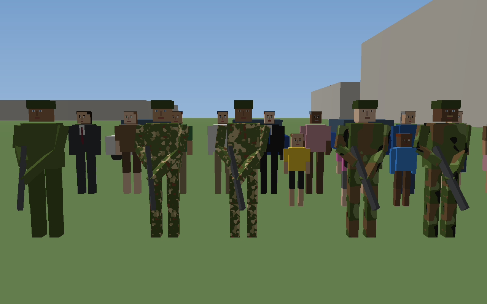 | 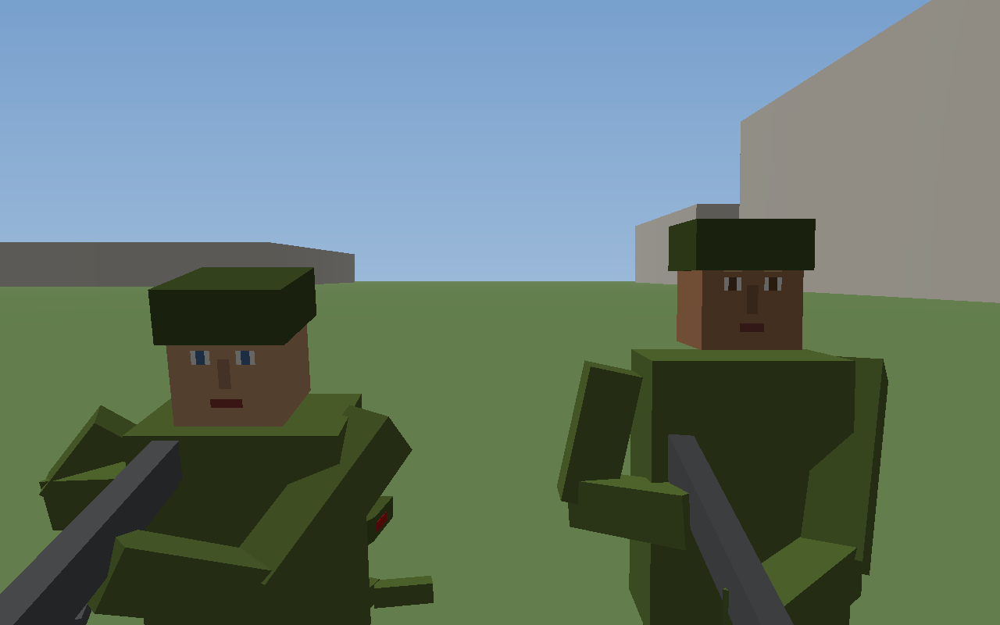 |
| *painted by the shader, right to left: two friends (woodland), two hostiles (sand fleck), a neutral (plain)* | *eyes with irises, brows, the nose's shade and the mouth, per man* |

### 6s. CE-1103 — the AH-64: an attack helicopter's own body, its chin gun turning with its aim — DESIGN + AS-BUILT `2026-10-15` (ui)

🔒 **User, `2026-10-15`:** *"Maybe also an attack helicopter ah64 might be needed"* → the plan *"APPROVED"*.

| the design rests on | code — how it is | design basis |
|---|---|---|
| the type exists, drawn as the generic helicopter | ✅ 406 `Heli_AH64`, DIS 1.2.225.20 (`BdcTkbCatalog.DefineAttackHelicopter`); the class table names `AttackHelicopter` 1.2.*.20 (`EntityClassTable.cs:159`) but the map maps no family to it | Air Operations §7a AW-5 |
| its body is CG-referenced | ✅ `Body.Geometry` 17.73 × 14.63 × 3.87, `BodyCentreX = −1.5`, `BodyCentreZ = 0.6` | G4 (Body Geometry) |
| its chin gun is turret 0 / mount 0 | ✅ `TurretDto` pivot (4.3, 0, −1.0), trunnion +0.2; mount 0 the M134, muzzle +0.8 | AW-5 |
| ⛔ `KitFromTkb` reads the TKB pivot as a box-frame offset | ✅ `KitFromTkb.cs:24` — `turret.PivotX / size.X`, no reference-point shift: right for a ground-referenced tank (offset 0), **wrong for a CG body** (1.5 m aft, 1.3 m low on the AH-64) | — |

```mermaid
classDiagram
    direction LR
    class VisualFamily { <<existing, grows>> + AttackHelicopter }
    class VisualFamilies { <<existing, grows>> AttackHelicopter class to the AttackHelicopter family }
    class ShapeKits { <<existing, grows>> + AttackHelicopter kit, its size }
    class KitFromTkb { <<existing, fixed>> the TKB pivot shifted from the body reference to the kit box }
    class MotionTracker { <<existing, grows>> the attack helicopter's rotor spools like a helicopter's }
    class EntityBodyLayer3D { <<existing>> poseOf, the chin turret's TurretPose }
    VisualFamilies ..> VisualFamily
    ShapeKits ..> VisualFamily
    EntityBodyLayer3D ..> KitFromTkb
    EntityBodyLayer3D ..> MotionTracker
```

```mermaid
sequenceDiagram
    participant L as EntityBodyLayer3D
    participant K as KitFromTkb
    participant P as TurretPoseSource
    L->>K: the AH-64 kit, its template, its size
    K-->>L: turret and barrel at the TKB pivot, shifted into the kit box
    L->>P: the chin turret's azimuth and elevation
    L->>L: draw: the gun turns and lifts with its aim, the rotors spin while it lives
```

*Caption:* nothing new reaches the map — the family, a kit, and one fix that makes a CG-referenced turret land where the TKB puts it.

| decision | rule |
|---|---|
| **H-1 the body** | a slim fuselage with a stepped tandem canopy (gunner low in front, pilot raised behind), a nose sensor ball, engine nacelles either side of the mast, stub wings with a rocket pod and a missile rail each side, a long tail boom with a swept fin, a horizontal stabiliser and a tail rotor on the left, a four-blade main rotor |
| **H-2 the chin gun** | an articulated turret + barrel under the nose, placed by the TKB turret and turned by the replicated `TurretPose` (as a tank's) |
| **H-3 rotors** | spin while it lives, as the helicopter's (S4 spool) |

**Rejected — one line each:** *the UH-60 kit for the AH-64* — wide cabin, no wings, no chin gun, so an attack helicopter reads as a
transport; *a turret fix only for this type* — every CG-referenced body with a turret would carry the same error.

**AS-BUILT** — as drawn. The kit is authored in the AH-64's own centre-of-gravity metres and put into its box by the geometry's offsets, so
it agrees with the TKB's wheels and turret. `KitFromTkb` now shifts the TKB pivot by the box offset (zero for every ground-referenced type,
so tanks are unchanged — the E4b rail still holds them). ⭐ The E4b rail (the drawn barrel tip within 5 cm of `Muzzle.TryOf`) gained the
AH-64 AND the renderer's box offset (`kitToBody`) — without it the rail could never have seen this class of error. Rails
`Map3DTests.CE1103_*`, `E4b_*` (+ AH-64), frame rail `CE1103_V` (`ah64-*.png`).

| | |
|---|---|
| 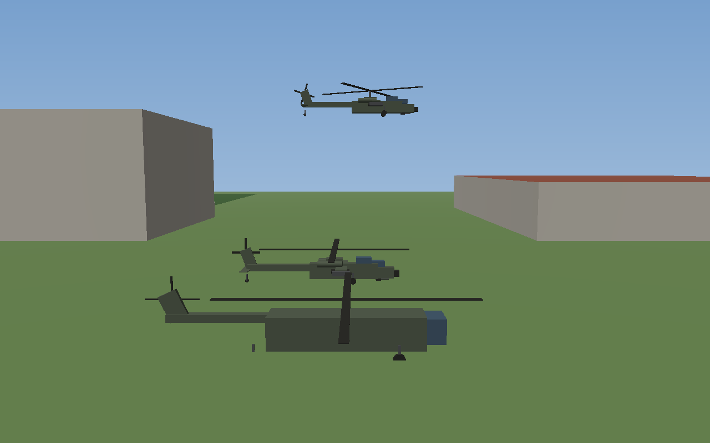 | 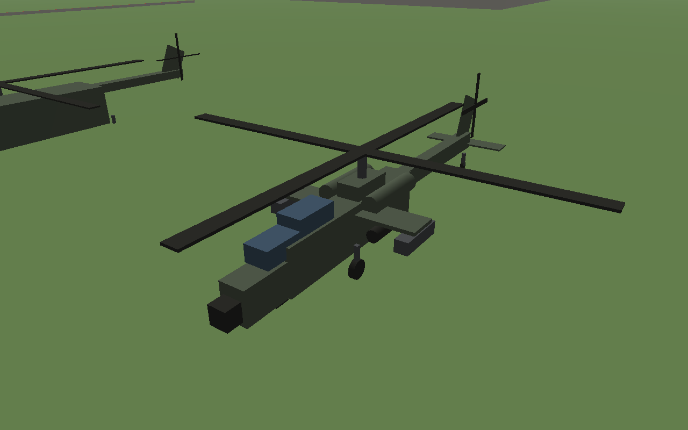 |
| *one hovering with its rotors turning, one on its wheels, a UH-60 in front for scale* | *the tandem canopy, the nose sensor, the stub wing's pod and rail, the tail rotor on the left* |

### 6t. CE-1104 — the stretcher and the two-man weapon: two men carry one load (team carry T-b) — DESIGN + AS-BUILT `2026-10-15` (ui)

🔒 **User, `2026-10-14`:** *"we might need aomething like that for medics carrying stretcher with wounded soldier"* · *"Approwed"* (R-2017) →
`2026-10-15` the plan *"APPROVED"*. The sim half is T-a (backend, built); this is its drawing ([Entity Interactions
§7.5](DESIGN_Entity_Interactions.md) T-b).

| the design rests on | code — how it is | design basis |
|---|---|---|
| a stretcher is a CARRY MODE, not an entity | ✅ `CarryMode.Stretcher = 3` in `PassengerBuffer.Modes`; the casualty's `IsEmbarkedTag.Mode == Stretcher`, his holder the front carrier | §7.5 T2 |
| the second man is named by the carrier | ✅ `PassengerBuffer.Assistant`; he carries `IsAssistingTag { Carrier }`, derived on every node | §7.5 T1 |
| the sim already places all three | ✅ the assistant `AssistantBehindMetres` (2 m) behind the carrier, the casualty half way | §7.5 T3 |
| a two-man weapon is a `TwoMan` weapon system in the carry station with an assistant | ✅ `Embarkation.IsTwoManWeapon` | §7.5 |
| ⛔ the map does not know any of it | ✅ `Carriage.Of`: a `Stretcher` casualty falls to `Free` (drawn standing), the carrier to `Carrying` (the shoulder pose); nothing reads `IsAssistingTag` | — |

```mermaid
classDiagram
    direction LR
    class CarriageKind { <<existing, grows>> + OnStretcher · StretcherFront · StretcherRear · TeamFront · TeamRear }
    class FigureCarriage { <<existing, grows>> + Partner, the other man of the pair }
    class Carriage { <<existing, grows>> reads the Stretcher mode and IsAssistingTag · LitterFrame }
    class BlockFigure { <<existing, grows>> OnLitter, the casualty and the litter · HandleArms, both hands on the handles }
    class ColourRole { <<existing, grows>> + Canvas }
    class EntityBodyLayer3D { <<existing, grows>> the litter frame for the casualty · a two-man weapon between the pair }
    Carriage ..> CarriageKind
    Carriage ..> FigureCarriage
    EntityBodyLayer3D ..> Carriage
    EntityBodyLayer3D ..> BlockFigure
```

```mermaid
sequenceDiagram
    participant L as EntityBodyLayer3D
    participant C as Carriage
    participant F as BlockFigure
    L->>C: the casualty: OnStretcher, his carrier, the assistant
    C-->>L: the litter frame, midway between the pair at hand height, facing the carrier's way
    L->>F: OnLitter: him on his back on the litter, poles and canvas
    L->>C: the carrier: StretcherFront · the assistant: StretcherRear
    L->>F: HandleArms: hands behind him on the front handles, or ahead of him on the rear ones
    L->>L: a two-man weapon: drawn between the pair, at the same height
```

*Caption:* the three are found from facts every node has (the carrier's list, the derived tags); the drawing only moves the casualty onto a
litter between the two men and their hands onto its handles — the sim's places are kept.

| decision | rule |
|---|---|
| **T-b1 the casualty** | on his back on the litter, head toward the front man, arms along his sides (a soldier's rifle on his chest); the litter midway between the pair at 0.80 m, facing the front man's way |
| **T-b2 the litter** | two poles 1.7 m long and a canvas between them |
| **T-b3 the carriers** | the front man's hands behind his hips on the front handles, the rear man's ahead of him on the rear ones; both walk with their gait; a soldier's rifle slung |
| **T-b4 a two-man weapon** | stowed, between the pair at hand height, both men's hands on it |

**Rejected — one line each:** *a stretcher entity* — the sim ruled it a carry mode (T2), so the drawing needs none; *the litter at the casualty's
own place and height* — he is placed on the ground by the sim, the litter belongs in the men's hands.

**AS-BUILT** — as drawn. A two-man weapon's stowed kit is centred on the hands by its own height (measured: a fixed share of its size
left a stowed 120 mm mortar on the ground). ⚠ A carried weapon must carry `IsEmbarkedTag.Exposed = 1` to be drawn at all (the enclosed-
passenger rule hides `Exposed = 0`) — true of the sim's carry station; the rail sets it. Rails `Map3DTests.CE1104_*` (the classifier and the
team frame; the litter and the hands), frame rail `CE1104_V` (`team-*.png`).

| | |
|---|---|
| 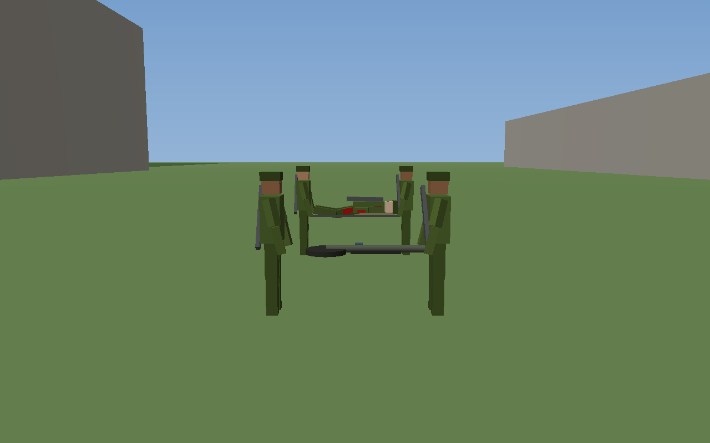 | 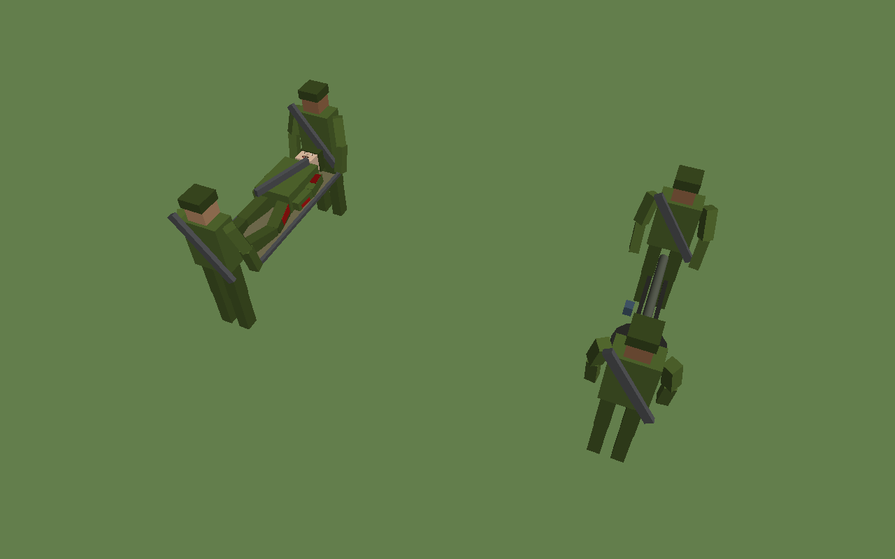 |
| *behind: two medics carry a wounded soldier on a stretcher; in front: a mortar team carries a 120 mm mortar between them* | *from above* |

### 6u. CE-1105 — a burst you can see: automatic fire draws a stream from the muzzle — DESIGN + AS-BUILT `2026-10-15` (ui)

🔒 **User, `2026-10-15`:** the plan (*"minigun / GAU-8 streams … build after the AH-64"*) *"APPROVED"*.

| the design rests on | code — how it is | design basis |
|---|---|---|
| a node sees only some rounds of a fast gun | ✅ only rounds whose munition has a look replicate (`FireProcessingSystem.cs`, `LightweightRound`): the M134 fires 7.62 ball with one tracer in five, so four in five rounds are invisible on every node | Visual Effects §8.5 LR-1 / LR-4 |
| …and at the behaviour's cadence, not the gun's | ✅ one intent per shot at the action's `CooldownSeconds`; the catalogue's `RateOfFire` (3000 / 3900) reaches no mount (`WeaponMountDto` has none) | — |
| every map host hears every shot | ✅ `WeaponFireNotification` (shooter, target, mount) reaches every map host; `EffectSpawnSystem` already writes `RecentShots` from it (CE-1090) | §6n N-4 |
| where a muzzle is | ✅ `Muzzle.TryOf(world, shooter, mount, out muzzle, out forward)` — the round's own origin (E4b holds the drawing to it) | VE-L |

```mermaid
classDiagram
    direction LR
    class RecentShots { <<existing, grows>> + where the shot was aimed · Recent }
    class FireStreams { <<NEW Hrot.Presentation.Effects>> IsAutomatic · Dashes · Window · Spacing · Speed }
    class EffectSpawnSystem { <<existing>> records the aim point with the shot }
    class ProjectileLayer { <<existing, grows>> draws the streams · StreamsDrawn }
    EffectSpawnSystem ..> RecentShots
    ProjectileLayer ..> RecentShots
    ProjectileLayer ..> FireStreams
```

```mermaid
sequenceDiagram
    participant S as EffectSpawnSystem
    participant R as RecentShots
    participant P as ProjectileLayer
    S->>R: a shot: shooter, mount, time, aim point
    P->>R: shots within the window
    P->>P: an automatic mount only, its muzzle from Muzzle.TryOf
    P->>P: dashes from the muzzle toward the aim point, running outward at bullet speed, fading
```

*Caption:* the stream is drawn from what every node already hears — no entity, no wire; the real tracer rounds still fly as before.

| decision | rule |
|---|---|
| **B-1 which guns** | a mount whose category is `MachineGun` or `Autocannon` (M134, M2, DShK, a coax, the Bradley's 25 mm, the GAU-8); rifles, launchers and big guns keep their single round |
| **B-2 the stream** | for 0.35 s after each shot: dashes 1.8 m long every 5 m from the muzzle toward the aim point (its target, else where its posture aims, else straight out of the muzzle), running outward at 900 m/s, fading; at most 500 m |
| **B-3 the look** | the tracer colour (additive), as wide as a tracer on screen |

**Rejected — one line each:** *spawn the missing rounds on every node* — the wire carries one in five on purpose (LR-1); *read the catalogue's
rate of fire* — no mount carries it; *a stream for every weapon* — a rifle shot or a tank round is one round, and a stream would lie.

**As-built `2026-10-15`** — matches the diagrams. `FireStreams` (`Hrot.Presentation/Effects/FireStreams.cs`) is pure (`IsAutomatic`, `Dashes`);
`RecentShots.Record` gained the aim point (`EffectSpawnSystem`: the target's position, else `AimPointOf` the shooter's posture) and `Recent(now,
seconds)`; `ProjectileLayer.DrawStreams` runs after the rounds, skips a dead shooter or a non-automatic mount, and draws each dash as an additive
cone in tracer orange whose alpha falls with the window. A station weapon (a door gun, a pintle M2) streams from ITS OWN muzzle — the shooter is
the weapon entity. Rails `EffectTests.CE1105_*` ×3, frame rail `Map3DFrameRail.CE1105_V` (an AH-64's chin gun at a T-72, and a doors-off UH-60's
right door gun):

⭐ **CE-1106 — found by this rail:** the doors-off UH-60's door gunner (seats 8 / 10) sat 0.95 m off the centreline, INSIDE the fuselage box —
only his legs and arms showed, below his gun. His seat moved into the door like the riders' (|Y| 1.05, `SitLegsOut`), and his station in front
of him with its pivot at his chest (`BdcTkbCatalog.DoorSeats`; a cross-lane edit to Air Ops F4's catalogue data). Rail `Map3DTests.CE1106_*`.

| 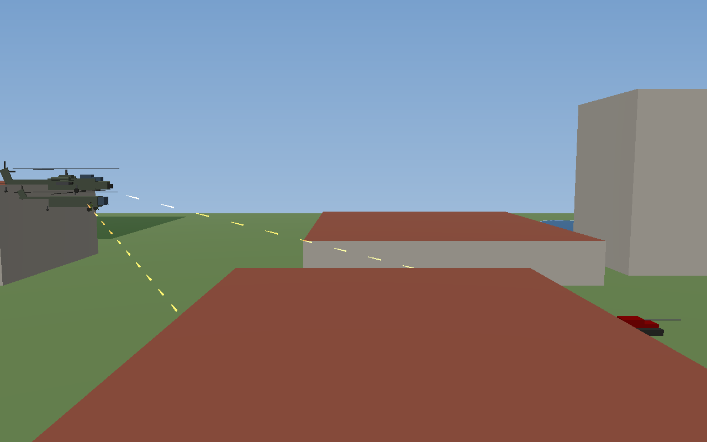 | 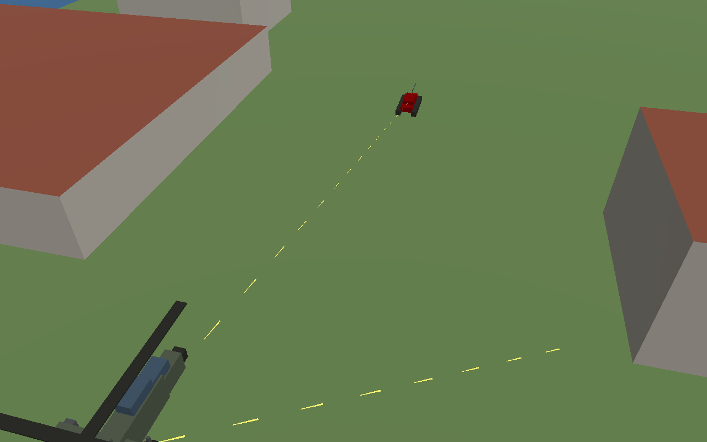 | 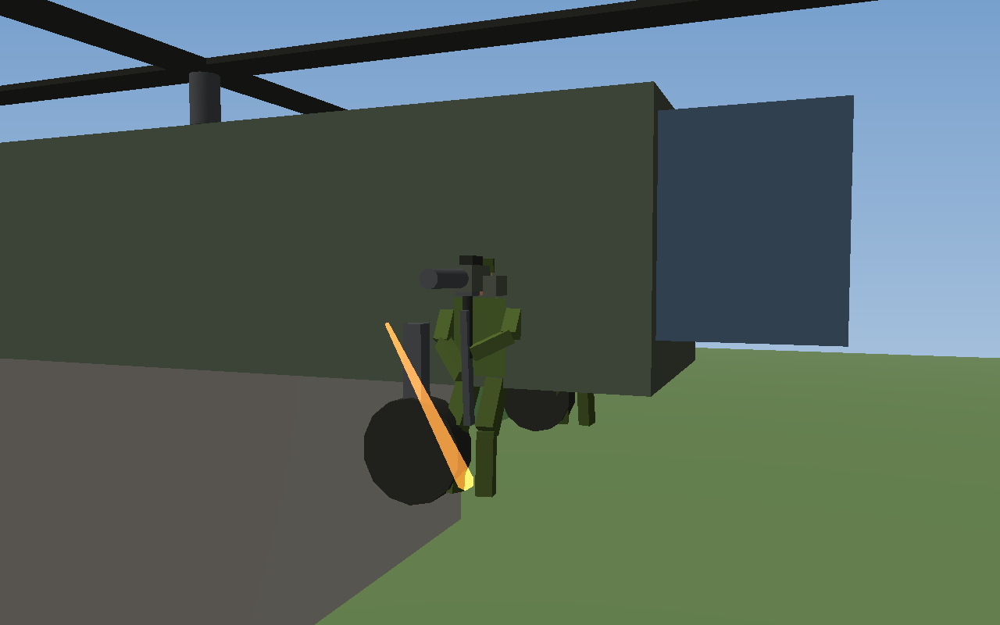 |
|---|---|---|

### 6v. CE-1112 / CE-1113 — air defence drawn: the MANPADS, the ZU-23-2, their gunners and technical; no scorch under an air burst — DESIGN `2026-10-15` (ui)

🔒 **User, `2026-10-15`:** *"pls implement the visualization of new weapons ammos vehicles and effects"* — backend's air defence (CE-2187,
CE-2190; Weapon Systems §5c) added launchers 613 / 614 (DIS 1.1.*.50.6), the ZU-23-2 615 (1.1.*.50.7), gunners 202 / 203 and technical 110.

**INVENTORY** (`git diff e5b108c89..HEAD` over the TKB catalogues; `search_graph` / grep for the drawing seams):

| the design rests on | code — how it is | design basis |
|---|---|---|
| a weapon system's look is chosen by its CLASS chain | ✅ `WeaponKits.KindOf` walks `EntityClassTable.Chain` (`WeaponKits.cs:37`) | §6n N-1 |
| 50.6 / 50.7 have no class row ⇒ they draw as an HMG | ✅ `EntityClassTable.cs:140-145` stops at 50.5; `KindOf` falls back to `Hmg` | — |
| …so a Stinger gunner never shoulders it, and wears an HMG on his back | ✅ `EntityBodyLayer3D.Shouldering` (`:659`, `:667`) and `BlastOf` key on `Launcher or Atgm` | §6n N-3, N-4 |
| the missiles and 23 mm rounds already have looks (smoke trail, tracer) and the ZU-23 streams | ✅ `MunitionTkbCatalog` visuals 6030–6033 (backend); `FireStreams.IsAutomatic` takes `MachineGun` | §6u B-1 |
| a proximity burst has no target ⇒ the hit draws a ground decal under it, however high | ✅ `BallisticsSystem.cs:237` `Target = Entity.Null`; `EffectSystems.cs:107-111` | VE-M |
| a pickup's station puts the weapon's ORIGIN at 1.6 m (an HMG pivot at 1.9 m) and its gunner kneels behind | ✅ `BdcTkbCatalog.Pickup` (`PintleZ`, the CE-1108 seat) | §6n CE-1108 |

```mermaid
classDiagram
    direction LR
    class EntityClassTable { <<existing, grows>> + ManpadsWeaponSystem 1.1.*.50.6 · + AaGunWeaponSystem 1.1.*.50.7 }
    class WeaponKind { <<existing, grows>> Hmg · Minigun · Atgm · Launcher · Sentry · Mortar · TowedGun · + Manpads · + AaGun }
    class WeaponKits { <<existing, grows>> KindOf · Kit · GunnerSpot (+ pose) · + IsShoulderFired(kind) · BlastOf }
    class EntityBodyLayer3D { <<existing>> GunnerFrame (+ pose: a seated gunner) · Shouldering }
    class EffectSpawnSystem { <<existing>> + a decal only for a burst near the ground }
    WeaponKits ..> EntityClassTable
    WeaponKits --> WeaponKind
    EntityBodyLayer3D ..> WeaponKits
```

```mermaid
sequenceDiagram
    participant L as EntityBodyLayer3D
    participant K as WeaponKits
    participant C as EntityClassTable
    L->>K: TypeOf(weapon) for a 615
    K->>C: Chain(1.1.*.50.7)
    C-->>K: WeaponSystem, AaGunWeaponSystem
    K-->>L: AaGun: the ZU-23 kit (stowed on its wheels / deployed on its jacks)
    L->>K: GunnerSpot(AaGun)
    K-->>L: the left seat, SITTING
    L->>L: the gunner drawn seated on it, turning with its traverse
```

*Caption:* nothing new reaches the wire — the class row alone routes every existing drawing (kit, gunner, carry, shoulder, backblast) to the
new kinds.

| decision | rule |
|---|---|
| **AD-V1 classes** | `ManpadsWeaponSystem` (1.1.*.50.6) and `AaGunWeaponSystem` (1.1.*.50.7) in the class table; `KindOf` maps them to `Manpads` / `AaGun` |
| **AD-V2 the MANPADS** | a slim 1.5 m tube with a grip stock, a battery unit under the front and a folded antenna — the same lying kit stowed and deployed, like a Launcher; shouldered and back-blasting like one (`IsShoulderFired`: Launcher, Atgm, Manpads — one helper for the three copies) |
| **AD-V3 the ZU-23-2** | two 2.6 m barrels with flash hiders above a cradle with an ammunition box each side, a turret ring, two seats; STOWED on its two wheels with the barrels level forward, DEPLOYED lowered onto three jacks with the wheels lifted — the same 17 parts, so a deploy blends |
| **AD-V4 a seated gunner** | `GunnerSpot` returns a POSE (kneel / stand / sit); the ZU-23's gunner SITS on its left seat (hips at the seat), turning with its traverse |
| **AD-V5 technical 110** | the bed holds the ZU-23 ON its floor (its origin at the bed, not at the HMG pintle height) and its gunner sits on the gun's seat — a cross-lane edit to backend's `Pickup` preset data (as CE-1108) |
| **AD-V6 no scorch in the air** | a hit with no body leaves a decal only when it burst within 2 m of the ground |

**Rejected — one line each:** *a ZU-23 per-type override in the drawing* — the class chain already routes every weapon (N-1); *the MANPADS as
a plain Launcher* — a 1.5 m Stinger with a grip stock is not a 1.1 m Javelin tube, and the class row is needed anyway for the picker folder;
*skip decals for SAM ammo only* — any burst in the air (a bomb's airburst later) has the same problem.

**As-built `2026-10-15`** — matches the diagrams, plus one finding from the frame. `EntityClassTable` rows 50.6 / 50.7; `WeaponKind.Manpads` /
`AaGun` with their kits (`WeaponKits.Manpads`, `AaGun`: 17 parts, stowed on its wheels / deployed on its jacks); `GunnerSpot` returns a
`SeatPose` and `EntityBodyLayer3D`'s manning branch draws `Sit` as `BlockFigure.Seated` with the hips at the spot (its `GunnerFrame` gives the
pose); `WeaponKits.IsShoulderFired` replaces the three `Launcher or Atgm` copies (`Shouldering` ×2, `BlastOf`). `EffectSpawnSystem` scorches
only for a burst within `DecalMaxBurstHeight` (2 m). Technical 110: `BdcTkbCatalog.Pickup` gained `stationZ` and `gunnerSeat` (defaults
unchanged for 104–109), and 110 passes the bed floor (`BedFloorZ` 0.85 m) and a `Sit` seat on the gun's left seat.
⭐ **Found by the frame:** on the technical the deployed gun's lifted wheels stood out of the bed ⇒ **AD-V5b** `WeaponKits.Mounted`: a weapon
embarked in a vehicle's station draws without its ground carriage (the ZU-23's jacks and wheels; every other kind keeps all parts). Rails
`Map3DTests.CE1112_*`, the class rows folded into `CE1087_*`, `EffectTests.CE1113_*`; frame rail `Map3DFrameRail.CE1112_V`:

|  |  |  |
|---|---|---|

### 6w. CE-1119 — airborne drawn: the fast rope, the round and ram-air canopies, a pose for every descent phase — DESIGN + AS-BUILT `2026-10-16` (ui)

📄 Owning design: [Airborne Insertion](designs/airborne/DESIGN_Airborne_Insertion.md) item **U-1** (approved with it, R-1003); this section is
the drawing's own design. 🔒 User, `2026-10-16`: *"Approved, go autonomously"*. Backend built the engine half (B-1…B-5, §7a / §7b there).

**INVENTORY** (`search_graph` Map3D classes — 40, `BlockFigure`, `Carriage`, `DismountDrop`; `scripts/find.sh Descent` — no reader outside the
engine and the NED translators):

| the design rests on | code — how it is | design basis |
|---|---|---|
| a body coming down carries a replicated `Descent` (Kind, Phase, Canopy, PhaseSince, Anchor, AnchorIndex) | ✅ `Fdp.Toolkits/Motion/Descent.cs`; egress / ingress `EntityDescentTranslators.cs` | Airborne D-1, §7a |
| the canopy's bank IS the body's roll in `SimTransform.Rotation` | ✅ `ParachuteModel` writes it; P3 put pitch / roll on the wire (CE-1102) | Airborne D-5 |
| the rope's top is a world point the slide snaps to | ✅ `DescentRules.TryAnchor` / `DoorPoint` (`DescentModels.cs:46-87`), `CarrierDefDto.RopeAnchors` (404: one over each door) | Airborne §7a, §7b |
| the helicopter says it is roping, on every node | ✅ `NavigationStatus.Phase == Roping` — `NavigationStatus` is a replicated descriptor | Airborne B-3 |
| a figure in a held state skips the gait and the jump | ✅ `EntityBodyLayer3D.HeldFigure` (`:439`) → parts with `MotionPose.Still` | §6m |
| a man who leaves a raised seat is drawn JUMPING from its height | ✅ `DismountDrop.Riding` / `Free` (`Carriage.cs:203-252`) | §6m C-4 |
| every figure is the shared part order (legs, torso, head, arms, weapon), so poses blend | ✅ `BlockFigure` (`TorsoIndex`, `HeadIndex`, `WeaponIndex`) | §6j |
| the 11 hit-location poses must not change | ✅ `PersonBodyParityTests` pin `BlockFigure.Parts(stance…)`; descent poses are NEW functions | Airborne §9 |

```mermaid
classDiagram
    direction LR
    class EntityBodyLayer3D { <<existing>> HeldFigure · + DescentFigure · + DrawRopes · + DrawCanopy }
    class DescentDraw { <<NEW pure>> Pose(phase, t, soldier) · Canopy(kind, phase, t, chute) · RopeTop · RopeBottom · Open(t) }
    class BlockFigure { <<existing, grows>> + RopeSlide · + Tuck · + FreeFall · + UnderCanopy · + Flare · + Rolled · + SittingOut }
    class Descent { <<existing, backend>> Kind Phase Canopy PhaseSince Anchor AnchorIndex }
    class DescentRules { <<existing, backend>> TryAnchor · DoorPoint · RopeLength }
    class ParachuteModel { <<existing, backend>> Of(world, jumper, canopy): OpenSeconds, FlareHeightM }
    class NavigationStatus { <<existing, replicated>> Phase Roping }
    class DismountDrop { <<existing>> Riding · Free }
    EntityBodyLayer3D ..> Descent : reads
    EntityBodyLayer3D ..> DescentDraw
    DescentDraw ..> BlockFigure : the poses
    DescentDraw ..> ParachuteModel : how long it opens
    EntityBodyLayer3D ..> DescentRules : the rope's top
    EntityBodyLayer3D ..> NavigationStatus : ropes out
    EntityBodyLayer3D ..> DismountDrop : riding while he comes down
```

*Caption:* everything the drawing needs is already on the wire (`Descent`, the banked transform, `NavigationStatus`) — no new component. The
rope's top is the SAME rule the slide snaps him to (`DescentRules.TryAnchor`), so the man is drawn on his rope by construction, not by a second
copy of the anchor arithmetic.

```mermaid
sequenceDiagram
    participant L as EntityBodyLayer3D
    participant D as DescentDraw
    participant R as DescentRules
    L->>L: a person with a Descent (not Landed long ago)
    L->>D: Pose(phase, time in phase)
    D-->>L: the figure's parts (shared order), MotionPose.Still
    L->>L: DismountDrop.Riding(his hips now): no jump drawn when he lands
    alt a parachute phase with a canopy
      L->>D: Canopy(kind, phase, opening, chute)
      D-->>L: canopy parts + line ends, in his BODY frame (banks with his roll)
    end
    L->>L: pass 3: each carrier roping, or with a man on its rope
    L->>R: TryAnchor(carrier, index) per rope
    R-->>L: the rope's top (world)
    L->>L: a rope from it down to the surface (its length at most), cut ropes lie where they fell
```

```mermaid
graph TD
    subgraph every map host - MapInteractionPack.AttachMapLayers
      BL[EntityBodyLayer3D] --> DF[DescentFigure NEW]
      BL --> RP[DrawRopes NEW, pass 3]
    end
    subgraph replicated - nothing new
      DS[Descent · EntityDescent] --> DF
      TF[SimTransform with roll] --> DF
      NS[NavigationStatus Roping] --> RP
      DS --> RP
    end
```

*Caption:* who calls it each frame — the canvas draws `EntityBodyLayer3D` on every map host; the descent branch runs before the held-figure
branch, the ropes after every body (they hang from the helicopter's drawn frame). A host without the `EntityDescent` translator (none today)
would draw a jumper as a standing man falling.

| decision | rule |
|---|---|
| **AB-V1 one pure helper** | `DescentDraw` (Hrot.Presentation/Map3D) turns a `Descent` into a pose, canopy parts and rope ends; the layer only places them — the rails test the helper without a window |
| **AB-V2 a pose per phase** | `Exit` / `Deploying` (first half) — the TUCK (knees up, chin down, hands on the reserve); `Grip` / `Slide` / `Brake` — the ROPE SLIDE (hands above the head on the rope, legs wrapped, feet together; rifle slung); `FreeFalling` and `Falling` — the ARCH (belly down, arms forward and out, lower legs up); `Canopy` — UNDER CANOPY (hanging, hands up on the toggles, legs together a little forward); `Flare` — toggles pulled to the hips, legs forward, knees bent; `Landing` — the PLF, rolled onto his side (blended from the flare over the phase's first 0.6 s); `Landed` — sitting up on the ground out of the harness. Each a NEW `BlockFigure` pose in the shared order, so phases blend (0.3 s) |
| **AB-V3 the canopies** | ROUND (T-11 class): a dome 10 m across (a flat cone) with a skirt, 6 m above his shoulders, eight lines to his shoulders; RAM-AIR (MC-4 class): a wing 8.5 m span × 3.4 m chord in three cells arched down at the tips, 4.5 m above him, four line groups. Drawn in his BODY frame ⇒ it banks with him (D-5). Olive drab (round), dark grey (ram-air) |
| **AB-V4 opening and collapse** | `Deploying`: the canopy grows from a 0.6 m streamer to full over `OpenSeconds` (the type's `Gen.Parachute`, `ParachuteModel.Of`); `Landing` / `Landed`: it collapses and lies flat on the ground behind him (downwind of his heading) |
| **AB-V5 the rope** | for each rope anchor of a carrier whose `NavigationStatus.Phase` is `Roping`, or that a man's `Descent` names: a rope 5 cm thick from `DescentRules.TryAnchor` straight down to the highest surface under it, at most `RopeLength`; the spare length lies coiled at its foot. When the carrier stops roping the ropes are CUT: they lie on the surface where they hung for 30 s |
| **AB-V6 C-4 amended** | a body with a `Descent` is never drawn as a jump: while he comes down the drop tracker is told he is RIDING at his hips' height, so when the descent ends no fall from the seat is drawn. A step-out from a low hover (≤ 3 m, Airborne D-8) still jumps as §6m C-4 |

**Rejected — one line each:** *drawing the canopy as its own entity* — no such entity exists and it would need a spawn on every node for a
purely visual part; *a rope component* — the anchors and the roping phase already say where every rope is; *posing from the motion model's
inputs (toggle u, brake b)* — they are not replicated; the bank (on the wire) and the phase carry what a viewer sees.

**As-built `2026-10-16`** — matches the diagrams. `DescentDraw` (`Map3D/DescentDraw.cs`: `PoseOf`, `Before`, `Figure`, `Opening`, `Collapse`,
`Canopy`, `Rope`, `Stick`), the seven poses in `Map3D/BlockFigureDescent.cs` (`BlockFigure.Descending`, `BlendDescent`), and in
`EntityBodyLayer3D` `DescentFigure` (before `HeldFigure`), `DrawCanopy` and pass 3 `DrawRopes`. Where it went further than the table:

| as built | why |
|---|---|
| ⚠ the poses live in a NESTED class (`BlockFigure.DescentPoses`) | C# does not order static initialisers across the files of a partial class: built as plain fields they read `S` and the shoulders as zeros (found by the rope rail — the hands drew at his feet) |
| a canopy coming down SHRINKS and drops `CollapsedBehind` (6 m) behind him over the landing, then lies as a low heap at the end of a strip of fabric — never a full-size dome on the ground | the first frame drew a 10 m flat disc (a pond) and a dome hovering over the rolled man |
| a cut rope lies in a loose S from where it hung, with a small heap at its end | a heap under the rope read as a pedestal under the men who had just come down it |
| the jump tracker is fed whenever he has a `Descent`, even in a rope's `Landed` (no figure then) | the hold's last frame has him on the surface, so its end is a step of nothing |
| `Falling` (anchor lost) draws the arch; a man killed under his canopy keeps the descent figure and canopy until he is down | no slumped-under-canopy pose yet — noted, not built |

Rails `Map3DTests.CE1119_*` (the figures per phase and the opening blend, the canopy's size / lines / collapse, the rope) and the frame rail
`Map3DFrameRail.CE1119_V` (2 ropes hanging while roping, every phase drawn, canopies counted, the ropes cut when the hold ends, no jump):

|  |  |
|---|---|
|  |  |

#### 6w.U2 — the ejection seat (`CE-1119` U-2, `2026-10-21`, ui) — AS-BUILT

Backend B-7…B-9 landed (`EjectionSystem` spawns the pilot 206 with a `Descent { Kind = Ejection, Phase = Exit }`; after `SeatSeconds`
1.5 s the canopy deploys). Drawn: the Exit phase's figure is **sitting** (`DescentDraw.PoseOf(Ejection, Exit)` = SittingOut, blended into
the canopy pose while it deploys); `DescentDraw.EjectionSeat` (pure) puts the seat in his frame — the pan under him, the back and headrest
behind — and the rocket's flame under it for `RocketSeconds` 1 s, a cone that shrinks and flickers as it burns out; from the canopy's
deployment the EMPTY seat falls away beneath and behind him, tumbling, for `SeatAwaySeconds` 1.2 s. `EntityBodyLayer3D.DrawEjectionSeat`
draws it (seat grey, flame `RocketFlame`). The abandoned jet's fall is the existing crash drawing. Rails `Map3DTests.CE1119_U2_*` (red-proved:
a flame after burn-out), frame `Map3DFrameRail.CE1119_V_U2_*` (`docs/assets/map-3d/airborne-5-ejection.png`).

### 6x. §6n's last blocked items — the fire mission's aim points on the map, the fire-mission form — DESIGN + AS-BUILT `2026-10-16` (ui)

🔒 User, `2026-10-16`: *"Approved, go autonomously"*. These were blocked on behaviors' IF-2, now built
([Indirect Fire §3.7](designs/indirect-fire/DESIGN_Indirect_Fire.md)).

**INVENTORY** (grep + graph: `BatteryFireMissionPlay`, `FireAtPointExecutor`, `WeaponPostureOf`, the order form):

| the design rests on | code — how it is | design basis |
|---|---|---|
| each gun of a battery mission runs `FireAtPoint` on ITS OWN aim point (the sheaf), and holds laid until its fire time | ✅ `IndirectFireBehaviors.cs:100` `AimPoint`; `FireAtPointExecutor` holds with `AwaitingFireTime` | Indirect Fire §3.4, FM-3 |
| while it holds or fires, the gun's replicated `WeaponPosture` is AIMED at that POINT | ✅ `WeaponPostureOf.For` (`AwaitingFireTime`, `Firing` ⇒ Aimed) and `Report` (`Point` when no target), called from `FireAtPointExecutor.Say` (`:277`) | Weapon Layers W-13b, R-272 |
| an indirect weapon is a mount with an `IndirectArc` | ✅ `WeaponMountDto.Arc` (`CombatTkb.MountOf`); a controlled weapon by its index 32 + k (`WeaponSystems.ControlledAt`) | IF-1 I2 |
| the order form is the ONE reflected form over the order struct | ✅ `OrderForm` + `OrderMenu.FieldsOf`; `StrikeOrder` carries Method · Rounds · Sheaf · SheafWidthM · Control · ImpactInS · DangerClose | §13.12 (Orders design), IF-2 |
| a passive overlay on every map host has a home | ✅ `DesignationOverlayGizmo` registered by `MapInteractionPack` | §13.12 O8 |

```mermaid
classDiagram
    direction LR
    class FireMissionOverlayGizmo { <<NEW passive global gizmo>> AimsOf(world) · UpdateAndDraw }
    class WeaponPosture { <<existing, replicated>> Kind Point Target ActiveMount }
    class CombatTkb { <<existing>> MountOf · WarheadOf }
    class WeaponSystems { <<existing>> ControlledAt }
    class SidePalette { <<existing>> Of(force) }
    class DesignationOverlayGizmo { <<existing, the pattern>> }
    class MapInteractionPack { <<existing>> registers both }
    FireMissionOverlayGizmo ..> WeaponPosture : aimed at a point
    FireMissionOverlayGizmo ..> CombatTkb : an indirect arc? the burst radius
    FireMissionOverlayGizmo ..> WeaponSystems : a manned tube
    FireMissionOverlayGizmo ..> SidePalette
    MapInteractionPack ..> FireMissionOverlayGizmo
    MapInteractionPack ..> DesignationOverlayGizmo
```

```mermaid
sequenceDiagram
    participant B as battery (Brain)
    participant G as gun (FireAtPoint)
    participant W as WeaponPosture (replicated)
    participant O as FireMissionOverlayGizmo (every map host)
    B->>G: FireAtPoint(aim i, fireAt)
    G->>W: Aimed, Point = aim i (laid, waiting)
    O->>W: every gun Aimed at a POINT with an indirect mount
    O->>O: a ring of the round's burst radius + a cross at each aim point, in the gun's side colour
    O->>O: a selected gun: a dashed line from it to its aim point
    G->>W: rounds gone: Ready, then AtEase - its mark goes
```

*Caption:* nothing new on the wire or in the Brain — the sheaf is drawn from what each gun already publishes about its own aim, so a CGF, IG or
editor map shows the same pattern, and a gun that has fired its rounds drops its mark by itself.

| decision | rule |
|---|---|
| **FX-1 what** | at each aim point of a gun laid or firing on a POINT with an INDIRECT mount: a ring the size of its round's blast injury radius (20 m when the round names none) and a small cross, in the gun's side colour — the parallel / open / converged sheaf reads from the rings' pattern |
| **FX-2 the line** | only for a SELECTED gun (or a selected battery's members): a dashed line from the gun to its aim point — a battery 10 km away drawing a line per gun all the time would cross the whole map |
| **FX-3 layer** | the Entities layer (on by default): a mark exists only during a mission, so it adds nothing to a quiet map (CE-1065's complaint was standing clutter) |
| **FX-4 the form** | no fire-mission screen: the reflected order form already carries every Strike field, and a battery and an SP gun are offered Strike and "Order with options › Strike…" — measured by a rail, built by construction |

**Rejected — one line each:** *drawing the battery's plan from the Brain's play params* — they are not replicated, so only the Brain node
could draw it; *a new layer bit* — the layer panel, its persistence and its rails for a mark that only exists during a mission;
*a Strike-specific form* — a second form for one order is what §13.12 retired.

**As-built `2026-10-16`** — matches the diagrams: `Hrot.Presentation/Orders/FireMissionOverlayGizmo.cs` (`AimsOf`, `IndirectMount` — its own
mount or the controlled weapon's at 32 + k; the ring from `CombatTkb.WarheadOf`'s blast injury radius, else its fragment radius, else 20 m),
registered in `MapInteractionPack` BEFORE the live-only order block so a replay draws the marks too. Measured on the way: every tactical-brain
unit carries a `WeaponPosture` (`BehaviorTkbTranslator.cs:144-146`), so an M109 or a mortar's gunner publishes its aim with no new component.
Rails `MenuOrdersTests.FX1_*` and `IF2_ABatteryAndAnSpGun_*` (the form, measured); red-proved by five breaks. ⚠ Not screenshotted: the marks
are ordinary gizmo spheres and lines, drawn in 2-D and draped in 3-D by the existing renderers (§6e).

### 6y. CE-1122 — blood where he was hit: the replicated hit marks drawn on the part (hit location S1c) — DESIGN + AS-BUILT `2026-10-16` (ui)

📄 Owning design: [Body Parts and Hit Location](designs/hit-location/DESIGN_Body_Parts_And_Hit_Location.md) HL-8 and slice **S1c** (ui). Backend's
S1b (CE-3210) built `HitMarks`. This supersedes §6p's *"the real hit point is a follow-up if backend ever puts it on the hit message"*.

**INVENTORY** (grep + graph):

| the design rests on | code — how it is | design basis |
|---|---|---|
| every node gets the last 24 marks of a body: part id, a part-local point, the face, the kind, a sequence | ✅ `HitMarks` (`Physics/BodyParts/BodyPartComponents.cs:55`), `dtHitMarks` translators (`EntityBodyPartTranslators.cs`) | HL-8 |
| the point is in the hit BOX's unit frame (−0.5 … 0.5 per axis), on the face it entered | ✅ `BodyPartHit.Segment` (`BodyPartHit.cs:53`) | HL-2 |
| a person's part ids are the drawn figure's part order (thighs, shins, torso, head, upper arms, forearms) | ✅ `PersonPart` 0–9 (`BodyParts.cs:19`) = `BlockFigure`'s shared order | HL-1 |
| the sim's boxes ARE the drawn parts (11 poses, generated from the figure) | ✅ `PersonBodyParityTests` | HL-1 |
| a stain is a flat box in its part's unit frame, carried by the part's own transform | ✅ `BlockFigure.StainDetail`, `EntityBodyLayer3D.Bloodied` | §6p |

```mermaid
classDiagram
    direction LR
    class HitMarks { <<existing, replicated>> NextSeq · TryGet(seq): part, local, face, kind }
    class BlockFigure { <<existing, grows>> StainOf(seed, k) · + MarkStain(part, local, kind, fresh, partMetres) }
    class Stain { <<existing, grows>> Part Centre Extent Fresh · + Char }
    class EntityBodyLayer3D { <<existing>> Bloodied: the marks, else the seeded spots }
    EntityBodyLayer3D ..> HitMarks : the last 24
    EntityBodyLayer3D ..> BlockFigure
    BlockFigure --> Stain
```

```mermaid
sequenceDiagram
    participant M as Muscle (hit resolution)
    participant W as HitMarks (replicated)
    participant L as EntityBodyLayer3D (every node)
    M->>W: Add(part, unit point, face, kind) on each hit
    L->>W: the marks it holds, oldest first
    L->>L: MarkStain: flat on the face the point is on, sized in metres by kind
    L->>L: drawn on the part, so it moves with the arm, falls with the body
    Note over L: no marks yet (a hit from before marks, a dead man loaded) - the seeded spots by health, as before
```

| decision | rule |
|---|---|
| **HM-1 where** | the mark's part is the drawn part of the same index; the point stays where it is on the box, pushed just proud of the face it lies on (the axis at ±0.5) |
| **HM-2 what** | a bullet: a blood spot 9 cm across; a fragment: 6 cm; a burn: a 16 cm char patch (near-black); the three newest are fresh red, older ones darker — sizes in METRES, so a spot on a forearm is not stretched along it |
| **HM-3 fallback** | a man with no marks but lost health keeps §6p's seeded spots |
| **HM-4 the geometry source** | ⛔ NOT switched: `BlockFigure` stays the source and the sim's table is generated from it (HL-1's interim, kept) — the drawn figure has ~20 more poses (seated, carried, the descents) than the sim's 11, so reading the 11 from `PersonBody` would split one description in two |

**Rejected — one line each:** *accumulating marks past the ring's 24* — a man with 24 hits is a casualty, and a late joiner sees only the
24 anyway, so two viewers would draw different men; *a hole as well as the blood* — at block-figure scale a hole and its blood are one dark
spot.

**As-built `2026-10-16`** — matches the diagrams: `BlockFigure.MarkStain` + `Stain.Char`, `EntityBodyLayer3D.Bloodied` reads `HitMarks` first
(the parts and the figure's size give each part's metres). Rails `Map3DTests.CE1122_*`; frame rail `Map3DFrameRail.CE1122_V` (`hit-marks.png`).


*Three hit men and a dead one, facing the camera: a chest, upper-arm and shin hit; a fragment in the side and the face; a bullet in the chest of a man burned on his back; the dead man's marks where he fell.*

### 6z. CE-1136 · CE-1138 · CE-1142 · CE-1145 — the 3-D marquee, a wheel and keys that accelerate, the FPS counter and render telemetry — AS-BUILT `2026-10-16` (ui)

🔒 User, manual test `2026-10-16` ([tracker](blueprints/Blueprint_Issues_Tracker.md) CE-1136, CE-1138, CE-1142, CE-1145): *"the 3d map has no
multi-selection marquee"* · *"mouse scroll zoom makes big jump, i would like acceleration"* · *"ASWD too fast at high zoom … slow start with
acceleration … modifiers weak … need long-distance travel"* · *"small FPS indicator top-left of the 3D view … graphics telemetry including view
location/direction/zoom via the AI debug HTTP"*.

**INVENTORY** (graph `search_graph` Class `.*RubberBand.*`, `.*Telemetry.*`, `.*Overlay.*`; grep): the band state `RubberBandState` and the
one selection writer `SelectionInteractionSystem` existed (2-D only, a ground rectangle); no render telemetry, no FPS counter, no per-world
UI-state holder (world managed singletons need a `[ComponentId]`, so the pack could not use them — measured: 20 presentation rails red).

```mermaid
classDiagram
    direction LR
    class RubberBandState { <<existing, grows>> Start Current · + Projector: world→screen? · + InScreen ScreenStart ScreenCurrent }
    class SelectionInteractionSystem { <<existing, grows>> ExecuteBoxSelection → + ExecuteScreenBoxSelection(band, projector) }
    class RubberBandOverlay3D { <<NEW IMapLayer>> Update: lends the projector in 3-D, free camera only · DrawOverlay: the screen rectangle }
    class MapUiStates { <<NEW>> per-world RubberBandState, RtsModeState (ConditionalWeakTable) }
    class MapCamera3D { <<existing, grows>> WheelStepGrowth(streak) · FlySpeed(height, held, shift, ctrl) · EyeHeightAboveGround() }
    class RenderTelemetry { <<NEW static>> Frame(dt) · Camera(mode, eye, forward, yaw, pitch, distance, height, viewport) · ToJson() }
    class MapStatsOverlay { <<NEW IMapLayer>> feeds RenderTelemetry · draws FPS top-left of OpenMapArea · RTS legend }
    class OpenMapArea { <<NEW static>> the dockspace's central node rect (the map's visible area) }
    class DebugApiHost { <<existing, grows>> GET /diagnostics/render }
    RubberBandOverlay3D ..> MapUiStates
    RubberBandOverlay3D ..> RubberBandState : sets Projector
    SelectionInteractionSystem ..> RubberBandState
    MapStatsOverlay ..> RenderTelemetry
    MapStatsOverlay ..> OpenMapArea
    DebugApiHost ..> RenderTelemetry
```

*What the picture shows that prose hid: the marquee adds no second selection path — the 3-D view only LENDS the one system a projection, and
`SelectionInteractionSystem` still writes the one `SelectionChangeRequest`.*

| decision | rule |
|---|---|
| **MQ-1 the marquee** | in 3-D, free camera, a drag selects what PROJECTS inside the screen rectangle (a click — under 4 px — is a click); ⛔ not in first person (the driver owns the mouse) |
| **CA-1 the wheel** | a lone click moves 4 % of the distance; clicks within 0.35 s of each other form a streak whose step grows by 0.6× per click up to 8× — a fast spin travels far, a single click nudges |
| **CA-2 the keys** | speed = 0.4 m/s per metre of eye height above the ground (min 0.6 m/s) — close to the ground a tap moves centimetres whatever the look distance; it starts at 25 % and reaches full in 1 s, then up to 5× by 5 s held; Shift ×4, Ctrl ×20, both ×100 (long-distance travel) |
| **CA-3 the near clip** ⛔ *(`CE-1196` 2026-10-19 — REVERTED 2026-10-20 by `R-1014`)* | 🔒 user, 2026-10-20: *"the near plane seems to be too far probably maybe as a result of trying to fix teh z-fight of the roads; i need near plane as it was before"*. ⇒ `NearClipShare` is back to **0.1 %** (0.5 % put the near plane at 1 m from 200 m out and clipped near geometry). ⚠ The road flicker from afar is open again (`CE-1196` reopened): fix it WITHOUT moving the near plane (a polygon offset / depth bias on the road pass, or a lift that grows with distance). ⛔ HISTORY of the reverted row follows. |
| ⛔ *(history, reverted)* CA-3 *(`CE-1196`, `2026-10-19`)* | 🔒 user, live: *"sumo roads (black) z-fight heavily with artificial terrain if looked at from distance"*. 📐 The near clip was 0.1 % of the look-at distance; a 24-bit depth step at distance d is d² / (near · 2²⁴), so from 2 km the step was ~12 cm while `TrafficLayer3D.Style` lifts the road kinds only 3–6 cm over the ambient ground. ⇒ `MapCamera3D.NearClip` = `NearClipShare` (0.5 %) of the distance, never under 5 cm: the step from 2 km is ~2.4 cm, inside the lift. ⭐ First person is untouched — it sits at `MinDistance` 2 m, so its near clip stays on the 5 cm floor. ⛔ Not a polygon offset (the tracker's first lean): one camera-wide constant serves every thin layer, not the road pass only (decals and area clouds should gain too — not measured). Rail `TrafficLayer3DTests.CE1196_FromTwoKilometresTheRoadsLiftIsWithinTheDepthBuffersReach` (`MapCamera3D.DepthStepAt`) |
| **CA-4 things lying ON the ground** *(`CE-1196`, `2026-10-20`, ui — the fix CA-3 was reverted for; ⭐ BUILT)* | 🔒 user: *"sumo roads (black) z-fight heavily with artificial terrain if looked at from distance"* · *"same flicker is for multiple gizmos showing filled circle on the ground in 3d."* ⭐ **One depth bias, for what lies on the ground, never the near plane** (`R-1014`): `MapCamera3D.GroundBiasSteps` = **4 depth steps**, as `GroundBiasNdc` (a constant in clip depth is a constant number of steps at every distance — ~0.5 m from 2 km, ~1 cm from 50 m — `GroundBiasMetresAt`). ① **SUMO's roads** (`TrafficLayer3D`) draw with `LitShader.SetDepthBias(GroundBiasNdc)`; the ambient ground is its own mesh, UNBIASED (it lies under everything; AQ93 V8-b already keeps it off our terrain). ② **Gizmo fills** (`RaylibGizmoSink3D`): kept until `Flush`, drawn FIRST with the `LitShader.Flat` program (unlit, Raylib's look) biased the same, **with depth writes off** — overlapping fills blend in draw order, the 2-D map's painter's rule (gizmos-1 §2.6) — then the lines. 📐 The measured causes: the roads' 3–6 cm lift is under one depth step (12 cm) from 2 km; two draped fills lie on the SAME surface (the same `Drape` heights) through different triangles, so with depth writes on they fought pixel by pixel at any distance. ⛔ Rejected: a near plane move (`R-1014`) · `glPolygonOffset` (not in rlgl; a native GL import per platform) · a lift grown with distance (the road mesh is static, built once). Rails `TrafficLayer3DTests.CE1196_*`, `Map3DFrameRail.CE1196_V_*` |
| **TM-1 telemetry** | fps and frame ms over a 2 s window, the camera's mode / eye / forward / yaw / pitch / distance / height above ground / viewport — `GET /diagnostics/render` (`get_render_diagnostics`); the counter sits top-left of the map's visible area (`OpenMapArea`, so it never hides under a docked panel) |

**Rejected — one line each:** *a 3-D ground-rectangle marquee* — tilted, a ground rectangle is a trapezoid on screen and selects what the user
did not box; *world managed singletons for the band* — they need a `[ComponentId]`, so every world without one threw.

Rails: `SelectionInteractionSystemTests.CE1136_*`, `Map3DTests.CE1138_*` / `CE1142_*` ×2, `EveryRouteIsDocumentedTests` (the new route).

### 6aa. CE-1146 — the weather and the time of day in first person: sun, sky, light that never goes below twilight, fog — DESIGN + AS-BUILT `2026-10-16` (ui; the simple slice)

📄 Owning design: [Weather and Time](designs/weather/DESIGN_Weather_And_Time.md) §5 **S3** (ui) — *"the 3D map: sun direction and sky colour, fog
from the extinction, cloud layers; smoke drifts on the wind"* — and the backend → ui handoff's **U5** (`WeatherField.At(world, point)` is the
one call). 🔒 User, `2026-10-16`: *"especially for the FPS mode; but not in the usual free camera 3d map mode … never full darkness, just
twilight instead of night … weapon flashes and flares and explosions … should stay bright no matter the ambient light … what is simple and
relatively cheap"*; `2026-10-16`: *"take the weather rendering where it is clear or simple"*.

**INVENTORY** (graph `search_graph` `.*(Atmosphere|Sky|Fog|Lighting|Ambient).*` and Class `.*Weather.*`; grep `LitShader`):

| the slice rests on | code — how it is | design basis |
|---|---|---|
| the world's lit look is ONE shader: ambient + sun·N, distance fog into the sky colour | ✅ `LitShader` (`Vis3D/LitShader.cs`), its sun fixed at creation, fog per frame from the camera distance | §3 |
| the sky is a gradient behind the world | ✅ `MapCamera3D.BeginMode` | §3 |
| one pure, allocation-free call gives the sun, light band, relative light, extinction/visibility, cloud cover above the point | ✅ `WeatherField.At` (`FDP/Toolkits/Fdp.Toolkits/Weather/WeatherField.cs:261`) | weather §4, §6.3 |
| effects (flashes, explosions, flares, fire) draw WITHOUT the lit shader | ✅ only terrain and bodies use `LitShader.Shared` (grep) | Visual Effects |
| nothing else models a sky or an atmosphere | ⛔ searched (graph above) — none | — |

```mermaid
classDiagram
    direction LR
    class WeatherField { <<existing, backend>> At(world, point): WeatherSample }
    class WeatherSky { <<NEW, pure>> Of(sample): SceneAtmosphere · TwilightFloor 0.35 }
    class WeatherSkyLayer { <<NEW IMapLayer>> Update: camera.Atmosphere = FPS ? Of(At(eye)) : null }
    class SceneAtmosphere { <<NEW value>> SkyTop SkyHorizon ToSun Ambient SunLight VisibilityM SunDisc · Default · FogFor(V) }
    class MapCamera3D { <<existing, grows>> + Atmosphere? · FogDensityFor(a) · BeginMode: sky, sun disc, shader }
    class LitShader { <<existing, grows>> + sunLight uniform · ApplyAtmosphere(a) }
    class FpsCameraDriver { <<existing>> }
    WeatherSkyLayer ..> WeatherField
    WeatherSkyLayer ..> WeatherSky
    WeatherSkyLayer ..> FpsCameraDriver : only while it drives
    WeatherSkyLayer --> MapCamera3D : sets Atmosphere
    MapCamera3D ..> SceneAtmosphere
    MapCamera3D ..> LitShader : ApplyFrame + ApplyAtmosphere
```

```mermaid
sequenceDiagram
    participant L as WeatherSkyLayer (every map host)
    participant F as WeatherField
    participant C as MapCamera3D
    participant S as LitShader
    L->>L: 3-D and the FPS driver drives?
    alt first person
        L->>F: At(world, eye)
        F-->>L: sun el/az, relative light, cloud above, visibility
        L->>C: Atmosphere = WeatherSky.Of(sample)
    else free camera / 2-D
        L->>C: Atmosphere = null (the clear day)
    end
    C->>C: BeginMode: sky gradient, sun disc + glow
    C->>S: ApplyFrame(eye, fog for the visibility) · ApplyAtmosphere(sun, light, fog colour)
    Note over S: terrain and bodies are lit by it - effects are not, so they stay bright
```

```mermaid
graph TD
    P[MapInteractionPack.AttachMapLayers - every map host] --> W[WeatherSkyLayer]
    P --> R[RubberBandOverlay3D]
    W -->|Update, each frame, before the draw| C[MapCamera3D.Atmosphere]
    C -->|BeginMode| S[LitShader]
    E[EffectLayer - unlit] -.->|never reads it| S
    style E stroke-dasharray: 4 4
```

*What the pictures show that prose hid: the weather enters through ONE nullable property, set by one layer that every host attaches, so the free
camera is unchanged by construction (null = the old look); and the effects' independence from the light is not a rule to keep but a fact of
the draw path — they never touch the shader.*

| decision | rule |
|---|---|
| **WS-1 where** ⭐ *(superseded `2026-10-19`)* | ~~only in first person~~ ⇒ 🔒 user, `2026-10-19`: *"I'm not asking for much more than just showing the same weather as in FPS as the first slice"* — first person reads the weather at the EYE (fog from the eye); the FREE camera reads it at the point it LOOKS AT and starts the fog there (`MapCamera3D.FogStart` = 0.9 × the look-at distance, the shader's `fogStart`), so what is looked at stays clear and the world beyond fades by the visibility; the 2-D map and any other driver get none |
| **WS-2 the light** | shown light = 0.35 + 0.65 × `RelativeLight` (the field's, cloud-dimmed) ⇒ ambient 0.30 at the darkest night … 0.42 at day; the sun's share 0.58 × sin(el)/0.25 (capped) × the field's own cloud cut `1 − 0.75·(octas/8)^3.4`, 0 below the horizon — the darkest night is a dusk, never black |
| **WS-3 the sky** | day blue → dusk blue with the light; greyed toward overcast with the cloud cover above; a warm glow on the horizon with the sun within ±8° of it (thinned by cloud); the sun disc and its glow where the field puts the sun (azimuth clockwise from north), hidden under ≥ 7 octas; in fog or mist (visibility under 2 km) the sky takes the fog's grey, fully by ~200 m, and the disc goes |
| **WS-4 the fog** | `exp(−(d·k)²)` with `k = 1.73 / V` — 5 % contrast at the visibility (Koschmieder, the field's own σ = 3.912 / V); never thinner than a fog that has faded fully by 90 % of the far clip, so the world never ends at an edge |
| **WS-5 the bright things** | effects stay unlit, so a muzzle flash, an explosion or a flare keeps its colour at night (the user's ⑤) |

**Not in this slice — each needs the discussion the item asks for (CE-1146 stays open):** cloud LAYERS (flat, translucent, procedural — a
noise texture per layer: the cost question), the MOON (the field has no lunar position), precipitation, smoke drifting on the wind, lights that
light their surroundings at night (a flare lighting the ground).

**Rejected — one line each:** *a skybox / dome mesh* — a screen gradient plus a disc costs nothing and shows the same at FPS scale; *darkening the
effects with the scene and adding them back* — they never pass through the shader, so leaving them alone IS the rule; ~~*weather in the free
camera* — the user ruled it out (it would obstruct the view)~~ — superseded `2026-10-19` (WS-1): the fog starting at the look-at is what keeps it from obstructing; *the fog from the eye in the free camera* — from hundreds of metres up a 500 m mist would grey out the whole map.

**As-built `2026-10-16`** — matches the diagrams. Rails `WeatherSkyTests.CE1146_*` ×5 (noon, night floor, overcast, sunrise glow, fog) and
`PossessionStationTests.CE1146_TheWeathersSky_OnlyInFirstPerson`; frame rail `Map3DFrameRail.CE1146_V` (Mesa under Xvfb: the shader
compiles and lights; the night is darker than noon and brighter than a quarter of it). ⚠ Not yet seen on the Windows GL.

| clear noon | sunset (south-west) |
|---|---|
|  |  |
| **the darkest night — still a dusk** | **fog, 150 m visibility** |
|  |  |

**As-built `2026-10-19` — the free camera (WS-1):** `WeatherSkyLayer` samples at the look-at with no driver; `LitShader` gained `fogStart` (`ApplyFrame`'s third argument), set from `MapCamera3D.FogStart` only when the weather states a visibility. Rails `PossessionStationTests.CE1146_TheWeathersSky_InTheFreeCameraAtWhatItLooksAt_AndInFirstPersonAtTheEye` and the frame rail's free-camera fog shot (the centre of a 150 m fog seen from 120 m is the ground, not the fog colour — red-proved with the fog from the eye).

| the free camera in a 150 m fog, 120 m from what it looks at |
|---|
|  |

*Eye height over the test town, looking south. In the fog the sky takes the fog's grey and the sun is gone (WS-3).*

### 6ab. CE-3289 — filming the 3-D map: a director camera and a clean capture of the scene — DESIGN + AS-BUILT `2026-10-21` (backend, cross-lane into ui's map)

🔒 User, `2026-10-21`: *"I would like to make short videos demonstrating the engine features"* · *"videos of the 3d map content, not the imgui
necessarily. Actually the imgui panels are clutter so they would rather be turned off during the filming"* · *"Yes pls implement the
necessary engine additions yourself and lets take a short testing video."* (R-3032)

**INVENTORY** *(measured `2026-10-21`)*

| query | total | what it found |
|---|---|---|
| `search_graph name_pattern=".*(Capture\|Screenshot\|Camera\|Film\|Director).*" label=Class` | 49 | ⛔ no runtime capture, no director. Camera: `MapCamera3D` + `CameraPose`, `MapViewSwitch`, `MapCameraLayer`; Stride's `CameraBookmarkStore` (Windows app, not the map) |
| grep `TakeScreenshot\|LoadImageFromScreen\|ExportImage` (non-test) | 0 | the only PNG writer is the rail harness `UiFrameSession.Screenshot` (the whole window) |
| grep production writers of `Camera3D.Pose` / `ShowPose` | `MapCameraLayer` (the scenario camera, adopted ONCE at load, `MapCameraLayer.cs:177`), `PossessionStation` (via `Driver`) | ⇒ nothing outside can place the camera; writing the camera ENTITY does not move the view after load |
| grep `ICameraDriver` implementers | 2 | `FpsCameraDriver` (first person), `FallScreen` — ⭐ the seam that places the camera every frame (`MapCamera3D.cs:225`) and is never saved to the scenario (`MapCameraLayer.cs:165`) |
| the layer list `MapInteractionPack.AttachMapLayers:476-551` | 18 layers | **scene** (the world): `TerrainLayer3D`, `TrafficLayer3D`, `EntityBodyLayer3D`, `EffectLayer`, `ProjectileLayer` · **not scene**: the gizmo layer (cards, rings, lines), `RubberBandOverlay3D`, `MapStatsOverlay`, `PossessionStation` (HUD), the rest draw nothing |
| effects' clock | — | `EffectLayer` draws by `SimClock.TotalTime` and keeps no wall-clock state (`Update` empty) ⇒ a PAUSED, STEPPED sim films the same frame every time |

```mermaid
classDiagram
  class IMapLayer { <<EXISTS>> }
  class ISceneLayer { <<NEW marker>> draws the world itself }
  class MapCanvas {
    <<EXISTS, grows>>
    +Draw() unchanged
    +DrawScene() NEW scene layers only, no overlays
    -DrawLayers3D(include) NEW, Draw3D and DrawScene share it
  }
  class ICameraDriver {
    <<EXISTS, grows>>
    +Update(camera, dt)
    +HandleInput(camera, input)
    +ViewsFromEye bool NEW, default true
  }
  class FpsCameraDriver { <<EXISTS>> }
  class FilmDirector {
    <<NEW ICameraDriver>>
    +Shot FilmShot
    +Place(camera)
  }
  class FilmShot { <<NEW record>> a fixed pose, or follow a networkId at distance / yaw / pitch / lift }
  class FilmStudio {
    <<NEW static mailbox, any thread>>
    +Direct(shot) / Release()
    +Capture(request) Task~FilmFrame~
    +TryTake(out request)
  }
  class FilmCaptureLayer {
    <<NEW IMapLayer, one per map>>
    +Update(dt) sync the director, serve a capture
    +Draw3D() marks drawn
  }
  class WeatherSkyLayer { <<EXISTS, reads ViewsFromEye>> }
  class DebugApiHost { <<EXISTS, +3 routes>> }
  IMapLayer <|-- ISceneLayer
  ISceneLayer <|.. TerrainLayer3D
  ISceneLayer <|.. TrafficLayer3D
  ISceneLayer <|.. EntityBodyLayer3D
  ISceneLayer <|.. EffectLayer
  ISceneLayer <|.. ProjectileLayer
  ICameraDriver <|.. FpsCameraDriver
  ICameraDriver <|.. FilmDirector
  FilmDirector --> FilmShot
  FilmCaptureLayer --> FilmStudio : takes shots and requests
  FilmCaptureLayer --> FilmDirector : sets as Camera3D.Driver
  FilmCaptureLayer --> MapCanvas : DrawScene into a render texture
  DebugApiHost --> FilmStudio : POST/DELETE /film/shot, POST /film/capture
```

*Caption:* what the picture shows that prose hid — the director is the SAME seam first person uses (one way to place the camera), and the
capture is the SAME layer loop the window draws with, filtered by a marker (one way to draw the scene). Nothing new draws anything.

```mermaid
sequenceDiagram
  participant S as film script (HTTP)
  participant H as DebugApiHost (HTTP thread)
  participant St as FilmStudio
  participant C as MapCamera3D.Update (frame N)
  participant L as FilmCaptureLayer.Update (frame N)
  participant M as MapCanvas
  S->>H: POST /sim/pause, then POST /film/shot {follow or pose}
  H->>St: Direct(shot)
  L->>L: Driver = FilmDirector(shot), the view in 3-D
  S->>H: POST /film/capture {path, width, height}
  H->>St: Capture(request) — awaits
  C->>C: Driver.Update places the camera
  L->>St: TryTake (only a map DRAWN last frame)
  L->>L: Place the camera again (the shot may be new)
  L->>M: BeginTextureMode, DrawScene (sky, scene layers), EndTextureMode
  L->>St: PNG written, complete the request
  St-->>H: FilmFrame {path, simTime}
  H-->>S: 200
  S->>H: POST /sim/step {count: 2} (one 30 fps frame)
  S->>S: ... repeat, then ffmpeg the PNGs into an MP4
```

*Caption:* the sim is PAUSED and STEPPED, so a frame is a moment of sim time, not of the (slow, software-GL) wall clock — the video is
smooth at any render speed and the same run films the same every time.

```mermaid
graph TD
  LOOP["runner frame loop"] --> UPD["orchestrator.Update"]
  UPD --> HOST["every map host (Editor, CGF, SimHost, ReplayBrowser, IG)"]
  HOST -->|AttachMapLayers| FCL["FilmCaptureLayer, one per map"]
  HTTP["DebugApiHost, HTTP thread"] --> ST["FilmStudio (static)"]
  FCL -->|TryTake| ST
  FCL --> DS["MapCanvas.DrawScene into a render texture"]
  LOOP --> DRAW["BeginDrawing: DrawWorldAll, ImGui"]
  DRAW -.->|"marks drawn"| FCL
  HIDDEN["a map not drawn last frame"] -.->|"never serves a capture"| ST
  style HIDDEN fill:#fdd,stroke:#c00
```

*Caption:* in `--mode all` several hosts each own a map in one process; only a map the window DREW last frame takes a capture (the dead
edge, red) — so the film is of what is on screen, and a hidden host's map never answers. The capture runs in `Update`, outside
`BeginDrawing` (`Program.cs:660-668`), so the offscreen pass never disturbs the window's frame.

| ⭐ decision | rejected (one line) |
|---|---|
| **the scene layers are MARKED** (`ISceneLayer`) — opt-in, so a new overlay stays out of films by default | *an exclusion list of overlays* — every future overlay leaks into films until someone remembers |
| **the director is an `ICameraDriver`** — first person's seam; never saved to the scenario camera (`MapCameraLayer.cs:165`); it holds the view until released | *write the camera entity* — adopted once at load, ignored after · *set `Camera3D.Pose` per frame from the layer* — a second way to place the camera, and it would be saved as a user move |
| **`ViewsFromEye`** on the driver: a director looks AT a point like the free camera — weather read there, fog starting part way (as the free camera) | *treat any driver as first person* — fog from the lens and no weather (`WeatherSkyLayer` reads at the eye only for `FpsCameraDriver`) |
| **capture = a render texture at the asked size** (default 1280×720), the sky by the camera's own `BeginMode`, then the scene layers' `Draw3D`, NO `DrawOverlay` | *grab the window* — panels, overlays and the window's size in every frame · *x11grab live* — choppy on software GL, no re-shoot |
| **a frame = a paused sim stepped N frames** (`POST /sim/step {count}`, 1/60 s each); the script asks one capture per film frame | *film the running sim* — the frame rate is the renderer's, not the story's |
| **follow** resolves the network id every frame (`NetworkIdResolver.ResolveNetworkId`, per-tick safe) | *the script computes every pose* — still possible (a pose shot); follow is the common case and saves a round trip per frame |

| shot (`POST /film/shot`) | meaning |
|---|---|
| `{lookAt:[x,y,z], distance, yawDeg, pitchDeg}` | the free camera's pose (yaw from east, counter-clockwise; pitch negative looks down) |
| `{eye:[x,y,z], target:[x,y,z]}` | a camera at `eye` looking at `target` |
| `{follow: networkId, distance, yawDeg, pitchDeg, lift}` | looks at the unit's position + `lift` metres, from that distance and angle, every frame |
| `DELETE /film/shot` | releases the view (the free camera keeps the last pose) |
| `POST /film/capture {path, width?, height?}` | the next drawn frame's scene to `path` (PNG); answers `{path, width, height, simTime}`; 504 after 30 s (no map drawn) |

#### 6ab-i As built `2026-10-21` — matches the diagrams above; two additions, measured on the first films

📄 **How to film:** [`RUNBOOK_Filming.md`](RUNBOOK_Filming.md).

| | |
|---|---|
| code | `Fdp.Presentation`: `ISceneLayer` (`Vis2D/Abstractions/CoreInterfaces.cs`), `MapCanvas.DrawScene` / `DrawLayers3D`, `ICameraDriver.ViewsFromEye`, `MapCamera3D.FogStart` · `Hrot.Presentation/Map3D/Film.cs`: `FilmShot`, `FilmStudio`, `FilmDirector`, `FilmCaptureLayer`; `WeatherSkyLayer` reads a look-AT driver at its point; `MapInteractionPack` adds the layer last · `DebugApiHost`: `/film/shot`, `/film/capture` · `scripts/film.py` |
| ⭐ added: **the lens** | a shot may carry `fovDeg` (a telephoto): 📐 the first take, over the M1's shoulder, showed the T-72 at 240 m as a speck. The director sets `FovyDegrees` and gives the camera's own back in `Detached` |
| ⭐ added: **cuts** | `film.py --plan` — segments at sim times; between them the sim PLAYS in real time to the next one. ⚠ real-time play overshoots by up to ~0.1 s, and the AI is not frame-identical between runs ⇒ 📐 the second take's cut landed just after the T-72 shot it was meant to catch. Aim a cut ≥ 0.5 s before the event |
| ⚠ the first frame of a new shot | `WeatherSkyLayer` updates BEFORE the film layer, so the frame a shot first takes effect has the previous pose's atmosphere (📐 the first frame of the first take was the default sky, brighter). `film.py` throws that frame away |
| 📐 cost | `--mode all`, 1280×720, Xvfb + llvmpipe: **~1.85 s per film frame** at 30 fps (2 sim steps + 1 capture; each step is a gated frame of the whole editor window) ⇒ 13 s of film in 12 min, 7 s in 7 min — run in the background |
| rails | `FilmTests` ×6 (shot geometry, follow, fog, mailbox, layer takes / gives back the camera + undrawn map films nothing, the lens) · `FilmFrameRail` (Xvfb: the scene alone at the asked size, no clutter, sky on top) · the shared-layers pin · `EveryRouteIsDocumented` — 7/7 mutants caught |
| ⭐ **`--mode editor` — the demo host** *(user, `2026-10-21`)* | a cut STEPS to the next segment (frame-exact, the same every run — CE-202); 📐 ~0.8 s per film frame (vs 1.85 on the cluster); the first editor film caught the T-72 impact on the planned frame. `RUNBOOK_Filming.md` §0 |
| ⏭ not built | a smaller window while filming (the window's own frame is most of the cost) · `--mode all` only films the perspective on screen (the default, Scenario) |
| ⭐ **CE-4038 (ui, `2026-10-21`) — the film director drives this** | 📄 [DESIGN_Film_Director.md §8](DESIGN_Film_Director.md). Three changes HERE: ① `FilmDirector.Update` takes the NEWEST `FilmStudio.Shot` when the camera updates, so a cut lands in the same frame, before the layers read the camera — ⛔ SUPERSEDES the "first frame of a new shot" row above for every shot after the first (film.py's one throwaway settle capture is kept for the first) · ② `FilmCaptureRequest` gained `Caption` (burned in under the scene) and `Card` (a title card instead of the scene, served in 2-D too), drawn by `FilmText` · ③ `POST /film/shot {spec, t}` — a take's shot evaluated by the director's `ShotEvaluator`, so `film.py` keeps no shot math (D-9) |

## 7. NOT VERIFIED — say so before it is built on

| claim | how it is settled |
|---|---|
| ✅ **cloud's software GL: VERIFIED `2026-10-10`** (S1 frame rail, Mesa under Xvfb — compiles, lights, fogs). ⚠ the hosts' GL (Windows) is not yet run | the user's Windows run of `Map3DFrameRail` |
| ⚠ 3-D frame cost inside the host frame (terrain mesh + a few hundred entities) | S1, measured on Windows and in the cloud |
| ⚠ an entity box hit returning that entity's ground XY lands inside its 2-D pick box for every entity kind | S2 rail per kind |
| ⚠ M18's `z = 0` test stays a convention: once the ground has height, a real point at exactly 0 m is rare, and where it happens it is drawn on the ground at that spot — the same place. A gizmo that means "on the roof" must give the roof's height | S2 rail |
| ⚠ draping subdivision cost — a few metres per step over a long route or a large area fill, every frame | S2, measured; cache per primitive while the terrain is unchanged |
| ⚠ door leaves move (open/closed) but the terrain mesh is built once — picking through a door that opened after load | S2: doors as separate dynamic boxes, or accepted |
| ⚠ hover picking every frame: entity boxes + one mesh ray per frame | S2, measured |
| ⚠ which CC0 texture pack — ambientCG / Poly Haven are CC0 by their own terms; specific textures and repo size not chosen | S7, with a licence table |
| ✅ **VERIFIED `2026-10-11`**: the 3-D pass accepts `Map2D \| Viewport3D` (`Map3DGizmoTests`) — every gizmo today targets `Map2D` only · ⭐ `2026-10-17` (R-4058): except a primitive carrying `PipelineTarget.FlatOnly` — a 2-D symbol of something this map draws as its own model (the SUMO road layer); the triage always culls it (`Map3DGizmoTests.FlatOnly_IsCulledBy3D_AndPlainMap2D_IsNot`) | — |
| ⚠ the overhead perspective camera at matched height looks close enough to the 2-D map at the swap (tall buildings lean slightly at the edges — seen in S1's overhead shot) — ⚠ and north flips at the swap (§6a) | the user, in the editor |
| ✅ **VERIFIED `2026-10-10`**: every placeable built-in type has a family, and the icon fallback is unchanged for every built-in type (`Map3DTests`) | — |
| ⚠ DIS air categories for helicopter / fixed wing | when the first air type is added |
| ⚠ a terminal that does not know `CoordinateSpace.EntityCard` (an old build on the wire) must skip card primitives, not draw them as world text — the 2-D renderer treats every non-`EntityLocal` space as world today | S5b rail on the 2-D renderer |
| ⛔ **MEASURED `2026-10-11`: `FilledTriangle` bytes 48-51 are NOT free** — `BoxAnchorId` is a `long` at 44 (44-51), and the hit-test treats ANY primitive with `BoxAnchorId != 0` as pickable (`DebugGizmoLayer.LogCanvasFallback` counts it; the terminal's pick skip keys on it). A fill height there would make every raised fill a phantom pick target ⇒ H2's flat fill height needs another route (an anchored fill, `EntityLocal`) | open |
| ⚠ route waypoint axes: `RouteWaypoint.Position` is documented as ENU (`RoutePlan.cs:11-20`), yet every route gizmo reads **Z as north** (`RouteWaypointGizmo.cs:18-21,111-128`, `AuthoredRouteGizmo.cs:70`) — one of the two is wrong, and a route in 3-D needs to know which is up | before routes get height (H1) |
| ⚠ until `TerrainWorld` gets terrain height (`:319`), S1's screenshot shows flat ground — 🔒 `R-248`: the 3-D map is built for relief regardless (§3.10), and a test fixture with relief proves it | S1–S2, a sloped test terrain |
| ✅ **BUILT `2026-10-16` (CE-1139)**: the IG ingests stance — it registers `StanceIntent`/`StanceStatus` and runs both stance ingress translators (`AnimationReplicationModule.RegisterStanceViewerOn`), so IG humans crouch and lie down | `StanceWireTests.CE1139_*`, `IgRoleComponentRegistryTests.CE1139_*` |
| ⚠ `LogicalStance.Of` and `StanceStatus` are present on every host's entities (they are `NoScenario` runtime components; the Editor may not run the stance systems) — no stance ⇒ standing, as the rule itself says | S1 rail |

## ⛔ HISTORY — superseded the same day, do NOT quote

- **rev 6 card:** dedicated `CardHeader` and `CardBar` primitive shapes and a mandatory `EntityCardGizmo` header. Superseded by U20 — the card is created by any primitive that targets it; frame, bar and name are ordinary gizmos; no new shapes.
