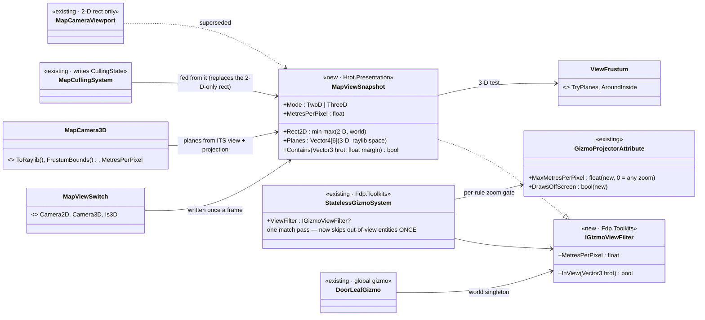
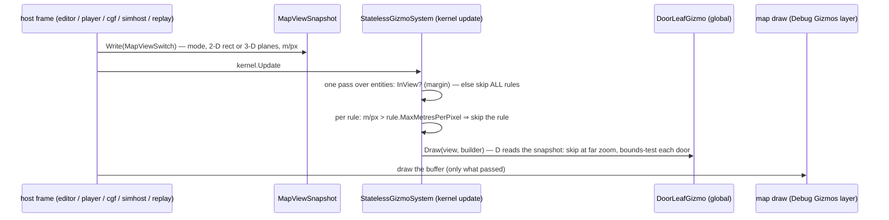
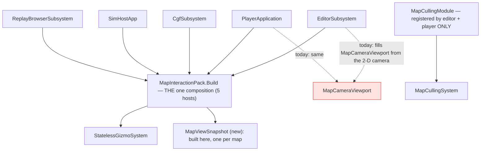

<!--STATUS
state: LIVE
updated: 2026-11-10
build-state: READY-TO-BUILD — D-1…D-7 APPROVED by the user 2026-11-10 (R-1049): "D-1..D-7 approved. for sure measure before optimizing"
current-answer: the whole file (§2 diagrams, §3 decisions)
related-designs:
  - docs/UX/UX_Feature_Map_Parity.md §3.2f / §3.2g — OWNS culling as a gizmo POLICY (CullingStateVisibilityPolicy: "the ONE implementation of should this entity draw"), default off for compatibility only (the "culling blanks IG" fear REFUTED); this file moves that check to where it saves the walk, and feeds it the right view
  - docs/UX/UX_Feature_Entity_Symbology.md §3.4 — OWNS the policy-on-the-registration design (registry.Register(projector, policy)) that the filter extends
  - docs/DESIGN_Map_3D_Mode.md §6ah — OWNS the chunked terrain whose frustum test (ViewFrustum) this reuses; its "Measured on Windows" block is the evidence
  - docs/DESIGN_Building_Interiors.md §3j 5b — OWNS the door entity: selectable (a pick box), no symbol, no palette entry — why doors are filtered by VIEW, not excluded
  - docs/blueprints/batches/STATUS_Ui_Windows_Render_Under_Load.md — the measurements (CE-4387 / CE-4388)
-->

# DESIGN — the map's VIEW FILTER: one place decides what is close enough and on screen to draw (CE-4388)

🔒 User, `2026-11-10`: *"Doors are rendered on 2d map. But they are small and only visible at very high zoom, they dont need to be rendered at all at smaller
zooms"* · *"Like several other 2d gizmos could be filtered on zoom/map view frustum basis."*

## 1. Why — measured on Windows (scale-1, 5.5 km; Release, hidden, uncapped)

| | empty terrain | 1 000 men |
|---|---|---|
| `StatelessGizmoSystem` (update) — ~20 rules each walking every match, every frame | 11.4 ms (6 912 doors per rule) | 21.6 ms |
| Debug Gizmos layer (drawing the gizmo buffer) | — | 5–8 ms, **2–4 MB garbage / frame** |
| `DoorLeafGizmo` — all 6 912 door lines, every zoom | in the above | |
| `StyleResolutionSystem` / `MapLayerAssignmentSystem` — every door, every frame | 1.3 + 0.9 ms | 1.65 + 1.2 ms |

The pieces exist and are not used where they would save the walk (§4 INVENTORY). ⭐ The 3-D bodies were already filtered this way (CE-4388, `EntityBodyLayer3D`
30.7 → 5.1 ms) — this design gives the gizmos the same, in one place.

## 2. Diagrams

*What the picture shows that prose hid:* the 3-D frustum is computed from the CAMERA (`MapCamera3D`'s own view and projection — the ones it hands rlgl),
so the UPDATE can use it; today `MapCameraViewport` is filled from the 2-D camera even while the map shows 3-D, so `CullingState` is wrong in 3-D.

*What it shows:* the filter runs BEFORE any rule work, once per entity — the per-rule policy (today's `CullingStateVisibilityPolicy`) runs after the
match, so it saves the drawing but never the walk.

*What it shows:* the filter goes in `MapInteractionPack.Build`, which all five hosts call ⇒ every host has it by construction; today's culling module is
registered by two of them and fed a 2-D rectangle (red: the edge that is wrong in 3-D).

## 3. Decisions — ✅ APPROVED 2026-11-10 (R-1049)

| # | question | ⭐ lean | rejected — one line each |
|---|---|---|---|
| **D-1** | where is "in view" decided? | **in `StatelessGizmoSystem`'s single match pass, once per entity**, through `IGizmoViewFilter` set by `MapInteractionPack.Build` | per-rule `CullingStateVisibilityPolicy` on every rule — still walks every entity once per rule (the 11–22 ms) · per-gizmo `if` checks — N copies of one concept |
| **D-2** | the view in 3-D | **the frustum from `MapCamera3D`'s own view + projection**, written once a frame into `MapViewSnapshot`, tested with `ViewFrustum` (margin 40 m, as the bodies) | the 2-D rectangle (today's) — wrong in 3-D · rlgl's matrices — not set yet during the update |
| **D-3** | zoom | **`GizmoProjectorAttribute.MaxMetresPerPixel`** (0 = any zoom), checked once per rule per frame; doors' lines and pick boxes ≈ 0.25 m/px (a 1 m leaf ≥ 4 px), labels ≈ 5 m/px; symbols any | a global LOD enum (`CullingStateConstants`) — three fixed levels fit no single gizmo |
| **D-4** | what must draw OFF screen | **`DrawsOffScreen = true`** opts a rule out of the view test (a route from an off-screen unit, an orbit, a fire line); the list is enumerated from the code before building (§5) | a bigger margin for everyone — buys back the walk |
| **D-5** | the existing `CullingState` / `MapCullingSystem` | **kept, fed from `MapViewSnapshot`** (so it is right in 3-D) — its readers (view telemetry, performance metrics) keep working; `MapCameraViewport` becomes the snapshot's 2-D half (one owner) | delete it — `GET /view`'s in-view list and the player's metrics read it |
| D-6 | global gizmos | they read the snapshot as a world singleton (`DoorLeafGizmo` first: skip above its zoom, bounds-test each door) | a second filter interface for globals — two mechanisms |
| D-7 | default | **ON** for every host — the "culling blanks IG" reason for OFF is refuted (Map Parity §3.2g); a headless host has no snapshot ⇒ everything is in view (today's CE-131 guard, kept) | |

## 4. INVENTORY — the queries run (graph, `2026-11-10`, project `D-Work-HROT`)

| query | total | what it found |
|---|---|---|
| `search_graph name_pattern=".*(Cull\|Viewport\|Frustum).*" label=Class` | 14 (9 production) | `CullingState`, `CullingStateConstants`, `CullingStateVisibilityPolicy`, `MapCameraViewport`, `MapCullingModule`, `MapCullingSystem`, `ViewFrustum` (+ NodeEdit's own viewport, unrelated) |
| `search_graph name_pattern=".*VisibilityPolicy.*" label=Class` | 3 | `CullingStateVisibilityPolicy`, `GizmoFamilyVisibilityPolicy` (+ the interface) |
| `search_graph name_pattern=".*Gizmo(System\|Registry\|Projector\|Settings).*" label=Class` | 25 | `StatelessGizmoSystem`, `DataDrivenGizmoSystem`, `StatelessGizmoRegistry`, `GizmoRegistry`, `GizmoProjectorAttribute`, the settings classes |
| grep `MapInteractionPack.Build(` | 5 hosts | editor, CGF, Player, Replay Browser, SimHost |
| grep `new MapCullingModule` / `WorldMinX =` | 2 + 2 | editor + player register culling; both fill `MapCameraViewport` from the 2-D camera |

⚠ `check_index_coverage` is not available through the CLI — the inventory is best effort; the grep rows corroborate the graph's.

## 5. Before building

- ⭐ D-4's list, FIRST CUT (`2026-11-10`, a grep of the 70-odd `[GizmoProjector]` classes for line / polyline / arc draws and route / target / area words —
  ⚠ heuristic, each to be read before it is classed): **lines to elsewhere** (opt out: `DrawsOffScreen`) — `MissionPresentationGizmo`, `AuthoredRouteGizmo`,
  `RouteGizmo`, `PlannedPathGizmo`, `SquadGizmo`, `AimLineGizmo`, `LineOfSightGizmo`, `NavigationTargetGizmo`, `PeekAndFireGizmo`, `HillAttackGizmo`,
  `CommandPictureGizmo`; **an area round an anchor** — `TacticalAreaGizmo`, `EntityEditorPolylineGizmo`, `MapOverlayGizmo`, `EqsSensorGizmo`,
  `VisibilityConeGizmo`, `NamedPointGizmo`. ⭐ The second kind changes D-4: an area whose ANCHOR is off screen can still cover the screen ⇒ it is tested by its
  BOUNDS (a `BoundsOf(view, entity)` on the projector, default = the point), not opted out — opting out would keep the full walk for them. Globals
  (`DoorLeafGizmo`, `RoadNetworkGizmo`, `DangerAreaGizmo`, `SectorAreasGizmo`, …) are not entity rules: D-6
- the per-rule log (`HROT_FRAME_STATS`, `GizmoRuleTimings`) re-measures each step
- rails: one in the gizmo system's suite (an entity out of view reaches no rule; a `DrawsOffScreen` rule still sees it; a rule above its zoom is skipped), one
  frame rail (doors: no lines far out, lines close in), each red-proved; the zero-garbage rail for the system's steady frame
