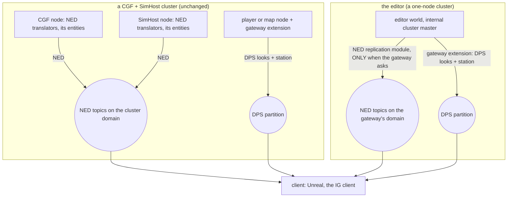
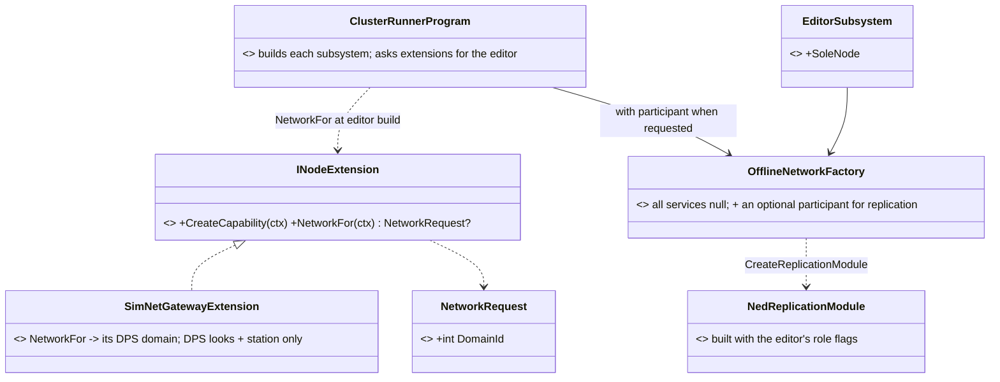
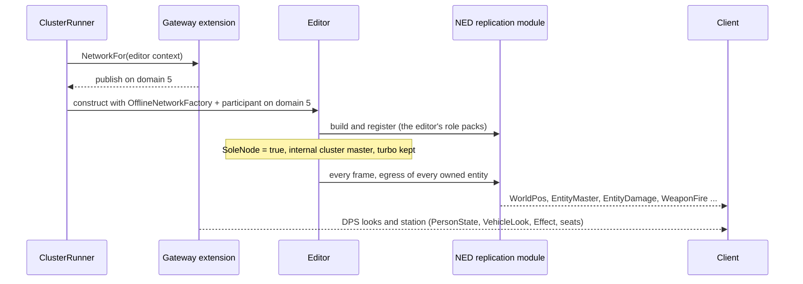

<!--STATUS
state: PARKED
updated: 2026-11-25
build-state: PARKED 2026-11-25 by the user (§11) — DPS stays a separate, NED-independent contract; return here if the duplication cost grows
current-answer: §11 (the user's decision: PARKED); §10 the review and the narrowed scope it led to; §8 the spike's measurements (still valid if the idea returns)
stale-below: nothing
known-rot: none
known-conflict: SimNetGateway docs/design/DD-017-Dps-Dds-Player-Station.md §1a rejected "one protocol for both" ("the internal wire would freeze, or the public one would break with HROT") — this design revisits that, with the user (§1); RULINGS R-4092 ("no one speaks NED besides HROT so changes are allowed") — narrowed for the client-visible subset (D-5)
related-designs:
  - reference/NED_DDS_Protocol.md — OWNS the NED wire (160 topics, QoS, frame, ids); this design makes a subset of it client-facing
  - DESIGN_Node_Extensions.md — OWNS INodeExtension; this design adds one optional member (D-2)
  - DESIGN_Node_Roles_And_Policies.md — OWNS which packs a role loads (§3.5-3.6); the editor's role picks its packs here (D-3)
  - designs/IG/DRAFT_Unreal_Image_Generator.md — OWNS the Unreal client; its "data in" row moves from DPS state topics to NED (§6)
  - designs/IG/DESIGN_Linked_Client_Director.md — OWNS the gateway's place inside a HROT node; unchanged
  - blueprints/DESIGN_Time_Architecture.md §20 — OWNS turbo stepping; its gate becomes the sole-node fact (D-4)
  - SimNetGateway docs/design/DD-017 … DD-034 — OWN the DPS contract; the state topics retire into NED (§6), the look and station topics stay
-->

> ⏸ **PARKED 2026-11-25 — see §11.** DPS stays a separate, stable contract for external clients, independent of NED.

# DESIGN — NED is the client's wire for simulation state; DPS keeps the looks and the player station

> 🔒 **User, 2026-11-25:** *"I still feel like we are duplicating the same stuff … reuse the NED stuff for DPS purposes to avoid duplication … the gateway could
> instantiate some of the NED network translators (even in editor) … It might need extending the NED … We might need to keep some DPS specific parts."*
> · *"why to care about owner? In editor, all is owned by editor. In CGF+SimHost, each own its parts and they complement each other … gateway can just activate
> them so that editor without gateway does not run them at all as now."* · *"best the whole group to avoid unnecessary fine granularity"* · *"maybe the cluster check
> should be explicit and tied to NedNetworkFactory?"* · *"please write the whole idea as a design and then measure the open points"*

## 1. The picture

*What the picture shows that prose hides:* the state comes from the SAME translators in both cases, from whichever node owns it; the gateway never republishes
state. The editor without the gateway draws no NED edge at all (as today).

## 2. INVENTORY (measured 2026-11-25)

| query | total | the set |
|---|---|---|
| `[DdsTopic]` production types in HROT (`scripts/ned-wire-inventory.py --check`) | **160** | grouped in `reference/NED_DDS_Protocol.md` §1 (identity/motion, weapons, damage, people, vehicles, terrain damage, effects, AI, rules, aggregates, map UI, lifecycle, time/cluster, player join) |
| NED translator classes (`scripts/cbm.sh search_graph '{"name_pattern":".*(Egress\|Ingress)Translator$","label":"Class"}'`) | 103 | `Hrot.Network.NED/Replication/Map/*` (53 files) + SimHost / perception / pathfinding / animation |
| DPS topics (`DpsProtocol.AllTopics`, SimNetGateway) | **55** | 26 copied HROT state / events · 14 derived by a HROT look rule · 5 gateway logic · 10 client → gateway |
| DPS state topics with a NED twin | **~20** | Entity ≈ EntityMaster+EntityInfo · EntityState ≈ WorldPos (+EntityDamage) · Articulation ≈ EntityTurretPose · Fire ≈ WeaponFire · Detonation ≈ MunitionDetonation · Impact ≈ RoundImpact · FireSpots ≈ EntityFireState · GroundMarks ≈ EntityGroundHeatMarks · BuildingDamage ≈ EntityBuildingDamage+EntityWindowDamage · GroundDamage ≈ EntityGroundDamage · Cloud ≈ EntityAreaEffectCloud · Carried ≈ EntityPassengers · Animal ≈ EntityAnimalState · Utterance ≈ EntityUtterance · ManDowned ≈ EntityManDowned · PlayerMessage · Status ≈ EntityObjectiveStatus · Exercise ≈ EntityExerciseResult · Ambience ≈ EntityAmbience · Weather ≈ EntityWeather · PlayerSlot ≈ PlayerSlotTopic |
| the editor's network composition | — | `OfflineNetworkFactory` (all null, `OfflineNetworkFactory.cs:16-20`); node config `Headless = true` (`EditorSubsystem.cs:1601`); plain builder, no `BuildReplicatedNode` (`EditorNodeBootstrapper.cs:206-214`); `RegisterNetworkTranslators` empty (`:397-400`); orchestration `Offline = true` (`:354`); a bare `OrchestratorCore` on the node bus (`EditorSubsystem.cs:1660-1674`) |
| a "sole node" flag | **0** | none on `HrotNodeContext` / `HrotNodeConfig`; two type checks `_networkFactory is OfflineNetworkFactory` (`EditorSubsystem.cs:1734` turbo, `:5925` AAR) |

📌 The cost of the duplication, measured: CE-11054 put a breach's cause into HROT's record (and NED), then SimNetGateway T-075 copied it into DPS — one
fact, two schemas, two sets of rails.

## 3. The proven solution, and what we take from it

The problem class is *"simulators and image generators share one world"*. The proven answer is a **common simulation object model**: HLA's RPR-FOM is published
by the simulators and read as-is by IGs and other federates; the look is the IG's. ⇒ **adopt** the shape (state on one model, from its owners; a separate layer
for what the IG cannot derive) — **adapt** it: our "look" layer is HROT's own `Hrot.Look` results (R-146, R-11001), which stay on DPS; and the player station has no
FOM counterpart, so it stays DPS.

## 4. Decisions

| # | decision | rejected (one line each) |
|---|---|---|
| **D-1** | **NED is the client's wire for simulation STATE.** A client reads the NED topics of the cluster it renders (or of the editor). The ~20 DPS twins (§2) retire after the migration (§6). | *the gateway republishes NED onto a DPS partition* — duplicates the traffic in a cluster and keeps the code twice · *keep two schemas, map NED → DPS mechanically* — still two schemas · *put the looks on NED* — NED carries state, every node derives looks (R-11001) |
| **D-2** | **The gateway ASKS, HROT builds.** `INodeExtension` gains one optional member, default "nothing" (no existing extension changes): `NetworkRequest? NetworkFor(NodeExtensionContext)` → *"publish this node's replication on domain N"*. Extensions are loaded before the editor is constructed (`Program.cs:302` → `DeploymentAssemblies.LoadAll`), so the runner can ask them when it builds the editor (`Program.cs:308-312`). | *the gateway constructs HROT's NED module itself* — a second composition of the module, in another repository · *a command-line flag* — the gateway is what needs it; an extension that is present should not also need a flag |
| **D-3** | **What the editor gets: ONLY the NED replication module, the whole group.** The runner creates the participant on the requested domain (Rule 3: only the composition root creates one) and the editor's bootstrap builds `NedReplicationModule` with the editor's own role flags (`Brain\|MuscleGround\|Perception\|NavigationSolver\|Traffic`, `EditorCapabilities.cs:39-40`) — every pack those roles load, no per-translator choice. **Orchestration, the time master and the id allocator stay in-process** (the internal cluster master, `SequentialIdAllocator`). | *the full `NedNetworkFactory`* — its id allocator needs a server and throws after 30 s without one (`DdsIdAllocatorHelper.cs:25-53`, `DdsIdAllocator.cs:106-119`); its master AND slave orchestration translators on the editor's ONE bus would loop intents and node ops back (`ClusterOpEgressTranslator.cs:55-95`, `NedOrchestrationTranslator.cs:21-64`; inferred) · *per-topic opt-in* — fine granularity the user rejected |
| **D-4** | **"Sole node" becomes an explicit fact**, replacing the two `is OfflineNetworkFactory` checks: the editor is a one-node cluster whether or not it publishes. Turbo needs *"no step ACK is awaited"* — measured true for a sole node: the master waits only for the step roster (`MasterSyncController.cs:408-409`), built from heartbeats on its bus, the master itself excluded (`ClusterMaster.cs:2765-2777`, `OrchestratorCore.cs:101`); with no orchestration translator no remote heartbeat arrives ⇒ empty ⇒ turbo holds. | *keep the type check* — "offline" and "alone" stop meaning the same thing the moment the editor publishes |
| **D-5** | **The client-visible NED subset is a contract:** frozen topic names, append-only (`@appendable` already), a committed IDL; changes to it are announced like DPS changes. The rest of NED stays HROT-internal (R-4092 unchanged for it). | *all of NED public* — freezes AI, cluster and request topics no client reads · *nothing frozen* — every HROT rename breaks the clients (NED_DDS_Protocol §15) |
| **D-6** | **NED gains what DPS found** (§6), as ordinary NED changes. | *keep them DPS-only* — the state would be split again |
| **D-7** | **Filtering a client needs moves to the source or to a documented client rule:** doors at the source (CE-11043: a door is an entity only while it differs from its house); concealed items and bodiless records by HROT's documented rules the client applies. | *the gateway filters* — it no longer carries the state |

## 5. UML

*What the sequence shows that prose hides:* the extension is asked BEFORE the editor exists — the only point where its network can still change (§2).

## 6. NED gains · DPS retires · clients migrate

| NED gains (D-6) | why |
|---|---|
| acceleration on `WorldPos` | DPS dead-reckons second order (DD-018 §3.6c) |
| a world boundary (epoch) and "disposed = gone" stated for the client subset | DPS `Session.WorldEpoch`; a client must drop everything on a new world |
| what DPS records added beyond HROT's records, if any remain after CE-11054 | e.g. a breach's world centre — or the client calls HROT's documented rule (D-7) |

| DPS retires (after the clients moved) | stays DPS |
|---|---|
| the ~20 twins of §2 | PersonState, PersonAim, Appearance, VehicleLook, Effect, FlameJet, EntityStatus, View, OwnUnit, GizmoFrame, MunitionLook, TkbType, traffic (SUMO is not NED), the clock echo, film rendering, seats, ControlFrame and the other client → gateway topics |

Clients: Unreal and the IG client move their state readers from the DPS twins to the NED subset; their look and station readers are untouched.

### 6a. Where a client reads what (DPS is NOT merged into NED — two layers on one domain)

| | NED (state) | DPS (looks + player station) |
|---|---|---|
| a CGF + SimHost cluster (+ a player node with the gateway) | the cluster's own NED topics, written by each OWNING node; the client joins the cluster's domain read-only; nothing republished | written by the gateway on the player node |
| the editor alone | the editor's NED replication module, ON only because the gateway asked (D-2), on the gateway's domain | written by the gateway in the editor |
| domain | the cluster's (editor: the gateway's) | the same domain |
| partition | NED's own, unchanged (⛔ whether NED uses a partition at all: checked in slice 3) | unchanged: the world partition `<base>-*`, one per seat `<base>-n` (DD-023, R-140) |
| names | NED's (`Hrot_NED_Descriptors_WorldPos` …) — never clashing with DPS names | unchanged |

DPS shrinks from 55 topics to ~35; every state fact then has ONE type and ONE translator. DPS's own contract rules (append-only, producer-neutral wording) stay for what remains.

### 6b. SUMO traffic stays on DPS — two KINDS of vehicles, not two ways of sending one

SumoSharp's own wire (`sumo/*`, `reference/NED_DDS_Protocol.md` §SUMO) is lane-relative dead reckoning (lane, distance along it, lateral offset, speed,
upcoming lanes) in `FrameCodec` blobs, in SUMO net metres; a receiver needs the net geometry, SumoSharp's lane numbering, its three codecs and its
`DrExtrapolation` curve — or SumoSharp's C# assemblies, which a C++ client cannot host. Turning that into world poses is a DERIVATION, so by this design's rule
(state from its owner as is; a derivation the client cannot port stays DPS) the DPS traffic topics (`Mover`, `MoverTracks` world-frame track knots,
`TrafficLights`) STAY — as DD-018 §3.6b already ruled for the same reason.

| | a HROT vehicle (tank, HMMWV, a scenario car) | a SUMO ambient car |
|---|---|---|
| what it is | a full HROT entity: owner, damage, weapons, seats, possession | a lightweight traffic participant, possibly thousands, no damage model |
| who simulates it | its owning node (SimHost / CGF) | the traffic node |
| channel | **NED** (`WorldPos`, `EntityMaster`, …) — was DPS `Entity` / `EntityState` | **DPS** `Mover` / `MoverTracks` / `TrafficLights` (unchanged) |

Never both: a HROT vehicle driving in SUMO (`hrot:` name) is a HROT entity — NED only; the DPS traffic gather already drops it. A SUMO car that is hit or
converted becomes a HROT entity — it moves to NED and SUMO despawns it (the hand-over that already exists between DPS `Mover` and `Entity`). Ambient cars are not
NED entities on purpose (AQ93, R-4020: per-car ids, ownership and topics would cost far more than SUMO's compact stream). The client keeps ONE curve routine for
both: NED positions and DPS track knots are track points in the same local frame. ⛔ Not measured: whether the editor writes `sumo/*` today; what DPS traffic
carries beyond `sumo/*` (e.g. a car's TKB type and colour) — slice 3.

## 7. Claim table (measured)

| the design rests on | code — how it is | design — how it was meant |
|---|---|---|
| a node with no `NetworkAuthority` on an entity owns it ⇒ the editor's translators publish everything | ✅ `AuthorityExtensions.cs:26-40`; egress gates on it (`EntityMasterEgressTranslator.cs:67-87`, `GeoSpatialEgressTranslator.cs:167-183`) | ✅ the comment there: single-process contexts are authoritative |
| editor entities are already map-registered and owned (the spawning pack) | ✅ `NetworkSpawningSystem` `:152`, `:250`; the editor uses it (`HostSpawning.cs:61-80`) | — |
| ownership grants never wait on a missing role node | ✅ `RoleGroupOwnershipStrategy.cs:17, :56`; `ClusterCacheExpectedPeersProvider.cs:36-44` | — |
| turbo needs only an empty step roster | ✅ D-4's evidence; turbo steps when `IsAwaitingStepAcks` is false (`EditorSubsystem.cs:3436-3439`) | ✅ DESIGN_Time_Architecture §20 |
| 2PC and the load gate finish at once with no peers | ✅ `ClusterMaster.cs:1766-1790`; `ClusterConfiguration.ForOneNodeCluster` (`:108-112`) | ✅ ruling 66 / R-1043 (one-node cluster) |
| the editor is offline by composition, not by its factory | ✅ §2 (Headless, plain builder, empty translators, offline orchestration) | ✅ R-3074 decision B: "one-node cluster by design; rejected: fake a participant" — ⚠ D-3 gives it a REAL participant for replication only; the cluster stays one node |
| the full NED factory is unsafe in the editor | ✅ id allocator (D-3) · ⚠ orchestration loopback inferred, not run | ⛔ searched docs/ + .dev/: no "online editor" design |

## 8. Open points — measured by the spike (2026-11-25)

📌 The spike: local branch `spike/ned-editor` (`55175d0d0`, never pushed), 6 files, +40/-2 — an env var stands in for D-2; the runner creates the
participant (sender tracking, node id 1) and hands it to `OfflineNetworkFactory`; `EditorNodeBootstrapper.BuildContext` builds `NedReplicationModule` and sets
`context with { NedReplication, GhostCreationSystem, SoleNode = true }`; the shared bootstrapper registers it as for any node (`SharedApplicationBootstrapper.cs:358`).
Passed to the module, **nothing stubbed**: the participant, the editor's role flags, `context.EntityMap`, the node bus, `context.NodeId`, the domain, the behavior
registry, `context.TkbDb`, the `EntityLifecycleModule` from `context.BaseModules`, a `new SimpleClusterStateCache()`. Scenario `bd-destruction`, headless editor, domain 77.

| # | verdict | evidence |
|---|---|---|
| **O-1** | ✅ works | `Headless` kept ⇒ `NodeExtensionContext.Offline = True` with the module on: the gateway still composes. ⇒ the extension's `Offline` means "not a cluster member" |
| **O-2** | ✅ works | the editor's role flags load **194 translators (93 egress, 101 ingress)**; the time and orchestration translators in the module send and receive 0 (`Expecting ACKs from 0 slave(s)`) |
| **O-3** | ✅ no ghosts | every sample loops back (WorldPos 8948 out / 8947 in) with no harm: a delete (66 → 61, stable, dispose sent), two reloads (63, 26 networked, no duplicate ids), a preview cycle (63 → 70 → 63 → 58) — 0 errors. New noise: one `TD-9 Dispose called` WARN per disposed entity |
| **O-4** | ✅ everything published | 30 s of play: 33 egress topics with samples — WorldPos 8948, TurretPose 293, EntityMaster 31 (all 28 networked entities + 3 that came and went), Info 10, Damage 17, WeaponFire 2, MunitionDetonation 3, BuildingDamage 3, WindowDamage 3, DoorState 16, WeaponAmmo 14, Passengers 2; the other 60 had no data in this scenario |
| **O-5** | ✅ no measurable cost | run-to 60 s turbo, `turbo:true`, 3 runs each: 8.0 / 9.9 / 9.5 s without the module, 7.2 / 10.0 / 8.8 s with it — within the spread |
| **O-6** | ✅ works, ⚠ unguarded | both checks read `SoleNode`; turbo stays on. ⚠ their rails (`RunToControllerTests` 15/15, `TheReviewLayoutTests` 9/1 skip) inject the decision as delegates ⇒ they cannot see the fact: the build adds a rail on the COMPOSITION (`SoleNode` true with and without the participant) |

Into the build: the per-entity `TD-9` WARN is noise to quiet; a factory built without a `HrotNodeContext` (some NodeComposition tests) never sets `SoleNode`; the
participant is created before the editor (D-2's ask happens at that point). `PreviewLifecycleRails` 3/1 with and without the module — the red is the known CE-3156.

## 9. Acceptance (when built)

- With the gateway: a client on the domain receives every entity's NED state in the editor and in a CGF + SimHost cluster, with no state topic from the gateway.
- Without the gateway: the editor composes exactly as today (no participant, null replication) — a rail on the composition.
- Turbo, run-to, preview, reload, replay unchanged in the editor (their own rails).
- The client subset's IDL is committed and a rail refuses a rename.

## 10. Independent review (2026-11-25) — findings and the revised scope

An adversarial review read this design and both repositories, not the author's reasoning. Verified as correct: the load order (extensions before the editor),
the editor's role flags, the two type checks, `@appendable` NED types, WorldPos in local ENU (the DPS frame), DPS `EntityId` = HROT `NetworkIdentity`, §6b (SUMO).

| # | sev | finding (evidence) | resolution — ⭐ = changes the design |
|---|---|---|---|
| 1 | blocker | NED has no partitions (`NED_DDS_Protocol.md:191`); the spike gives every editor node id 1; DPS and HROT both default to domain 0 ⇒ two editors, or an editor on a cluster's domain, mix worlds | ⭐ the editor's NED runs on a DEDICATED domain the gateway names, refused when it equals the cluster's; EGRESS-ONLY (finding 4) so nothing is ingested |
| 2 | blocker | the gateway does not run in a cluster (`GatewayExtension.cs:50-55`: offline only) — the cluster half of §1 / §6a / §9 assumes an unbuilt host | ⭐ scope = the EDITOR; the cluster case is DD-017 step 2 (which node hosts the gateway and its looks), designed separately |
| 3 | major | NED `WeaponFire` comes from live bus events; in REPLAY HROT raises none — DPS rebuilds Fire / Detonation from recorded effects (DD-017 §3.9, guide :717) | ⭐ Fire, Detonation, Impact STAY DPS (presentation events); replay of retained state on NED measured before retiring any of it |
| 4 | major | 101 ingress translators listen on an open domain ⇒ any writer (a client tool) can change the editor's world | ⭐ the editor's module is EGRESS-ONLY |
| 5 | major | a client sees all of NED: minefield truth and every side's knowledge, sensor targets, AI internals; DPS withholds them (guide :383-384) | ⭐ threat model: the IG is TRUSTED software — what the PLAYER sees is what it draws; the "never draw" rules (minefields, concealed items) become documented client rules; ⛔ whether a client can tell a concealed item from NED alone: to measure |
| 6 | major | every client must rebuild "what is a drawable entity": damage / door / ground records, clouds, concealed items, `IsUnit`, `Playable` (`EcsHrotAdapter.cs:184, :623`) are DPS's, not NED's | ⭐ a table of every non-drawable NED entity kind and who filters it (source / client) — a precondition of slice 3 |
| 7 | major | the twins differ: WorldPos BestEffort vs Reliable, 10 s vs 5 s heartbeat, no acceleration, no `Bank` (gateway-derived), quaternion w implied; damage as floats vs `PartCondition`; WeaponFire carries refused shots; MunitionDetonation lacks time / velocity / result | ⭐ the field-by-field table per twin (NED gains / client rule / stays DPS); `Bank` stays a DPS look |
| 8 | major | PlayerSlot has no NED writer in the editor (DD-017:504); Status, Exercise, PlayerMessage are station data | ⭐ they STAY DPS |
| 9 | major | `Reliable·Volatile·KeepAll` NED events: a slow external reader can stall a writer | resolved for the client by 3 (events stay DPS) |
| 10 | major | NED's lifecycle and ownership rules (only an `EntityMaster` dispose means gone; a stale WorldPos after a hand-over) fall on the client; DPS's "any not-ALIVE = gone" would be wrong | ⭐ written into the client subset's rules; in the editor (one owner) the hand-over case does not occur |
| 11 | major | topic name = C# namespace; WorldPos was rewritten in place in 2026 (frame, rotation), units converted in place — a rename rail does not stop semantic breaks | ⭐ the client subset in its OWN namespace / assembly with a semantic-review gate |
| 12 | major | in the editor the time and orchestration translators send nothing ⇒ no time / world boundary on NED | ⭐ time and world boundaries STAY DPS (`Session`, `SimClock`); D-6's "world epoch on NED" dropped |
| 13 | major | the spike never loaded the gateway, never ran an external reader (a QoS mismatch fails silently), no replay, save, hot reload, seats, or a large world | ⭐ an end-to-end rail: the gateway loaded + a reference NED reader with client QoS, before slice 4 |
| 14 | minor | entities imported from DIS / HLA are owned by the gateway's replica owner ⇒ NED egress skips them | measure what DPS shows of them today |
| 15 | minor | a look (DPS) can arrive before its entity (NED), or outlive it | a client buffering rule |
| 16 | minor | `Round` in neither list; `PlayerMessage` named a twin without its NED type | `Round` stays DPS (a look of a lightweight round) |
| 17 | minor | `NodeExtensionContext.Offline` documented as "no DDS stack" | renamed in meaning to "not a cluster member", its doc changed |
| 18 | minor | D-2 needs the gateway's config before the editor exists; NED requested when only DIS is on? | NED only when DPS is enabled |

### Revised scope (pending the user)

| | |
|---|---|
| where | the editor first; the cluster later, with DD-017 step 2 |
| how | the editor's NED module EGRESS-ONLY, on a DEDICATED domain the gateway names (refused if it equals a cluster's) |
| what moves to NED | RETAINED state only: Entity, EntityState (without `Bank`), Articulation, FireSpots, GroundMarks, BuildingDamage records, GroundDamage, Cloud, Carried, Animal, Ambience, Weather — ~12 topics, each after its field-by-field row |
| what stays DPS | events (Fire, Detonation, Impact, Utterance, ManDowned, PlayerMessage), the station (PlayerSlot, Status, Exercise, seats, controls), time and boundaries (Session, SimClock), every look, Round, SUMO traffic |
| what the client takes on | NED's lifecycle rule (EntityMaster dispose = gone), the drawable-entity filter table, the field differences (w-implied quaternion, damage floats), a look-before-entity buffer |
| what NED gains | acceleration on WorldPos; the client subset in its own namespace with a semantic-review gate |

## 11. Decision — PARKED (user, 2026-11-25)

> 🔒 **User, verbatim:** *"isolation is not an issue. domain settings solves that. scope is editor first, the solution needs to be cluster ready. replay
> fire/detonation/impact accepted. ok, as not so great win as expected, let's update the design with the findings, and park it, accepting separate DPS maintenance
> costs, bringing stable and NED independent interface to external clients. maybe we will return to the idea later."*

| | the user's ruling |
|---|---|
| review finding 1 (isolation) | **not an issue** — the domain settings separate an editor's NED from any cluster's |
| scope | **editor first, but the solution must be cluster ready** (a design that only works in the editor would not do) |
| finding 3 (replay events) | **accepted** — Fire, Detonation, Impact stay DPS |
| the idea | ⏸ **PARKED.** The gain (~12 retained-state topics maintained once) does not outweigh the cost (client-side NED rules, a frozen NED subset, the drawable-entity filter, field differences). **DPS stays the stable, NED-independent interface for external clients**, and its separate maintenance is accepted |

**If we return to it,** start from: §10's narrowed scope; the two tables it requires first (field by field per twin; the drawable-entity kinds); the cluster
host for the gateway (DD-017 step 2) designed with it, so the result is cluster ready; and §8's spike (local branch `spike/ned-editor`, `55175d0d0`, not pushed —
its 6-file shape is described in §8). Until then the reduction of double maintenance comes from ONE HROT rule per derived fact that the gateway calls (the
CE-11054 / CE-11056 / CE-11058 pattern), never a gateway copy.
