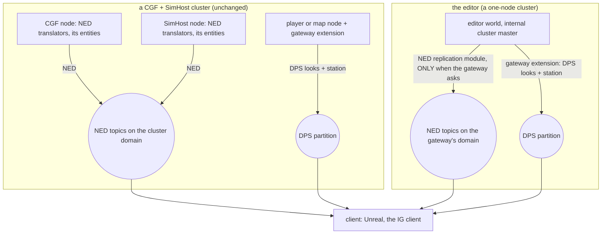
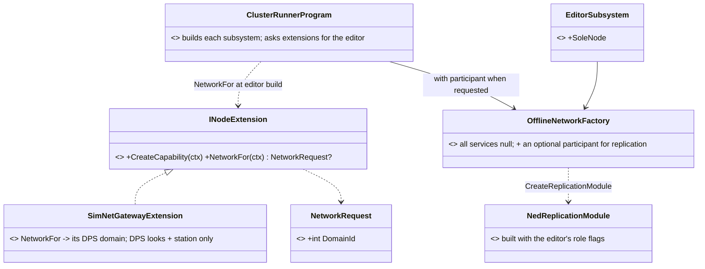
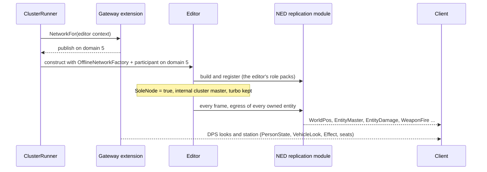

<!--STATUS
state: LIVE
updated: 2026-11-25
build-state: DESIGN — not approved; open points O-4 / O-5 / O-6 to be measured by the spike (§8) before READY-TO-BUILD
current-answer: whole document; §7 (the claim table) is what is measured, §8 what is not yet
stale-below: nothing
known-rot: none
known-conflict: SimNetGateway docs/design/DD-017-Dps-Dds-Player-Station.md §1a rejected "one protocol for both" ("the internal wire would freeze, or the public one would break with HROT") — this design revisits that, with the user (§1); RULINGS R-4092 ("no one speaks NED besides HROT so changes are allowed") — narrowed for the client-visible subset (D-5)
related-designs:
  - reference/NED_DDS_Protocol.md — OWNS the NED wire (160 topics, QoS, frame, ids); this design makes a subset of it client-facing
  - DESIGN_Node_Extensions.md — OWNS INodeExtension; this design adds one optional member (D-2)
  - DESIGN_Node_Roles_And_Policies.md — OWNS which packs a role loads (§3.5-3.6); the editor's role picks its packs here (D-3)
  - designs/IG/DRAFT_Unreal_Image_Generator.md — OWNS the Unreal client; its "data in" row moves from DPS state topics to NED (§6)
  - designs/IG/DESIGN_Linked_Client_Director.md — OWNS the gateway's place inside a HROT node; unchanged
  - blueprints/DESIGN_Time_Architecture.md §20 — OWNS turbo stepping; its gate becomes the sole-node fact (D-4)
  - SimNetGateway docs/design/DD-017 … DD-034 — OWN the DPS contract; the state topics retire into NED (§6), the look and station topics stay
-->

# DESIGN — NED is the client's wire for simulation state; DPS keeps the looks and the player station

> 🔒 **User, 2026-11-25:** *"I still feel like we are duplicating the same stuff … reuse the NED stuff for DPS purposes to avoid duplication … the gateway could
> instantiate some of the NED network translators (even in editor) … It might need extending the NED … We might need to keep some DPS specific parts."*
> · *"why to care about owner? In editor, all is owned by editor. In CGF+SimHost, each own its parts and they complement each other … gateway can just activate
> them so that editor without gateway does not run them at all as now."* · *"best the whole group to avoid unnecessary fine granularity"* · *"maybe the cluster check
> should be explicit and tied to NedNetworkFactory?"* · *"please write the whole idea as a design and then measure the open points"*

## 1. The picture

*What the picture shows that prose hides:* the state comes from the SAME translators in both cases, from whichever node owns it; the gateway never republishes
state. The editor without the gateway draws no NED edge at all (as today).

## 2. INVENTORY (measured 2026-11-25)

| query | total | the set |
|---|---|---|
| `[DdsTopic]` production types in HROT (`scripts/ned-wire-inventory.py --check`) | **160** | grouped in `reference/NED_DDS_Protocol.md` §1 (identity/motion, weapons, damage, people, vehicles, terrain damage, effects, AI, rules, aggregates, map UI, lifecycle, time/cluster, player join) |
| NED translator classes (`scripts/cbm.sh search_graph '{"name_pattern":".*(Egress\|Ingress)Translator$","label":"Class"}'`) | 103 | `Hrot.Network.NED/Replication/Map/*` (53 files) + SimHost / perception / pathfinding / animation |
| DPS topics (`DpsProtocol.AllTopics`, SimNetGateway) | **55** | 26 copied HROT state / events · 14 derived by a HROT look rule · 5 gateway logic · 10 client → gateway |
| DPS state topics with a NED twin | **~20** | Entity ≈ EntityMaster+EntityInfo · EntityState ≈ WorldPos (+EntityDamage) · Articulation ≈ EntityTurretPose · Fire ≈ WeaponFire · Detonation ≈ MunitionDetonation · Impact ≈ RoundImpact · FireSpots ≈ EntityFireState · GroundMarks ≈ EntityGroundHeatMarks · BuildingDamage ≈ EntityBuildingDamage+EntityWindowDamage · GroundDamage ≈ EntityGroundDamage · Cloud ≈ EntityAreaEffectCloud · Carried ≈ EntityPassengers · Animal ≈ EntityAnimalState · Utterance ≈ EntityUtterance · ManDowned ≈ EntityManDowned · PlayerMessage · Status ≈ EntityObjectiveStatus · Exercise ≈ EntityExerciseResult · Ambience ≈ EntityAmbience · Weather ≈ EntityWeather · PlayerSlot ≈ PlayerSlotTopic |
| the editor's network composition | — | `OfflineNetworkFactory` (all null, `OfflineNetworkFactory.cs:16-20`); node config `Headless = true` (`EditorSubsystem.cs:1601`); plain builder, no `BuildReplicatedNode` (`EditorNodeBootstrapper.cs:206-214`); `RegisterNetworkTranslators` empty (`:397-400`); orchestration `Offline = true` (`:354`); a bare `OrchestratorCore` on the node bus (`EditorSubsystem.cs:1660-1674`) |
| a "sole node" flag | **0** | none on `HrotNodeContext` / `HrotNodeConfig`; two type checks `_networkFactory is OfflineNetworkFactory` (`EditorSubsystem.cs:1734` turbo, `:5925` AAR) |

📌 The cost of the duplication, measured: CE-11054 put a breach's cause into HROT's record (and NED), then SimNetGateway T-075 copied it into DPS — one
fact, two schemas, two sets of rails.

## 3. The proven solution, and what we take from it

The problem class is *"simulators and image generators share one world"*. The proven answer is a **common simulation object model**: HLA's RPR-FOM is published
by the simulators and read as-is by IGs and other federates; the look is the IG's. ⇒ **adopt** the shape (state on one model, from its owners; a separate layer
for what the IG cannot derive) — **adapt** it: our "look" layer is HROT's own `Hrot.Look` results (R-146, R-11001), which stay on DPS; and the player station has no
FOM counterpart, so it stays DPS.

## 4. Decisions

| # | decision | rejected (one line each) |
|---|---|---|
| **D-1** | **NED is the client's wire for simulation STATE.** A client reads the NED topics of the cluster it renders (or of the editor). The ~20 DPS twins (§2) retire after the migration (§6). | *the gateway republishes NED onto a DPS partition* — duplicates the traffic in a cluster and keeps the code twice · *keep two schemas, map NED → DPS mechanically* — still two schemas · *put the looks on NED* — NED carries state, every node derives looks (R-11001) |
| **D-2** | **The gateway ASKS, HROT builds.** `INodeExtension` gains one optional member, default "nothing" (no existing extension changes): `NetworkRequest? NetworkFor(NodeExtensionContext)` → *"publish this node's replication on domain N"*. Extensions are loaded before the editor is constructed (`Program.cs:302` → `DeploymentAssemblies.LoadAll`), so the runner can ask them when it builds the editor (`Program.cs:308-312`). | *the gateway constructs HROT's NED module itself* — a second composition of the module, in another repository · *a command-line flag* — the gateway is what needs it; an extension that is present should not also need a flag |
| **D-3** | **What the editor gets: ONLY the NED replication module, the whole group.** The runner creates the participant on the requested domain (Rule 3: only the composition root creates one) and the editor's bootstrap builds `NedReplicationModule` with the editor's own role flags (`Brain\|MuscleGround\|Perception\|NavigationSolver\|Traffic`, `EditorCapabilities.cs:39-40`) — every pack those roles load, no per-translator choice. **Orchestration, the time master and the id allocator stay in-process** (the internal cluster master, `SequentialIdAllocator`). | *the full `NedNetworkFactory`* — its id allocator needs a server and throws after 30 s without one (`DdsIdAllocatorHelper.cs:25-53`, `DdsIdAllocator.cs:106-119`); its master AND slave orchestration translators on the editor's ONE bus would loop intents and node ops back (`ClusterOpEgressTranslator.cs:55-95`, `NedOrchestrationTranslator.cs:21-64`; inferred) · *per-topic opt-in* — fine granularity the user rejected |
| **D-4** | **"Sole node" becomes an explicit fact**, replacing the two `is OfflineNetworkFactory` checks: the editor is a one-node cluster whether or not it publishes. Turbo needs *"no step ACK is awaited"* — measured true for a sole node: the master waits only for the step roster (`MasterSyncController.cs:408-409`), built from heartbeats on its bus, the master itself excluded (`ClusterMaster.cs:2765-2777`, `OrchestratorCore.cs:101`); with no orchestration translator no remote heartbeat arrives ⇒ empty ⇒ turbo holds. | *keep the type check* — "offline" and "alone" stop meaning the same thing the moment the editor publishes |
| **D-5** | **The client-visible NED subset is a contract:** frozen topic names, append-only (`@appendable` already), a committed IDL; changes to it are announced like DPS changes. The rest of NED stays HROT-internal (R-4092 unchanged for it). | *all of NED public* — freezes AI, cluster and request topics no client reads · *nothing frozen* — every HROT rename breaks the clients (NED_DDS_Protocol §15) |
| **D-6** | **NED gains what DPS found** (§6), as ordinary NED changes. | *keep them DPS-only* — the state would be split again |
| **D-7** | **Filtering a client needs moves to the source or to a documented client rule:** doors at the source (CE-11043: a door is an entity only while it differs from its house); concealed items and bodiless records by HROT's documented rules the client applies. | *the gateway filters* — it no longer carries the state |

## 5. UML

*What the sequence shows that prose hides:* the extension is asked BEFORE the editor exists — the only point where its network can still change (§2).

## 6. NED gains · DPS retires · clients migrate

| NED gains (D-6) | why |
|---|---|
| acceleration on `WorldPos` | DPS dead-reckons second order (DD-018 §3.6c) |
| a world boundary (epoch) and "disposed = gone" stated for the client subset | DPS `Session.WorldEpoch`; a client must drop everything on a new world |
| what DPS records added beyond HROT's records, if any remain after CE-11054 | e.g. a breach's world centre — or the client calls HROT's documented rule (D-7) |

| DPS retires (after the clients moved) | stays DPS |
|---|---|
| the ~20 twins of §2 | PersonState, PersonAim, Appearance, VehicleLook, Effect, FlameJet, EntityStatus, View, OwnUnit, GizmoFrame, MunitionLook, TkbType, traffic (SUMO is not NED), the clock echo, film rendering, seats, ControlFrame and the other client → gateway topics |

Clients: Unreal and the IG client move their state readers from the DPS twins to the NED subset; their look and station readers are untouched.

## 7. Claim table (measured)

| the design rests on | code — how it is | design — how it was meant |
|---|---|---|
| a node with no `NetworkAuthority` on an entity owns it ⇒ the editor's translators publish everything | ✅ `AuthorityExtensions.cs:26-40`; egress gates on it (`EntityMasterEgressTranslator.cs:67-87`, `GeoSpatialEgressTranslator.cs:167-183`) | ✅ the comment there: single-process contexts are authoritative |
| editor entities are already map-registered and owned (the spawning pack) | ✅ `NetworkSpawningSystem` `:152`, `:250`; the editor uses it (`HostSpawning.cs:61-80`) | — |
| ownership grants never wait on a missing role node | ✅ `RoleGroupOwnershipStrategy.cs:17, :56`; `ClusterCacheExpectedPeersProvider.cs:36-44` | — |
| turbo needs only an empty step roster | ✅ D-4's evidence; turbo steps when `IsAwaitingStepAcks` is false (`EditorSubsystem.cs:3436-3439`) | ✅ DESIGN_Time_Architecture §20 |
| 2PC and the load gate finish at once with no peers | ✅ `ClusterMaster.cs:1766-1790`; `ClusterConfiguration.ForOneNodeCluster` (`:108-112`) | ✅ ruling 66 / R-1043 (one-node cluster) |
| the editor is offline by composition, not by its factory | ✅ §2 (Headless, plain builder, empty translators, offline orchestration) | ✅ R-3074 decision B: "one-node cluster by design; rejected: fake a participant" — ⚠ D-3 gives it a REAL participant for replication only; the cluster stays one node |
| the full NED factory is unsafe in the editor | ✅ id allocator (D-3) · ⚠ orchestration loopback inferred, not run | ⛔ searched docs/ + .dev/: no "online editor" design |

## 8. Open points — measured by the spike, not yet

| # | open point | how the spike measures it |
|---|---|---|
| **O-1** | the gateway extension stops composing when the node is not `Headless` (`NodeExtensionContext.Offline` = `config.Headless`, `SharedApplicationBootstrapper.cs:220`) | keep the editor `Headless` (no DDS in the builder) and inject the participant for replication only; read the extension's `Offline` as "not a cluster member" — confirm by loading the gateway |
| **O-2** | the NED module with the editor's role FLAGS (it was written for single roles) — which packs load | log the registered translators; compare with SimHost + CGF |
| **O-3** | NED INGRESS on the editor: its own samples coming back — a late `EntityMaster` for an id already cleared from the map could create a ghost (`EntityMasterIngressTranslator.cs:183-195`) | run a load, a delete, a world boundary and a preview restore; or build the module egress-only if it allows |
| **O-4** | does it publish every entity, every frame it should — and only those | `ddsmonitor` on the domain: `WorldPos`, `EntityMaster`, `EntityDamage`, weapon events for `bt-range`'s entities |
| **O-5** | turbo, run-to, preview and a reload still work, at what cost per frame | run-to 60 s turbo with and without the module; time it |
| **O-6** | the explicit sole-node fact: where it lives (`HrotNodeContext`?) and that both checks read it | code it in the spike, run the two existing rails for turbo and AAR |

## 9. Acceptance (when built)

- With the gateway: a client on the domain receives every entity's NED state in the editor and in a CGF + SimHost cluster, with no state topic from the gateway.
- Without the gateway: the editor composes exactly as today (no participant, null replication) — a rail on the composition.
- Turbo, run-to, preview, reload, replay unchanged in the editor (their own rails).
- The client subset's IDL is committed and a rail refuses a rename.
