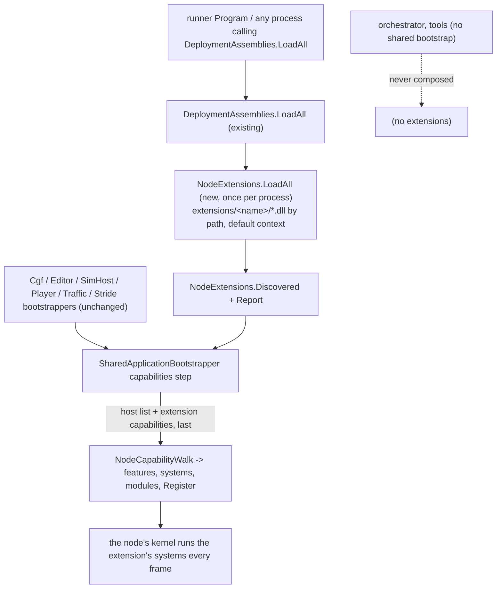
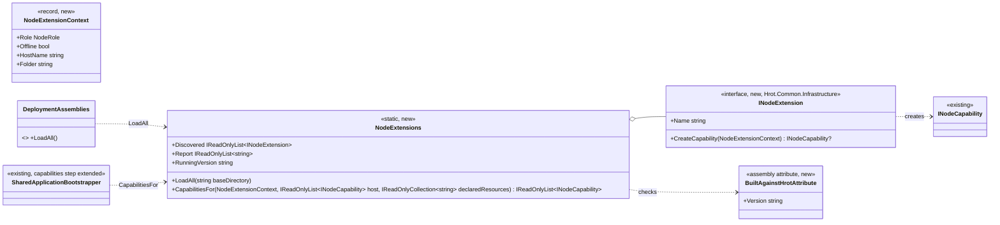
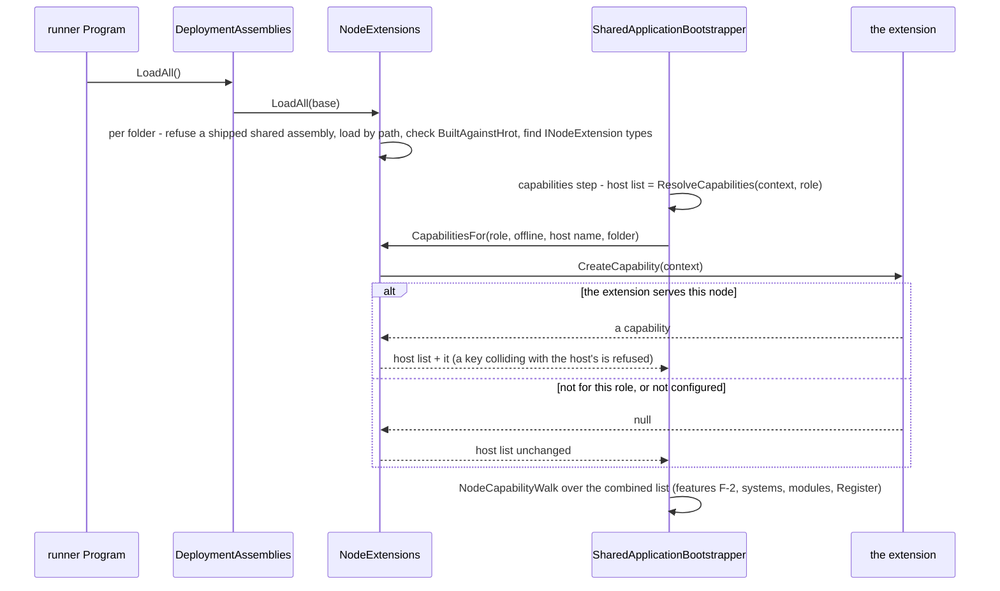
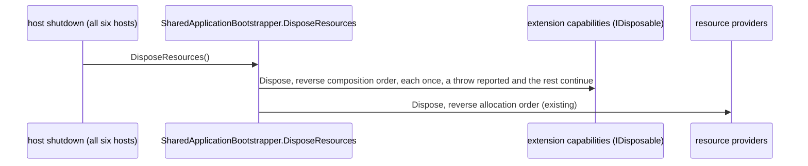

<!--STATUS
state: LIVE
updated: 2026-11-07
build-state: BUILT (sections 1-6); section 7 teardown READY-TO-BUILD (CE-4296) (CE-4293, as-built notes in section 6)
current-answer: whole document; section 6 (as-built) overrides anything above it where they differ
stale-below: none
related-designs:
  - docs/DESIGN_Subsystem_Composition_Unification.md - owns the shared bootstrap's composition steps and the capability seam (INodeCapability, NodeCompositionPlan, the capabilities step of §4.1ae) that this design appends to; §4.1ag the one role table (unchanged here)
  - docs/DESIGN_Node_Features.md - owns feature declarations (F-2) through which a node switches an extension's capability off
-->

# Node extensions - capabilities loaded from `extensions/<name>/`

🔒 **User, `2026-11-07`:** *"I thought we share the bootstrap so all nodes get all stuff be construction and only role
or features can strip that down. Loading from extensions folder is desired, not mixing with hrots binaries"* - then,
on the design: *"Approved"* (R-4158).

## 0. Why

A product built outside HROT's sources (first user: a protocol gateway, built in its own repository against HROT as a
submodule) must run inside HROT nodes - the editor first - **without its code in HROT** and installed by copying one
folder. HROT gains one generic seam: an **extension** is an assembly in `extensions/<name>/` that contributes an
ordinary `INodeCapability` to every node the shared bootstrap composes.

INVENTORY (graph AND grep, `2026-11-07` on coordinator after merging ui + backend). Graph queries run: `search_graph name_pattern=.*Bootstrapper$ label=Class` (total 7 - its index is stale: it still lists `IgNodeBootstrapper`, deleted by CE-3371, and misses the three `internal` ones grep finds), `.*Extension.* label=Interface` (total 1: `IRunExtension`, the director's, unrelated), `.*NodeCapability.* label=Interface` (total 1: `INodeCapability`), `.*(Plugin|AssemblyLoad|LoadContext).* label=Class` (total 0). `check_index_coverage` is not available through the CLI, so the absence rows below are graph-plus-grep, not proven complete:

| query | result |
|---|---|
| hosts deriving from `SharedApplicationBootstrapper` | 6: `CgfNodeBootstrapper`, `EditorNodeBootstrapper`, `SimHostNodeBootstrapper`, `PlayerNodeBootstrapper`, `TrafficNodeBootstrapper`, `StrideNodeBootstrapper` |
| where a host's capabilities are walked | ONE place: the base's `capabilities` step, `SharedApplicationBootstrapper.cs:207` (`_walk = new NodeCapabilityWalk(ResolveCapabilities(context, role))`) |
| `AssemblyLoadContext` / `LoadFromAssemblyPath` in production | only the behaviour hot reload (`FbtAssemblyHotReloader`, `AiHotReloadCoordinator`), collectible contexts; nothing loads third-party assemblies |
| reflection discovery precedents | `SubsystemFactory.Scan` (types in loaded assemblies + one constructor rule + "reported, never silently skipped"), `DeploymentAssemblies.TypesWithAttribute` (metadata read) |
| existing extension point | none (`RoleTableInputs` and every host's `ResolveCapabilities` are closed lists) |

⚠ **Constraint, measured in code, consequence from .NET's resolution rules (confirmed by rail ⑥ below):**
`DeploymentAssemblies.LoadAll` loads by NAME (`Assembly.Load(AssemblyName)`) and swallows failures; a framework-dependent
app resolves names from its `deps.json`, which a folder copied in later is not part of. ⇒ extensions load **by path**.

## 1. Module relationships

Caption - what the picture shows that prose hid: no host changes and no host can forget it; the only frame caller of an
extension is a kernel composed by the shared bootstrap (the dashed edge: hosts without it never run one).

## 2. Classes

## 3. Sequence - a node starts with an extension installed

## 4. Decisions (each with the rejected alternative)

1. **Contract** - `INodeExtension.CreateCapability(NodeExtensionContext)` in `Hrot.Common.Infrastructure`; null composes
   nothing; the capability is an ordinary `INodeCapability` (key, needs, features, the three hooks).
   Rejected: discovering `INodeCapability` types directly - capabilities are instances built with values.
2. **Where** - in the shared bootstrap's `capabilities` step, appended **after** the host's resolved list: every node by
   construction; stripped by role (null from `CreateCapability`) and by feature (the capability declares one, F-2).
   Rejected: the role table (§4.1ag) - the Player and Traffic node build their own plans; a per-host input slot - the
   silent-default shape (one host forgets).
3. **Loading** - each `extensions/<name>/` folder holds **only the extension's own assemblies** and their private
   third-party dependencies, loaded **by path into the default load context** (type identity with HROT's types); a
   `Resolving` handler serves an unresolved name from the requesting extension's folder. **Shared assemblies (`Hrot.*`,
   `Fdp.*`, `CycloneDDS*`) are never shipped** - an extension folder containing one is refused with one error naming the
   file (a second `Hrot.Common` would be a second `INodeCapability` type; a second CycloneDDS.NET a second DDS runtime).
   An update is a replaced folder, effective at the next process start.
   Rejected: copying into HROT's own folder (not in `deps.json`: silently not loaded, and mixes binaries); an isolated
   load context (shared types must come from the default context anyway; nothing needs unloading).
4. **Build check** - the extension's assembly carries `[assembly: BuiltAgainstHrot("<informational version of the
   Hrot.Common it compiled against>")]` (HROT's informational version carries the commit - measured, section 6.1); a
   mismatch with the running `Hrot.Common` refuses **that extension only**, with one error naming both versions.
   Rejected: failing the process (an editor stays usable); no check (fails late, mid-frame).
5. **No silent failure** - every refusal (shared assembly shipped, load failure, build mismatch, no public parameterless
   constructor, a throwing `CreateCapability`, a capability key colliding with the host's or another extension's) is
   one line in `NodeExtensions.Report` and the log. No `extensions/` folder = nothing, no error.

## 5. Test plan (rails, all in `Hrot.Common.Tests` unless a host is needed)

| # | rail | red-proof (mutation) |
|---|---|---|
| ① | a test extension folder (built by the test into a temp dir: one `INodeExtension`, one system) is loaded, discovered, and its capability is appended LAST to a host list | append first / not at all |
| ② | `CreateCapability` returning null leaves the host list identical (same instances, same order) | always append |
| ③ | refusals, one `Report` line each: wrong `BuiltAgainstHrot`; a shipped `Hrot.*` / `Fdp.*` / `CycloneDDS*` dll; no parameterless constructor; a throwing `CreateCapability`; a colliding key | drop each check |
| ④ | the editor host (headless) with the test extension composes its system and runs it one frame; without the folder its capability list equals the base list | skip the step |
| ⑤ | the extension's feature (F-2) appears in `context.Features` and switching it off removes its systems | — (existing F-2 machinery) |
| ⑥ | a DLL copied into HROT's own folder is not loaded by `LoadAll` (documents the `deps.json` fact that motivates §4.3) | — |

## 6. As-built (CE-4293)

Built as designed (6 files: `Infrastructure/NodeExtensions.cs` with `INodeExtension`, `NodeExtensionContext`, `BuiltAgainstHrotAttribute`, `NodeExtensions`; the one-line hook in `DeploymentAssemblies.LoadAll`; the 4-line change in the `capabilities` step of `SharedApplicationBootstrapper`; `Hrot.NodeExtension.targets`). The class and sequence diagrams above match, with the deviations below. Prior statements they supersede are marked.

| # | deviation / finding | why |
|---|---|---|
| 6.1 | **Build stamp, measured:** `Hrot.Common`'s informational version is `0.1.1+d9f1cb7e8a8a963480229c03e5968f0c6b3d50c7` (the .NET 8 SDK appends the HEAD commit). SUPERSEDED: section 4.3/4.4 say `Directory.Build.targets` adds it - that file does not exist (the comment in `Directory.Build.props:10` is stale). Consequence: the stamp is HEAD at build time, so **every HROT commit invalidates every installed extension** until it is rebuilt - as designed, but worth knowing. | rail `ABuildStampThatIsNotTheRunningHrotCommon...` asserts the version contains `+` |
| 6.2 | **Auto-stamp:** an extension project imports `Hrot/Engine/Hrot.Common/Hrot.NodeExtension.targets` (snippet in its header). It reads the referenced `Hrot.Common.dll`'s product version with an inline task and writes `BuiltAgainstHrot.g.cs`. Proven by the test-only `Hrot/Engine/Hrot.Common.Tests.SampleExtension` (assembly `SampleNodeExtension`, built with compile-only references; the stamp equals the running version). | the stamp cannot be hand-typed |
| 6.3 | The stamp is read from **metadata** (`PEReader`), so a mismatching extension is refused **before it is loaded**. | no half-loaded refused extension |
| 6.4 | `LoadAll` is idempotent **per base directory** (not literally once per process), under one lock: a second call for the same directory does nothing; another directory is scanned too. `DeploymentAssemblies.LoadAll(directory)` forwards its directory. | tests and a second root need it; same guarantee for the real process |
| 6.5 | `CapabilitiesFor` takes an optional `declaredResources` and refuses (one report line) an extension whose `Needs` the role does not declare, or whose feature id is already declared. | otherwise the base's D10 equality check or `FeatureRegistry` (F-2) THROWS at boot and the editor is not usable. **An extension's `Needs` must be keys the role declares**; most declare none. |
| 6.6 | `NodeExtensionContext`: `Offline` = `HrotNodeConfig.Headless`, `HostName` = `HrotNodeConfig.SubsystemName`, `Role` = the role passed to the step, `Folder` = the extension's own folder. | the base has no other offline flag; Headless is "no DDS stack" |
| 6.7 | **Rail 6 is not an in-process rail.** The test host registers its own resolver for the test folder, so `Assembly.Load` finds a dll copied beside the test binaries (measured: `FileLoadException` for a renamed copy, not `FileNotFoundException`). Measured instead in a plain framework-dependent console app: `Assembly.Load("SampleNodeExtension")` with the dll beside the binary answers `FileNotFoundException`. The motivation of 4.3 stands; the rail was dropped and a comment in `NodeExtensionsTests` says why. | a rail would assert the test host, not HROT |
| 6.8 | ⛔ **SUPERSEDED 2026-11-07 by CE-4294 (fixed): a feature on a group member now switches it off - the rule "gate a feature through a module" no longer applies.** Original finding: `[NodeFeature]` on a system contributed through `PopulateSystems` (a group member) does NOT switch it off.** Measured on the editor: after `SetNodeOverride(feature, {"Enabled":false})` the system kept running (6 -> 11 executions). A `[NodeFeature]` on a **module** returned by `ProvideModules` does (rail 5 asserts that, and that the extension's other system keeps running). Cause read in `SystemScheduler`: `RegisterStepReader` stores the system's tick policy first, so the first-sight `ReadFeature` in `ExecuteSystem` (`SystemScheduler.cs:236-239`) never runs for group members. **Rule for extension authors: gate a feature through a module.** Open question for the owner of F-13: do production group members with `[NodeFeature]` (e.g. `ExercisePauseOnEndSystem`, a `CgfLogicPack` group member) switch off at all? Not verified for them. | found while writing rail 5 |
| 6.9 | Authoring rules the sample hit: every system and module declares `[TickMode]` (CE-3293); a system needs `[UpdateInPhase]` when a module registers it; an `IEcsModule` must implement `Policy` (the interface's default `Policy`/`Tier` pair recurse into each other: stack overflow). | learned by running it |
| 6.10 | Test seams: `NodeExtensions.ResetForTests()` / `Add(Type, folder)` (internal), `InternalsVisibleTo Hrot.NodeComposition.Tests` on `Hrot.Common`, `EditorSubsystem.CapabilitiesForTest` (ui lane's file, one property). Rails: `Hrot.Common.Tests/NodeExtensions/NodeExtensionsTests` (1, 2, 3), `SharedApplicationBootstrapperTests.CE4293_*` (4 at the base), `Hrot.Editor.Tests/TheEditorComposesNodeExtensionsTests` (4, 5). Tests that load an extension run in a non-parallel collection (`NodeExtensions` is process state). | |

## 7. Teardown (CE-4296, user 2026-11-07: "Fix the teardown") - READY-TO-BUILD

Measured: the kernel never disposes modules or systems (`ModuleHostKernel.cs:450-457`); a node's one teardown is the base's
`DisposeResources()` (`SharedApplicationBootstrapper.cs:698`), called by the editor (`EditorSubsystem.Shutdown`, `:5116`), CGF
(`CgfSubsystem.cs:2806`), SimHost (`SimHostApp.cs:698`) and the traffic node (`TrafficNodeBootstrapper.cs:56`) - but NOT by the
Player (`PlayerApplication.Shutdown`, `:1483`) or Stride (`StrideNodeBootstrapper.Dispose`, `:158`). An extension's capability
therefore lives until the process exits (its sockets and threads included).

Caption: the base disposes what the base created (the extensions' capabilities, through `NodeExtensions.CapabilitiesFor`), before
the resources they borrow; a host-created capability stays the host's to free (the owner frees, CE-197).

1. **Owner frees**: the base records the capabilities `NodeExtensions.CapabilitiesFor` added (not the host's), and
   `DisposeResources()` disposes those that implement `IDisposable`, in reverse order, BEFORE the resource providers; idempotent
   (a second call does nothing); a throwing `Dispose` is one line in `NodeExtensions.Report` and the next one still runs.
   Rejected: disposing every `IDisposable` capability (a host-created one, e.g. the traffic node's `TrafficPack`, would be
   disposed twice); a new `INodeExtension.Shutdown` hook (a second lifetime contract next to `IDisposable`).
2. **Every host tears down**: `PlayerApplication.Shutdown` and `StrideNodeBootstrapper.Dispose` call `DisposeResources()` too
   (harmless today: they allocate no provider), so all six hosts end a node the same way.
3. **Contract for extension authors**: a capability that owns threads, sockets or files implements `IDisposable`; it disposes
   what it created (its systems' resources); the kernel does not.
4. **Found, not fixed here**: the editor never disposes its `TrafficPack` (`EditorSubsystem.cs:226`, built by
   `EditorNodeBootstrapper.cs:267`; `TrafficPack.Dispose` at `TrafficPack.cs:106`) - filed as CE-4297.

Rails: an extension capability that is `IDisposable` is disposed once by `DisposeResources()`, after the host's systems stop and
before the providers (order observed); not disposed twice on a second call; a throwing one is reported and the next still
disposed; a host capability is NOT disposed; the headless editor's `Shutdown` disposes the sample extension's capability; the
Player and Stride paths call `DisposeResources()` (a forwarding rail on the constructed host, CLAUDE.md silent-default rule).
