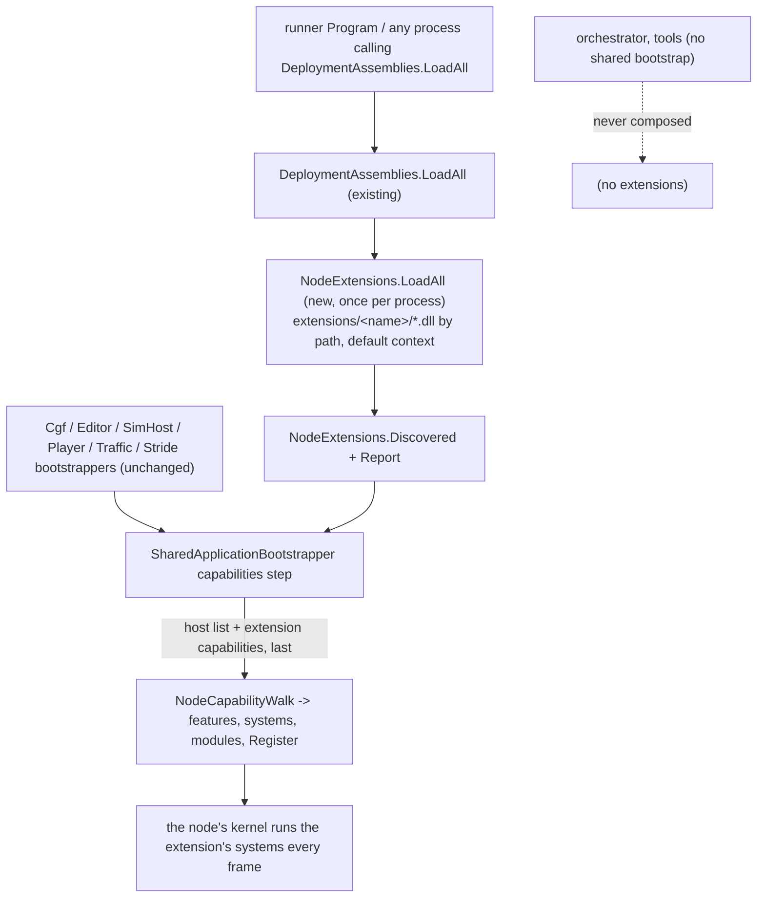
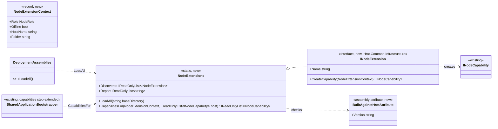
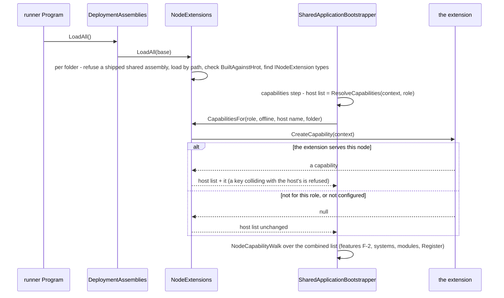

<!--STATUS
state: LIVE
updated: 2026-11-07
build-state: READY-TO-BUILD (approved, R-4158)
current-answer: whole document
stale-below: none
related-designs:
  - docs/DESIGN_Subsystem_Composition_Unification.md - owns the shared bootstrap's composition steps and the capability seam (INodeCapability, NodeCompositionPlan, the capabilities step of §4.1ae) that this design appends to; §4.1ag the one role table (unchanged here)
  - docs/DESIGN_Node_Features.md - owns feature declarations (F-2) through which a node switches an extension's capability off
-->

# Node extensions - capabilities loaded from `extensions/<name>/`

🔒 **User, `2026-11-07`:** *"I thought we share the bootstrap so all nodes get all stuff be construction and only role
or features can strip that down. Loading from extensions folder is desired, not mixing with hrots binaries"* - then,
on the design: *"Approved"* (R-4158).

## 0. Why

A product built outside HROT's sources (first user: a protocol gateway, built in its own repository against HROT as a
submodule) must run inside HROT nodes - the editor first - **without its code in HROT** and installed by copying one
folder. HROT gains one generic seam: an **extension** is an assembly in `extensions/<name>/` that contributes an
ordinary `INodeCapability` to every node the shared bootstrap composes.

INVENTORY (graph AND grep, `2026-11-07` on coordinator after merging ui + backend). Graph queries run: `search_graph name_pattern=.*Bootstrapper$ label=Class` (total 7 - its index is stale: it still lists `IgNodeBootstrapper`, deleted by CE-3371, and misses the three `internal` ones grep finds), `.*Extension.* label=Interface` (total 1: `IRunExtension`, the director's, unrelated), `.*NodeCapability.* label=Interface` (total 1: `INodeCapability`), `.*(Plugin|AssemblyLoad|LoadContext).* label=Class` (total 0). `check_index_coverage` is not available through the CLI, so the absence rows below are graph-plus-grep, not proven complete:

| query | result |
|---|---|
| hosts deriving from `SharedApplicationBootstrapper` | 6: `CgfNodeBootstrapper`, `EditorNodeBootstrapper`, `SimHostNodeBootstrapper`, `PlayerNodeBootstrapper`, `TrafficNodeBootstrapper`, `StrideNodeBootstrapper` |
| where a host's capabilities are walked | ONE place: the base's `capabilities` step, `SharedApplicationBootstrapper.cs:207` (`_walk = new NodeCapabilityWalk(ResolveCapabilities(context, role))`) |
| `AssemblyLoadContext` / `LoadFromAssemblyPath` in production | only the behaviour hot reload (`FbtAssemblyHotReloader`, `AiHotReloadCoordinator`), collectible contexts; nothing loads third-party assemblies |
| reflection discovery precedents | `SubsystemFactory.Scan` (types in loaded assemblies + one constructor rule + "reported, never silently skipped"), `DeploymentAssemblies.TypesWithAttribute` (metadata read) |
| existing extension point | none (`RoleTableInputs` and every host's `ResolveCapabilities` are closed lists) |

⚠ **Constraint, measured in code, consequence from .NET's resolution rules (confirmed by rail ⑥ below):**
`DeploymentAssemblies.LoadAll` loads by NAME (`Assembly.Load(AssemblyName)`) and swallows failures; a framework-dependent
app resolves names from its `deps.json`, which a folder copied in later is not part of. ⇒ extensions load **by path**.

## 1. Module relationships

Caption - what the picture shows that prose hid: no host changes and no host can forget it; the only frame caller of an
extension is a kernel composed by the shared bootstrap (the dashed edge: hosts without it never run one).

## 2. Classes

## 3. Sequence - a node starts with an extension installed

## 4. Decisions (each with the rejected alternative)

1. **Contract** - `INodeExtension.CreateCapability(NodeExtensionContext)` in `Hrot.Common.Infrastructure`; null composes
   nothing; the capability is an ordinary `INodeCapability` (key, needs, features, the three hooks).
   Rejected: discovering `INodeCapability` types directly - capabilities are instances built with values.
2. **Where** - in the shared bootstrap's `capabilities` step, appended **after** the host's resolved list: every node by
   construction; stripped by role (null from `CreateCapability`) and by feature (the capability declares one, F-2).
   Rejected: the role table (§4.1ag) - the Player and Traffic node build their own plans; a per-host input slot - the
   silent-default shape (one host forgets).
3. **Loading** - each `extensions/<name>/` folder holds **only the extension's own assemblies** and their private
   third-party dependencies, loaded **by path into the default load context** (type identity with HROT's types); a
   `Resolving` handler serves an unresolved name from the requesting extension's folder. **Shared assemblies (`Hrot.*`,
   `Fdp.*`, `CycloneDDS*`) are never shipped** - an extension folder containing one is refused with one error naming the
   file (a second `Hrot.Common` would be a second `INodeCapability` type; a second CycloneDDS.NET a second DDS runtime).
   An update is a replaced folder, effective at the next process start.
   Rejected: copying into HROT's own folder (not in `deps.json`: silently not loaded, and mixes binaries); an isolated
   load context (shared types must come from the default context anyway; nothing needs unloading).
4. **Build check** - the extension's assembly carries `[assembly: BuiltAgainstHrot("<informational version of the
   Hrot.Common it compiled against>")]` (HROT's informational version carries the commit, `Directory.Build.targets`); a
   mismatch with the running `Hrot.Common` refuses **that extension only**, with one error naming both versions.
   Rejected: failing the process (an editor stays usable); no check (fails late, mid-frame).
5. **No silent failure** - every refusal (shared assembly shipped, load failure, build mismatch, no public parameterless
   constructor, a throwing `CreateCapability`, a capability key colliding with the host's or another extension's) is
   one line in `NodeExtensions.Report` and the log. No `extensions/` folder = nothing, no error.

## 5. Test plan (rails, all in `Hrot.Common.Tests` unless a host is needed)

| # | rail | red-proof (mutation) |
|---|---|---|
| ① | a test extension folder (built by the test into a temp dir: one `INodeExtension`, one system) is loaded, discovered, and its capability is appended LAST to a host list | append first / not at all |
| ② | `CreateCapability` returning null leaves the host list identical (same instances, same order) | always append |
| ③ | refusals, one `Report` line each: wrong `BuiltAgainstHrot`; a shipped `Hrot.*` / `Fdp.*` / `CycloneDDS*` dll; no parameterless constructor; a throwing `CreateCapability`; a colliding key | drop each check |
| ④ | the editor host (headless) with the test extension composes its system and runs it one frame; without the folder its capability list equals the base list | skip the step |
| ⑤ | the extension's feature (F-2) appears in `context.Features` and switching it off removes its systems | — (existing F-2 machinery) |
| ⑥ | a DLL copied into HROT's own folder is not loaded by `LoadAll` (documents the `deps.json` fact that motivates §4.3) | — |
