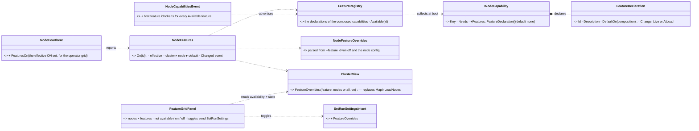
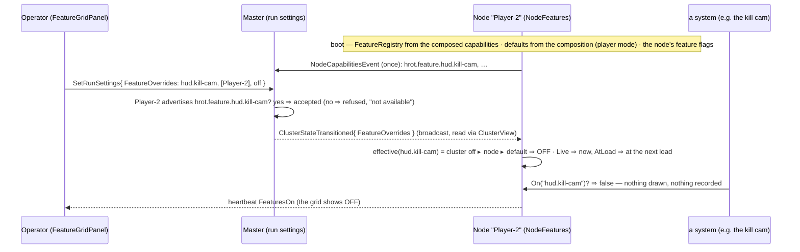
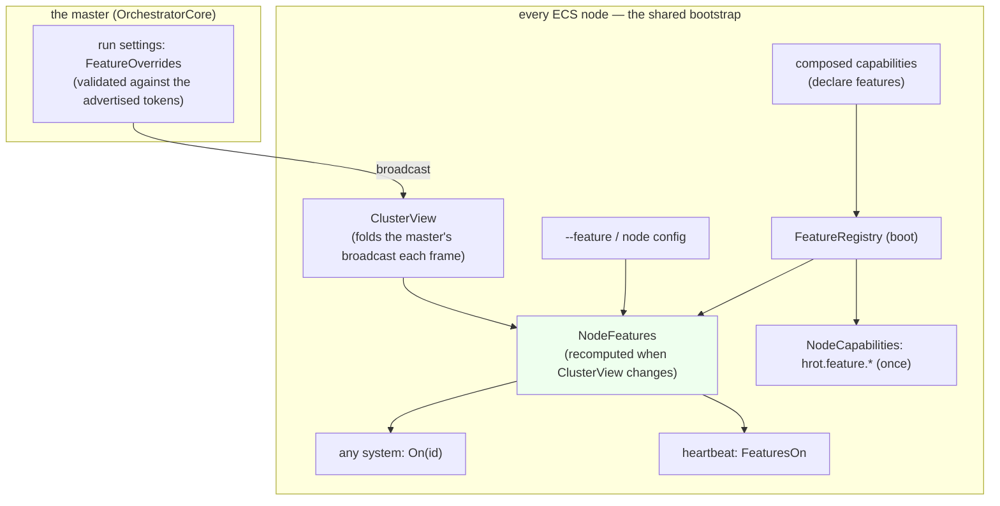

<!--STATUS
state: LIVE
build-state: DESIGN — the model AGREED by the user 2026-10-31 ("Good, this sounds like what is needed", "Yes, please write it down"); slice details to confirm at S1
updated: 2026-10-31 (first version — coordinator)
current-answer: §2 the three tiers · §3 the diagrams · §4 decisions F-1…F-12 · §5 slices
stale-below: nothing
known-rot: none
known-conflict: none
related-designs:
  - docs/PLAN_Training_And_Gameplay_Engine.md — every item there is delivered as features (P-7 scenario presets of these switches)
  - docs/DESIGN_Node_Roles_And_Policies.md — §3.2–§3.4 OWN composition by role (R-4000, R-4005): a role sets DEFAULTS through composition; a switch never replaces composition
  - docs/DESIGN_Player_Join.md — the deploy server is the feature gameplay.deploy-server (D-3 there); its §7a audit items G1…G6 become hud.* features here (S2)
  - docs/blueprints/Architect_Question_108_Run_Mode_Picker.md — D15 OWNS the cluster run settings (SetRunSettings, "Ask to keep recordings") the cluster override rides
  - docs/DESIGN_Cluster_Load_Phase.md — R-1046 / CE-3354 ③ OWN "the 3-D map in the load" (NodeRunProfile.MapInLoad + the master's MapInLoadNodes): the pattern this generalises and its first member (S1)
  - docs/blueprints/Architect_Question_70_Host_Capabilities_And_Reliable_Init_Degradation.md — AQ-70 §Q70-B/C OWNS the capability tokens on the durable NodeCapabilities topic a feature's availability is advertised on
-->

# DESIGN — **node features** *(one switch structure: composed where the code is, on or off per node and per cluster)*

> 🔒 **User, `2026-10-31`:** *"the node should have some configuration structure for features to be turned on or off, and the role which is
> assigned to the node by composition usually, but also via the minus M switch, should simply turn the features on or off. And that could happen
> cross-cluster, the same way as we are switching the 3D map loading, waiting, on or off. That way it wouldn't matter much what is strictly military
> and what is strictly gameplay … we can create a mixture of these that suits the needs of the training or the gameplay … It could be more granular."*
> · *"is this feature setting on or off related to the capabilities that are announced by different nodes? So the feature can be turned on only if
> the capability is saying that the node has it."*

**The idea in one line:** a **feature** is a named behaviour declared by the capability whose code implements it; a node ADVERTISES it as
available when that code is composed, and whether it is ON is decided by three layers — the composition's default, the node's own override,
the cluster's override — so any mixture of training and gameplay behaviour can be assembled at run time.

## 1. INVENTORY *(`2026-10-31`)*

Queries run: `scripts/cbm.sh search_graph` Class `.*(Feature|Toggle|Flag|Settings|Config).*` (the hits: per-tool settings — `AudioSettings`,
gizmo `*Settings`, `UnitDebugSettings`, `MapUserConfig`; `HrotNodeConfig`) · grep `MapInLoad` · grep `CapabilityKeys` / `CapabilityTokens` /
`NodeCapabilitiesEvent` · the run-settings path (`SetRunSettingsIntent`, `ClusterView`).

| what exists | where | used here as |
|---|---|---|
| composition units, role-sized: 8 keys (`cap:brain`, `cap:muscle-ground`, `cap:perception`, `cap:navigation-solver`, `cap:image-generator`, `cap:animation-muscle`, `cap:traffic`, `cap:traffic-mirror`) | `CapabilityKeys`, `INodeCapability` (`Hrot.Common/Infrastructure/NodeCapability.cs:25-46, :142`) | tier ① — the OWNER of a feature |
| advertised tokens, published ONCE at join on a durable topic; roles derived from `fdp.role.*`; feature tokens like `fdp.reliable-init` | `NodeCapabilitiesEvent` (`ClusterCqrsEvents.cs:109-117`), `CapabilityTokens`, `NodeRoster.Supports` | tier ② — a feature's AVAILABILITY (`hrot.feature.<id>`) |
| ONE switch in two layers: the node default from composition and a cluster override naming nodes | `NodeRunProfile.MapInLoad` (R-1046; `NodeRunControls.cs:20-23`) · `ClusterView.MapInLoadNodes` (CE-3354 ③), sent by `SetRunSettingsIntent` | tier ③'s pattern, generalised; its first member |
| the cluster run settings: master-owned, broadcast, read through `ClusterView` | `SetRunSettingsIntent` → master → `ClusterStateTransitionedEvent` → `ClusterView` (`AskToKeepRecordings`, `MapInLoadNodes`) | the cluster override's wire |
| the heartbeat carries strings | `NodeHeartbeat` `[DdsManaged] string Step, Reason, NodeName` (`OrchestrationMessages.cs:435-440`) | each node's EFFECTIVE feature state |
| the node's base config is infrastructure only | `HrotNodeConfig` (domain, node id, staging, name) | where the node override is parsed into |
| per-tool settings (gizmo, audio, debug) | `*Settings` classes | ⛔ NOT features: local UI preferences of one window, never cluster-switched |

| claim | code — how it IS | design — how it was MEANT to be |
|---|---|---|
| composition is role-sized; a feature is finer | ✅ 8 keys | ✅ Node Roles §3.2 |
| availability may ride the capability tokens | ✅ tokens are namespaced, extensible (`fdp.reliable-init`) | ✅ AQ-70 §Q70-B ("feature tokens") |
| the on/off state may NOT ride them (published once) | ✅ `NodeCapabilitiesEvent` *"Published ONCE at join"* | — |
| the cluster override has a home | ✅ `MapInLoadNodes` on the run settings | ✅ AQ108 D15, CE-3354 ③ |
| an AtLoad feature's state is recorded with the run | ⛔ **not measured** — whether the run settings are written into a recording; S1 measures it | — |

## 2. The three tiers

| tier | what it is | granularity | lifetime |
|---|---|---|---|
| **① composition capability** | the CODE a node loaded (systems, modules) | coarse — role- or pack-sized | fixed at boot |
| **② availability token** `hrot.feature.<id>` | "this node HAS feature X" — advertised because its owner is composed | one per feature | static (published once at join) |
| **③ feature switch** | "feature X is ON here now" | one per feature | dynamic |

## 3. Diagrams

*What the picture shows that prose hid:* the ONLY reader a system ever calls is `NodeFeatures.On(id)` — the three layers and the wire are
behind it, so a feature's code never knows who switched it.

*Caption:* `NodeFeatures` is built by the SHARED bootstrap on every ECS node (the `ClusterView` it reads already exists there), so no
host can lack it; ⚠ the edge that could go silently dead is a feature whose owner forgets to DECLARE it — `On(id)` of an undeclared id is a
**thrown** error in a test build and `false` in production, and a rail lists every `On("…")` literal against the declarations.

## 4. Decisions

| # | decision | ⭐ lean |
|---|---|---|
| **F-1** | what a feature is | a named behaviour (`area.name`, e.g. `hud.kill-cam`, `map3d.in-load`, `gameplay.deploy-server`) that an operator would want on or off INDEPENDENTLY. Two switches that always move together are one feature |
| **F-2** | who declares it | exactly ONE composition capability — the one whose code implements it (`INodeCapability.Features`, default none) |
| **F-3** | availability | declared ⇔ its owner is composed ⇒ the node advertises `hrot.feature.<id>` on `NodeCapabilities` (static, once at join) |
| **F-4** | the only reader | `NodeFeatures.On(id)` — no system reads a run setting, a flag or a host kind for a feature |
| **F-5** | precedence | **cluster override ▸ node override ▸ composition default** |
| **F-6** | the composition default | declared by the feature (`DefaultOn(composition)`): e.g. `hud.kill-cam` ON for `-m player`, OFF elsewhere; `map3d.in-load` ON for the Player (today's R-1046) |
| **F-7** | the node override | `--feature <id>=on|off` (repeatable) and the node config file |
| **F-8** | the cluster override | the run settings carry `FeatureOverrides: [(feature, nodes by name or all, on/off)]`; the master REFUSES an override for a node that does not advertise the feature. `MapInLoadNodes` becomes `(map3d.in-load, nodes, on)` |
| **F-9** | when a switch takes effect | each feature declares **Live** (now — a HUD element) or **AtLoad** (at the next load — anything that changes simulation outcomes, e.g. `gameplay.team-kill`) |
| **F-10** | replays | the effective switches of AtLoad features are part of the run's recorded settings, so a replay reproduces the run (S1 measures where run settings are recorded) |
| **F-11** | what the operator sees | each node reports its effective ON set on its heartbeat; a `FeatureGridPanel` shows nodes × features (not available / on / off) and toggles through the run settings |
| **F-12** | composition is untouched | a switch NEVER loads code; a feature that needs its own code or wire is still a pack (R-4102), and the switch decides whether it is active |

**Rejected — one line each:**
- *One bespoke setting per feature, the MapInLoad way, repeated* — N copies of one plumbing; MapInLoad becomes the first member instead.
- *Compile-time switches, or packs only* — no run-time mixture.
- *One "game mode" flag* — too coarse for "a mixture that suits the needs of the training or the gameplay".
- *The on/off state on the capabilities topic* — it is published once at join.
- *Features as a second kind of capability* — a capability is code, a feature is a behaviour inside it; merging them loses "available but off".

## 5. Slices

| slice | builds | done when |
|---|---|---|
| **S1** | `FeatureDeclaration`, `FeatureRegistry`, `NodeFeatures`, `--feature`, `FeatureOverrides` on the run settings + `ClusterView`, the availability tokens, `FeaturesOn` on the heartbeat; **`map3d.in-load` migrated** (`MapInLoad` / `MapInLoadNodes` read through it) | a Player builds its 3-D map in the load exactly as today (the R-1046 rails unchanged); an override switches it on a named node; an override for a node without the feature is refused; a rail: every `On("…")` literal is declared |
| **S2** | the HUD features: `hud.hit-marker`, `hud.damage-arc`, `hud.kill-cam`, `hud.squad-takeover-after-death`, `hud.spread-ring`, `hud.near-miss` (CE-4148; Player Join §7a G1–G6) + the `FeatureGridPanel` | with each OFF nothing of it is drawn or recorded on any host; defaults: ON for `-m player`, OFF elsewhere (G5/G6 lean ON everywhere) |
| **S3** | `gameplay.deploy-server` (Player Join D-3): "a server exists" = a node with the feature available AND on | a Player observes when no node has it on (R-4103) |
