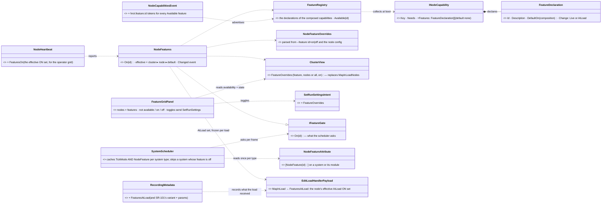
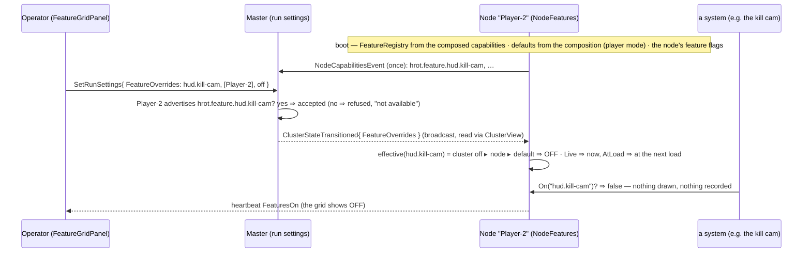
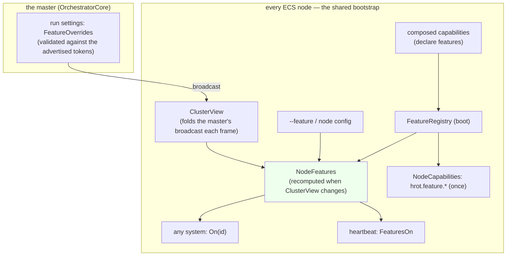
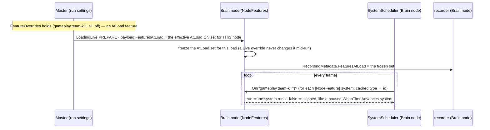
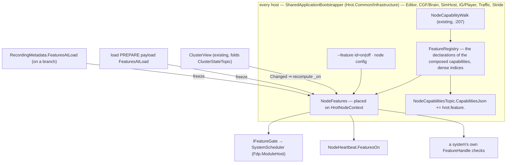
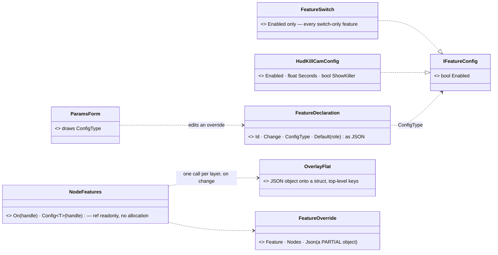

<!--STATUS
state: LIVE
build-state: ⭐ S1 BUILT 2026-11-02 (coordinator lane; commits 21d6ae1a1 · b2bc4fc5d · fc338819b — §8 is the as-built, with its deviations) · S2, S3 DESIGN · (history: S1 READY-TO-BUILD 2026-11-02 — with §7 F-21…F-26 ✅ accepted: a config per feature; §7 + §7.1 supersede §6.5's `bool On`, `FeaturesAtLoad` string[] and F-15/F-16's shapes) · first READY 2026-11-01 ( §4 F-13…F-18 ✅ ACCEPTED — user: "Approved.") · the model AGREED by the user 2026-10-31 ("Good, this sounds like what is needed", "Yes, please write it down") · S2, S3 DESIGN
updated: 2026-11-01 (S1 made buildable: the gate, the two delivery paths, the recording, the first two features — coordinator)
current-answer: ⭐ §8 AS-BUILT (what exists, where, and where the build deviated) · §7 a feature carries a CONFIG (F-21…F-26 ✅) + §7.1 what travels, worked example · §2 the three tiers · §3 the diagrams · §4 decisions F-1…F-18 · §5 slices (S1 buildable) · ⭐ §6 the S1 technical spec (catalogue, C# shapes, where it lives, speed, wire, recording + going live)
stale-below: nothing
known-rot: ⛔ §6.2 / §6.5 / §6.6 show the switch-only shapes (`bool On`, `string[] FeaturesAtLoad`, `FeaturesAtLoad` in the recording) — SUPERSEDED by §7 and, for what was built, §8 (marked inline). §6.1 / §6.3 / §6.4 and §7.1's flow still hold except the two points §8 lists (the load payload carries the cluster LAYER, not the full config; `GET /features` is not built)
known-conflict: none
related-designs:
  - docs/DESIGN_Scenario_Macros.md — OWNS scenario macros (the expander, macro files, params + bindings, RefKey scoping); F-19: the expander is core, never behind a switch
  - docs/DESIGN_Scenario_Rules.md — SR-145: objectives / triggers are scenario CONTENT with NO switch (F-20); its features are `exercise.pause-on-end` and the `hud.*` set; SR-101's run variant + params share F-15's recording seat
  - docs/DESIGN_Cluster_Load_Phase.md — the load PREPARE payload (`EditLoadHandlerPayload`) F-14 stamps AtLoad features into, as CE-3354 ③ stamps MapInLoad
  - docs/DESIGN_Player_Join.md — §7c (R-4115): gameplay packs are composed by the shared bootstrap and their features default ON; a pack runs when any of its features is on
  - docs/PLAN_Training_And_Gameplay_Engine.md — every item there is delivered as features (P-7 scenario presets of these switches)
  - docs/DESIGN_Node_Roles_And_Policies.md — §3.2–§3.4 OWN composition by role (R-4000, R-4005): a role sets DEFAULTS through composition; a switch never replaces composition
  - docs/DESIGN_Player_Join.md — the deploy server is the feature gameplay.deploy-server (D-3 there); its §7a audit items G1…G6 become hud.* features here (S2)
  - docs/blueprints/Architect_Question_108_Run_Mode_Picker.md — D15 OWNS the cluster run settings (SetRunSettings, "Ask to keep recordings") the cluster override rides
  - docs/DESIGN_Cluster_Load_Phase.md — R-1046 / CE-3354 ③ OWN "the 3-D map in the load" (NodeRunProfile.MapInLoad + the master's MapInLoadNodes): the pattern this generalises and its first member (S1)
  - docs/blueprints/Architect_Question_70_Host_Capabilities_And_Reliable_Init_Degradation.md — AQ-70 §Q70-B/C OWNS the capability tokens on the durable NodeCapabilities topic a feature's availability is advertised on
-->

# DESIGN — **node features** *(one switch structure: composed where the code is, on or off per node and per cluster)*

> 🔒 **User, `2026-10-31`:** *"the node should have some configuration structure for features to be turned on or off, and the role which is
> assigned to the node by composition usually, but also via the minus M switch, should simply turn the features on or off. And that could happen
> cross-cluster, the same way as we are switching the 3D map loading, waiting, on or off. That way it wouldn't matter much what is strictly military
> and what is strictly gameplay … we can create a mixture of these that suits the needs of the training or the gameplay … It could be more granular."*
> · *"is this feature setting on or off related to the capabilities that are announced by different nodes? So the feature can be turned on only if
> the capability is saying that the node has it."*

⭐ **R-4108 (`2026-10-31`):** this structure is the rule for EVERY behaviour of the engine, not only gameplay — *"Nothing is hard-coded, everything is a feature that can be switched on or off and announced as a capability."*

**The idea in one line:** a **feature** is a named behaviour declared by the capability whose code implements it; a node ADVERTISES it as
available when that code is composed, and whether it is ON is decided by three layers — the composition's default, the node's own override,
the cluster's override — so any mixture of training and gameplay behaviour can be assembled at run time.

## 1. INVENTORY *(`2026-10-31`)*

Queries run: `scripts/cbm.sh search_graph` Class `.*(Feature|Toggle|Flag|Settings|Config).*` (the hits: per-tool settings — `AudioSettings`,
gizmo `*Settings`, `UnitDebugSettings`, `MapUserConfig`; `HrotNodeConfig`) · grep `MapInLoad` · grep `CapabilityKeys` / `CapabilityTokens` /
`NodeCapabilitiesEvent` · the run-settings path (`SetRunSettingsIntent`, `ClusterView`).

| what exists | where | used here as |
|---|---|---|
| composition units, role-sized: 8 keys (`cap:brain`, `cap:muscle-ground`, `cap:perception`, `cap:navigation-solver`, `cap:image-generator`, `cap:animation-muscle`, `cap:traffic`, `cap:traffic-mirror`) | `CapabilityKeys`, `INodeCapability` (`Hrot.Common/Infrastructure/NodeCapability.cs:25-46, :142`) | tier ① — the OWNER of a feature |
| advertised tokens, published ONCE at join on a durable topic; roles derived from `fdp.role.*`; feature tokens like `fdp.reliable-init` | `NodeCapabilitiesEvent` (`ClusterCqrsEvents.cs:109-117`), `CapabilityTokens`, `NodeRoster.Supports` | tier ② — a feature's AVAILABILITY (`hrot.feature.<id>`) |
| ONE switch in two layers: the node default from composition and a cluster override naming nodes | `NodeRunProfile.MapInLoad` (R-1046; `NodeRunControls.cs:20-23`) · `ClusterView.MapInLoadNodes` (CE-3354 ③), sent by `SetRunSettingsIntent` | tier ③'s pattern, generalised; its first member |
| the cluster run settings: master-owned, broadcast, read through `ClusterView` | `SetRunSettingsIntent` → master → `ClusterStateTransitionedEvent` → `ClusterView` (`AskToKeepRecordings`, `MapInLoadNodes`) | the cluster override's wire |
| the heartbeat carries strings | `NodeHeartbeat` `[DdsManaged] string Step, Reason, NodeName` (`OrchestrationMessages.cs:435-440`) | each node's EFFECTIVE feature state |
| the node's base config is infrastructure only | `HrotNodeConfig` (domain, node id, staging, name) | where the node override is parsed into |
| per-tool settings (gizmo, audio, debug) | `*Settings` classes | ⛔ NOT features: local UI preferences of one window, never cluster-switched |

| claim | code — how it IS | design — how it was MEANT to be |
|---|---|---|
| composition is role-sized; a feature is finer | ✅ 8 keys | ✅ Node Roles §3.2 |
| availability may ride the capability tokens | ✅ tokens are namespaced, extensible (`fdp.reliable-init`) | ✅ AQ-70 §Q70-B ("feature tokens") |
| the on/off state may NOT ride them (published once) | ✅ `NodeCapabilitiesEvent` *"Published ONCE at join"* | — |
| the cluster override has a home | ✅ `MapInLoadNodes` on the run settings | ✅ AQ108 D15, CE-3354 ③ |
| an AtLoad feature's state is recorded with the run | ⛔ **measured `2026-11-01`: NO** — `RecordingMetadata` (`Fdp.Core/FlightRecorder/Metadata/RecordingMetadata.cs:8-117`) holds scenario, terrain, exercise / parent ids, checkpoints, reviews and a free `CustomTags` map, but no run settings ⇒ F-15 adds them | — |
| ⭐ an AtLoad switch already reaches a node FROZEN per load | ✅ `ClusterMaster.FanOutLoadPrepare` stamps `EditLoadHandlerPayload.MapInLoad = true` per node whose name is in `MapInLoadNodes` (`ClusterMaster.cs:2392-2400`) | ✅ CE-3354 ③ ⇒ F-14 generalises it |
| ⭐ a Live switch already reaches every node | ✅ `MapInLoadNodes` crosses as a comma string on the cluster facts and is folded into `ClusterView` (`ClusterFactsIngress.cs:180-181`); the master keeps it on `ClusterMaster.RunSettings.cs:43-47, :97` | ✅ AQ108 D15 |
| ⭐ the scheduler already gates systems by a cached ATTRIBUTE | ✅ `SystemScheduler` reads each system's `[TickMode]` once (`TickModes.OfSystem`, `Scheduling/SystemScheduler.cs:24-95`) and skips a `WhenTimeAdvances` system on a paused frame | ✅ CE-3293 / R-3036 ⇒ F-13 puts the feature gate beside it |
| the capability interface today | `INodeCapability { Key; Needs; PopulateSystems(…); ProvideModules(); Register(…) }` — no features (`NodeCapability.cs:142-178`) | — |
| the command line | `--map-in-load` is a `CommandLineParser` option with a sentinel for "no names" (`HrotRunnerConfiguration.cs:28-40`) | ⇒ `--feature` copies it |

## 2. The three tiers

| tier | what it is | granularity | lifetime |
|---|---|---|---|
| **① composition capability** | the CODE a node loaded (systems, modules) | coarse — role- or pack-sized | fixed at boot |
| **② availability token** `hrot.feature.<id>` | "this node HAS feature X" — advertised because its owner is composed | one per feature | static (published once at join) |
| **③ feature switch** | "feature X is ON here now" | one per feature | dynamic |

## 3. Diagrams



*What the picture shows that prose hid:* the ONLY reader is `NodeFeatures.On(id)` — and most systems never call even that: the SCHEDULER
asks it for every system marked `[NodeFeature]`, beside the `[TickMode]` gate it already applies, so a feature's code cannot forget the
check. The AtLoad set arrives FROZEN in the load payload and is what the recording keeps.





*Caption:* `NodeFeatures` is built by the SHARED bootstrap on every ECS node (the `ClusterView` it reads already exists there), so no
host can lack it; ⚠ the edge that could go silently dead is a feature whose owner forgets to DECLARE it — `On(id)` of an undeclared id is a
**thrown** error at registration in every build (F-18), and a rail lists every `On("…")` literal against the declarations.



*What the picture shows that prose hid:* an AtLoad feature is decided ONCE, by the master, per node, in the payload the load already carries —
the same path `MapInLoad` takes today — so a run cannot change outcome-affecting features half-way, and the recording knows exactly which were on.

## 4. Decisions

| # | decision | ⭐ lean |
|---|---|---|
| **F-1** | what a feature is | a named behaviour (`area.name`, e.g. `hud.kill-cam`, `map3d.in-load`, `gameplay.deploy-server`) that an operator would want on or off INDEPENDENTLY. Two switches that always move together are one feature |
| **F-2** | who declares it | exactly ONE composition capability — the one whose code implements it (`INodeCapability.Features`, default none) |
| **F-3** | availability | declared ⇔ its owner is composed ⇒ the node advertises `hrot.feature.<id>` on `NodeCapabilities` (static, once at join) |
| **F-4** | the only reader | `NodeFeatures.On(id)` — no system reads a run setting, a flag or a host kind for a feature |
| **F-5** | precedence | **cluster override ▸ node override ▸ composition default** |
| **F-6** | the composition default | declared by the feature (`DefaultOn(composition)`): e.g. `hud.kill-cam` ON for `-m player`, OFF elsewhere; `map3d.in-load` ON for the Player (today's R-1046) |
| **F-7** | the node override | `--feature <id>=on|off` (repeatable) and the node config file |
| **F-8** | the cluster override | the run settings carry `FeatureOverrides: [(feature, nodes by name or all, on/off)]`; the master REFUSES an override for a node that does not advertise the feature. `MapInLoadNodes` becomes `(map3d.in-load, nodes, on)` |
| **F-9** | when a switch takes effect | each feature declares **Live** (now — a HUD element) or **AtLoad** (at the next load — anything that changes simulation outcomes, e.g. `gameplay.team-kill`) |
| **F-10** | replays | the effective switches of AtLoad features are part of the run's recorded settings, so a replay reproduces the run (S1 measures where run settings are recorded) |
| **F-11** | what the operator sees | each node reports its effective ON set on its heartbeat; a `FeatureGridPanel` shows nodes × features (not available / on / off) and toggles through the run settings |
| **F-12** | composition is untouched | a switch NEVER loads code; a feature that needs its own code or wire is still a pack (R-4102), and the switch decides whether it is active |

| **F-13** ✅ `2026-11-01` | ⭐ the GATE *(lean, `2026-11-01`)* | `[NodeFeature("id")]` on a system (or on its module — inherited by its systems), read ONCE per type by `SystemScheduler` beside `[TickMode]`; each frame the scheduler asks `IFeatureGate.On(id)` (an interface in `Fdp.ModuleHost`, implemented by `NodeFeatures`) and SKIPS the system when off ⇒ a pack is idle while its features are off **by construction** (R-4115). `NodeFeatures.On(id)` stays for finer checks INSIDE a system (one HUD element of several) |
| **F-14** ✅ `2026-11-01` | ⭐ how an AtLoad switch arrives *(lean)* | the master stamps each node's effective **AtLoad** ON set into its load PREPARE payload (`EditLoadHandlerPayload.FeaturesAtLoad`, replacing `MapInLoad`) — exactly `FanOutLoadPrepare`'s path today; the node FREEZES it for the load. A **Live** feature reads `ClusterView` each time it changes. ⇒ an override of an AtLoad feature during a run applies at the NEXT load, and the grid says so |
| **F-15** ✅ `2026-11-01` | ⭐ the recording *(lean)* | `RecordingMetadata.FeaturesAtLoad` (per node — each node records its own) = the frozen set; a REPLAY needs nothing (the outcome is already recorded); a BRANCH TO LIVE from a checkpoint re-applies it, so the continued run has the same rules. ⭐ The same metadata seat carries SR-101's run variant + params (`DESIGN_Scenario_Rules.md`) — one place for "how this run was set up". ⛔ not `CustomTags` (a typed field, read by code) |
| **F-16** ✅ `2026-11-01` | ⭐ the wire shapes *(lean)* | `SetRunSettingsIntent.FeatureOverrides` + the cluster facts: a typed managed list `{Feature, Nodes (names, empty = all), On}` — ⛔ not another comma string; `NodeHeartbeat.FeaturesOn` (the effective ON set). `MapInLoadNodes` becomes the override `(map3d.in-load, nodes, on)` and is deleted (no compatibility, CE-4153 S10) |
| **F-17** ✅ `2026-11-01` · amended by F-20 | ⭐ the first feature | **`map3d.in-load`** (migrated, declared by the Player's capability, AtLoad, default ON for `-m player` — R-1046 unchanged). ⛔ `scenario.rules` was the second — withdrawn by F-20 |
| **F-18** ✅ `2026-11-01` | an undeclared id *(lean)* | `On("x")` / `[NodeFeature("x")]` with no declaration THROWS at registration in every build (registration is boot, never mid-run — so throwing costs nothing in production); a rail lists every literal against the declarations. ⇒ supersedes the caption's "false in production" |
| **F-19** ✅ `2026-11-01` | macro expansion is CORE, not a feature | 🔒 user: *"Macro expansion is not part of scenario rules, is it? Isn't it a standalone feature which is usable in general, just being used by the rules system? So it should not be gated by scenario.rules. I think this is the core system feature."* ⭐ The macro expander sits on the entity CREATION path and serves forces, units, props and events as much as rules (`DESIGN_Scenario_Rules.md` SR-144) ⇒ it is composed wherever entities are created and is ⛔ NOT gated by `scenario.rules` — nor by any switch: a scenario that uses a macro would become unloadable with it off |
| **F-20** ✅ `2026-11-01` | objectives and triggers are CONTENT, not a feature | 🔒 user, `2026-11-01`: *"The triggers and objectives, they are entities like cars or whatever else, and they are probably a core system feature as well. So is there anything that we can turn on or off? They are either present in the scenario or they don't. And if they are, they should be working, as the system knows how to handle them."* → *"Yes."* to the lean. ⭐ No reason survived (`DESIGN_Scenario_Rules.md` SR-145: free play and debugging are per-scenario controls, performance is negligible, any Brain node runs every behaviour, brains do not tick in replay) ⇒ ⛔ no `scenario.rules` feature. ⭐ The rule for what IS a feature: something that changes how a run is PRESENTED or PLAYED on a node (a HUD element, team-kill, pause-on-end) — ⛔ not the presence of content the scenario itself carries |

**Rejected — one line each:**
- *Each system calling `NodeFeatures.On` at its top* — N copies of one check, and the one that forgets is the silent defect; the scheduler already gates by attribute.
- *Live-reading AtLoad features from `ClusterView`* — a run could change outcome-affecting rules half-way; the load payload freezes them.
- *Run settings in `CustomTags`* — an untyped map nobody can rely on.
- *One bespoke setting per feature, the MapInLoad way, repeated* — N copies of one plumbing; MapInLoad becomes the first member instead.
- *Compile-time switches, or packs only* — no run-time mixture.
- *One "game mode" flag* — too coarse for "a mixture that suits the needs of the training or the gameplay".
- *The on/off state on the capabilities topic* — it is published once at join.
- *Features as a second kind of capability* — a capability is code, a feature is a behaviour inside it; merging them loses "available but off".

## 5. Slices

| slice | builds | done when |
|---|---|---|
| **S1** ⭐ READY-TO-BUILD *(with §7: config types, `OverlayFlat` layers, partial-JSON overrides, `FeatureConfigsAtLoad`, `Config<T>`, `GET /features` with `source`)* | `FeatureDeclaration` on `INodeCapability`, `FeatureRegistry`, `NodeFeatures` (`IFeatureGate`), `[NodeFeature]` + the `SystemScheduler` gate (F-13), `--feature`, `FeatureOverrides` on the run settings + the cluster facts + `ClusterView` (F-16), `FeaturesAtLoad` in the load payload (F-14) and in `RecordingMetadata` (F-15), the availability tokens, `FeaturesOn` on the heartbeat; **`map3d.in-load` migrated** (`MapInLoad` / `MapInLoadNodes` deleted) | a Player builds its 3-D map in the load exactly as today (the R-1046 / CE-3354 ③ rails unchanged, re-pointed); an override switches it on a named node at the next load; an override for a node without the feature is refused; a `[NodeFeature]` system is skipped while off (a rail beside the TickMode rails); a branch to live re-applies the recorded set; rails: every literal is declared, every `[NodeFeature]` id is declared |
| **S2** | the HUD features: `hud.hit-marker`, `hud.damage-arc`, `hud.kill-cam`, `hud.squad-takeover-after-death`, `hud.spread-ring`, `hud.near-miss` (CE-4148; Player Join §7a G1–G6) + the `FeatureGridPanel` | with each OFF nothing of it is drawn or recorded on any host; defaults: ON for `-m player`, OFF elsewhere (G5/G6 lean ON everywhere) |
| **S3** | `gameplay.deploy-server` (Player Join D-3): "a server exists" = a node with the feature available AND on | a Player observes when no node has it on (R-4103) |

## 6. S1 technical spec *(`2026-11-01`, answers the user's questions: *"What is the list of features? What do the network topic structs look like … the reason for comma separated list in one place and a list of strings in the other … What is the scenario.rules feature about? How does the node keep / manage the list … where, what module? How fast is the NodeFeatures.On(id) check? How do we remember the features in the recording … when we load the recording and go to live, how do we know what features to enable?"*)*

### 6.1 The feature catalogue *(every id the designs name — grep of `docs/` for dotted ids, `2026-11-01`; S1 builds the first two, the rest arrive with their owners)*

| id | declared by (capability) | change | default | owning design / slice |
|---|---|---|---|---|
| `map3d.in-load` | Player (`cap:image-generator`) | AtLoad | ON for `-m player` | R-1046 · **S1** (migrated) |
| `exercise.pause-on-end` | Brain | Live | ON | Scenario Rules SR-9 / SR-116 · its S2 |
| `hud.objectives` · `hud.own-evaluation` · `hud.messages` | Player | Live | ON (demo profile, SR-83) | Scenario Rules SR-106 / SR-112 · its S2 / S4 |
| `hud.hit-marker` · `hud.damage-arc` · `hud.kill-cam` · `hud.squad-takeover-after-death` · `hud.spread-ring` · `hud.near-miss` | Player | Live | ON for `-m player` | `DESIGN_Player_Join.md` §7a G1–G6 · S2 |
| `hud.kill-feed` · `hud.score-popups` · `hud.coaching` | Player | Live | game profile ON, training OFF | Scenario Rules SR-112 · its S6 |
| `gameplay.deploy-server` | the deploy pack | AtLoad | ON where composed | Player Join D-3 · S3 |
| `gameplay.team-kill` | Combat (`cap:muscle-ground`) | AtLoad | ON | PLAN_Training_And_Gameplay_Engine |
| `ui.side-knowledge` · `ui.side-knowledge.last-known` · `map3d.knowledge-indicators` | Player | Live | per profile | Entity Control / Map 3D designs |
| `eval.performance` | Brain | AtLoad | ON | Scenario Rules S4 |

⭐ The catalogue is CODE, not a file: each capability's `Features` list is the truth; a rail prints the table, so this one can be regenerated.

### 6.2 The C# shapes — ⛔ SUPERSEDED (switch-only; see §7 and §8 for the shapes that exist)

```csharp
public enum FeatureChange : byte { Live, AtLoad }
public sealed record FeatureDeclaration(string Id, string Description, FeatureChange Change, Func<NodeRole, bool> DefaultOn);

public interface INodeCapability {                      // existing — grows ONE default member
    IReadOnlyList<FeatureDeclaration> Features => Array.Empty<FeatureDeclaration>();
    // Key, Needs, PopulateSystems, ProvideModules, Register — unchanged
}

public readonly struct FeatureHandle { internal readonly int Index; }   // a dense index, resolved ONCE

public interface IFeatureGate { bool On(FeatureHandle f); FeatureHandle Resolve(string id); }   // Fdp.ModuleHost — the scheduler's view

public sealed class NodeFeatures : IFeatureGate {       // Hrot.Common/Infrastructure — ONE per node
    public bool On(FeatureHandle f) => _on[f.Index];    // the hot path: one array read
    public bool On(string id) => _on[_index[id]];        // convenience: one dictionary lookup
    public FeatureHandle Resolve(string id);             // throws on an undeclared id (F-18)
    public event Action? Changed;                        // after a recompute
    private bool[] _on;                                  // effective, recomputed on ClusterView change / at load
    private readonly Dictionary<string, int> _index;     // id → index, built at boot from the FeatureRegistry
    private bool[] _frozenAtLoad;                        // the AtLoad part, set from the load payload or the recording
}

[AttributeUsage(AttributeTargets.Class)] public sealed class NodeFeatureAttribute(string id) : Attribute { public string Id => id; }
```

### 6.3 Where it lives, who builds it



*Caption:* the registry is built where the capability walk already is, in the ONE base bootstrapper every host derives from (`TrafficNodeBootstrapper`,
`IgNodeBootstrapper`, `StrideNodeBootstrapper`, `CgfNodeBootstrapper`, `SimHostNodeBootstrapper`, `EditorNodeBootstrapper` — all
`: SharedApplicationBootstrapper`), so no host can lack it; the scheduler sees only the FDP-level `IFeatureGate`.

### 6.4 Speed

| call | cost | used by |
|---|---|---|
| `On(FeatureHandle)` | one `bool[]` read (~1 ns) | the scheduler (the handle cached per system TYPE at registration, beside `TickMode`) and systems (handle resolved in the constructor) |
| `On(string)` | one `Dictionary<string,int>` lookup (~20 ns) | UI and rare checks — ⛔ not in a per-entity loop |
| recompute `_on` | O(features), only when `ClusterView` changes or a load freezes | — |

### 6.5 The wire — ⛔ SUPERSEDED by §7.1 / §8 (`FeatureOverrideWire` carries `Json`, not `bool On`; `FeaturesAtLoad` string[] is `FeatureConfigsAtLoad`) *(measured shapes: `OrchestrationMessages.cs:150-200` `ClusterStateTopic`, `:426-445` `NodeHeartbeat`, `:463-472` `NodeCapabilitiesTopic`; `Payloads/OrchestrationPayloadDtos.cs:98-108` `SetRunSettingsPayloadDto`)*

```csharp
public partial struct FeatureOverrideWire {                // NEW, a DDS struct
    [DdsManaged] public string Feature;
    [DdsManaged] public List<string> Nodes;                // empty = all nodes
    public bool On;
}
// ClusterStateTopic — APPENDED LAST (R-42); MapInLoadNodes DELETED (no compatibility):
    [DdsManaged] public List<FeatureOverrideWire> FeatureOverrides;
// NodeHeartbeat — appended:
    [DdsManaged] public List<string> FeaturesOn;          // the effective ON set
// NodeCapabilitiesTopic — UNCHANGED: CapabilitiesJson simply gains "hrot.feature.<id>" tokens
// SetRunSettingsPayloadDto (JSON, the cluster-op channel) — appended; MapInLoadNodes deleted:
    [property: JsonPropertyName("FeatureOverrides")] FeatureOverrideDto[]? FeatureOverrides = null   // null = no change
// EditLoadHandlerPayload (JSON, the load PREPARE) — MapInLoad DELETED:
    string[]? FeaturesAtLoad                               // this node's effective AtLoad ON set
```

⭐ **Why a comma string in one place and a list in another — measured, no deep reason:** the orchestration topics carry lists in THREE
conventions today — a comma string (`ClusterStateTopic.MapInLoadNodes`, CE-3354 ③: *"comma-joined (names hold no comma)"*), a JSON
`string[]` inside a string (`NodeCapabilitiesTopic.CapabilitiesJson`, `SubsystemsJson`, the asset inventory), and a typed DDS sequence
(`EntityMission.Plan.Tasks`, `[DdsManaged] List<MissionTask>`, `MissionDescriptors.cs:62-64`). The JSON payload DTOs (`SetRunSettingsPayloadDto`)
use `string[]` because they are JSON. ⭐ Lean: NEW topic fields use the typed sequence (it already crosses the wire for missions);
`MapInLoadNodes` goes with this slice. ⚠ Unifying the existing JSON-in-a-string lists is a separate, cheap finding — filed with this slice's row.

### 6.6 The recording, and going live from it — ⛔ the rows hold with `FeatureConfigsAtLoad` (full configs) in place of `FeaturesAtLoad`; the payload stamp differs, see §8

| step | what happens | where |
|---|---|---|
| a live load | the master stamps each node's effective AtLoad ON set into its load PREPARE (`FeaturesAtLoad`) — the `FanOutLoadPrepare` path `MapInLoad` takes today | `ClusterMaster.cs:2392-2400` |
| the node | freezes it (`_frozenAtLoad`) and writes it into its own `RecordingMetadata.FeaturesAtLoad` | `RecordingModule` (`Fdp.Toolkits/Replay/RecordingModule.cs`), where `ParentExerciseId` is written today (`:89`) |
| replay | nothing needed — the outcome of those features is already in the recorded state | — |
| ⭐ go live from the recording (`NodeOpType.PrepareLive`, `LiveBranchAggregator`) | each node's `StartBranch` already copies its parent's metadata (terrain, geo origin, checkpoints, parent id — `RecordingModule.cs:57-73`); it copies `FeaturesAtLoad` too, and the node FREEZES that set — ⭐ **the recording wins** for AtLoad features (the continued run plays by the same rules); Live features follow the cluster's current settings | `RecordingModule.StartBranch` |
| a node that kept no recording | takes the master's current overrides, as on a fresh load | — |
| a recorded feature this build does not declare | the branch is REFUSED loudly (*"recording needs feature X, not available on node Y"*) — ⛔ never a silent different run | the PrepareLive answer |

## 7. A feature carries a CONFIGURATION, not just a switch *(`2026-11-02` — ✅ F-21 … F-26 ACCEPTED — user: *"Accepted"*; S1 was not built, so this changed its spec, not code)*

> 🔒 **User, `2026-11-02`:** *"I was thinking about whether the feature on/off setting is not just a reduced form of some wider feature
> configuration and whether it could not be generalized as such (and transported as json object), if each feature can come with its json
> serializable configuration DTO which contains the Enabled flag as a minimum."*

**INVENTORY** *(`2026-11-02`: graph `.*Settings$` Class (16) and `.*(Config|Options|Profile)$` Class (~70); read `BehaviorParams.cs:121-190`,
`NodeRunControls.cs:20-26`, `BrainSettings.cs`; ⚠ coverage unchecked)*

| what exists | where | so |
|---|---|---|
| ⭐ the layered FLAT overlay of a JSON object onto a typed struct — DTO initialisers ▸ asset defaults ▸ the scenario / order JSON, top-level keys only, unknown keys ignored | `BehaviorParams.OverlayFlat<T>` (`Fdp.Toolkits/Behavior/BehaviorParams.cs:132`, `OverlayFlatAt` `:185`) | ⭐ exactly the precedence F-5 needs, already built ⇒ reuse it, per layer |
| ⭐ the ONE params form draws any DTO type; a runtime-chosen type through `ScalarEditBox<T>` | `BehaviorParamsForm.cs:43-85`; `VariableEditModal.cs:340-380` (macros SR-44a) | the operator edits a feature's config with it — no new editor |
| the node's run profile is a bag of per-host switches (`SuppressTimeControl`, `MapInLoad`) | `NodeRunControls.cs:20` | `MapInLoad` is already S1's first feature; the rest are host-kind facts, ⛔ not features |
| most `*Settings` / `*Config` types are per-ENTITY components (`DangerAreaSettings`, `GroundClampingConfig`), per-unit brain settings (`BrainSettings`, R-1036) or per-WINDOW UI preferences (gizmo `*Settings`) | the graph lists above | ⛔ not features (§1 already ruled the UI preferences out); ⭐ the three node-level candidates, measured `2026-11-02`: `TimeControllerConfig` is built from the node's ROLE by `HrotNodeBuilder.cs:162` (how the node keeps cluster time — infrastructure, ⛔ not a feature); `LiveCityConfig` is built by `TrafficSession.cs:51` from the scenario's traffic entity (R-4021 — scenario CONTENT, ⛔ not a feature, F-20); `PedDemandConfig` lives inside the external SumoSharp library — ⇒ ⛔ none becomes a feature config |



*What the picture shows that prose hid:* the switch becomes the `Enabled` field of a typed config, and the layers become JSON objects the
existing flat overlay applies in order — so the precedence, the editor and the transport are all things the engine already has.

| # | decision | ⭐ lean |
|---|---|---|
| **F-21** | a feature's state is a CONFIG, `Enabled` its minimum | ⭐ every feature declares a config type implementing `IFeatureConfig { bool Enabled }`; a switch-only feature uses the shared `FeatureSwitch`. ⭐ The type is an UNMANAGED struct where it can be (CLAUDE.md *"NEW COMPONENTS"*): it is read on the frame path and recorded |
| **F-22** *(amends F-5, F-6, F-7, F-8)* | the layers | ⭐ each layer is a flat JSON OBJECT applied by `BehaviorParams.OverlayFlat<T>` in order: the type's initialisers ▸ the composition default (per role, F-6) ▸ the scenario's preset (P-7, `PLAN_Training_And_Gameplay_Engine.md`) ▸ the node override (`--feature hud.kill-cam={"Seconds":3}`; `--feature id=on\|off` stays as the short form of `{"Enabled":…}`) ▸ the cluster override. ⭐ A layer names only the keys it changes, so *"turn it off"* is `{"Enabled": false}` and keeps every other setting |
| **F-23** *(amends F-16)* | the wire | ⭐ `FeatureOverrideWire { Feature, Nodes, Json }` — `Json` the partial object, replacing `bool On`; the load payload's `FeaturesAtLoad` becomes `FeatureConfigsAtLoad` (id → the EFFECTIVE full object of each AtLoad feature); `NodeHeartbeat.FeaturesOn` stays (the ON set, for the grid); the full effective configs are read on demand through the node's debug API, ⛔ not every heartbeat |
| **F-24** *(amends F-15)* | the recording | `RecordingMetadata.FeatureConfigsAtLoad` — the effective objects; a branch to live re-applies them (unchanged rule: the recording wins for AtLoad). A recorded key this build's type no longer has ⇒ the branch is refused loudly, as an undeclared feature is today |
| **F-25** | reading it | ⭐ `On(handle)` is unchanged (one `bool[]` read — the scheduler gate F-13 keeps working); `Config<T>(handle)` returns `ref readonly T` from the node's slot, recomputed only when a layer changes — ⛔ no allocation, no JSON on the frame path. Systems take the handle in their constructor |
| **F-26** | Live vs AtLoad | ⭐ stays PER FEATURE (F-9): a feature whose settings mix both kinds is two features (F-1 — *"two switches that always move together are one feature"*, and the reverse). ⭐ An override with a key the type does not have is refused by the APPLYING node and reported on its heartbeat — the master only sees availability tokens, not the types |

**Rejected — one line each:**
- *Keep `bool On` and add a separate settings channel per feature* — two transports and two recordings for one fact.
- *A free JSON blob read by the system itself* — untyped, parsed on the frame path, and no editor can draw it.
- *Managed config classes* — recorded and read every frame; an unmanaged struct costs nothing in replay.
- *Deep merge of nested objects* — `OverlayFlat` is flat on purpose (macros §4.0); a nested setting is promoted to the top level.

### 7.1 What travels — a worked example *(`2026-11-02`, ✅ accepted with F-21…F-26; the shapes S1 builds)*

⭐ The cluster: `Brain-1`, `Player-1`, `Player-2`. The operator shortens the kill cam on `Player-2` and turns team-kill off everywhere.

| # | message | direction · when | carries |
|---|---|---|---|
| ① | `NodeCapabilitiesTopic` (existing, unchanged) | each node → all · ONCE at join | which features the node HAS — `hrot.feature.<id>` tokens |
| ② | `SetRunSettings` (JSON, cluster-op channel) | operator → master · on a change | the overrides, each a PARTIAL object; the master refuses one for a node without the token |
| ③ | `ClusterStateTopic.FeatureOverrides` (DDS, typed sequence, appended last) | master → all · broadcast | the same list; each node folds it into `ClusterView` and recomputes |
| ④ | load PREPARE `FeatureConfigsAtLoad` (JSON) | master → each node · per load | the FULL effective config of every AtLoad feature that node has — frozen for the run, and written into its `RecordingMetadata` |
| ⑤ | `NodeHeartbeat.FeaturesOn` (DDS, appended) | each node → all · every heartbeat | the ON set only, for the grid |
| ⑥ | the node's debug API `GET /features` (HTTP) | on demand | effective values + the LAYER each value came from (`source`) |

```text
① Player-2 → all     CapabilitiesJson = ["fdp.role.player", "fdp.reliable-init",
                                         "hrot.feature.map3d.in-load", "hrot.feature.hud.kill-cam", "hrot.feature.hud.hit-marker"]
② operator → master  { "FeatureOverrides": [
                         { "Feature": "hud.kill-cam",       "Nodes": ["Player-2"], "Json": "{\"Seconds\":3}" },
                         { "Feature": "gameplay.team-kill", "Nodes": [],           "Json": "{\"Enabled\":false}" } ] }   // [] = all nodes
③ master → all       FeatureOverrides = [ FeatureOverrideWire{ "hud.kill-cam", ["Player-2"], "{\"Seconds\":3}" },
                                          FeatureOverrideWire{ "gameplay.team-kill", [], "{\"Enabled\":false}" } ]
                     ⇒ hud.kill-cam is Live: applied now on Player-2 · team-kill is AtLoad: waits for the next load
④ master → Brain-1   { "FeatureConfigsAtLoad": { "gameplay.team-kill": {"Enabled": false},
                                                 "exercise.pause-on-end": {"Enabled": true}, "eval.performance": {"Enabled": true} } }
  master → Player-2  { "FeatureConfigsAtLoad": { "map3d.in-load": {"Enabled": true} } }
⑤ Player-2 heartbeat FeaturesOn = ["map3d.in-load", "hud.kill-cam", "hud.hit-marker"]
⑥ GET /features      { "hud.kill-cam": { "Enabled": true, "Seconds": 3, "ShowKiller": true,
     (Player-2)        "source": { "Enabled": "role default", "Seconds": "cluster", "ShowKiller": "type default" } } }
```

⛔ **Never on the wire:** the config TYPES (each node has them in code) · the full config on every heartbeat (rarely changes; ⑥ inspects it) ·
anything during a REPLAY (the outcome is already recorded).

## 8. AS BUILT — S1 *(`2026-11-02`, coordinator lane; ✅ built and gated, the prior shapes above are superseded where they differ)*

| part | commit | what exists (file) |
|---|---|---|
| (a) model | `21d6ae1a1` | `IFeatureConfig`, `FeatureSwitch`, `FeatureChange`, `FeatureDeclaration` (`Of<T>` / `Switch`, `RoleDefault` a `Func<NodeRole,string?>` returning a partial JSON), `FeatureRegistry`, `NodeFeatures` (layers: type initialisers ▸ role default ▸ node override ▸ cluster override, each `BehaviorParams.OverlayFlat`; `On(handle)` a `bool[]` read; `Config<T>` a `ref readonly`; `Resolve` throws) in `Hrot.Core/Infrastructure/NodeFeatures.cs` (namespace `Hrot.Common.Infrastructure`, because `HrotNodeContext` is in `Hrot.Core`); `FeatureHandle`, `IFeatureGate`, `[NodeFeature]` in `Fdp.ModuleHost/Scheduling/FeatureGate.cs`; `INodeCapability.Features` default member; `HrotNodeContext.Features` built in the shared bootstrapper's `capabilities` step |
| (b) gate | `6508be001` | `SystemScheduler` reads `[NodeFeature]` once per system (type or its module, inherited: `RegisterSystem(system, ownerModule)`) beside `TickModes`, skips while off; an undeclared id or no gate throws at registration; `ModuleHostKernel.FeatureGate` |
| (c) CLI | `21d6ae1a1`.. | `--feature id=on\|off` / `id={json}`, repeatable (`NormaliseArgs` folds the repeats into one sequence — the parser takes an option once); process-wide `NodeFeatureOverrides.FromCommandLine` |
| (d) wire | `b2bc4fc5d` | `FeatureOverrideWire` + `ClusterStateTopic.FeatureOverrides` (last), `NodeHeartbeat.FeaturesOn`, `SetRunSettingsPayloadDto.FeatureOverrides`, `FeatureOverrideSpec` (the internal twin, `Fdp.Toolkits/Orchestration/FeatureOverrideSpec.cs`; the ONE converter `FeatureOverrideWires`), master validation (`ClusterMaster.RunSettings.cs`), `EditLoadHandlerPayload.FeatureConfigsAtLoad`, `IRecordReplayController.FreezeFeaturesForLoad`, `RecordingMetadata.FeatureConfigsAtLoad` (written by `RecordingModule`, copied by `StartBranch`), `IFeatureRecording` |
| (e) first feature | `fc338819b` | `map3d.in-load` (`Map3dInLoadFeature`); `NodeRunProfile.MapInLoad`, `ClusterView.MapInLoadNodes` and its event/topic/DTO fields, the master's set and `EditLoadHandlerPayload.MapInLoad` DELETED; `MapBuildLoadStep` asks the node's frozen feature |

**Deviations from §6 / §7 — read before building on it**
1. ⭐ **The load payload carries the cluster LAYER, not the full effective config.** The master knows availability tokens only, not config types or role defaults, so it cannot compute "the full effective JSON" (§7.1 ④). It stamps, per node and per feature the node advertises, the merged matching overrides (partial JSON, values are strings in a `Dictionary<string,string>`); the NODE freezes that layer (defaults ▸ role ▸ node override ▸ layer) and writes the FULL effective configs into its `RecordingMetadata.FeatureConfigsAtLoad` — the recording is what holds full objects. A branch to live re-applies them (`FreezeRecorded`; the recording wins).
2. **`FeatureOverrides` on the run settings REPLACE the whole list** (null = no change); the master refuses the whole intent (`Rejected`) when a named node is in the roster and does not advertise `hrot.feature.<id>`, or an all-nodes override has no advertiser. A name no node holds now is kept (a restart), as `MapInLoadNodes` was.
3. **`map3d.in-load` is declared by every host that supplies a map status** (IG default ON; CGF, SimHost, editor default OFF) through `SharedApplicationBootstrapper.HostFeatures`, not by the Player's capability alone — the old `--map-in-load` could name any of those hosts, and a Player-only declaration would have removed that. The map's eager build policy is decided at boot (`Map3dInLoadFeature.OnAtBoot`: default ▸ `--feature`), the load's wait at the load.
4. **The node override layer is process-wide** (`NodeFeatureOverrides`), not a `HrotNodeConfig` field: every host reaches `NodeFeatures` through the one shared bootstrapper. A node applies entries whose feature it declares; ✅ **CE-4215 ①:** an id NO node of the process declares is refused at startup — each node's bootstrapper calls `NodeFeatureOverrides.NoteDeclared(ids)` after building its registry, `Program.cs` asks `NodeFeatureOverrides.Unclaimed()` once `orchestrator.Initialize()` returned (every in-process node built) and exits 1 naming the ids; an id another in-process node declares stays fine.
5. ✅ **Built by CE-4215 (`2026-11-02`)** — the items §8 first listed as not built:
   - **`GET /features`** (§7.1 ⑥): `DebugApiHost` route → `DebugApiService.GetFeatures` → per provider `ISubsystemDebugProvider.Features` (the `NodeFeatures` of that subsystem's `HrotNodeContext`, set by `EcsNodeDebugProvider`) → `NodeFeatures.Describe()`: `{ subsystems[{ subsystem, perspective, features{ <id>: { <field>…, source{ <field>: layer }, change } }, problems[] }] }`; layers `type default · role default · node · cluster · recording` (an AtLoad cluster stamp reads `cluster`). Per SUBSYSTEM like `/diagnostics/architecture`: a `--mode all` node holds one registry per hosted subsystem.
   - **F-26 heartbeat report:** `NodeFeatures.ProblemList()` → `ClusterSlave.FeatureErrorsProvider` → `NodeHeartbeatEvent.FeatureErrors` → `NodeHeartbeat.FeatureErrors` (`[DdsManaged] List<string>`, appended LAST, R-42; twin converted in `NodeHeartbeatWire`) → the master's roster `NodeHealthProfile.FeatureErrors` (and `.FeaturesOn`, the grid's input for S2).
   - **Branch refusal rail at the controller:** `EcsRecordReplayControllerTests.PrepareRecordingAsync_ABranchWhoseRecordingNamesAFeatureThisBuildLacks_IsRefused` (the refusal itself stays railed at `NodeFeatures.FreezeRecorded`).
   - **Real DDS round-trip:** `Hrot.ClusterRunner.Integration.Tests/NodeFeaturesWireRoundTripTests` (domain 45): `FeatureOverrideWire` (master → IG) and `NodeHeartbeat.FeaturesOn` (IG → master roster).
   - **Still not built:** the `FeatureGridPanel` (S2) the operator UI sender of a general override. Over HTTP, `POST /run-settings` now takes `featureOverrides: [{feature, nodes:[names] ([]=all), json}]` (replaces the whole list; `mapInLoad` / `mapInLoadNodes` stay and can only turn `map3d.in-load` ON for named nodes). Live check `2026-11-02` (`--mode all`, `hill-attack`): IG `GET /features` `map3d.in-load` Enabled true/`role default` → false/`cluster` after an override naming `IG-100`; the IG heartbeat on the wire (`ddsmonitor`) `FeaturesOn` [`map3d.in-load`] → [], `FeatureErrors` []; the broadcast carried `FeatureOverrides` with `Nodes:["IG-100"]`.
6. `HrotNodeContext.Tick` folds `ClusterView.FeatureOverrides` into `NodeFeatures` each frame by reference comparison (the view builds a new list per broadcast).
7. `Hrot.Orchestrator.Tests` compiles again (a missing `Hrot.Editor.AiShared` project reference — the pre-existing CS0234).
