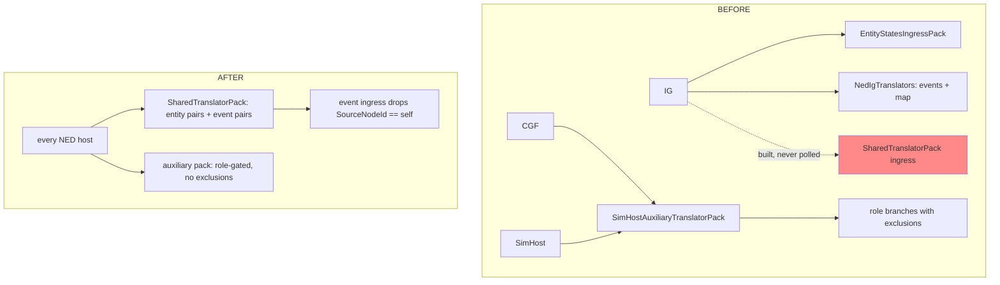
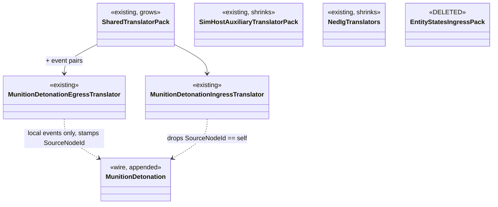
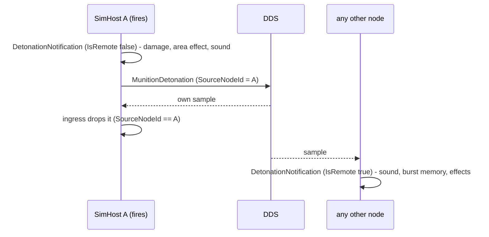
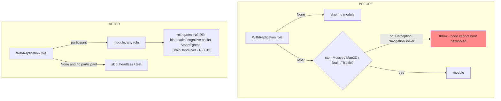
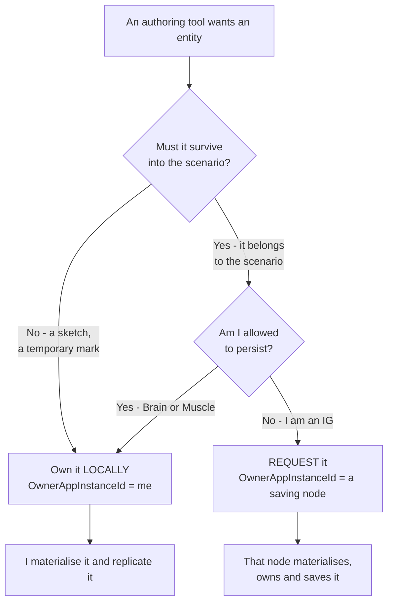

<!--STATUS
state: LIVE
updated: 2026-10-25 (§3.0a NEW — who hears, who reads the terrain, who makes sound; the user's rulings) · 2026-10-19 (§3.5 — the EntityHitDamage pair joins the shared pack, CE-3246) · 2026-10-17 (§3.5 NEW — R-3015: one translator set on every node; CE-1148's slices S1–S3 + the event own-sample skip) · 2026-10-15 (§3.4 NEW — R-4005: a role is what a host DOES, never a network fact; the editor's NodeRole.None vs EditorCapabilities.DefaultRole contradiction measured and the one-line fix scoped) · 2026-10-15 (§3.3 NEW — R-4000: one code path on every node, behaviour differs by ROLE, never by a missing handler; the Player node's 2PC robustness recorded as OPEN) · 2026-09-13
known-rot: ⛔ §4's role-affinity ownership (IG passing a Map2D policy; create/promote legs claiming by role, e.g. the §4.1 seam ② row) is RETIRED 2026-10-02 by push-only ownership — DESIGN_Ownership_Groups_And_Grants.md §5.6 S4 (no host passes a policy; the creator claims all and grants role groups).
current-answer: §3 is the role table, §3.1 is entity-creation uniformity (a role never denies a
  capability), ⭐ §3.3 is ONE CODE PATH ON EVERY NODE (R-4000 — behaviour differs by role, never by a missing
  handler), ⭐ §3.4 is A ROLE IS WHAT A HOST DOES, NEVER A NETWORK FACT (R-4005 — an all-in-one host declares
  the union of its roles; NodeRole.None means "plays no role", not "is not networked"),
  ⭐ §3.5 is ONE TRANSLATOR SET ON EVERY NODE (R-3015 — what a node receives never depends on its host kind),
  ⭐ §3.6 is EVERY NETWORKED ECS NODE REPLICATES (R-4057 — the role gates inside the module, never whether it exists),
  ⭐ §3.2 is WHAT EACH ROLE LOADS in the init phase — the role declares the WHAT, the host
  supplies the HOW, §4 is ownership, §5 is persistence, §5a is which nodes must carry an ORBAT (operator
  surfaces), §6 is where an entity should be created. §7 is the honest list of what is ENFORCED versus
  merely CONVENTION.
  ⭐ §3.2 is NEW on 2026-09-18 and closes a SILENCE, not a contradiction: this document was already
  role-centric (§2, §3, §3.1) but said nothing about the init/load phase, so that decision had drifted
  into three host bootstrappers and produced a production defect.
  ⭐ §5a is NEW on 2026-09-10 and is the FIRST statement of its rule anywhere - 177 corpus files mention
  ORBAT and none said which nodes need one. It owns only WHICH NODES; the panel unification is UXI-04,
  the ExCon fork retirement UXI-25, the seam defect CE-259t.
open-elsewhere: §8 ① — what happens to a REPLICATED entity at save time — is a SCENARIO-SAVING
  question parked here; its owning home is docs/designs/cgf-scn-2/DESIGN.md (scenario serialization
  correctness). §8.1 records that an earlier draft claimed no such design existed, which was FALSE —
  it searched docs/ only and its filename filter missed cgf-scn because the folder says "scn".
  ⭐ §7.3 now MEASURES that question and answers it: the sketch DOES reach the saving node, so R-140
  does not hold by topology. What remains open there is the MECHANISM CHOICE (a/b/c), not the fact.
stale-below: §7.2's closing "NOT MEASURED" paragraph is SUPERSEDED by §7.3, and §8.1's
  "the existing exclusion mechanism cannot express §8 ①" is SUPERSEDED — ScenarioIgnoreTag can.
  Both supersessions are marked in place and the dead text is quoted under a HISTORY heading.
known-rot: nothing known. ⚠ This document is NEW and consolidates statements that were previously
  scattered across HROT-Engine-Guide §1.3–§1.3c, RULINGS R-138/R-140, and Architect_Question_65. If it
  disagrees with any of those, THIS file is the one to correct — the others are index or orientation.
known-conflict: none reconciled away silently. §7 records two places where the CODE cannot enforce what
  this document states, and names them as gaps rather than pretending the rule holds.
design-basis: docs/blueprints/RULINGS.md R-138 (fully distributed; NodeRole is a convention) and R-140
  (IG is passive and non-persisting) - docs/HROT-Engine-Guide/HROT-Engine-Guide.md §1.3a/§1.3b/§1.3c -
  docs/blueprints/Architect_Question_65_Entity_Genesis_Uniformity.md §0, §4 (Q65-A′), §5.5 (CE-143) -
  Hrot/Engine/Hrot.Core/NodeRole.cs (the enum itself)
related-designs:
  - docs/DESIGN_World_Survey_Sensor.md — OWNS the brain's only way to the geometry (R-2037); §3.0a here states the rule per role
  - docs/DESIGN_Visual_Effects.md — §10: the RoundImpact pair §3.5 S2 moved to every node.
  - docs/designs/brain-split/BS-1-DESIGN.md — §6.4a: the EntityHitDamage pair §3.5 moved to every node (CE-3246); it owns the hit's route and the one ownership rule.
  - docs/designs/indirect-fire/DESIGN_Indirect_Fire.md — §3.8: the observer's burst ingress §3.5 S2 folded into the shared pack.
  - docs/DESIGN_Civilians_And_Crowd_Control.md — §7.3a: the gas cloud (R-3014) is the case that surfaced §3.5; it owns the cloud, this owns who receives the detonation.
  - docs/DESIGN_Thermal_And_Acoustic_Sensing.md — §3a's Perception-only event ingress and its named limit ("a second MuscleGround node") are what §3.5 S2 replaces.
  - docs/blueprints/Architect_Question_91_Player_Nodes.md — the multiplayer Player node (an IG node, no new role): which
    nodes may fail or hang a 2PC round is derived from the ROLE (§4-A there), the open item at the end of §3.3 here.
  - docs/DESIGN_Unified_Cluster_Handler_Registration.md — owns WHICH cluster handlers each host registers and in
    what ORDER (CE-279); §3.3 here owns the rule that the set is the same everywhere and a ROLE, not a missing
    handler, makes a node behave differently.
  - docs/DESIGN_Terrain_World.md — the LOS-against-terrain reader §3.2 named as its reopen trigger now exists (Q81 T4): Perception and Map2D load the terrain world.
  - docs/DESIGN_Terrain_Zones_And_Assets.md — owns WHAT terrain and zones ARE (the definition file, the
    ECS singleton, the zone ops, the asset build). ⚠ CORRECTED 2026-09-18: an earlier version of this
    line said terrain is consumed by "MuscleGround, Perception, NavigationSolver; the brain loads none
    of it". Measured, the consumers are MuscleGround and NavigationSolver ONLY — Perception, Brain and
    Map2D have no reader. §3.2 carries the measured table.
  - docs/DESIGN_Cluster_Load_Phase.md — ⭐⭐⭐ owns the LOAD PHASE MECHANISM that §3.2's requirements feed:
    the ordered per-host chain, the single acknowledgement, and the content names riding the load
    message. §3.2 here owns WHICH ROLE NEEDS WHAT; that document owns HOW and WHEN it is loaded, and
    neither restates the other.
  - DESIGN_Entity_Authoring_Surface.md — owns the authoring affordance whose `isTransient` argument is the
    CARRIER for R-140's "an IG entity is disposable". Its §7c parks the product question — are IG's map
    drawings disposable or persistent? — and names THIS document (§5, §8) as the owner of the answer.
  - DESIGN_Distributed_Scenario_Persistence.md — owns the SAVE/LOAD MECHANISM that enforces this
    document's ownership POLICY: the uniform per-entity save gate (`HasAuthority`), the per-node file
    model, and the `NetworkAuthority`/`NetworkOwnership` merge. ⭐ It SUPERSEDES §7.2's "ownership is
    discarded at save time" for the distributed case and ANSWERS §8 ①. This document keeps the policy
    (who may own what, R-138/R-140); that one keeps the mechanism.
  - docs/blueprints/Architect_Question_93_Sumo_Traffic_Node.md — adds the Traffic role: an ECS host running SumoSharp that publishes on SumoSharp's own topics, not NED (R-4020, R-4022).
-->

# ⭐⭐⭐ Node Roles, Policies and Conventions

> 🔒 **Why this document exists** *(user, `2026-09-02`)*: *"can we create a standalone design document
> explaining the node roles and policies and conventions, not hiding it into a small ruling document?"*

⭐⭐ **The single home for *"what is a node allowed and expected to do."*** Before this, the answer was
split across an orientation guide, two ledger rows and an architect question — ⛔ and the most important
part of it *(why IG may not own persistable entities)* **existed in no document at all**, only in the
user's head. That is what this fixes.

---

## 1. INVENTORY

⭐ Run `2026-09-02`, graph **and** grep, per the seam law.

| # | query | result |
|---|---|---|
| ① | `search_graph name_pattern="NodeRole\|ClusterRole\|.*NodeRole.*"` | **25** hits — ⭐ exactly **one** production type: `Hrot/Engine/Hrot.Core/NodeRole.cs`. The rest are docs and reports |
| ② | `grep "enum NodeRole"` production | **1** definition — no second, competing role enum |
| ③ | `grep -rln "NodeRole\|node role\|passive.*node"` over **`docs/`** | **12** files, all **orientation or per-project reference** |
| ④ | existing owners of the topic | `HROT-Engine-Guide` §1.3/§1.3a/§1.3b/§1.3c · `RULINGS` R-138/R-140 · `Architect_Question_65` |
| ⑤ | ⚠ **ADDED `2026-09-02` after the search flaw in §8.1** — `find .dev -iname "*role*" -o -iname "*node*"` over all **2939** `.dev` markdown files, **including `_DONE/`** | **13** hits, ⭐ **every one a Blueprint EDITOR-node document** *(graph nodes, not cluster nodes)* ⇒ ⛔ **nothing on cluster node roles** |

⇒ ⭐ **No prior standalone design to extend** — ⭐⭐ **now measured across BOTH trees**, not just `docs/`
⇒ this file is new, and the sources in ④ become **pointers to it** rather than parallel accounts.
⚠ **Row ⑤ exists because rows ①–④ searched `docs/` only, and §8.1 records where that same flaw produced
a FALSE claim about scenario-saving designs.** ⛔ The conclusion survived; the method did not.

---

## 2. ⭐⭐⭐ THE ONE RULE THAT GOVERNS EVERYTHING ELSE

> 🔒 **`R-138`:** the system is **fully distributed**. Every ECS node can create entities. Ownership is
> **per-component, dynamic and transferable**. ⛔ **`NodeRole` is a CONVENTION, never a protocol
> restriction.**

⭐⭐ **Everything below is a convention.** ⛔ Nothing in this document is enforced by the protocol, and
almost none of it is enforced by code *(§7 is the honest accounting)*. ⇒ **These are the expectations a
correct deployment satisfies**, not invariants the engine will defend for you.

⚠ **The checkable habit `R-138` demands:** ⛔ never write *"node X owns Y"* or *"only X can Z"*.
⭐ Write *"X owns Y **for entities it originated or was delegated**"*, or name the configuration flag
that makes it so.

---

## 3. ⭐⭐ THE ROLES — **what the enum actually says**

📐 `Hrot/Engine/Hrot.Core/NodeRole.cs`. ⭐⭐ **It is a `[Flags]` enum — roles COMBINE**, and that matters:
a deployment is described by a *set* of roles, not by a node "type".

| role | bit | what the bootstrapper installs |
|---|---|---|
| `None` | `0` | no role assigned |
| ⭐ `Brain` | `1<<0` | MissionControl · CognitiveRuntime · ActionDispatch · Combat. ⛔ **no ground kinematics** — it commands movement as `NavigationIntent` to a Muscle |
| ⭐ `MuscleGround` | `1<<1` | ActionDispatch · GroundKinematics · Combat. ⛔ **no behaviour/BTree** — orders arrive as `NavigationIntent` from a Brain |
| ⭐ `Map2D` | `1<<2` | presentation only, **no simulation logic** *(renamed from `ImageGenerator`, `CE-212`)* |
| `Perception` | `1<<3` | LOS · broadphase · threat evaluation |
| `NavigationSolver` | `1<<4` | on-demand pathfinding |

| ⚠ | |
|---|---|
| ⛔ **`NodeRole.AllInOne` does not exist** | a single-process deployment is a **combination**, e.g. `Brain \| MuscleGround` |
| ⭐ production SimHost is **`MuscleGround \| Perception \| NavigationSolver`** | ⚠ **CORRECTED `2026-09-18`** — this row said `MuscleGround \| Perception`, citing `docs/projects/Hrot/Subsystems/Hrot.SimHost.md`. 📐 A live `--mode all` boot prints `[Node-1] Node role: MuscleGround, Perception, NavigationSolver`. ⭐ The third bit matters to §3.2: `NavigationSolver` is one of the two roles that actually consume the road graph |
| ⭐ the role selects **modules**, not permissions | ⇒ a role does not gate what a node *may* do, only what it is *built with* |

---

### 3.0a ⭐⭐ WHO HEARS, WHO READS THE TERRAIN, WHO MAKES SOUND *(user, `2026-10-25`)*

> 🔒 **User, verbatim:** *"sounds sensors are calculated on simhost (perception) node only, not on brain, so brain should not assume the sensor
> code is reachable"* · *"same for map; brain should use map only for rendering, no direct access"* · *"map = terrain"* · *"every node with 3d
> map has a sound system, not just SimHost"*

| concern | where it runs | ⛔ never |
|---|---|---|
| ⭐ **hearing** (the acoustic sensor, its memory stage) | `Perception` only — the brain receives the anonymous `SoundContact` result | the brain calling sensor code |
| ⭐ **the terrain** (`TerrainWorld`, `IWorldQuery`, `BuildingLayout`) | read by `MuscleGround` / `Perception` / `NavigationSolver`; **drawn** by every map | ⛔ the brain reading it for a decision — it asks a survey sensor (R-2037, [`DESIGN_World_Survey_Sensor.md`](DESIGN_World_Survey_Sensor.md)) |
| ⭐ **sound making** (`SoundEmissionSystem` and its ring) | every node with a 3-D map (the user's statement) — each from REPLICATED state only (`DoorState`, `Utterance`, the shot / burst events), never from another node's local command | ⛔ a sound made only where the actor's command was raised |

⚠ **Measured `2026-10-25`, and it disagrees with row 3:** `SoundEmissionSystem` is registered by `EqsInfrastructureCapability.cs:80` (SimHost, and the
editor composing it) only; nothing in `Stride/` or the IG registers one. ⇒ either the 3-D-map nodes' sound is a different system (the FPS audio,
[`designs/audio/DESIGN_FPS_Audio.md`](designs/audio/DESIGN_FPS_Audio.md)) or it is not composed there yet — ⏳ asked of the user. 📄 hearing's own map: [`DESIGN_Thermal_And_Acoustic_Sensing.md`](DESIGN_Thermal_And_Acoustic_Sensing.md) §3, §8.8.

### 3.1 ⭐⭐⭐ A ROLE NEVER DENIES A CAPABILITY — **entity-creation uniformity**

📄 **The full design: [`DESIGN_Entity_Creation_Unification.md`](DESIGN_Entity_Creation_Unification.md) ·
the decisions: [`Architect_Question_65`](blueprints/Architect_Question_65_Entity_Genesis_Uniformity.md)
§0 and §4 (`Q65-A′`).**

> 🔒 **The governing ruling, user `2026-08-31`, verbatim:** *"the shared code for entity creation support
> should not restrict any ECS enabled node from creating own networked entities … no exceptions, not
> removing capabilities by design, and only concrete authoring code picks the way it needs."*

⭐⭐ **This is the sharpest consequence of §2, and it belongs here rather than only in the creation
design, because it is a statement about ROLES:** ⛔ **a role selects which modules a node is BUILT with —
it must never be used to withhold the ability to create entities.**

| ⭐ what `Q65-A′` settles | |
|---|---|
| **every ECS node composes the FULL genesis pipeline** | ⛔ no half-pack, no per-host omission. `EntityCreationPack` has **no opt-out switch**, and rails enforce that |
| ⭐ **the ONE value that legitimately differs per node** | `IsBroadcastArbiter` — and it is a **tiebreaker** for unowned requests, ⛔ not an authority gate *(§4)* |
| ⭐ **the authoring code chooses, per entity** | §6's decision — own it locally, or request it from another node. ⛔ **The node's role does not choose for it** |

⚠⚠ **This does NOT contradict §5.** Persistence is a policy about **what an IG SHOULD own**; uniformity is
about **what every node CAN do**. ⇒ ⭐ IG composes the same pipeline as everyone else *(it must, to hold
its own temporary entities)*, and then **declines to own persistable ones by choosing a different target
owner** — a choice made in authoring code, exactly as the ruling requires. ⛔ **If IG were denied the
pipeline instead, the capability would be gone and §6's second arm could not exist.**

---

### 3.2 ⭐⭐⭐ WHAT A ROLE LOADS — **the ROLE declares the WHAT, the HOST supplies the HOW** *(user, `2026-09-18`)*

> 🔒 **User, verbatim:** *"the node-centric concept is superseded, replaced with unification and
> role-centric approach. Unification says that each node must be able to do all what is required for its
> role, in unified way … The init phase is distributed and should be unified; potentially each node must
> be able to load those scenario parts it needs."*
>
> 🔒 **And the goal, stated exactly:** *"unify the handling of the loading phase across host by binding it
> to the host role, not to the host bootstrap code, while keeping the possibility for each host to
> override the HOW the handling is done (like stride-simhost loads different data than SimHost because
> they implement their muscle/perception/navigation/etc… role differently)."*

⚠ **This section exists because this document was SILENT on the init/load phase.** §3's table says what a
role *is built with*; nothing said what a role must *make resident* before the simulation starts. ⛔ That
silence is why the decision ended up in three host bootstrappers, where it drifted apart and produced a
production defect (📄 [`DESIGN_Cluster_Load_Phase.md`](DESIGN_Cluster_Load_Phase.md) §2).

#### ⭐⭐ The split

| | who decides | where it lives |
|---|---|---|
| ⭐⭐⭐ **WHAT must be resident** — the knowledge base, the terrain, the scenario entities, anything added later | ⭐ **the ROLE** — one declarative table, below | ⛔ **not** in any bootstrapper |
| ⭐⭐⭐ **HOW it is made resident** | ⭐ **the HOST** — it supplies an implementation per part its roles require | the host's own composition |
| **WHICH named content** *(this terrain, this knowledge base)* | the orchestrator, on the load message | 📄 `DESIGN_Cluster_Load_Phase.md` §4.2 |

⭐⭐ **That is the whole point of the split:** `HrotStrideApp` and `Hrot.SimHost` both carry
`MuscleGround`, both therefore *require* terrain — and they load **different data**, because they
implement the role against different engines. ⇒ **the requirement is shared and stated once; the
implementation is theirs.** ⛔ A host may not decide it needs *less* than its role requires; it decides
only how it satisfies it.

#### ⛔⛔⛔ FIRST — **the knowledge base is NOT role-derived.** It is required by every ECS node

> 🔒 **User, `2026-09-18`:** *"every ECS enable node should be able to create entities so every needs the
> TKB loaded."*

⭐⭐⭐ **This follows directly from §3.1 and is not a separate policy.** `Q65-A′` rules that **every ECS node
composes the FULL genesis pipeline** with no opt-out. ⇒ **a node that can be asked to create an entity must
be able to resolve that entity's template**, so a node without the scenario's knowledge base holds a
creation pipeline it cannot actually use — ⛔ it would silently resolve against whatever catalogue it built
locally instead. ⇒ ⭐⭐ **the knowledge-base requirement is UNCONDITIONAL on every host that holds an ECS
world**, `Map2D` included, and it is derived from *"is this an ECS node?"* — never from the role set.

🔴 **Measured `2026-09-18`: only SimHost loads a named knowledge base.** CGF and IG register no loader and
would **ignore a scenario's `TkbName` entirely**. That is a live violation of `Q65-A′`, not a host that
happens not to need one. 📄 [`DESIGN_Cluster_Load_Phase.md`](DESIGN_Cluster_Load_Phase.md) §2.2, §4.1.

#### ⭐ What each role additionally requires — **measured `2026-09-18`, by CONSUMER, not by assumption**

⭐⭐ **SUPERSEDED IN PART `2026-10-03` — the consumer appeared, exactly as the ruling below anticipated.** The terrain
**world** is now **universal on every ECS node**, like the knowledge base (`RoleLoadRequirements.UniversalParts`):
the map on every host draws it (🔒 *"Cgf must render the map as well"*), Perception's line of sight is tested against it,
and the movement model takes its Z from it (R-181/R-182). ⭐ Only the **navmesh bake** stays role-derived — nodes that
compose `NavigationSolver` (`TerrainResidency.AttachNavmesh`). The table below is the 2026-09-18 measurement, kept as
HISTORY for its terrain column. 📄 [`DESIGN_Terrain_World.md`](DESIGN_Terrain_World.md) §5.

| role | knowledge base | terrain / road graph | scenario entities | the consumer that proves it |
|---|---|---|---|---|
| — *every ECS node* — | ⭐⭐⭐ ✅ **unconditional** *(above)* | — | — | `Q65-A′` / §3.1, not a consumer measurement |
| ⭐ `Brain` | ✅ | ⛔ **no reader measured** | ✅ **reads, parses, spawns** | it is the only role that also EDITS and SAVES the scenario |
| ⭐ `MuscleGround` | ✅ | ✅ | ⛔ replicated in | `CarKinem/Systems/CarKinematicsSystem.cs:57-60` reads `ZoneEnvironmentData` |
| `NavigationSolver` | ✅ | ✅ | ⛔ | `Navigation/Systems/PathfindingSolverSystem.cs:116-119` · `Navigation/Modules/NavigationSolverModule.cs:122` read the `RoadNetworkHolder` |
| `Perception` | ✅ | ⛔ **no reader measured** | ⛔ | — |
| `Map2D` | ✅ | ⛔ **no reader measured** — it HOLDS a `RoadNetworkHolder` (`IgNodeBootstrapper.cs:80`) that nothing on that host reads | ⛔ | — |
| *observer* (no role, no ECS world) | ⛔ | ⛔ | ⛔ acknowledges only | it holds no world, so `Q65-A′` does not reach it |

⚠⚠ **Read the three ⛔ "no reader measured" cells honestly.** 📐 `search_code` + grep agree that the only
production consumers of the road graph are `CarKinematicsSystem` and the pathfinding solver. ⛔ **An
earlier draft of the load-phase design asserted that every role needs terrain; that was written from a
principle, not a measurement, and is corrected there.**

✅ **RULED `2026-09-18` (user): *"load nothing where nothing reads it"* — ACCEPTED.** ⇒ a role with no
measured consumer does **not** make terrain resident, and
[`DESIGN_Terrain_Zones_And_Assets.md`](DESIGN_Terrain_Zones_And_Assets.md) §8.3 N4's loud failure narrows to
the roles that declare the requirement. ⚠ What would change it is a **consumer appearing** — a map that
really draws the road graph, or line of sight against terrain obstacles — and then this table is the single
place that moves.

⭐⭐ **The general shape, so a future part is placed correctly:** ask which question the part answers.
*"Can this node be asked to create an entity?"* → **being an ECS node** ⇒ unconditional. *"Does this node
read X?"* → **its role** ⇒ role-derived.

#### ⛔⛔ This does NOT become a permission gate

⭐ §3.1's ruling is untouched: **a role never denies a capability.** A role's requirement list is the set
of parts a correct deployment makes resident — ⛔ **it is not a list of what the node is allowed to
touch**, and a host that composes a scenario reader may run the scenario step whatever its role says. ⇒
the requirement is a **default with a named home**, in the same sense as everything else in this document
(§2: these are conventions, not protocol restrictions).

📄 **The mechanism** — the ordered load-phase chain, the single acknowledgement, and the content names on
the load message — is owned by [`DESIGN_Cluster_Load_Phase.md`](DESIGN_Cluster_Load_Phase.md). ⛔ This
section states only **which role needs what**, and is not restated there.

### 3.3 ⭐⭐⭐ ONE CODE PATH ON EVERY NODE — **a difference in behaviour comes from the ROLE, never from a missing handler** *(user, `2026-10-15`, `R-4000`)*

> 🔒 **User, verbatim:** *"I forced the design of the nodes to be unified, so all the nodes support handlers for
> recording, replay and so on. So if we want to disable it, we need to do it via roles so the code stays unified."*
> · and on the multiplayer Player node: *"if we make stuff more robust, we could stay largely unified"*

| ⭐ the rule | |
|---|---|
| ⭐⭐⭐ **every node registers the same cluster handlers** | ⛔ a host bootstrap never OMITS a handler to switch a behaviour off — that is the per-host drift `DESIGN_Unified_Cluster_Handler_Registration.md` §3 measured |
| ⭐⭐ **when a node must behave differently, its ROLE decides** | ⭐ the §3.2 shape: the role declares the WHAT, the host supplies the HOW. ⛔ It is still not a permission gate (§3.1) |
| ⭐⭐ **prefer a more robust SHARED path to a per-role exception** | ⭐ a role-driven exception is the fallback, ⛔ not the first move |
| ⛔ **the role → behaviour map is APPLICATION code** | 🔒 `NodeRole.cs` header (user, `2026-09-12`): the engine *"may never map one to a set of components, a system, or a behaviour"* ⇒ the map lives in Hrot, never in FDP |

📐 **Measured `2026-10-15` — the two places IG still differs by a missing piece:**

| | IG today | every other ECS host |
|---|---|---|
| record / replay controller | `ListenerRecordReplayController` — ACKs, records nothing (`IgNodeBootstrapper.cs:374`) | `EcsRecordReplayController` — SimHost `NodeBootstrapper.cs:272`, CGF `CgfApplication.cs:163`, Editor `EditorSubsystem.cs:1512`, Stride `EditorStrideSubsystem.cs:851` |
| `.fdp` archive handler | none (`archiveHandler: null`, `IgNodeBootstrapper.cs:455-459`) | `ReferenceArchiveHandler` |

⛔ **Both are SUPERSEDED by R-4003** (§7.1's banner): IG records like every ECS host. ⚠ The real controller lives in
`Hrot.SimHost`, which IG does not reference (CGF, the Editor and Stride do) — moving it down is `CE-279`'s deferred A2.
⚠ `CgfRecordReplayController` (a "Phase 3 skeleton") has ZERO constructions — CGF already uses the real one. Unreferenced
is not unintentional: its own comment says it was a placeholder until CGF had a recordable kernel, which it now has.

⭐ **OPEN, not ruled — the multiplayer Player node.** Measured: a Player that is an IG node already takes part in
recording and replay as a listener, so it needs NO role-driven exception there. What it needs is a 2PC that a
volatile node can neither veto nor hang (`EjectNode` returns early for a non-mandatory node and the round keeps
waiting — `ClusterMaster.cs:700`, `:1828`) and a step barrier that drops a node that has gone
(`MasterSyncController.cs:566-580`). ⭐ Owned by [`Architect_Question_91_Player_Nodes.md`](blueprints/Architect_Question_91_Player_Nodes.md) — no Player role; authority derived from the simulation roles.

---

### 3.4 ⭐⭐⭐ A ROLE IS WHAT A HOST DOES, NEVER A NETWORK FACT — **a single-process host is an ordinary node** *(user, `2026-10-15`, `R-4005`)*

> 🔒 **User, verbatim:** *"The concepts must stay unified, no exceptions, and editor is just a special case of shared
> unified generic rules."*
> · *"Roles are never network oriented, all needs to work using internal bus events even without any network."*

⭐⭐ **The rule.** A host declares the **union of the roles it actually plays**, derived from the capabilities it
composes — ⛔ never from whether it has a DDS participant. An all-in-one host declares all of them. Every mechanism
keyed on a role must work over the **internal bus** with no network present.

⛔⛔ **`NodeRole.None` means "plays no role". It does NOT mean "is not networked."** Reading it the second way is what
produced the defect below.

#### 📐 The measured case — the editor said two different things about itself

| where | what it declares | what reads it |
|---|---|---|
| ⭐ `EditorCapabilities.cs:60-62` | `Brain \| MuscleGround \| Perception \| NavigationSolver` — *"CGF ∪ SimHost, and deliberately not Map2D"*, per the user's `2026-09-07` ruling quoted in that file | the capability plan (`:97`) and the load chain (`EditorSubsystem.cs:1546`) |
| 🔴 `EditorSubsystem.cs:1153` | `.WithRole("Editor", Fdp.Core.NodeRole.None)` | ⭐⭐ **the `ClusterSlave`, hence the ROSTER** — and therefore the authority split, the `hrot.asset.needs.*` tokens and the step barrier |

⇒ **Two producers for one slot (`R-132`), and the roster gets the wrong one.** ⚠ The editor is *offline* — no participant,
no DDS — but it is **not outside the cluster**: `HrotNodeBuilder` builds it a `ClusterSlave` like every host (`:232`), the
editor registers `OrchestrationLogicPack(clusterSlave)` so that slave is ticked every frame (`EditorSubsystem.cs:1699` →
`OrchestrationLogicPack.cs:68`), and its heartbeat lands on `_node.EventBus` — **the same bus its own `OrchestratorCore`
reads** (`EditorSubsystem.cs:1170`, `:2185-2197`). ⇒ ⭐⭐ **the editor is a one-node cluster containing itself.**

🔴 **The consequence that makes this load-bearing, not cosmetic:** with `ForOneNodeCluster()` setting `Mandatory` empty
(`ClusterConfiguration.cs:51-53`), a role-derived authority split (§4-A of `Q91`) would make **the only node in the
editor's cluster best-effort** ⇒ **no load could ever fail its round** in the primary authoring host.

#### ⭐ The fix, and its measured blast radius

⭐⭐⭐ **One line:** `.WithRole("Editor", EditorCapabilities.DefaultRole)`.

📐 `HrotNodeBuilder._role` has **exactly two consumers**, both on one statement (`:232-233`): the `ClusterSlave`'s
`fdp.role.*` tokens, and `AssetNeeds.HostCapabilities(_role)`. ⛔ `ClusterSlave` does nothing else with the mask
(`:83-84`, `:125-128`) — no ownership, no scheduling, no handler selection; ownership groups reach the editor through
`EditorCapabilities.DefaultRole` already (`R-172`). ⇒ the only behaviour that changes is **what the editor advertises**.

⚠ **`NodeRole.AllInOne` does NOT exist** in the enum (`None, Brain, MuscleGround, Map2D, Perception, NavigationSolver`);
the name survives only in a `.dev` batch review as a deviation. ⭐ `EditorCapabilities.DefaultRole` is the honest mask —
⛔ do not add an `AllInOne` member to express it.

---

✅ **BUILT `2026-10-15` (P2a)** — `EditorSubsystem` now declares `EditorCapabilities.DefaultRole` to the roster. 📐 Measured live:
`GET /cluster/roster` on a headless editor reads `"roles":"Brain, MuscleGround, Perception, NavigationSolver"` (was `None`); a
`hill-attack` live load still succeeds (32 entities) — the new `needs:scenario` advert only stages a COPY into the editor's own
staging folder (`/tmp/FDP_Temp/nodes/node-0/scenarios/…`), nothing is overwritten.

---

### 3.5 ⭐⭐⭐ ONE TRANSLATOR SET ON EVERY NODE — **what a node RECEIVES never depends on its host kind** *(user, `2026-10-17`, `R-3015`; `CE-1148`)*

> 🔒 **User, verbatim:** *"the fact that the detonations are not received by CGF is alarming. We need to unify this. Every node
> needs to receive that. The difference are driven by the roles. The code should be the same on the nodes."* (The premise was
> a mis-measurement — CGF does receive them, through a host-shaped list; the rule stands on its own.)

`build-state: BUILDING` — S1–S3 below; S4 is inventory only. ✅ **S1 BUILT `2026-10-17`**: the IG registers the shared ingress; `EntityStatesIngressPack`, both `pureIg` branches and seam ⑥'s separate registration are deleted. Rail `NedReplicationModuleTests.CE1148_EveryRole_PollsTheSharedIngress_OneReaderPerTopic` (red on Map2D before: the IG lacked the shared pairs). ✅ **S2 BUILT `2026-10-17`**: `SourceNodeId` appended on `WeaponFire`, `MunitionDetonation`, `RoundImpact`; the three pairs in `SharedTranslatorPack` (node id a REQUIRED constructor argument on the production constructors); the three events registered by `HrotSharedComponentRegistry`; every event branch in `SimHostAuxiliaryTranslatorPack` and the event ingresses in `NedIgTranslators` deleted. Rails: the module rail (each pair exactly once per role), an own-sample rail per ingress, the rewritten aux-pack and round-impact rails, cross-node `EntityOrdersAcrossNodesTests.CE1148_ABurstOnSimHost_ReachesTheBrainExactlyOnce`. Superseded statements marked in Thermal §3a, Visual Effects §10, Indirect Fire §3.8. 📐 Measured while gating (pre-existing, unchanged): `MunitionDetonationEgressTranslator.cs:82` skips a detonation whose SHOOTER is not in `NetworkEntityMap` — a shooterless burst (a scripted / scenario burst) never leaves its node, so only the simulating node feels it. ⚠ Open question, not decided here: whether such a burst should travel with `ShooterEntityId = 0` as a terrain hit already does for the target. ✅ **S3 BUILT `2026-10-17`**: `IgNodeBootstrapper.RegisterNetworkTranslators` builds the auxiliary pack (`CreateSimHostAuxiliaryTranslators().RegisterOn`) like CGF, SimHost and Stride; for `Map2D` its role gates give exactly the order egress, so `NedIgTranslators` drops its `TacticalIntentEgress` copy (it keeps only the S4 map ingresses). Rails: `SimHostAuxiliaryTranslatorPackTests.CE3167_…` (+`Map2D`), `CE1148_TheIgsOwnList_CarriesNoOrderEgress`, cross-node `EntityOrdersAcrossNodesTests.CE3167_…` (a release given on the IG reaches the brain — red with the bootstrapper line removed).

✅ **The hit pair joined `2026-10-19` (`CE-3246`, backend)**: `DamageAssessedEgress` / `EntityHitDamageIngress` left the auxiliary pack's three role branches (Muscle, Brain, Traffic) for `SharedTranslatorPack`; `SourceNodeId` appended on `EntityHitDamage`; the egress sends only a hit this node does not apply (`HealthOwnership.AppliesHere`, the rule `HealthApplicationSystem` reads) — design [BS-1 §6.4a](designs/brain-split/BS-1-DESIGN.md). Rails: `HitDamageAcrossNodesTests`, the every-role rail below (+ `Traffic`, `Brain|MuscleGround`).

#### INVENTORY — `search_graph(name_pattern=".*(TranslatorPack|IngressPack|Translators)$", label="Class")` → **30 classes** (12 NED packs, the rest Null/BDC stubs)

| list | built by | what decides its content | measured |
|---|---|---|---|
| `SharedTranslatorPack` | every NED host | nothing: always all pairs | `NedReplicationModule.cs:389` |
| `EntityStatesIngressPack` | **pure IG only** (`pureIg`) | host kind | `NedReplicationModule.cs:421-455` — its 21 ingresses are **all** in the shared pack; the shared ingress is skipped there, so the IG misses `ManualDrive`, `WeaponTask`, `WeaponTaskStatus`, `FireInteractionEvent` (and missed `OwnershipUpdate` until seam ⑥) |
| `SimHostAuxiliaryTranslatorPack` | CGF, SimHost, Stride (`CgfSubsystem.cs:1103`, `SimHostNodeBootstrapper.cs:612`, `StrideNodeBootstrapper.cs:535`) — ⛔ **not the IG** | role branches, two of them **exclusions** (`Perception && !MuscleGround`, `Brain && !MuscleGround && !Perception`) | the exclusions exist only because a node would re-ingest its OWN event samples (CE-3065, IF-3, VE §10 captions) |
| `NedIgTranslators` | **IG only** | host kind | duplicates `TacticalIntentEgress`, `WeaponFireIngress`, `MunitionDetonationIngress`, `RoundImpactIngress`; plus 3 map-only ingresses (S4) |
| `CreateIgEgressTranslators` | **IG only** | host kind | `UpdateEntityCommand` egress (S4). ✅ the `DestroyEntityCommand` egress moved to `SharedTranslatorPack` `2026-10-18` (`CE-2247`, forwards only a destroy this node cannot dispose — Entity Creation §3.4c) |
| `RegisterStanceOn` / `RegisterStanceViewerOn` | CGF / SimHost / IG by hand | host kind | `CE-1147` (ui) |

*What the picture shows that prose hid:* before, **which host you are** picks the list; after, every host builds the same two
lists and only the **role** gates inside one of them. The red box is the shared ingress the IG builds and never polls.

*(`WeaponFire` and `RoundImpact` take the same shape. The auxiliary pack keeps only role-gated commands and EQS; `NedIgTranslators`
keeps only the S4 map ingresses.)*

*The loop-back the role exclusions guarded against is now dropped by the ingress itself, so every node can register the pair.*

| the design rests on | code — how it IS | design — how it was MEANT |
|---|---|---|
| the IG's list adds nothing the shared pack lacks | ✅ diff of the two files: 21 of 21 in the shared pack; `EntityMasterIngressTranslator` built with the same arguments (`EntityStatesIngressPack.cs:52`, `SharedTranslatorPack.cs:71`) | ✅ `CE-1148`; Q65 §4 *"one pipeline"* |
| "self-ghosting" does not apply to the IG | ✅ the note concerns a node that SIMULATES entities receiving its own `EntityMaster` (`NedReplicationModule.cs:427-431`) | ✅ `.dev/_DONE/mod-init/reviews/BATCH-03-REVIEW.md:77` — the guard avoided **two** `EntityMaster` readers, which unifying also removes |
| a remote copy harms no consumer | ✅ damage and area effect skip `IsRemote` (`DamageCalculationSystem.cs:50`, `AreaEffectSystem.cs:61`); sound and burst memory want one copy per detonation | ✅ Thermal_And_Acoustic §3a's named limit (*"a second MuscleGround node — then the ingress skips … instead of keying on the role"*) is what this does |
| egresses never re-send a remote copy | ✅ `MunitionDetonationEgressTranslator.cs:78`, `WeaponFireNotificationEgressTranslator.cs:74`, `RoundImpactTranslators.cs:43` | — |
| the own-sample test needs a field | ✅ the wrapper exposes no `ignorelocal` QoS (native has `dds_qset_ignorelocal`); sender tracking is async with a measured miss window (`EntityMasterIngressTranslator.cs:36`) | ⛔ searched, none found |

| slice | does | removes |
|---|---|---|
| **S1** | the IG registers the shared `CycloneNetworkIngressSystem` like every node | `EntityStatesIngressPack`, both `pureIg` branches, seam ⑥'s separate registration |
| **S2** | `SourceNodeId` appended on `WeaponFire`, `MunitionDetonation`, `RoundImpact`; the three pairs move into `SharedTranslatorPack` | every event branch and exclusion in `SimHostAuxiliaryTranslatorPack`; the event ingresses in `NedIgTranslators` |
| **S3** | the IG builds the auxiliary pack like every node (role-gated) | `NedIgTranslators`' `TacticalIntentEgress` copy |
| S4 *(inventory only)* | the IG's map-only ingresses (`EntityMission`, `GroundClampingOverride`, `ContextActionsUpdate`) and command egresses (`UpdateEntityCommand`, `DestroyEntityCommand`): which roles need them | — |

⭐ **Rejected:** *sender tracking for the own-sample test* — async; a sample can arrive before its writer is identified (CE-517's
measured window), so a node would sometimes take its own event twice. *Keep the role exclusions* — they hard-code "a node that fires
never needs another node's shot", which is false with two MuscleGround nodes.

### 3.6 ⭐⭐⭐ EVERY NETWORKED ECS NODE REPLICATES — **the role gates INSIDE the replication module, never WHETHER it exists** *(user, `2026-10-17`, `R-4057`; `CE-4013` D14)*

> 🔒 **User, verbatim:** *"Couldnt replication module run on any networked node independently on the role?"* — then: *"I told already
> what i think about replication on any networked ecs node - i think it shoukd be enabled by default"*

`build-state: BUILT` `2026-10-17`.

*What the picture shows that prose hid:* the old gate sat at TWO levels — the builder skipped `None`, the ctor threw for every role
outside four flags — and the red box was a node that could not join the network at all. After, the only question is *"is this node
networked?"*; what differs by role is decided inside, where §3.5 already put it.

| the decision rests on | code — how it IS | design — how it was MEANT |
|---|---|---|
| the ctor's role list had no reason | ✅ `NedReplicationModule.cs` ctor (removed), rail SC4 pinned it | ⛔ searched `docs/` + `.dev/`, none found; ✅ §3.1 "a role never denies a capability" (R-138) |
| `None` is not "not networked" | ✅ the skip existed only because the ctor threw for `None` (`HrotNodeBuilderReplicationExtensions.cs` comment) | ✅ §3.4 / R-4005 |
| receiving never harms owned data | ✅ every egress guards `HasAuthority`; ingress guards `IsRecordedOwner` (`EntityMissionIngressTranslator`); DR skips owned (`DeadReckoningSyncSystem.cs:99`) in both modes | ✅ R-138, Ownership_Groups §3 F-5 |
| the role still gates inside | ✅ kinematic / cognitive packs, `SmartEgressSystem`, `BrainHandOverSystem` unchanged | ✅ §3.5 / R-3015 *"a ROLE gates inside it"* |

⭐ **Rejected:** *run the kinematic and cognitive packs on every node too* — R-3015 keeps the role gate inside the set. *Register one
identical component set on every node* — `DESIGN_Role_Affinity_Ownership.md` §3.9b "registration narrowing" is KEPT; a node instead
registers what the SHARED pack writes — `HrotSharedComponentRegistry` now carries the six types the shared ingress wrote and it lacked (`EntityInfo`, `UnitSubordinate`, `CmdAssign/RemoveSubordinate`, `EditablePolyline`, `MapOverlayStyle`, `RoutePlan`; `CE-4013` D19, rail `SharedRegistryCoversTheSharedPackTests`, which feeds every shared ingress a default sample on a shared-registry-only world).

## 4. ⭐⭐ OWNERSHIP — **a role is an EXPECTATION, the mask is the fact**

| ⭐ | |
|---|---|
| **ownership is per-component** | an entity's `AuthorityMask` says which components this node owns — not the whole entity |
| **it is transferable at runtime** | over the `OwnershipUpdate` topic; the previous owner yields symmetrically |
| ⭐⭐ **a node that originates an entity KEEPS what it creates** | ⛔ *"SimHost owns `SimTransform`"* is **not** a property of SimHost — it is the **outcome** of CGF's `BrainMuscleOwnershipStrategy` delegating kinematics **for entities CGF spawned** |
| ⭐ **the broadcast arbiter is a TIEBREAKER, not an authority** | exactly one node sets `isDefaultProcessor`, and it services requests addressed to **nobody** (`OwnerAppInstanceId == 0`) so they are not serviced twice. ⛔ A request **targeted at a node is processed by that node regardless** of the flag |

📄 The role-derived default is designed in
[`DESIGN_Role_Affinity_Ownership.md`](DESIGN_Role_Affinity_Ownership.md) — ⚠ **designed, not built.**

### 4.1 ⭐⭐⭐ ANY node distributes — **completing the wiring behind `R-138`** *(`2026-09-13`)*

> `build-state: BUILT` — seams ①–⑥ built and the full equal-creation chain verified live end to end
> (IG creates+owns → declines non-role → grants → SimHost takes `dtWorldPos` → IG receives the yield and
> drops its bit; 0 exceptions on 4 nodes). Remaining is only the PRODUCTION affordance routing choice —
> which IG tools create locally vs forward — a `R-140` product call, not wiring.

⛔⛔ **The residue.** `R-138` (canon) says every ECS node can create an entity it OWNS and distributes that
entity's **non-role** components. But several seams were wired on the assumption that **the broadcast
arbiter is the only creator/owner** — valid *before* auto-takeover (`DeferredTakeOwnership`) existed, and
retired by `R-138`. The distribution uses **two** mechanisms, and both must fire for a non-arbiter owner:

| component class | how it leaves the creator | mechanism |
|---|---|---|
| non-role, **non**-birth-critical (brain, nav, sensors, `SimVelocity`) | creator **declines at CREATE** (`AuthorityMask &= OwnableMask`), role-holders **claim on PROMOTE** | P3 role-affinity **derivation** — no grant |
| birth-critical (`SimTransform` only) | creator **keeps at birth** (avoids origin-flash), then **hands off** | **auto-takeover grant** (`DeferredTakeOwnership`) |

⭐ **The five seams — each the same assumption in a different place** *(measured `2026-09-13` on the
`IG`/`Map2D` node)*:

| # | seam | today | file:line | build-state |
|---|---|---|---|---|
| **①** | grant publish gated on the arbiter | non-arbiter owner hands off nothing | `CreateEntityRequestSystem.cs:348,459` | ✅ **BUILT `CE-271`** — gate is now `_ownershipStrategy != null`; red→green rail `ProcessRequest_NonArbiterLocalOwner_PublishesDeferredTakeOwnership` |
| **②** | IG runs a **null** role policy | create-leg never declines non-role ⇒ IG keeps `SimVelocity` etc. while promoters also claim → two owners | `IgNodeBootstrapper.cs` now passes `RoleAffinity = CreatePolicy(Map2D)` | ✅ **BUILT** — unit `AMap2DCreatedBrainEntity_KeepsOnlyItsSimTransformBirthright` |
| **③** | Map2D **owned component set** undefined | ② has nothing to install | `HrotRoleComponentSets.cs` — `[NodeRole.Map2D] = {EditablePolyline, RoutePlan}` | ✅ **BUILT** — unit `Map2DOwns_ItsOverlayAndRouteAuthorship_AndNothingDynamic` |
| **④** | cluster cache never pumped on IG | `GetLeastLoadedNode(Muscle)` returns null ⇒ empty grants even with ① | `IgNodeBootstrapper.NetworkPolling` → invoked in `IgApplication.Update` | ✅ **BUILT** — covered by the live run (wiring, not unit-testable in isolation) |
| **⑤** | routing choice (debug route for the live run) | `POST /entities/create-request` drives the real request path | `DebugApiHost` + `IgSubsystem.CreationRequestEnqueuer` | ✅ **BUILT** — live run below. ⚠ the PRODUCTION affordance choice (`IgEntityCreationRequests.cs:65`, which IG tools go local vs forward) is a separate product call (`R-140`), not done |
| **⑥** | pure IG runs no `OwnershipUpdate` INGRESS | after granting a descriptor away, IG never receives the grantee's symmetric yield ⇒ never drops its own bit ⇒ two owners | pure-IG block in `NedReplicationModule.cs` now registers the shared `OwnershipUpdateTranslator` ingress | ✅ **BUILT** — ⭐ **found by the live run**: IG granted `dtWorldPos` to SimHost, SimHost took it, but IG's `OwnershipUpdate` recv stayed 0 |

#### ⭐⭐⭐ Live run — `2026-09-13`, 4-process cluster (orch/CGF/SimHost/IG)

Through `POST /entities/create-request {tkbType:100, ownerNodeId:100}` on IG (node 100):

| observation | evidence |
|---|---|
| IG created the tank via the **request path** and OWNED it | `[Node-100] ProcessSpawn NetworkId=1200`; replicated to SimHost |
| IG published the auto-takeover grant (seam ①, from a **non-arbiter**) | `[Node-100] DeferredTakeOwnership egress: EntityId=1200 Grants=2` |
| IG's grant named a real Muscle (seam ④ cache pump worked) | grant `NewOwner=1` = SimHost |
| **SimHost took `dtWorldPos`** — equal-creation distribution | `[Node-1] DeferredTakeover executed: EntityNetId=1200 GrantCount=2` → `OwnershipUpdate egress EntityId=1200 TypeId=2 NewOwner=1` |
| 🔴 **but IG never dropped its own bit** — the gap seam ⑥ fixes | IG `OwnershipUpdate` recv=0, `grep OwnershipUpdate n-ig.log` = 0 |

⭐⭐ **After seam ⑥, re-run `2026-09-13`:** IG `OwnershipUpdate` recv **0 → 18**, and
`[Node-100] OwnershipUpdate ingress: EntityId=1200 TypeId=2 NewOwner=1` — IG receives SimHost's yield and
drops its own `dtWorldPos` bit, so kinematics has a **single owner** (SimHost). 0 exceptions on all 4 nodes.
⇒ **equal creation verified end to end: a Map2D node creates a brain-enabled entity it owns, and the
cluster distributes it correctly (Brain derives cognition, Muscle owns kinematics) via auto-takeover.**

#### ⚠ The one design sub-item — Map2D's owned set

Seam ③ is the only piece that is a *decision*, not wiring, and it has a trap already hit once (`CE-256`): an
**empty** `Map2D` owned row makes an IG-created overlay own only `SimTransform` (the sole `[BirthCritical]`
type) — so `MapVisualOverlayEgressTranslator`'s `HasAuthority` gate fails and overlays **silently stop
publishing**. ⇒ the Map2D owned set must be **non-empty**: the presentation/overlay/route family a Map2D
node legitimately owns, and nothing combat/brain/muscle (so a Map2D-created *tank* declines those, leaving
them for the Brain/Muscle to claim). ⭐ **Lean:** enumerate it from `IgRoleComponentRegistry`'s
overlay/route registrations, cross-checked against what actually replicates from a Map2D node — **awaiting a
nod before hard-coding**, because a wrong set here breaks overlays or double-owns.

📄 Full mechanism + measurements: [`DESIGN_Role_Affinity_Ownership.md`](DESIGN_Role_Affinity_Ownership.md)
§6i-b. ⚠ Stale statement corrected `2026-09-13`: `EntityCreationContext.OwnershipStrategy`'s remark
("only consulted when arbiter") — superseded by seam ①.

---

## 5. ⭐⭐⭐ PERSISTENCE — **the policy that had no home**

> ⭐⭐⭐ **REFINED `2026-09-14`** by
> [`DESIGN_Distributed_Scenario_Persistence.md`](DESIGN_Distributed_Scenario_Persistence.md) §1a.
> 🔒 **User:** *"'IG is passive, non-persisting' is the OLD paradigm. Hosts are not passive by design;
> passivity results from whether they create their own entities, which comes from the roles they are
> assigned. Any single host can create entities (thus be their primary owner) so if that happens and the
> entity is savable (non-transient), also the IG must save it — no exceptions, unified rules."*
> ⇒ ⭐ The table below still describes the **usual** outcome (an IG typically owns only transient
> entities), but as an **EMERGENT** consequence of role-driven creation — **NOT** a rule the save path
> enforces. The save path is uniform: the only gate is *ownership + non-transient*. Read "⛔ NO" below as
> "in practice owns nothing savable", not "the code forbids it".

> 🔒 **`R-140`, user `2026-09-02`, verbatim:** *"by convention it is considered passive listening node,
> not maintaining any persistent state. If IG creates entities, then only temporary ones, possibly shared
> with other IGs, but never persisted to scenario. If IG crashes, its entities are gone, but no one cares,
> they were temporary anyway. There can be many IGs in the system, dynamically added and removed, none
> should affect the scenario being edited. This was the reason why persistable entities can not be owned
> by IGs and why the request was sent to another node who owns them and who saves them to scenario
> because he is allowed to save."*

| role | may hold persistent state? | rationale |
|---|---|---|
| ⭐ `Brain` / `MuscleGround` | ✅ **yes** — these are the simulation tiers whose state *is* the scenario | |
| 🔴 `Map2D` **(IG)** | ⛔ **NO** | **many IGs, added and removed at runtime** ⇒ none may affect the scenario being edited. An IG crash must cost nothing |
| **ExCon** *(operator console)* | ⛔ no — it is not an ECS node; it issues **unowned** requests (`Owner == 0`) | |

⇒ ⭐⭐ **An IG-owned entity is TEMPORARY BY DEFINITION.** A working sketch or shared mark, possibly
replicated IG↔IG, ⛔ **never written to the scenario.** ⇒ **a persistable entity may not be IG-owned** —
IG **requests** it from a node that is allowed to save, and that node owns and persists it.

---

## 5a. ⭐⭐⭐ OPERATOR SURFACES — **which nodes must carry an ORBAT** *(user, `2026-09-10`)*

> 🔒 **User, verbatim, first form:** *"…and everywhere else the orbat panel is (cgf, editor, stride
> editor.., everywhere brain role is)."*
> 🔒 **User, verbatim, correcting that same day:** *"orbat needed also on excon node."*

⭐⭐ **Why this is a NODE-ROLE statement and not a UI one.** The ORBAT is the surface that **drives and
reflects the global entity selection** — an operator picks a unit there and every panel on that node
follows. ⇒ *"which nodes have one"* is a statement about **what a node is expected to let an operator
do**, which is exactly this document's subject. ⛔ *How* the panel is built and de-duplicated is **not**
this document's business — §5a.2 points at the designs that own it.

### ⭐⭐⭐ 5a.1 The rule

| ⭐ | |
|---|---|
| ⭐⭐⭐ **A node carries an ORBAT if and only if it presents an OPERATOR-FACING VIEW OF THE FORCE** | ⭐ an operator who can command or inspect units on that node needs the roster they act on |
| ⛔⛔ **It is NOT keyed on `NodeRole`, and it cannot be** | 🔴 **ExCon is not an ECS node at all** *(§5's table)* and carries the **richest** ORBAT in the repo. ⇒ the `[Flags]` enum of §3 **cannot express this predicate** — do not try to derive it from a role bit |
| ⭐ **the counter-example that keeps the rule honest** | **Muscle / SimHost** legitimately has **none**: nobody commands units *at* a Muscle tier — it executes `NavigationIntent` (§3). ⇒ ⛔ **"every host gets every panel" is NOT the rule** |
| ⚠ **`R-141` still applies to the PANEL, not to the POLICY** | ⭐ a host that has no operator is not *"justifying an omission"* — it has **no operator-facing view at all**. ⛔ But a host that HAS one may not hand-roll a private ORBAT to avoid the shared seam; that is `UXI-04`'s subject |

### ⭐⭐ 5a.2 AS-IS — measured `2026-09-10`

📐 **INVENTORY:** `search_graph(name_pattern=".*Orbat.*", label="Class")` → **total 22, `has_more` false**;
`scripts/find.sh SharedOrbatPanel --glob '*.cs'` for the construction sites.
⚠ **`check_index_coverage` is NOT reachable through the CLI** *(`CLAUDE.md`)*, so this enumeration is
best-effort and is corroborated by grep, not proven complete.

| node | operator-facing force view? | ORBAT today | measured at |
|---|---|---|---|
| ⭐ **Editor** | ✅ yes | ✅ `SharedOrbatPanel` + `ScenarioOrbatAdapter` | `EditorSubsystem.cs:2461` *(construct)* · `:4890` *(register)* |
| ⭐ **CGF** | ✅ yes | ✅ the same shared pair | `CgfSubsystem.cs:1408`/`:1421`/`:1605` |
| ⭐ **ExCon** *(operator console, ⛔ not an ECS node)* | ✅ yes | ⚠ its **own private** `OrbatPanel` — the richest one, and the only one carrying mission-plan editing | `ExConSubsystem.cs:498`/`:570` · `Panels/OrbatPanel.cs:67-453` |
| ⭐ **Stride mode 1** | ✅ yes — it hosts the REAL editor | ⭐ **inherited**: `HostedEditor.RegisterWindows(wm)` *"registers every editor panel"* — ⚠ **design-claimed only**; the production path in `Stride/` is **NOT measured** | `DESIGN_Stride_Node_Modes.md:415` |
| **Stride mode 2** | ⛔ no — `:439` makes it a **Muscle** node | ⛔ none, **correctly** — its bundle is *"component + event inspectors, architecture panel, profiler"* and the stated target is *"full simhost-like UI"* | `DESIGN_Stride_Node_Modes.md:439`/`:447`/`:455` |
| **SimHost** *(`MuscleGround \| Perception`)* | ⛔ no | ⛔ none | — |
| **IG** · **ReplayBrowser** | ⛔ no — they present a MAP, not a force to command | ⛔ none | graph total above + grep over both hosts |

⇒ ⭐⭐ **The rule is satisfied today, but INCIDENTALLY** — by each host's own wiring, with nothing stating
the expectation. ⭐ That is what this section fixes; ⛔ it is **not** a claim that anything enforces it
*(§7)*.

| ⭐ what this section deliberately does NOT own — *one concept, one document* | owner |
|---|---|
| the ORBAT panel **unification** *(four raw-ImGui panels onto one shared implementation; the shared one is impoverished — its whole menu is Disembark)* | 📄 **`UXI-04`** — [`docs/UX/UX_Issues.md`](UX/UX_Issues.md#uxi-04) |
| retiring **ExCon's private fork** onto the shared seam | 📄 **`UXI-25`** — [`docs/UX/UX_Issues.md`](UX/UX_Issues.md#uxi-25), blocked on `UXI-04` |
| the ORBAT **context menu** *(incl. `CMD_SET_SELECTION`)* | 📄 [`docs/designs/orbat-context-menu/OC1-DESIGN.md`](designs/orbat-context-menu/OC1-DESIGN.md) |
| what the panel **does to selection**, and the request/notify protocol it must use | 📄 [`UX_Feature_Selection.md`](UX/UX_Feature_Selection.md) §2.6–§2.7 |
| 🔴 the **seam defect** — `ExConOrbatAdapter.SelectEntity` sets selection locally and never reaches the cluster ⇒ **a prerequisite for `UXI-25`** | 📄 `CE-259t`, [`Blueprint_Issues_Tracker.md`](blueprints/Blueprint_Issues_Tracker.md) |

⭐ **Design basis for the rule itself:** 📐 searched `docs/` **and** `.dev/` by topic — **177 markdown
files mention ORBAT** and ⛔ **not one states which nodes must carry it.** The only near-misses are the
user's own quotes *(recorded at `UX_Feature_Selection.md:285`)* and `UX_RESUME.md:574`, which is an
enumeration **habit** *("enumerate every host before editing a shared panel")*, not a policy. ⇒ **this
section is the first statement of it.**

---

## 6. ⭐⭐⭐ WHERE SHOULD THIS ENTITY BE CREATED? — **the decision, per entity**

⭐⭐ **Both arms are the same request type; only the target owner differs.**
`EntityCreationRequest.OwnerAppInstanceId` carries the choice, and `CreateEntityRequestSystem`'s level-1
routing guard already honours it in its own words: *"If the request specifies an explicit target node,
only that node processes it. If the target is 0, only the designated default processor intercepts it —
all other nodes drop the packet silently to prevent duplicate ID allocation."*

⭐ **A second, INDEPENDENT axis rides along** *(`CE-143`)*: `EntityCreationRequest.InitType` decides
whether the creator **waits for peers to ACK** before the entity goes `Active`. ⛔ **Do not conflate
them** — *"I own this"* does not imply *"nobody needs to ACK it."* An IG sketch typically wants
`ReliableInitType.None`; the default is `AllPeers`.

---

## 7. ⚠⚠ WHAT IS ACTUALLY ENFORCED — **and what is only convention**

⭐⭐ **The most useful section in this document.** ⛔ A policy nobody checks decays; naming which half is
which is what keeps the next reader honest.

| statement | enforced by |
|---|---|
| a request targeted at a node is processed only by that node | ✅ **CODE** — `CreateEntityRequestSystem` level-1 routing guard |
| an unowned (`Owner == 0`) request is serviced once | ✅ **CODE** — the `isDefaultProcessor` tiebreaker |
| a node cannot hold both a local spawner and a spawn-forwarder | ✅ **RAIL** — `EntityGenesisHazardRails` *(`CE-160`)*, red-proved |
| ownership is per-component and transferable | ✅ **CODE** — `AuthorityMask` + the `OwnershipUpdate` topic |
| ⭐⭐ **IG entities are never persisted to the scenario** | ✅⛔ **SUPERSEDED `2026-09-14` (CE-275 ③).** ~~IG registers no scenario-SAVE handler~~ — 🔒 the user reversed this: IG now registers the SAME gated `HrotScenarioSaveHandler` as every host, and R-140 is enforced by the OWNERSHIP GATE (IG's file is empty because it owns nothing savable), NOT by a missing handler. 📄 [`DESIGN_Distributed_Scenario_Persistence.md`](DESIGN_Distributed_Scenario_Persistence.md) §4/§6; see §7.1 for the retired enforcement |
| 🔴 **a persistable entity is not IG-owned** | ⛔ **convention only** |
| 🔴 **a host makes resident everything its ROLES require** *(§3.2)* | ⛔ **nothing today** — ⚠ and the cost of that is measured: the requirement lived in three bootstrappers, they disagreed, and the cluster silently loaded ZERO entities. 📄 [`DESIGN_Cluster_Load_Phase.md`](DESIGN_Cluster_Load_Phase.md) §2.2. ⭐ Its `L7` rails are what would move this row to ✅ |
| 🔴 **a node with an operator-facing force view carries an ORBAT** *(§5a)* | ⛔ **convention only** — ⚠ **and it is satisfied INCIDENTALLY**, by four hosts' independent wiring. ⛔ **Not railable as stated**: the predicate is *"has an operator"*, which no code expresses; the nearest checkable form is *"each host that registers a scenario panel set also registers an ORBAT"*, ⚠ **not proposed here** — it would fire on Stride mode 1, whose registration path is unmeasured |

### 7.1 ✅⭐⭐ HOW THE RULE IS ACTUALLY ENFORCED — **by NOT HANDLING THE OPERATION** *(user, `2026-09-02`)*

> ⛔⛔⛔ **SUPERSEDED `2026-09-14` (CE-275 ③) — the enforcement moved from "IG doesn't handle the op" to
> "the ownership GATE".** 🔒 **User, `2026-09-14`, verbatim:** *"IG is a host and each host can create entities
> so it needs to be able to save them to scenario, IG must share same scenario save handler with other hosts,
> it just rarely saves anything! Unification is our goal."* ⇒ IG now registers the ONE gated
> `HrotScenarioSaveHandler` like every host; its scenario file is empty because it OWNS nothing savable (the
> gate — `CollectSaveableEntities` on `HasAuthority`, CE-275 ②), not because it lacks the handler. The rail
> `NodeRolePersistenceRails` was rewritten to match: IG must not hold a CHECKPOINT save handler (ungated), but
> DOES hold the gated scenario handler. 📄 [`DESIGN_Distributed_Scenario_Persistence.md`](DESIGN_Distributed_Scenario_Persistence.md) §4.
> The `2026-09-02` reasoning below is retained as HISTORY.
>
> ⛔⛔ **SUPERSEDED `2026-10-15` (R-4003) — the surviving invariant below, AND its premise.** 🔒 **User, verbatim:**
> *"that premise is old and not valid anymore, it must be a pre-unification one. pls mark it superseded. IG can create its
> own entities if it wants to. So it might need to run its own recording. I prefer the unification over optimization at
> this stage, still the disabling would be controlled by the role or by some optimization settings later."*
> ⇒ ⛔ *"IG carries no ECS frame data, so it must not hold a checkpoint save handler / must not record"* is a
> PRE-UNIFICATION premise and is no longer true: IG can own entities, so it records like every ECS host — the same
> `EcsRecordReplayController` and the same `ReferenceArchiveHandler`. ⭐ If recording on some node is ever switched off, it
> is by ROLE or an optimisation setting (R-4000), never by a missing handler. The rail `NodeRolePersistenceRails.
> IgCompositionRoot_RegistersNoCheckpointSaveHandler` is superseded with it. ⚠ **R-140 is NOT touched**: it is about
> SCENARIO persistence (IG owns no persistable entity), and the gated scenario save still enforces it.
> 📄 Build: [`HANDOFF_Coordinator_Player_Nodes.md`](blueprints/batches/HANDOFF_Coordinator_Player_Nodes.md) P5a–P5d; decision: [Q91](blueprints/Architect_Question_91_Player_Nodes.md) §4-G.

> 🔒 **User, verbatim (`2026-09-02`, now superseded):** *"IG not saving to scenario is as simple as not letting
> the IG subsystem handle the clusterwide scenario save operation."*

⭐⭐⭐ **Correct, and it is already true.** ⚠ **This CORRECTS an earlier draft of this section**, which said
the rule was *"enforced by NOTHING."* ⛔ **That was too pessimistic** — it looked for a per-entity filter
and missed that the enforcement is one level up, at **which cluster operations the node handles at all.**

📐 **Measured `2026-09-02` — every handler `IgNodeBootstrapper` registers on its `ClusterSlave`:**

| handler | what it is |
|---|---|
| `ReferenceReplayLoadHandler` | **load** |
| `ReferenceLiveLoadHandler` | **load** |
| `IgZoneDummyHandler` | ⭐ a **dummy** |
| `ReferencePrefetchHandler` | **read** |
| `ReferencePreviewHandler(liveRepo: null)` | ⭐⭐ **read, and IG passes a NULL live repo** — it declares it has nothing to contribute from its own world |
| `DiagnosticsDumpClusterOpHandler` | diagnostics |

⇒ ⭐⭐⭐ **Not one of them is a SAVE handler**, and `ScenarioSerializer`/`IScenarioEntityExtractor` are never
wired on IG. ⇒ **`ClusterOpType.SaveScenario` is serviced by the Orchestrator and the saving nodes; IG
simply does not answer it.** ⭐ **The entity-level question does not arise, because IG never extracts.**

| ⚠ **the residual risk, and it is now NARROW** | |
|---|---|
| ⛔ **the enforcement is an ABSENCE** | *"IG registers no save handler"* is the **silent-default shape**: nothing stops the next person adding one, and it would look like a feature |
| ⭐⭐ **the guard is a RAIL, and it is cheap** | assert IG's composition root registers **no** save/extraction handler — ⭐ the same pattern as `EntityGenesisHazardRails`, which turned another absence into a checked invariant |
| ⚠ **STILL OPEN — a DIFFERENT question from the one this closes** | ⛔ if an IG-owned temporary entity **replicates to a SAVING node**, that node's extractor sees it in **its own** world, and *(per §7.2)* cannot tell it apart. ⇒ **the question is no longer "does IG save?" but "does IG's sketch reach CGF?"** |

### 7.2 The save path cannot distinguish an owner, measured `2026-09-02`

> ⛔⛔ **SUPERSEDED FOR DISTRIBUTED SAVE (`2026-09-14`) by
> [`DESIGN_Distributed_Scenario_Persistence.md`](DESIGN_Distributed_Scenario_Persistence.md) §6.**
> ⭐ The "good half" below — *"ownership is DISCARDED at save time, so choosing an owner is safe"* — held
> only while there was ONE saver (the editor, which owns everything). The unified distributed save now
> **CONSULTS** ownership: each host saves only entities it primary-owns (`view.HasAuthority(entity)`).
> ⚠ The measurement below is still TRUE of today's *ungated* code; it is the very gap the new design closes.

📐 `StagingEntityExtractor.BuildStaticMask()` **STRIPS** `NetworkOwnership`, `NetworkAuthority`,
`NetworkIdentity`, `DescriptorOwnership`, `TkbIdentity`, `GhostStateTracker` and `PendingNetworkAck`
from what it saves. ⇒ **ownership is DISCARDED at save time, never consulted**, and there is no
owner-based filter deciding *which* entities are written.

| | |
|---|---|
| ⭐ **the good half** | choosing an owner does **not** silently change whether something is saved ⇒ the two axes really are independent, so §6's per-entity choice is safe to make |
| ⚠ **the half that still matters** | the extractor **cannot tell an IG-owned entity apart from any other**. ⭐ §7.1 means this never bites *on IG* — IG does not extract. ⛔ It bites **on a saving node**, if an IG-owned entity is present in that node's world |

⚠ **An earlier draft of this section ended here with *"NOT MEASURED."* ⭐ It has now been measured — see
§7.3, which SUPERSEDES that paragraph.**

### 7.3 ✅⛔ MEASURED `2026-09-02` — **§5's rule does NOT hold by topology. The sketch reaches the saving node.**

⭐⭐⭐ **The question §7.2 left open** — *do IG-owned temporary entities reach a SAVING node's world?* —
**is answered, and the answer is YES.** ⛔ **`R-140` is therefore a CONVENTION with a HOLE, not an
invariant**, and the hole is on the receiving side, exactly where §7.2 predicted it would be.

#### ⭐ The chain, link by link — **two hold, the third does not**

| link | what it does | measured |
|---|---|---|
| **①** the cluster save **fans out to EVERY active node**, with no role filter | `ProcessStorageOpIntent` → `FanOutSerializeLocal(txId, new List<int>(_roster.ActiveNodes.Keys), …)` | ✅ `Hrot/Subsystems/Hrot.Orchestrator/ClusterMaster.cs:983-987` |
| **②** ⭐⭐ a node with **no handler** for the op answers `Success` with **`IsParticipating = false`**, and does **not** stall the 2PC | ⇒ §7.1's *"IG simply does not answer it"* is a **first-class engine outcome**, not an accident | ✅ `FDP/Toolkits/Fdp.Toolkits/Orchestration/ClusterSlave.cs:349-359` |
| **②b** IG registers **no** `SerializeLocal` handler; **CGF and ExCon do** *(`ReferenceArchiveHandler`, whose `CanHandle(op) => op == NodeOpType.SerializeLocal`)* | ⇒ link ① is doing real work — IG **is** asked, and declines | ✅ `Hrot/Subsystems/Hrot.IG/IgNodeBootstrapper.cs:250-288` · `Hrot.CGF/CgfApplication.cs:227` · `Hrot.ExCon/ExConSubsystem.cs:305` · `Fdp.Toolkits/Orchestration/Handlers/ReferenceArchiveHandler.cs:44-45` |
| **③** 🔴 **the receiving node spawns the entity UNCONDITIONALLY** — `ProcessSpawn` has **no** owner check, no role gate; `cmd.OwnerNodeId` is only used to *fill in* `NetworkOwnership`/`NetworkAuthority` and to compute `isLocalAuthority` | ⇒ ⭐ this is `Q65-A′` behaving exactly as designed: **every ECS node materialises every spawn it receives** | ✅ `Fdp.Toolkits/NetworkSpawning/Systems/NetworkSpawningSystem.cs:104-175` |
| **④** 🔴 **the saving node's serializer filters on ONE thing only** — `CollectSaveableEntities` walks every live entity and skips **only** those bearing `ScenarioIgnoreTag`. ⛔ **No ownership filter, no ghost filter, no authority filter** | ⇒ the replicated sketch is written to the scenario, and *(per §7.2)* its ownership components are stripped on the way out ⇒ **indistinguishable in the file from a real entity** | ✅ `Fdp.Toolkits/Scenario/ScenarioSerializer.cs:523-541` |
| **④b** ⭐⭐ **and that IS the production save path, not a test-only one** — `IEditorLogic.SaveScenario` → `EditorScenarioSession.SaveTo` → `ScenarioFileService.SaveScenario(repo, path)` → `ScenarioSerializer.Serialize(repo, header)` → `CollectSaveableEntities` | ⇒ ⭐ **the tag is honoured by the save the user actually runs.** ⚠ **Measured `2026-09-02` after an earlier pass cited only the serializer** — a filter nothing production reaches would have made §7.3's remedy worthless | ✅ `ScenarioFileService.cs:114-120` |

⇒ ⭐⭐⭐ **An IG sketch is saved — by CGF, not by IG.** ⛔ **§7.1's enforcement is necessary and NOT
sufficient**: it stops IG writing a file; it does nothing about IG's *entities* being written by someone
else. ⚠ **This is a silent failure of exactly the shape this codebase keeps producing** — nothing errors,
nothing logs, and it is visible only by opening the saved scenario.

#### ⭐⭐ The one row that is NOT a fresh end-to-end run

| ⚠ | |
|---|---|
| ⛔ **not run as a live two-node test** | *"IG publishes → the command leaves IG → CGF's `ProcessSpawn` runs"*. ⭐ It is **measured by composition of two halves**: `SpawnEntityCommandEgressTranslator` reads `SpawnEntityCommand` off the bus *(`Hrot.Network.NED/Replication/Map/Egress/SpawnEntityCommandEgressTranslator.cs:80`)*, and `ProcessSpawn` is unconditional on receipt. ⚠ **Stated as inference, not as a run** |
| ⭐ **why it does not change the verdict** | ⛔ if that link were BROKEN, IG could not replicate anything at all — which would contradict IG's whole purpose *(and the ruling's own words: temporary entities "possibly shared with other IGs")* |

#### ⭐⭐⭐ The mechanism that closes it ALREADY EXISTS AND IS UNUSED

📐 **`ScenarioIgnoreTag`** *(`Fdp.Toolkits/Scenario/ScenarioIgnoreTag.cs`, component id `200`)* — an
empty tag whose doc says *"instructs the scenario serializer to skip the entire entity bearing it."*
⭐⭐ It is **per-ENTITY**, and it is itself `[DataPolicy(DataPolicy.NoScenario)]` so the tag never serializes —
it is **purely a filter**.

📐 **Production writers: ZERO.** *(grep + `search_graph`: one unit test — `ScenarioSerializerTests.ScenarioIgnoreTag_EntitySkipped` — and no production `AddComponent`/`SetComponent` anywhere.)*
⇒ 📌 **the `UNREFERENCED IS NOT UNINTENTIONAL` pattern**: it was built for precisely this and never wired.

⛔ **AS-BUILT CORRECTION, `2026-10-08`:** the stamp was wired (`NetworkSpawningSystem.ProcessSpawn`, `IsTransient`), but **no host
ever REGISTERED the tag** — every rail registered it for itself. ⇒ the first transient spawn in a real cluster (a door entity,
`bt-doors`) threw *"ScenarioIgnoreTag is not registered"* in CGF's kernel and killed the process. ✅ Now registered for every host
in `HrotSharedComponentRegistry.RegisterAll` (rail `RegisterAll_TheTransientSpawnTag_IsRegistered`); 📄
`DESIGN_Building_Interiors.md` §3j 5b.

#### ⭐ How the tag gets onto the receiver's copy — **three options, with a lean**

| | option | verdict |
|---|---|---|
| **(a)** | the **receiver derives it** — stamp the tag when `NetworkOwnership.PrimaryOwnerId` resolves to a node whose declared role is non-persisting | ⛔ **rejected.** It makes persistence depend on **roster state at save time**: once the IG disconnects the receiver can no longer resolve the role, and the sketch **silently becomes persistent**. ⚠ Same silent-failure family as everything else in this section |
| ⭐⭐ **(b)** | ⭐ **the REQUEST carries it** — `EntityCreationRequest` gains a transient flag, `CreateEntityRequestSystem` copies it into `SpawnEntityCommand` at both publish sites, and `ProcessSpawn` adds `ScenarioIgnoreTag` when set | ✅ **THE LEAN.** ⭐ It is the **same seam `CE-143` widened one commit ago** for the same class of problem *("the request cannot express X")*, so precedent and shape both match. ⭐⭐ The knowledge *"this is a sketch"* lives with the **author**, which is where it actually is; every receiver then derives the tag **locally at spawn**, so nothing depends on the tag replicating or on the author still being alive. ⭐ Additive, defaulted to today's behaviour |
| **(c)** | forbid IG from creating replicated entities | ⛔ **rejected — it contradicts `R-138`** *(fully distributed; a role never denies a capability, §3.1)* |

⭐ **Blast radius of (b):** `EntityCreationRequest` *(+1 `init` member, default = today)* · `CreateEntityRequestSystem` *(the same two publish sites `CE-143` touched, `:321` and `:416`)* · `SpawnEntityCommand` *(+1 field)* · `ProcessSpawn` *(one `if`, beside the existing `PendingNetworkAck` one)*. ⛔ **No behaviour changes for any existing caller.**

⚠ **What would change the lean:** if a *persistable* entity ever needs to be created by a node that is
not its owner **and** marked transient on some peers but not others — i.e. if transience turns out to be
**per-node** rather than **per-entity**. 📐 Nothing measured suggests that; the ruling states it as a
property of the entity *("only temporary ones… never persisted to scenario")*.

⇒ 🔴 **This is a DECISION, not a build item — it is not implemented, and §8 ① stays open until approved.**

---

## 8. ⭐ OPEN QUESTIONS

| # | question | why it matters |
|---|---|---|
| ① | ✅ **DECIDED AND BUILT `2026-09-02`** — the user approved option (b) *(`D2`)*, and it is implemented: `EntityCreationRequest.IsTransient` carries the intent, `NetworkSpawningSystem` stamps `ScenarioIgnoreTag` at spawn on every receiver, with rails in `TransientSpawnTagRails` + `NodeRolePersistenceRails`. ⛔ **The approval line further down this row is SUPERSEDED — it says "awaiting approval; nothing is implemented" and that is no longer true.** ⚠ What REMAINS open is only the wider *"what else must be kept out of scenario JSON"* question, whose home is [`docs/designs/cgf-scn-2/DESIGN.md`](designs/cgf-scn-2/DESIGN.md) per §8.1. ⭐ **UPDATE `2026-09-14`: the SAVE-SIDE ownership gate is now BUILT** — [`DESIGN_Distributed_Scenario_Persistence.md`](DESIGN_Distributed_Scenario_Persistence.md) §6, `CE-275` ②: `ScenarioSerializer.CollectSaveableEntities` gates on `HasAuthority` (absent⇒owned), so a non-owner no longer writes a replicated entity it does not own — the general form of the `ScenarioIgnoreTag` mechanism. The residual at cgf-scn-2 is component-level JSON correctness + which node SHOULD own a persistable. ⭐ HISTORY of how it was decided follows: **ANSWERED `2026-09-02` in §7.3**: ~~does IG save?~~ **no (§7.1)**; ~~does the sketch reach a saving node?~~ 🔴 **YES, measured — the fan-out is roster-wide, `ProcessSpawn` is unconditional, and `CollectSaveableEntities` filters only on `ScenarioIgnoreTag`, which nothing in production sets.** ⇒ ⛔ **`R-140` does NOT hold by topology.** ⭐ **§7.3 recommends option (b)** — the request carries a transient flag, each receiver derives `ScenarioIgnoreTag` at spawn. ⚠ **Awaiting approval; nothing is implemented.** 🔒 **User, `2026-09-02`:** *"saving replicated entities is not yet resolved so it should stay as open question. very likely in a design document dedicated to scenario saving."* ⭐⭐ **AND SUCH DOCUMENTS DO EXIST — see §8.1. The owning home is [`docs/designs/cgf-scn-2/DESIGN.md`](designs/cgf-scn-2/DESIGN.md)** *(scenario serialization correctness — what belongs in scenario JSON and what must be kept out)*. ⇒ ⭐ **this question is PARKED here and belongs there** | it decides whether §5's rule is safe **by topology** or needs a rule on the saving side. ⛔ **It is a SCENARIO-SAVING question, not a node-role one** — this document only records that the role policy depends on its answer |
| ①b | ⛔ **CLOSED — NOT BUILT, by user ruling `2026-09-03`.** 🔒 *"1b - rail possible but not really necessary; adding full save handler hardly happens by accident"* ⇒ ⭐ **the reasoning, stated so it is not re-proposed:** a rail earns its keep against a hazard that arrives SILENTLY *(the `EntityGenesisHazardRails` pair guard exactly that — a system registration whose effect is invisible on the node that changed it)*. ⛔ Registering a scenario-save handler on IG is a **deliberate, visible act**, not a slip ⇒ the rail would guard a mistake nobody makes. ⚠ **If IG ever grows a persistence path for another reason, this row comes back** | ~~§7.1 — turns an ABSENCE into a checked invariant~~ |
| ② | ✅ **ANSWERED `2026-09-03` — the DDS instance lifecycle removes them, and `CE-144` is what makes it work.** 🔒 **User, verbatim:** *"DDS published entity master disappears, recipients get dispose sample, and because EntityMaster existence == entity existence, the entity gets deleted everywhere."* ⭐ 📐 **Confirmed end to end:** `EntityMasterIngressTranslator.ProcessDispose` *(`:110`)* publishes `DestroyEntityCommand` on each receiving node → its single consumer `NetworkSpawningSystem.ProcessDestroy` runs the ELM teardown → the entity is destroyed and `DisposalMonitoringSystem` prunes the map. ⇒ ⭐⭐ **the propagation is a LOOP through one command type.** ⛔⛔ **And this row was the PEER-SIDE HALF of `CE-144`:** while IG's private `GhostDestructionSystem` bypassed the ELM, an IG-owned entity's dispose was **never written**, so the loop never started and peers kept the drawing forever. ⇒ 📄 **fixed by [`DESIGN_Entity_Creation_Unification.md`](DESIGN_Entity_Creation_Unification.md) §3.4c** — one consumer, on every host. ⚠ **What this does NOT cover:** a HARD-CRASHED IG writes no dispose at all; that is DDS liveliness/QoS, a different mechanism, and it is not claimed here | 🔒 the ruling says its entities are *"gone, and no one cares"* — ⭐ and now they are, on the peers too |
| ③ | should `RequestFromDefaultProcessor` remain reachable from IG once it can create locally? | §6 says yes — it is the only way IG can author something persistable. ⭐⭐ **OWNED ELSEWHERE `2026-09-02`: [`DESIGN_Entity_Creation_Unification.md`](DESIGN_Entity_Creation_Unification.md) §3.4b** — the level mismatch and its option (b) *(the forwarder subscribes to the REQUEST, and fires when the owner is someone else)*. ⛔ **That is a CROSS-HOST change of principle, not an IG fix**; this row is a pointer, not the decision |

### 8.1 ⛔⛔ CORRECTION `2026-09-02` — **the scenario-saving designs DO exist; my search was wrong**

⚠ **An earlier version of §8 ① said *"NO SUCH DOCUMENT EXISTS."* 🔴 That was FALSE**, and the way it was
false is worth recording because `CLAUDE.md` warns about it in exactly these words.

| ⛔ what I did | ⭐ why it missed |
|---|---|
| searched **`docs/` only** | 📌 `CLAUDE.md`: *"there are ~2900 markdown files in `.dev/` and this programme had never searched them"* — ⛔ including **`.dev/_DONE/`**, where finished programmes' designs live |
| filtered filenames on `scenario\|sav\|persist\|storage` | 🔴 **the programme is called `cgf-scn`** — *"scn"*, not *"scenario"* ⇒ **the filter excluded the very thing it was looking for** |

⭐⭐ **What actually exists** *(found `2026-09-02` after the user challenged the claim)*:

| document | what it covers |
|---|---|
| ⭐⭐ [`docs/designs/cgf-scn-2/DESIGN.md`](designs/cgf-scn-2/DESIGN.md) | **CGF Scenario Serialization Correctness** — ⭐ **the closest thing to a scenario-SAVING design**: what belongs in scenario JSON, `[DataPolicy(DataPolicy.NoScenario)]` guards, `IEntityScenarioTranslator`, and the serializer's silent-truncation defects ⇒ **the owning home for §8 ①** |
| [`docs/designs/cgf-scn/DESIGN.md`](designs/cgf-scn/DESIGN.md) | **CGF Scenario Loading via Genesis Pipeline** — makes CGF the *authoritative entity genesis source* for scenario load. ⭐ Directly relevant to §3.1 and §4 |
| `.dev/_DONE/cgf-scn-3/DESIGN.md` | scenario save producing wrong JSON — missing missions, and **runtime-tier state leaking into declarative initial conditions** ⇒ ⭐ **the same DISEASE as §8 ①, one level down** |

### ⭐⭐ The existing exclusion mechanisms — **there are TWO, and the second one FITS**

⚠⚠ **CORRECTED `2026-09-02`, later the same day.** ⛔ **An earlier version of this sub-section is
SUPERSEDED — it is reproduced in §HISTORY below.** It said the save path has *"a per-type opt-out and a
static exclusion mask, and neither can express a per-entity origin."* 🔴 **The first clause is true; the
conclusion is FALSE, because it enumerated only two of the three mechanisms.**

| # | mechanism | granularity | can it say *"THIS entity is a sketch"*? |
|---|---|---|---|
| ① | `[DataPolicy(DataPolicy.NoScenario)]` *(`FDP/Engine/Fdp.Core/DataPolicyAttribute.cs:48`)* | ⛔ **component TYPE** | ⛔ **no** — it says *"`UnitRoster` is never saved"* |
| ② | `StagingEntityExtractor.BuildStaticMask()` | ⛔ **component TYPE**, statically | ⛔ **no** |
| ⭐⭐⭐ **③** | **`ScenarioIgnoreTag`** *(`Fdp.Toolkits/Scenario/ScenarioIgnoreTag.cs`, id `200`)* — honoured by `ScenarioSerializer.CollectSaveableEntities` *(`:523-541`)* | ⭐⭐ **per ENTITY** | ✅ **YES — that is literally its stated purpose** |

⇒ ⭐⭐ **§8 ① is not open for want of a mechanism.** ⭐ It is open on a **design decision**: *how does the
tag get onto the copy that lives on the SAVING node?* — ⭐⭐ **§7.3 measures the problem and recommends
option (b)** *(the request carries a transient flag; each receiver derives the tag at spawn)*.

📌 **This is the `UNREFERENCED IS NOT UNINTENTIONAL` rule paying out twice in one document** — once for
the mechanism *(built for this, zero production writers)*, and once for **the search that missed it**: the
earlier claim was made after reading `DataPolicyAttribute.cs` and the extractor, **and not enumerating
what the serializer itself filters on.**

#### ⛔ HISTORY — the superseded claim, kept so nobody re-derives it

> *"⇒ ⭐⭐ That is precisely why §8 ① is still open: the save path has a per-type opt-out and a static
> exclusion mask, and neither can express a per-entity origin."*

⛔ **Do not quote this.** ⭐ `ScenarioIgnoreTag` is the third mechanism, and it is per-entity.

---

## 9. ⭐ WHERE THIS IS REFERENCED FROM

| document | relationship |
|---|---|
| [`HROT-Engine-Guide` §1.3a–§1.3c](HROT-Engine-Guide/HROT-Engine-Guide.md) | ⭐ **orientation** — the "at a glance" diagram and the one-line statements. ⛔ It stays short and points here |
| [`RULINGS.md`](blueprints/RULINGS.md) `R-138`, `R-140` | ⭐ **the INDEX** — the canon rows and their verbatim probes. ⛔ A ledger row is a pointer, never the explanation |
| [`Architect_Question_65`](blueprints/Architect_Question_65_Entity_Genesis_Uniformity.md) | the entity-genesis decisions that made these conventions load-bearing |
| [`DESIGN_Entity_Creation_Unification.md`](DESIGN_Entity_Creation_Unification.md) | the shared creation pipeline every role composes. ⭐⭐ **§3.4b is the owning home for the CREATION-side half of this document's problem** — the level mismatch and the cross-host resolution of creation duplication. ⛔ This file owns the PERSISTENCE side (§7.3); it does not restate §3.4b |
| ⭐ [`docs/designs/cgf-scn-2/DESIGN.md`](designs/cgf-scn-2/DESIGN.md) | **scenario serialization correctness** — what belongs in scenario JSON. ⭐ **The owning home for §8 ①** |
| [`docs/designs/cgf-scn/DESIGN.md`](designs/cgf-scn/DESIGN.md) | CGF as the authoritative entity genesis source for scenario LOAD — relevant to §3.1 and §4 |
| ⭐ [`DESIGN_Cluster_Load_Phase.md`](DESIGN_Cluster_Load_Phase.md) | **the init/load phase** — the ordered per-host chain, the single acknowledgement, and the content names on the load message. ⭐⭐ **§3.2 here is its requirement source**: that document asks "what does this role need?" and answers "how and when". ⛔ Neither restates the other |
| [`DESIGN_Role_Affinity_Ownership.md`](DESIGN_Role_Affinity_Ownership.md) | ⚠ **designed, not built** — would turn §4's expectations into a derived default |
| ⭐ [`UX_Feature_Selection.md`](UX/UX_Feature_Selection.md) §2.6–§2.7 | **the selection model itself** — the request/notify protocol every ORBAT must use, and the target state for the four selection stores. ⛔ **§5a owns only WHICH NODES carry an ORBAT**; it does not restate the protocol |
| ⭐ `UXI-04` · `UXI-25` — [`docs/UX/UX_Issues.md`](UX/UX_Issues.md) | the ORBAT panel **unification** and the ExCon fork **retirement**. ⛔ §5a is the POLICY; these are the work |
| [`docs/designs/orbat-context-menu/OC1-DESIGN.md`](designs/orbat-context-menu/OC1-DESIGN.md) | the ORBAT context menu, incl. `CMD_SET_SELECTION` |
| ⭐ [`SNAPSHOT_Map_Interaction_Architecture.md`](SNAPSHOT_Map_Interaction_Architecture.md) §4 | where the *"the ORBAT rule is written nowhere"* finding was filed before §5a existed. ⚠ **Now closed by §5a** — the snapshot's row is a pointer |
