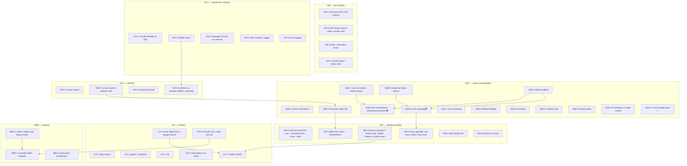
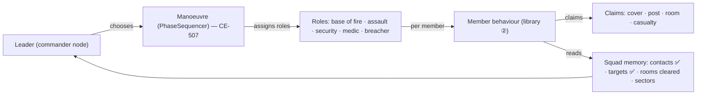
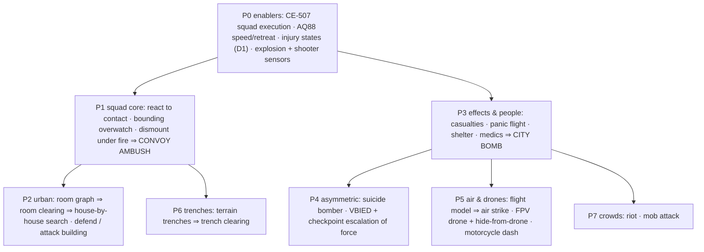
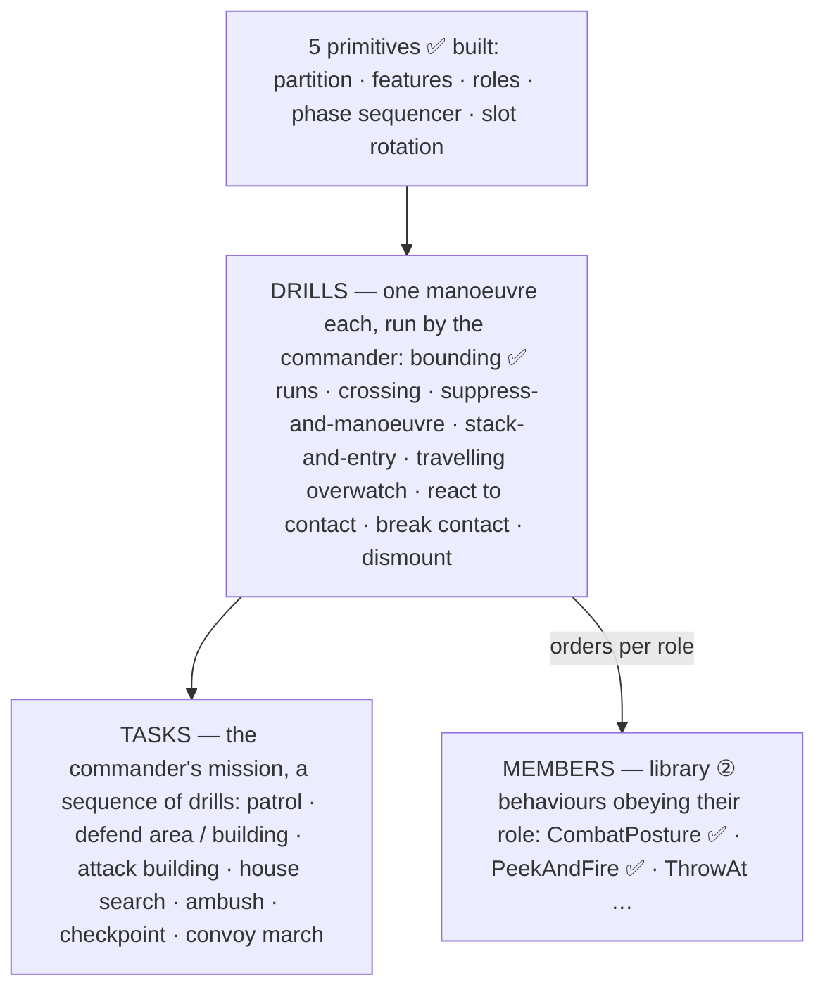

<!--STATUS
state: LIVE
build-state: DESIGN — a catalogue and gap analysis, not a buildable design; each programme it names gets its own design (with UML) before it is built
updated: 2026-11-15 (§3a status — coordinator)
current-answer: §3a the STATUS (what is built, 2026-11-15) · §12 the next three (motorcycle grey-zone crossing, checkpoint, ramming / car bomb) · §11 the behaviors-lane review · §10.1 the user's answers · §2 the scenarios decomposed · §3 the taxonomy
stale-below: nothing
known-rot: none
known-conflict: none
related-designs:
  - designs/hit-location/DESIGN_Body_Parts_And_Hit_Location.md — S2 is the build design of D1's per-compartment vehicle damage (PartDamage, zones ⇒ mobility / firepower / destroyed)
  - docs/designs/structure-damage/DESIGN_Structure_Damage.md — OWNS the "building damage" engine row (founded 2026-10-15, CE-2181)
  - docs/designs/indirect-fire/DESIGN_Indirect_Fire.md — OWNS mortars and artillery: CallFireMission (AIR-1, SQD-9) — the battery play and the observer
  - docs/designs/air-attack/DESIGN_Air_Operations.md — OWNS AIR-1 (precision strike) and the AIR-2/3 route + attack, first built as air operations (R-2015)
  - docs/designs/vehicle-tactics/DESIGN_FPV_Drone.md — AIR-2's first slice (FPV: route, search, select, pursue, dive; point-mass flight, rotor sound, battery in the behaviour)
  - docs/designs/vehicle-tactics/DESIGN_Vehicle_Exposure_Cycle.md — AIR-4's first slice (ShelterFromAir) and the vehicle damage-state hook (D-K)
  - docs/designs/vehicle-tactics/DESIGN_Urban_Armour_Tactics.md — the armour-combat entry the VEH group lacks: urban tank hide / expose / AT-threat priority
  - DESIGN_Injury_States.md — OWNS the build design of D1's human half (four states + bleed-out, CE-2155)
  - docs/blueprints/Architect_Question_90_Unit_Orders_Carry_Capacity.md — OWNS R-273..275 (behaviors): orders to units and echelons (A4 answers T6 in part), the person-carry profile (C, after R-263)
  - DESIGN_Visual_Effects.md — §7 (R-269): how a destroyed vehicle and a dead soldier LOOK (black wreck, 2-D X, flames and smoke, the Dead figure); it reads Health ≤ 0 until this catalogue's D1 damage states exist, then `WreckState.IsDestroyed` reads those.
  - designs/group-maneuvers/DESIGN_Squad_Tactics.md — OWNS the squad-tactics build (§11.3 S1 runner, S2 react to contact) and the measured embark / formation state
  - REVIEW_Behaviour_Library_Genericity.md — OWNS the library line (②/③), the promotion rule and the existing-block audit this catalogue extends
  - OVERVIEW_Behaviour_Building_Blocks.md — OWNS the map of what EXISTS today (§6a the library); this file is what is MISSING
  - designs/group-maneuvers/Squad_Coordination_Design_v1_1.md — OWNS the squad layer and its six designed manoeuvres (§8); CE-507 decides who runs them
  - designs/group-maneuvers/DESIGN_Squad_Wiring.md — OWNS how the squad layer is wired into CGF (D2/D3/D5 open)
  - DESIGN_Building_Interiors.md — OWNS storeys, doors, windows, warheads (§3k) and the designed room graph / room entry (B-8)
  - DESIGN_Decision_Layer.md — OWNS task / SOP / reaction slots and ROE that every behaviour here plugs into
  - DESIGN_Sensors_And_Doctrine.md — OWNS sensor kinds, sensor children, memory, doctrine (Goal mode G2)
  - DESIGN_Thermal_And_Acoustic_Sensing.md — OWNS hearing (shots, near misses) — the base for drone and explosion hearing
  - designs/eqs-2/EQS_Design_v1.3_final.md — OWNS EQS generators, tests, templates
  - DESIGN_Peek_And_Fire.md — OWNS the fight-from-cover node and CoverClaim (the claim pattern §8 generalises)
  - blueprints/Architect_Question_88_Soldier_Speed_And_Retreat_Under_Fire.md — the open speed / retreat decisions several behaviours here depend on
  - docs/blueprints/Architect_Question_93_Sumo_Traffic_Node.md — §8: SUMO pedestrians that panic become our civilian entities for good (CGF creates them, P4) and need CIV-2/CIV-7 as a production HSM (P5).
  - docs/DESIGN_Civilians_And_Crowd_Control.md — the BUILD of the civilian rows (CIV-1…7, ASY-5, SQD-13) and of D3/D4/D5: one civilian family + HSM, crowds, riots, non-lethal force (R-4033…R-4036).
  - docs/designs/group-maneuvers/DESIGN_Building_Clearing.md — OWNS the building-clearing drill (Battle Drill 6: stack, breach, points of domination, sectors, controlling and searching civilians, room order) — the build of SQD-5 room clearing and SQD-6 house search
  - docs/designs/group-maneuvers/DESIGN_Defend_And_Attack_Position.md — designs SQD-8 / SQD-11 (defend), the building / roof / overwatch post templates and snipers
-->

# Operations behaviour catalogue — what a library for modern operations needs

## 0. The request *(user, `2026-10-11`; typos corrected, wording unchanged)*

> 🔒 *"Could you please think about what is missing or suboptimal in the behavior library for usual military operations and
> terrorist actions these days? Few ideas: urban patrolling or convoy being attacked by insurgents where soldiers squads are
> disembarking vehicles and taking cover positions and try to fight back, systematic search house by house with clearing the rooms
> in houses from enemies, bomb explosion in a city and people dying or hurt from the explosion while others panicking and running
> away, precise air bombing strike on some building with same effect as terrorist bomb explosion, small drones with explosives
> attacking moving targets who tries to escape or hide into buildings once they hear the drone buzzing, combat in ditches,
> systematic ditches clearing, soldiers on motorcycles trying to cross no one's land where drones are waiting for their preys. I
> would like to build a behavior library for these situations, generic building blocks, with squad level coordination. Also
> civilian rioting, civilian group coming to and hand attacking a selected other civilian, suicide bomber exploding himself in a
> crowded place, suicide bomber driving his car towards a military checkpoint or building while soldiers trying to stop him by
> fire when they spot a weird car coming wildly to them, medical personnel trying to help the wounded people and probably many
> others, including standard military tactics like march, advance, ambush, defend area, defend building from inside, attack
> building etc etc, you name it. I would like you to record the request, categorize necessary behaviors, and analyze what sensors
> and eqs query and whatever other support it might need."*

⭐ **The aim, restated:** a library of **generic** building blocks (R-256: no scenario constants, a stated unit scope, one
implementation per concept) with **squad-level coordination**, covering conventional tactics, asymmetric attacks, air/drone
threats and civilian life — for training simulation.

## 1. INVENTORY *(2026-10-11 — graph + two read-only sweeps over code and the design corpus)*

| query | result |
|---|---|
| `search_graph name_pattern=.*Generator$ label=Class file_pattern=*Spatial/Eqs/*` | 8 — Cone, CoverPoints, Donut, EntitiesInRadius, Grid, NavmeshSamples, OffsetFromContext, PointPattern (+ `EntitiesInAreaGenerator`, `Visual/AcousticSensorGenerator` elsewhere) |
| `search_graph name_pattern=.*Test$ … Spatial/Eqs` | 10 — Accurate/CheapLineOfSight, Alive/FactionFilter, DistanceScore, DotProduct, HeightScore, NavmeshReachable, PathCostScore, ThreatExposure |
| EQS templates (`StarterTemplates.cs`, `Find*.cs`) | 6 — FindCoverFromTarget, FindOpenFiringPosition, FindWindowFiringPosition, FindFlankingPosition, FindSafeRetreatPoint, FindThreatsInView |
| `search_graph name_pattern=.*(Perception\|Sensor).*(System\|Generator)$` | Visual / Acoustic sensor generators, DangerAreaSensorSystem, SquadPerceptionMergeSystem, ActiveSensorTracks |
| `SensorModality` · `SensorChange` | Visual, Radar, Thermal, Acoustic · Acquired, Lost, TopChanged, FirstThreat, AllClear, Hit, NearMiss, AreaAhead/Threatened/Cleared |
| danger-area kinds | OpenGround, StreetCrossing, Intersection, ChokePoint, CrestLine |

| area | state *(measured)* | owner |
|---|---|---|
| direct fire · hit chance · suppression (near miss) · ROE · fire at a point (grenade, mortar) · armour | ✅ built | `DESIGN_Building_Interiors.md` §3k · AQ85 · `DESIGN_Thermal_And_Acoustic_Sensing.md` §6 |
| warheads (HE, fragmentation, shaped charge; impact/time fuze) · area effect · `MunitionDetonation` | ✅ built — blast hits personnel only (v1) | Building Interiors §3k |
| health · mobility kill | 🟨 one float; no wounded / incapacitated states | `CombatLife.cs`, packs-1 §2.B |
| storeys · stairs · doors (lock/open/breach) · windows · per-storey cover · window firing positions | ✅ built | Building Interiors §3g–§3l |
| room / portal graph · room entry (B-8) · "occupy building" EQS | 🟥 designed only | Building Interiors `:189`, `:1573–1574` |
| squad state · roster · perception merge · fire distribution (threat matrix) | ✅ built and running | commander-subordinates · Squad_Wiring §3.1 · U6 |
| six squad manoeuvres (danger crossing, bounding overwatch, suppress-and-maneuver, hull-down, stack-and-room-entry, travelling overwatch) · PhaseSequencer · role slots | 🟨 built and unit-tested, **nothing runs them** (CE-507 D2/D3) | Squad_Coordination §8 · Squad_Wiring `:17`, `:147–149` |
| missions / phases · tactical intents · commander nodes | ✅ built | tactical-intent · hill-attack |
| vehicle kinematics · formation / route driving | ✅ built; convoy = name only; embark/eject executors not registered on CGF | `DESIGN_Entity_Interactions.md` §7 |
| crowd agent (dtCrowd) | ✅ built; civilian behaviours `WanderCivil`/`PanicFlee` = **names only** | Nav design §7.2 |
| terrain height · prone stance · HoldProne | ✅ built | `DESIGN_Terrain_Height.md` · Decision Layer §3.3f |
| ⛔ **nothing at all** (searched code + `docs/` + `.dev/`) | medical / casualty care · IED · self-detonation · VBIED · air strike · drones / flight model · motorcycles · ramming · fire (⚠ smoke corrected 2026-10-18: a sight-blocking cloud and TKB smoke grenade 6041 exist, `AreaEffectSystem.cs:101-106`, `MunitionTkbCatalog.cs:130`; nothing throws it — Defend_And_Attack DA-12) · trenches / ditches · riot / mob / melee · fire missions · ambush as a manoeuvre · infantry formations / march | — |

## 2. The requested scenarios, decomposed

| scenario | actors → behaviours *(ids from §3)* | the hard new support |
|---|---|---|
| **convoy ambushed, squads dismount and fight back** | insurgents ASY-3 · vehicles VEH-1, VEH-2 · squads SQD-4, SQD-2, SQD-3, MED-2 | dismount under fire, cover around the vehicle, react-to-contact drill |
| **urban patrol** | squad SQD-12 (+ SQD-2 on contact) · civilians CIV-1 | patrol formation in streets, overwatch at intersections (danger-area sensor ✅) |
| **house-by-house search, room clearing** | squad SQD-6 → SQD-5 · defenders SQD-8 · IND-4 grenade | **room graph**, stack / entry / clear, shared "room cleared" state |
| **bomb in a city: dead, hurt, panic** | attacker ASY-1 or ASY-4 · civilians CIV-2, CIV-6, CIV-7 · medics MED-2/3 | **injury states**, explosion sensing, panic flight away from a source |
| **precision air strike on a building** | AIR-1 · same effect chain as the bomb | strike tasking (fire mission), building damage |
| **FPV drones hunting moving targets; targets hide when they hear them** | AIR-2 · targets IND-3, CIV-7 | **drone flight + acoustic signature**, overhead-cover / indoor-shelter EQS |
| **combat in ditches, systematic ditch clearing** | SQD-7 · IND-1 crawl | **trenches in the terrain**, trench-segment EQS |
| **motorcycles crossing no-man's land under drones** | VEH-3 · AIR-3 | motorcycle class, exposure-minimising dash route |
| **riot** | CIV-4 · police/soldiers SQD-13 (crowd control) | crowd-level behaviour, throwing objects |
| **group attacks a chosen civilian** | CIV-5 | converge on a victim, melee |
| **suicide bomber in a crowd** | ASY-1 · crowd CIV-1/2/6 | self-detonation, concealed carrier, suspicion sensing |
| **VBIED at a checkpoint, soldiers stop it by fire** | ASY-2 · checkpoint SQD-13 | **suspicious-vehicle sensor**, escalation of force, stop by fire |
| **medics help the wounded** | MED-1..3 | casualty sensor, triage, drag to cover, evacuation |
| **march, advance, ambush, defend area, defend / attack building** | SQD-1, SQD-3, SQD-10, SQD-11, SQD-8, SQD-9 | squad execution (CE-507), sectors, overwatch positions |

## 3. The behaviour taxonomy

*What the picture shows that prose hid: most "scenarios" are compositions — house search IS room clearing repeated, attacking a
building IS fire-and-movement plus room clearing, a convoy ambush IS the vehicle reaction plus a dismount plus fight-from-cover. The
library needs ~40 blocks, not one behaviour per scenario. ✅ = built, 🟨 = built but not driven.*

### 3a. Status — what is built *(measured `2026-11-15`, coordinator; 🔒 user: "let's check what we have implemented and what is still missing" · "Yes, please update the catalog")*

⚠ The ✅ / 🟨 marks in the diagram above are the `2026-10-11` state — ⛔ do not read them as current; THIS table is. 📐 Basis: the 141 behaviour
names registered on `behaviors` (`Hrot/Engine/Hrot.Core/MapDefinitions/Behavior/BehaviorNames.cs`), targeted greps and the classes' summaries —
NOT run; a row's evidence is the class that implements it.

| row | state | implemented by |
|---|---|---|
| IND-1 tactical movement | ✅ | `UnderFireMove` (crawl to cover, rise elsewhere), `FireAndMovement` rushes |
| IND-2 fight from cover | ✅ | `FightFromCover`, `PeekAndFire`, `WindowDuel` |
| IND-3 react to explosion / drone | ✅ | `EvadeGrenade` (`GrenadeReflex.cs`), `TakeCover`, `ShelterFromAir` / `SquadShelterFromAir`, the anti-drone rule (CE-2436 AU-7) |
| IND-4 throw grenade | ✅ | `HiddenTargetThrow` (at a hidden enemy, into a room) |
| IND-5 self & buddy aid | 🟨 | buddy aid by `CasualtyCare`; ⛔ self-aid not built |
| IND-6 observe a sector | ✅ | `Sentry`, `PersonObserveFire` |
| SQD-1 march / formations | ✅ | `SquadMarch`, `JoinFormation`, the formations |
| SQD-2 react to contact · break contact | ✅ | `ReactToContact`, `BreakContact` |
| SQD-3 fire & movement · bounding | ✅ | `FireAndMovement`, `BoundingOverwatch`, `SupportByFire` (CE-2436) |
| SQD-4 dismount under fire | ✅ | `SquadDismount`, `PlatoonConvoy`'s contact phase |
| SQD-5 room clearing | ✅ | `ClearRoom`, `BreachDoor` |
| SQD-6 house-by-house search | ✅ | `ClearArea` (its buildings in turn), `ClearBuilding` |
| SQD-7 trench clearing | ⛔ | nothing — ditches now exist (CE-4593), the play does not |
| SQD-8 defend building | ✅ | `SquadDefend`, `PlatoonDefend` |
| SQD-9 attack building | ✅ | `PlatoonAttack`, `CompanyAttack`, `ClearBuilding` |
| SQD-10 ambush | ✅ | `Ambush` |
| SQD-11 defend area | ✅ | `DefendArea`, `HoldArea` |
| SQD-12 urban patrol | 🟨 | movement through a city (`UrbanMovement`); ⛔ no patrol loop |
| SQD-13 checkpoint / crowd control | 🟨 | crowd control ✅ (`HoldTheLine`, `BatonCharge`, `PushThrough`, the escalation of force); ⛔ the checkpoint itself — §12 |
| SQD-14 cross danger area | ✅ | `SquadDangerCrossing`, `DangerCrossing` |
| VEH-1 convoy march | ✅ | `PlatoonConvoy` (CE-2347) |
| VEH-2 convoy react to ambush / IED | ✅ | `PlatoonConvoy`'s contact phase: the squads' own SOP dismounts and fights, secure, remount |
| VEH-3 motorcycle dash | ⛔ | no two-wheeler, no play — §12 (now: crossing a drone-saturated grey zone) |
| VEH-4 vehicle as a weapon | ⛔ | no ramming, no car bomb — §12 |
| AIR-1 precision strike / fire mission | ✅ | `AirPlatformStrike`, `ArtilleryUnitStrike`, the battery fire mission, `SpotForFire` |
| AIR-2 FPV drone | ✅ | `DroneOperator`, the AirAttack Dive profile |
| AIR-3 loiter / overwatch drone | ✅ | `DroneRecon`, `AirArmedSearch`, the drone team (CE-2436 AU-5) |
| AIR-4 counter-drone | ✅ | `EngageAircraft`, `ShelterFromAir`, the shotgun + drone rule (CE-2436 AU-7); the radar SAM building (CE-4617) |
| ASY-1 suicide bomber on foot | ✅ | `DetonateCharge` (a worn charge, CE-2238) |
| ASY-2 VBIED driver | 🟨 | ⭐ `ua-car-bomb` (a boot charge, `FollowRoute` + `TriggerIed` at 15 m; checked by `utility-demo-check.py` `run_car_bomb`) — route-driven only, no driving AT a target, no ramming — §12 |
| ASY-3 hit-and-run ambush | 🟨 | composable from `Ambush` + `BreakContact`; no dedicated play |
| ASY-4 IED | ✅ | `TriggerIed` |
| ASY-5 riot instigator | ✅ | the instigator in `CrowdSystem` (CE-2238) |
| CIV-1 daily routine | ✅ | `CivilianHsm` (Routine) |
| CIV-2 panic flight | ✅ | `CivilianReact` / the HSM's Alarmed state |
| CIV-3 gather / onlookers | ✅ | the crowd (CE-2237) |
| CIV-4 riot | ✅ | the protest (CE-2240) |
| CIV-5 mob attack on a victim | ⛔ | nothing found |
| CIV-6 casualty | ✅ | the injury states (CE-2155) |
| CIV-7 shelter indoors | ✅ | the HSM's shelter (Civilians §5e) |
| MED-1 casualty states | ✅ | injury states + bleed-out (CE-2155) |
| MED-2 medic | ✅ | `CasualtyCare`, `CarryCasualty` |
| MED-3 CASEVAC | ✅ | `LoadCasualty`, `SquadRecover` |

⭐ **31 built · 6 partial · 4 missing** (the missing: SQD-7, VEH-3, VEH-4, CIV-5). ⭐ Next (🔒 user, `2026-11-15`): VEH-3 as the grey-zone
motorcycle crossing, SQD-13's checkpoint, VEH-4 / ASY-2 the ramming and the car bomb — analysed in §12.

## 4. Capability nodes needed *(① layer — shared C#, one per concept)*

| node / action | used by | basis today |
|---|---|---|
| `MoveTactically(mode: walk/rush/crouch/crawl/dash)` | IND-1, SQD-3, VEH-3 | 🟥 no moving stance; speed cap (AQ88 A/B) |
| `ShelterFrom(threat: drone/blast/air)` | IND-3, CIV-7, AIR-4 | 🟥 needs shelter EQS (§6) |
| `ThrowAt(point, munition)` | IND-4, SQD-5, SQD-7, CIV-4 (non-lethal) | ✅ `FireAtPoint` + M67 — "when to throw" not built |
| `Treat(casualty)` · `Drag(casualty, to)` · `Carry` | IND-5, MED-2/3 | 🟥 nothing |
| `Detonate(self/carried charge)` · `TriggerIed(remote)` | ASY-1/2/4 | 🟥 nothing (warheads ✅ to reuse) |
| `MeleeAttack(target)` | CIV-5, CIV-4 | 🟥 nothing |
| `Embark/Disembark(vehicle, side)` | SQD-4, VEH-2, MED-3 | 🟨 executors exist, not registered (Entity Interactions §7 I-2) |
| `ClearRoom(room)` · `MarkCleared` | SQD-5/6/9 | 🟥 needs room graph |
| `OccupyPost(post)` (claim-based) | SQD-8/11, SQD-13 | 🟨 `CoverClaim` pattern generalises (§8) |
| `Warn(target)` · `WarningShot` · `StopByFire(vehicle)` | SQD-13 | 🟥 escalation of force; ROE ✅ |
| `FlyTo / Loiter / Dive(target)` | AIR-2/3 | 🟥 no flight model |
| `CallFireMission(point, effect)` | AIR-1, SQD-9 | 🟥 no fire missions (mortar ✅ as a unit) |

## 5. Sensors needed

| sensor | answers | used by | basis |
|---|---|---|---|
| **explosion** (heard / seen, distance, direction, size) | "a blast happened there" | IND-3, CIV-2, MED-2, SQD-2 | `MunitionDetonation` ✅ + acoustic sensing ✅ ⇒ a new `SensorChange` kind |
| **drone audible / visible** (bearing, closing?) | "a drone is near / coming" | IND-3, AIR-4, CIV-7, VEH-3 | acoustic ✅ — needs drone entities with an acoustic signature |
| **shooter / fire direction** | "who is hitting me" | IND-2, SQD-2, AQ88 C | `HitEvent` shooter + near miss ✅ — not exposed as a sensor |
| **casualty** (wounded friend / civilian nearby, severity) | "who needs help" | MED-2, IND-5, CIV-3 | 🟥 needs injury states (MED-1) |
| **suspicious vehicle** (speed, heading at me, ignores warnings) | "is that car a threat" | SQD-13, VEH-4 | visual ✅ + kinematics ✅ ⇒ a scored track attribute |
| **suspicious person** (loitering, carrying, approaching crowd) | "is he a bomber" | SQD-13, ASY-1 counter | 🟥 ground-truth flag × detection chance (decision D4) |
| **crowd** (density, mood, direction) | "where is the crowd going" | CIV-2/3/4, SQD-13 | crowd agent ✅ — no aggregate sensor |
| **room / building state** (cleared / unknown / occupied) | squad shared memory | SQD-5/6/8/9 | squad state ✅ — needs room ids |
| **danger area** | "crossing ahead" | SQD-12/14 | ✅ built (only a FAKE provider feeds squads — CE-507 D3) |

## 6. EQS queries needed

| template | finds | generator / tests (new ⭐) |
|---|---|---|
| **FindShelter** | nearest point with OVERHEAD cover or indoors, reachable before the threat arrives | NavmeshSamples + ⭐`OverheadCoverTest` (sky occlusion) + ⭐`IndoorTest` + PathCost |
| **FindDismountCover** | cover around a stopped vehicle, away from the fire | CoverPoints (✅ vehicle sides, CE-3142) + ThreatExposure |
| **FindRoomStack / FindNextRoom** | stack positions beside a door; the nearest uncleared room | ⭐`DoorStackGenerator`, ⭐`RoomGraphGenerator` (needs the room graph) |
| **FindBuildingPosts** | windows / loopholes covering assigned sectors | FindWindowFiringPosition ✅ + ⭐`SectorTest` |
| **FindOverwatchPosition** | a spot seeing the next bound | Cone/Grid + LOS-to-context ✅ |
| **FindAmbushPosition** | overlooks the kill zone, concealed, with an escape route | Grid + LOS ✅ + ⭐`ConcealmentTest` + PathCost |
| **FindTrenchSegment** | next trench bay / corner to clear | ⭐`TrenchGenerator` (needs trenches in terrain) |
| **FindDashRoute** | a crossing path minimising exposure to known threats / drones | ⭐ path query with a threat-field cost (PathCost ✅ is distance only) |
| **FindFleeExit** | away from a danger source, through open exits, not into it | ⭐ variant of FindSafeRetreatPoint pointed at a SOURCE (not a threat entity) |
| **FindCasualtyCollectionPoint** | covered, reachable by vehicle | CoverPoints + ⭐`VehicleReachableTest` |
| **FindCheckpointStopLine** | where to stop / engage an approaching vehicle | ⭐ authored or road-graph points + LOS |
| **FindGatheringPoint** | where a crowd assembles / a mob converges | EntitiesInArea ✅ + crowd sensor |

## 7. Engine support (non-behaviour)

| need | why | state |
|---|---|---|
| **injury states** (ok / wounded / incapacitated / dead, bleed-out timer, mobility & weapon effects) | every casualty, medic and panic scenario | 🟥 — Health is one float (decision D1) |
| **vehicle damage states** (mobility kill · firepower kill · destroyed), derived from **per-compartment damage** (D1, user 2026-10-11) | VEH-1/2, convoy ambush, air strike, FPV drone vs vehicle | 🟨 today: one `Health` pool, per-facing armour (`ArmorModel.cs:11`), opt-in `MobilityKill` by health fraction (`MobilityKill.cs`, CE-3092); death strips `CanMove`/`CanShoot` (`CombatLife.cs:42`). ⛔ no firepower kill, no compartments (searched `docs/`+`.dev/`: none) |
| **explosive carried by an entity** (bomb vest, VBIED) + detonate | ASY-1/2 | warheads ✅ — the carrier and trigger 🟥 |
| **flight model** (point-mass, altitude, speed, dive) + acoustic signature | drones, strike aircraft | 🟥 (aircraft are data only, CE-1041) |
| **motorcycle vehicle class** | VEH-3 | 🟥 (`VehicleClass` has no bike) |
| **drone 3-D route following + autonomous attack** (D2, user 2026-10-11) | AIR-2, AIR-3 | 🟥 — no flight model; routes and nav are 2-D ground (`RoutePlan`, navmesh) |
| **building damage** (collapse / breach from a heavy charge) | air strike, bombs, breaching | 🟨 doors breach; walls deferred (§14 runtime navmesh) |
| **trenches** (authored polylines carved into the height grid + navmesh) | SQD-7 | 🟥 (decision D7) |
| **room graph** (rooms + portals from walls) | SQD-5/6/8/9, sound v2 | 🟥 designed (Building Interiors) |
| **melee / non-lethal throw** | CIV-4/5 | 🟥 |
| **smoke / obscurant** | breaking contact, casualty drag | 🟥 (LOS has transmittance ✅ to reuse) |
| **escalation-of-force signals** (shout, warning shot) as events | SQD-13 | 🟥 |
| **squad execution** (who runs a manoeuvre) | all SQD | 🟨 CE-507 D2/D3 |

## 8. Squad model — what the squad layer must carry

*What the picture shows that prose hid: the per-member behaviours already exist or are listed in §3; what makes them a SQUAD is
three shared things — roles from a running manoeuvre (blocked on CE-507), shared memory beyond contacts (rooms, sectors), and
CLAIMS so two members never take the same post, room or casualty — the `CoverClaim` pattern (CE-3158 G5) generalised.*

## 9. Roadmap *(lean — each programme gets its own design with UML first)*

*Why this order: P0 unblocks everything (no squad runs today; nobody can be "wounded"). The convoy ambush (P1) exercises the most
existing blocks for the least new engine. Rooms (P2) are designed already. Effects and people (P3) are the base of every
terrorist scenario. Air/drones (P5) need the largest new engine piece (flight) and are last among the big ones.*

## 10. Decisions for the user *(each with a lean)*

| # | question | ⭐ lean | what would change it |
|---|---|---|---|
| **D1** | injury model | ⭐ discrete states ok / wounded / incapacitated / dead + bleed-out timer; wounded = slower, worse aim; incapacitated = no move/fire, needs aid | a need for per-body-part wounds (more cost, little behaviour gain) |
| **D2** | drone fidelity | ⭐ point-mass flight (speed, climb, turn rate) + acoustic signature + battery time; no aerodynamics | a training need for pilot-level flight |
| **D3** | civilians at scale | ⭐ crowd agents (dtCrowd ✅) driven by a light per-person state machine (HSM fits reactive states — R-258 "where HSM is most suitable"), with a crowd-level system for mood and density | thousands of civilians ⇒ an aggregate crowd model instead |
| **D4** | spotting a suicide bomber / VBIED | ⭐ a hidden ground-truth flag + observable cues (approach speed, ignoring warnings, loitering) scored by the suspicion sensor — never omniscient | a scripted "reveal" for training scenarios |
| **D5** | melee / riot violence | ⭐ a simple contact action (damage + knockdown) and non-lethal thrown objects reusing `ThrowAt` | none — minimal by design |
| **D6** | squad execution | ⭐ decide CE-507 D2/D3 first (`DESIGN_Squad_Wiring.md` — its own leans); every SQD item waits on it | — |
| **D7** | where trenches come from | ⭐ authored polylines (like roads) carved into the height grid and the infantry navmesh | procedural trenches |
| **D8** | first programme | ⭐ **P0 + P1 (convoy ambush)** — most reuse, the user's first example | the user's priority |

### 10.1 Answers *(user, `2026-10-11`)*

> 🔒 *"D1 ok for human. Vehicles need fire power kill, mobility kill, destroyed. And maybe smarter per-compartment damage model those
> overall damage states are derived from. D2 accepted. Drones must be able to follow a planned 3d path and be able attack autonomously
> if suitable target is spotted. D3 ok. Our Hsms are optimized for large crowds. D4 ok. D5 ok. … D7 ok."*

| # | ruling | consequence for the programmes |
|---|---|---|
| **D1** | ✅ **humans:** the four injury states + bleed-out, as leaned. ⭐ **vehicles:** three damage states — **mobility kill, firepower kill, destroyed** — preferably **derived from a per-compartment damage model** (e.g. engine/drive → mobility, weapon/turret → firepower, crew/ammo/fuel → destroyed) | P0 gets a vehicle-damage item. Builds on what exists: per-facing armour, the opt-in `MobilityKill`, the `CanMove`/`CanShoot` capability bits (the derived states map onto them), and turrets as part children (R-255) — a natural home for a compartment. Its own design (with UML) before building |
| **D2** | ✅ point-mass flight + acoustic signature + battery. ⭐ **plus:** a drone **follows a planned 3-D path** and **attacks autonomously** when a suitable target is spotted | AIR-2/AIR-3 = a 3-D route (waypoints with altitude) + a loiter/search phase + a target-selection rule (the existing sensor + threat ranking) + a terminal dive. The routes we have are 2-D ground routes ⇒ a 3-D route type is new |
| **D3** | ✅ crowd agents + a light per-person HSM + a crowd-level system. 🔒 *"Our HSMs are optimized for large crowds"* ⇒ HSM is THE host for civilian behaviours (R-258's "where HSM is most suitable") | CIV-1..7 are authored as HSMs, not BTrees |
| **D4** | ✅ hidden ground-truth flag + observable cues | — |
| **D5** | ✅ simple contact action + `ThrowAt` | — |
| **D6** | ✅ `2026-10-11`: CE-507 D2 **(a)** (manoeuvre = a behaviour on the commander; library squad behaviours may be C# fluent HSMs), D3 as leaned — R-264 | SQD items unblocked once the first manoeuvre behaviour ships |
| **D7** | ✅ authored trench polylines carved into the height grid and navmesh | — |
| **D8** | ✅ `2026-10-11` *"D8 ok"* — **P0 + P1 (convoy ambush) first** | — |

## 11. Review of the taxonomy, and where squad tactics start *(behaviors lane, `2026-10-11`; leans, awaiting the user)*

🔒 *User: "check the categorization of various behaviors i enumerated before. I need to start solving group behaviors (squad
tactics first)."*

### 11.1 What the §3 taxonomy gets wrong

| # | finding | lean |
|---|---|---|
| **T1** | §3 mixes two axes. IND / SQD / VEH / AIR say **who acts** (one soldier, a squad, a vehicle, an aircraft); ASY / CIV / MED say **which side or job**. So the same behaviour appears twice: ASY-3 insurgent ambush = SQD-10 ambush; ASY-2 VBIED = VEH-4; ASY-5 riot instigator sits inside CIV-4; MED-2 "drag to cover" = IND-5 | ⭐ group by **who acts** only. Side and job become a **unit scope + ROE / doctrine** on a generic block (R-256), not a category. An insurgent ambush is SQD-10 run by insurgents |
| **T2** | SQD mixes three levels. **Drills** (seconds to minutes, phased: bounding, danger crossing, suppress-and-manoeuvre, stack-and-entry, react to contact, dismount, break contact) sit next to **squad tasks** (patrol, defend area / building, attack building, house search, trench clearing, ambush, checkpoint, march), and the tasks are made OF drills | ⭐ split SQD into **drills** (one manoeuvre, run by the commander) and **tasks** (a mission that sequences drills). Different hosts: a drill is a manoeuvre node; a task is the commander's task-slot behaviour; react-to-contact is the commander's SOP / reaction |
| **T3** | "group" is not only an infantry squad. A **convoy** (VEH-1/2) is a commanded group with the same five primitives (lead / main / trail elements = travelling overwatch). A **crowd** (CIV-3/4/5) is an UNcommanded group — no leader, a crowd-level system (D3) | ⭐ name both: **commanded groups** (squad, convoy, later platoon) share the squad layer; **crowds** get the D3 crowd system. Neither belongs under CIV or VEH as an individual behaviour |
| **T4** | MED-1 "casualty states" is engine, not a behaviour | move it to §7 (it is already there as "injury states") |
| **T5** | missing squad items: **consolidate / reorganise** after an assault, **casualty handling inside the squad** (who drags the wounded), **break contact / withdraw** as its own drill, **flank** (EQS `FindFlankingPosition` exists, no drill uses it), **sectors of fire** in a defence | add them as drills / tasks |
| **T6** | no echelon above the squad: a platoon of squads (attack a building with two squads) | later; ⚠ whether a commander can itself have a commander that orders it as a group is not measured |

*What the picture shows that the §3 list hid: a squad task is never built directly — it is drills in sequence, each drill is
the five primitives with a table, and members only ever run individual behaviours with an order.*

### 11.2 State of the squad layer *(measured `2026-10-11`)*

| claim | code — how it is | design — how it was meant |
|---|---|---|
| the six manoeuvres are tables only; ONE runs | `Squad/Maneuvers/*.cs` (static classes, no shared interface — grep `IManeuver`: 0); `BoundingOverwatchBehavior.cs` (216 lines) is the only runner | Squad_Coordination §2: "they differ only in configuration"; Squad_Wiring §6: "each is the same node shape over its own table" |
| a second manoeuvre today = a copy of that node | the node hard-codes `BoundingOverwatchManeuver` (`BoundingOverwatchBehavior.cs:62-145`) | — (the design expects configuration, not copies) |
| no squad-level reaction exists | the merge pools contacts on the commander (`SquadPerceptionMergeSystem`); no event tells the commander "the squad is in contact"; `PhaseEventKind` has ShotFired / arrivals / veto / abort only | Squad_Coordination §8.0 picks a manoeuvre by scorer (deferred, D3) or by mission order — a REACTION path is not designed |
| arrival events are polled, not taken from `SquadEventIngressSystem` | it keys on fixed intent ids the per-entity counter breaks (Squad_Wiring §6) | — |

### 11.3 Squad tactics — the lean order

| slice | what | acceptance |
|---|---|---|
| **S1** | ⭐ **one generic manoeuvre runner** — a commander node over a small manoeuvre description (table, partition, per-role order: hold / advance to / suppress / flank, completion test). `BoundingOverwatch` moves onto it; **suppress-and-manoeuvre** is the second user (base of fire suppresses the known threat; assault flanks via `FindFlankingPosition`) | a 4-man squad on `test-town` suppresses a hostile and flanks it |
| **S2** | **react to contact** — a squad "contact" event into the commander (first threat in the pooled contacts) and the commander's SOP runs the drill: everyone to cover facing the threat and returns fire, then the leader chooses suppress-and-manoeuvre or break contact by strength ratio | the same squad, fired on while moving, reacts as a squad, not as four individuals |
| **S3** | travelling overwatch / squad march; then **dismount under fire** (needs the embark / disembark executors registered on CGF — Entity Interactions §7 I-2) ⇒ the P1 convoy ambush | the convoy ambush scenario (D8) |

Rejected: **one node per manoeuvre** — six copies of the same 200-line shape, against "differ only in configuration"; **starting
with the convoy ambush** — it needs S1 + S2 + the dismount first; **the autonomous scorer (`ManeuverSelect`) first** — D3 waits for
a real danger-area provider, and a mission or the SOP can pick the drill until then.

## 12. The next three — the grey-zone motorcycle, the checkpoint, ramming and the car bomb *(coordinator, `2026-11-15`; ANALYSIS with leans — each gets its own design with UML before it is built)*

🔒 User, `2026-11-15`: *"Some motorcyclist trying to get over the no man's zone, which is full of suicide drones … to cross the land as quickly as
possible and to avoid the drones by speed driving … used for transporting the troops over the exposed areas"* · *"the second one is the checkpoint
and the car RAM attack. Please think about it and analyze what might be implemented and how it could work."*

### 12.1 What the 2025 front shows *(open sources, Apr–Dec 2025; mostly Ukrainian officials and ISW; ⚠ no source describes the riding drill itself)*

| | |
|---|---|
| the zone | FPV saturation widened the grey zone from ~0.5–2 km to 5–7 km (some say 10–15 km); search drones see riders ~4 km out |
| the use | groups of 2–3 motorcycles / ATVs, 1–2 men each, carry assault troops across at 50–60 km/h (up to 100) off-road; the bikes are DROPPED at the enemy's edge and the men fight on foot; sometimes a decoy drawing drones off the IFVs |
| the defence | speed (less time exposed), dispersion, manoeuvre; ⚠ engine noise drowns the drone's sound — riders do not hear it coming |
| the results | heavy losses (a 90-bike assault near Pokrovsk failed; a 50-bike one near Siversk left one survivor) — fast is survivable, not safe |
| Ukraine | the 425th's motorcycle assault company, riders trained to shoot on the move; and ground robots replacing exposed men |

### 12.2 What the engine has *(measured `2026-11-15`)*

| need | state | where |
|---|---|---|
| a two-wheeler | ⛔ none — wheeled vehicles are pickups / HMMWV (25 m/s), seats with `PassengerExposure.Open` | `NedTkbCatalog.cs:142, :157-170, :581` |
| off-road speed | ⛔ **no off-road factor at all** — every wheeled vehicle drives a ploughed field at its road speed; only a tracked hull in a wood is capped | `CarKinematicsSystem.cs:216-223` |
| the FPV chase | ✅ search → pursue (re-steered 0.5 s) → dive (0.2 s) with LEAD on the target's velocity; 30 m/s, 120°/s, hit at 0.8 m; speed is NOT in its target choice | `AirAttackBehaviors.cs:548-635`, `FlightParamsDto.cs:15-27`, `DroneImpactSystem.cs` |
| a vehicle evading drones | ✅ `ShelterFromAir`: overhead cover within 60 m, else 40 m legs away with ±35° swerves | `ShelterFromAirNodes.cs:184-198` |
| an exposure-minimising dash route | ⛔ (`FindDashRoute` was listed 🟥 in §7) | — |
| checkpoint scenery | ✅ the `checkpoint` terrain recipe (jersey barriers, booth, sandbags, a car); obstacles SUMO cars respect, a fully blocked road closed (CE-4590) | `assets/terrain-recipes/checkpoint.recipe.json`, `TrafficBodies.cs:110` |
| escalation of force | ✅ ROE `ForceLevel` Warn → NonLethal → Lethal, a 2 s warning gesture; ⛔ no warning shot, no disabling shot, no vehicle ladder | `Roe.cs:24-36`, `EscalationLadder.cs`, Civilians §5k |
| searching a person | 🟨 the primitive `Custody` Search (3 s, reveals hidden weapons) — ⛔ nothing raises it | `Custody.cs:140-160` |
| stopping one SUMO car | ⛔ only by an obstacle; SUMO cars carry no people | `TrafficBodies.cs` |
| a vehicle hitting a person | ⛔ no damage — vehicles avoid people | `CarKinematicsSystem.cs:476-490`; Breaching `:34` |
| an AI vehicle driving AT an entity | ⛔ only fixed points / routes | — |
| a car bomb | 🟨 `ua-car-bomb`: a boot charge, route + proximity trigger | §3a ASY-2 |
| AI ramming a barrier | ⛔ by ruling: only a player's heavy vehicle (or the bulldozer on order) breaches | Breaching B-D1, B-D3 |

### 12.3 The grey-zone motorcycle crossing (VEH-3) — leans *(⏳ not yet ruled — the user widened it to insurgents, §12.6)*

⭐ **The physics, stated honestly:** an FPV (30 m/s, our default; real ones 28–40 m/s) is FASTER than a bike off-road (14–17 m/s). Speed cannot outrun
it — it SHORTENS THE EXPOSURE (fewer drones get a run) and makes the drone's lead harder; what saves a rider in its last seconds is a hard break
turn as it dives (our drone re-aims every 0.2 s at 120°/s with a 0.8 m contact radius — a late swerve can make it miss by construction).

| # | lean | why |
|---|---|---|
| MC-1 | a **motorcycle** type: rider + one passenger, both exposed; ~28 m/s on a road, its off-road speed from MC-2; a small target signature | the transport the reports describe |
| MC-2 | ⭐ an **off-road speed factor per mobility class and ground** (road / track / field / rough / wood), engine-wide, defaulting to 1.0 for existing types so nothing changes until each is calibrated | ⛔ today a pickup crosses a field at road speed — the dash means nothing without it |
| MC-3 | the play **`GreyZoneDash`** (a squad on 2–3 bikes): a route minimising exposure (woods, hedges, dead ground — the EQS exposure test along the route), **spacing ≥ 80 m** (one drone, one bike), full speed, never stop | the doctrine reported |
| MC-4 | **the last-second break**: the passenger is the lookout (EYES — ⭐ riding masks the riders' hearing, the reported weakness); a diving drone inside ~40 m ⇒ a hard swerve across its line; a drone tailing ⇒ jink | the one thing a rider can do; measurable |
| MC-5 | bike disabled or a rider down ⇒ the others DO NOT stop (doctrine); the survivors go to cover on foot (`UnderFireMove`, `TakeCover`) | the existing reflexes |
| MC-6 | at the dismount point (the enemy's tree line) ⇒ dismount, leave the bikes, take the squad's order on foot (`SquadDismount`, then Attack / Hold) | the bike is a transport |
| MC-7 | the defender: the existing `DroneOperator` / `DroneTeam` FPV hunt, unchanged; optional decoy use later | no new defender code |
| MC-8 | the test: 3 bikes × 2 men across ~1.5 km of open ground against two FPV operators; seeded runs measure crossings survived vs speed, spacing and the break turn | the user's scenario |

### 12.4 The checkpoint (SQD-13) — ✅ CP-1…CP-5 APPROVED `2026-11-15` (R-4260)

**The proven pattern** (vehicle checkpoint doctrine): warning signs far out → a serpentine of barriers that FORCES slow speed → a stop line → a search
bay off the road → an overwatch weapon covering the approach → a reaction element; escalation of force by distance lines: signal → warning shot →
disabling shots (engine) → lethal at the driver; threat indicators: not slowing by the line, ignoring signals.

| # | lean | why |
|---|---|---|
| CP-1 | a **`Checkpoint`** squad play on an authored site (the terrain recipe gains named lines: the warning line, the stop line, the search bay) with roles: stopper, searchers, overwatch, reaction | the doctrine's roles; the scenery exists |
| CP-2 | a **vehicle-approach watch**: each approaching vehicle's speed at each line — slowing ⇒ routine; not slowing past the warning line ⇒ a THREAT (a hostile act, Civilians AW-19 already rules a vehicle driven at people hostile) | the threat indicator, measured not scripted |
| CP-3 | the **vehicle ladder** in `EscalationLadder`: signal (gesture, a light) → **warning shot** (into the ground ahead) → **disabling shots** (the engine — a mobility kill on the vehicle's damage parts) → lethal, each tied to a distance line and the ROE force level | ⛔ today there is no warning or disabling shot |
| CP-4 | **search**: an own-simulated car (with occupants) is stopped at the line, the occupants get out, `Custody` Search runs (finally raised); a SUMO car is waved through or held as traffic (a backend "hold this car" command on the traffic bridge) | SUMO cars carry no people |
| CP-5 | the test: `ua-car-bomb` re-cast at a checkpoint — a routine car searched and released; a car that does not slow is laddered and stopped before the stand-off line, or reaches it and detonates | the existing car bomb becomes the acceptance |

### 12.5 Ramming and the car bomb (VEH-4 / ASY-2) — ✅ RM-1…RM-5 APPROVED `2026-11-15` (R-4260; RM-5 as leaned: an AI vehicle breaches a weak barrier ONLY on a `RamTarget` order, through `ContactBreach` — amends Breaching B-D1)

| # | lean | why |
|---|---|---|
| RM-1 | ⭐ **a vehicle that hits a person hurts him by its speed** — an injury by the impact speed into the existing injury states (thresholds: knocked down / serious / killed), one rule in the vehicle integrator | ⛔ today vehicles cannot hurt anyone; needed for ramming AND for realism (a player's car) |
| RM-2 | **`RamTarget`**: an AI vehicle drives AT an entity or a crowd with the drone's lead pursuit, avoidance switched off for its target only | ⛔ no ground pursuit exists; the lead predictor is shared |
| RM-3 | a **hostile act `VehicleAtPeople`** in `HostileActs` — the checkpoint's ladder and every soldier's ROE fire on it | AW-19 rules it hostile; nothing raises it |
| RM-4 | the **VBIED driver** = `RamTarget` at the checkpoint / crowd + detonate on contact or when stopped (his boot charge, `Charges.Ask` with the carried rule) | composes what exists |
| RM-5 | ⚠ **a ramming AI vehicle through a weak barrier** — today ruled OUT (Breaching B-D1: only a player's heavy vehicle, and the bulldozer on order). Lean: allow it ONLY on a `RamTarget` order, through the same `ContactBreach` rules — ⚠ **this reverses part of a user ruling, so it is the user's call** | a truck through the barrier is the classic ram attack |

⭐ **Lean on the order:** design the checkpoint and ramming TOGETHER (they share the approach watch, the hostile act, the ladder and the car-bomb test)
and the motorcycle separately; build MC-2 (off-road speed) first — it is engine-wide and every vehicle tactic depends on it.

🔒 User, `2026-11-15`: *"Checkpoint and ramming is approved."* (R-4260)

### 12.6 The motorcycle in insurgency and terrorism *(coordinator, `2026-11-15`; 🔒 user: "could we use something similar for Far East terrorist attacks, or in general for the movement of the terrorists or insurgents, and what kind of behavior might make sense using the motorcycle in such areas" — ANALYSIS, leans)*

**What open sources show** *(⚠ a quick sweep — the Sahel and southern Thailand are sourced; the South-Asian pillion shooting is widely reported but was not verified in this sweep)*:

| where | the use |
|---|---|
| the Sahel (JNIM, Mali / Burkina Faso, 2025–26) | MASSED motorcycles are the predominant tactic: rapid concentration, moving round fixed defences, instant dispersal after contact; often at night; one part of a combined assault (indirect fire, VBIEDs); cheap, and hard for air / drone strikes to find; dozens of motorcycle BANS since 2012 |
| southern Thailand (Pattani, Yala) | the motorcycle BOMB: ridden into a market and parked among other bikes, then left (2019); beside a police station on a timer (2025); a sidecar bomb ridden to a CHECKPOINT, the riders escaping on a second, waiting bike (2026); two men on a bike throwing an IED at a government pickup |
| South Asia (Pakistan, Afghanistan) | ⚠ unverified here: the two-up drive-by — the pillion shoots a target at a stop and the bike escapes into traffic; a charge stuck to a vehicle at a stop |

⭐ **What makes the motorcycle the insurgent's tool, in one line:** it BLENDS (one of thousands in civilian traffic), it is FAST through narrow streets, it DISPERSES instantly, and it is cheap. ⇒ in our engine the behaviours are compositions of the SAME motorcycle (MC-1, MC-2) with what already exists — hidden weapons (Civilians §5h), charges, the hostile act, the checkpoint (R-4260).

| # | behaviour (lean) | how it composes | ⛔ the gap it needs |
|---|---|---|---|
| IM-1 | ⭐ **`DriveBy`** — two up; ride to the target (a man, a vehicle at a stop, a post), slow alongside, the PILLION fires a burst or throws a grenade, escape at speed into traffic / a side street, split up | the hidden weapon revealed on the act (§5h), `HiddenTargetThrow`, the hostile act; escape = `BreakContact` on wheels | a passenger firing his OWN weapon from an exposed seat (exposed seats exist — `CarrierTkbTranslator.cs:110-120` — a seat that FIRES is unmeasured) |
| IM-2 | ⭐ **parked motorcycle bomb** — ride in, park among other bikes / at a market / beside a post, walk away (or onto a waiting bike), detonate by timer or phone | the cargo charge (`Charges`, `TriggerIed` for the phone), `PlaceCharge`-style placement | a TIMER detonation; a charge carried by a two-wheeler |
| IM-3 | **motorcycle VBIED at a checkpoint** — = R-4260's `RamTarget` with a two-wheeler; ⭐ the checkpoint must handle bikes (they slip through a serpentine meant for cars) | `RamTarget`, the checkpoint ladder | the checkpoint's lines sized for a bike too |
| IM-4 | **sticky bomb** — at a stop (a traffic light, a checkpoint queue) the pillion attaches a charge to a vehicle and the bike rides off | a charge ATTACHED to another entity | ⛔ attaching a charge to a vehicle |
| IM-5 | **swarm raid (Sahel)** — 20–100 bikes, two men each, converge on a post from several directions (often at night), fight, then DISPERSE in many directions at once | the motorcycle squad of §12.3 at scale; `PlatoonAttack` / `CompanyAttack` on bikes; dispersal = many `BreakContact`s on divergent routes | a dispersal play; night (existing weather / light) |
| IM-6 | **scout / spotter / getaway** — a lone rider watches a patrol and reports to the cell (the "dicker"); a second bike waits to extract the bombers | `Sentry` + the report path; a waiting `MoveToLocation` | none — composition |
| IM-7 | **blending in** — insurgent bikes ARE civilian traffic until they act: SUMO can drive motorcycles (a traffic type with SUMO's `motorcycle` class, as the cars are `TrafficVehicleDto`, `UrbanCombatTkbCatalog.cs:206, :439`) and an insurgent rides like one, neutral, his weapon hidden, until the act | traffic + identification (neutral → hostile on the act) | civilian motorcycles in the traffic catalogue |
| IM-8 | **the counters, for the trainees** — a motorcycle ban as a scenario rule; "two men on one bike" as a suspicion indicator at a checkpoint; the checkpoint's bike lane | the checkpoint (R-4260), the suspicion indicators (CP-2) | the indicator |

⭐ **Lean on the order:** ONE motorcycle (MC-1, MC-2) serves both the soldier and the insurgent — build it once; then **IM-1 drive-by** and **IM-2
parked bomb** first (the commonest, cheapest, and they test the checkpoint and patrol scenarios trainees most need), IM-3 falls out of R-4260 for
free, IM-5's swarm after the grey-zone dash (the same group play at scale); IM-4 last (a new attach mechanism).

