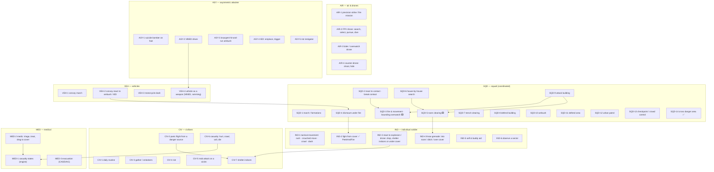
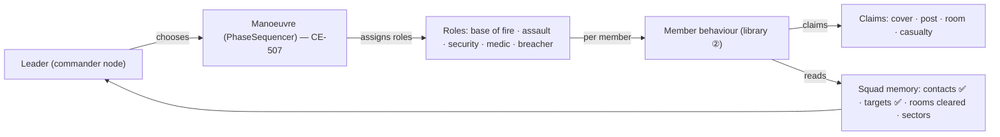
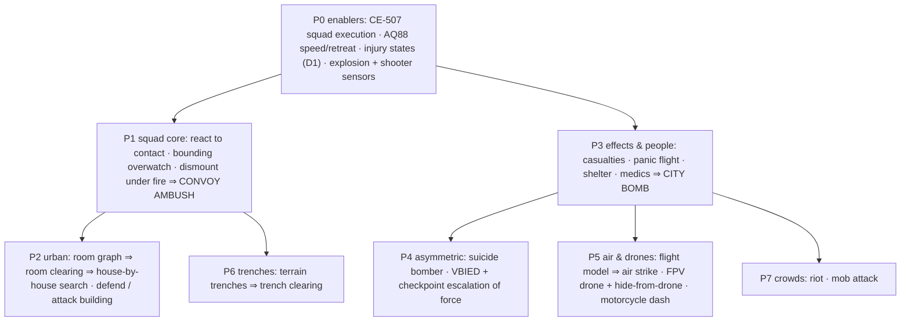

<!--STATUS
state: LIVE
build-state: DESIGN — a catalogue and gap analysis, not a buildable design; each programme it names gets its own design (with UML) before it is built
updated: 2026-10-11
current-answer: §2 the scenarios decomposed · §3 the behaviour taxonomy · §4–§7 what each needs (blocks, sensors, EQS, engine) · §8 squad model · §9 roadmap · §10 decisions for the user
stale-below: nothing
known-rot: none
known-conflict: none
related-designs:
  - REVIEW_Behaviour_Library_Genericity.md — OWNS the library line (②/③), the promotion rule and the existing-block audit this catalogue extends
  - OVERVIEW_Behaviour_Building_Blocks.md — OWNS the map of what EXISTS today (§6a the library); this file is what is MISSING
  - designs/group-maneuvers/Squad_Coordination_Design_v1_1.md — OWNS the squad layer and its six designed manoeuvres (§8); CE-507 decides who runs them
  - designs/group-maneuvers/DESIGN_Squad_Wiring.md — OWNS how the squad layer is wired into CGF (D2/D3/D5 open)
  - DESIGN_Building_Interiors.md — OWNS storeys, doors, windows, warheads (§3k) and the designed room graph / room entry (B-8)
  - DESIGN_Decision_Layer.md — OWNS task / SOP / reaction slots and ROE that every behaviour here plugs into
  - DESIGN_Sensors_And_Doctrine.md — OWNS sensor kinds, sensor children, memory, doctrine (Goal mode G2)
  - DESIGN_Thermal_And_Acoustic_Sensing.md — OWNS hearing (shots, near misses) — the base for drone and explosion hearing
  - designs/eqs-2/EQS_Design_v1.3_final.md — OWNS EQS generators, tests, templates
  - DESIGN_Peek_And_Fire.md — OWNS the fight-from-cover node and CoverClaim (the claim pattern §8 generalises)
  - blueprints/Architect_Question_88_Soldier_Speed_And_Retreat_Under_Fire.md — the open speed / retreat decisions several behaviours here depend on
-->

# Operations behaviour catalogue — what a library for modern operations needs

## 0. The request *(user, `2026-10-11`; typos corrected, wording unchanged)*

> 🔒 *"Could you please think about what is missing or suboptimal in the behavior library for usual military operations and
> terrorist actions these days? Few ideas: urban patrolling or convoy being attacked by insurgents where soldiers squads are
> disembarking vehicles and taking cover positions and try to fight back, systematic search house by house with clearing the rooms
> in houses from enemies, bomb explosion in a city and people dying or hurt from the explosion while others panicking and running
> away, precise air bombing strike on some building with same effect as terrorist bomb explosion, small drones with explosives
> attacking moving targets who tries to escape or hide into buildings once they hear the drone buzzing, combat in ditches,
> systematic ditches clearing, soldiers on motorcycles trying to cross no one's land where drones are waiting for their preys. I
> would like to build a behavior library for these situations, generic building blocks, with squad level coordination. Also
> civilian rioting, civilian group coming to and hand attacking a selected other civilian, suicide bomber exploding himself in a
> crowded place, suicide bomber driving his car towards a military checkpoint or building while soldiers trying to stop him by
> fire when they spot a weird car coming wildly to them, medical personnel trying to help the wounded people and probably many
> others, including standard military tactics like march, advance, ambush, defend area, defend building from inside, attack
> building etc etc, you name it. I would like you to record the request, categorize necessary behaviors, and analyze what sensors
> and eqs query and whatever other support it might need."*

⭐ **The aim, restated:** a library of **generic** building blocks (R-256: no scenario constants, a stated unit scope, one
implementation per concept) with **squad-level coordination**, covering conventional tactics, asymmetric attacks, air/drone
threats and civilian life — for training simulation.

## 1. INVENTORY *(2026-10-11 — graph + two read-only sweeps over code and the design corpus)*

| query | result |
|---|---|
| `search_graph name_pattern=.*Generator$ label=Class file_pattern=*Spatial/Eqs/*` | 8 — Cone, CoverPoints, Donut, EntitiesInRadius, Grid, NavmeshSamples, OffsetFromContext, PointPattern (+ `EntitiesInAreaGenerator`, `Visual/AcousticSensorGenerator` elsewhere) |
| `search_graph name_pattern=.*Test$ … Spatial/Eqs` | 10 — Accurate/CheapLineOfSight, Alive/FactionFilter, DistanceScore, DotProduct, HeightScore, NavmeshReachable, PathCostScore, ThreatExposure |
| EQS templates (`StarterTemplates.cs`, `Find*.cs`) | 6 — FindCoverFromTarget, FindOpenFiringPosition, FindWindowFiringPosition, FindFlankingPosition, FindSafeRetreatPoint, FindThreatsInView |
| `search_graph name_pattern=.*(Perception\|Sensor).*(System\|Generator)$` | Visual / Acoustic sensor generators, DangerAreaSensorSystem, SquadPerceptionMergeSystem, ActiveSensorTracks |
| `SensorModality` · `SensorChange` | Visual, Radar, Thermal, Acoustic · Acquired, Lost, TopChanged, FirstThreat, AllClear, Hit, NearMiss, AreaAhead/Threatened/Cleared |
| danger-area kinds | OpenGround, StreetCrossing, Intersection, ChokePoint, CrestLine |

| area | state *(measured)* | owner |
|---|---|---|
| direct fire · hit chance · suppression (near miss) · ROE · fire at a point (grenade, mortar) · armour | ✅ built | `DESIGN_Building_Interiors.md` §3k · AQ85 · `DESIGN_Thermal_And_Acoustic_Sensing.md` §6 |
| warheads (HE, fragmentation, shaped charge; impact/time fuze) · area effect · `MunitionDetonation` | ✅ built — blast hits personnel only (v1) | Building Interiors §3k |
| health · mobility kill | 🟨 one float; no wounded / incapacitated states | `CombatLife.cs`, packs-1 §2.B |
| storeys · stairs · doors (lock/open/breach) · windows · per-storey cover · window firing positions | ✅ built | Building Interiors §3g–§3l |
| room / portal graph · room entry (B-8) · "occupy building" EQS | 🟥 designed only | Building Interiors `:189`, `:1573–1574` |
| squad state · roster · perception merge · fire distribution (threat matrix) | ✅ built and running | commander-subordinates · Squad_Wiring §3.1 · U6 |
| six squad manoeuvres (danger crossing, bounding overwatch, suppress-and-maneuver, hull-down, stack-and-room-entry, travelling overwatch) · PhaseSequencer · role slots | 🟨 built and unit-tested, **nothing runs them** (CE-507 D2/D3) | Squad_Coordination §8 · Squad_Wiring `:17`, `:147–149` |
| missions / phases · tactical intents · commander nodes | ✅ built | tactical-intent · hill-attack |
| vehicle kinematics · formation / route driving | ✅ built; convoy = name only; embark/eject executors not registered on CGF | `DESIGN_Entity_Interactions.md` §7 |
| crowd agent (dtCrowd) | ✅ built; civilian behaviours `WanderCivil`/`PanicFlee` = **names only** | Nav design §7.2 |
| terrain height · prone stance · HoldProne | ✅ built | `DESIGN_Terrain_Height.md` · Decision Layer §3.3f |
| ⛔ **nothing at all** (searched code + `docs/` + `.dev/`) | medical / casualty care · IED · self-detonation · VBIED · air strike · drones / flight model · motorcycles · ramming · smoke / fire · trenches / ditches · riot / mob / melee · fire missions · ambush as a manoeuvre · infantry formations / march | — |

## 2. The requested scenarios, decomposed

| scenario | actors → behaviours *(ids from §3)* | the hard new support |
|---|---|---|
| **convoy ambushed, squads dismount and fight back** | insurgents ASY-3 · vehicles VEH-1, VEH-2 · squads SQD-4, SQD-2, SQD-3, MED-2 | dismount under fire, cover around the vehicle, react-to-contact drill |
| **urban patrol** | squad SQD-12 (+ SQD-2 on contact) · civilians CIV-1 | patrol formation in streets, overwatch at intersections (danger-area sensor ✅) |
| **house-by-house search, room clearing** | squad SQD-6 → SQD-5 · defenders SQD-8 · IND-4 grenade | **room graph**, stack / entry / clear, shared "room cleared" state |
| **bomb in a city: dead, hurt, panic** | attacker ASY-1 or ASY-4 · civilians CIV-2, CIV-6, CIV-7 · medics MED-2/3 | **injury states**, explosion sensing, panic flight away from a source |
| **precision air strike on a building** | AIR-1 · same effect chain as the bomb | strike tasking (fire mission), building damage |
| **FPV drones hunting moving targets; targets hide when they hear them** | AIR-2 · targets IND-3, CIV-7 | **drone flight + acoustic signature**, overhead-cover / indoor-shelter EQS |
| **combat in ditches, systematic ditch clearing** | SQD-7 · IND-1 crawl | **trenches in the terrain**, trench-segment EQS |
| **motorcycles crossing no-man's land under drones** | VEH-3 · AIR-3 | motorcycle class, exposure-minimising dash route |
| **riot** | CIV-4 · police/soldiers SQD-13 (crowd control) | crowd-level behaviour, throwing objects |
| **group attacks a chosen civilian** | CIV-5 | converge on a victim, melee |
| **suicide bomber in a crowd** | ASY-1 · crowd CIV-1/2/6 | self-detonation, concealed carrier, suspicion sensing |
| **VBIED at a checkpoint, soldiers stop it by fire** | ASY-2 · checkpoint SQD-13 | **suspicious-vehicle sensor**, escalation of force, stop by fire |
| **medics help the wounded** | MED-1..3 | casualty sensor, triage, drag to cover, evacuation |
| **march, advance, ambush, defend area, defend / attack building** | SQD-1, SQD-3, SQD-10, SQD-11, SQD-8, SQD-9 | squad execution (CE-507), sectors, overwatch positions |

## 3. The behaviour taxonomy

*What the picture shows that prose hid: most "scenarios" are compositions — house search IS room clearing repeated, attacking a
building IS fire-and-movement plus room clearing, a convoy ambush IS the vehicle reaction plus a dismount plus fight-from-cover. The
library needs ~40 blocks, not one behaviour per scenario. ✅ = built, 🟨 = built but not driven.*

## 4. Capability nodes needed *(① layer — shared C#, one per concept)*

| node / action | used by | basis today |
|---|---|---|
| `MoveTactically(mode: walk/rush/crouch/crawl/dash)` | IND-1, SQD-3, VEH-3 | 🟥 no moving stance; speed cap (AQ88 A/B) |
| `ShelterFrom(threat: drone/blast/air)` | IND-3, CIV-7, AIR-4 | 🟥 needs shelter EQS (§6) |
| `ThrowAt(point, munition)` | IND-4, SQD-5, SQD-7, CIV-4 (non-lethal) | ✅ `FireAtPoint` + M67 — "when to throw" not built |
| `Treat(casualty)` · `Drag(casualty, to)` · `Carry` | IND-5, MED-2/3 | 🟥 nothing |
| `Detonate(self/carried charge)` · `TriggerIed(remote)` | ASY-1/2/4 | 🟥 nothing (warheads ✅ to reuse) |
| `MeleeAttack(target)` | CIV-5, CIV-4 | 🟥 nothing |
| `Embark/Disembark(vehicle, side)` | SQD-4, VEH-2, MED-3 | 🟨 executors exist, not registered (Entity Interactions §7 I-2) |
| `ClearRoom(room)` · `MarkCleared` | SQD-5/6/9 | 🟥 needs room graph |
| `OccupyPost(post)` (claim-based) | SQD-8/11, SQD-13 | 🟨 `CoverClaim` pattern generalises (§8) |
| `Warn(target)` · `WarningShot` · `StopByFire(vehicle)` | SQD-13 | 🟥 escalation of force; ROE ✅ |
| `FlyTo / Loiter / Dive(target)` | AIR-2/3 | 🟥 no flight model |
| `CallFireMission(point, effect)` | AIR-1, SQD-9 | 🟥 no fire missions (mortar ✅ as a unit) |

## 5. Sensors needed

| sensor | answers | used by | basis |
|---|---|---|---|
| **explosion** (heard / seen, distance, direction, size) | "a blast happened there" | IND-3, CIV-2, MED-2, SQD-2 | `MunitionDetonation` ✅ + acoustic sensing ✅ ⇒ a new `SensorChange` kind |
| **drone audible / visible** (bearing, closing?) | "a drone is near / coming" | IND-3, AIR-4, CIV-7, VEH-3 | acoustic ✅ — needs drone entities with an acoustic signature |
| **shooter / fire direction** | "who is hitting me" | IND-2, SQD-2, AQ88 C | `HitEvent` shooter + near miss ✅ — not exposed as a sensor |
| **casualty** (wounded friend / civilian nearby, severity) | "who needs help" | MED-2, IND-5, CIV-3 | 🟥 needs injury states (MED-1) |
| **suspicious vehicle** (speed, heading at me, ignores warnings) | "is that car a threat" | SQD-13, VEH-4 | visual ✅ + kinematics ✅ ⇒ a scored track attribute |
| **suspicious person** (loitering, carrying, approaching crowd) | "is he a bomber" | SQD-13, ASY-1 counter | 🟥 ground-truth flag × detection chance (decision D4) |
| **crowd** (density, mood, direction) | "where is the crowd going" | CIV-2/3/4, SQD-13 | crowd agent ✅ — no aggregate sensor |
| **room / building state** (cleared / unknown / occupied) | squad shared memory | SQD-5/6/8/9 | squad state ✅ — needs room ids |
| **danger area** | "crossing ahead" | SQD-12/14 | ✅ built (only a FAKE provider feeds squads — CE-507 D3) |

## 6. EQS queries needed

| template | finds | generator / tests (new ⭐) |
|---|---|---|
| **FindShelter** | nearest point with OVERHEAD cover or indoors, reachable before the threat arrives | NavmeshSamples + ⭐`OverheadCoverTest` (sky occlusion) + ⭐`IndoorTest` + PathCost |
| **FindDismountCover** | cover around a stopped vehicle, away from the fire | CoverPoints (✅ vehicle sides, CE-3142) + ThreatExposure |
| **FindRoomStack / FindNextRoom** | stack positions beside a door; the nearest uncleared room | ⭐`DoorStackGenerator`, ⭐`RoomGraphGenerator` (needs the room graph) |
| **FindBuildingPosts** | windows / loopholes covering assigned sectors | FindWindowFiringPosition ✅ + ⭐`SectorTest` |
| **FindOverwatchPosition** | a spot seeing the next bound | Cone/Grid + LOS-to-context ✅ |
| **FindAmbushPosition** | overlooks the kill zone, concealed, with an escape route | Grid + LOS ✅ + ⭐`ConcealmentTest` + PathCost |
| **FindTrenchSegment** | next trench bay / corner to clear | ⭐`TrenchGenerator` (needs trenches in terrain) |
| **FindDashRoute** | a crossing path minimising exposure to known threats / drones | ⭐ path query with a threat-field cost (PathCost ✅ is distance only) |
| **FindFleeExit** | away from a danger source, through open exits, not into it | ⭐ variant of FindSafeRetreatPoint pointed at a SOURCE (not a threat entity) |
| **FindCasualtyCollectionPoint** | covered, reachable by vehicle | CoverPoints + ⭐`VehicleReachableTest` |
| **FindCheckpointStopLine** | where to stop / engage an approaching vehicle | ⭐ authored or road-graph points + LOS |
| **FindGatheringPoint** | where a crowd assembles / a mob converges | EntitiesInArea ✅ + crowd sensor |

## 7. Engine support (non-behaviour)

| need | why | state |
|---|---|---|
| **injury states** (ok / wounded / incapacitated / dead, bleed-out timer, mobility & weapon effects) | every casualty, medic and panic scenario | 🟥 — Health is one float (decision D1) |
| **explosive carried by an entity** (bomb vest, VBIED) + detonate | ASY-1/2 | warheads ✅ — the carrier and trigger 🟥 |
| **flight model** (point-mass, altitude, speed, dive) + acoustic signature | drones, strike aircraft | 🟥 (aircraft are data only, CE-1041) |
| **motorcycle vehicle class** | VEH-3 | 🟥 (`VehicleClass` has no bike) |
| **building damage** (collapse / breach from a heavy charge) | air strike, bombs, breaching | 🟨 doors breach; walls deferred (§14 runtime navmesh) |
| **trenches** (authored polylines carved into the height grid + navmesh) | SQD-7 | 🟥 (decision D7) |
| **room graph** (rooms + portals from walls) | SQD-5/6/8/9, sound v2 | 🟥 designed (Building Interiors) |
| **melee / non-lethal throw** | CIV-4/5 | 🟥 |
| **smoke / obscurant** | breaking contact, casualty drag | 🟥 (LOS has transmittance ✅ to reuse) |
| **escalation-of-force signals** (shout, warning shot) as events | SQD-13 | 🟥 |
| **squad execution** (who runs a manoeuvre) | all SQD | 🟨 CE-507 D2/D3 |

## 8. Squad model — what the squad layer must carry

*What the picture shows that prose hid: the per-member behaviours already exist or are listed in §3; what makes them a SQUAD is
three shared things — roles from a running manoeuvre (blocked on CE-507), shared memory beyond contacts (rooms, sectors), and
CLAIMS so two members never take the same post, room or casualty — the `CoverClaim` pattern (CE-3158 G5) generalised.*

## 9. Roadmap *(lean — each programme gets its own design with UML first)*

*Why this order: P0 unblocks everything (no squad runs today; nobody can be "wounded"). The convoy ambush (P1) exercises the most
existing blocks for the least new engine. Rooms (P2) are designed already. Effects and people (P3) are the base of every
terrorist scenario. Air/drones (P5) need the largest new engine piece (flight) and are last among the big ones.*

## 10. Decisions for the user *(each with a lean)*

| # | question | ⭐ lean | what would change it |
|---|---|---|---|
| **D1** | injury model | ⭐ discrete states ok / wounded / incapacitated / dead + bleed-out timer; wounded = slower, worse aim; incapacitated = no move/fire, needs aid | a need for per-body-part wounds (more cost, little behaviour gain) |
| **D2** | drone fidelity | ⭐ point-mass flight (speed, climb, turn rate) + acoustic signature + battery time; no aerodynamics | a training need for pilot-level flight |
| **D3** | civilians at scale | ⭐ crowd agents (dtCrowd ✅) driven by a light per-person state machine (HSM fits reactive states — R-258 "where HSM is most suitable"), with a crowd-level system for mood and density | thousands of civilians ⇒ an aggregate crowd model instead |
| **D4** | spotting a suicide bomber / VBIED | ⭐ a hidden ground-truth flag + observable cues (approach speed, ignoring warnings, loitering) scored by the suspicion sensor — never omniscient | a scripted "reveal" for training scenarios |
| **D5** | melee / riot violence | ⭐ a simple contact action (damage + knockdown) and non-lethal thrown objects reusing `ThrowAt` | none — minimal by design |
| **D6** | squad execution | ⭐ decide CE-507 D2/D3 first (`DESIGN_Squad_Wiring.md` — its own leans); every SQD item waits on it | — |
| **D7** | where trenches come from | ⭐ authored polylines (like roads) carved into the height grid and the infantry navmesh | procedural trenches |
| **D8** | first programme | ⭐ **P0 + P1 (convoy ambush)** — most reuse, the user's first example | the user's priority |
