<!--STATUS
state: LIVE
updated: 2026-10-13 (§13 finishing the params story — measured, leans await the user)
build-state: BUILDING — §5a records each task as built (CE-2145 ✅, CE-2131 ✅, CE-2132 ✅, CE-2130, CE-2133, CE-2134, CE-2140, CE-2141, CE-2142, CE-2143, CE-2137, CE-2138, CE-2139 ✅); §6 is the build plan
current-answer: §1 the rules every behaviour follows · §2 classes · §3 sequences · §4 modules · §5 what changes, file by file · §5a AS BUILT · §6 THE TASK LIST (ids, order, dependencies, acceptance) · §7 D2 (CE-2141) the unit order behaviours and the member release · §8 D3 (CE-2142) the receiver resolves an order by its class · §9 D4 (CE-2143) one generic order path: menu, RTS, HTTP · ⭐ §13 FINISHING THE PARAMS STORY (2026-10-13): what is left, decisions F1–F8, work P1–P7 by lane
stale-below: nothing
known-rot: none
known-conflict: (resolved by CE-2143) docs/DESIGN_Entity_Control.md §3.1/§10 is now marked superseded in its own STATUS. · docs/blueprints/DESIGN_Parameter_Model.md §P.7 (a resolver asset's authored shape = its Parameters) and §1 (Role Input/State) are superseded HERE by R-276/R-277 (one params DTO, no roles); that doc is updated when B3 builds, not before. docs/DESIGN_Entity_Control.md §3.1/§10 (EntityOrders names soldier behaviours) is superseded by R-273; updated when D4 builds.
related-designs:
  - docs/blueprints/DESIGN_Behaviour_Fault_And_Teardown.md — OWNS the run-end release step (D4) that §7 hangs the members' release on (D4′)
  - docs/DESIGN_Decision_Layer.md — OWNS the gate (§4.1) the named clear of §7 is weighed by
  - docs/blueprints/Architect_Question_90_Unit_Orders_Carry_Capacity.md — the QUESTION and its rulings R-273..R-281 (behaviors); every decision here is argued there (§2.3a–§2.3p)
  - docs/blueprints/DESIGN_Parameter_Model.md — OWNS the behaviour start pipeline (bake → overlay → resolve, §P.2); this design changes what the overlay targets (Params) and who names the DTO
  - docs/blueprints/Behavior_Parameter_Resolver_Detailed_Design.md — foresaw a shared named param-type (§3.1), which the order DTO is
  - docs/blueprints/Architect_Question_76_One_Blackboard_Block_Per_Primitive.md — OWNS one block per running behaviour (B, approved); this removes the Input/State roles inside it
  - docs/blueprints/EXPLAINER_Where_Parameters_And_State_Live.md — the measurement record of where params and state live today
  - docs/designs/tactical-intent/DESIGN.md — OWNS receiver-side resolution (TacticalIntentResolutionSystem); D3 adds the class-chain lookup to it
  - docs/DESIGN_Entity_Control.md — OWNS EntityOrders, the HTTP order route, the menu and the RTS tool; D4 makes them generic
  - docs/DESIGN_Map_3D_Mode.md — OWNS VisualFamilies (§3.5), which C2 grows into the class table
  - docs/DESIGN_Add_Entity_Picker.md — its D2b (DisNames.json) is superseded by R-280; C2 rebuilds the folder path from classes
  - docs/blueprints/DESIGN_Details_Panel_View_Switching.md — the asset-level Details view a params DTO / class view would join
  - docs/designs/group-maneuvers/DESIGN_Squad_Tactics.md — OWNS the squad drills D2 turns into order behaviours
  - docs/blueprints/HANDOFF_Orders_Track_B_Params_Internals.md — the dispatch for Track B
  - docs/blueprints/HANDOFF_Orders_Track_C_Classes_And_Dis.md — the dispatch for Track C
  - docs/designs/orbat-context-menu/OC1-DESIGN.md — its §2.1 (OC1-S001, the sender-side FollowRoute translation) is superseded by §10 (CE-2145)
-->

# Orders, params DTOs and entity classes

The rulings are R-273 … R-281 (behaviors), argued in
[Architect_Question_90](blueprints/Architect_Question_90_Unit_Orders_Carry_Capacity.md). This document is what gets built.

## 0. INVENTORY *(2026-10-12; graph CLI + grep + six read-only sweeps; details and file:line in AQ90 §1, §2.3e, §2.3m)*

| what exists | where | role here |
|---|---|---|
| `TacticalIntentResolutionSystem` + `TacticalIntentMapperRegistry` (4 mappers) | `Hrot.CGF/Systems`, `Fdp.Toolkits/Behavior/TacticalOrderMapper` | the receiver-side resolver D3 extends |
| `EntityOrders` (Move / Attack / Hold / Behavior / Release / Possess) | `Hrot.Common/Orders/EntityOrders.cs` | becomes generic (D4) |
| `MenuOrders`, `RtsCommands`, `ContextMenuProjectorGizmo` | `Hrot.Presentation/ScenarioEditor/Map` | become generic (D4) |
| `BehaviorRegistry` / `BehaviorDefinition.JsonParamsDtoType` | `Fdp.Toolkits/Behavior` | the params DTO the behaviour names (B1/B2) |
| `[BehaviorContract(name, BehaviorCategory)]` (25 DTOs), `BehaviorCatalog`, `BehaviorSchemaDiscovery`, `IntentContractPaletteEntries` | `Hrot.Core`, `Hrot.Presentation`, `Hrot.Blueprints.Editor` | replaced by the behaviour-side attribute and one registry (B2) |
| generators: `BTreeBridgeEmitCore`, `HsmBridgeEmitCore`, blueprint `CSharpEmitter` / `InstanceEmitter` | `Hrot.AiEditor.Persistence/Emit`, `Hrot.Blueprints.Compiler` | parse flat into one DTO; drop roles (B1/B3) |
| `VisualFamilies.Of` (the one "what kind of thing is this type") | `Hrot.Presentation/Map3D/VisualFamily.cs` | grown into the class table (C2) |
| `DisNameTable` + `DisNames.json` | `Hrot.Core/Tkb` | rebuilt from the class table; JSON deleted (C2) |
| `DISEntityType`, `QueryBuilder.WithDisType` (value + byte mask) | `Fdp.Core` | `DisTypeMask` generalises it (C1) |
| the "type makes it pickable" pick (`EntityRef`, `PickableGeoPoint`) + `MapPickBroker` | `BehaviorUiCompiler` (⛔ deleted by `CE-1023`, 2026-10-12 — the form is `ComponentEditDrawer` via `BehaviorParamsForm`), `Hrot.Presentation/Facades` | the generic order menu's picks (D4) |
| `SquadManeuverRunner` + the squad drills | `Hrot.AI.Behaviors/Brains` | become order behaviours (D2) |

## 1. The rules every behaviour follows *(R-276, R-277, R-278)*

| # | rule | checked by |
|---|---|---|
| **P1** | a behaviour names **exactly one params DTO**; one that takes nothing names the shared empty `NoParams` | conformance rail (R0) |
| **P2** | the params JSON is that DTO's fields, **flat** — never wrapped in a variable name | conformance rail + per-tier round-trip rails (B1) |
| **P3** | several behaviours may share one params DTO; a DTO may be a class, **unless** it is stored (no resolver), then an unmanaged struct | load check (B2) |
| **P4** | **no resolver:** the JSON lands in the reserved block variable `Params`. **A resolver:** it receives the DTO and writes any block variables; there is no `Params` | ingress (B3) |
| **P5** | nothing carries over between behaviours; only a paused task gets its own block back | B5 rail |
| **O1** | an order is a behaviour whose params DTO carries `[Order]`; it is otherwise an ordinary behaviour (the debug API / MCP may still assign any behaviour by name) | — |
| **O2** | the behaviour fulfilling order K for an entity is `<Class><K>` for the entity's most specific matching class, then broader matching classes; a tie is a load error | load check (D3) |
| **O3** | the receiving unit decides how its members act; there is no mandated way | — |
| **K1** | an entity's class = the most specific **named DIS mask** in ONE hard-coded table, shared by the 3-D model, the 2-D symbol, the picker and the behaviours | rails (C2) |
| **K2** | units have their own DIS Kind: Category = arm, Subcategory = echelon, Specific = variant | rails (C3) |

## 2. Classes


*What the picture shows that prose hid: the order KIND is only an attribute on a DTO, and the CLASS is only a row in one table;
nothing new sits between a sender and a behaviour except the class lookup, and that same table answers every "what is this
entity" question in the UI.*

## 3. Sequences

### 3.1 An operator orders a squad to move

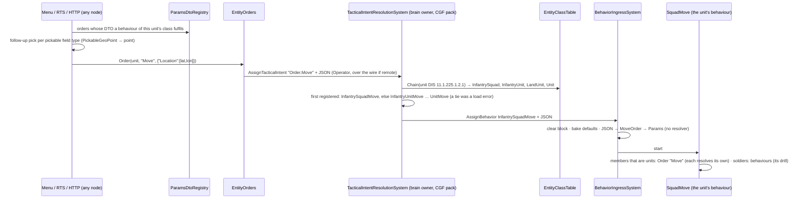

*What the picture shows that prose hid: the behaviour name first appears on the receiver's own node (`TIR`), read from the
receiver's own class, so neither the UI nor `EntityOrders` ever knows it.*

### 3.2 A behaviour starts: where the params land

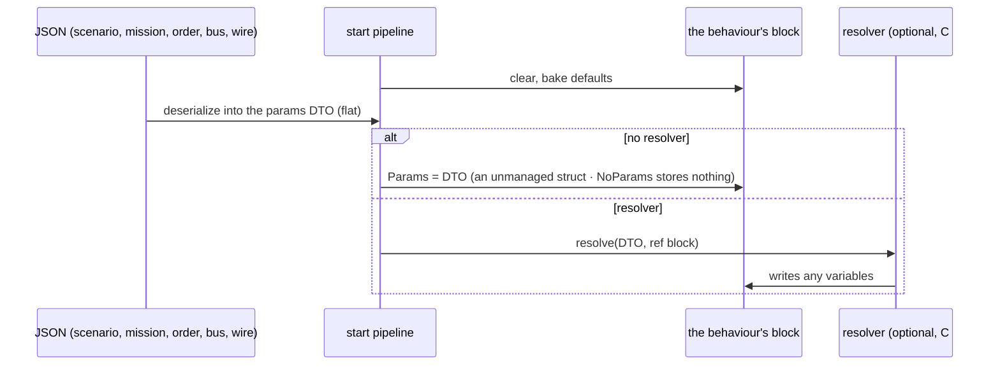

## 4. Modules — who registers what, who calls it each frame

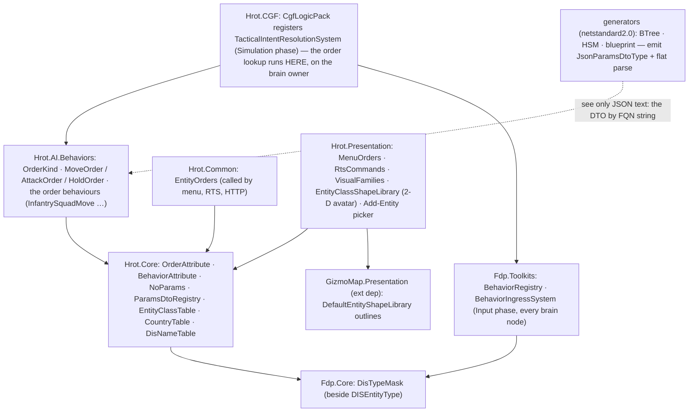

*What the picture shows that prose hid: `Hrot.Common` and `Hrot.Presentation` cannot see `Hrot.AI.Behaviors` (measured,
their `.csproj`), so they reach orders ONLY through `ParamsDtoRegistry` in `Hrot.Core`, which scans the loaded assemblies at
run time; the order lookup itself runs only where `CgfLogicPack` is registered — the brain owner. `GizmoMap` (an external
dependency) cannot see `Hrot.Core` either, so the 2-D avatar is CHOSEN in `Hrot.Presentation` from the class table and only the
outlines are GizmoMap's (CE-2138).*

## 5. What changes, by area

| area | today | after |
|---|---|---|
| params contract | `[BehaviorContract]` on the DTO, one behaviour per DTO; a generated mirror of Input variables; nested JSON for one DTO-typed Input | `[Behavior(Params=…)]` on the behaviour (C#) or `ParamsDtoTypeId` on the asset; shared DTOs; flat JSON |
| blackboard | Input / State roles | one variable kind; reserved `Params` (no resolver only) |
| editor | Inputs / State sections; DTOs only in C# | one Variables section; a params DTO asset + generator + editor |
| behaviour filter per type | `BehaviorCategory` flags + a switch over 8 type ids | the class table (classes declared by the order behaviour's name, or by a class list on a non-order behaviour) |
| unit DIS type | `1.1.US` Category 0 — same as any land platform | Kind 11; arm / echelon / variant |
| display classification | `VisualFamilies` with a composite special case; picker names from `DisNames.json` | one hard-coded class table; picker path = class chain; no JSON |
| orders | `EntityOrders` maps Move / Attack / Hold to soldier behaviours; hard-coded menu entries | order DTOs in the AI assembly; generic `Order(name, json)`; menu from the registry; receiver resolves |

## 5a. As built *(updated per task)*

| task | as built | deviation from the design |
|---|---|---|
| **CE-2130** R0 ✅ 2026-10-12 | the rail lives in the params-contract feature suite, `Hrot.Editor.Tests/DebugApi/ABehaviourAdvertisesItsRealParametersTests` (T-1: the suite that already guards `GET /behaviors` publishing the authored DTO, CE-224/CE-235). It loads the PRODUCTION registry (`CgfBehaviorSetup.LoadFromAiAssembly`). Checks: **P1**, a behaviour names a params DTO (`JsonParamsDtoType != null`); **P2**, that DTO is not a generator's mirror of the behaviour's variables (a BTree asset's Inputs struct in `Hrot.AI.Behaviors.Trees`, or a blueprint behaviour's nested `*_Bp.Params`). `ParamsContractAllowList` holds the **48** violators measured at the first run; the rail fails on a NEW violator and on a STALE entry, so the list only shrinks. A second test registers a missing, a mirrored and a named DTO and proves the predicate catches the first two (a permanent red-proof). **Red-proved both ways:** `TakeCover` removed from the list ⇒ fails naming it as a new violator; a compliant `Idle` added ⇒ fails asking to remove it. Suite 10/10 | ⚠ the rule "a published contract ≠ the parsed type" (CE-2128 ①, `FollowRoute`) is **not** checkable by reflection: a curated resolver deserializes inside its body. It stays a manual item of CE-2131. CE-2128 ② (`PlatoonHillAttack`) IS caught: its generated mirror outranks its contract |
| **CE-2131** A1 ✅ 2026-10-12 | `FollowRouteParamsJsonDto` gained `Speed` and `Loop`, so the published contract now lists every key callers write (rail `CE2131_FollowRouteAdvertisesTheKeysItsCallersWrite`). ⭐ After CE-2134: `Idle`, `WanderMilitary` (curated) and the three FDP examples `Ambush`, `InfantryCombat`, `ConvoyEscort` (`Hrot.Editor/ExampleBehaviorDeclarations.cs`) declare `NoParams`; their five empty `*ParamsJsonDto` classes are deleted (rail `CE2131_ABehaviourThatTakesNothing_NamesNoParams`; `ParamsDtoRegistryTests` for the examples). `JoinFormation` was done by CE-2134 (it names `CgfNodes.JoinFormationParams`) | ⚠ three parts moved: the `NoParams` switch needed a SHARED DTO, i.e. the contract on the behaviour (CE-2134). `PlatoonHillAttack`'s contract is fixed by CE-2133/CE-2134 (a declaration outranks the generated contract). FollowRoute's route→trajectory conversion runs on the SENDING side (`MissionControlBehaviorParamsHelper`), filed as CE-2145 |
| **CE-2145** ✅ 2026-10-12 | per §10. `CgfNodes.ResolveFollowRoute` (typed: `in FollowRouteParamsJsonDto` → `ref FollowRouteParams`), `CgfNodes.TryFindRouteTrajectory` (through `NetworkIdResolver`, then `RouteTrajectoryCache`), `FollowRouteParams.RouteNetworkId`; `Action_WriteFollowRouteChannel` returns Running and leaves the channel untouched while the trajectory is 0. `MissionControlExecutionSystem` passes FollowRoute params through; both `MissionControlBehaviorParamsHelper` copies deleted, and `ThereIsOneNetworkIdResolverTests` loses their two exemptions. Rails (`MissionControlRequestSystemFollowRouteTests`, re-homed from OC1-S001): `CE2145_FollowRoute_TheMissionStoresTheAuthoredParams_Unchanged`, `CE2145_FollowRoute_ARouteNotReady_DoesNotHoldTheMission` ×2, `CE2145_TheResolver_FindsTheCompiledTrajectory_AndKeepsSpeedAndLoop`, `CE2145_TheAction_WaitsForTheRoute_ThenFollowsIt`, `CE2145_TheResolver_WithNoParams_ResolvesToNoRoute_WithoutThrowing` (an empty params string is a null DTO). 🔴 Red-proved: the action without its look-up and the resolver without its null guard each redden exactly their rail | ⚠ the lookup goes through `NetworkIdResolver` (the one sanctioned resolver, BP-508), not the helper's `WithLifecycle(All)` query: a route entity that is not Active is not found and the behaviour waits — measured, no caller relied on a non-Active route. `Speed` still does not reach the locomotion channel (the action never wrote it, before or after) |
| **CE-2141** D2 ✅ 2026-10-12 | per §7. `InfantrySquadMove` / `InfantrySquadHold` / `InfantrySquadAttack` (`Brains/SquadOrderBehaviors.cs`) over the existing plays; `SuppressAndManeuverParams.TargetId` (named target, D2-G); `OrderGeo` (lat/lon ↔ local); the runner's `Hold`/`Move` take the commander, record each order (`SubordinateOrders`, new, id 276) and send a UNIT member `Order.Hold` / `Order.Move` (`OrderAttribute.IntentPrefix`); `BehaviorOwnedParts.Release` releases a run's orders; `ClearBehaviorEvent.OnlyBehaviorHash` + the ingress's named clear (D2-C, folded into Decision Layer §4.1's table); TIR drops a superseded clear and names the hash (D2-D). Rails: `SquadManeuverTests.CE2141_*` (7), `SopSlotTests.CE2141_*` (3), `TacticalIntentResolutionSystemTests.CE2141_*` (2), the registrar names, the CE-2130 rail (the three comply). ✅ **Live** (`SquadTacticsScenarioTests`, cluster, on the merged ui + backend tree): `CE2141_AMoveOrder_…` green (42 s) — a lat/lon `InfantrySquadMove` ordered at run time marches all five men to the point, and when the drill ends no member still runs its AdvanceTo / CombatPosture; the march, react-to-contact and suppress-flank runs stay green with the release in place | ⚠ one gap the design did not see: a curated behaviour's params DTO reaches the registry ONLY through a `[BehaviorContract]` in `Hrot.Core` (`BehaviorSchemaDiscovery`), which a shared order DTO cannot carry — the CE-2130 rail caught all three. Bridged in `CuratedBehaviorGenerator`: a typed resolver whose DTO carries `[Order]` also emits `RegisterJsonParamsDtoType` (no other behaviour changes); CE-2134 (B2) generalises it. ⚠ Not built here: the mission editor's per-type list (`BehaviorCatalog`) still cannot list them (§7.0) |
| **CE-2142** D3 ✅ 2026-10-12 | per §8. `Hrot.Core/Tkb/OrderResolver.cs` (`Resolve` → Resolved / NoBehaviour / Tie); `TacticalIntentResolutionSystem` resolves an `Order.*` intent through it before any mapper, by the entity's header DIS type (`GetDisType`), and starts nothing when no class fulfils it (warning) or on a tie (error); optional `classes` ctor parameter (default `EntityClassTable.Default`). Rails, red-proved (the `Order.` branch and the tie check disabled ⇒ all 5 red): `TacticalIntentResolutionSystemTests.CE2142_*` (M1 and T-72 resolve the same · a squad its own, most specific first, a platoon falls back to `UnitMove` · no class ⇒ nothing · equal-specificity tie · the shipped squad's Move / Hold / Attack); `OrderVocabularyTests.CE2142_EveryClassOrderBehaviour_TakesItsOrdersDto` (production registry). ✅ **Live:** `SquadTacticsScenarioTests.CE2141_AMoveOrder_…` now sends `Order.Move`, not the behaviour name — the squad resolves it to `InfantrySquadMove` on CGF, marches, and releases its members (41 s) | none from §2 / §3.1 / §8 |
| **CE-2143** D4 ✅ 2026-10-12 | per §9. `Hrot.Common/Orders/OrderMenu.cs` (the vocabulary from `ParamsDtoRegistry`, action ids 400+, the pick from the DTO's field type, `OfferedFor(dis)` through `OrderResolver`); `EntityOrders.Order(unit, name, json)` → `Order.<name>`, refusing `NotFulfilled` (HTTP 409) when no class of the unit fulfils it; `Move` / `Attack` / `Hold` build `MoveOrder` / `AttackOrder` / `HoldOrder` JSON; `ContextMenuProjectorGizmo` lists the orders the unit's class fulfils (cached per DIS type), no Possess on a `UnitEntity`; `MenuOrders` one handler per order id; `RtsCommands` by `OrderGesture`; HTTP `kind` = any order + `params`. Parity behaviours `Brains/ClassOrderBehaviors.cs`: `PersonMove/Attack/Hold`, `PlatformMove/Attack/Hold` over `MoveToLocation` / `CombatPosture` (target, assault) / an `Idle`-shaped HSM. Rails, red-proved: `MenuOrdersTests.CE2143_TheMenu_ListsExactlyTheOrdersTheUnitsClassFulfils` (all orders offered / Possess always ⇒ red); `DebugApiOrdersTests.CE2143_AnyOrderByName_…` (no NotFulfilled check ⇒ red); the menu / RTS / HTTP / across-nodes rails moved from behaviour names to orders. ✅ **Live:** `EntityOrdersAcrossNodesTests` (an order issued on SimHost runs the Rifleman's `PersonHold` on CGF; possession across nodes) and the squad `Order.Move` run, green | ⚠ measured while building: a module diagram claim held — `ParamsDtoRegistry.Default` loads `Hrot.AI.Behaviors` by name, so every host whose process carries it (the cluster runner, editor, CGF, IG, ExCon) offers orders; a standalone SimHost process would offer none (§9.3). ⚠ `Hrot.Presentation.Tests` had a stale restore (2026-10-03) that left it uncompilable; `dotnet restore` fixed it — a green run before that was a STALE binary |
| **CE-2140** D1 ✅ 2026-10-12 | `OrderAttribute` (name string + `OrderGesture`) and `NoParams` in `Hrot.Core` (`MapDefinitions/Behavior/Orders`, `MapDefinitions/Behavior/NoParams.cs`); `OrderKind` + `MoveOrder` (`PickableGeoPoint Location`, `Speed`, `ArrivalRadius`, `RoadUse`; GroundClick) / `AttackOrder` (`EntityRef Target`; EnemyClick) / `HoldOrder` (empty) in `Hrot.AI.Behaviors/Orders`, each `[BlackboardDtoStruct]` so a variable can be typed with it before B3. Rail: `OrderVocabularyTests` (every `OrderKind` has exactly one `[Order]` DTO, every `[Order]` names a kind; order DTOs are structs) | the attribute takes `nameof(OrderKind.X)`, not the enum: `Hrot.Core` cannot see the AI assembly's enum |
| **CE-2137** C1 ✅ 2026-10-12 (ui) | `FDP/Engine/Fdp.Core/DisTypeMask.cs`: an immutable class; per segment `null` = `*` or sorted, MERGED ranges (`1,2,6,7` → `1-2,6-7`), so equal masks have one text and `Equals` compares it. Missing trailing segments are `*` (unlike `DISEntityType.TryParse`, where they are 0). `Specificity` = 2 bits per segment (Any 0 · Set 1 · Exact 2), Kind most significant, so an int compare is the §1 rule. Also `Overlaps` (some type matches both — the tie test) and `DeepestPinned`. Rail `DisTypeMaskTests` (Fdp.Core.Tests, 5 tests + theory rows) | none. `QueryBuilder.WithDisType` untouched |
| **CE-2138** C2 ✅ 2026-10-12 (ui) | `Hrot.Core/Tkb/EntityClassTable.cs`: `EntityClass(Name, DisplayName, Mask)`, the table (53 classes: kinds, domains, categories as DisNames.json held them, plus the grouping classes `Armor`, `WheeledUtility`, `Helicopter`, `Jet`, `CargoPlane` that were `VisualFamilies`' switches), `CountryTable` (the five codes). `DisNameTable` names exactly the classes that pin one level (`NamesALevel`); `VisualFamilies.Of(dis)` and the new `EntityClassShapeLibrary` (2-D avatar, wired in `MapInteractionPack.BuildRenderLayer`) walk the chain from the most specific class to the first one in their own small map (`FamilyOfClass`, `ProfileOfClass`). `DisNames.json` + `EmbeddedResource` deleted. **Golden:** `EntityTypeCatalogTests.CE2138_*` (25 built-in types: family, folder, icon; 52 names) taken on the pre-C2 code (commit `79a0f8bf8`) and unchanged after; sweeps over the DIS space for the family (`Map3DTests.CE2138_TheClassTable_KeepsEveryFamily_…`, vs the old switch) and the avatar (vs GizmoMap's fixed switch). Table rails: `EntityClassTableTests` (no ties, duplicate refused, every built-in type named, chain order). **CE-2127** fixed in the same commit | ⚠ **the picker path is NOT the whole chain**: it is the chain filtered to the classes that name ONE level (an exact Kind / Domain / Category), with the country between Domain and Category. The whole chain would insert grouping classes (`Armor`, `Helicopter`) as folders and move every built-in type's folder, which §3 of the handoff forbids. ⚠ the **class name ≠ the display name** (`Person` reads "Life Form", `Afv` reads "Armored Fighting Vehicle"): names are identifiers for `<Class><Order>`, display names are what the picker always showed. ⚠ `VisualFamilies.IsSoldier` (rifle on the figure) still reads Kind 3 / Category 1 directly — not a classification surface the table was asked to own. ⚠ GizmoMap keeps its own DIS switch for non-HROT hosts (it cannot see `Hrot.Core`); every HROT host passes `EntityClassShapeLibrary`. 🔴 Found: GizmoMap's `BuildRotaryWing` returned the fixed-wing outline under the fixed-wing name, so no helicopter could ever draw as one; it now has its own outline |
| **CE-2139** C3 ✅ 2026-10-12 (ui) | `Hrot.Core/Tkb/UnitDis.cs`: `Kind = 11`, `UnitArm` (Infantry 1 · Armor 2 · MechanizedInfantry 3 · Artillery 4 · Reconnaissance 5), `UnitEchelon` (the MIL-STD-2525 order: Team 1 · Squad 2 · Section 3 · Platoon 4 · Company 5 · Battalion 6 · Regiment 7 · Brigade 8 · Division 9), `Land(arm, echelon, country, variant)`, `EchelonOf(string)` (throws on an unknown name). `NedTkbBuilder.AsLandUnit(type, arm, country, variant)` reads the echelon from the template's `TkbCompositionDef.Echelon`, so the string stays the ONE source. Built-in units: Tank Platoon `11.1.225.2.4.1`, its auto-spawn variant `…2.4.2`, Infantry Squad `11.1.225.1.2.1`. Classes added: `Unit` ("Units") · `LandUnit` · five arm classes · `InfantrySquad` · `TankPlatoon`. Both composite special cases are gone (`VisualFamilies.Of` = `Of(dis)`, `FamilyOfClass["Unit"]`; `EntityTypeCatalog.CategoryOf` has no branch). Picker folder `Units/United States` → `Units/Land/United States/<arm>` (ExCon's ORBAT still keys on the `Units` prefix; railed). Map layers: a unit stays in `units_ground`, leaves `vehicles`; 2-D avatar: none. **The load rule** lives in `CreateEntityRequestSystem.UnitTakesItsTemplatesDisType`: a composite always spawns with its template's DIS type. Rails: `EntityClassTableTests.CE2139_*` (Hrot.Core.Tests), `BdcTkbBuilderVisualTests.CE1017_*` (composite ⇔ unit Kind), `Map3DTests.CE2139_*`, `EntityTypeCatalogTests` (the golden moved on exactly the 3 unit lines + 7 Kind-11 names), `CreateEntityRequestSystemTests.CE2139_*` (SimHost.Tests) | ⚠ **the load rule is NOT in `DisEntityTypeTranslator` / `StagingEntityExtractor`** (the handoff's pointers): translators inject BEFORE the auto-serializer adds `TkbIdentity` (`ScenarioSerializer.cs:458-484`), so the translator cannot tell a composite, and the extractor holds no TKB. `CreateEntityRequestSystem` is the one funnel every creation path passes that holds the TKB, and it already special-cases composites (child spawn). ⚠ a composite whose TKB still carries a PLATFORM DIS type (a user TKB file written before C3) now draws as its DIS says (unknown box) — no such file is checked in. ⚠ arm and echelon codes are HROT's (no SISO aggregate table in the repo) |
| **CE-2133** B1 ✅ 2026-10-12 (backend) | a BTree/HSM with ONE struct Input parses flat; `ParamsDtoTypeId` on BTree/HSM/blueprint assets; details §5a.1 | ⚠ blueprints parse flat only when they NAME the DTO (§5a.1) |
| **CE-2134** B2 ✅ 2026-10-12 (backend) | `[Behavior(name, Params, Categories)]` + `ParamsDtoRegistry` in `Hrot.Core`; 25 declarations moved off the DTOs (placement and classes/sequences/modules in §5b); `[BehaviorContract]` and `BehaviorTestHelper` deleted; readers moved: `BehaviorSchemaDiscovery`, `BehaviorCatalog` (now per host), the blueprint palette (To/From JSON once per DTO type); a declaration OUTRANKS a generated contract (PlatoonHillAttack publishes `PlatoonHillAttackParamsJsonDto`, CE-2128 ②); curated generator BEH002/BEH003; `RootParamsAccess.InputBytes` reads the block's `In`. Rails: `ParamsDtoRegistryTests` ×5, `ABehaviourAdvertisesItsRealParametersTests.CE2134_*` ×2, `CuratedBehaviorGeneratorResolverShapeTests.CE2134_*` ×2, `CE472_IntentAndJsonNodeTests.Palette_ListsASharedDtosJsonRowsOnce` | ⚠ JoinFormation now declares `CgfNodes.JoinFormationParams` (what its identity parse fills; BEH003), and the empty `JoinFormationParamsJsonDto` is deleted. ⚠ The example behaviours (Ambush, InfantryCombat, ConvoyEscort) are declared in `Hrot.Editor` (`[assembly: Behavior]`), so CGF / ExCon no longer offer them. ⚠ ExCon gained a ProjectReference to `Hrot.AI.Behaviors` (catalogue only). ⚠ Found in the build: the editor loads the AI assembly twice (hot reload) — the scan takes the LAST instance of each assembly name. ⚠ Found at the behaviors merge (`CE2142_EveryClassOrderBehaviour_TakesItsOrdersDto` red 3/3 after the hot-reload rails, *"must take MoveOrder; it takes MoveOrder"*): a caller that registers definitions from ONE copy must bind contracts from that copy — `ParamsDtoRegistry.Pinning(assembly)`, passed by `CgfBehaviorSetup.LoadFromAiAssembly` to `BindJsonParamsDtoTypes(registry, declarations)` |
| **CE-2132** A2 ✅ 2026-10-12 | `"ParamsDtoTypeId": "Hrot.Map.Definitions.Behavior.NoParams"` on `BasicInfantrySop`, `BasicSquadSop`, `FiringPosition`, `Flank`; the CE-2130 allow-list loses them (rail `CE2132_ALibraryTreeNoCallerParameterises_NamesNoParams`, params-contract suite). ⭐ **DangerCrossing (after CE-3182):** the asset names `ParamsDtoTypeId = DangerCrossingConfig` (one field per node: `sensor`, `holdAhead`, `hold`, `crossAhead`, `cross`, `walk`; `ParamsDefaultJson` = the six former variables' defaults) and each node binds `Params.<field>`; `DangerAreaNodes.ResolveDangerCrossing` (typed, `[Behavior(DangerCrossing, Params = DangerCrossingParams)]`) takes the twin's flat `{Objective, WalkSpeed, RushSpeed, CrossWithin}` and writes only those fields into the baked block. `ua-danger-crossing` and `TacticsTreesTests` send `{"Objective":[x,y,0]}`; allow-list −1 (rails `CE2132_DangerCrossing_PublishesItsFlatContract_NotItsBlock`, `CE2132_TheDangerCrossingResolver_WritesTheContract_AndKeepsTheBakedTuning`, the H5 tree rail). Goldens: 4 files +26/−114, the bindings at the struct's CLR offsets. ✅ **Live:** `PostureScenarioTests.CE3079_DangerCrossing_…` 2/2 (`ua-danger-crossing` and its blueprint twin, 3 m 50 s); 🔴 red-proved (resolver without the walk lines → its rail red) | ⚠ **not "one Input of one C# DTO"** (AQ90 §2.3h blast radius, `FlankParams { tactics; engage }`): measured, no scenario, test, asset or C# caller sends these four any JSON, so a contract would publish knobs nobody sets — B3a's T31–T34 precedent applies. ⚠ **DangerCrossing cannot convert with what exists**: its callers send the destination twice (`{"sensor":{RouteTo},"walk":{X,Y}}`), a flat `{Objective,…}` needs a resolver writing a config struct into `Params` (exists: PlatoonHillAttack) AND nodes binding a FIELD of `Params` — not built (`HsmAsset.IsExpressionTargetOf` is an exact name match; every emitter looks up `offsetMap[name]`, ~10 copies), though AQ90 §2.3j rules it (*"an ACTION binds a field of any block variable, Params included"*). ⇒ a Track B item (field binding) before DangerCrossing, and so before B3b empties the allow-list. Rejected: DangerCrossing-specific node overloads (duplicates EnsureSensor / MoveTo); a resolver writing plain variables by name (a second write path + a per-asset offset table) |
| **CE-2129** B5 ✅ 2026-10-12 (backend) | `BehaviorIngressSystem`: the previous behaviour's stateful slots are detached on EVERY behaviour change (it ran only when the NEW behaviour declared slots), except when this start pauses that behaviour, and never a key a paused task holds (`DetachStatefulSlots(…, pausing)` → `IsHeldByPausedTask`). Rail `BehaviorIngressStatefulTests.CE2129_ASwitchToABehaviourWithNoSlots_…` (A writes its slot → B with no slots → A reads 0), red-proved: the old gate restored ⇒ red *"B takes no slots, yet A's slot must be detached"*. Feature suites green: ingress-stateful, SOP slot, brain hand-over, hosting, ghost slots, unit memory (97/0) | ⚠ **the salting half was already true — measured, nothing built:** every stateful slot key folds its owner — generated BTree/HSM the asset id (`BTreeBridgeEmitCore.ResolveStatefulSlotKey`, `SharedAiBindings.StatefulSlotKey`), curated hosted sites `AssetIdFromName(host)` (`BTreeHostedSites.cs:89,112`), blueprints the asset id (`InstanceEmitter.cs:797`); a curated stateful action's state is a field of the block (`SharedNodeBinder`), which lives in the root slot keyed by behaviour hash. The unsalted key the row cited (`OccurrenceSlotKey` P2) was deleted by S8; the stale comment at `BehaviorIngressSystem.cs:311` is corrected. ⚠ A re-assign of the SAME behaviour still keeps its slots (`previousBehaviorId != behaviorId`), as before |

### 5a.1 CE-2133 B1 in detail *(2026-10-12, backend lane)*

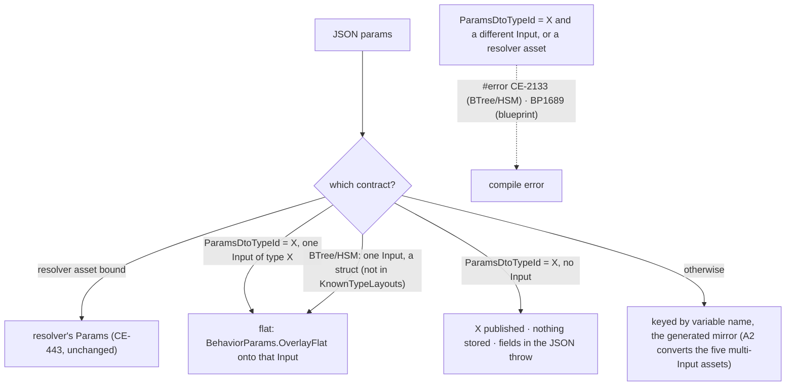

*What the picture shows that prose hid: there is still exactly one place the JSON lands per behaviour, and naming a DTO
never creates a second one; a name that cannot land is a compile error, and a DTO that is not stored refuses fields at run
time instead of dropping them.*

| piece | where |
|---|---|
| `ParamsDtoTypeId` (FQN string, written only when set) on `BehaviorTreeAssetDto`, `HsmAssetDto`, `BlueprintAsset` → `IrAsset`; the two editor models and mappers carry it | `Hrot.AiEditor.Persistence`, `Hrot.BTree.Editor`, `Hrot.Hsm.Editor`, `Hrot.Blueprints.Compiler` |
| flat-target rule `BTreeEmitCore.FlatParamsVariable`; `ParamsDtoTypeIdError`. A host binds a flat child with a variable of the child's DTO (what `TryGetHostedInputType` answers); ⛔ `InputsStructTypeId` stays the GENERATED mirror — it tells `GeneratedTypeCatalog` which struct an asset generates, and answering the DTO there made a host its own child's generator (a sizing cycle, caught by `HsmJsonGeneratorTests.S8c_*`) | `BTreeEmitCore.cs` |
| a flat behaviour's block types `In` as the DTO itself (`{Asset}_Block.In : ThreatCountParams`, same bytes as the one-field mirror), so CE-425's "block.In is the published contract" holds by construction (`AGeneratedBehaviourAdvertisesItsManifestTests`) | `BTreeEmitCore.EmitBlockStructs` |
| emitted parse: `BehaviorParams.OverlayFlat` (a sent key wins, an absent key keeps the baked default, unknown keys ignored, case-insensitive, malformed JSON throws); `BehaviorParams.RequireNoStoredFields` for a named DTO stored nowhere | `BehaviorParams.cs`, `BTreeBridgeEmitCore.cs` (BTree and HSM share it), `InstanceEmitter.cs` / `CSharpEmitter.cs` (blueprint) |
| `RootParamsAccess.InputBytes`: an EMPTY manifest means 0 Input bytes even when a contract type is published (the AQ90 §2.3m B trap, for a named DTO stored nowhere) | `RootParamsAccess.cs` |
| the two saved Sentry params strings rewritten flat | `scenarios/ua-danger-crossing{,-bp}/scenario.json` |

⚠ **Deviation — blueprints opt in by naming.** A blueprint with one struct Parameter does NOT turn flat by itself: the
blueprint compiler sees only type ids and cannot tell a struct from an enum, and an enum Parameter must stay keyed. It
parses flat when `ParamsDtoTypeId` names its one Parameter's type. (No shipped blueprint behaviour has a single struct
Parameter; AQ90 §2.3m.) BTree / HSM variables are offered only as primitives or DTO structs, so the struct test there is
"not a known scalar/vector".
⚠ **Not closed here:** a curated resolver on a generated asset (`PlatoonHillAttack`, `HullDownAttackRun`) still publishes the
asset's Input type, not the resolver's source DTO; that is CE-2128 (A1) / B2's `[Behavior(Params=…)]`. A named DTO on an asset
with NO variables at all has no `ParseParams`, so fields sent to it are not refused (B3's reserved `Params` closes this).

## 5b. CE-2134 B2 — the contract on the behaviour *(2026-10-12, backend lane; BUILT — as-built row in §5a)*

**INVENTORY** *(graph CLI index + grep + one read-only sweep; file:line in the task row)*: 25 `[BehaviorContract]` DTOs, all in
`Hrot.Core`; 4 readers — `BehaviorSchemaDiscovery` (UI registry, scenario remapper, `RegisterJsonParamsDtoType`;
Hrot.Core-only scan), `BehaviorCatalog` (per-category picker lists; Hrot.Core-only scan; 3 callers incl. ExCon),
`ReflectionIntentContractProvider` (blueprint Send Intent / To / From JSON palette; AppDomain scan by attribute NAME),
`BehaviorTestHelper` (no callers). Where each behaviour is implemented: 18 curated topologies in `Hrot.AI.Behaviors`
(`[BTreeDefinition(Curated)]` / one `[HsmDefinition(Curated)]`), 15 of them with a TYPED resolver whose `TAuthored` IS the
DTO; `PlatoonHillAttack` = a JSON asset + a raw resolver; `DefendArea` / `HullDownAttack` = intent ids handled by mappers;
`ConvoyEscort` / `InfantryCombat` / `Ambush` = FDP examples the EDITOR registers (`EditorSubsystem.cs:1246`), nothing on CGF.
`Hrot.AI.Behaviors` → `Hrot.Core` (one way); standalone ExCon reaches neither the AI assembly nor CGF.

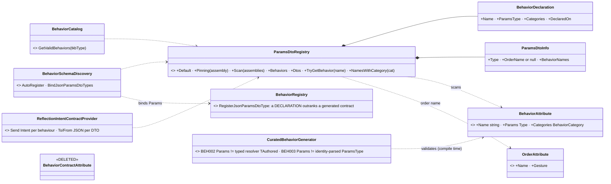

*What the picture shows that prose hid: the four readers stop owning a scan each — one registry is the only reflection over
the attribute, and the generator only CHECKS it; and the DTO no longer points anywhere, so one DTO can serve many behaviours.*

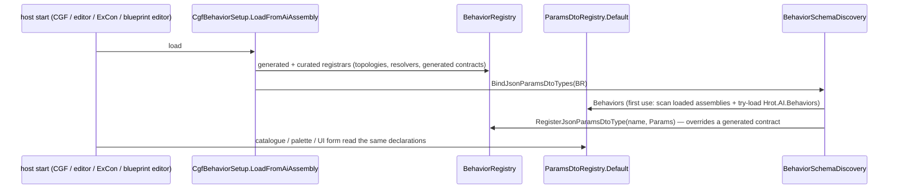

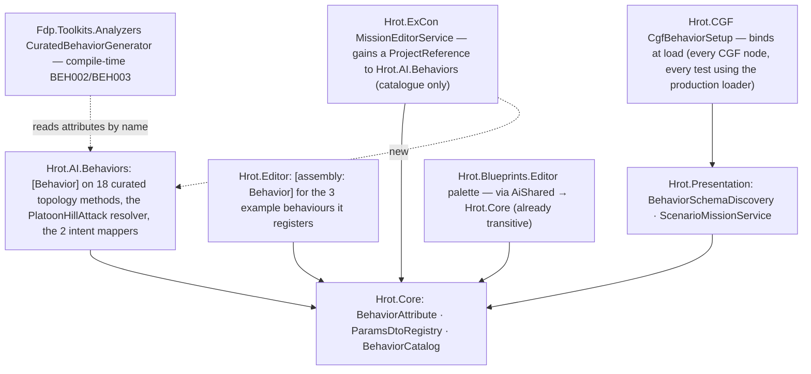

*What the module picture shows: the registry sees a declaration only if its assembly is LOADED — `Hrot.Core` cannot reference
the AI assembly (it would be a cycle), so the registry tries to load it by name, and standalone ExCon must ship it (the new
reference). The editor's example behaviours are declared in the editor, so CGF and ExCon stop listing behaviours they cannot run.*

| where `[Behavior]` goes | behaviours |
|---|---|
| the curated topology method (`[BTreeDefinition(Curated)]` / `[HsmDefinition(Curated)]`) | AdvanceTo, BoundingOverwatch, BreakContact, CombatPosture, DoorLocksmith, FireAtPoint, FireAtTarget, FollowRoute, HoldStance, Idle, JoinFormation, MoveToLocation, ReactToContact, SquadHold, SquadMarch, SuppressAndManeuver, TrackTarget, WanderMilitary, WindowDuel |
| the curated resolver method (the asset owns the topology) | PlatoonHillAttack (`PlatoonHillAttackParamsJsonDto`) |
| the tactical-intent mapper class (an intent id is fulfilled by its mapper) | DefendArea (`DefendAreaMapper`), HullDownAttack (`HullDownAttackMapper`) |
| `[assembly: Behavior]` in `Hrot.Editor`, beside the registration of the FDP examples | ConvoyEscort, InfantryCombat, Ambush |

| decision | why · rejected |
|---|---|
| a declaration OUTRANKS a generated contract in `BehaviorRegistry` | R-132 (curated outranks generated); it is what fixes CE-2128 ② for PlatoonHillAttack (its generated contract is the Input struct, its resolver parses the JSON DTO). ⛔ rejected: B1's `ParamsDtoTypeId` on the asset for this — a NAMED DTO there must be the Input's type (B1 rule), and the resolver is the code that knows what it parses |
| BEH002 / BEH003 are compile ERRORS in the curated generator | CE-2128 "cannot recur": a typed resolver states `TAuthored`, and a resolver-less topology parses its `ParamsType` by identity; both are visible at compile time. ⚠ a RAW resolver (FollowRoute, PlatoonHillAttack) deserializes inside its body and stays unverifiable. ⛔ rejected: a runtime-only check (it would fire on every host, after the build) |
| JoinFormation declares `CgfNodes.JoinFormationParams` | it is what the identity parse fills (BEH003); the empty `JoinFormationParamsJsonDto` was an anchor only and is deleted |
| P3 (stored ⇒ unmanaged struct) is enforced at generate time | BEH003 makes a resolver-less curated behaviour's Params its `ParamsType` (a struct by construction); B1 makes a generated asset's stored params its Input (a struct). ⇒ no runtime P3 check is needed |
| the registry refuses two declarations of one name, and a declaration with no `Params` | the load check: one producer per behaviour (R-132), P1 (a behaviour that takes nothing names `NoParams`) |

## 5c. CE-2135 B3 — no Input / State roles *(design 2026-10-12, backend lane; build-state: B3a BUILT, B3b open — the split APPROVED, R-3000)*

> 🔒 **User, 2026-10-12** (with the behaviors lane's steering): *"So approved, B3a now; A2 (CE-2132) converts straight to the B3a form after it lands"* ⇒ the order is **B3a (backend) → A2 / CE-2132 (behaviors, converts once, to the final form) → B3b (backend)**.

**INVENTORY** *(two read-only sweeps, 2026-10-12; graph CLI index + grep)*:
- **Code:** ~200 production lines read Role/Scope or the `In`/`St` split: persistence (10), BTree/HSM emitters + generators (~43),
  blueprint compiler `Parameter`/`Variable` (~45 lines / 20 files), runtime (5 + 4 structural), editors (~60: the AiShared
  variables panel's Role column and its "Inputs" / "Working State" sections, the BTree / HSM models, the blueprint MyBlueprint
  "Inputs" section), validators (~9). 43 test files (234 hits). ⭐ **No runtime code reads `Role`** — only the block layout.
- **Assets** (52 behaviours): class A no Input 20 · **B one struct Input 11** (shipped: Sentry, TakeCover, FallBack,
  HullDownAttackRun, PlatoonHillAttack) · C one scalar Input 4 (tests + HsmVariableShowcase) · **D several Inputs 17**
  (shipped BTree: BasicInfantrySop, BasicSquadSop, DangerCrossing, FiringPosition, Flank = A2 CE-2132, behaviors lane;
  shipped blueprints with Parameters: PlatoonHillAttackBp, Demo_MissionPlan, Demo_TaskChain, DangerCrossingBp). Keyed (nested)
  JSON in data: `ua-danger-crossing`, `hsm-channel-e2e` (×2), `mission-demo-bp`, `T20` test.
- ⭐ **`Scope` is NOT the same question:** `Node`-scoped working state (an action's private memory, auto-managed) is separate
  storage keyed by node; it survives B3. Only `Role` goes.


*What the picture shows that prose hid: the runtime layout does NOT change shape — `In` at 0, `St` after — so the runtime,
`RootParamsAccess` and the hosted-child copy stay as they are; only what the AUTHOR declares changes (a named DTO instead of
Input variables), which is why the cost is in the editors, the generators and the assets, not the engine.*

| claim the lean rests on | code — how it IS | design — how it was MEANT |
|---|---|---|
| the runtime reads only the block shape, never `Role` | ✅ sweep: `StatefulSlotInfo.Role` written, never read; `InputBytes` reads `In` (`RootParamsAccess.cs:319`) | ✅ AQ76 §12.3b: *"Role=Input becomes optional"* |
| a named DTO already lands in `In` flat | ✅ B1 (`BTreeEmitCore.cs:246`, `OverlayFlat`) | ✅ AQ90 §2.3j: *"the JSON lands in the reserved variable Params"* |
| a class-B asset's default lives on its Input variable (`DefaultValueJson`, e.g. Sentry `WithinMetres 90`) | ✅ `Sentry.btree.json:110` | ⛔ AQ90 is silent on where a named DTO's default lives ⇒ lean below |
| several shipped multi-Input assets are A2's (behaviors lane) | ✅ tracker CE-2132 | ✅ design §6 (A2 depends on B1 only) |
| removing `Role` outright breaks every class C/D asset not yet converted | ✅ their JSON is keyed by variable (sweep §3) | ⛔ the §6 graph shows B3 depending on B1 only — **it misses this dependency** |

**The decision (lean ⭐ B3a now, B3b later):**

| | what | when |
|---|---|---|
| ⭐ **B3a** | an asset that names its params DTO has NO Input variable: `In` = the DTO, called `Params`, its default `ParamsDefaultJson` on the asset; every authored variable is what `State`+`Behavior` is today (`St`). Convert the 11 class-B assets (5 shipped, 6 tests) to it. Editor: one "Variables" section + a read-only "Params" row; new variables are plain (no Role column). A host binds a child with an ordinary variable (`St` offsets measured on the struct, like the blueprint emitter). The legacy Input path stays ONLY for unconverted assets, listed by the CE-2130 allow-list | now (backend) |
| **B3b** | delete `Role` (`BlackboardVariableRole`, the panel's legacy path, the mirror emission); blueprint behaviours' Parameters → a named DTO; resolver assets' Parameters → the DTO (supersedes §P.7) | when A2 (CE-2132) + the test / blueprint conversions empty the allow-list; blueprint Parameters ideally after B4 (an editor-made DTO) so no C# is needed |

⚠ **Refined while building B3a (measured 2026-10-12, before any code relied on the table above):** a "plain" variable is a
PACKED one (today's `Input` storage), not an `St` one. Action bindings bake each variable's OFFSET into their keys at generate
time (`HsmActionKey.CompoundKeyName(fqn, offset)`, both emitters) and resolve it from the packed fields only
(`BTreeBridgeEmitCore.cs:497`); `St` is CLR-laid-out (its types may be unsizable at generate time, e.g. fixed buffers), so an `St`
variable cannot be an action's params. ⇒ in B3a: the reserved `Params` is the FIRST packed variable (offset 0); the asset's other
packed variables are plain variables (bindable, baked, never JSON); `St` stays the working-state half. The persisted value
`Role = Input` therefore means "a plain (packed) variable" in an asset that names a DTO, and "the generated JSON mirror" only in a
legacy asset; B3b removes the name. The `Block_B3` box above reads: `In` = `Params` + the plain variables.

**B3b prep as built** *(2026-10-12, behaviors overnight)*: the 15 allow-listed assets that store nothing name `NoParams` —
`BTreeRenderShowcase`, `CombatShowcase`, `SampleScout`, `SampleGuard`, `HsmShowcase`, `HsmTwoChannelRegionsDemo`, `HsmOrthogonalRegions`
(its one variable is `State`), `T01`–`T08` (measured: no caller sends any of them params). ⚠ In a BTree the key sits where the serializer
writes it (before `Pills`) — `MigrationEquivalenceTests` pins the editor's byte-stable save; `HsmShowcase`'s frozen V1 snapshot carries it
too. Allow-list 33 → 18: the blueprints with Parameters, the two resolver assets (`HsmResolverDemo`, `T40`), and the multi-variable
fixtures (`T09`, `T10`, `T20`, `T35`, `T39`, `BTreeCuratedBindingDemo`) — B3b proper.

**B3b re-measured** *(2026-10-13, behaviors; codebase-memory `search_graph` / `search_code` after a fresh index, grep corroboration;
`check_index_coverage` is not reachable through the CLI, so the counts are best-effort)*:
- ⭐ **Only 4 of the 9 allow-listed blueprints declare Parameters**: `DangerCrossingBp` (4), `Demo_MissionPlan` (3), `Demo_TaskChain` (2),
  `PlatoonHillAttackBp` (6), counted from each `.bp.json` `Declarations` by `Kind` (AQ90's "four Parameter-declaring blueprints"). The other
  five, `BlueprintBehaviourDemo`, `Demo_Advance`, `Demo_Engage`, `Demo_Retreat` and `Demo_TakeCover`, declare none: they fail the rail only
  because the emitter's empty `*_Bp.Params` mirror is their DTO. ⇒ they can name `NoParams` like the 15 in the prep, with no editor.
  The blueprint compiler already reads `ParamsDtoTypeId` (`BlueprintAsset.cs`, `Stage2_Validate.cs`, `CSharpEmitter.cs`); no `.bp.json` sets it yet.
- `OperatorControl` is a curated C# BTree (`[BTreeDefinition(… ParamsType = typeof(OperatorControlBlackboard))]`,
  `OperatorControlBehavior.cs:116`): a C# change, no editor.
- ⇒ **only the 4 Parameter-declaring blueprints need B4b's params-asset editor** (or hand-written C# DTOs). The other 14 entries need neither.
- **The `Role` enum**: `BlackboardVariableRole` (in-degree 106) is named in 23 production files (persistence + emitters 10, the AiShared
  editor 11, the BTree / HSM models 2) and 33 test files.
- ⭐ **The runtime twin is write-only**: `StatefulSlotInfo.Role` (`BehaviorRegistry.cs:91`) is written by every generated registrar and by
  `HostedSubtree.cs:369`, and read by nothing (the inspector's `StatefulWorkingStateProjection` reads neither `Role` nor `Scope`).
  `Fdp.Toolkit.Blueprints.Partitioning.StatefulSlotRole` exists only to spell that byte. ⇒ B3b deletes both with `BlackboardVariableRole`,
  which this section's B3b row did not list.
- **Blueprint Parameters blast radius**: `ParameterDecl` is named in 24 production / 72 total files, `GetParameterNode` in 8 / 13,
  `GetAllParametersNode` in 7 / 10 (grep: 21 / 70, 7 / 13, 7 / 10). ⚠ This section does not say whether "Parameters → a named DTO"
  removes `ParameterDecl` and the two Get nodes, or keeps them as the graph's view of the DTO's fields. That is decided before B3b-2 is
  built. Lean: keep them as a view, which leaves the graphs untouched.

**B3a as built** *(2026-10-12)*: `ParamsDefaultJson` on the BTree / HSM asset; `BTreeEmitCore.WithParamsVariable` /
`HsmBridgeEmitCore.WithParamsVariable` inject `Params` at every generator entry (idempotent); `ParamsTarget` = `Params` (named)
or B1's single struct Input (legacy); `NoParams` stores nothing (no injection, `RequireNoStoredFields`, `InputBytes` 0, nothing
for a host to seed); `RootParamsAccess.InputBytes` = the DTO's size when the first packed variable is it. Editor: the mappers
show `Params` as a read-only entry (`ReservedParamsVariable`, `BlackboardVariableEntry.IsReservedParams`) and save it back as the
two asset fields; the panel has no Role column; the first section is "Variables". Converted: Sentry, TakeCover, FallBack,
HullDownAttackRun, PlatoonHillAttack → `Params`; the test assets T11, T31–T34, HsmStatefulBindingDemo → `NoParams` (their one
variable is a composed action's params or an aliasing fixture that no caller sets by JSON, so it stays a plain variable).

Rejected (one line each): **remove `Role` in one step now** — breaks the 17 class-D and 4 class-C assets and 5 keyed scenario strings
the behaviors lane is converting (A2) · **give the named DTO its default from C# initialisers** — `default(T)` ignores them
(measured for R-237) and B4's editor-made DTOs would need a second mechanism · **put `Params` in `St`** — moves every class-B
asset's bytes and the hosted-child copy for nothing.

Design docs checked: AQ90 §2.3i/§2.3j — *applies* (the target: one kind, reserved `Params`); AQ76 §12.3b — *applies* (Role
optional, block from the DTO); Parameter Model §P.2/§P.7 — *applies*, §P.7 is superseded only in B3b; §5.1 "sections are the
classification" — *applies*: one Variables section is that rule with one section.

## 5d. CE-3182 — a binding targets a FIELD of a block variable *(2026-10-12, backend lane; build-state: BUILT — as-built at the end of this section)*

> 🔒 *User, 2026-10-12: "A binding's target may be Variable.Field (at least Params.<field>), with the offset = the variable's offset
> + the field's offset from the build-time layout. Fold the ~10 duplicated offsetMap builds … into one target resolver. Make the
> editor's binding picker, IsExpressionTargetOf and rename understand the path."* Basis: AQ90 §2.3j, *"an ACTION binds a field of
> any block variable, `Params` included"*. Why now: A2 found DangerCrossing can take its flat contract only through a resolver that
> fills a config struct in its block, with nodes bound to `<var>.sensor`, `<var>.walk`; until then it stays on the CE-2130 list and
> B3b cannot empty it.

**INVENTORY** *(`search_graph` + grep + one read-only sweep, 2026-10-12)* — every place that turns a binding's
`ExpressionTargetField` into bytes or answers "does it target X":

| where | what | count |
|---|---|---|
| `BTreeBridgeEmitCore` | `offsetMap` name → `PackedField`: plain / condition / stateful / blueprint action / blueprint condition thunks, ParseParams, deactivators (`:483,541,634,1031,1115,1568,2019`) | 7 |
| `HsmBridgeEmitCore.EmitStateParamBindings:341` · `SharedAiBindings.Collect:164` | the same map, HSM | 2 |
| `BTreeEmitCore.BuildVariableOffsets:507` · `HsmEmitCore.HsmParamOffsets:1063` (→ `EffectiveActionName`, `SharedAiBindings.NameFor`) | name → offset, for the blob key | 2 |
| `BTreeMethodCompatibilityValidator:179-210,235-244,284` · `BTreeDeactivatorScanner:177` | exists + type check (BTREE0002); HSM has none (`SharedAiBindings:183` skips silently) | 2 |
| `ActionBindingCompatibility.CompatibleVariables` (`ActionBindingSources.cs:151`) | THE picker filter, BTree + HSM, `v.FieldType == parameterType` | 1 |
| `HsmAsset.IsExpressionTargetOf:414` + ~10 `==` sites (`BehaviorTreeAsset.CountNodesReferencingVariable:447`, `BTreeCommandSink:344`, `AutoManagedVariables:94`, `NodePropertiesDetailsView:260`, the two reference contributors, …) | "does this binding target variable X" | ~11 |
| `HsmAsset.RetargetBindings:343` (ETF only) · `BehaviorTreeAsset.RenameVariable:428` (**touches no binding**) · `VariablesPanelControl.CommitRename:744` (**no name validation**) | rename | 3 |

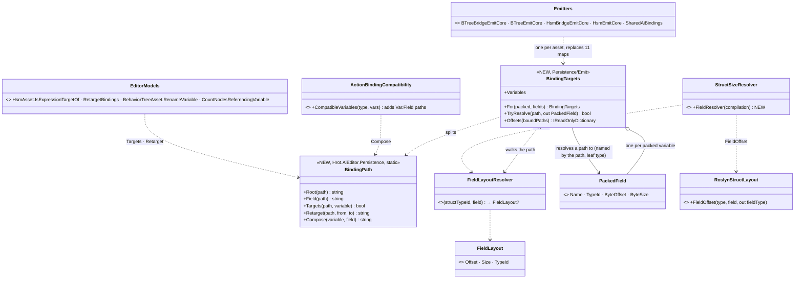

*What the picture shows that prose hid: the ONLY new layout knowledge is `FieldLayoutResolver`, and its one producer is the
Roslyn layout that already sizes struct variables (`RoslynStructLayout`, pinned to the CLR by the CE-2027 rails). Every emitter
and the validator read targets through ONE `BindingTargets`, and the editor never needs an offset: it reasons about names
(`BindingPath`) and CLR types (reflection), so nothing on the editor side can disagree with the bytes.*

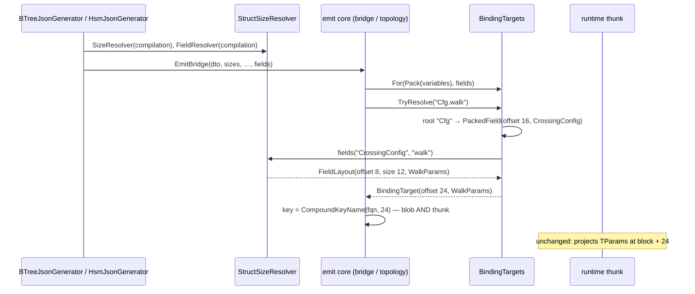

*What it shows: the key `fqn@24` is computed once, by the same call, for the blob and the thunk — so a field binding cannot
drift between them, exactly as a variable binding cannot today. The runtime is untouched.*

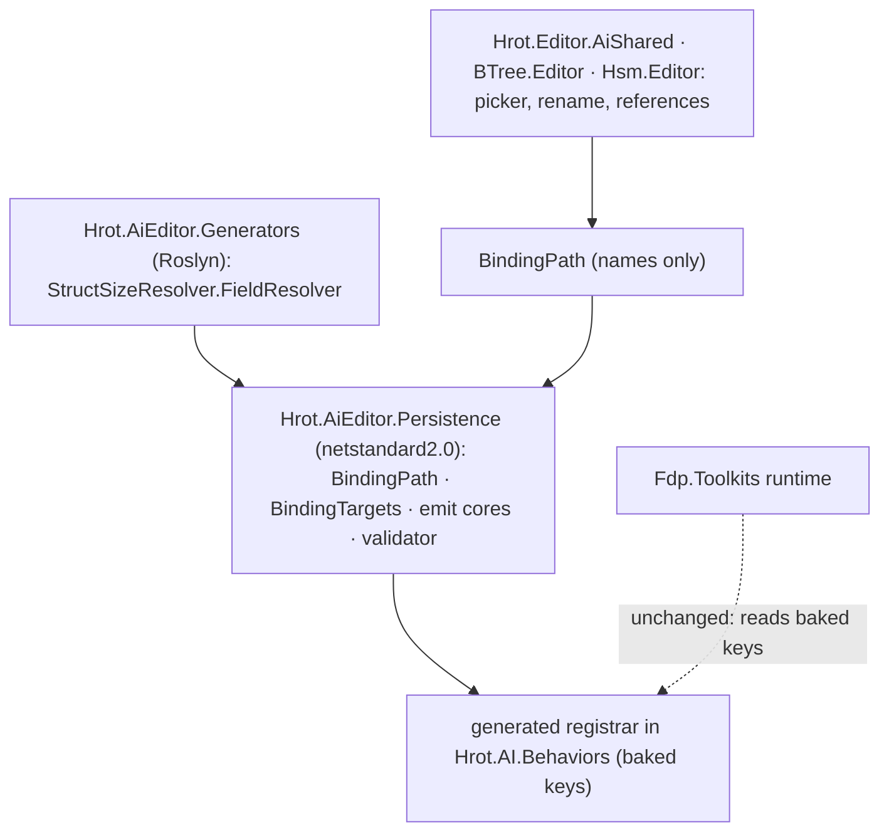

*What it shows: the runtime has no edge to anything new — a field binding is a baked offset like any other. ⚠ A path into a type
Roslyn cannot see (a sibling's GENERATED Inputs struct, a blueprint's generated `Params`) has no field layout and fails CLOSED with
a diagnostic, never a guessed offset.*

| decision | ⭐ chosen | rejected (one line each) |
|---|---|---|
| **D1 syntax** | dotted `Var.Field[.Sub…]`; a variable name is an identifier (`BlackboardNameValidator`), so the first `.` ends the root | a separate `TargetFieldPath` property — two fields to keep in step in every DTO, mapper and migrator |
| **D2 which variables** | any PACKED block variable of a struct type, `Params` included; nested fields to any depth | `Params` only — the user's "at least"; one resolver costs the same for every root |
| **D3 type rule** | the leaf field's type == the method's params type (as a variable's is today) | an assignable/convertible match — the thunk reinterprets bytes; only identity is safe |
| **D4 offset** | root `ByteOffset` + `RoslynStructLayout.FieldOffset` per segment, at build time | `Marshal.OffsetOf` at registration — the blob key is a compile-time string; a runtime offset cannot be baked into it |
| **D5 the fold** | `BindingTargets` built ONCE per asset in each entry point; the private helpers take it instead of `packedFields` | a shared static `BuildOffsetMap` helper — still 11 maps, and no place to hang the path walk |
| **D6 editor** | `CompatibleVariables` adds `Var.Field` candidates by reflection (public instance fields, `FieldType == parameterType`); every "targets X" test goes through `BindingPath.Targets` (root equality); rename rewrites the root of `ExpressionTargetField` AND `WorkingStateTargetField` in BOTH editors and is validated as an identifier | leave BTree rename as is — it already dangles plain bindings (`BehaviorTreeAsset.cs:428`); a path would only add to it |
| **D7 fail closed** | an unresolvable path (no such root, no field, no layout) emits NO key: BTREE0002 on BTree, a new generator warning on HSM (it skipped silently) | guess `offset = root` — binds the wrong bytes with no error |

**Not in scope:** the blueprint tier (no AI binding picker there); the stateful WORKING-STATE target (`WorkingStateTargetField` stays a
variable name); variable DELETE leaving bindings in place (pre-existing, unchanged). **Rails:** a generator rail binding
`Cfg.walk` (key = root + field offset, blob and registrar agree, the CLR's `Marshal.OffsetOf` the oracle); a fail-closed rail
(unknown field ⇒ diagnostic, no key); `BindingTargets` unit rails; editor rails: picker lists `Params.<field>`, rename rewrites a path
root (BTree and HSM), `IsExpressionTargetOf` matches by root. **Goldens:** must not move (no shipped asset binds a path yet).

**As built (2026-10-12).** ⚠ One deviation from the class diagram's first draft, now drawn: `TryResolve` returns the existing
`PackedField` (named by the path, typed by the leaf) rather than a new `BindingTarget` struct — so every emitter helper swapped
`offsetMap.TryGetValue(etf, out var field)` for `targets.TryResolve(etf, out var field)` and kept the rest of its body. The two
name → offset builders (`BTreeEmitCore.BuildVariableOffsets`, `HsmEmitCore.HsmParamOffsets`) now return
`BindingTargets.Offsets(boundPaths)`: every variable plus each path a binding names, so the blob-key sites downstream resolve a path
with no change. `fields` is an optional trailing parameter on the full entry overloads (`BTreeEmitCore.EmitTopologyCore`,
`BTreeBridgeEmitCore.EmitBridge`, `HsmEmitCore.EmitTopologyCore`, `HsmBridgeEmitCore.EmitBridge`, `SharedAiBindings.Collect` /
`UnbindableBindings`); the generators pass `GeneratedTypeCatalog.FieldResolver(compilation)` (over
`StructSizeResolver.ResolveFieldOf`, which stays project-free for its link into the blueprint generators). The BTree validator
(`BTreeMethodCompatibilityValidator.ResolveTarget`, used by BTREE0002's two checks and `BTreeDeactivatorScanner`) type-checks the LEAF
field. HSM: an unresolvable FIELD path is HSM0003 (a plain variable name that is not packed keeps its old silent skip — shipped
assets rely on it). Editor: the picker (`ActionBindingCompatibility.CompatibleVariables`, depth ≤ 3), `HsmAsset.IsExpressionTargetOf`,
both `RenameVariable`s (ETF + WSTF), `BehaviorTreeAsset.CountNodesReferencingVariable`, node-delete auto-variable cleanup
(`BTreeCommandSink`, `AutoManagedVariables.RemoveIfAutoManaged`), both reference contributors and the details view's default editor
go by `BindingPath`; `VariablesPanelControl.CommitRename` now validates the new name (`BlackboardNameValidator`, plus a duplicate check).
Rails: `BindingTargetsTests` ×4, `SharedAiBindingCompilesTests.CE3182_*` ×4 (BTree and HSM, oracle `Marshal.OffsetOf` on the compiled
probe; fail-closed on both hosts), `ActionBindingTests.CE3182_*`, `BlackboardRenameTests.CE3182_*`,
`ExpressionTargetFieldCountTests.CE3182_*`.

## 6. ⭐ THE TASK LIST — the build plan

Tracker ids are from the behaviors block. ⛔ Each task: extend the UML here first if it deviates, red-prove its rails, fold the
as-built back into this document. "Lane" is a lean; any session may take a task whose dependencies are met.

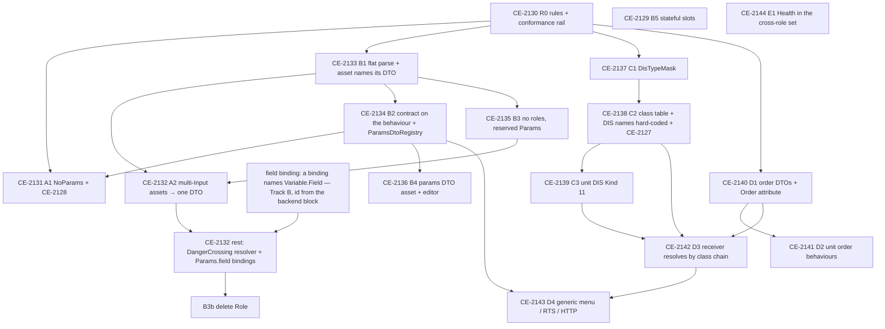

| id | task | depends | lane (lean) | acceptance |
|---|---|---|---|---|
| **CE-2130** R0 | the authoring rules (§1 P1–P2, O2 naming) as a **conformance rail** over every registered behaviour (curated, BTree, HSM, blueprint): one params DTO; no multi-Input asset; no `[BehaviorContract]` contract ≠ parsed type. Today's violators listed in an **allow-list that may only shrink** | — | behaviors | rail green with the allow-list; a new violating behaviour turns it red (red-proved) |
| **CE-2131** A1 | ⚠ *(amended 2026-10-12: the NoParams part waits for CE-2134)* the six empty DTOs (`Idle`, `Ambush`, `InfantryCombat`, `ConvoyEscort`, `JoinFormation`, `WanderMilitary`) → `NoParams`; fix the two wrong contracts (CE-2128: `FollowRoute`, `PlatoonHillAttack`) | R0, CE-2134 (NoParams) | behaviors | their allow-list entries removed; `GET /behaviors` publishes what each parses |
| **CE-2132** A2 | ⚠ *(amended 2026-10-12, measured after B3a)* `BasicInfantrySop`, `BasicSquadSop`, `FiringPosition`, `Flank` → `NoParams` (no caller sends them JSON; their variables are baked tuning — B3a's T31–T34 precedent) ✅; `DangerCrossing` → its blueprint twin's contract `{Objective, WalkSpeed, RushSpeed, CrossWithin}` through a resolver that fills a config struct in `Params`, its nodes bound to `Params.<field>`; the 2 keyed params strings (`ua-danger-crossing`, `TacticsTreesTests`) rewritten flat | B3a; **field binding** (Track B) for DangerCrossing | behaviors | the CE-2132 rail + allow-list shrink; each feature's rails; live `ua-danger-crossing` |
| **CE-2133** B1 | a single struct-typed Input parses FLAT; an asset may name its params DTO (`ParamsDtoTypeId`, FQN string; the generator emits `typeof(global::X)` + `Deserialize<global::X>`); BTree, HSM, blueprint | R0 | Track B | per-tier round-trip rails; generator goldens show only the intended diff |
| **CE-2134** B2 | `[Behavior(Params = …)]` on the behaviour replaces `[BehaviorContract]` on the DTO; `ParamsDtoRegistry` (one scan of loaded assemblies; order DTOs carry their order name); the blueprint palette de-duplicated by DTO type; load check P3 | B1 | Track B | `BehaviorSchemaDiscovery` / `BehaviorCatalog` consumers moved; CE-2128 cannot recur |
| **CE-2135** B3 | drop Input / State: one variable kind, reserved `Params` (no resolver only), `NoParams` stores nothing (fix the `InputBytes`=1 vs 0 trap); editor sections merged; Parameter Model §1 / §P.7 updated | B1 | Track B | AQ76 rails; hosted-child rails; the size pre-check still skips unsizable types |
| **CE-2136** B4 | `*.params.json` asset + build-time generator + editor (variables-panel rows, an order-name field); appears in `ParamsDtoRegistry` | B2 | Track B | a generated DTO used by a behaviour end to end |
| **CE-2129** B5 | stateful slots salted by behaviour and detached on every change except a paused task's | — | Track B | A(slots) → B(none) → C(same key) starts clean |
| **CE-3182** | a binding targets `Variable.Field` (`Params.<field>`): one target resolver for every emitter, the editor picker / rename / targets understand the path (§5d) | — | backend (user, 2026-10-12) | a field binding is keyed at the CLR offset on BTree and HSM; DangerCrossing can bind `<var>.<field>` |
| **CE-2137** C1 | `DisTypeMask` in `Fdp.Core`: parse (`*`, `n`, `a-b`, `a,b,c`), `Matches`, `Specificity` (segment by segment from Kind: exact > list/range > `*`) | R0 | Track C | parse / match / specificity rails |
| **CE-2138** C2 | the hard-coded `EntityClassTable` grown from `VisualFamilies` + `CountryTable`; `VisualFamilies.Of` and `DisNameTable` built from it; `DisNames.json` deleted; picker path = class chain; CE-2127 fixed | C1 | Track C | a golden: every built-in type keeps its 3-D family and picker folder; no two classes share a name or mask |
| **CE-2139** C3 | units: Kind 11, Category = arm, Subcategory = echelon (the `TkbCompositionDef.Echelon` string becomes the code); composite special cases → DIS; scenario load prefers the template's DIS type; CE-1017 rail updated | C2 | Track C | a unit is in its own class; no tank mask matches a unit |
| **CE-2140** D1 | `OrderKind`, `MoveOrder` / `AttackOrder` / `HoldOrder` with `[Order(name, gesture)]` in `Hrot.AI.Behaviors`; `OrderAttribute` + `NoParams` in `Hrot.Core` | R0 | behaviors | — |
| **CE-2141** D2 | `InfantrySquadMove` (today's `SquadMarch`), `InfantrySquadHold`, the squad attack drill, each taking the order DTO; a drill that ends releases its members; a member that is a unit receives an order | D1 | behaviors | `tt-squad-march`, `tt-react-contact` live |
| **CE-2142** D3 | `TacticalIntentResolutionSystem` resolves `Order.<name>` through the class chain (O2), tie = load error; no soldier fallback for a body-less unit | C2, C3, D1 | behaviors | an M1 and a T-72 resolve the same; a squad resolves its own |
| **CE-2143** D4 | `EntityOrders.Order(unit, name, json)`; HTTP `order {kind, params}`; menu + RTS generic over `ParamsDtoRegistry`; picks from field types via `MapPickBroker`; `Possess` hidden on a unit | D3, B2 | behaviors | the menu lists exactly the orders the unit's class fulfils |
| **CE-2144** E1 | `HealthApplicationSystem` into the cross-role infrastructure on every host (R-275) | — | any | a passenger owned on a non-CGF node dies there |

⛔ Out of this programme (decided, built later): carry capacity and seats per vehicle type, and the human-carrier profile
(R-274). Embarkation itself is NOT deferred (R-282) and may run in parallel, following §1's rules.

## 7. D2 — the unit order behaviours *(CE-2141; build-state: BUILT `2026-10-12` — as-built §5a)*

⭐ **In one line:** a squad fulfils Move / Hold / Attack with the drills it already has, a unit member is ordered by
order name (A4), and **the orders a commander's run gave its members belong to that run**, like its sensors (CE-485 D4),
so they end when the run ends, for any reason (A5).

### 7.0 Claims *(measured `2026-10-12`; both columns)*

| claim | code — how it IS | design — how it was MEANT |
|---|---|---|
| a drill orders a member as a tactical intent at `Superior` whose id IS the behaviour (`CombatPosture` / `AdvanceTo`) | `SquadManeuverRunner.cs:386-405` | Decision Layer §4 (origins); Squad Tactics §3.2 |
| ⛔ no drill releases its members: the play `Release` hooks drop sensors only, the march's is empty | `SquadMarchBehavior.cs:233`; `SquadContactBehaviors.cs:97,225` | AQ90 A5: "a drill that ends, for any reason, clears the Superior orders it gave its members" |
| ⛔ the ingress applies a frame's assigns BEFORE its clears ⇒ a clear and a new order for one member in the same frame leave it with nothing | `BehaviorIngressSystem.cs:97-136` (assign handler, then clear handler) | the same hazard named for one intent in `TacticalIntentResolutionSystem.cs:107-110` (CE-3167); ⛔ searched `docs/` for two intents in one frame: none |
| `ReactToContact` ends one play and starts the next in the SAME tick | `SquadContactBehaviors.cs:310-327` | Squad Tactics §4.7 (one stateful action, stages) |
| ⇒ a release inside the runner's end path would race the next play's orders | follows from the two rows above | — |
| a behaviour run's owned parts are released at EVERY site that ends a run (start of another, re-assign of the same, clear, finish, a dropped paused task) and NOT at a pause | `BehaviorIngressSystem.cs:567-569, 1641-1642, 444` | `DESIGN_Behaviour_Fault_And_Teardown.md` §1 D4 ("one release step, three call sites, no per-route hook") |
| an order's clear over a running REACTION is weighed against the paused task; admitted, today it ends the reaction too | `AdmitsWithReactions` + the clear handler `:124-136` | Decision Layer §4.1 table: "admitted ⇒ the paused task is dropped" — silent on the reaction |
| a Clear intent's `IntentId` already crosses the wire | `TacticalIntentEgressTranslator.cs:92`, message `IntentId` | CE-3167 (assign and clear share one wire path) |
| the squad pool keys a contact by the LOCAL entity; an `EntityRef` resolves a network id to it | `SquadManeuverRunner.TopContact`; `EntityRef.TryResolve` | DESIGN_Entity_Reference |
| geodetic → local metres through the `IGeographicTransform` singleton (CGF has it) | `HillAttackCommanderNodes.cs:717-778` | — |
| ⚠ the mission editor's per-type behaviour list sees only `[BehaviorContract]` DTOs in `Hrot.Core` ⇒ the order behaviours are NOT in it until the class table replaces it | `BehaviorCatalog.cs:45-56` | §5 row "behaviour filter per type" (C2/D3) |
| ⚠ `Order.<name>` is not resolved by anything until D3 | `TacticalIntentResolutionSystem.cs:129-148` (falls back to a behaviour named `Order.Move`, warns) | §3.1 (D3 resolves it) |

### 7.1 Classes

```mermaid
classDiagram
  direction LR
  class InfantrySquadMove { <<NEW behaviour, Library/Squad>> resolver: MoveOrder to SquadMarchParams · runs SquadMarchPlay }
  class InfantrySquadHold { <<NEW behaviour>> resolver: HoldOrder to SquadHoldParams (no end) · runs SquadHoldPlay }
  class InfantrySquadAttack { <<NEW behaviour>> resolver: AttackOrder to SuppressAndManeuverParams with TargetId · runs SuppressAndManeuverPlay }
  class SquadMarchPlay { <<existing>> }
  class SquadHoldPlay { <<existing>> }
  class SuppressAndManeuverPlay { <<existing, EXTENDED>> TargetId: the threat is the named target, pooled or not }
  class SquadManeuverRunner { <<existing, EXTENDED>> Hold and Move take the commander · a UNIT member gets Order.Hold / Order.Move }
  class SubordinateOrders { <<NEW, Fdp.Toolkits Behavior, brain-local managed>> per member: behaviour name, origin, owning run · Record · Release }
  class BehaviorOwnedParts { <<existing, EXTENDED>> Release also releases the run's SubordinateOrders }
  class ClearBehaviorEvent { <<existing, EXTENDED>> +OnlyBehaviorHash (0 = whatever runs) }
  class TacticalIntentResolutionSystem { <<existing, EXTENDED>> Clear names a behaviour (IntentId) · a Clear followed by an Assign to the same entity in one frame is dropped }
  class BehaviorIngressSystem { <<existing, EXTENDED>> a NAMED clear ends only that behaviour: running, or paused under a reaction }
  class OrderAttribute { <<existing>> +IntentPrefix "Order." }
  class CuratedBehaviorGenerator { <<existing, EXTENDED as built>> a typed resolver taking an Order DTO also publishes it as the params DTO }
  InfantrySquadMove ..> SquadMarchPlay
  InfantrySquadHold ..> SquadHoldPlay
  InfantrySquadAttack ..> SuppressAndManeuverPlay
  SquadMarchPlay ..> SquadManeuverRunner
  SquadHoldPlay ..> SquadManeuverRunner
  SuppressAndManeuverPlay ..> SquadManeuverRunner
  SquadManeuverRunner ..> SubordinateOrders : Record per order
  SquadManeuverRunner ..> OrderAttribute : unit member
  CuratedBehaviorGenerator ..> InfantrySquadMove : RegisterJsonParamsDtoType
  BehaviorOwnedParts ..> SubordinateOrders : Release at run end
  SubordinateOrders ..> TacticalIntentResolutionSystem : Clear intent naming the behaviour
  TacticalIntentResolutionSystem ..> ClearBehaviorEvent
  BehaviorIngressSystem ..> ClearBehaviorEvent
```

*What the picture shows that prose hid: nothing new runs a squad — the three order behaviours are new FRONT DOORS to the
three existing plays; the only new mechanism is the release, and it hangs off the one run-end step the engine already has.*

### 7.2 A drill ends, for any reason

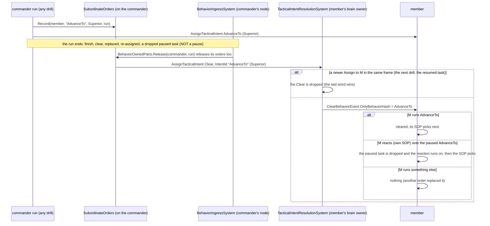

*What the picture shows that prose hid: the release never touches what a member is doing on its own — its reaction, or a
newer order — and the two ordering hazards (assigns before clears in the ingress; plays chained in one tick) are both
closed at the one place intents are resolved.*

### 7.3 Modules

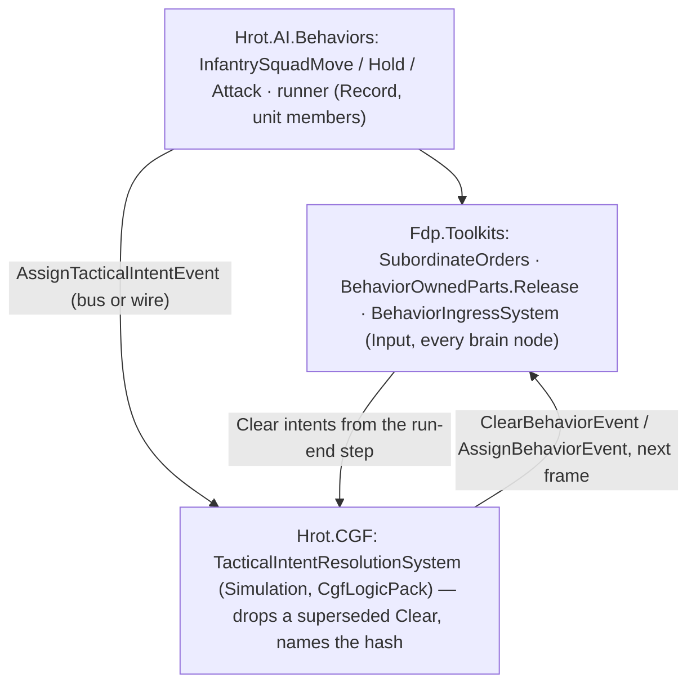

*What the picture shows that prose hid: the release is published from the INGRESS (where runs end), not from the
behaviour, so a run ended from outside — an operator's new order, a release, a fault — releases its members exactly like
one that finished.*

### 7.4 Decisions *(leans)*

| # | decision | ⭐ lean | why |
|---|---|---|---|
| **D2-A** | the order behaviours vs the drills | NEW front doors `InfantrySquadMove` / `InfantrySquadHold` / `InfantrySquadAttack` over the existing plays; `SquadMarch`, `SquadHold`, `SuppressAndManeuver` stay | the drills carry finer authored params (shape, spacing, duration) scenarios use; one implementation (the play), two doors (R-137: unifying may not cost a feature) |
| **D2-B** | where the release lives | the commander's RUN owns the orders it gave; released by the existing run-end step (`BehaviorOwnedParts.Release`) | the step already fires at every end and never at a pause (D4); in the runner it would race `ReactToContact`'s chained plays |
| **D2-C** | what the release clears | a Clear that NAMES the ordered behaviour: running ⇒ cleared; paused under the member's own reaction ⇒ only the paused task dropped; anything else ⇒ nothing. An unnamed clear is unchanged | a drill's end must not end a member's reaction to being shot at, nor a newer order; abort-all / mission end keep today's meaning |
| **D2-D** | a Clear and an Assign to one entity in one frame | `TacticalIntentResolutionSystem` drops a Clear followed by an Assign to the same entity in the same batch | the ingress reads two buses (assign then clear), so publication order is lost there; it is kept at the one place intents are read in order |
| **D2-E** | the squad's shape on Move | the squad decides (O3): `RoadUse` Prefer / StronglyPrefer ⇒ File (a squad on a road walks in file), else Wedge | the order says where, not how |
| **D2-F** | the height of a geodetic `Location` | the unit's own height (it stands at its men's centre, CE-514); the navmesh snaps ±4 m | the order carries lat/lon only; z 0 would put the point off the walkable area on hilly ground |
| **D2-G** | Attack on a target the squad has not seen | the designation is the knowledge: the threat point is the target's position when ordered, followed once the squad pools it; no target ⇒ the top contact | an operator who designates an enemy has told the squad where it is |
| **D2-H** | a member that is a UNIT | `Order.Hold` / `Order.Move` (HoldOrder / MoveOrder JSON, geodetic); released by an UNNAMED clear (the commander cannot know what it resolved to) | A4; resolution is D3's — until then the intent warns and starts nothing |

Rejected: **rename `SquadMarch` to `InfantrySquadMove`** — loses the shape/spacing door the scenarios use; **release in each
play's `Release`** — `ReactToContact` ends a play and starts the next in one tick, so the clear would wipe the next order;
**a BTree deactivator** — it is a node-exit hook inside the tree, not the run's end, and the run-end step already exists;
**every order's clear leaves a reaction running** — wider than D2 needs (abort-all, mission end); **reorder the ingress
handlers** — they read two buses.

### 7.5 Acceptance

| rail | where | asserts |
|---|---|---|
| the order behaviours | `SquadManeuverTests` (the feature's suite) | Move: geodetic Location → the march to the local point, Wedge (File on a road); Hold: everyone holds, never ends by itself; Attack: a named target the squad never pooled is attacked at its position |
| the release | `SquadManeuverTests` | a march that ends clears each member's last order (named); a drill replaced from outside does too; a PAUSED drill releases nothing |
| unit members | `SquadManeuverTests` | a member that is a unit gets `Order.Move` with a geodetic Location, and an unnamed clear at the end |
| the named clear | `SopSlotTests` (the gate's suite) | running ⇒ cleared; paused under a reaction ⇒ the reaction runs on and nothing resumes; another behaviour ⇒ untouched; unnamed ⇒ unchanged |
| the superseded clear | `TacticalIntentResolutionSystemTests` | Clear then Assign to one entity in one frame ⇒ only the assign; Assign then Clear ⇒ both, in order |
| live | `SquadTacticsScenarioTests` (cluster): `tt-squad-march` with `InfantrySquadMove` ordered at run time; `tt-react-contact` unchanged | everyone arrives, and after the march no member still runs its drill order |

## 8. D3 — the receiver resolves an order by its class *(CE-2142; build-state: BUILT `2026-10-12` — as-built §5a)*

⭐ **In one line:** an intent `Order.<K>` reaching an entity's brain owner starts `<Class><K>` for the entity's most specific
class (its DIS type through the one class table) that has such a behaviour, then broader classes; nothing else maps it (R-273).
The classes and sequence are §2 (`OrderResolver`) and §3.1; nothing new beyond them.

| claim | code — how it IS | design — how it was MEANT |
|---|---|---|
| every order path ends in TIR on the brain owner; it tried a mapper, then the intent id as a behaviour name | `TacticalIntentResolutionSystem.cs` (assign path) | AQ90 §3-A (the handoff's measurement) |
| an entity's DIS type is in its header on every node: stamped at spawn (owner) and on ingress (replica) | `NetworkSpawningSystem.cs:160`; `EntityMasterIngressTranslator.cs:260`; read by `EntityRepository.GetDisType` | rule K1 |
| `EntityClassTable.Chain(dis)` lists the matching classes general → specific (stable by table order) | `Hrot.Core/Tkb/EntityClassTable.cs:72` (CE-2138) | §2, rule O2 |
| a squad is `InfantrySquad` (`11.1.*.1.2`), a tank platoon `TankPlatoon` (`11.1.*.2.4`) | `EntityClassTable.cs` units block; `UnitDis` (CE-2139) | rule K2 |

| # | decision | ⭐ as built | why |
|---|---|---|---|
| **D3-A** | where the lookup lives | ONE pure function `Hrot.Core.Tkb.OrderResolver.Resolve(table, dis, order, isBehaviour)`; TIR calls it for an intent starting `Order.` (`OrderAttribute.IntentPrefix`) before any mapper | the menu that offers orders (D4) must ask the same question — one function, never two answers |
| **D3-B** | the walk | most specific class first; within one specificity, two classes that both have the behaviour ⇒ **Tie** (logged as an error, nothing starts) | O2 — a tie is never guessed. The built-in table has no equal-specificity overlap (CE-2138's `Ties()` rail), so a tie can only come from a new class |
| **D3-C** | no class fulfils it | **nothing starts** (a warning); ⛔ no fallback to the intent id as a behaviour name, nor to a soldier behaviour | a body-less unit given `MoveToLocation` stands still for ever (AQ90 §3-A) |
| **D3-D** | the params | the order's JSON passes through unchanged | the order DTO IS the fulfilling behaviour's params DTO (P3); a rail checks every `<Class><Order>` behaviour takes its order's DTO |
| **D3-E** | the table | the engine's `EntityClassTable.Default`; a test may pass its own | R-279: hard-coded, one table |

Rejected: **unit-aware mappers** (Move → `SquadMarch`, the embark handoff's lean A) — R-273, the sender would own the mapping;
**the unit's SOP slot as the decomposer** — the order would land in a slot that only reacts; **a cached name per DIS value** —
orders are rare, the walk is a dozen mask matches.

## 9. D4 — one generic order path: menu, RTS, HTTP *(CE-2143; build-state: BUILT `2026-10-12` — as-built §5a)*

⭐ **In one line:** the sender names an ORDER (a DTO marked `[Order]`), never a behaviour; what a unit is offered and what it
runs both come from the same question — `OrderResolver.Resolve(its class, the order)` (§8). Supersedes Entity Control §3.1 /
§10 / §11's sender-side mapping (Move → `MoveToLocation`, Engage → `CombatPosture`, Stop → `Idle`; R-273).

### 9.0 Claims *(measured `2026-10-12`)*

| claim | code — how it IS | design — how it was MEANT |
|---|---|---|
| the HTTP route, the menu and the RTS tool all call `EntityOrders`, which publishes ONE intent per order (Operator, `ClearsPriorIntent`) | `EntityOrders.cs:199-208`; `MenuOrders.cs`; `RtsCommands.cs:59-67`; `DebugApiService.Orders.cs:66-104` | Entity Control §3.1 (one service) |
| ⚠ `EntityOrders` maps orders to SOLDIER behaviours by name: Move → `MoveToLocation`, Attack → `CombatPosture`(target, assault), Hold → `Idle` | `EntityOrders.cs:70-117` | ⛔ overruled by R-273 (AQ90 A1) |
| the unit menu is fixed pre-serialised permutations (degraded × brain × orders), ids `MoveHere 1 · Engage 2 · Stop 3 · Possess 255` | `ContextMenuProjectorGizmo.cs:46-79`; `GlobalActionIds.cs` | Entity Control §11 |
| every behaviour declares its params DTO, and order DTOs carry their order name, in ONE registry readable by any host | `ParamsDtoRegistry` (CE-2134: `Dtos[].OrderName`, `TryGetBehavior`) | §2 (ParamsDtoRegistry) |
| an entity's class is answerable on EVERY node (DIS type in the header) | §8 claims | K1 |
| a pick is chosen by the field TYPE: `PickableGeoPoint` = a point, `EntityRef` = an entity | `MoveOrder.Location`, `AttackOrder.Target`; `DtoJsonSchemaExtractor.cs:193` | DESIGN_Map_Picking_Unification P5 |

### 9.1 Classes

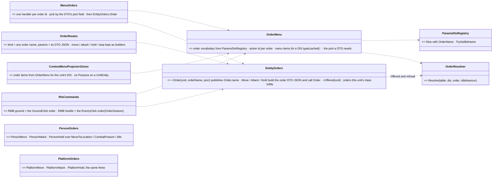

*What the picture shows that prose hid: three front-ends, one question. The menu's items, the RTS click, the HTTP refusal and
the receiver's own choice all go through `OrderResolver` over the same registry — so a menu can never offer an order the unit
then ignores, and no front-end names a behaviour.*

### 9.2 A menu order, end to end

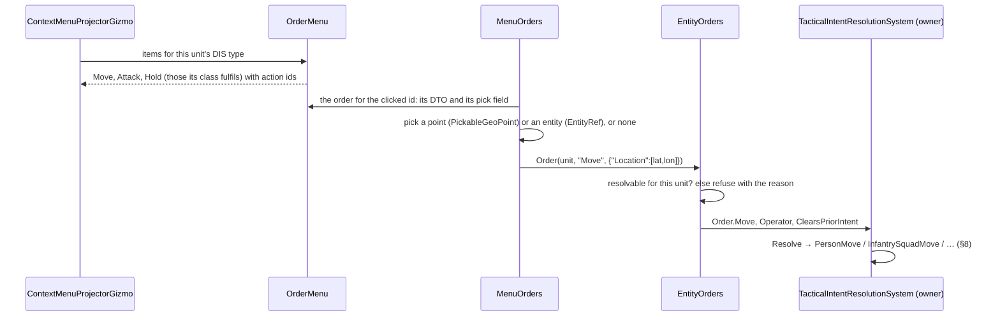

### 9.3 Modules

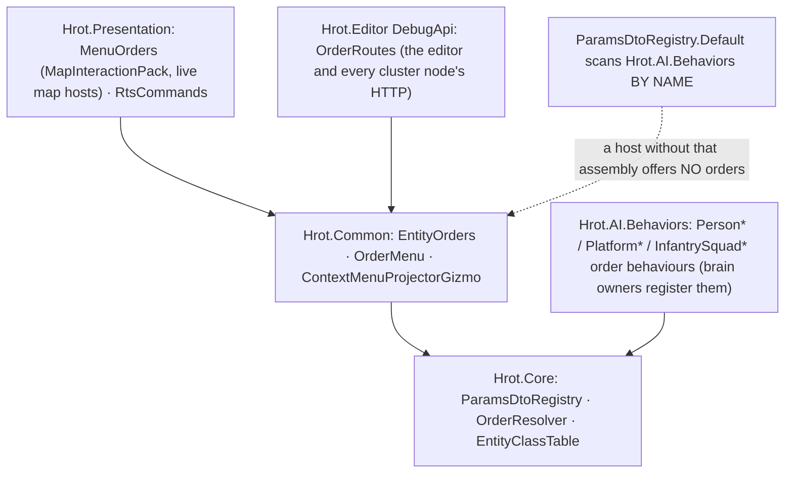

*What the picture shows that prose hid: the menu and the HTTP refusal read the behaviour declarations through
`ParamsDtoRegistry.Default`, which finds them only where `Hrot.AI.Behaviors` is loadable — a host without it offers no orders
rather than wrong ones (measured per host as part of the build).*

### 9.4 Decisions *(leans)*

| # | decision | ⭐ lean | why |
|---|---|---|---|
| **D4-A** | the service | `EntityOrders.Order(unit, orderName, json)` publishes `Order.<name>`; `Move` / `Attack` / `Hold` stay as builders of `MoveOrder` / `AttackOrder` / `HoldOrder` JSON | one publish; the builders keep the menu, RTS and HTTP callers' shapes |
| **D4-B** | soldiers and vehicles keep their orders | NEW order behaviours on the broad classes: `PersonMove/Attack/Hold` and `PlatformMove/Attack/Hold`, thin resolvers over today's `MoveToLocation` / `CombatPosture` (target, assault) / `Idle` | ⭐ parity: today every brained entity gets Move / Engage / Stop; without these the menu would offer them nothing. A more specific class overrides later (`TankMove`) |
| **D4-C** | refusal at the sender | `EntityOrders` refuses an order the unit's class does not fulfil (same resolver, `ParamsDtoRegistry.Default` as the behaviour list) | the operator / AI player learns WHY now, not by a silent receiver |
| **D4-D** | the menu | order items = the vocabulary filtered by the resolver for the unit's DIS type; label = the order name, shortcut its first letter; ids `OrderActionBase + index` (orders sorted by name); cached per DIS type × the existing permutations | a menu that lists exactly what the unit's class fulfils (the D4 acceptance) |
| **D4-E** | follow-up pick | from the DTO's fields: one `PickableGeoPoint` ⇒ a point, one `EntityRef` ⇒ an entity, none ⇒ issue at once; an order needing more than one pick is HTTP-only | the type is the pick (P5); no per-order code |
| **D4-F** | RTS | RMB ground ⇒ the order whose `Gesture = GroundClick`, RMB hostile ⇒ `EnemyClick`, each only if the unit's class fulfils it | no order name in UI code (AQ90 §2.3k ①) |
| **D4-G** | HTTP | `kind` = any order name (case-insensitive) + `params` = its DTO JSON; `move` / `attack` / `hold` / `stop` keep their old fields (built by D4-A); `behavior` / `release` unchanged | AI players keep working; new orders need no route change |
| **D4-H** | Possess | not offered on a `UnitEntity` (no body to drive) | AQ90 §6 D4 |

Rejected: **keep the soldier mapping in `EntityOrders`** — R-273 (the sender would own the mapping); **one generic `EntityMove`
class covering everything** — not a class in the table (R-279); **label orders from a new display attribute** — the order name
is the label until someone asks otherwise.

## 10. CE-2145 — FollowRoute converts its route on the RECEIVING side *(build-state: BUILT `2026-10-12`, behaviors — as-built §5a)*

**Why:** R-273 (behaviors) — the receiver converts. Today the authored contract `{routeEntityId, Speed, Loop}`
(`FollowRouteParamsJsonDto`) is turned into `{trajectoryId, Speed, Loop}` by `MissionControlBehaviorParamsHelper` inside
`MissionControlExecutionSystem` (CGF), and the curated resolver parses only that converted shape (`CgfNodes.cs:227`). ⇒ a
FollowRoute assigned any other way — HTTP, an order, an SOP row, a blueprint, a scenario's saved AI — with the published contract
gets trajectory 0 and does nothing. This is CE-2128 ①'s remaining half.

**INVENTORY** *(2026-10-12; grep + the graph's file list)*: the conversion exists twice — `Hrot.Core/Systems/Common/MissionControlBehaviorParamsHelper.cs`
(called once, `MissionControlExecutionSystem.cs:331`) and a dead copy in `Hrot.SimHost/Systems/MissionControlBehaviorParamsHelper.cs`
(called only by its own test). `RouteTrajectoryCache` is written by `RouteTrajectorySyncSystem` and read on CGF by
`RouteContextSystem`; the mission path, the FollowRoute brain and the trajectory pool are on the same node (CGF), so moving the
lookup into the behaviour does not move it across a node.

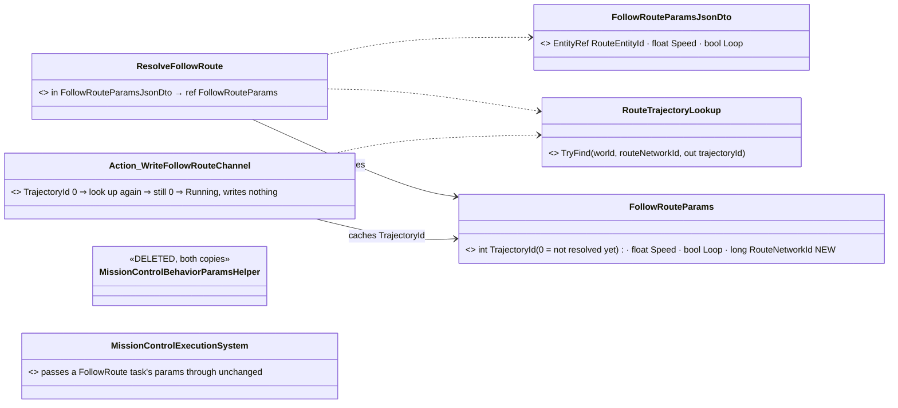

*What the picture shows that prose hid: one lookup with two callers — the resolver at start and the action while the route is not
compiled yet — replacing two helper copies on the sending side; and the resolver is TYPED, so the generator checks
`TAuthored == Params` (BEH002), which the raw resolver it replaces could not.*

```mermaid
sequenceDiagram
  participant S as any sender (mission, HTTP, order, SOP, scenario)
  participant I as BehaviorIngressSystem
  participant R as ResolveFollowRoute
  participant L as RouteTrajectoryLookup
  participant A as Action_WriteFollowRouteChannel
  S->>I: Assign FollowRoute with routeEntityId, Speed, Loop
  I->>R: authored DTO
  R->>L: TryFind(routeNetworkId)
  L-->>R: trajectoryId, or 0 when not compiled yet
  R-->>I: FollowRouteParams with RouteNetworkId and TrajectoryId
  loop every tick
    alt TrajectoryId is 0
      A->>L: TryFind(routeNetworkId)
      L-->>A: still 0
      A-->>A: Running, channel untouched
    else resolved
      A-->>A: write FollowRoute to the locomotion channel
    end
  end
```

*What the picture shows that prose hid: "not compiled yet" was a RETRY of the whole assignment on the sending side (the mission
system's 10-frame queue); now the behaviour starts at once and WAITS — the same outcome for the mission path, and the first one
that exists for every other path.*

| claim | code | design |
|---|---|---|
| the conversion runs only on the mission path | ✅ one caller, `MissionControlExecutionSystem.cs:331` | ✅ OC1-S001 (`docs/designs/orbat-context-menu/OC1-DESIGN.md` §2.1) put it at the mission ingress |
| the receiver should convert | ✅ FireAtTarget already does (`CgfNodes.ResolveFireAtTarget`) | ✅ R-273 (behaviors) |
| the mission, the brain and the trajectory pool share a node | ✅ `CgfLogicPack.cs:164` builds the mission system; the helper reads `RouteTrajectoryCache` there | ⛔ searched, no record — the measurement stands |
| an action may cache into its params block | ✅ `ref FollowRouteParams p`, the root slot; R-153: a re-assign starts from empty | ✅ R-153 |

Rejected (one line each): **keep the sender conversion and add one per path** — five copies of a lookup the receiver can do once ·
**resolve in the resolver only** — a route not compiled at start would leave trajectory 0 forever (the helper's retry existed for
exactly that) · **look the route up through `NetworkEntityMap`** — the helper's proven query also finds routes the map may not
hold (`WithLifecycle(All)`); one lookup, moved as is.

Design docs checked: OC1-DESIGN §2.1 (OC1-S001) — *superseded here*: its reason, *"the FDP engine and the BTree layer remain
network-agnostic"*, still holds, because the lookup lives in `Hrot.AI.Behaviors` (HROT), not FDP; its §2.1 gets a superseded
note. Parameter Model §P.2 (bake → overlay → resolve) — *applies*: the typed resolver is its resolve stage.

## 11. CE-2144 E1 — health application is cross-role *(build-state: ⏸ STOPPED `2026-10-12` on a measured ordering question — see "Found before building"; behaviors)*

**Why:** R-275 (behaviors) — every node that can own live entities is equal in capability. `HealthApplicationSystem` (the owner
side of damage: it applies a `DamageAssessedEvent` where this node holds the entity's Health claim) is built only by
`CgfLogicPack` (`CgfLogicPack.cs:199,231`). A passenger, door or soldier owned by SimHost or IG therefore never dies there: the
damage is assessed (`DamageCalculationSystem` / `AreaEffectSystem`, and `EmbarkedStateSystem` for an enclosed passenger) and
nothing applies it.

**INVENTORY** *(grep + the graph's file list, 2026-10-12)*: `CoreInfrastructureCapabilities` already holds the cross-role owner
side (`UnitHierarchy`, `Interactions`); `Interactions` is declared by SimHost (`SimHostNodeBootstrapper.cs:333`), IG
(`IgNodeBootstrapper.cs:283`), CGF (`CgfSubsystem.cs:984`), both editor arms (`EditorCapabilities.cs:104,141`), and wired by hand in
two harnesses (`EditorHarness.cs:326`, `SimHostInstance.cs:402`). `DamageSystem` (the old local path) has no production
registration, so there is no second applier to double-count.

```mermaid
graph TD
  subgraph every host plan
    SH[SimHostNodeBootstrapper]
    IG[IgNodeBootstrapper]
    CGF[CgfSubsystem]
    ED[EditorCapabilities x2 arms]
  end
  HA[CoreInfrastructureCapabilities.HealthApplication NEW]
  INT[CoreInfrastructureCapabilities.Interactions existing]
  HAS[HealthApplicationSystem - Simulation tail]
  PACK[CgfLogicPack]
  SH --> HA
  IG --> HA
  CGF --> HA
  ED --> HA
  SH --> INT
  HA --> HAS
  PACK -. no longer builds it .-> HAS
  K[ModuleHost kernel Simulation phase] -->|calls each frame| HAS
```

*What the picture shows that prose hid: the system moves from ONE role pack (Brain) to a capability every plan declares, and
the kernel's Simulation phase ticks it on SimHost and IG too; a fused Brain+Muscle node resolves it once (de-duplicated by Key),
exactly like `Interactions`.*

| claim | code | design |
|---|---|---|
| it gates itself on ownership, so it costs nothing where nothing is owned | ✅ `HealthApplicationSystem` authority check (the Health claim) | ✅ BS-1 (`docs/designs/brain-split/BS-1-DESIGN.md`) |
| no second applier exists in production | ✅ `DamageSystem` has no registration; `DamageAssessmentModule` runs only `DamageCalculationSystem` + `AreaEffectSystem` | ⛔ searched, no record |
| its position in CGF's list does not matter | ⛔ **FALSE, measured:** it runs at `CgfLogicPack.cs:231`, BEFORE the cognitive runtime (`:243`, `CognitiveInterruptSystem` reads `CanMove`) and the action dispatch (`:244`, `Locomotion`/`WeaponDispatcherSystem` read the capabilities) | ⛔ searched, no record |

Rejected (one line each): **put it in `Interactions`** — damage is not an interaction; the key would lie · **register it in
SimHost's pack too** — a fused node would run it twice (the CE-221 disease).

### 11.1 ⏸ Found before building — the position is load-bearing *(2026-10-12)*

Events are read from the PREVIOUS frame (`FdpEventBus.Read`), and module systems are scheduled by their `[UpdateInPhase]`
attribute in registration order (`SystemScheduler.GetPhaseAttribute`). A cross-role capability lands at the TAIL of Simulation
(that is how `UnitHierarchy` / `Interactions` are placed). ⇒ on CGF a unit killed this frame would still be dispatched a move or a
shot this frame, and its cognitive interrupt would fire one frame later than today. Small, but a behaviour change on the main path,
and R-275 rules out the cheap fix (keep it in the CGF pack and add it per host elsewhere — *"no per-host initializations"*).

| option | what | cost |
|---|---|---|
| ⭐ **A (lean)** | the capability at the Simulation tail on every host, AND the action dispatchers gate on `Health.Current > 0` as well as on the capabilities | one frame later interrupt on CGF; the extra-shot window closed where it matters. Small, all in owner-side code |
| B | the capability declares a scheduling anchor so it runs before the cognitive runtime on hosts that have one | needs an ordering seam the node plan does not have (`NodeCompositionPlan` orders by declaration only) |
| C | accept the one-frame delay with no gate | the dead unit may fire once more |

**User decision needed** before building (the blast radius is every host's Simulation order).

## 12. CE-2136 B4 — the params DTO asset *(build-state: B4a BUILT `2026-10-12` — as-built §12.1 · B4b DESIGN, awaits the user — behaviors, taking Track B overnight)*

**Why:** AQ90 §2.3j / one-page row "authoring params DTOs" (approved in principle, R-277): a params DTO must be authorable without
C# — a `*.params.json` asset (fields, types, defaults, an optional order name) that a BUILD-TIME generator turns into the DTO,
the same Category-2 path the editor-managed blackboard takes (`Blackboard_Authoring_Detailed_Design.md` v2: *"the asset JSON is the
source and the struct is generated at build"*). B3b needs it: the blueprint behaviours' Parameters move to a named DTO, ideally
with no C# (§5c B3b row).

**INVENTORY** *(read-only sweep + grep, 2026-10-12)*:

| what | measured |
|---|---|
| an asset kind whose generator emits only a C# TYPE | ⛔ none. The enum design forbids an enum catalogue (`ENUM-DESIGN.md:3-45`); the closest are the per-asset blackboard structs (`BTreeEmitCore.EmitBlackboardStructSource:204`) and the blueprint's nested `Params` |
| generator wiring | `Hrot.AiEditor.Generators` (netstandard2.0, `IsRoslynComponent`; sees only JSON text, `ENUM-DESIGN.md:79-84`); AdditionalFiles only in `Hrot.AI.Behaviors.csproj:177-191`; generated code lands in `Hrot.AI.Behaviors` |
| does a generated struct reach `ParamsDtoRegistry` | ⛔ no — `Dtos` = `[Behavior(Params=…)]` types ∪ `[Order]` types (`ParamsDtoRegistry.cs:125-150`); generated code carries neither |
| does it reach the editor's type list | ⛔ no — `BlackboardTypeChoiceBuilder` scans `[BlackboardDtoStruct]` (`:102-133`); generated code carries none |
| editor kinds | `AssetKind {Blueprint, BTree, Hsm, Blackboard, Utility, Scenario}` (`AssetKind.cs:3-11`); per-kind switches in `AssetSavePath:59-65`, `AssetRoots:197-203`, `AssetBaseNameCollisionGuard:41-43`, `AssetSelectionValidator:157-161`, `CompanionFileDiscovery:179`, the browser filter (`AssetBrowserPanel:39-90`), icons, `AiDocumentViewStateBinder:123-150` (every document is a graph canvas) |
| a field-list control | `VariablesPanelControl(IRefactorService, IEditableAsset, IReadOnlyList<VariableTypeChoice>)` (`:244`) over an `IVariablesSchemaSource` (~19 members; standalone stubs exist in tests) — rows need a CLR `Type`; its only production host is `BlackboardAuthoringWindow:553` |

```mermaid
classDiagram
  direction LR
  class ParamsDtoAsset { <<NEW, *.params.json>> Name · Namespace · OrderName · Gesture · Fields[] }
  class ParamsDtoField { <<NEW>> Name · TypeId (FQN) · DefaultJson · Comment }
  class ParamsDtoJsonGenerator { <<NEW, Hrot.AiEditor.Generators, IIncrementalGenerator>> *.params.json → struct source }
  class GeneratedDto { <<GENERATED into Hrot.AI.Behaviors>> [ParamsDto] [Order]? sequential struct, one public field per row }
  class ParamsDtoAttribute { <<NEW, Hrot.Core>> DefaultJson · Comment }
  class ParamsDtoRegistry { <<existing, CHANGED>> Dtos also lists every [ParamsDto] type }
  class OrderAttribute { <<existing>> }
  class ParamsDtoDocument { <<B4b, NEW — awaits the user>> a form document hosting VariablesPanelControl over a ParamsDtoSchemaSource }
  ParamsDtoAsset o-- ParamsDtoField
  ParamsDtoJsonGenerator ..> ParamsDtoAsset : reads JSON text only
  ParamsDtoJsonGenerator --> GeneratedDto : emits
  GeneratedDto ..> ParamsDtoAttribute
  GeneratedDto ..> OrderAttribute : when OrderName is set
  ParamsDtoRegistry ..> ParamsDtoAttribute : one more scan arm
  ParamsDtoDocument ..> ParamsDtoAsset : edits
```

*What the picture shows that prose hid: the generated DTO is an ordinary params DTO the moment it carries `[ParamsDto]` — every
reader already goes through `ParamsDtoRegistry` (orders, menus, the palette, `GET /behaviors`), so nothing downstream changes; the
new code is one generator, one attribute and one scan arm. The EDITOR is the separate, larger half.*

```mermaid
sequenceDiagram
  participant A as Assets/Params/X.params.json
  participant G as ParamsDtoJsonGenerator (build)
  participant B as Hrot.AI.Behaviors.dll
  participant R as ParamsDtoRegistry (runtime)
  participant U as a behaviour asset naming ParamsDtoTypeId
  A->>G: AdditionalFiles text
  G->>B: struct X with ParamsDto and fields
  R->>B: scan: ParamsDto types join Dtos
  U->>B: Params of type X (B3a), bound fields (CE-3182)
```

```mermaid
graph TD
  CS[Hrot.AI.Behaviors.csproj AdditionalFiles Assets/Params/**/*.params.json] --> G[ParamsDtoJsonGenerator]
  G --> DLL[Hrot.AI.Behaviors assembly]
  DLL -->|loaded by name| R[ParamsDtoRegistry.Default]
  R --> M[OrderMenu / BehaviorSchemaDiscovery / palette]
```

*The module view: no host registers anything new; the generator runs in the one project that already compiles every AI asset,
and the registry already loads that assembly by name on every node (`ParamsDtoRegistry.cs:30`).*

| decision | ⭐ lean | why |
|---|---|---|
| **B4a** the shape | a `[StructLayout(Sequential)]` **struct** with public fields | it can be a no-resolver `Params` (B3a needs unmanaged); the platform JSON options include fields |
| **B4a** defaults | per field in the asset; the generator also emits the whole default as `[ParamsDto(DefaultJson = …)]` | `default(T)` ignores initialisers (R-237); one string a host or the editor can seed `ParamsDefaultJson` from |
| **B4a** an order DTO | `OrderName` (+ `Gesture`) on the asset ⇒ the generator adds `[Order]` | the menu then offers it with no other change (§9) |
| **B4a** the type of a field | an FQN string, emitted `global::FQN` | generators see only JSON text; an unknown type is a compile error in the generated file |
| **B4b** the editor ⏸ | a new `AssetKind.Params`, a FORM document (the first non-graph one) hosting `VariablesPanelControl` over a new `ParamsDtoSchemaSource`, plus an order-name field | ⚠ touches ~10 per-kind switches and adds the first non-graph document — **the user decides the shape** |
| **later** one params-DTO scan for the editor | `BlackboardTypeChoiceBuilder` also lists `[ParamsDto]` types (AQ90 row: one scan replaces `[BlackboardDtoStruct]`) | after B4b, so a generated DTO is selectable as a variable type |

Rejected (one line each): **a class DTO** — cannot be a no-resolver `Params` (B3a stores unmanaged) · **listing generated DTOs by
namespace** — a convention nothing checks; an attribute is checkable · **the editor first** — the generator is the part every later
step needs, and it is additive.

Design docs checked: AQ90 §2.3j + one-page row — *applies* (the asset, the generator, the editor); Blackboard Authoring DD v2/v2.1 —
*applies* (Category-2: JSON is the source; discovery latency until reload); ENUM-DESIGN — *applies as a constraint* (JSON text only),
*does not apply* as precedent (it forbids an enum catalogue, a different question).

### 12.1 B4a as built *(2026-10-12)*

| piece | where |
|---|---|
| the asset model, validation, emitter, sequential layout | `Hrot.AiEditor.Persistence/Params/ParamsDtoAsset.cs` (`ParamsDtoAssetDto`, `ParamsDtoJson`, `ParamsDtoEmitCore.Validate / Emit / DefaultJsonOf / TryLayout`) |
| the generator | `Hrot.AiEditor.Generators/ParamsDtoJsonGenerator.cs` — `PARAMS0001` on a bad asset (descriptor inline: RS2008, the siblings' rule) |
| the attribute and the registry arm | `Hrot.Core/MapDefinitions/Behavior/ParamsDtoAttribute.cs` (`DefaultJson`); `ParamsDtoRegistry.Scan` lists `[ParamsDto]` types (`FromDeclarations(…, markedDtos)`) |
| sibling sizing / field binding | `GeneratedTypeCatalog` collects `*.params.json`: `Declares`, `SizeResolver` and `FieldResolver` lay a generated DTO out from its JSON (fail closed on an unknown field type) |
| wiring | `Hrot.AI.Behaviors.csproj`: `AdditionalFiles` / `UpToDateCheckInput` `Assets\Params\**\*.params.json` |
| the end-to-end fixture | `Assets/Params/Tests/T41Params.params.json` + `Assets/BTrees/Tests/Authoring/T41_GeneratedParamsDto.btree.json` (names it, bakes `ParamsDefaultJson`) |
| rails | `ParamsDtoJsonGeneratorTests` (valid → struct + `[ParamsDto]` + `[Order]`; six invalid cases → a diagnostic; the sequential layout) · `ParamsDtoAssetTests` (listed by the registry with its default; the CLR layout equals the computed one, 24 bytes; the behaviour publishes it and parses flat over the bake) · the corpus count 33 → 34 |

⚠ Deviation from the lean: none. ⚠ Not yet: the editor (B4b) and `BlackboardTypeChoiceBuilder` listing `[ParamsDto]` types.

## 13. Finishing the params story *(build-state: DESIGN — measured `2026-10-13`, leans await the user; behaviors leads)*

> 🔒 **User, 2026-10-13:** *"I would like to finish this parameter story before continuing with embark and other squad development.
> We can postpone the editor parameter editing in favor of hardcoding the dto for now … backend lane can work on the param
> infrastructure refactor and asset conversion, you can lead this effort making handoff to other sessions."*

**INVENTORY** *(four read-only sweeps + codebase-memory CLI `search_graph` / `search_code` after a fresh index + grep; the two
surprising claims spot-checked by reading the file)*:

| claim | code — how it IS | design — how it was MEANT |
|---|---|---|
| an asset names its DTO by FQN; it is resolved at BUILD time only (`typeof(global::X)` in the generated registrar) | ✅ `BTreeBridgeEmitCore.cs:1772`, `HsmBridgeEmitCore.cs:470`, `CSharpEmitter.cs:644` | ✅ §6 CE-2133 |
| nothing in the assembly marks a generated DTO apart from a hand-written one (`[ParamsDto]` may sit on either; the namespace is a convention) | ✅ `ParamsDtoAttribute.cs:8-17`, `ParamsDtoAsset.cs:137` | ✅ §12 rejected the namespace as a marker |
| ⚠ the registry misses every DTO that is named only by an ASSET: it scans `[Behavior]`, `[Order]`, `[ParamsDto]` types (e.g. `ThreatCountParams`, `EqsTacticsParams`, `HullDownAttackParams` carry none) | ✅ `ParamsDtoRegistry.cs:107-109`; `SensorNodes.cs:44` | ⛔ §6 B2 says "one scan of loaded assemblies" — it never covered asset-named DTOs |
| no DTO record carries a source location; `SourceFileOpener` + `ClrSourceLocator` open a METHOD only (portable PDB) | ✅ `ParamsDtoRegistry.cs:14`; `SourceFileOpener.cs:24`, `ClrSourceLocator.cs:27` | ⛔ searched docs/ + .dev/, none found |
| a changed DTO arrives only by a FULL rebuild (quick reload compiles the active asset only); three caches keep the old Type: `BindJsonParamsDtoTypes` runs at CGF load only, `BlackboardTypeHelper.ResolveClrType` returns the first match, `IntentContractPaletteEntries` is cached with `??=` | ✅ `AiAssetReload.cs:101`; `BehaviorRegistry.cs:911`; `BlackboardTypeHelper.cs:64`; `IntentContractPaletteEntries.cs:31` | ✅ quick-reload DESIGN: structure change = Hard reload; ⛔ no doc covers a params DTO changing |
| no field is MANDATORY anywhere: no attribute, the schema emits no `required`, the generic HTTP path checks nothing | ✅ `DtoJsonSchemaExtractor.cs:43-58`; `EntityOrders.cs:122-131` | ⛔ none |
| ⚠ the menu supports ONE pick: `PickOf` reads PROPERTIES only (a B4a generated DTO has FIELDS ⇒ classed None, sent as `{}`); two pickable fields ⇒ the order is not offered; `[MapPickableEntity]` presets are not passed; the right-clicked point is not carried | ✅ `OrderMenu.cs:77-87`; `ContextMenuProjectorGizmo.cs:70`; `MenuOrders.cs:79`; `GlobalActionRequestedEvent.cs:15` | ✅ D4-E: "an order needing more than one pick is HTTP-only" |
| no "default order arguments" component exists; `Roe` (sticky unit state, `SetBy` origin gate, on `dtBrainIntent`) and `EqsSensor`'s context slots + mask bit are the patterns; Sensors & Doctrine **G3** (a per-unit intent component doctrine and orders write, behaviours read live) is OPEN | ✅ `Roe.cs:43`; `EqsComponents.cs:167` | ✅ `DESIGN_Sensors_And_Doctrine.md` G3 (open); R-136 / R-138 constrain it |
| 21 live docs still state the old rules (6 likely read as current), 9 more still describe `[BehaviorContract]` | sweep, 2026-10-13 | — |

### 13.0 User decisions *(2026-10-13)*

> 🔒 **User, 2026-10-13, verbatim:** *"Hot reload lean accepted, param change forces full rebuild. We must support plain fields, not
> just propweties, actually propreties in param dtos are undesired as unnecessary code bloat with no added value. F7 stage 1 accepted
> just needs explanation on details. F1-F3 accepted. [Required] accepted. Not all params are just picking, some are numbers (various
> distances etc.) and ui should allow editing them - some kind of parameter filling modeless floating form allowing for picking from
> 2d/3d map (as attempted in the mission plan editor panel) and/or list picker with incremental search , but avoidable for simpler
> orders where RTS style is desired (pre-filling params from previously clicked entity/place etc.) F9 accepted. Sector as area for sure."*
> · on F1's identity: *"Is the json asset path a good id? Shoukdnt we have a guid baked in the json asset and same in the dto attrib to
> stay indwpwndent on where the asset is? Or at least to force the param dto unique and force the json asset fike name define the param
> dto name?"*

> 🔒 **User, 2026-10-13 (later), verbatim:** *"Blueprints should use param dto either from asset or hardcoded struct as anyone else, no own
> declaration, getparameters node probably already provides the parameter fields as pins so single-field parameter either need to refer
> to the field of the single param dto or gets retired as redundant. Json must support fields everywhere, and in case insetive way,
> sharing the json option settring."*

> 🔒 **User, 2026-10-13 (third), verbatim:** *"All blyeprint types, retire getparameter node, feel feee to retire PlatoonHillAttackBp
> with its scenario (too complex to maintain, we prefer csharp hardcoded version), json always should read enums as strings not numeric
> constants,"*
> · then: *"I do not want to lose tests and checks regarding the nodes"* (on retiring `PlatoonHillAttackBp`)

| decision | state | ledger |
|---|---|---|
| F1–F3 (every params DTO carries `[ParamsDto]` with its origin; one registry; open source / asset) | ✅ accepted; identity refined in F1 below (the path is a LOCATOR, never an id) | R-2000 |
| F4 a params DTO shape change needs a full rebuild | ✅ accepted | R-2001 |
| F5 `[Required]` marks a mandatory field | ✅ accepted | R-2002 |
| F11 *(new)* params DTOs use plain public FIELDS; properties are not allowed | ✅ ruled by the user | R-2002 |
| F6 how the UI fills params | 🔁 revised by the user: a modeless floating params form + the RTS fast path — see F6 below | — (lean awaits a nod) |
| F7 stage 1 (sender-side fill from per-unit designations) | ✅ accepted; details in §13.3 | R-2003 |
| F9 one registry for every authored data struct | ✅ accepted | R-2000 |
| F10 a sector is an area entity | ✅ ruled | R-2003 |
| F8 *(replaced 2026-10-13)* — blueprints declare NO Parameters: every blueprint kind names a params DTO (a `.params.json` asset or a hand-written struct) like any behaviour; Get All Parameters projects the DTO's fields as pins; Get Parameter retires | ✅ ruled — see F8 below | R-2004 |
| F12 *(new)* — every JSON path supports fields, case-insensitively, through ONE shared options instance | ✅ ruled — see F12 below | R-2005 |
| F8 confirmed — ALL blueprint kinds (behaviour, resolver, AiPrimitive action / condition); Get Parameter RETIRES | ✅ ruled | R-2004 |
| P9 *(new)* — retire `PlatoonHillAttackBp` and its scenario `hill-attack-close-bp`; the C# `PlatoonHillAttack` is the hill attack | ✅ ruled — §13.5 | R-2006 |
| F12 enums — JSON reads and writes enums as STRINGS, never numbers (the shared options' `StrictStringEnumConverter` stays; numeric enum JSON in data is converted) | ✅ ruled | R-2007 |

### 13.1 Decisions *(leans)*

| # | question | ⭐ lean | rejected (one line each) |
|---|---|---|---|
| **F1** | how does a behaviour reference its DTO, and how is a generated one told apart | unchanged: asset `ParamsDtoTypeId` (FQN) / `[Behavior(Params=…)]`. ⭐ **Every params DTO carries `[ParamsDto]`**, hand-written included; the attribute records its origin: `SourceAsset` (set by the B4a generator ⇒ generated) or the C# file + line (caller-info arguments filled by the compiler at the use site ⇒ hand-written; ✅ verified 2026-10-13 with a console probe: `[CallerFilePath]` / `[CallerLineNumber]` on an attribute constructor yield the struct's absolute file and line; `Directory.Build.props` sets no `PathMap`, so the path is the machine's). A conformance rail (CE-2130's suite) fails a DTO a behaviour names without it | a namespace convention (unchecked) · a separate source-map generator (a second producer for one fact) · ⭐ **identity, refined 2026-10-13:** the DTO's IDENTITY is its CLR type FQN — what `ParamsDtoTypeId` / `[Behavior(Params=…)]` already store, unique by the compiler and checked at build (`typeof(global::X)`); the path is only a LOCATOR. A `.params.json` asset carries an `AssetId` GUID like every `.bp` / `.btree` / `.hsm` asset (36 / 34 / 10 measured) and the generator emits it as `[ParamsDto(AssetId = …)]` ⇒ the editor opens the asset through `AssetCatalog.FindByAssetId` (exists, `AssetCatalog.cs:24`) wherever it moved; the generator ENFORCES file name = `Name` (a diagnostic), `AssetBaseNameCollisionGuard` gains `.params.json` (no same-named `.cs` beside it), and the registry refuses two `[ParamsDto]` types with the same simple name (the UI and order names show the simple name). Rejected: behaviours referencing a generated DTO by GUID (CE-417 4c binds a blueprint by GUID) — a hand-written DTO has no asset, so it would be a second reference mechanism |
| **F2** | one registry the editor picks from | `ParamsDtoRegistry` = the `[ParamsDto]` scan (the other two arms become redundant once F1 holds); `BlackboardTypeChoiceBuilder` lists `[ParamsDto]` types; `GET /orders` publishes each order DTO's schema | keep three scan arms (an asset-named DTO stays invisible) |
| **F3** | open source / open asset | the registry entry exposes the F1 location; the editor reuses `SourceFileOpener` (file + line). The struct EDITOR is postponed with B4b (user) | PDB lookup (a field-only struct has no sequence points) |
| **F4** | hot reload | a DTO shape change needs a FULL rebuild (accepted); fix the three stale caches; a quick reload of an asset whose DTO changed refuses with "full rebuild needed" instead of running stale | compiling DTOs in quick reload (re-lays every block that embeds it — the Hard path anyway) |
| **F5** | mandatory params | `System.ComponentModel.DataAnnotations.RequiredAttribute` (`[Required]`) on a DTO field — BCL, no new attribute; the schema emits `required`; the generic HTTP path answers 400 naming the field; the receiver's resolver may still refuse | a new `[Mandatory]` (duplicates the BCL) · "zero means default" for every field (cannot say "must pick") |
| **F6** *(revised by the user 2026-10-13)* | how the UI fills params | ⭐ two paths, one rule. **RTS fast path:** the gesture fills the `[Required]` fields — the right-clicked / RTS-clicked entity or point, then the unit's designations (F7), then the DTO defaults; if every `[Required]` field is filled the order is sent at once (as today's one-pick orders). **Otherwise, or on request** (a modifier, or an "Order…" menu entry), a MODELESS floating **order form** opens, prefilled the same way: it is `BehaviorParamsForm` (exists; the mission panel and the AI details view host it) over the order DTO — numbers edited inline, `PickableGeoPoint` → a map pick button (2D built; 3D not verified), `EntityRef` → a map pick AND a searchable list (the node editor's fuzzy `PickerWindow` with favourites / recents exists, `NodeEditor.UI/Picker/PickerWindow.cs`; an entity source adapter is new), `[MapPickableEntity(presets)]` narrowing both; Send / Cancel; it stays open while the user picks. `PickOf` / the form read FIELDS (F11) | a chain of one pick per field (cannot enter numbers) · a modal dialog (blocks the map the user must pick on) · a params dialog for every order (slow for the common one-click order) |
| **F7** | default order arguments (the user's idea) | ⭐ **stage 1: fill on the SENDER.** A per-unit "designations" store (target, point, route, area) set by UI gestures; `EntityOrders.Order` fills any missing `[Required]` field from it before publishing, so the order on the wire stays COMPLETE (replay, logs, HTTP and AI senders see explicit args). Stage 2 (a replicated per-unit intent component read live by behaviours) is G3 — a larger question, decided separately | receiver-side fill now: needs a new descriptor + component id (AQ87 budget), adds hidden state to every order, and pre-empts G3 |
| **F8** *(replaced by the user 2026-10-13)* | blueprint parameters | ⭐ ruled: **no blueprint declares Parameters** — every kind names a params DTO through `ParamsDtoTypeId` (the compiler reads it: `BlueprintAsset.cs:36`, BP1689), a `.params.json` asset or a hand-written struct. Measured: 14 of 93 blueprints declare Parameters — 4 Behavior (`PlatoonHillAttackBp` 6, `DangerCrossingBp` 4, `Demo_MissionPlan` 3, `Demo_TaskChain` 2), 2 resolvers (`HsmResolverDemoResolver`, `T40Resolver`), 8 AiPrimitive actions / conditions (`ChannelMoveAndWaitDemo`, `ParamDemo`, `HsmDriveActivity`, `HsmFireActivity`, `HsmTwoRegionParamsDemo`, `GateConditionDemo` ×2 declarations, `HsmGuardDemo`). ⭐ ruled (*"All blyeprint types"*): all 14 convert — minus `PlatoonHillAttackBp`, which retires (P9) ⇒ 13. **Get All Parameters** (`Nodes.cs:235`, one data-out pin per declared Parameter today, used by 5 assets) is retargeted to one pin per FIELD of the named DTO. ⭐ ruled: **Get Parameter** (`Nodes.cs:218`, reads one declared Parameter by GUID; used by 3 assets: `HsmGuardDemo`, `DangerCrossingBp`, `PlatoonHillAttackBp`) **retires** — Get All Parameters with one pin connected says the same thing; those 3 graphs migrate. ⚠ the compiler must know the DTO's fields: a hand-written struct by reflection in the editor / Roslyn in the generator, a `.params.json` through `GeneratedTypeCatalog` (exists) | Get Parameter re-targeted to a field name (a second node for what one node already shows) · keeping `ParameterDecl` as a view of the DTO (the earlier F8 lean — two declarations of one shape) |
| **F9** *(user, 2026-10-13: "we might need a dto registry not just for params")* | one registry for EVERY authored data struct, not only params | measured: four separate type catalogues, one marker each — `[ParamsDto]` (`ParamsDtoAttribute.cs`), `[Order]`, `[BlackboardDtoStruct]` (editor variable types, 13 production files, `Fbt.Kernel/BlackboardAnnotations.cs:12`) and `[UnitMemory]` (`:37`, 1 shipped struct `FiringPositionMemory`). ⭐ lean: one base `DtoAttribute` carrying the origin (F1) that the purpose attributes derive from; ONE registry scans the base and records each entry's purposes; `[BlackboardDtoStruct]` retires into the base (any registered struct is a variable type). where it lives, measured: `Fbt.Kernel` references nothing, and `Hrot.Core` → `Fdp.Toolkits` → `Fbt.Kernel`; the kernel itself never uses either attribute (only their declaration file names them). ⇒ move `[BlackboardDtoStruct]` / `[UnitMemory]` out of the vendored kernel to the base attribute in `Fdp.Core` (referenced by `Fdp.Toolkits` and `Hrot.Core`) — a namespace move, by Roslyn | a registry per purpose (today: four scans, four pickers, none knows the source) |
| **F10** *(user: "squads might need to know their sectors where they fight as area of interest")* | where a squad's SECTOR lives | measured: an area is already an authored entity (a tactical graphic: `MapOverlayStyle`, picked as `EntityRef` + `[MapPickableEntity("tactical_graphics")]`, e.g. `PlatoonHillAttackParamsJsonDto.cs:45-46`); no sector / area-of-interest component exists (§13 inventory). ⭐ lean: the sector IS an area entity; WHICH area is a unit's sector is standing unit state read continually while it fights ⇒ it belongs in the G3 per-unit intent component (with target, objective, route), not only in a params field; until G3 is decided, a behaviour takes it as an `EntityRef` params field (works today). ⇒ sectors are the strongest case so far for G3's receiver-side, live-read stage | sector only as a params field forever (lost at the next order) · unit memory (behaviour-only: not replicated, not saved, invisible to the UI) |
| **F11** *(user, 2026-10-13: "propreties in param dtos are undesired")* | fields or properties in a params DTO | plain public FIELDS only. Measured: 21 hand-written DTO files hold 87 properties (mostly `Hrot.Core/MapDefinitions/Behavior/*ParamsJsonDto.cs`); the params parse already reads fields (B4a's T41 parses flat); `OrderMenu.PickOf` reads properties only (`OrderMenu.cs:79`). ⇒ a conformance rail rejects a property on a params DTO; the 21 files convert; every reader (`PickOf`, the schema extractor, `ComponentEditDrawer`, the registry) reads fields — ⚠ whether `DtoJsonSchemaExtractor` reads fields is not measured | keep both (two shapes every reader must handle) |
| **F12** *(user, 2026-10-13)* | JSON options | ⭐ ruled: one shared options instance, field-aware and case-insensitive. ⭐ It EXISTS: `Fdp.Core.Serialization.FdpJsonOptionsRegistry.DefaultRelaxed` (`IncludeFields`, `PropertyNameCaseInsensitive`, trailing commas, comments, frozen; its header already says *"All JSON serialisation in the platform must use one of these two singletons"*) — under-adopted: 42 production `new JsonSerializerOptions` measured. ⇒ every params / order JSON path (parse AND send) uses it; the remaining ad-hoc instances move to it or carry a one-line justification, and a rail lists the justified ones (an allow-list that may only shrink). ⭐ ruled (R-2007): enums are STRINGS in every JSON — `DefaultRelaxed`'s `StrictStringEnumConverter` (`FdpJsonOptionsRegistry.cs:77`) is the rule, not a caveat; any data that sends an enum as a number is CONVERTED, the converter is never relaxed. It also omits nulls on write — measure who relies on an explicit null | a params-only options instance (a third producer for one setting) |

### 13.3 F7 stage 1 — designations filled on the sender *(accepted 2026-10-13; build-state: DESIGN)*

```mermaid
classDiagram
  direction LR
  class OrderDesignations { <<NEW, Hrot.Common/Orders, one per operator station>> Set(unit, kind, value) · Clear(unit, kind) · TryGet(unit, kind) }
  class Designation { <<NEW>> Kind: Target | Point | Route | Area · EntityRef or PickableGeoPoint }
  class EntityOrders { <<existing, CHANGED>> Order(unit, name, json) fills missing Required fields }
  class OrderMenu { <<existing, CHANGED>> PickOf reads fields · FilledByGesture(dto, context) }
  class ParamsDtoRegistry { <<existing>> the order DTO and its fields }
  class DesignationOverlay { <<NEW, Hrot.Presentation>> draws each designation from its unit }
  OrderDesignations o-- Designation
  EntityOrders ..> OrderDesignations : reads at send
  EntityOrders ..> ParamsDtoRegistry : which fields are Required
  OrderMenu ..> OrderDesignations : Set from the unit menu
  DesignationOverlay ..> OrderDesignations : reads
```

*What the picture shows that prose hid: designations never reach the network or the brain — `EntityOrders` resolves them into the order
JSON before it publishes, so the order on the wire is complete and every receiver, replay and log sees explicit arguments.*

```mermaid
sequenceDiagram
  participant U as Operator
  participant M as Unit menu
  participant D as OrderDesignations
  participant O as EntityOrders
  participant T as Intent topic
  U->>M: Set sector, pick an area
  M->>D: Set(squad, Area, areaRef)
  U->>M: Defend (order DTO: Area Required, Radius optional)
  M->>O: Order(squad, Defend, {})
  O->>D: TryGet(squad, Area)
  D-->>O: areaRef (entity still alive)
  O->>T: Order.Defend {Area: areaRef}
```

| detail | ⭐ lean | why |
|---|---|---|
| the kinds | `Target` (an `EntityRef`), `Point` (`PickableGeoPoint`), `Route` (an `EntityRef` on `road_graphs`), `Area` (an `EntityRef` on `tactical_graphics` — a sector, F10) | the four the user named; each maps to a field TYPE + picker preset the registry already sees |
| which field a designation fills | a missing field whose type (and `[MapPickableEntity]` preset) matches exactly one kind, when the DTO has exactly ONE such field; explicit arguments always win | two candidate fields ⇒ ambiguous ⇒ the order form opens instead (F6) |
| `[Required]` only, or optional fields too | `[Required]` only | an optional field keeps the behaviour's default; filling it silently would change behaviour nobody asked for |
| where it lives | per operator station, in the order service beside `EntityOrders`; keyed by the unit's network id; not replicated, not saved | it is operator UI state, not entity state (R-136 binds entity state); stage 2 (G3) is where it becomes entity state |
| how it is set | the unit's context menu: "Set target / point / route / sector" (one pick each); a "remember" tick in the order form; a selection sets it for every selected unit | explicit gestures — no silent capture from the last order |
| visibility | drawn on the map from the unit (a line to the target / point, the route highlighted, the sector outlined) while the unit is selected | the main con of the idea is hidden state; drawing it removes it |
| staleness | checked at send: an entity no longer alive (or a route / area deleted) is dropped and the order form opens | a dead target must not silently become `0` |
| HTTP and AI senders | unaffected: they send explicit JSON; designations are the operator UI's convenience | nothing downstream learns a new concept |

### 13.2 The work and the lanes *(lean)*

| # | item | lane | depends |
|---|---|---|---|
| P1 | F1 + F2 + F9: one `[Dto]` base (in `Fdp.Core`) with the origin (`AssetId` / caller file+line); `[ParamsDto]`, `[Order]`, `[UnitMemory]` derive from it; `[BlackboardDtoStruct]` retires; registry = one scan with purposes; `.params.json` gets `AssetId`, file name = `Name` enforced, the collision guard covers it; the rail | backend | — |
| P2 | F4: the three stale caches; quick reload refuses a changed DTO | backend | P1 |
| P3 | B3b-1: 14 allow-list entries (5 parameter-less blueprints → `NoParams`, `OperatorControl`, the 2 resolver behaviours, 6 fixtures) | backend | — |
| P4 | B3b-2 (F8) then delete `Role`, `StatefulSlotRole`, `StatefulSlotInfo.Role` (§5c re-measured) — allow-list empty | backend | P3 |
| P5 | F5 + F6 rule: `[Required]`, schema `required`, HTTP 400, the RTS fast path (gesture context + designations + defaults), `PickOf` over fields, presets passed, `GET /orders`; `MoveOrder.Location` / `AttackOrder.Target` marked | behaviors | P8 |
| P5b | F6 form: the modeless floating order form (`BehaviorParamsForm` over the order DTO), an entity source for the fuzzy `PickerWindow`, 3D map picking if absent. ⭐ **Separable by one seam P5 defines:** an `OrderDraft` (units, order name, the prefilled DTO JSON, the `[Required]` fields still missing) and `IOrderForm.Open(draft)` — P5 calls it when the fast path cannot send; the ui lane implements it; until then a stub reports "needs the order form" | ui | P5's seam |
| P8 | F11: params DTOs become plain fields (21 files, 87 properties), the rail, every reader over fields | backend | — |
| P9 | retire `PlatoonHillAttackBp` + `hill-attack-close-bp` without costing a feature (§13.5) | behaviors | — |
| P6 | F7 stage 1: the designations store + gestures + sender fill | behaviors (ui for the gestures) | P5 |
| P7 | docs: the 6 high-risk rewrites + `OVERVIEW` box (behaviors); the remaining 15 known-rot lines + the 9 `[BehaviorContract]` mentions (any session) | behaviors leads | as each item lands |
| — | B4b editor, the struct editor | postponed (user) | — |

### 13.4 Docs that still state the old parameter rules *(sweep 2026-10-13; P7 works this list)*

⭐ Fix each when the item that retires its rule lands; a doc already marked SUPERSEDED / HISTORICAL is skipped.

| rank | doc (under `docs/`) | what it still says | fix |
|---|---|---|---|
| 1 | `blueprints/DESIGN_Parameter_Model.md` | §1 / §P.7: `Role=Input` is the parameter role; the DTO is a generated mirror; classification by section | known-rot now; rewrite §1 when B3b lands |
| 2 | `blueprints/Variables_Designer_Quickstart.md` | four kinds as Role + Scope; "set its Role to Input"; "never field-by-field" (CE-3182 allows `Params.walk`) | rewrite |
| 3 | `blueprints/Behavior_Parameter_Resolver_Detailed_Design.md` | role enum { Input, State } in §3.2, §4.1, the diagram | known-rot → this design §1 / §5c |
| 4 | `blueprints/EXPLAINER_Where_Parameters_And_State_Live.md` | "the authored DTO is an auto-generated mirror of the Input variables" | known-rot (predates B1 / B3a) |
| 5 | `blueprints/Blackboard_Authoring_Addendum_v3_ActionParamAuthoring.md` | binds a WHOLE DTO to one variable | known-rot (CE-3182) |
| 6 | `blueprints/GUIDE_Blueprint_Visual_Check.md` | sections "Inputs · Working State · Asset Globals" | rewrite the row |
| 7–8 | `designs/blueprint-finalize/ACTION-NODE-DESIGN.md` · `blueprints/Hsm_Parameters_And_Variables_OPENING_PROMPT.md` | whole-DTO binding · { Input, State } | STATUS block + known-rot · superseded-by this design |
| 9–16 | `blueprints/DESIGN_Variable_Details_And_Editing.md` · `DESIGN_Hsm_Storage_Model.md` · `DESIGN_Unified_Behaviour_Run.md` · `Architect_Question_76_…` · `DESIGN_Behavior_Action_Binding.md` · `DESIGN_Occurrence_Scoped_Storage.md` · `Variable_Model_Unification.md` · `Blackboard_Authoring_Detailed_Design.md` | `Role=Input` / `Role=State` vocabulary | a known-rot line each |
| 17–21 | `DESIGN_Decision_Layer.md` · `blueprints/DESIGN_Resolver_World_Reach.md` · `blueprints/RESUME_Hsm_Blueprint_Behaviour.md` · `blueprints/RESUME_START_HERE.md` · `blueprints/BTree_HSM_JSON_Persistence_Detailed_Design.md` | small mentions | low; a note each |
| + | `OVERVIEW_Behaviour_Building_Blocks.md` | the params box says "designed, not built" | refresh the box |
| + | `[BehaviorContract]` still current in: `UX/UX_Design.md`, `UX/UX_Requirements.md`, `UX/UX_Feature_Entity_Commanding.md`, `UX/UX_Golden_Path.md`, `designs/tactical-intent/DESIGN.md`, `designs/group-maneuvers/DESIGN_Squad_Tactics.md`, `designs/group-maneuvers/DESIGN_Squad_Wiring.md`, `projects/Hrot/Engine/Hrot.Core.md`, `blueprints/DESIGN_Entity_Reference.md` | replaced by `[Behavior(Params=…)]` (CE-2134) | one pass |

Already correct (leave): this design, `RULINGS.md` R-273..R-282 / R-2000..R-2003, AQ90, the orders resume / handoffs,
`DESIGN_Entity_Interactions.md`, `tools/ai-debug-mcp/SKILL.md`, `AI_DEV_GUIDE.md`, `HROT-PROGRAMMERS-GUIDE.md`, `TUTORIAL_Behaviour_Composition.md`.

### 13.5 P9 — retiring `PlatoonHillAttackBp` *(ruled 2026-10-13, R-2006; measured before deleting — R-137: unification may not cost a feature)*

| what depends on it | measured | what happens |
|---|---|---|
| the asset + its scenario | `Assets/Blueprints/Demos/HillAttack/PlatoonHillAttackBp.bp.json`, `scenarios/hill-attack-close-bp/` | deleted; the C# `PlatoonHillAttack` stays the hill attack |
| its own tests | `Hrot.Blueprints.Tests/Authoring/PlatoonHillAttackBpAuthoring(+Tests).cs`, `Hrot.SimHost.Tests/HillAttackBlueprintTests.cs`, the emit golden `Snapshots/Golden/Emit/PlatoonHillAttackBp.cs.txt`, `persistence-shape.txt`, the corpus counts in `GoldenCorpusTests` / `CorpusCanonicalisationTests`, the CE-2130 allow-list entry | deleted / counts moved, as a reported diff shape |
| ⚠ **five node kinds only it uses in the corpus**: `Cast`, `FlowForEach`, `GetTime`, `Not`, `SendIntent` | measured over all 93 `.bp.json`. 🔒 user: *"I do not want to lose tests and checks regarding the nodes"*. Per kind, what proves it today (`NodeCoverageTests.cs:600-660`): `Cast`, `Not`, `GetTime`, `SendIntent` each have their OWN full-Roslyn coverage fixture (`Inline/Cast` `:605`, `Inline/Not`, `Inline/GetTime`, `Inline/SendIntent`) — unaffected. ⛔ **`FlowForEach` is the gap**: its fixture is validate-only (stages 1–7; the generated loop references `UnitRosterOps`, which the coverage compile does not load) and its REAL-build compile and its RUNTIME run are proven ONLY by this asset and `HillAttackBlueprintTests` (`:655`) | ⭐ **built BEFORE the delete**: a small corpus behaviour blueprint `SubordinateForEachDemo` — `FlowForEach` over `UnitRoster` subordinates using `CurrentItem`, `CurrentIndex` and `Count`, one `SendIntent` (`MoveToLocation`) per member, with a `Cast`, a `Not` and a `GetTime` in the same graph — compiled by the real `Hrot.AI.Behaviors` generator (the corpus is the generator's glob), held by the corpus goldens, authored by a builder with a "the asset on disk is what the authoring builds" rail, and RUN by a SimHost rail (commander + N subordinates ⇒ exactly one intent per live subordinate, its X from the index). `NodeCoverageTests`' FlowForEach note is re-pointed to it. The hill-attack PARITY test (blueprint vs C# commander) retires with the asset — its subject is the asset, not a node |
| ⚠ **feature suites that use it as their SUBJECT** | `TheClusterAiDebugSurfaceAnswersTests` (live cluster: the trace and variables of a running BLUEPRINT behaviour, `:167-199`), `AGeneratedBehaviourAdvertisesItsManifestTests` (`:78`) | re-pointed to another blueprint BEHAVIOUR that runs in a scenario (e.g. `DangerCrossingBp` and its scenario twin), so the features keep their rails |
| ⚠ **its C# types are shared** | `HillAttackBlueprintTypes.cs`: `HillAttackSlot` (also `DtoDiagnosticMapper`, `EventSerializationHelperTests`), `HillAttackRunner` (also `BlueprintDebugSession`, `StructSizeResolverEnumTests`, `BlueprintTooltipTests`), `HillAttackPhase` (its tests only) | each kept, moved, or re-pointed per user — never deleted while something reads it |
| comments that cite it as the case that found a bug | `RootParamsAccess.cs:264`, `EmissionContext.cs:67`, `InstanceEmitter.cs:1228`, `BehaviorIngressSystemTests.cs:848` | kept as history (they record why the code is shaped so) |
| docs | `DESIGN_Hill_Attack_Blueprint_Behaviour.md`, AQ78, `DESIGN_Hill_Attack_Eqs_Migration.md`, `designs/hill-attack/DESIGN.md`, `DESIGN_Cluster_Ai_Debug_Surface.md`, the CE-464 tracker row | a RETIRED banner / known-rot naming R-2006; the debug-surface design names the new subject |

**P9 as built** *(2026-10-13, behaviors — two commits: the replacement first, the delete second)*:
- `SubordinateForEachDemo.bp.json` (`Assets/Blueprints/Samples/`), authored by `Hrot.Blueprints.Tests/Authoring/SubordinateForEachDemoAuthoring.cs`
  — the first `.bp.json` to name a params DTO (`NoParams`, R-2004). Beyond the plan it also carries the FIXED-LIST usages the
  hill-attack asset alone had (measured per node configuration, not only per kind): an enum list (`Slots`, `SubordinateSlot`) and a
  struct list (`Orders`, `SubordinateOrder`) written by `ListWrite` Clear / Resize / SetAt / Add, read by `ComponentItemGet`, walked
  by `ComponentForEach`, with Make / Break struct — and an enum-typed variable (`LastOrder : OrderKind`) for the debug-surface rails.
- The plain-data types are generic (`Hrot.AI.Behaviors/Brains/SubordinateForEachDemoTypes.cs`), replacing `HillAttackBlueprintTypes.cs`
  (user: *"lets convert rhem to more generic shape"*); `StructSizeResolverEnumTests` and `BlueprintTooltipTests` hold the new struct.
- Rails: `SubordinateForEachDemoAuthoringTests` (compiles with no diagnostic · carries the node usages · on disk = authoring) and
  `SubordinateForEachDemoTests` (SimHost: 3 subordinates ⇒ one order each with its index and the count, then one confirming order
  each read back through both lists, then it holds) — red-proved (slot check broken ⇒ 3 orders, not 6).
- Re-pointed: `TheClusterAiDebugSurfaceAnswersTests` (6/6 on the demo), `ABlueprintBehaviourAdvertisesItsParameters` →
  `DangerCrossingBp` (interim until backend P4), `NodeCoverageTests`' FlowForEach note, the CE-2130 allow-list (−1, 18 → 17).
- Deleted: the asset, `scenarios/hill-attack-close-bp/`, its authoring + tests, `HillAttackBlueprintTests` (the blueprint-vs-C# parity
  rail — its subject was the asset), its two goldens, `HillAttackBlueprintTypes.cs`. Code comments that cite it as the case that found
  a bug are kept as history. Docs: `DESIGN_Hill_Attack_Blueprint_Behaviour.md` and AQ78 → HISTORICAL; the EQS-migration, hill-attack
  and cluster-debug-surface designs carry a known-rot line.

### 13.6 P8 — params DTOs are plain public fields *(CE-3184; build-state: BUILT `2026-10-13`, backend)*

| claim | code — how it IS | design basis |
|---|---|---|
| the send side already writes params JSON with the field-aware options | ✅ every production `JsonSerializer` call on a params DTO passes `FdpJsonOptionsRegistry.DefaultRelaxed` (`SquadManeuverRunner.cs:398-419`, `HillAttackCommanderNodes.cs:157,480,744`, `DefendAreaMapper.cs:74`, the blueprint `ToJson` emit `StatementEmitter.cs:221`); `EntityOrders` builds its `JsonObject` by hand; the typed resolver reads with `BehaviorParams.JsonOptions` (= `DefaultRelaxed`, `BehaviorParams.cs:148`) | ✅ `BehaviorParams.JsonOptions` doc: "deliberately the SHARED registry" — ⇒ the "one shared options instance" the handoff leaned to ALREADY EXISTS; nothing new built |
| `DtoJsonSchemaExtractor` reads fields | ✅ `DtoJsonSchemaExtractor.cs:178-187` (properties, then fields) — the handoff's unmeasured ⚠ is answered | ✅ CE-224 |
| the other reflective readers read fields | ✅ `EntityRefRemap.cs:71-74`, `IntentContractPaletteEntries.PinnableMembers`, `BehaviorParamsForm` (`BehaviorParams.JsonOptions`) — ⛔ only `OrderMenu.PickOf` read properties alone | §13.1 F11 |

**As built.** 22 files, **102** auto-properties → fields *(the dispatch counted 87 in 21 files; the rail found `DangerCrossingParams`
too)*: the 20 `Hrot.Core/MapDefinitions/Behavior/**` DTOs (with the nested `CombatPostureAdvanceJsonDto`, `SquadDismountParamsJsonDto`),
`OrderDtos.cs`, `DangerAreaNodes.DangerCrossingParams`. Attributes (`[JsonPropertyName]`, `[JsonConverter]`, `[JsonIgnore(WhenWritingDefault)]`)
and initialisers moved unchanged. `OrderMenu.PickOf` reads fields (and still properties), skipping `[JsonIgnore]` members — ⚠ a cross-lane
edit to the behaviors lane's file, named in the commit. Four tests that deserialised with DEFAULT options now pass `BehaviorParams.JsonOptions`
(what production uses).

**R-2005 (steer 1, the shared options) against P8, measured:** every params / order JSON path, parse and send, already passes
`FdpJsonOptionsRegistry.DefaultRelaxed` (the table above) — nothing to switch. ⚠ The steer's warning (`StrictStringEnumConverter` reads enums
as STRINGS only): the params DTOs hold two enums (`RoadUse`, `StanceId`); every authored value across `scenarios/`, the assets, the tests and
the scripts is a string (`"Prone"`, `"StronglyPrefer"`, …), none a number — and the typed resolver already parses with these options. The
other ad-hoc `new JsonSerializerOptions` (42) are their own item, **CE-3187**.

**The one exemption, deliberately:** a `[JsonIgnore]` COMPUTED view — `MoveToLocationParamsJsonDto.PickableLocation`, the mission panel's
map-pick target over the `targetLat`/`targetLon` wire pair (`MissionPanelRegistryTests` binds `.PickableLocation`). It stores nothing, so it is
not the "bloat" R-2002 rules out; deleting it would remove the panel's map pick.

**Rail** (CE-2130's suite): `CE3184_ParamsDtosArePlainPublicFields_NeverProperties` walks every published DTO + every registry DTO + the
Hrot types their members hold; red-proved (`MoveOrder.Speed` back to `{ get; set; }` → fails naming it). Companion
`CE3184_TheRuleCatchesAPropertyAndExemptsAJsonIgnoredView`.

### 13.7 P1 — one `[Dto]` base, its origin, one registry *(CE-3185; build-state: BUILT `2026-10-13`, backend — as-built at the end of this section)*

```mermaid
classDiagram
  direction LR
  class DtoAttribute { <<NEW, Fdp.Core>> +SourceFile: string · +SourceLine: int · +AssetId: string? · ctor([CallerFilePath], [CallerLineNumber]) }
  class ParamsDtoAttribute { <<MOVED Hrot.Core → Fdp.Core>> +DefaultJson: string? }
  class UnitMemoryAttribute { <<MOVED Fbt.Kernel → Fdp.Core>> }
  class OrderAttribute { <<existing, Hrot.Core>> +Name · +Gesture }
  class BlackboardDtoStructAttribute { <<RETIRED → [Dto]>> }
  class ParamsDtoRegistry { <<existing, Hrot.Core, CHANGED>> +Behaviors · +Dtos (params purpose) · +All (every [Dto]) · +TryGetDto(Type) }
  class ParamsDtoInfo { <<existing record, CHANGED>> +Type · +Purposes · +OrderName · +BehaviorNames · +Origin }
  class DtoOrigin { <<NEW record struct, Hrot.Core>> +SourceFile · +Line · +AssetId · +IsAsset }
  class DtoPurpose { <<NEW flags>> Variable · Params · Order · UnitMemory }
  class ParamsDtoEmitCore { <<existing, CHANGED>> emits AssetId · checks file name = Name }
  class BlackboardTypeChoiceBuilder { <<existing, CHANGED>> lists [Dto] value types }
  DtoAttribute <|-- ParamsDtoAttribute
  DtoAttribute <|-- UnitMemoryAttribute
  DtoAttribute <|-- OrderAttribute
  ParamsDtoRegistry *-- "many" ParamsDtoInfo
  ParamsDtoInfo *-- DtoOrigin
  ParamsDtoInfo ..> DtoPurpose
  ParamsDtoRegistry ..> DtoAttribute : one scan
  ParamsDtoEmitCore ..> ParamsDtoAttribute : emits AssetId
  BlackboardTypeChoiceBuilder ..> DtoAttribute : predicate
```

*What the picture shows that prose hid: `ParamsDtoAttribute` must leave `Hrot.Core` — `ThreatCountParams` (`Fdp.Toolkits`) is named by an asset
and cannot see `Hrot.Core`, so the attribute every params DTO must carry has to live where `Fdp.Toolkits` sees it. `OrderAttribute` stays an
Hrot concept and derives across the assembly line.*

```mermaid
sequenceDiagram
  participant C as caller (CgfBehaviorSetup / OrderMenu / BehaviorCatalog / type picker)
  participant R as ParamsDtoRegistry.Default
  participant A as each loaded assembly
  C->>R: Default
  R->>R: load KnownBehaviourAssemblies
  loop assemblies that reference Fdp.Core or Hrot.Core (latest copy per name)
    R->>A: [Behavior] on assembly / types / methods
    R->>A: types carrying a DtoAttribute (any derived)
    A-->>R: purposes (Params / Order / UnitMemory / Variable) + origin (file:line or AssetId)
  end
  R->>R: two [ParamsDto] types, one simple name ⇒ THROW (load error)
  R-->>C: Behaviors · Dtos (Params purpose) · All
```

```mermaid
graph TD
  FC["Fdp.Core<br/>DtoAttribute · ParamsDtoAttribute · UnitMemoryAttribute"]
  FT["Fdp.Toolkits<br/>ThreatCountParams [ParamsDto]"]
  HC["Hrot.Core<br/>OrderAttribute · ParamsDtoRegistry · the *ParamsJsonDto"]
  AI["Hrot.AI.Behaviors<br/>order DTOs · asset DTOs · generated [ParamsDto(AssetId)]"]
  GEN["Hrot.AiEditor.Generators (netstandard2.0)<br/>emits [ParamsDto(AssetId=…)] as TEXT"]
  CGF["CgfBehaviorSetup.LoadFromAiAssembly — at CGF load"]
  MENU["OrderMenu.Orders — first menu build"]
  PICK["BlackboardTypeChoiceBuilder — editor type picker"]
  FT --> FC
  HC --> FC
  AI --> HC
  GEN -. "names by FQN string" .-> FC
  CGF --> HC
  MENU --> HC
  PICK --> FC
```

*Who calls it: nobody per frame — the scan runs on first use (CGF load, the first menu build, the editor's type picker) and is cached until
an assembly loads.*

| # | decision | ⭐ lean (building on it) | rejected |
|---|---|---|---|
| P1-a | the base's home | `Fdp.Core`, namespace `Fdp.Core` (beside `BirthCriticalAttribute` and the other engine attributes) — the one assembly `Fdp.Toolkits`, `Hrot.Core` and the editor all see (`Fbt.Kernel` references nothing) | `Fbt.Kernel` (vendored; the kernel never reads them) · `Hrot.Core` (`Fdp.Toolkits` cannot see it) |
| P1-b | `[ParamsDto]`'s home | moves to `Fdp.Core` with the base | stays in `Hrot.Core` — `ThreatCountParams` could never carry it |
| P1-c | does `[Order]` also need `[ParamsDto]` | no — `[Order]` implies the Params purpose (an order DTO IS a params DTO, R-277) | both attributes on every order DTO (two markers for one fact) |
| P1-d | `[BlackboardDtoStruct]` | retires; its 3 readers test `DtoAttribute` (a derived attribute matches) ⇒ every registered struct is a variable type (F9) | keep it as a fifth purpose (a marker that says what `[Dto]` already says) |
| P1-e | origin of a generated DTO | `AssetId` set ⇒ the origin is the asset; the caller file is then the generated `.g.cs` and is ignored | carry both (the generated file is not where a human edits it) |
| P1-f | a `.params.json` with no `AssetId`, or file name ≠ `Name` | generator ERROR diagnostics (`PARAMS0002`, `PARAMS0003`) | warnings (the identity would silently drift) |
| P1-g | "open the asset" in this slice | the registry entry carries the `AssetId`; ⚠ **no catalog contributor for `.params.json` is built** — `AssetCatalog` holds editable documents, and the params asset's editor is B4b (postponed by the user). A file-scan locator `ParamsDtoJson.FindByAssetId(root, id)` answers the lookup until then | a read-only catalog contributor now (a new `AssetKind`, ripples into the browser and asset tokens — ui-lane surfaces — for an asset nobody can edit yet) |
| P1-h | the rail "a behaviour's DTO lacks `[ParamsDto]`" | over every PUBLISHED DTO of the production registry (generated mirrors excepted until P3/P4 retire them) — a rail, not a load error (a test fixture would throw) | a load error |

**As built** *(2026-10-13)* — matches the diagrams, with these deviations and findings:
- `DtoAttribute`, `ParamsDtoAttribute`, `UnitMemoryAttribute` in `FDP/Engine/Fdp.Core/DtoAttribute.cs` (namespace `Fdp.Core`); the `Hrot.Core`
  `ParamsDtoAttribute.cs` is deleted; `Fbt.Kernel/BlackboardAnnotations.cs` keeps only the two parameter-access attributes. `[BlackboardDtoStruct]`'s
  three readers (`BlackboardTypeChoiceBuilder`, `ISharedStructTypeProvider`, `BlackboardFieldClassifier`) test `DtoAttribute` on VALUE types; its
  three declarations became `[Dto]` (`CustomEventDemoEvents`) or were dropped (the order DTOs — `[Order]` is a `[Dto]`). The method name
  `DiscoverBlackboardDtoStructTypes` is unchanged (a rename is Roslyn work, not part of this item). `UnitMemoryParams.AttributeName` = `Fdp.Core.UnitMemoryAttribute`.
- `[ParamsDto]` added to 29 DTOs: the 21 `*ParamsJsonDto`, the 2 intent DTOs, `NoParams`, `DangerCrossingParams`, `EqsTacticsParams`,
  `PlatoonHillAttackParams`, `HullDownAttackParams`, `ThreatCountParams` (`Fdp.Toolkits`) — and `CgfNodes.JoinFormationParams`, found by the rail.
- ⚠ **Deviation:** the generator reports the two new asset errors (no `AssetId`; file name ≠ `Name`) under its existing single id `PARAMS0001`
  with distinct messages, not as `PARAMS0002` / `PARAMS0003` — the generator's one-descriptor rule (RS2008) is kept.
- ⚠ **Deviation (P1-g, as designed):** no catalog contributor; `ParamsDtoJson.FindByAssetId(root, id)` is the locator.
- ⚠ **Found, fixed in place:** CE-2130's `IsGeneratedMirror` could not see an HSM's Inputs mirror (`Hrot.AI.Behaviors.Machines.<A>_<A>_Blackboard`)
  ⇒ `HsmChannelE2E`, `HsmCuratedBindingDemo`, `HsmPolledGuardDemo`, `HsmVariableShowcase` always broke P2 unlisted. The test now sees them; they are
  listed for P3 with a note (not new violations).
- ⚠ **Found, fixed:** `ParamsDtoRegistry.Default` scanned while holding its lock, and its `AssemblyLoad` hook takes the same lock. With the scan
  widened to every `Fdp.Core` referencer a `Hrot.Presentation.Tests` run hung 17 min (not reproduced; suspected, not proven). The scan now runs
  outside the lock; a generation counter keeps a scan that raced a load from being cached. Presentation then ran 124/0 three times in a row.
- Rails: `CE3185_EveryPublishedParamsDto_CarriesParamsDto` (CE-2130's suite; red on first run, naming the 4 HSM mirrors + `JoinFormationParams`),
  `CE3185_TheRegistryRecordsEachDtosOrigin_AssetOrSourceLine` (SimHost), `CE3185_OneScan_RecordsPurposesAndOrigin` and
  `CE3185_TwoParamsDtos_OneSimpleName_AreRefused` (Core; the clash twin lives in a dynamic assembly — a static twin made every scan of the test
  assembly throw, 9 reds), `CE3185_FindByAssetId_LocatesTheAsset_WhereverItMoved` + two invalid-asset cases (generator), the collision guard's
  `.params.json` cases.

### 13.8 P2 — no stale DTO type after a rebuild *(CE-3186; build-state: READY-TO-BUILD `2026-10-13`, backend)*

| claim | code — how it IS | design basis |
|---|---|---|
| a full rebuild reaches a running editor / CGF as a NEW COPY of the AI assembly, scanned into a staging registry and merged | ✅ `Fdp.Toolkit.Behavior.AiHotReloadCoordinator.ApplyReload` (`:332` scan, `:339` `MergeFrom`) — used by CGF (`CgfSubsystem.cs:2787`) and the editor's quick-reload service (`EditorSubsystem.cs:4629`); `Hrot.Editor.AiHotReloadCoordinator` (`:301`, `:362`) — the editor's file watcher | ✅ `DESIGN_Unified_Behaviour_Run` hot reload; R-2001 |
| ⚠ the merge puts the OLD copy's DTO back | ✅ `BehaviorRegistry.MergeFrom` (`:899-936`) copies the staging declarations first (empty — nobody binds the staging registry) and then sets `def.JsonParamsDtoType` from the LIVE map, bound once at CGF load (`CgfBehaviorSetup.cs:64`) from the old copy | ⛔ no doc covers a DTO changing (§13 inventory) |
| the type helper returns the FIRST copy | ✅ `BlackboardTypeHelper.ResolveClrType` walks `GetAssemblies()` in load order and returns the first hit (`:64-87`) | — |
| the intent palette is cached forever | ✅ `ReflectionIntentContractProvider._cached ??=` (`IntentContractPaletteEntries.cs:31`); `ParamsDtoRegistry.Default` itself IS invalidated on an assembly load (`ParamsDtoRegistry.cs`, `AssemblyLoad` hook) | — |
| quick reload compiles ONE asset against the loaded DTO types | ✅ `AiAssetReload.ReloadBTree` / `ReloadHsm` (`:99-124`) emit topology + bridge only; the DTO is named by FQN (`typeof(global::X)`) | ✅ R-2001: a DTO change needs a full rebuild |

```mermaid
sequenceDiagram
  participant W as file watcher (full rebuild)
  participant C as AiHotReloadCoordinator (Fdp / Hrot.Editor)
  participant S as staging BehaviorRegistry
  participant L as live BehaviorRegistry
  W->>C: new copy of Hrot.AI.Behaviors loaded
  C->>S: BlueprintRegistrarScanner.Scan(newCopy)
  Note over C,S: NEW (Hrot.Editor coordinator) — BindJsonParamsDtoTypes(S, ParamsDtoRegistry.Pinning(newCopy))
  C->>L: MergeFrom(S)
  Note over L: NEW — every declared DTO type is re-based to its LATEST loaded copy (same assembly name, same FullName) before it is applied
  L-->>C: definitions carry the new copy's DTO types
```

```mermaid
classDiagram
  class BehaviorRegistry { <<existing, Fdp.Toolkits, CHANGED>> MergeFrom(source) · LatestCopyOf(Type) NEW }
  class BlackboardTypeHelper { <<existing, CHANGED>> ResolveClrType — the LAST loaded match }
  class ReflectionIntentContractProvider { <<existing, CHANGED>> cache keyed by the ParamsDtoRegistry.Default instance }
  class AiAssetReload { <<existing, CHANGED>> ReloadBTree / ReloadHsm refuse a stale params DTO }
  class ParamsDtoStaleness { <<NEW, Hrot.AiEditor.Persistence>> Check(typeId, loadedType, assetRoot) → null | "full rebuild needed" }
  AiAssetReload ..> ParamsDtoStaleness
  ParamsDtoStaleness ..> ParamsDtoJson : FindByAssetId
```

*What the picture shows that prose hid: the stale type is not cached by the hot-reload coordinators at all — it is re-applied by
`MergeFrom` from the declaration map the CGF loader filled once. One re-base inside `MergeFrom` fixes both coordinators (CGF's cannot see
`Hrot.Core`); the editor's, which can, also rebinds from the new copy so a RETARGETED declaration (`Params = typeof(OtherDto)`) lands too.*

| # | decision | ⭐ lean | rejected |
|---|---|---|---|
| P2-a | where the re-base lives | `BehaviorRegistry.MergeFrom` (`Fdp.Toolkits`) — one place both coordinators pass through; `LatestCopyOf(t)` = the same `FullName` in the last-loaded assembly of `t`'s name | a hook on the Fdp coordinator (an API for one caller) · a second rebind in each coordinator only (CGF's cannot reach `Hrot.Core`) |
| P2-b | how quick reload detects a changed DTO | a GENERATED DTO (`[ParamsDto(AssetId)]`) is compared field by field (name + type id) with its `.params.json` on disk; a mismatch refuses with "full rebuild needed" before compiling. A hand-written DTO cannot change without a build, which IS the full rebuild | compare a layout hash re-emitted by the generator (needs the generator in the editor process; the field list says the same) · compile the DTO in quick reload (rejected by the user, R-2001) |
| P2-c | the palette cache | recomputed when `ParamsDtoRegistry.Default` is a different instance (the registry already drops itself on every assembly load) | an `AssemblyLoad` hook of its own (a second invalidation rule) |
