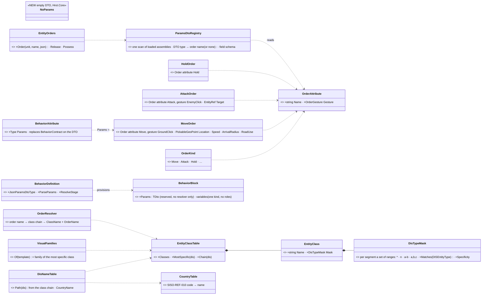
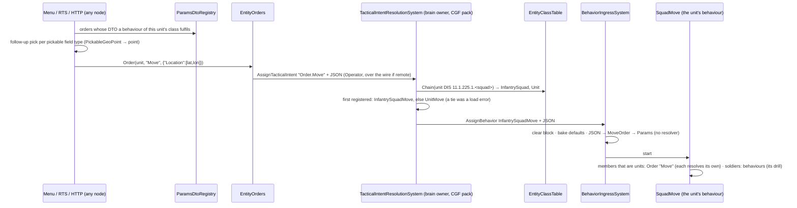
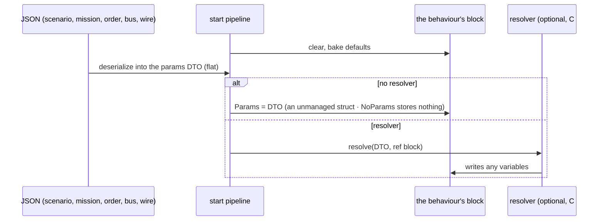
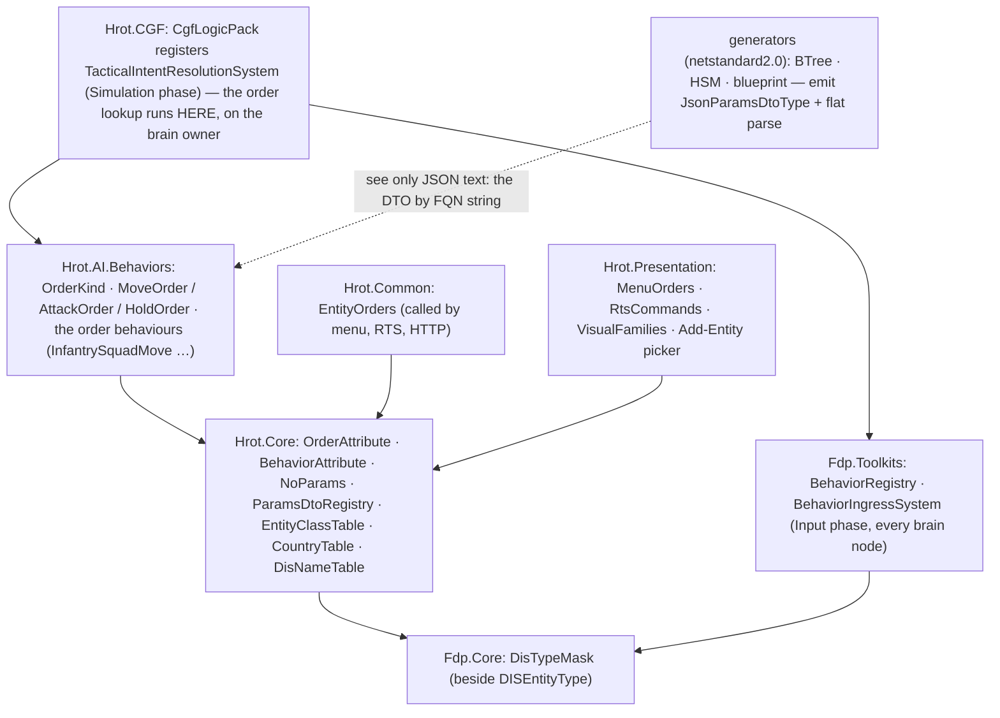
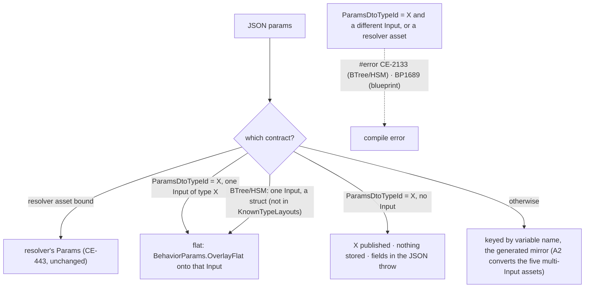
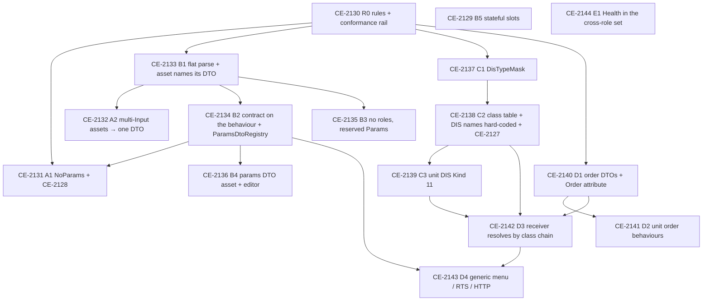

<!--STATUS
state: LIVE
updated: 2026-10-12
build-state: BUILDING — §5a records each task as built (CE-2130 ✅ · CE-2133 ✅ · CE-2140 ✅); §6 is the build plan
current-answer: §1 the rules every behaviour follows · §2 classes · §3 sequences · §4 modules · §5 what changes, file by file · §5a AS BUILT · §6 THE TASK LIST (ids, order, dependencies, acceptance)
stale-below: nothing
known-rot: none
known-conflict: docs/blueprints/DESIGN_Parameter_Model.md §P.7 (a resolver asset's authored shape = its Parameters) and §1 (Role Input/State) are superseded HERE by R-276/R-277 (one params DTO, no roles); that doc is updated when B3 builds, not before. docs/DESIGN_Entity_Control.md §3.1/§10 (EntityOrders names soldier behaviours) is superseded by R-273; updated when D4 builds.
related-designs:
  - docs/blueprints/Architect_Question_90_Unit_Orders_Carry_Capacity.md — the QUESTION and its rulings R-273..R-281 (behaviors); every decision here is argued there (§2.3a–§2.3p)
  - docs/blueprints/DESIGN_Parameter_Model.md — OWNS the behaviour start pipeline (bake → overlay → resolve, §P.2); this design changes what the overlay targets (Params) and who names the DTO
  - docs/blueprints/Behavior_Parameter_Resolver_Detailed_Design.md — foresaw a shared named param-type (§3.1), which the order DTO is
  - docs/blueprints/Architect_Question_76_One_Blackboard_Block_Per_Primitive.md — OWNS one block per running behaviour (B, approved); this removes the Input/State roles inside it
  - docs/blueprints/EXPLAINER_Where_Parameters_And_State_Live.md — the measurement record of where params and state live today
  - docs/designs/tactical-intent/DESIGN.md — OWNS receiver-side resolution (TacticalIntentResolutionSystem); D3 adds the class-chain lookup to it
  - docs/DESIGN_Entity_Control.md — OWNS EntityOrders, the HTTP order route, the menu and the RTS tool; D4 makes them generic
  - docs/DESIGN_Map_3D_Mode.md — OWNS VisualFamilies (§3.5), which C2 grows into the class table
  - docs/DESIGN_Add_Entity_Picker.md — its D2b (DisNames.json) is superseded by R-280; C2 rebuilds the folder path from classes
  - docs/blueprints/DESIGN_Details_Panel_View_Switching.md — the asset-level Details view a params DTO / class view would join
  - docs/designs/group-maneuvers/DESIGN_Squad_Tactics.md — OWNS the squad drills D2 turns into order behaviours
  - docs/blueprints/HANDOFF_Orders_Track_B_Params_Internals.md — the dispatch for Track B
  - docs/blueprints/HANDOFF_Orders_Track_C_Classes_And_Dis.md — the dispatch for Track C
-->

# Orders, params DTOs and entity classes

The rulings are R-273 … R-281 (behaviors), argued in
[Architect_Question_90](blueprints/Architect_Question_90_Unit_Orders_Carry_Capacity.md). This document is what gets built.

## 0. INVENTORY *(2026-10-12; graph CLI + grep + six read-only sweeps; details and file:line in AQ90 §1, §2.3e, §2.3m)*

| what exists | where | role here |
|---|---|---|
| `TacticalIntentResolutionSystem` + `TacticalIntentMapperRegistry` (4 mappers) | `Hrot.CGF/Systems`, `Fdp.Toolkits/Behavior/TacticalOrderMapper` | the receiver-side resolver D3 extends |
| `EntityOrders` (Move / Attack / Hold / Behavior / Release / Possess) | `Hrot.Common/Orders/EntityOrders.cs` | becomes generic (D4) |
| `MenuOrders`, `RtsCommands`, `ContextMenuProjectorGizmo` | `Hrot.Presentation/ScenarioEditor/Map` | become generic (D4) |
| `BehaviorRegistry` / `BehaviorDefinition.JsonParamsDtoType` | `Fdp.Toolkits/Behavior` | the params DTO the behaviour names (B1/B2) |
| `[BehaviorContract(name, BehaviorCategory)]` (25 DTOs), `BehaviorCatalog`, `BehaviorSchemaDiscovery`, `IntentContractPaletteEntries` | `Hrot.Core`, `Hrot.Presentation`, `Hrot.Blueprints.Editor` | replaced by the behaviour-side attribute and one registry (B2) |
| generators: `BTreeBridgeEmitCore`, `HsmBridgeEmitCore`, blueprint `CSharpEmitter` / `InstanceEmitter` | `Hrot.AiEditor.Persistence/Emit`, `Hrot.Blueprints.Compiler` | parse flat into one DTO; drop roles (B1/B3) |
| `VisualFamilies.Of` (the one "what kind of thing is this type") | `Hrot.Presentation/Map3D/VisualFamily.cs` | grown into the class table (C2) |
| `DisNameTable` + `DisNames.json` | `Hrot.Core/Tkb` | rebuilt from the class table; JSON deleted (C2) |
| `DISEntityType`, `QueryBuilder.WithDisType` (value + byte mask) | `Fdp.Core` | `DisTypeMask` generalises it (C1) |
| the "type makes it pickable" pick (`EntityRef`, `PickableGeoPoint`) + `MapPickBroker` | `BehaviorUiCompiler`, `Hrot.Presentation/Facades` | the generic order menu's picks (D4) |
| `SquadManeuverRunner` + the squad drills | `Hrot.AI.Behaviors/Brains` | become order behaviours (D2) |

## 1. The rules every behaviour follows *(R-276, R-277, R-278)*

| # | rule | checked by |
|---|---|---|
| **P1** | a behaviour names **exactly one params DTO**; one that takes nothing names the shared empty `NoParams` | conformance rail (R0) |
| **P2** | the params JSON is that DTO's fields, **flat** — never wrapped in a variable name | conformance rail + per-tier round-trip rails (B1) |
| **P3** | several behaviours may share one params DTO; a DTO may be a class, **unless** it is stored (no resolver), then an unmanaged struct | load check (B2) |
| **P4** | **no resolver:** the JSON lands in the reserved block variable `Params`. **A resolver:** it receives the DTO and writes any block variables; there is no `Params` | ingress (B3) |
| **P5** | nothing carries over between behaviours; only a paused task gets its own block back | B5 rail |
| **O1** | an order is a behaviour whose params DTO carries `[Order]`; it is otherwise an ordinary behaviour (the debug API / MCP may still assign any behaviour by name) | — |
| **O2** | the behaviour fulfilling order K for an entity is `<Class><K>` for the entity's most specific matching class, then broader matching classes; a tie is a load error | load check (D3) |
| **O3** | the receiving unit decides how its members act; there is no mandated way | — |
| **K1** | an entity's class = the most specific **named DIS mask** in ONE hard-coded table, shared by the 3-D model, the 2-D symbol, the picker and the behaviours | rails (C2) |
| **K2** | units have their own DIS Kind: Category = arm, Subcategory = echelon, Specific = variant | rails (C3) |

## 2. Classes

*What the picture shows that prose hid: the order KIND is only an attribute on a DTO, and the CLASS is only a row in one table;
nothing new sits between a sender and a behaviour except the class lookup, and that same table answers every "what is this
entity" question in the UI.*

## 3. Sequences

### 3.1 An operator orders a squad to move

*What the picture shows that prose hid: the behaviour name first appears on the receiver's own node (`TIR`), read from the
receiver's own class, so neither the UI nor `EntityOrders` ever knows it.*

### 3.2 A behaviour starts: where the params land

## 4. Modules — who registers what, who calls it each frame

*What the picture shows that prose hid: `Hrot.Common` and `Hrot.Presentation` cannot see `Hrot.AI.Behaviors` (measured,
their `.csproj`), so they reach orders ONLY through `ParamsDtoRegistry` in `Hrot.Core`, which scans the loaded assemblies at
run time; the order lookup itself runs only where `CgfLogicPack` is registered — the brain owner.*

## 5. What changes, by area

| area | today | after |
|---|---|---|
| params contract | `[BehaviorContract]` on the DTO, one behaviour per DTO; a generated mirror of Input variables; nested JSON for one DTO-typed Input | `[Behavior(Params=…)]` on the behaviour (C#) or `ParamsDtoTypeId` on the asset; shared DTOs; flat JSON |
| blackboard | Input / State roles | one variable kind; reserved `Params` (no resolver only) |
| editor | Inputs / State sections; DTOs only in C# | one Variables section; a params DTO asset + generator + editor |
| behaviour filter per type | `BehaviorCategory` flags + a switch over 8 type ids | the class table (classes declared by the order behaviour's name, or by a class list on a non-order behaviour) |
| unit DIS type | `1.1.US` Category 0 — same as any land platform | Kind 11; arm / echelon / variant |
| display classification | `VisualFamilies` with a composite special case; picker names from `DisNames.json` | one hard-coded class table; picker path = class chain; no JSON |
| orders | `EntityOrders` maps Move / Attack / Hold to soldier behaviours; hard-coded menu entries | order DTOs in the AI assembly; generic `Order(name, json)`; menu from the registry; receiver resolves |

## 5a. As built *(updated per task)*

| task | as built | deviation from the design |
|---|---|---|
| **CE-2130** R0 ✅ 2026-10-12 | the rail lives in the params-contract feature suite, `Hrot.Editor.Tests/DebugApi/ABehaviourAdvertisesItsRealParametersTests` (T-1: the suite that already guards `GET /behaviors` publishing the authored DTO, CE-224/CE-235). It loads the PRODUCTION registry (`CgfBehaviorSetup.LoadFromAiAssembly`). Checks: **P1**, a behaviour names a params DTO (`JsonParamsDtoType != null`); **P2**, that DTO is not a generator's mirror of the behaviour's variables (a BTree asset's Inputs struct in `Hrot.AI.Behaviors.Trees`, or a blueprint behaviour's nested `*_Bp.Params`). `ParamsContractAllowList` holds the **48** violators measured at the first run; the rail fails on a NEW violator and on a STALE entry, so the list only shrinks. A second test registers a missing, a mirrored and a named DTO and proves the predicate catches the first two (a permanent red-proof). **Red-proved both ways:** `TakeCover` removed from the list ⇒ fails naming it as a new violator; a compliant `Idle` added ⇒ fails asking to remove it. Suite 10/10 | ⚠ the rule "a published contract ≠ the parsed type" (CE-2128 ①, `FollowRoute`) is **not** checkable by reflection: a curated resolver deserializes inside its body. It stays a manual item of CE-2131. CE-2128 ② (`PlatoonHillAttack`) IS caught: its generated mirror outranks its contract |
| **CE-2131** A1 🟡 2026-10-12 | `FollowRouteParamsJsonDto` gained `Speed` and `Loop`, so the published contract now lists every key callers write (rail `CE2131_FollowRouteAdvertisesTheKeysItsCallersWrite`) | ⚠ three parts moved: the `NoParams` switch needs a SHARED DTO, i.e. the contract on the behaviour (CE-2134); measured, today's empty DTOs already satisfy P1. `PlatoonHillAttack`'s contract is fixed by CE-2133 (the asset names its DTO). FollowRoute's route→trajectory conversion runs on the SENDING side (`MissionControlBehaviorParamsHelper`), filed as CE-2145 |
| **CE-2140** D1 ✅ 2026-10-12 | `OrderAttribute` (name string + `OrderGesture`) and `NoParams` in `Hrot.Core` (`MapDefinitions/Behavior/Orders`, `MapDefinitions/Behavior/NoParams.cs`); `OrderKind` + `MoveOrder` (`PickableGeoPoint Location`, `Speed`, `ArrivalRadius`, `RoadUse`; GroundClick) / `AttackOrder` (`EntityRef Target`; EnemyClick) / `HoldOrder` (empty) in `Hrot.AI.Behaviors/Orders`, each `[BlackboardDtoStruct]` so a variable can be typed with it before B3. Rail: `OrderVocabularyTests` (every `OrderKind` has exactly one `[Order]` DTO, every `[Order]` names a kind; order DTOs are structs) | the attribute takes `nameof(OrderKind.X)`, not the enum: `Hrot.Core` cannot see the AI assembly's enum |
| **CE-2133** B1 ✅ 2026-10-12 (backend) | a BTree/HSM with ONE struct Input parses flat; `ParamsDtoTypeId` on BTree/HSM/blueprint assets; details §5a.1 | ⚠ blueprints parse flat only when they NAME the DTO (§5a.1) |

### 5a.1 CE-2133 B1 in detail *(2026-10-12, backend lane)*

*What the picture shows that prose hid: there is still exactly one place the JSON lands per behaviour, and naming a DTO
never creates a second one; a name that cannot land is a compile error, and a DTO that is not stored refuses fields at run
time instead of dropping them.*

| piece | where |
|---|---|
| `ParamsDtoTypeId` (FQN string, written only when set) on `BehaviorTreeAssetDto`, `HsmAssetDto`, `BlueprintAsset` → `IrAsset`; the two editor models and mappers carry it | `Hrot.AiEditor.Persistence`, `Hrot.BTree.Editor`, `Hrot.Hsm.Editor`, `Hrot.Blueprints.Compiler` |
| flat-target rule `BTreeEmitCore.FlatParamsVariable`; `ParamsDtoTypeIdError`. A host binds a flat child with a variable of the child's DTO (what `TryGetHostedInputType` answers); ⛔ `InputsStructTypeId` stays the GENERATED mirror — it tells `GeneratedTypeCatalog` which struct an asset generates, and answering the DTO there made a host its own child's generator (a sizing cycle, caught by `HsmJsonGeneratorTests.S8c_*`) | `BTreeEmitCore.cs` |
| a flat behaviour's block types `In` as the DTO itself (`{Asset}_Block.In : ThreatCountParams`, same bytes as the one-field mirror), so CE-425's "block.In is the published contract" holds by construction (`AGeneratedBehaviourAdvertisesItsManifestTests`) | `BTreeEmitCore.EmitBlockStructs` |
| emitted parse: `BehaviorParams.OverlayFlat` (a sent key wins, an absent key keeps the baked default, unknown keys ignored, case-insensitive, malformed JSON throws); `BehaviorParams.RequireNoStoredFields` for a named DTO stored nowhere | `BehaviorParams.cs`, `BTreeBridgeEmitCore.cs` (BTree and HSM share it), `InstanceEmitter.cs` / `CSharpEmitter.cs` (blueprint) |
| `RootParamsAccess.InputBytes`: an EMPTY manifest means 0 Input bytes even when a contract type is published (the AQ90 §2.3m B trap, for a named DTO stored nowhere) | `RootParamsAccess.cs` |
| the two saved Sentry params strings rewritten flat | `scenarios/ua-danger-crossing{,-bp}/scenario.json` |

⚠ **Deviation — blueprints opt in by naming.** A blueprint with one struct Parameter does NOT turn flat by itself: the
blueprint compiler sees only type ids and cannot tell a struct from an enum, and an enum Parameter must stay keyed. It
parses flat when `ParamsDtoTypeId` names its one Parameter's type. (No shipped blueprint behaviour has a single struct
Parameter; AQ90 §2.3m.) BTree / HSM variables are offered only as primitives or DTO structs, so the struct test there is
"not a known scalar/vector".
⚠ **Not closed here:** a curated resolver on a generated asset (`PlatoonHillAttack`, `HullDownAttackRun`) still publishes the
asset's Input type, not the resolver's source DTO; that is CE-2128 (A1) / B2's `[Behavior(Params=…)]`. A named DTO on an asset
with NO variables at all has no `ParseParams`, so fields sent to it are not refused (B3's reserved `Params` closes this).

## 6. ⭐ THE TASK LIST — the build plan

Tracker ids are from the behaviors block. ⛔ Each task: extend the UML here first if it deviates, red-prove its rails, fold the
as-built back into this document. "Lane" is a lean; any session may take a task whose dependencies are met.

| id | task | depends | lane (lean) | acceptance |
|---|---|---|---|---|
| **CE-2130** R0 | the authoring rules (§1 P1–P2, O2 naming) as a **conformance rail** over every registered behaviour (curated, BTree, HSM, blueprint): one params DTO; no multi-Input asset; no `[BehaviorContract]` contract ≠ parsed type. Today's violators listed in an **allow-list that may only shrink** | — | behaviors | rail green with the allow-list; a new violating behaviour turns it red (red-proved) |
| **CE-2131** A1 | ⚠ *(amended 2026-10-12: the NoParams part waits for CE-2134)* the six empty DTOs (`Idle`, `Ambush`, `InfantryCombat`, `ConvoyEscort`, `JoinFormation`, `WanderMilitary`) → `NoParams`; fix the two wrong contracts (CE-2128: `FollowRoute`, `PlatoonHillAttack`) | R0, CE-2134 (NoParams) | behaviors | their allow-list entries removed; `GET /behaviors` publishes what each parses |
| **CE-2132** A2 | `FiringPosition`, `Flank`, `BasicInfantrySop`, `BasicSquadSop`, `DangerCrossing` → one Input of one C# DTO; the 3 scenario params strings rewritten flat | B1 | behaviors | each feature's rails; live `ua-danger-crossing` |
| **CE-2133** B1 | a single struct-typed Input parses FLAT; an asset may name its params DTO (`ParamsDtoTypeId`, FQN string; the generator emits `typeof(global::X)` + `Deserialize<global::X>`); BTree, HSM, blueprint | R0 | Track B | per-tier round-trip rails; generator goldens show only the intended diff |
| **CE-2134** B2 | `[Behavior(Params = …)]` on the behaviour replaces `[BehaviorContract]` on the DTO; `ParamsDtoRegistry` (one scan of loaded assemblies; order DTOs carry their order name); the blueprint palette de-duplicated by DTO type; load check P3 | B1 | Track B | `BehaviorSchemaDiscovery` / `BehaviorCatalog` consumers moved; CE-2128 cannot recur |
| **CE-2135** B3 | drop Input / State: one variable kind, reserved `Params` (no resolver only), `NoParams` stores nothing (fix the `InputBytes`=1 vs 0 trap); editor sections merged; Parameter Model §1 / §P.7 updated | B1 | Track B | AQ76 rails; hosted-child rails; the size pre-check still skips unsizable types |
| **CE-2136** B4 | `*.params.json` asset + build-time generator + editor (variables-panel rows, an order-name field); appears in `ParamsDtoRegistry` | B2 | Track B | a generated DTO used by a behaviour end to end |
| **CE-2129** B5 | stateful slots salted by behaviour and detached on every change except a paused task's | — | Track B | A(slots) → B(none) → C(same key) starts clean |
| **CE-2137** C1 | `DisTypeMask` in `Fdp.Core`: parse (`*`, `n`, `a-b`, `a,b,c`), `Matches`, `Specificity` (segment by segment from Kind: exact > list/range > `*`) | R0 | Track C | parse / match / specificity rails |
| **CE-2138** C2 | the hard-coded `EntityClassTable` grown from `VisualFamilies` + `CountryTable`; `VisualFamilies.Of` and `DisNameTable` built from it; `DisNames.json` deleted; picker path = class chain; CE-2127 fixed | C1 | Track C | a golden: every built-in type keeps its 3-D family and picker folder; no two classes share a name or mask |
| **CE-2139** C3 | units: Kind 11, Category = arm, Subcategory = echelon (the `TkbCompositionDef.Echelon` string becomes the code); composite special cases → DIS; scenario load prefers the template's DIS type; CE-1017 rail updated | C2 | Track C | a unit is in its own class; no tank mask matches a unit |
| **CE-2140** D1 | `OrderKind`, `MoveOrder` / `AttackOrder` / `HoldOrder` with `[Order(name, gesture)]` in `Hrot.AI.Behaviors`; `OrderAttribute` + `NoParams` in `Hrot.Core` | R0 | behaviors | — |
| **CE-2141** D2 | `InfantrySquadMove` (today's `SquadMarch`), `InfantrySquadHold`, the squad attack drill, each taking the order DTO; a drill that ends releases its members; a member that is a unit receives an order | D1 | behaviors | `tt-squad-march`, `tt-react-contact` live |
| **CE-2142** D3 | `TacticalIntentResolutionSystem` resolves `Order.<name>` through the class chain (O2), tie = load error; no soldier fallback for a body-less unit | C2, C3, D1 | behaviors | an M1 and a T-72 resolve the same; a squad resolves its own |
| **CE-2143** D4 | `EntityOrders.Order(unit, name, json)`; HTTP `order {kind, params}`; menu + RTS generic over `ParamsDtoRegistry`; picks from field types via `MapPickBroker`; `Possess` hidden on a unit | D3, B2 | behaviors | the menu lists exactly the orders the unit's class fulfils |
| **CE-2144** E1 | `HealthApplicationSystem` into the cross-role infrastructure on every host (R-275) | — | any | a passenger owned on a non-CGF node dies there |

⛔ Out of this programme (decided, built later): carry capacity and seats per vehicle type, and the human-carrier profile
(R-274). Embarkation itself is NOT deferred (R-282) and may run in parallel, following §1's rules.
