<!--STATUS
state: LIVE
updated: 2026-10-12
build-state: BUILDING — §5a records each task as built (CE-2130, CE-2133, CE-2134, CE-2140, CE-2141, CE-2137, CE-2138, CE-2139 ✅); §6 is the build plan
current-answer: §1 the rules every behaviour follows · §2 classes · §3 sequences · §4 modules · §5 what changes, file by file · §5a AS BUILT · §6 THE TASK LIST (ids, order, dependencies, acceptance) · §7 D2 (CE-2141) the unit order behaviours and the member release
stale-below: nothing
known-rot: none
known-conflict: docs/blueprints/DESIGN_Parameter_Model.md §P.7 (a resolver asset's authored shape = its Parameters) and §1 (Role Input/State) are superseded HERE by R-276/R-277 (one params DTO, no roles); that doc is updated when B3 builds, not before. docs/DESIGN_Entity_Control.md §3.1/§10 (EntityOrders names soldier behaviours) is superseded by R-273; updated when D4 builds.
related-designs:
  - docs/blueprints/DESIGN_Behaviour_Fault_And_Teardown.md — OWNS the run-end release step (D4) that §7 hangs the members' release on (D4′)
  - docs/DESIGN_Decision_Layer.md — OWNS the gate (§4.1) the named clear of §7 is weighed by
  - docs/blueprints/Architect_Question_90_Unit_Orders_Carry_Capacity.md — the QUESTION and its rulings R-273..R-281 (behaviors); every decision here is argued there (§2.3a–§2.3p)
  - docs/blueprints/DESIGN_Parameter_Model.md — OWNS the behaviour start pipeline (bake → overlay → resolve, §P.2); this design changes what the overlay targets (Params) and who names the DTO
  - docs/blueprints/Behavior_Parameter_Resolver_Detailed_Design.md — foresaw a shared named param-type (§3.1), which the order DTO is
  - docs/blueprints/Architect_Question_76_One_Blackboard_Block_Per_Primitive.md — OWNS one block per running behaviour (B, approved); this removes the Input/State roles inside it
  - docs/blueprints/EXPLAINER_Where_Parameters_And_State_Live.md — the measurement record of where params and state live today
  - docs/designs/tactical-intent/DESIGN.md — OWNS receiver-side resolution (TacticalIntentResolutionSystem); D3 adds the class-chain lookup to it
  - docs/DESIGN_Entity_Control.md — OWNS EntityOrders, the HTTP order route, the menu and the RTS tool; D4 makes them generic
  - docs/DESIGN_Map_3D_Mode.md — OWNS VisualFamilies (§3.5), which C2 grows into the class table
  - docs/DESIGN_Add_Entity_Picker.md — its D2b (DisNames.json) is superseded by R-280; C2 rebuilds the folder path from classes
  - docs/blueprints/DESIGN_Details_Panel_View_Switching.md — the asset-level Details view a params DTO / class view would join
  - docs/designs/group-maneuvers/DESIGN_Squad_Tactics.md — OWNS the squad drills D2 turns into order behaviours
  - docs/blueprints/HANDOFF_Orders_Track_B_Params_Internals.md — the dispatch for Track B
  - docs/blueprints/HANDOFF_Orders_Track_C_Classes_And_Dis.md — the dispatch for Track C
-->

# Orders, params DTOs and entity classes

The rulings are R-273 … R-281 (behaviors), argued in
[Architect_Question_90](blueprints/Architect_Question_90_Unit_Orders_Carry_Capacity.md). This document is what gets built.

## 0. INVENTORY *(2026-10-12; graph CLI + grep + six read-only sweeps; details and file:line in AQ90 §1, §2.3e, §2.3m)*

| what exists | where | role here |
|---|---|---|
| `TacticalIntentResolutionSystem` + `TacticalIntentMapperRegistry` (4 mappers) | `Hrot.CGF/Systems`, `Fdp.Toolkits/Behavior/TacticalOrderMapper` | the receiver-side resolver D3 extends |
| `EntityOrders` (Move / Attack / Hold / Behavior / Release / Possess) | `Hrot.Common/Orders/EntityOrders.cs` | becomes generic (D4) |
| `MenuOrders`, `RtsCommands`, `ContextMenuProjectorGizmo` | `Hrot.Presentation/ScenarioEditor/Map` | become generic (D4) |
| `BehaviorRegistry` / `BehaviorDefinition.JsonParamsDtoType` | `Fdp.Toolkits/Behavior` | the params DTO the behaviour names (B1/B2) |
| `[BehaviorContract(name, BehaviorCategory)]` (25 DTOs), `BehaviorCatalog`, `BehaviorSchemaDiscovery`, `IntentContractPaletteEntries` | `Hrot.Core`, `Hrot.Presentation`, `Hrot.Blueprints.Editor` | replaced by the behaviour-side attribute and one registry (B2) |
| generators: `BTreeBridgeEmitCore`, `HsmBridgeEmitCore`, blueprint `CSharpEmitter` / `InstanceEmitter` | `Hrot.AiEditor.Persistence/Emit`, `Hrot.Blueprints.Compiler` | parse flat into one DTO; drop roles (B1/B3) |
| `VisualFamilies.Of` (the one "what kind of thing is this type") | `Hrot.Presentation/Map3D/VisualFamily.cs` | grown into the class table (C2) |
| `DisNameTable` + `DisNames.json` | `Hrot.Core/Tkb` | rebuilt from the class table; JSON deleted (C2) |
| `DISEntityType`, `QueryBuilder.WithDisType` (value + byte mask) | `Fdp.Core` | `DisTypeMask` generalises it (C1) |
| the "type makes it pickable" pick (`EntityRef`, `PickableGeoPoint`) + `MapPickBroker` | `BehaviorUiCompiler`, `Hrot.Presentation/Facades` | the generic order menu's picks (D4) |
| `SquadManeuverRunner` + the squad drills | `Hrot.AI.Behaviors/Brains` | become order behaviours (D2) |

## 1. The rules every behaviour follows *(R-276, R-277, R-278)*

| # | rule | checked by |
|---|---|---|
| **P1** | a behaviour names **exactly one params DTO**; one that takes nothing names the shared empty `NoParams` | conformance rail (R0) |
| **P2** | the params JSON is that DTO's fields, **flat** — never wrapped in a variable name | conformance rail + per-tier round-trip rails (B1) |
| **P3** | several behaviours may share one params DTO; a DTO may be a class, **unless** it is stored (no resolver), then an unmanaged struct | load check (B2) |
| **P4** | **no resolver:** the JSON lands in the reserved block variable `Params`. **A resolver:** it receives the DTO and writes any block variables; there is no `Params` | ingress (B3) |
| **P5** | nothing carries over between behaviours; only a paused task gets its own block back | B5 rail |
| **O1** | an order is a behaviour whose params DTO carries `[Order]`; it is otherwise an ordinary behaviour (the debug API / MCP may still assign any behaviour by name) | — |
| **O2** | the behaviour fulfilling order K for an entity is `<Class><K>` for the entity's most specific matching class, then broader matching classes; a tie is a load error | load check (D3) |
| **O3** | the receiving unit decides how its members act; there is no mandated way | — |
| **K1** | an entity's class = the most specific **named DIS mask** in ONE hard-coded table, shared by the 3-D model, the 2-D symbol, the picker and the behaviours | rails (C2) |
| **K2** | units have their own DIS Kind: Category = arm, Subcategory = echelon, Specific = variant | rails (C3) |

## 2. Classes

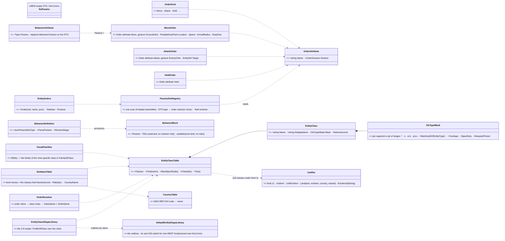

*What the picture shows that prose hid: the order KIND is only an attribute on a DTO, and the CLASS is only a row in one table;
nothing new sits between a sender and a behaviour except the class lookup, and that same table answers every "what is this
entity" question in the UI.*

## 3. Sequences

### 3.1 An operator orders a squad to move

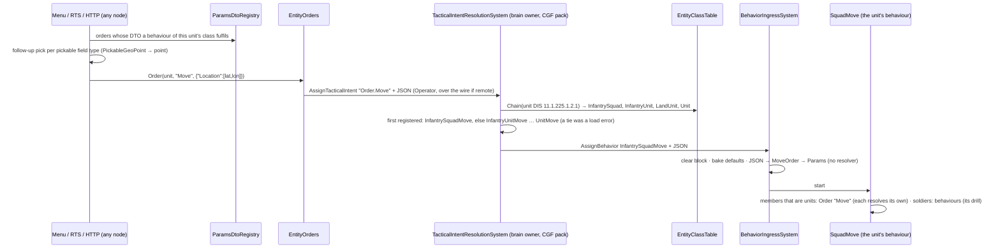

*What the picture shows that prose hid: the behaviour name first appears on the receiver's own node (`TIR`), read from the
receiver's own class, so neither the UI nor `EntityOrders` ever knows it.*

### 3.2 A behaviour starts: where the params land

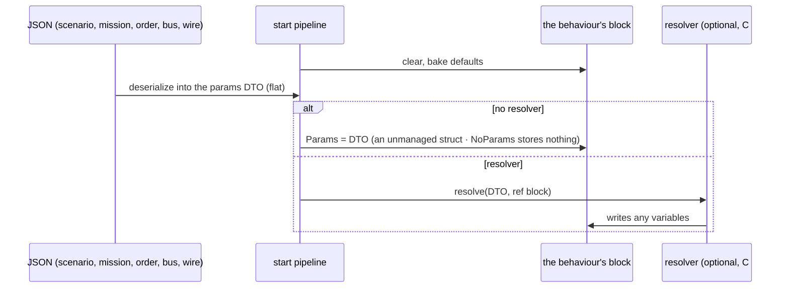

## 4. Modules — who registers what, who calls it each frame

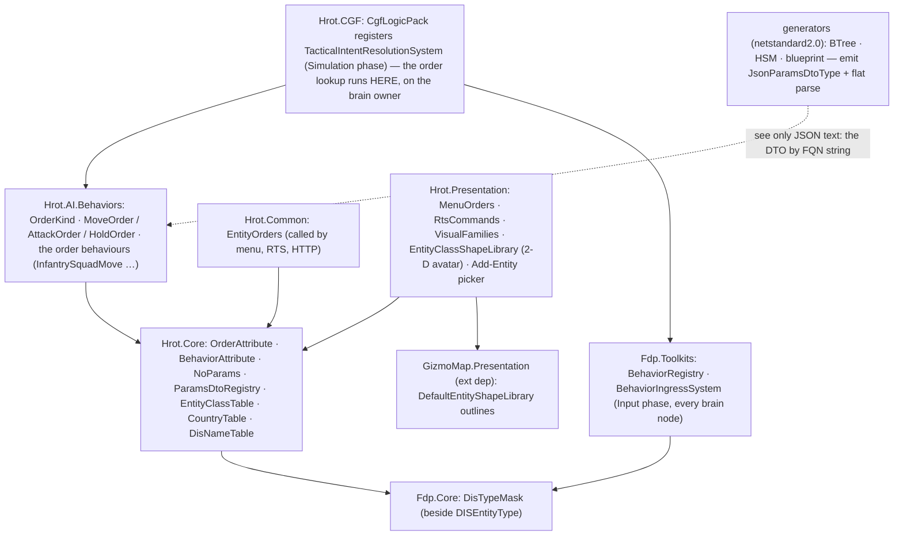

*What the picture shows that prose hid: `Hrot.Common` and `Hrot.Presentation` cannot see `Hrot.AI.Behaviors` (measured,
their `.csproj`), so they reach orders ONLY through `ParamsDtoRegistry` in `Hrot.Core`, which scans the loaded assemblies at
run time; the order lookup itself runs only where `CgfLogicPack` is registered — the brain owner. `GizmoMap` (an external
dependency) cannot see `Hrot.Core` either, so the 2-D avatar is CHOSEN in `Hrot.Presentation` from the class table and only the
outlines are GizmoMap's (CE-2138).*

## 5. What changes, by area

| area | today | after |
|---|---|---|
| params contract | `[BehaviorContract]` on the DTO, one behaviour per DTO; a generated mirror of Input variables; nested JSON for one DTO-typed Input | `[Behavior(Params=…)]` on the behaviour (C#) or `ParamsDtoTypeId` on the asset; shared DTOs; flat JSON |
| blackboard | Input / State roles | one variable kind; reserved `Params` (no resolver only) |
| editor | Inputs / State sections; DTOs only in C# | one Variables section; a params DTO asset + generator + editor |
| behaviour filter per type | `BehaviorCategory` flags + a switch over 8 type ids | the class table (classes declared by the order behaviour's name, or by a class list on a non-order behaviour) |
| unit DIS type | `1.1.US` Category 0 — same as any land platform | Kind 11; arm / echelon / variant |
| display classification | `VisualFamilies` with a composite special case; picker names from `DisNames.json` | one hard-coded class table; picker path = class chain; no JSON |
| orders | `EntityOrders` maps Move / Attack / Hold to soldier behaviours; hard-coded menu entries | order DTOs in the AI assembly; generic `Order(name, json)`; menu from the registry; receiver resolves |

## 5a. As built *(updated per task)*

| task | as built | deviation from the design |
|---|---|---|
| **CE-2130** R0 ✅ 2026-10-12 | the rail lives in the params-contract feature suite, `Hrot.Editor.Tests/DebugApi/ABehaviourAdvertisesItsRealParametersTests` (T-1: the suite that already guards `GET /behaviors` publishing the authored DTO, CE-224/CE-235). It loads the PRODUCTION registry (`CgfBehaviorSetup.LoadFromAiAssembly`). Checks: **P1**, a behaviour names a params DTO (`JsonParamsDtoType != null`); **P2**, that DTO is not a generator's mirror of the behaviour's variables (a BTree asset's Inputs struct in `Hrot.AI.Behaviors.Trees`, or a blueprint behaviour's nested `*_Bp.Params`). `ParamsContractAllowList` holds the **48** violators measured at the first run; the rail fails on a NEW violator and on a STALE entry, so the list only shrinks. A second test registers a missing, a mirrored and a named DTO and proves the predicate catches the first two (a permanent red-proof). **Red-proved both ways:** `TakeCover` removed from the list ⇒ fails naming it as a new violator; a compliant `Idle` added ⇒ fails asking to remove it. Suite 10/10 | ⚠ the rule "a published contract ≠ the parsed type" (CE-2128 ①, `FollowRoute`) is **not** checkable by reflection: a curated resolver deserializes inside its body. It stays a manual item of CE-2131. CE-2128 ② (`PlatoonHillAttack`) IS caught: its generated mirror outranks its contract |
| **CE-2131** A1 🟡 2026-10-12 | `FollowRouteParamsJsonDto` gained `Speed` and `Loop`, so the published contract now lists every key callers write (rail `CE2131_FollowRouteAdvertisesTheKeysItsCallersWrite`) | ⚠ three parts moved: the `NoParams` switch needs a SHARED DTO, i.e. the contract on the behaviour (CE-2134); measured, today's empty DTOs already satisfy P1. `PlatoonHillAttack`'s contract is fixed by CE-2133 (the asset names its DTO). FollowRoute's route→trajectory conversion runs on the SENDING side (`MissionControlBehaviorParamsHelper`), filed as CE-2145 |
| **CE-2141** D2 ✅ 2026-10-12 | per §7. `InfantrySquadMove` / `InfantrySquadHold` / `InfantrySquadAttack` (`Brains/SquadOrderBehaviors.cs`) over the existing plays; `SuppressAndManeuverParams.TargetId` (named target, D2-G); `OrderGeo` (lat/lon ↔ local); the runner's `Hold`/`Move` take the commander, record each order (`SubordinateOrders`, new, id 276) and send a UNIT member `Order.Hold` / `Order.Move` (`OrderAttribute.IntentPrefix`); `BehaviorOwnedParts.Release` releases a run's orders; `ClearBehaviorEvent.OnlyBehaviorHash` + the ingress's named clear (D2-C, folded into Decision Layer §4.1's table); TIR drops a superseded clear and names the hash (D2-D). Rails: `SquadManeuverTests.CE2141_*` (7), `SopSlotTests.CE2141_*` (3), `TacticalIntentResolutionSystemTests.CE2141_*` (2), the registrar names, the CE-2130 rail (the three comply) | ⚠ one gap the design did not see: a curated behaviour's params DTO reaches the registry ONLY through a `[BehaviorContract]` in `Hrot.Core` (`BehaviorSchemaDiscovery`), which a shared order DTO cannot carry — the CE-2130 rail caught all three. Bridged in `CuratedBehaviorGenerator`: a typed resolver whose DTO carries `[Order]` also emits `RegisterJsonParamsDtoType` (no other behaviour changes); CE-2134 (B2) generalises it. ⚠ Not built here: the mission editor's per-type list (`BehaviorCatalog`) still cannot list them (§7.0) |
| **CE-2140** D1 ✅ 2026-10-12 | `OrderAttribute` (name string + `OrderGesture`) and `NoParams` in `Hrot.Core` (`MapDefinitions/Behavior/Orders`, `MapDefinitions/Behavior/NoParams.cs`); `OrderKind` + `MoveOrder` (`PickableGeoPoint Location`, `Speed`, `ArrivalRadius`, `RoadUse`; GroundClick) / `AttackOrder` (`EntityRef Target`; EnemyClick) / `HoldOrder` (empty) in `Hrot.AI.Behaviors/Orders`, each `[BlackboardDtoStruct]` so a variable can be typed with it before B3. Rail: `OrderVocabularyTests` (every `OrderKind` has exactly one `[Order]` DTO, every `[Order]` names a kind; order DTOs are structs) | the attribute takes `nameof(OrderKind.X)`, not the enum: `Hrot.Core` cannot see the AI assembly's enum |
| **CE-2137** C1 ✅ 2026-10-12 (ui) | `FDP/Engine/Fdp.Core/DisTypeMask.cs`: an immutable class; per segment `null` = `*` or sorted, MERGED ranges (`1,2,6,7` → `1-2,6-7`), so equal masks have one text and `Equals` compares it. Missing trailing segments are `*` (unlike `DISEntityType.TryParse`, where they are 0). `Specificity` = 2 bits per segment (Any 0 · Set 1 · Exact 2), Kind most significant, so an int compare is the §1 rule. Also `Overlaps` (some type matches both — the tie test) and `DeepestPinned`. Rail `DisTypeMaskTests` (Fdp.Core.Tests, 5 tests + theory rows) | none. `QueryBuilder.WithDisType` untouched |
| **CE-2138** C2 ✅ 2026-10-12 (ui) | `Hrot.Core/Tkb/EntityClassTable.cs`: `EntityClass(Name, DisplayName, Mask)`, the table (53 classes: kinds, domains, categories as DisNames.json held them, plus the grouping classes `Armor`, `WheeledUtility`, `Helicopter`, `Jet`, `CargoPlane` that were `VisualFamilies`' switches), `CountryTable` (the five codes). `DisNameTable` names exactly the classes that pin one level (`NamesALevel`); `VisualFamilies.Of(dis)` and the new `EntityClassShapeLibrary` (2-D avatar, wired in `MapInteractionPack.BuildRenderLayer`) walk the chain from the most specific class to the first one in their own small map (`FamilyOfClass`, `ProfileOfClass`). `DisNames.json` + `EmbeddedResource` deleted. **Golden:** `EntityTypeCatalogTests.CE2138_*` (25 built-in types: family, folder, icon; 52 names) taken on the pre-C2 code (commit `79a0f8bf8`) and unchanged after; sweeps over the DIS space for the family (`Map3DTests.CE2138_TheClassTable_KeepsEveryFamily_…`, vs the old switch) and the avatar (vs GizmoMap's fixed switch). Table rails: `EntityClassTableTests` (no ties, duplicate refused, every built-in type named, chain order). **CE-2127** fixed in the same commit | ⚠ **the picker path is NOT the whole chain**: it is the chain filtered to the classes that name ONE level (an exact Kind / Domain / Category), with the country between Domain and Category. The whole chain would insert grouping classes (`Armor`, `Helicopter`) as folders and move every built-in type's folder, which §3 of the handoff forbids. ⚠ the **class name ≠ the display name** (`Person` reads "Life Form", `Afv` reads "Armored Fighting Vehicle"): names are identifiers for `<Class><Order>`, display names are what the picker always showed. ⚠ `VisualFamilies.IsSoldier` (rifle on the figure) still reads Kind 3 / Category 1 directly — not a classification surface the table was asked to own. ⚠ GizmoMap keeps its own DIS switch for non-HROT hosts (it cannot see `Hrot.Core`); every HROT host passes `EntityClassShapeLibrary`. 🔴 Found: GizmoMap's `BuildRotaryWing` returned the fixed-wing outline under the fixed-wing name, so no helicopter could ever draw as one; it now has its own outline |
| **CE-2139** C3 ✅ 2026-10-12 (ui) | `Hrot.Core/Tkb/UnitDis.cs`: `Kind = 11`, `UnitArm` (Infantry 1 · Armor 2 · MechanizedInfantry 3 · Artillery 4 · Reconnaissance 5), `UnitEchelon` (the MIL-STD-2525 order: Team 1 · Squad 2 · Section 3 · Platoon 4 · Company 5 · Battalion 6 · Regiment 7 · Brigade 8 · Division 9), `Land(arm, echelon, country, variant)`, `EchelonOf(string)` (throws on an unknown name). `NedTkbBuilder.AsLandUnit(type, arm, country, variant)` reads the echelon from the template's `TkbCompositionDef.Echelon`, so the string stays the ONE source. Built-in units: Tank Platoon `11.1.225.2.4.1`, its auto-spawn variant `…2.4.2`, Infantry Squad `11.1.225.1.2.1`. Classes added: `Unit` ("Units") · `LandUnit` · five arm classes · `InfantrySquad` · `TankPlatoon`. Both composite special cases are gone (`VisualFamilies.Of` = `Of(dis)`, `FamilyOfClass["Unit"]`; `EntityTypeCatalog.CategoryOf` has no branch). Picker folder `Units/United States` → `Units/Land/United States/<arm>` (ExCon's ORBAT still keys on the `Units` prefix; railed). Map layers: a unit stays in `units_ground`, leaves `vehicles`; 2-D avatar: none. **The load rule** lives in `CreateEntityRequestSystem.UnitTakesItsTemplatesDisType`: a composite always spawns with its template's DIS type. Rails: `EntityClassTableTests.CE2139_*` (Hrot.Core.Tests), `BdcTkbBuilderVisualTests.CE1017_*` (composite ⇔ unit Kind), `Map3DTests.CE2139_*`, `EntityTypeCatalogTests` (the golden moved on exactly the 3 unit lines + 7 Kind-11 names), `CreateEntityRequestSystemTests.CE2139_*` (SimHost.Tests) | ⚠ **the load rule is NOT in `DisEntityTypeTranslator` / `StagingEntityExtractor`** (the handoff's pointers): translators inject BEFORE the auto-serializer adds `TkbIdentity` (`ScenarioSerializer.cs:458-484`), so the translator cannot tell a composite, and the extractor holds no TKB. `CreateEntityRequestSystem` is the one funnel every creation path passes that holds the TKB, and it already special-cases composites (child spawn). ⚠ a composite whose TKB still carries a PLATFORM DIS type (a user TKB file written before C3) now draws as its DIS says (unknown box) — no such file is checked in. ⚠ arm and echelon codes are HROT's (no SISO aggregate table in the repo) |
| **CE-2133** B1 ✅ 2026-10-12 (backend) | a BTree/HSM with ONE struct Input parses flat; `ParamsDtoTypeId` on BTree/HSM/blueprint assets; details §5a.1 | ⚠ blueprints parse flat only when they NAME the DTO (§5a.1) |
| **CE-2134** B2 ✅ 2026-10-12 (backend) | `[Behavior(name, Params, Categories)]` + `ParamsDtoRegistry` in `Hrot.Core`; 25 declarations moved off the DTOs (placement and classes/sequences/modules in §5b); `[BehaviorContract]` and `BehaviorTestHelper` deleted; readers moved: `BehaviorSchemaDiscovery`, `BehaviorCatalog` (now per host), the blueprint palette (To/From JSON once per DTO type); a declaration OUTRANKS a generated contract (PlatoonHillAttack publishes `PlatoonHillAttackParamsJsonDto`, CE-2128 ②); curated generator BEH002/BEH003; `RootParamsAccess.InputBytes` reads the block's `In`. Rails: `ParamsDtoRegistryTests` ×5, `ABehaviourAdvertisesItsRealParametersTests.CE2134_*` ×2, `CuratedBehaviorGeneratorResolverShapeTests.CE2134_*` ×2, `CE472_IntentAndJsonNodeTests.Palette_ListsASharedDtosJsonRowsOnce` | ⚠ JoinFormation now declares `CgfNodes.JoinFormationParams` (what its identity parse fills; BEH003), and the empty `JoinFormationParamsJsonDto` is deleted. ⚠ The example behaviours (Ambush, InfantryCombat, ConvoyEscort) are declared in `Hrot.Editor` (`[assembly: Behavior]`), so CGF / ExCon no longer offer them. ⚠ ExCon gained a ProjectReference to `Hrot.AI.Behaviors` (catalogue only). ⚠ Found in the build: the editor loads the AI assembly twice (hot reload) — the scan takes the LAST instance of each assembly name |

### 5a.1 CE-2133 B1 in detail *(2026-10-12, backend lane)*

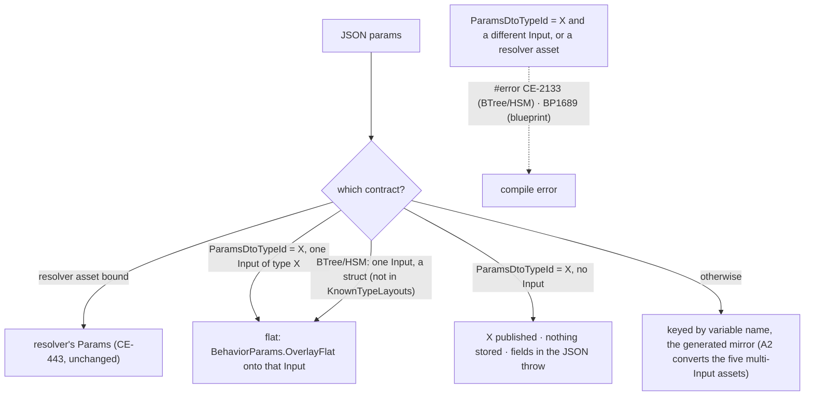

*What the picture shows that prose hid: there is still exactly one place the JSON lands per behaviour, and naming a DTO
never creates a second one; a name that cannot land is a compile error, and a DTO that is not stored refuses fields at run
time instead of dropping them.*

| piece | where |
|---|---|
| `ParamsDtoTypeId` (FQN string, written only when set) on `BehaviorTreeAssetDto`, `HsmAssetDto`, `BlueprintAsset` → `IrAsset`; the two editor models and mappers carry it | `Hrot.AiEditor.Persistence`, `Hrot.BTree.Editor`, `Hrot.Hsm.Editor`, `Hrot.Blueprints.Compiler` |
| flat-target rule `BTreeEmitCore.FlatParamsVariable`; `ParamsDtoTypeIdError`. A host binds a flat child with a variable of the child's DTO (what `TryGetHostedInputType` answers); ⛔ `InputsStructTypeId` stays the GENERATED mirror — it tells `GeneratedTypeCatalog` which struct an asset generates, and answering the DTO there made a host its own child's generator (a sizing cycle, caught by `HsmJsonGeneratorTests.S8c_*`) | `BTreeEmitCore.cs` |
| a flat behaviour's block types `In` as the DTO itself (`{Asset}_Block.In : ThreatCountParams`, same bytes as the one-field mirror), so CE-425's "block.In is the published contract" holds by construction (`AGeneratedBehaviourAdvertisesItsManifestTests`) | `BTreeEmitCore.EmitBlockStructs` |
| emitted parse: `BehaviorParams.OverlayFlat` (a sent key wins, an absent key keeps the baked default, unknown keys ignored, case-insensitive, malformed JSON throws); `BehaviorParams.RequireNoStoredFields` for a named DTO stored nowhere | `BehaviorParams.cs`, `BTreeBridgeEmitCore.cs` (BTree and HSM share it), `InstanceEmitter.cs` / `CSharpEmitter.cs` (blueprint) |
| `RootParamsAccess.InputBytes`: an EMPTY manifest means 0 Input bytes even when a contract type is published (the AQ90 §2.3m B trap, for a named DTO stored nowhere) | `RootParamsAccess.cs` |
| the two saved Sentry params strings rewritten flat | `scenarios/ua-danger-crossing{,-bp}/scenario.json` |

⚠ **Deviation — blueprints opt in by naming.** A blueprint with one struct Parameter does NOT turn flat by itself: the
blueprint compiler sees only type ids and cannot tell a struct from an enum, and an enum Parameter must stay keyed. It
parses flat when `ParamsDtoTypeId` names its one Parameter's type. (No shipped blueprint behaviour has a single struct
Parameter; AQ90 §2.3m.) BTree / HSM variables are offered only as primitives or DTO structs, so the struct test there is
"not a known scalar/vector".
⚠ **Not closed here:** a curated resolver on a generated asset (`PlatoonHillAttack`, `HullDownAttackRun`) still publishes the
asset's Input type, not the resolver's source DTO; that is CE-2128 (A1) / B2's `[Behavior(Params=…)]`. A named DTO on an asset
with NO variables at all has no `ParseParams`, so fields sent to it are not refused (B3's reserved `Params` closes this).

## 5b. CE-2134 B2 — the contract on the behaviour *(2026-10-12, backend lane; BUILT — as-built row in §5a)*

**INVENTORY** *(graph CLI index + grep + one read-only sweep; file:line in the task row)*: 25 `[BehaviorContract]` DTOs, all in
`Hrot.Core`; 4 readers — `BehaviorSchemaDiscovery` (UI registry, scenario remapper, `RegisterJsonParamsDtoType`;
Hrot.Core-only scan), `BehaviorCatalog` (per-category picker lists; Hrot.Core-only scan; 3 callers incl. ExCon),
`ReflectionIntentContractProvider` (blueprint Send Intent / To / From JSON palette; AppDomain scan by attribute NAME),
`BehaviorTestHelper` (no callers). Where each behaviour is implemented: 18 curated topologies in `Hrot.AI.Behaviors`
(`[BTreeDefinition(Curated)]` / one `[HsmDefinition(Curated)]`), 15 of them with a TYPED resolver whose `TAuthored` IS the
DTO; `PlatoonHillAttack` = a JSON asset + a raw resolver; `DefendArea` / `HullDownAttack` = intent ids handled by mappers;
`ConvoyEscort` / `InfantryCombat` / `Ambush` = FDP examples the EDITOR registers (`EditorSubsystem.cs:1246`), nothing on CGF.
`Hrot.AI.Behaviors` → `Hrot.Core` (one way); standalone ExCon reaches neither the AI assembly nor CGF.

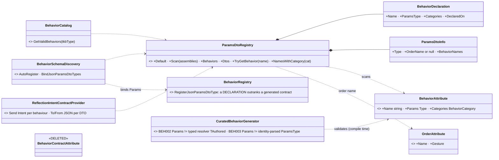

*What the picture shows that prose hid: the four readers stop owning a scan each — one registry is the only reflection over
the attribute, and the generator only CHECKS it; and the DTO no longer points anywhere, so one DTO can serve many behaviours.*

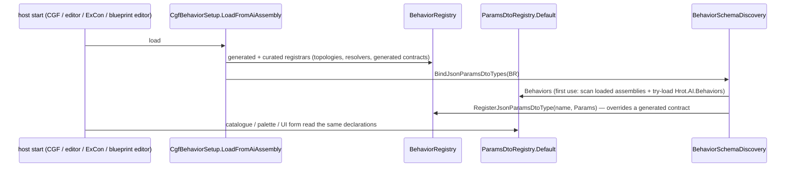

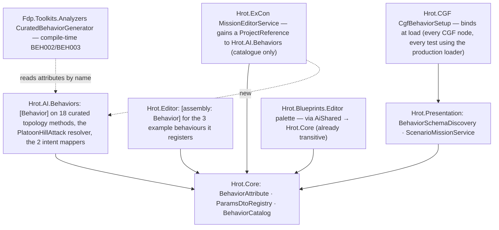

*What the module picture shows: the registry sees a declaration only if its assembly is LOADED — `Hrot.Core` cannot reference
the AI assembly (it would be a cycle), so the registry tries to load it by name, and standalone ExCon must ship it (the new
reference). The editor's example behaviours are declared in the editor, so CGF and ExCon stop listing behaviours they cannot run.*

| where `[Behavior]` goes | behaviours |
|---|---|
| the curated topology method (`[BTreeDefinition(Curated)]` / `[HsmDefinition(Curated)]`) | AdvanceTo, BoundingOverwatch, BreakContact, CombatPosture, DoorLocksmith, FireAtPoint, FireAtTarget, FollowRoute, HoldStance, Idle, JoinFormation, MoveToLocation, ReactToContact, SquadHold, SquadMarch, SuppressAndManeuver, TrackTarget, WanderMilitary, WindowDuel |
| the curated resolver method (the asset owns the topology) | PlatoonHillAttack (`PlatoonHillAttackParamsJsonDto`) |
| the tactical-intent mapper class (an intent id is fulfilled by its mapper) | DefendArea (`DefendAreaMapper`), HullDownAttack (`HullDownAttackMapper`) |
| `[assembly: Behavior]` in `Hrot.Editor`, beside the registration of the FDP examples | ConvoyEscort, InfantryCombat, Ambush |

| decision | why · rejected |
|---|---|
| a declaration OUTRANKS a generated contract in `BehaviorRegistry` | R-132 (curated outranks generated); it is what fixes CE-2128 ② for PlatoonHillAttack (its generated contract is the Input struct, its resolver parses the JSON DTO). ⛔ rejected: B1's `ParamsDtoTypeId` on the asset for this — a NAMED DTO there must be the Input's type (B1 rule), and the resolver is the code that knows what it parses |
| BEH002 / BEH003 are compile ERRORS in the curated generator | CE-2128 "cannot recur": a typed resolver states `TAuthored`, and a resolver-less topology parses its `ParamsType` by identity; both are visible at compile time. ⚠ a RAW resolver (FollowRoute, PlatoonHillAttack) deserializes inside its body and stays unverifiable. ⛔ rejected: a runtime-only check (it would fire on every host, after the build) |
| JoinFormation declares `CgfNodes.JoinFormationParams` | it is what the identity parse fills (BEH003); the empty `JoinFormationParamsJsonDto` was an anchor only and is deleted |
| P3 (stored ⇒ unmanaged struct) is enforced at generate time | BEH003 makes a resolver-less curated behaviour's Params its `ParamsType` (a struct by construction); B1 makes a generated asset's stored params its Input (a struct). ⇒ no runtime P3 check is needed |
| the registry refuses two declarations of one name, and a declaration with no `Params` | the load check: one producer per behaviour (R-132), P1 (a behaviour that takes nothing names `NoParams`) |

## 5c. CE-2135 B3 — no Input / State roles *(design 2026-10-12, backend lane; build-state: B3a BUILT, B3b open — the split APPROVED, R-3000)*

> 🔒 **User, 2026-10-12** (with the behaviors lane's steering): *"So approved, B3a now; A2 (CE-2132) converts straight to the B3a form after it lands"* ⇒ the order is **B3a (backend) → A2 / CE-2132 (behaviors, converts once, to the final form) → B3b (backend)**.

**INVENTORY** *(two read-only sweeps, 2026-10-12; graph CLI index + grep)*:
- **Code:** ~200 production lines read Role/Scope or the `In`/`St` split: persistence (10), BTree/HSM emitters + generators (~43),
  blueprint compiler `Parameter`/`Variable` (~45 lines / 20 files), runtime (5 + 4 structural), editors (~60: the AiShared
  variables panel's Role column and its "Inputs" / "Working State" sections, the BTree / HSM models, the blueprint MyBlueprint
  "Inputs" section), validators (~9). 43 test files (234 hits). ⭐ **No runtime code reads `Role`** — only the block layout.
- **Assets** (52 behaviours): class A no Input 20 · **B one struct Input 11** (shipped: Sentry, TakeCover, FallBack,
  HullDownAttackRun, PlatoonHillAttack) · C one scalar Input 4 (tests + HsmVariableShowcase) · **D several Inputs 17**
  (shipped BTree: BasicInfantrySop, BasicSquadSop, DangerCrossing, FiringPosition, Flank = A2 CE-2132, behaviors lane;
  shipped blueprints with Parameters: PlatoonHillAttackBp, Demo_MissionPlan, Demo_TaskChain, DangerCrossingBp). Keyed (nested)
  JSON in data: `ua-danger-crossing`, `hsm-channel-e2e` (×2), `mission-demo-bp`, `T20` test.
- ⭐ **`Scope` is NOT the same question:** `Node`-scoped working state (an action's private memory, auto-managed) is separate
  storage keyed by node; it survives B3. Only `Role` goes.

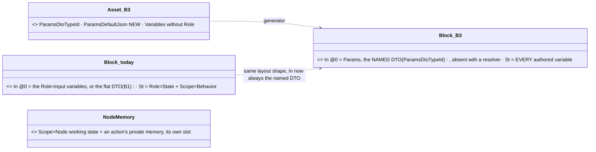

*What the picture shows that prose hid: the runtime layout does NOT change shape — `In` at 0, `St` after — so the runtime,
`RootParamsAccess` and the hosted-child copy stay as they are; only what the AUTHOR declares changes (a named DTO instead of
Input variables), which is why the cost is in the editors, the generators and the assets, not the engine.*

| claim the lean rests on | code — how it IS | design — how it was MEANT |
|---|---|---|
| the runtime reads only the block shape, never `Role` | ✅ sweep: `StatefulSlotInfo.Role` written, never read; `InputBytes` reads `In` (`RootParamsAccess.cs:319`) | ✅ AQ76 §12.3b: *"Role=Input becomes optional"* |
| a named DTO already lands in `In` flat | ✅ B1 (`BTreeEmitCore.cs:246`, `OverlayFlat`) | ✅ AQ90 §2.3j: *"the JSON lands in the reserved variable Params"* |
| a class-B asset's default lives on its Input variable (`DefaultValueJson`, e.g. Sentry `WithinMetres 90`) | ✅ `Sentry.btree.json:110` | ⛔ AQ90 is silent on where a named DTO's default lives ⇒ lean below |
| several shipped multi-Input assets are A2's (behaviors lane) | ✅ tracker CE-2132 | ✅ design §6 (A2 depends on B1 only) |
| removing `Role` outright breaks every class C/D asset not yet converted | ✅ their JSON is keyed by variable (sweep §3) | ⛔ the §6 graph shows B3 depending on B1 only — **it misses this dependency** |

**The decision (lean ⭐ B3a now, B3b later):**

| | what | when |
|---|---|---|
| ⭐ **B3a** | an asset that names its params DTO has NO Input variable: `In` = the DTO, called `Params`, its default `ParamsDefaultJson` on the asset; every authored variable is what `State`+`Behavior` is today (`St`). Convert the 11 class-B assets (5 shipped, 6 tests) to it. Editor: one "Variables" section + a read-only "Params" row; new variables are plain (no Role column). A host binds a child with an ordinary variable (`St` offsets measured on the struct, like the blueprint emitter). The legacy Input path stays ONLY for unconverted assets, listed by the CE-2130 allow-list | now (backend) |
| **B3b** | delete `Role` (`BlackboardVariableRole`, the panel's legacy path, the mirror emission); blueprint behaviours' Parameters → a named DTO; resolver assets' Parameters → the DTO (supersedes §P.7) | when A2 (CE-2132) + the test / blueprint conversions empty the allow-list; blueprint Parameters ideally after B4 (an editor-made DTO) so no C# is needed |

⚠ **Refined while building B3a (measured 2026-10-12, before any code relied on the table above):** a "plain" variable is a
PACKED one (today's `Input` storage), not an `St` one. Action bindings bake each variable's OFFSET into their keys at generate
time (`HsmActionKey.CompoundKeyName(fqn, offset)`, both emitters) and resolve it from the packed fields only
(`BTreeBridgeEmitCore.cs:497`); `St` is CLR-laid-out (its types may be unsizable at generate time, e.g. fixed buffers), so an `St`
variable cannot be an action's params. ⇒ in B3a: the reserved `Params` is the FIRST packed variable (offset 0); the asset's other
packed variables are plain variables (bindable, baked, never JSON); `St` stays the working-state half. The persisted value
`Role = Input` therefore means "a plain (packed) variable" in an asset that names a DTO, and "the generated JSON mirror" only in a
legacy asset; B3b removes the name. The `Block_B3` box above reads: `In` = `Params` + the plain variables.

**B3a as built** *(2026-10-12)*: `ParamsDefaultJson` on the BTree / HSM asset; `BTreeEmitCore.WithParamsVariable` /
`HsmBridgeEmitCore.WithParamsVariable` inject `Params` at every generator entry (idempotent); `ParamsTarget` = `Params` (named)
or B1's single struct Input (legacy); `NoParams` stores nothing (no injection, `RequireNoStoredFields`, `InputBytes` 0, nothing
for a host to seed); `RootParamsAccess.InputBytes` = the DTO's size when the first packed variable is it. Editor: the mappers
show `Params` as a read-only entry (`ReservedParamsVariable`, `BlackboardVariableEntry.IsReservedParams`) and save it back as the
two asset fields; the panel has no Role column; the first section is "Variables". Converted: Sentry, TakeCover, FallBack,
HullDownAttackRun, PlatoonHillAttack → `Params`; the test assets T11, T31–T34, HsmStatefulBindingDemo → `NoParams` (their one
variable is a composed action's params or an aliasing fixture that no caller sets by JSON, so it stays a plain variable).

Rejected (one line each): **remove `Role` in one step now** — breaks the 17 class-D and 4 class-C assets and 5 keyed scenario strings
the behaviors lane is converting (A2) · **give the named DTO its default from C# initialisers** — `default(T)` ignores them
(measured for R-237) and B4's editor-made DTOs would need a second mechanism · **put `Params` in `St`** — moves every class-B
asset's bytes and the hosted-child copy for nothing.

Design docs checked: AQ90 §2.3i/§2.3j — *applies* (the target: one kind, reserved `Params`); AQ76 §12.3b — *applies* (Role
optional, block from the DTO); Parameter Model §P.2/§P.7 — *applies*, §P.7 is superseded only in B3b; §5.1 "sections are the
classification" — *applies*: one Variables section is that rule with one section.

## 6. ⭐ THE TASK LIST — the build plan

Tracker ids are from the behaviors block. ⛔ Each task: extend the UML here first if it deviates, red-prove its rails, fold the
as-built back into this document. "Lane" is a lean; any session may take a task whose dependencies are met.

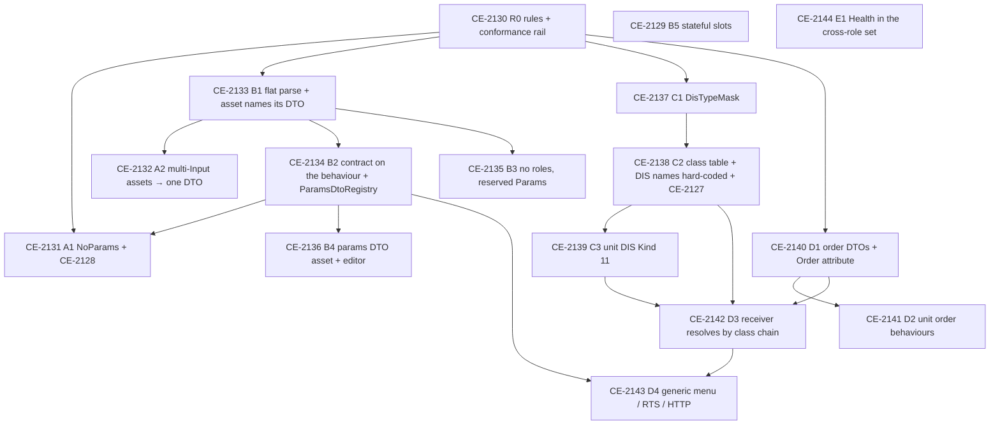

| id | task | depends | lane (lean) | acceptance |
|---|---|---|---|---|
| **CE-2130** R0 | the authoring rules (§1 P1–P2, O2 naming) as a **conformance rail** over every registered behaviour (curated, BTree, HSM, blueprint): one params DTO; no multi-Input asset; no `[BehaviorContract]` contract ≠ parsed type. Today's violators listed in an **allow-list that may only shrink** | — | behaviors | rail green with the allow-list; a new violating behaviour turns it red (red-proved) |
| **CE-2131** A1 | ⚠ *(amended 2026-10-12: the NoParams part waits for CE-2134)* the six empty DTOs (`Idle`, `Ambush`, `InfantryCombat`, `ConvoyEscort`, `JoinFormation`, `WanderMilitary`) → `NoParams`; fix the two wrong contracts (CE-2128: `FollowRoute`, `PlatoonHillAttack`) | R0, CE-2134 (NoParams) | behaviors | their allow-list entries removed; `GET /behaviors` publishes what each parses |
| **CE-2132** A2 | `FiringPosition`, `Flank`, `BasicInfantrySop`, `BasicSquadSop`, `DangerCrossing` → one Input of one C# DTO; the 3 scenario params strings rewritten flat | B1 | behaviors | each feature's rails; live `ua-danger-crossing` |
| **CE-2133** B1 | a single struct-typed Input parses FLAT; an asset may name its params DTO (`ParamsDtoTypeId`, FQN string; the generator emits `typeof(global::X)` + `Deserialize<global::X>`); BTree, HSM, blueprint | R0 | Track B | per-tier round-trip rails; generator goldens show only the intended diff |
| **CE-2134** B2 | `[Behavior(Params = …)]` on the behaviour replaces `[BehaviorContract]` on the DTO; `ParamsDtoRegistry` (one scan of loaded assemblies; order DTOs carry their order name); the blueprint palette de-duplicated by DTO type; load check P3 | B1 | Track B | `BehaviorSchemaDiscovery` / `BehaviorCatalog` consumers moved; CE-2128 cannot recur |
| **CE-2135** B3 | drop Input / State: one variable kind, reserved `Params` (no resolver only), `NoParams` stores nothing (fix the `InputBytes`=1 vs 0 trap); editor sections merged; Parameter Model §1 / §P.7 updated | B1 | Track B | AQ76 rails; hosted-child rails; the size pre-check still skips unsizable types |
| **CE-2136** B4 | `*.params.json` asset + build-time generator + editor (variables-panel rows, an order-name field); appears in `ParamsDtoRegistry` | B2 | Track B | a generated DTO used by a behaviour end to end |
| **CE-2129** B5 | stateful slots salted by behaviour and detached on every change except a paused task's | — | Track B | A(slots) → B(none) → C(same key) starts clean |
| **CE-2137** C1 | `DisTypeMask` in `Fdp.Core`: parse (`*`, `n`, `a-b`, `a,b,c`), `Matches`, `Specificity` (segment by segment from Kind: exact > list/range > `*`) | R0 | Track C | parse / match / specificity rails |
| **CE-2138** C2 | the hard-coded `EntityClassTable` grown from `VisualFamilies` + `CountryTable`; `VisualFamilies.Of` and `DisNameTable` built from it; `DisNames.json` deleted; picker path = class chain; CE-2127 fixed | C1 | Track C | a golden: every built-in type keeps its 3-D family and picker folder; no two classes share a name or mask |
| **CE-2139** C3 | units: Kind 11, Category = arm, Subcategory = echelon (the `TkbCompositionDef.Echelon` string becomes the code); composite special cases → DIS; scenario load prefers the template's DIS type; CE-1017 rail updated | C2 | Track C | a unit is in its own class; no tank mask matches a unit |
| **CE-2140** D1 | `OrderKind`, `MoveOrder` / `AttackOrder` / `HoldOrder` with `[Order(name, gesture)]` in `Hrot.AI.Behaviors`; `OrderAttribute` + `NoParams` in `Hrot.Core` | R0 | behaviors | — |
| **CE-2141** D2 | `InfantrySquadMove` (today's `SquadMarch`), `InfantrySquadHold`, the squad attack drill, each taking the order DTO; a drill that ends releases its members; a member that is a unit receives an order | D1 | behaviors | `tt-squad-march`, `tt-react-contact` live |
| **CE-2142** D3 | `TacticalIntentResolutionSystem` resolves `Order.<name>` through the class chain (O2), tie = load error; no soldier fallback for a body-less unit | C2, C3, D1 | behaviors | an M1 and a T-72 resolve the same; a squad resolves its own |
| **CE-2143** D4 | `EntityOrders.Order(unit, name, json)`; HTTP `order {kind, params}`; menu + RTS generic over `ParamsDtoRegistry`; picks from field types via `MapPickBroker`; `Possess` hidden on a unit | D3, B2 | behaviors | the menu lists exactly the orders the unit's class fulfils |
| **CE-2144** E1 | `HealthApplicationSystem` into the cross-role infrastructure on every host (R-275) | — | any | a passenger owned on a non-CGF node dies there |

⛔ Out of this programme (decided, built later): carry capacity and seats per vehicle type, and the human-carrier profile
(R-274). Embarkation itself is NOT deferred (R-282) and may run in parallel, following §1's rules.

## 7. D2 — the unit order behaviours *(CE-2141; build-state: BUILT `2026-10-12` — as-built §5a)*

⭐ **In one line:** a squad fulfils Move / Hold / Attack with the drills it already has, a unit member is ordered by
order name (A4), and **the orders a commander's run gave its members belong to that run**, like its sensors (CE-485 D4),
so they end when the run ends, for any reason (A5).

### 7.0 Claims *(measured `2026-10-12`; both columns)*

| claim | code — how it IS | design — how it was MEANT |
|---|---|---|
| a drill orders a member as a tactical intent at `Superior` whose id IS the behaviour (`CombatPosture` / `AdvanceTo`) | `SquadManeuverRunner.cs:386-405` | Decision Layer §4 (origins); Squad Tactics §3.2 |
| ⛔ no drill releases its members: the play `Release` hooks drop sensors only, the march's is empty | `SquadMarchBehavior.cs:233`; `SquadContactBehaviors.cs:97,225` | AQ90 A5: "a drill that ends, for any reason, clears the Superior orders it gave its members" |
| ⛔ the ingress applies a frame's assigns BEFORE its clears ⇒ a clear and a new order for one member in the same frame leave it with nothing | `BehaviorIngressSystem.cs:97-136` (assign handler, then clear handler) | the same hazard named for one intent in `TacticalIntentResolutionSystem.cs:107-110` (CE-3167); ⛔ searched `docs/` for two intents in one frame: none |
| `ReactToContact` ends one play and starts the next in the SAME tick | `SquadContactBehaviors.cs:310-327` | Squad Tactics §4.7 (one stateful action, stages) |
| ⇒ a release inside the runner's end path would race the next play's orders | follows from the two rows above | — |
| a behaviour run's owned parts are released at EVERY site that ends a run (start of another, re-assign of the same, clear, finish, a dropped paused task) and NOT at a pause | `BehaviorIngressSystem.cs:567-569, 1641-1642, 444` | `DESIGN_Behaviour_Fault_And_Teardown.md` §1 D4 ("one release step, three call sites, no per-route hook") |
| an order's clear over a running REACTION is weighed against the paused task; admitted, today it ends the reaction too | `AdmitsWithReactions` + the clear handler `:124-136` | Decision Layer §4.1 table: "admitted ⇒ the paused task is dropped" — silent on the reaction |
| a Clear intent's `IntentId` already crosses the wire | `TacticalIntentEgressTranslator.cs:92`, message `IntentId` | CE-3167 (assign and clear share one wire path) |
| the squad pool keys a contact by the LOCAL entity; an `EntityRef` resolves a network id to it | `SquadManeuverRunner.TopContact`; `EntityRef.TryResolve` | DESIGN_Entity_Reference |
| geodetic → local metres through the `IGeographicTransform` singleton (CGF has it) | `HillAttackCommanderNodes.cs:717-778` | — |
| ⚠ the mission editor's per-type behaviour list sees only `[BehaviorContract]` DTOs in `Hrot.Core` ⇒ the order behaviours are NOT in it until the class table replaces it | `BehaviorCatalog.cs:45-56` | §5 row "behaviour filter per type" (C2/D3) |
| ⚠ `Order.<name>` is not resolved by anything until D3 | `TacticalIntentResolutionSystem.cs:129-148` (falls back to a behaviour named `Order.Move`, warns) | §3.1 (D3 resolves it) |

### 7.1 Classes

*What the picture shows that prose hid: nothing new runs a squad — the three order behaviours are new FRONT DOORS to the
three existing plays; the only new mechanism is the release, and it hangs off the one run-end step the engine already has.*

### 7.2 A drill ends, for any reason

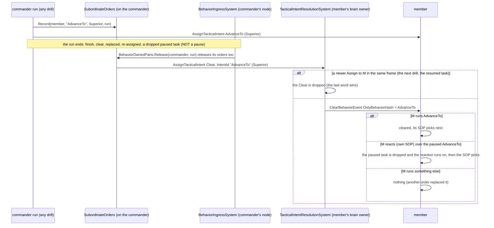

*What the picture shows that prose hid: the release never touches what a member is doing on its own — its reaction, or a
newer order — and the two ordering hazards (assigns before clears in the ingress; plays chained in one tick) are both
closed at the one place intents are resolved.*

### 7.3 Modules

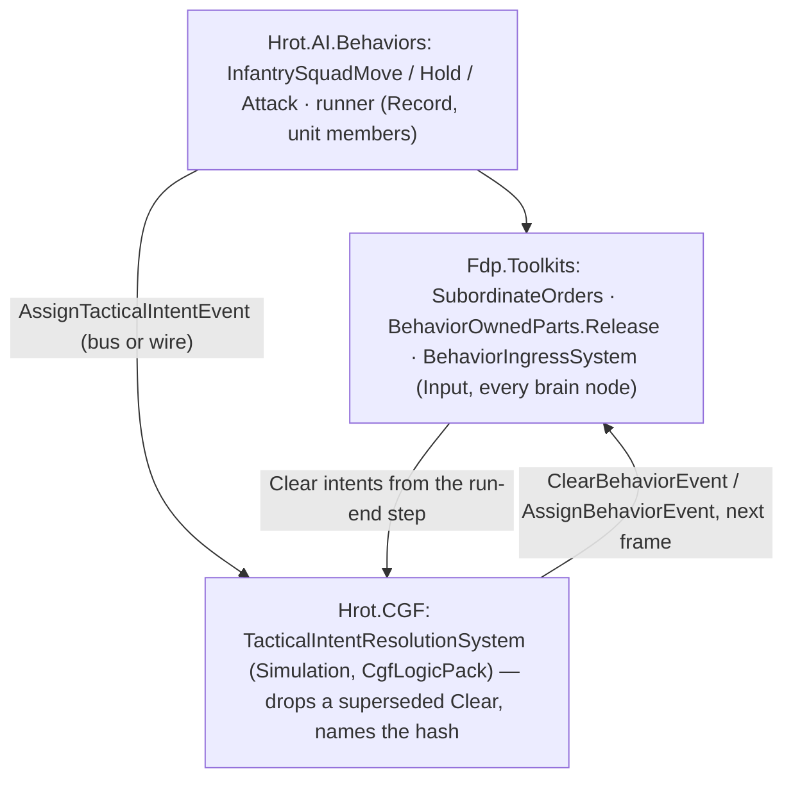

*What the picture shows that prose hid: the release is published from the INGRESS (where runs end), not from the
behaviour, so a run ended from outside — an operator's new order, a release, a fault — releases its members exactly like
one that finished.*

### 7.4 Decisions *(leans)*

| # | decision | ⭐ lean | why |
|---|---|---|---|
| **D2-A** | the order behaviours vs the drills | NEW front doors `InfantrySquadMove` / `InfantrySquadHold` / `InfantrySquadAttack` over the existing plays; `SquadMarch`, `SquadHold`, `SuppressAndManeuver` stay | the drills carry finer authored params (shape, spacing, duration) scenarios use; one implementation (the play), two doors (R-137: unifying may not cost a feature) |
| **D2-B** | where the release lives | the commander's RUN owns the orders it gave; released by the existing run-end step (`BehaviorOwnedParts.Release`) | the step already fires at every end and never at a pause (D4); in the runner it would race `ReactToContact`'s chained plays |
| **D2-C** | what the release clears | a Clear that NAMES the ordered behaviour: running ⇒ cleared; paused under the member's own reaction ⇒ only the paused task dropped; anything else ⇒ nothing. An unnamed clear is unchanged | a drill's end must not end a member's reaction to being shot at, nor a newer order; abort-all / mission end keep today's meaning |
| **D2-D** | a Clear and an Assign to one entity in one frame | `TacticalIntentResolutionSystem` drops a Clear followed by an Assign to the same entity in the same batch | the ingress reads two buses (assign then clear), so publication order is lost there; it is kept at the one place intents are read in order |
| **D2-E** | the squad's shape on Move | the squad decides (O3): `RoadUse` Prefer / StronglyPrefer ⇒ File (a squad on a road walks in file), else Wedge | the order says where, not how |
| **D2-F** | the height of a geodetic `Location` | the unit's own height (it stands at its men's centre, CE-514); the navmesh snaps ±4 m | the order carries lat/lon only; z 0 would put the point off the walkable area on hilly ground |
| **D2-G** | Attack on a target the squad has not seen | the designation is the knowledge: the threat point is the target's position when ordered, followed once the squad pools it; no target ⇒ the top contact | an operator who designates an enemy has told the squad where it is |
| **D2-H** | a member that is a UNIT | `Order.Hold` / `Order.Move` (HoldOrder / MoveOrder JSON, geodetic); released by an UNNAMED clear (the commander cannot know what it resolved to) | A4; resolution is D3's — until then the intent warns and starts nothing |

Rejected: **rename `SquadMarch` to `InfantrySquadMove`** — loses the shape/spacing door the scenarios use; **release in each
play's `Release`** — `ReactToContact` ends a play and starts the next in one tick, so the clear would wipe the next order;
**a BTree deactivator** — it is a node-exit hook inside the tree, not the run's end, and the run-end step already exists;
**every order's clear leaves a reaction running** — wider than D2 needs (abort-all, mission end); **reorder the ingress
handlers** — they read two buses.

### 7.5 Acceptance

| rail | where | asserts |
|---|---|---|
| the order behaviours | `SquadManeuverTests` (the feature's suite) | Move: geodetic Location → the march to the local point, Wedge (File on a road); Hold: everyone holds, never ends by itself; Attack: a named target the squad never pooled is attacked at its position |
| the release | `SquadManeuverTests` | a march that ends clears each member's last order (named); a drill replaced from outside does too; a PAUSED drill releases nothing |
| unit members | `SquadManeuverTests` | a member that is a unit gets `Order.Move` with a geodetic Location, and an unnamed clear at the end |
| the named clear | `SopSlotTests` (the gate's suite) | running ⇒ cleared; paused under a reaction ⇒ the reaction runs on and nothing resumes; another behaviour ⇒ untouched; unnamed ⇒ unchanged |
| the superseded clear | `TacticalIntentResolutionSystemTests` | Clear then Assign to one entity in one frame ⇒ only the assign; Assign then Clear ⇒ both, in order |
| live | `SquadTacticsScenarioTests` (cluster): `tt-squad-march` with `InfantrySquadMove` ordered at run time; `tt-react-contact` unchanged | everyone arrives, and after the march no member still runs its drill order |
