<!--STATUS
state: LIVE
build-state: DESIGN — options analysed, lean stated; NOT ruled
updated: 2026-11-12
current-answer: ⭐ §18.5 THE RULE AND THE BRAINS AS BUILT (overnight build, exp/threaded-build) · §16 POC 4 as built (one pool; no dependency scheduler) · §13 a job system? (the lean POC 4 tested) · §15 POC 3 as built (the cheap wins) · §14 POC 2 as built (the brain pre-score) · §12 R-4209 the sampled timer · §11 the aggregate (where the time is) · §10 after the experiment (R-4208, the emitter fix) · §9 the AS-BUILT of the overnight experiment (exp/parallel-sim) · §8 interleaving and quantizing (do less per frame) · §7 determinism is a switchable MODE (R-4207) and what per-batch buffers cost · §2 the lean · §1 what exists (measured) · §3 the options · §4 the hazards · §5 the staged plan · §6 open
stale-below: nothing
related-designs:
  - blueprints/batches/HANDOFF_Coordinator_To_Backend_Managed_Reads_Audit.md — CE-4445, the managed-read audit and the default flip (R-4210)
  - blueprints/batches/HANDOFF_Coordinator_To_Backend_Parallel_Sim_POC_4.md — CE-4444, POC 4: §13's one pool and the dependency-scheduler measurement
  - blueprints/batches/HANDOFF_Coordinator_To_Backend_Parallel_Sim_POC_2.md — CE-4440, POC 2: the serial 70 % on exp/parallel-sim-2
  - blueprints/batches/HANDOFF_Coordinator_To_Ui_Windows_Parallel_Sim_Measure.md — CE-4437, the 8-core Windows measurement of exp/parallel-sim
  - blueprints/batches/HANDOFF_Coordinator_To_Backend_Parallel_Simulation_Experiment.md — the overnight experiment (branch exp/parallel-sim) that tries §5 / §7 / §8
  - DESIGN_Threaded_Simulation_Presentation.md — the simulation on a worker thread (R-4205); this design parallelises INSIDE that worker's tick — the two add up, and share one core budget (its §11 F-20)
  - DESIGN_Evaluation_Cost_And_Cadence.md — §11h the measured per-system costs at 1 000 men these options target; §3 the brain cadence
  - DESIGN_Scale_Rig.md — §7.7 P-1 parallel EQS (built), the many-core Windows measurements
  - ../FDP/Engine/docs/Parallel-Processing-Production-Implementation.md — the existing ForEachParallel (adaptive batches, zero allocation)
  - ../FDP/Engine/docs/FDP-GDB-SoD-unified.md — FDP-DES-012: background modules on snapshots, commands back
-->

# DESIGN — run the simulation on many cores: parallel systems over many entities

## 0. The request

🔒 User, `2026-11-12`: *"I want to talk about how to parallelize much more than we do now. Single thread calculations of thousands of entities is
ineffective … There are many systems running over many entities. Many of those could be ok with writing stuff via command buffers, allowing parallel
runs. Pls analyze the options."*

## 1. What exists — measured `2026-11-12`

| fact | where |
|---|---|
| ⭐ the scheduler runs a phase's systems ONE AFTER ANOTHER, in `[UpdateAfter]` / `[UpdateBefore]` order — no system-level parallelism | `SystemScheduler.cs:222-231` |
| ⭐ a data-parallel loop EXISTS: `EntityQuery.ForEachParallel` — adaptive batches, a `ParallelHint` (light / medium / heavy), `FdpConfig.MaxDegreeOfParallelism`, pooled batch lists (zero allocation) | `EntityQuery.cs:~400-445`; `FDP/Engine/docs/Parallel-Processing-Production-Implementation.md` |
| ⭐ PER-THREAD command buffers EXIST: `GetCommandBuffer()` returns a `ThreadLocal` buffer; `FlushCommandBuffers()` plays them all back | `EntityRepository.View.cs:16-48`; `EntityCommandBuffer.cs:9-10` ("thread-safe for recording, each thread its own buffer; playback on the main thread") |
| who uses it today: car kinematics, linear kinematics, hull clearance, the raycast solver, the navmesh baker; the EQS solver runs parallel (P-1) | grep `ForEachParallel` / `Parallel.For` |
| ⛔ who does NOT: brains, weapons, stress, callouts, threat, squads — the CGF systems that cost the most | §11h of Evaluation Cost |
| the native event bus's `Write` is lock-free and safe for concurrent writers within a phase (only the end-of-frame swap must not overlap) | `NativeEventStream.cs:88-98` |
| background modules already run on other threads on snapshots, writing commands back (EQS, navigation, traffic) | FDP-DES-012; `EqsModule.cs:39` |

**Where the time goes at 1 000 men** (Evaluation Cost §11h, the user's Windows machine, ms per frame): the synchronous CGF simulation **38** — brains
9.8, weapons 7.3, stress 5.7, callouts 3.7, threat 2.0, squads 1.7, ~25 small ≈ 8 — the PostSimulation phase **9.5** (drone impacts 2.0, car
kinematics 1.7 — already parallel —, fire processing 1.4, map layers 1.1), the background snapshot copies 8.3.

**The write patterns of the hot non-brain systems** (grep of each file):

| system | in-place writes | to whom | bus publishes | loop |
|---|---|---|---|---|
| `StressSystem` | 2 × `Stress` | the man it loops over | 1 (`SensorChangedEvent`) | a cached list of people |
| `CalloutSystem` | 2 × `CalloutState` | the man it loops over | 0 | a cached list of men |
| `WeaponDispatcherSystem` | 6 (`WeaponChannel`, `WeaponState`, barrel heat, `AmmoLoadout`) | the mount / barrel / loadout it loops over | 0 | cached lists |
| `CgfThreatEvaluationSystem`, `SquadCoordinationSystem` | 0 | — | 0 | — |
| `BrainTickSystem` + the behaviours | ~100 sites | mostly the unit's own channels and state; some cross-entity (squad state, objective status, cover claims) | some | the tier queries |

⇒ ⭐ **the hot non-brain systems already have the shape that parallelises: a loop over entities, each writing only itself.** The brain is the hard one.

## 2. The lean

⭐ **Data-parallel loops INSIDE the hot systems (option A), made deterministic, starting with the systems that write only their own entity; the
brains last and behind a guard. System-level parallel scheduling (option B) not now.** Basis: §1 — the loop, the per-thread buffers and the batch
machinery exist; a handful of systems hold most of the cost; the per-entity loops write only their own entity.

| rejected (for now) | the one fact |
|---|---|
| B — run independent SYSTEMS concurrently from declared read / write sets | no system declares its reads and writes today (hundreds to annotate), in-place writes cannot be checked without an analyser, and a few systems dominate the cost — parallelising inside them gains more for less |
| C — move more systems to BACKGROUND modules (snapshot + commands) | each module pays its own snapshot copy (~4 ms each today, §11h) and adds a frame or more of latency; right for slow, lower-rate work (it is how EQS / navigation run), wrong for per-tick systems |
| D — split the men over more CGF NODES (processes) | ⏭ a cluster-level option for very large exercises; ⚠ UNVERIFIED whether more than one CGF node can own a partition of the units today |

## 3. The options in detail

| | A — parallel loops inside a system | B — parallel systems | C — background modules | D — more nodes |
|---|---|---|---|---|
| what runs at once | batches of entities of ONE system | different systems of one phase | a module on a snapshot, alongside the frame | whole simulations in other processes |
| what it needs | per-entity independence; cross-entity writes and structural changes via command buffers; deterministic merge | a read / write declaration per system and a scheduler that builds a parallel graph | the module rewritten to read a snapshot and write commands | ownership partitioning, the network |
| what exists | ✅ `ForEachParallel`, per-thread buffers | ⛔ | ✅ the kernel's async modules | ⚠ to check |
| determinism | ⚠ needs the merge of §4 | ⚠ the same plus ordering of systems | ✅ by slots (Time Architecture §17) | per node |
| cost | small per system (the self-writing ones); large for the brains | large (annotate everything) | medium per module | large |
| gain at 1 000 men (est., 24 cores) | the ~20 ms of weapons / stress / callouts / threat / squads → a few ms; the brains' ~10 → ~1–2 | overlaps systems — bounded by the biggest one | frees the tick, adds latency | scales out |

## 4. The hazards — what makes a system safe to run in parallel

| hazard | why it breaks | remedy |
|---|---|---|
| ⛔ **non-deterministic order** — per-thread buffers and events land in thread order, and which thread gets which batch varies run to run | stepped mode, replay, filming and the scenario regression's goldens require the same result every run — ⚠ only in the Deterministic MODE (§7) | ⭐ per-BATCH buffers (not per-thread), played back in batch order; events written per batch and appended in batch order — the result is then independent of the thread count |
| writes to ANOTHER entity in place | two batches writing one entity race | only through the command buffer (deferred to the batch merge) |
| structural changes (create, destroy, add / remove) mid-loop | invalidates the query | already command-buffer-only |
| shared caches: `Dictionary`, `ConditionalWeakTable`, static lists in systems and helpers | "collection modified", torn state | per-batch scratch, or computed before the loop |
| shared random number generators (2 files use `new Random` / `Random.Shared` in the AI) | not thread-safe; not deterministic across threads | a per-entity stream (seed from entity + tick), the expander's pattern |
| allocation in the parallel body (closures, LINQ) | GC pressure (R-2084) | `ForEachParallel` is zero-allocation; the body must be too |
| the cores — the threaded presentation's main thread (R-4205) and the background modules share the machine | oversubscription, UI stutter on small machines | one parallelism budget (cores − 2 when the presentation is threaded), `FdpConfig.MaxDegreeOfParallelism` |

⭐ **The safety net — a rail per converted system: run it SERIAL and PARALLEL on the same world and compare the world byte for byte**, at several
thread counts. A difference is a hazard the conversion missed. Plus the existing determinism rails and the scenario regression.

## 5. The staged plan *(once ruled)*

| step | what | gain | size |
|---|---|---|---|
| P-0 | ⭐ **deterministic per-batch merge** in `ForEachParallel` (per-batch buffers and event lists, merged in batch order) + the serial-vs-parallel rail harness | makes every later step safe | small, in Fdp.Core |
| P-1 | convert the self-writing hot systems: stress, callouts, weapon dispatcher, threat evaluation, squad coordination, and PostSimulation's drone impacts and fire processing | ~20 of the 47.5 ms → a few ms (to measure) | small each |
| P-2 | the inventory of the brain's writes (~100 sites): self vs cross-entity vs bus vs shared state; a Debug guard that knows "the entity this batch owns" and throws on a direct write to another | makes P-3 checkable | medium |
| P-3 | the brains in parallel: the tier loop over units in batches; cross-entity writes through the batch buffer | ~10 ms → ~1–2 ms | large (the behaviours' nodes) |
| P-4 | the long tail (~25 small systems) by measured cost | the rest | small each |
| later | B (parallel systems) only if, after P-1…P-4, many mid-sized systems remain | — | large |

## 6. Open

| question | why |
|---|---|
| which of the ~100 brain write sites are cross-entity | sizes P-3 |
| does any event consumer depend on the order of events within a frame | the per-batch merge makes order deterministic but different from today's serial order — goldens may need regenerating once |
| can more than one CGF node own a share of the units | option D |
| the parallelism budget with the threaded presentation | §4, Threaded design §11 F-20 |

## 7. ⭐ Determinism is a MODE, not a law — switchable against throughput *(user, `2026-11-12`; R-4207)*

🔒 User, `2026-11-12`: *"If Determinism mode goes against performance mode, these two are not necessary at the same time (determinism good for film
taking and regression test harnesses and special cases like stepped mode, real big scale simulation does not need) — needs to be switchable. What would
per batch buffers mean to performance?"*

| who needs determinism | who does not |
|---|---|
| the film director and its stills · the scenario regression and its goldens · the determinism rails · stepped mode and Run-to (Time Architecture §17, R-3035) · replaying a run to compare it | a big live exercise — 1 000 to 10 000 men at real time, where only throughput matters |

### 7.1 What per-batch buffers cost

⭐ **Almost nothing — the determinism is in the ORDER OF PLAYBACK, not in how work is shared out.** Threads still steal batches dynamically
(load balancing unchanged); each batch writes into its OWN pooled buffer instead of its thread's; at the end the buffers are played back in batch order
instead of thread order.

| | per-thread buffers (throughput) | per-batch buffers (deterministic) | difference |
|---|---|---|---|
| the parallel loop | the same batches, stolen dynamically | the same | none |
| recording a command | append to the thread's buffer | append to the batch's buffer | none |
| buffers alive | one per thread (~cores) | one per batch (~2 × cores, pooled — the adaptive batching targets 2 per core) | a few dozen small pooled objects, 0 B per steady frame once warm |
| playback | buffers in thread order — one serial pass over every command | buffers in batch order — the SAME serial pass | none: the same total commands |
| events | written straight into the bus, concurrently (lock-free) | written into the batch's list, appended to the bus in batch order | ⚠ one extra copy of each event — proportional to the EVENTS, not to the entities (tens to hundreds per tick) |
| a system that writes only its own entity (stress, callouts, weapons) | no buffer at all | no buffer at all | none |

⇒ the per-batch merge costs one copy of the events and a few pooled buffers — microseconds per tick. **It is not where determinism costs
performance.** ⭐ Measure it in P-0 to confirm.

### 7.2 Where determinism DOES cost performance

| deterministic behaviour | its cost | in throughput mode |
|---|---|---|
| ⭐ **stepped mode waits for background jobs on a step** (EQS, navigation — `ModuleHostKernel.cs:678-683`, Time Architecture §17) | the step waits the slowest job (EQS ~58 ms per run at 1 000 men, §11h) | never wait — results land when they land (today's continuous play already does this) |
| slow modules on SIM-time slots | a module can run only at its slot | wall-clock cadence (Scale Rig C-1, built) |
| results independent of the thread count — per-batch order, no parallel floating-point reductions in an unstable order | negligible (7.1); a stable reduction where one sums floats across batches | per-thread order, any reduction order |
| the same random stream every run | a per-entity seeded stream | the same (it is also faster than a shared locked one) |

⇒ ⭐ **the switch matters for the WAITS, not for the buffers.** Most of it already exists as the TIME mode: stepped (deterministic) vs continuous.

### 7.3 The switch

| | ⭐ lean |
|---|---|
| ONE setting, `SimulationMode { Deterministic, Throughput }`, read by the kernel and `ForEachParallel` | one place, not a flag per system |
| ⭐ chosen by WHAT IS RUNNING, not by hand: stepped mode, Run-to, filming, recording a regression, the test harnesses ⇒ Deterministic; continuous live play ⇒ Throughput | the user never has to remember it; stepped mode stays deterministic by construction (R-3035 unchanged) |
| the per-batch merge stays ON in both modes unless P-0 measures a cost | it is nearly free (7.1), and one merge path is simpler than two — ⛔ a second code path only if a number justifies it |
| the throughput mode is still CORRECT, only not repeatable — the same commands apply, possibly in another order | a run in throughput mode is valid; it simply cannot be compared byte for byte |
| the tests run BOTH modes: the serial-vs-parallel rails in Deterministic, a smoke run in Throughput | so the fast mode cannot rot |

## 8. ⭐ Do less every frame — INTERLEAVING and QUANTIZING *(user, `2026-11-12`; a lean, not ruled)*

🔒 User, `2026-11-12`: *"Also writing every frame and calculating every frame is what adds time. Interleaving and quantizing might help."*

Parallelism (§2–§5) makes the same work faster; these two make LESS work. They multiply.

### 8.1 Interleaving — an expensive per-entity system visits 1 / k of its entities each tick

| | |
|---|---|
| the idea | a system whose result changes slowly (stress recovery, callouts, threat evaluation, squad coordination, sight re-checks) updates each entity every k-th tick, the entities staggered by index — the cost per tick drops to 1 / k |
| ✅ precedents that exist | `CadenceGate` — brains and rules ticked `Periodic`, staggered `index % 10`, woken at once by a `SensorChangedEvent`, each slot reading every event since its own last tick (`Behavior/Cadence.cs`, CE-2382) · `DecisionCadence` — the combat decisions re-scored every 0.2 s on the man's own phase (CE-4395) · slow modules on a wall-clock cadence (Scale Rig C-1) · the presentation's `ChangeGate` (CE-1480) |
| ⚠ the trap, MEASURED | a slowed tick must receive the time ELAPSED since that entity's last update, not one frame's dt — ui found the brain's cadenced tick gets one frame's dt, so HSM timers run k times slow (Evaluation Cost §11h P-4) ⇒ ⭐ one rule: an interleaved system integrates `now − lastUpdate[entity]` |
| ⚠ the limit, MEASURED | the brains at 0.2 s saved only ~4 ms (§11h P-4): in a fight the senses wake most soldiers most ticks. Interleaving pays where the WAKES are rare — calm units, far from the fight, idle vehicles — so the period can follow a LEVEL OF DETAIL (near the fight / far / idle) |
| determinism | unchanged — the stagger is by entity index, the period by sim time |
| ⭐ lean | a shared interleave helper (the `CadenceGate` generalised: period, stagger, wake, elapsed dt) adopted by the slow-changing systems one by one, each with its measured saving and a rail that its result stays within a stated error of the every-tick result |

### 8.2 Quantizing — write only when the value MEANINGFULLY changes

| | |
|---|---|
| why a write costs more than the write | ✔ `GetRefRW` stamps the WHOLE 64 KB chunk's version whenever it hands out a writable reference (`NativeChunkTable.cs:158-178`) — whether or not the value then changes. A stamped chunk is then COPIED by every snapshot (the background modules' and the threaded presentation's, Threaded design §11 F-5), DIFFED by the recorder (format v8 block deltas) and SCANNED by egress |
| the idea | ① **check before write** — compare first, take the writable reference only when the value differs (FDP's own parallel doc names it, `Parallel-Processing-Production-Implementation.md` §4) · ② **quantize** slowly drifting floats (stress, suppression, morale, barrel heat, timers) to a step — the value changes only when it crosses a step, so a unit at rest writes nothing |
| ⚠ the limit | a chunk holds 128–4 096 entities: ONE changed man dirties his whole chunk. The gain is in tables where FEW entities change per tick (a calm unit's stress, an idle vehicle's heat), not in positions of a moving army |
| ⚠ what must NOT be quantized | the integrators' own state (positions, velocities, accumulated timers) — quantizing them changes the simulation. ⇒ quantize OBSERVED values, or keep the precise value where the integrator reads it |
| determinism | unchanged if the quantization is deterministic (a fixed step, no thread-dependent rounding) |
| ⭐ lean | MEASURE first which tables would gain, then convert those |

### 8.3 Measure first — one cheap instrument

⭐ **M-1, a per-table counter under `HROT_FRAME_STATS`:** per tick, how many writable references were handed out, how many of those left the value
unchanged (a compare in Debug), and how many chunks ended dirty. ⇒ it names the tables where check-before-write or quantizing pays, and the systems
whose writes are mostly no-ops. Same opt-in, 0 B pattern as ui's `KernelFrameTimings`.

### 8.4 In the plan (§5)

| step | what |
|---|---|
| M-1 | the write instrument (8.3) — with P-0 |
| P-5 | interleave the slow-changing systems by the shared helper, the elapsed-dt rule first; a level-of-detail period (near / far / idle) where M-1 and the wakes say it pays |
| P-6 | check-before-write and quantizing in the tables M-1 names; a rail per table that the observed behaviour stays within its stated error |

## 9. ⭐ As-built on `exp/parallel-sim` — the overnight experiment *(not merged; status: `blueprints/batches/STATUS_Backend_Parallel_Simulation_Experiment.md`)*

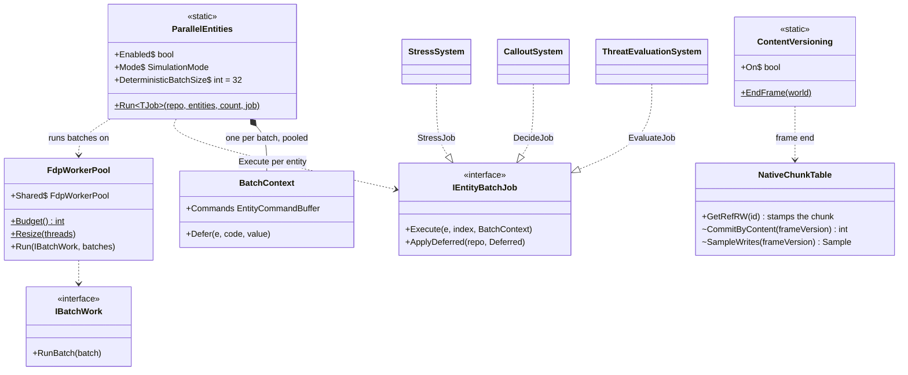
*What the picture shows that prose hid: the parallel path is a NEW runner beside `ForEachParallel`, not a change to it, and determinism lives
entirely in `ParallelEntities`' serial playback — the pool knows nothing about order.*

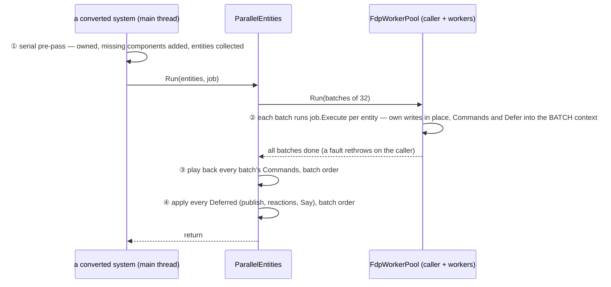

| deviation from §5 / §7 / §8 | why (measured) |
|---|---|
| ⭐ P-0 is a new runner (`Fdp.Core.Jobs.ParallelEntities` + `FdpWorkerPool`), not `ForEachParallel` changed | `ForEachParallel` allocates a closure + `ParallelOptions` per call and its per-thread buffers are its contract; struct jobs on a persistent pool give **0 B per steady run** (rail) |
| ⭐ Deterministic mode uses a FIXED batch size (32), not the adaptive 2-per-core | batch boundaries must not depend on the thread count, or the playback order (and so the result) differs between 4 and 8 cores |
| ⭐ "side effects deferred" is a second list beside the command buffer (`Defer(entity, code, value)` → `ApplyDeferred`) | publishes and reactions (a break, a callout) are not structural commands; replaying them in batch order is what makes Stress / Callouts equal to the serial loop |
| ⭐ §8.2 check-before-write grew a general form: **commit by content** (`ContentVersioning`, opt-in `HROT_CONTENT_VERSION=1`) | M-1 after per-site fixes: the 4 KB blackboard tier still stamps ~200 chunks / frame, ~50 % unchanged — the slots DO run and write back the same bytes, which no call site can avoid. ⚠ sound for frame-boundary readers only (a mid-frame A → B → A reader keeps B) |
| ⭐ P-2's inventory found the commander's `UnitRoster` / `SquadCognitiveState` taken writable by every soldier's READ (`SquadAssignment.cs`) | fixed read-only — both an E-4 and a P-3 hazard |
| P-3 (brains) not built | two order-dependent behaviours (cover claims read by friends in the same tick; EQS child sensors created and used at once) cannot give the serial answer without a behaviour change — §9 of the status file |
| ⚠ §8.1 interleaving: `CadenceGate.DueOnGrid` built and shared, Stress adopted it (opt-in) — and gained **0.3 of ~10 ms** | the step was not the cost; the per-event stimuli are (assumed, unprofiled). ⇒ interleave a system only after a profile shows its per-entity step dominates |
| D-5 measured: every remaining dirty chunk is a real change (0 % unchanged, was 50 % on the 4 KB blackboard tier) | the recorder / snapshot gain needs a RECORDED run — `scripts/parallel-sim-measure.py --content` |

## 10. ⭐ After the overnight experiment *(`exp/parallel-sim`, verdict "GO, with three changes" — [status](blueprints/batches/STATUS_Backend_Parallel_Simulation_Experiment.md) on `backend`)*

### 10.1 Cover claims seen one tick late — ruled *(R-4208)*

🔒 User, `2026-11-12`: *"Yes friend may see cover frame One frame late if it can recover from over-allocated covers."*

The experiment found two ORDER-DEPENDENT brain behaviours (cover claims read by friends in the same tick; EQS child sensors created and used at
once). Ruled: in Throughput mode a brain may read its friends' cover claims ONE TICK LATE (double-buffered) — on the condition that an OVER-ALLOCATED
cover recovers: when two units hold the same cover after a commit, one keeps it (a fixed rule — the earlier claim, then the lower id) and the other
re-picks on its next decision. ⭐ The acceptance rail: no cover held by two units for more than a bounded number of ticks, at 1 000 men. Deterministic
mode keeps the brains serial (R-4207).

### 10.2 Why the brains write back unchanged bytes — and the fix *(measured `2026-11-12`)*

M-1 measured the 4 KB blackboard table: ~150–200 of ~170–220 chunks stamped changed per tick, **half of them with identical bytes**. Three causes,
all in how a blueprint is compiled and stored — none is a bug in one behaviour:

| cause | code | effect |
|---|---|---|
| ① the generated tick assigns its state on every pass, whether or not it changed | e.g. `__bb.St.Walking = false;` on every tick the branch runs (`DangerCrossingBp_*_Bp.g.cs`, generated by the blueprint emitter) | a write of the same value |
| ② edge detectors keep their memory by rewriting it every tick | `prev.Above = isAbove ? 1 : 0;` in every When-node (same file, the `WhenNode` block) | same — the value changes only at an edge |
| ③ the change unit is the 64 KB CHUNK, stamped when the blackboard is handed out WRITABLE | `BlueprintTickSystem.cs:101-155` hands every slot a writable span; `GetComponentRW` / the tier's `Memory` stamp the whole chunk (~16 units' blackboards) | the stamp happens before anyone knows if a byte will change; one unit's real change also marks 15 neighbours |

| fix | what it does | lean *(revised `2026-11-12` after the user's question below)* |
|---|---|---|
| ⭐ **the emitter writes only on change and reports it** — `if (x != v) { x = v; wrote = true; }` for state and edge memory; the tick system stamps the chunk only when a slot reports a write | removes ① ② at the source and makes ③'s stamp precise; the check is a few BYTES the generated code already holds, not a 64 KB block; no shadow memory | ⭐ **first** — the cheapest real fix, in one place (the emitter), every blueprint benefits |
| **D-5 commit by content** (prototyped, opt-in) | at frame end a stamped chunk with unchanged bytes gets its previous version back — one engine policy, every writer covered | ⚠ **a safety net, not the fix** — see the cost below |
| a finer change unit (per entity row, not per chunk) | ③'s neighbour effect | ⛔ a kernel-wide change; only if recording / snapshot copies show it |

🔒 User, `2026-11-12`: *"Isn't the checking if the block has actually changed as expensive as actually copying the block?"* — ✔ **yes, and worse.**
The prototype keeps a SHADOW copy of every chunk (`NativeChunkTable.cs` on `exp/parallel-sim`, `CommitByContent`: `_cshadow`, `bytes.SequenceEqual(sh)`,
`bytes.CopyTo(sh)`) ⇒ per stamped chunk: a compare that reads 2 × 64 KB (in full when unchanged, early exit when changed) PLUS a 64 KB copy into the
shadow when it did change, and a second copy of the table in memory. ⇒ It costs about ONE copy per stamped chunk, and pays only where the chunk has
SEVERAL or EXPENSIVE consumers downstream (the recorder's delta, compression and disk; each background module's snapshot; the UI sync) — for one
plain copy it is a wash. ⇒ D-5 stays opt-in for tables with costly consumers (the recorder), measured on Windows (CE-4437 W-3); the fix for the
brains is the emitter.

## 11. ⭐ Aggregate `2026-11-12` — what the three experiments measured, and where the time is *(coordinator)*

Sources: the VM experiment ([status](blueprints/batches/STATUS_Backend_Parallel_Simulation_Experiment.md) on `backend`), the 8-core Windows run
(`STATUS_Ui_Windows_Parallel_Sim.md` on `exp/parallel-sim`), the threaded-analysis instruments (`STATUS_Threaded_Analysis_Instruments.md` and the
threaded design's §13.8, on `exp/threaded-analysis`).

| finding (CGF node, 1 000 men, demo-city, Windows Ryzen 7 6800H unless said) | number |
|---|---|
| the CGF frame, serial | **242 ms** (±2.3 %) |
| parallel (Stress, Threat, Callouts converted) | **1.07×** Deterministic 8 threads · **1.12×** Throughput 6 threads — real but small |
| where the frame goes | ⭐ **brains 105 ms (43 %)** · egress ~28 · weapon dispatcher ~21 · recorder ~20 (when recording; 1.6 MB garbage / frame) · stress 17 · callouts 15 · threat 7 · squads 7 |
| per system | Stress **2.5×** (17 → 6.5 ms, flat beyond 4 threads) · Threat ≥ 1.1× · ⛔ Callouts no gain |
| interleaving Stress (§8.1) | ⛔ **0.3 of ~10 ms** — the per-entity step was not the cost |
| D-5 commit by content | ⛔ **no measurable effect** — recorder 19.65 → 19.71 ms, file 1.76 MB/s both ways ⇒ the emitter fix (§10.2), not D-5 |
| ⭐ managed component READS stamp the chunk version (threaded analysis A1-2: `GetComponent<T>` → `ManagedComponentTable.GetRW`, `ManagedComponentTable.cs:181-196`) | ~438 000 UI reads a run mark chunks changed — ⛔ a race once the UI leaves the tick thread, and ⚠ false changes for the recorder and egress TODAY |

⇒ ⭐ **Converting more small systems cannot move the frame much: the serial 70 % is brains + egress + weapons + recorder.** The next evidence is a
PROFILE of those four (what inside them costs, how much is false change), before any more parallel work.

## 12. The per-query timer is SAMPLED *(R-4209)*

🔒 User, `2026-11-12`: *"sampled timer approved"* — on the proposal: `QueryTimings` (CE-3427) stays ON by default but times 1 call in 16 and scales
the time up; the call counts stay exact. POC 2 measured the always-timed version at ~13 ms of the brain on the VM (37 000 timed calls / frame at
1 000 men: two clock reads + a per-thread record each). Built in [CE-4443](blueprints/batches/HANDOFF_Coordinator_To_Backend_Parallel_Sim_POC_3.md).

## 13. A job system? — what we have, and the lean *(coordinator, `2026-11-12`; user: "other engines use custom job/task systems, why is that, could we benefit?")*

**What exists** (graph `search_graph .*(WorkerPool|JobSystem|JobQueue|Scheduler|ThreadPool|Workers)$` + grep, non-test): ⚠ **FOUR independent
ways to use the cores, each with its own budget:**

| mechanism | used by | code |
|---|---|---|
| `WorkerPool` — persistent, 0 B, "the process's ONE pool" | the EQS solver windows, the off-frame egress scan (CE-3427) | `Fdp.ModuleHost/Threading/WorkerPool.cs` |
| `FdpWorkerPool` — persistent, 0 B, per-batch ordered merge | the parallel systems (stress, threat, callouts, the brain pre-score) | `Fdp.Core/Jobs/FdpWorkerPool.cs` on `exp/parallel-sim*` only — ⛔ a DUPLICATE of the one above (R-shared-and-unified) |
| .NET `Task.Run` / thread pool | background modules, the recorder's I/O, topology rebuilds | `ModuleHostKernel.cs:738`, `AsyncRecorder.cs:224` |
| `Parallel.ForEach` (allocates) | `EntityQuery.ForEachParallel`, the raycast solver | `EntityQuery.cs:444`, `RaycastSolverSystem` |

Plus 8 dedicated `new Thread` sites (egress pipeline, flight-recorder prefetch, SUMO, the id allocator …). ⛔ Systems declare NO component
access (only `BlueprintWritableAttribute`), so the scheduler cannot run two systems at once safely.

**Why engines build their own:** ① one pool sized to the cores — no oversubscription (POC 1 on Windows: "8 threads" on 7 pinned CPUs);
② tiny jobs at no allocation; ③ PRIORITIES — frame-critical work first, background work yields; ④ work stealing for uneven batches; ⑤ jobs with
DEPENDENCIES from declared reads / writes, so independent systems run at the same time and a race is caught when scheduled.

| ⭐ lean | why |
|---|---|
| ⭐ **ONE pool, two priorities** (frame-critical: parallel systems, the sync; background: egress, recorder, EQS, background modules) — merge `FdpWorkerPool` into `WorkerPool`, move `Parallel.ForEach` and the background modules' `Task.Run` onto it | cheap, removes the duplicate and the oversubscription; one core budget (cores − 2) by construction |
| **measure before a dependency scheduler**: the access tracer (threaded-analysis A-1) already records each system's reads / writes — compute which systems are disjoint and the critical path; build declared-access scheduling only if it shows a gain | the brain is 43 % of the frame in ONE system — running the others side by side is bounded by it |
| ⛔ not a Unity-style job system with safety handles and a compiler | .NET has no Burst; the per-batch merge + `ParallelGuard` already give determinism and race checks where they matter |

## 14. ⭐ As-built on `exp/parallel-sim-2` — POC 2, the serial 70 % *(not merged; status: [`STATUS_Parallel_Sim_POC_2.md`](blueprints/batches/STATUS_Parallel_Sim_POC_2.md) on that branch)*

> ⛔ **SUPERSEDED `2026-11-13` (R-4219, CE-4482) — the utility PRE-SCORE below (`UtilityPrescore`, `HROT_BRAIN_PRESCORE`, and §15's widening to
> candidate rankings) is RETIRED and removed from the code.** The brains became a per-entity parallel phase in every mode (R-4214 ①, §18.5): the
> scoring runs on every core inside each unit's own tick, and the pre-score — which served only a SERIAL walk — was unreachable in every parallel
> configuration (`HROT_PARALLEL_SIM=1` itself makes the brains parallel). Two mechanisms for one concept ⇒ one kept (ruling 9). The rest of §14
> (the byte-compare stamps, §10.2) stands.

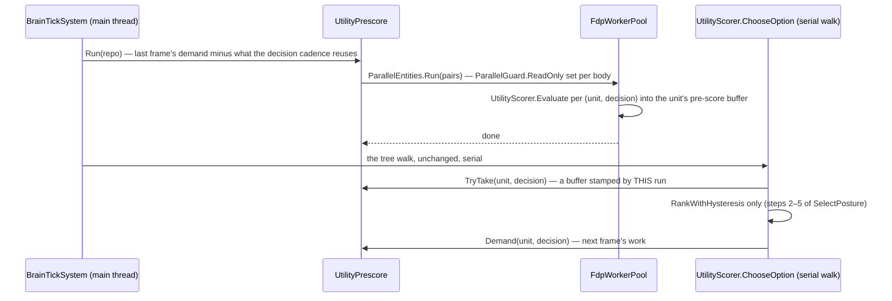
*What the picture shows that prose hid: the tree walk is untouched — only its most expensive leaf (67 % of the brain, Q-0) is computed ahead, in
parallel, from the world as it stood at the start of the brain phase; so no claim, assignment or reaction ever runs off the main thread.*

| deviation from §10 / the POC 2 handoff | why (measured) |
|---|---|
| ⭐ Q-4 is a parallel PRE-SCORE, not a parallel tree walk | the walk is tangled with shared state (§9, E-5); the scoring is pure reads (audited; `ParallelGuard` proves it in Debug) and is 67 % of the brain. ⇒ BrainTick −38 % on 2 threads. R-4208's cover claims stay serial — the rule waits for a walk that needs it |
| ⭐ §10.2's "emitter writes only on change" became a byte compare in the TICK PATHS (blueprint tick + the brain's per-tick store view) | no tick-contract change, no golden regeneration, 0 B; and the no-op writes were BTree / HSM, not blueprints |
| ⚠ even then the 4 KB tier stays ~50 % unchanged-dirty | the remaining stamps are real in-tick changes WRITTEN BACK within the frame (caller sampling, status D-11) — not yet found; D-5 (frame-end compare) is the only tool that catches them today |
| ⚠ off-frame egress (Egress §7) is a wash on the CGF | its replica sync is ON the main thread (11.8 ms) and the CGF's biggest translator (`EqsSensorConfigTopic`, 17 ms) builds every topic every frame before comparing (status D-4, D-7) ⇒ a change gate there first; then the recorder shares the replica (Q-3, D-12) |
| the per-query timer (`QueryTimings`, on by default) costs ~13 ms of the brain at 1 000 men | status D-1 |

## 15. ⭐ As-built on `exp/parallel-sim-3` — POC 3, the cheap wins *(not merged; status: [`STATUS_Parallel_Sim_POC_3.md`](blueprints/batches/STATUS_Parallel_Sim_POC_3.md) on that branch)*

| item | as built | measured (VM; Windows where noted) |
|---|---|---|
| §12 R-4209 the sampled timer | `QueryTimings.Begin` times 1 call in 16 (a per-thread xorshift draw — a fixed every-16th counter aliases with a fixed-order loop), scaled; counts exact; `HROT_QUERY_SAMPLE=1` times all | BrainTick 74.3 → 64.7 (sampled) → 58.3 (off) |
| ⛔ SUPERSEDED (R-4219) — the pre-score widened | `UtilityPrescore` scores CANDIDATE decisions (threat ranking, through `TopCandidate`) as well as option decisions | BrainTick 71.4 → 51.2 ms; Windows POC 2: 104 → 56, 2.0× at 8 threads |
| §10.2 stamp only on a change | unchanged; on this base it removes every unchanged-dirty chunk of the 4 KB tier (54 % → 0 %, dirty −45 %) — POC 2's residual did not reproduce | M-1 |
| the CGF's EqsSensorConfig egress | its cost was a LOCK + a new list per sensor per frame in `SimpleClusterStateCache.AllNodeIds` — one snapshot rebuilt on a set change, and the ids read once per scan | trace: the call gone from the profile |
| ⚠ the egress visit gate on the CGF | skips nothing: `OwnershipEgressSystem`'s managed READS stamp `DescriptorOwnership`'s chunk (A1-2) ⇒ "authority changed" ⇒ a full scan every frame. ⭐ A non-stamping managed read built opt-in (`HROT_MANAGED_READ_NO_STAMP=1`); the default is the user's call | gate stats: 0 skipped of ~6 M |
| the replica sync | its per-table copies on the worker pool (`EntityRepository.ParallelSync`); fully off the main thread is NOT safe (the next frame writes what it would read) | launch 11.9 → 8.4 ms; SimHost frame with off-frame egress 106 → 49 (Windows 92 → 40) |

## 16. ⭐ As-built on `exp/parallel-sim-4` — POC 4, ONE pool and the dependency-scheduler question *(not merged; status: [`STATUS_Parallel_Sim_POC_4.md`](blueprints/batches/STATUS_Parallel_Sim_POC_4.md) on that branch)*

⭐ §13's lean, built and measured: **one pool, two lanes — GO; a dependency scheduler — NO-GO** (the heavy systems are one chain of real
data dependencies: best case −9 to −14 ms of a 158 ms frame). §13's table of four mechanisms is SUPERSEDED on this branch by the rows below.

| mechanism (§13) | on `exp/parallel-sim-4` |
|---|---|
| `Fdp.ModuleHost.Threading.WorkerPool` | ⛔ deleted — its windows run on `FdpWorkerPool`'s BACKGROUND lane |
| `FdpWorkerPool` | ⭐ THE pool: FRAME lane (`Run`) + BACKGROUND lane (`TryRun`), one budget (cores − 2) |
| `Parallel.ForEach` / `Parallel.For` | ⭐ gone from `EntityQuery.ForEachParallel` and `RaycastSolverSystem` — both on the frame lane, 0 B when warm |
| `Task.Run` (background modules, recorder) | ⚠ unchanged — cross-frame work; needs a third job kind (a capped long-job queue), not built |

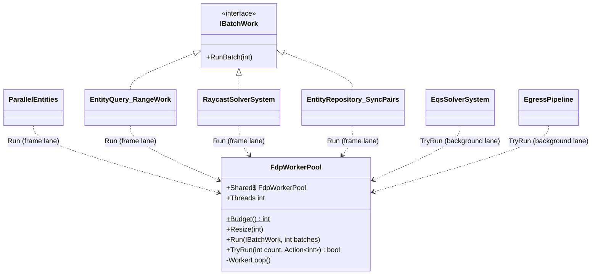
*What the picture shows that prose hid: every caller now reaches ONE class; the lane is chosen by the CALL (`Run` vs `TryRun`), so a caller
cannot land on a second pool by construction.*

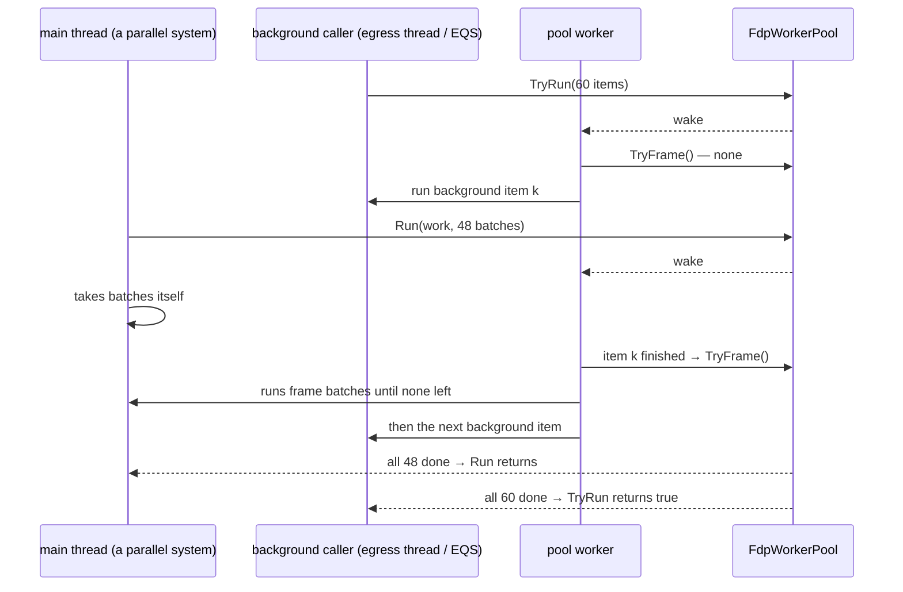
*What it shows: a frame run waits for at most the ONE background item a worker is inside (the J-1 rail measures it).*

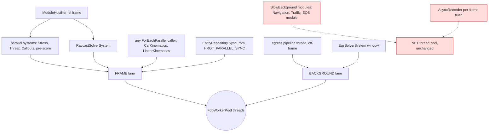
*Red: the cross-frame work still OUTSIDE the one budget — a module tick can last 100 ms and a hung one is a zombie (CE-3066), so it cannot be
a pool item without a cap; the recorder makes one `Task` per frame.*

**J-3 — why no dependency scheduler** (full table: [`J3_Access_Analysis.md`](blueprints/batches/parallel-sim-4/J3_Access_Analysis.md)):

| phase | serial ms | critical path ms | ideal on 6 cores | gain |
|---|---|---|---|---|
| Simulation | 149.8 | 144.2 | 144.2 | 5.6 |
| all phases | 158.1 | 149.4 | 149.4 | **8.7 (5.5 %)** |
| all, structural changes deferred + managed reads not stamping | 158.1 | 143.7 | 143.7 | **14.4 (9 %)** |

The chain: Stress → Threat (`TargetMemory`) → **Brain** (`TargetMemory`, `StanceIntent`, `BehaviorState`) → Callout → WeaponDispatcher
(`WeaponState`) → Squad. ⭐ The cores belong INSIDE those systems (data-parallel, as the pre-score), not beside them.
## 17. Managed component reads stop stamping — the default, after an audit *(R-4210)*

🔒 User, `2026-11-12`: *"yes, queue the audit; the other backend lane is free, if it can be done in parallel with POC4"* — on the lean: a managed
`GetComponent` READ must not bump the chunk version (A1-2); it becomes the DEFAULT once an audit has found and fixed every in-place mutation of a
managed component (already forbidden — CLAUDE.md: managed components are immutable and replaced whole). Both lanes hit it: the threaded editor
(a read off the sim thread is a write race) and the egress visit gate (POC 3 T-2: 0 skips, because `OwnershipEgressSystem`'s reads stamp every
chunk). Built and measured in [CE-4445](blueprints/batches/HANDOFF_Coordinator_To_Backend_Managed_Reads_Audit.md).

⭐ **As built (`exp/managed-reads`, not merged — [status](blueprints/batches/STATUS_Managed_Reads_Audit.md)):** the default is the non-stamping read
(`ThreadedReads.PureReads`; `HROT_MANAGED_READ_STAMP=1` restores the stamping read for one release). The audit and a runtime detector found no
RECORDED managed component mutated in place; two `NoReplay` bookkeeping types are mutated in place by design and kept. Rails unchanged between
the two modes; a recording replays to the same state either way.
⛔ **The premise "the reads defeat the egress gate" was incomplete:** with the flip, the CGF gate still skips 0 — `DescriptorOwnership`,
`PartMetadata` and `NetworkAuthority` are WRITTEN every frame (`OwnershipApplier.Apply` on every `OwnershipUpdate`, `BrainTickSystem`, command-buffer
playback), measured with `HROT_STAMP_TRACE`. ⇒ the gate needs CE-3442 (skip a no-op ownership write / a per-entity authority signal).

### 11.1 Update — `exp/perf` on the 8-core Windows machine *(`STATUS_Ui_Windows_Perf.md` on exp/perf, `2026-11-12`)*

| | serial | everything on | |
|---|---|---|---|
| CGF frame (1 000 men, recorded) | 256 ms (8.8 fps) | **163–173 ms (12.2 fps)** | **1.52×** (POC 2 alone: 1.47×) |
| `BrainTickSystem` | 96 ms | **42 ms** | the pre-score, posture + threat ranking |
| the one worker pool | everything on, 1 thread: 255 ms | at its budget: 173 ms | **the pool buys 81 ms** |
| SimHost with off-frame egress | 96–104 ms | **42–51 ms** | 20 → 40–45 fps |
| the sampled timer · T-2 gate · Q-1 | — | inside the 9 ms noise | the gate still skips 0 (CE-3442) |

⚠ **Two open anomalies:** ① off-frame egress + the parallel replica sync ALONE on a serial CGF frame makes it **slower** (252 → 337–339 ms,
reproduced; brain, weapons, ingress all grow) — invisible with everything on; suspected CPU contention on the 7 pinned logical CPUs, not measured.
② network ingress falls 14 → 3.6 ms with threads though it is not parallelised — unexplained.

## 18. ⭐ Per-entity parallel brains — the proposal and what decides it *(threaded POC 4 session + the user, `2026-11-12`; a lean, not ruled)*

🔒 User, `2026-11-12`: *"todays computers have 16+ physical cores so parallelization is the way to go."* Today only the brains' READ-ONLY scoring is
parallel (the pre-score: BrainTick 96 → 42 ms on Windows); the tree / HSM / action / blueprint execution is serial because it may write OTHER
entities (A-1: BrainTick writes 42 component types, squad-shared ones among them — `UnitRoster`, `SquadCognitiveState`) and a later brain may read them.

**The rule proposed** (the standard ECS discipline): a brain writes its OWN entity directly; anything aimed at another entity is a command in a
per-batch buffer, played in a fixed order after the phase; a read of another entity's brain-written component sees LAST tick's value. Precedents:
R-4208 (cover claims one tick late), `ParallelEntities` per-batch merge (POC 1), `ParallelGuard`.

| what decides it | how to measure | status |
|---|---|---|
| how many cross-entity WRITES, and where (each becomes a command) | a census: BrainTick sets a thread-local "current brain entity"; every component write / read classified own vs other, by type and call site, sampled stacks; one 1 000-man run | ⛔ not measured (A-1 counts per TYPE, not per entity) |
| cross-entity READS of brain-written components (must see last tick) | the same census | ⛔ not measured |
| ⭐ beyond components — the census must also count | ① STRUCTURAL changes, even on the own entity (create / destroy, add / remove: EQS child sensors are created in-tick) ⇒ deferred · ② bus publishes ⇒ per-batch event lists (exist) · ③ shared state outside components: `DecisionCadence`, dedup dictionaries, `BlueprintSharedState`, sim statics (`ObjectiveCensus.s_men`, `MemberEvaluationBehavior.s_current` — A-2 "sim-only scratch, unconfirmed") · ④ entities created this tick and read by a later brain · ⑤ leader → soldier orders within one tick (with commands they arrive a tick later — a behaviour change like R-4208, the user's call) | ⛔ |
| the prize | a trace splitting BrainTick's remaining ~42 ms (Windows) into scoring vs execution | ⛔ |

⭐ **Determinism comes for free with this rule.** The serial order is what makes today's result order-dependent; if every cross-entity effect is a
command merged in a FIXED order and every cross-entity read sees last tick, the result no longer depends on thread count or batch split — parallel
AND deterministic (Jacobi instead of Gauss-Seidel). It is a DIFFERENT result from today's serial one (a friend's claim seen a tick later), so the
regression goldens are re-baselined once — and R-4208's "Throughput only" could extend to Deterministic mode.

**The prize, bounded honestly:** the brains are one link of the measured chain (stress → threat → brain → callouts → weapons → squad, §16 J-3); the
same rule applies to every per-entity system in it, and that — not the brains alone — is what lets 16 cores pay. ⇒ census the brains first; if the
lists are short, the rule becomes the engine's rule for per-entity systems, enforced by `ParallelGuard`.

🔒 User, `2026-11-12`: *"basically every system can be parallelized including the brains, there is nothing why brains should be handled differently,
is it?"* — ✔ the RULE is the same for every per-entity system; the brains differ only in HOW MUCH they touch (42 written types, structural changes,
state outside components). Systems that are not per-entity (a spatial-hash build, ingress / egress, command playback) need a parallel algorithm
of their own (a partitioned build, a reduction), not the rule. ⇒ the census covers EVERY system of the phase, not only the brains
([CE-4449](blueprints/batches/HANDOFF_Coordinator_To_Backend_Entity_Access_Census.md)).

### 18.1 ⭐ The census verdict and the user's three calls *(R-4212, R-4213, `2026-11-12`)*

The census ([status](blueprints/batches/STATUS_Entity_Access_Census.md) on `exp/entity-census`): **GO — the rule is viable for the whole Simulation
phase.** CGF systems: 18 READY · 11 CONVERTIBLE (128 ms VM) · 6 GLOBAL · 36 no per-entity access in the run. Genuine cross-entity writes: callouts /
utterances and the command order journal (everything else was the brain's own child sensors); in-tick child-sensor creation ⇒ deferred; the
last-tick set = 18 types, a masked copy of them costs **CGF 1.9–2.7 ms, SimHost 0.9 ms** (a full copy 5.2–8.5 ms) ⇒ the last-tick view is that small
masked copy (settles D-4's half). Prize (Windows serial 256 ms): 2.05× at 4 cores, 2.5× at 8, 2.8× at 16 — the floor beyond 8 is egress, the
recorder and ingress (per-entity scans too).

🔒 User, `2026-11-12`: *"yes to all three"* — **R-4212:** ① a brain (and any per-entity system) reads other units' in-phase-written state from
LAST tick (the last-tick copy); ② a callout / an order to another entity is a command and reaches its listeners one tick later; ③ squad-level
systems run in parallel per SQUAD, not per man.

🔒 User, `2026-11-12`: *"we do not want a timing taking 12% so whatever helps"* — **R-4213** (supersedes R-4209's "sampled 1 in 16, on by
default"): the census measured the SAMPLED per-query timer still at 11.9 % of BrainTick ⇒ `QueryTimings` is OFF by default in every host; the
scale rig, the measurement scripts and `/diagnostics/queries?enable=1` turn it on when someone measures.

### 18.1a ⭐ As measured — the cross-entity access census, detail *(branch `exp/entity-census`, measure only; status: [`STATUS_Entity_Access_Census.md`](blueprints/batches/STATUS_Entity_Access_Census.md))*

⭐ **The rule is viable for the whole Simulation phase.** The CGF's heavy systems are all per-entity walks with SHORT conversion lists; the payoff
beyond 8 cores is bounded by egress, the recorder and ingress, not by the brains.

| | measured (1 000 men, steady state) |
|---|---|
| CGF Simulation + PostSimulation | READY 18 systems (6.5 ms VM) · **CONVERTIBLE 11 (128 ms)** · GLOBAL 6 (0.3 ms) |
| genuine cross-entity writes | callouts / utterances and the command order journal (~0.1 per brain run) — a brain's other "foreign" writes are its OWN child sensors (own-part, `PartMetadata.ParentEntity`) |
| already deferred | Stress (`StressModel.Add`), WeaponDispatcher (`ShotLedger.Settle`) — POC 1's per-batch merges |
| structural | in-tick child-sensor creation ⇒ deferred creation |
| the last-tick set | 18 types; their per-tick copy **CGF 1.9–2.7 ms** (a full copy 5.2–8.5 ms) |
| shared state outside components | the same few statics in every big system (`QueryTimings`, `Armament._conductJudgements`, the utility name registries, `DecisionCadence.s_wakeSlots`) + per-system scratch lists |
| the prize (Windows ms) | 4 cores 125 ms · 8 cores 102 ms · 16 cores 91 ms · 32 cores 85 ms (from 256 ms); floor ≈ 80 ms = egress + recorder + ingress |

The instrument: `EntityCensus` (`HROT_ENTITY_CENSUS=1`, `Fdp.Core`) — a per-thread stack of the entities the system is walking, every access
classified own / own-part / other / other-scan / none. ⛔ Blind spots: raw pointers taken once, `GetComponentTable`, loops that are not
`EntityQuery` walks (counted as "none"), pool workers (run it with `HROT_SIM_THREADS=1`).

### 18.2 ⭐ What goes into the last-tick copy — DECLARED by construction, not "copy all" *(user, `2026-11-12`: "why copying all, even blueprint knows what entity it reads and can say whenever it does what component it reads")*

Measured: the generated behaviour code reads components through TYPED calls only — `GetComponentRO<T>(entity)` on `self`, a child sensor, or an
entity variable (`__t0`, `__t5` …): 15 such reads in `Hrot.AI.Behaviors`' generated files, e.g. `UnitRoster`, `LocomotionChannel`,
`DangerAreaCognitiveBuffer` on a child; ⛔ no boxed / reflective / by-name reads (grep over the generated files). ⇒ the GENERATOR knows, for every
asset, which component types it reads and whether the entity is the unit itself / its own part or ANOTHER entity.

| content | how its cross-entity reads are known |
|---|---|
| blueprints, BTrees, HSMs (generated, incl. user assets compiled at run time) | ⭐ the generator emits, per asset, the set of component types read on entities other than self / own parts; registered with the asset; hot reload replaces it between ticks |
| hand-written systems and the library helpers generated code calls (`UnitSensors.Of`, `EnemyStrengthRatio` …) | a declaration on the system / helper (D-6), seeded from the census (N-2) |
| the last-tick copy's mask | the UNION over everything loaded — derived, never a hand list; changed chunks only (the 18 types the census saw: CGF 1.9–2.7 ms vs 5.2–8.5 ms for a full copy) |
| something undeclared slipping through | Debug / tests: the repository's read path (keyed by the census's per-thread current entity) THROWS on a cross-entity read of a type outside the mask ⇒ found by a rail, not in the field |

⚠ Not yet measured: the per-read cost of that check on the hot path (the tracer counted ~10⁹ accesses per run) — a static "parallel phase active"
flag checked first keeps serial code near free; to measure before the build. ⭐ **Measured (CE-4454): §18.3** — flag off no measurable cost; own +1.5–2.7 ns; another entity cheaper than today.

### 18.3 ⭐ As measured — the cost of the per-read cross-entity check *(branch `exp/read-check`, CE-4454; status: [`STATUS_Read_Check.md`](blueprints/batches/STATUS_Read_Check.md); the design is §18.2 above)*

⭐ **Affordable as designed: the check lives in the repository's own read path; no separate view type is needed for cost.**

| measured | result |
|---|---|
| serial code, the check compiled in, the phase flag off | ±0 … +1 ns per access (micro, Release) · the 1 000-man rig's CGF frame within its own run-to-run spread |
| a parallel phase, own entity | +1.5 … +2.7 ns per access (a `[ThreadStatic]` read + compare), on a 16–27 ns typed access |
| a parallel phase, another entity | 11 ns — **cheaper** than today's 16 ns: the last-tick copy is a flat array |

The hook: `ParallelReadCheck` (`HROT_READ_CHECK=1`, a `static readonly` the JIT folds away when unset) — one test in each internal read / write path
of `EntityRepository`, which every typed read reaches (`GetComponentRO/RW`, `TryGetComponent`, managed reads, `ISimulationView`).
⛔ **What the build must add:** ① the last-tick copy in NATIVE / pinned memory (callers keep pointers from typed refs for the tick —
`BlueprintTierSpec`); ② route `WeatherField.TryOutline` (a by-type-id managed read a brain's `EngagementArea` makes on another entity) through the
typed path; ③ ONE per-thread current entity shared with the census. ⚠ Not measured: the cross-entity write → command redirect, and a parallel run with
the flag on (needs §18's per-entity jobs).

### 18.4 Measured on heavier combat + the timer off *(CE-4450 K-2 / K-4, `exp/measure-2`)*

Combat ~2× heavier changes nothing in §18.1's verdict: 2 new cross-entity writes (the brain's order journal `CommandOrderHistory`; squad-level
`SquadMemberSense`), 3 new last-tick types (`CoverClaim`, `BallisticProjectile`, `NetworkIdentity`); the masked last-tick copy 2.6–2.7 ms on the
CGF (21 types), 0.7 ms on the SimHost. ⭐ R-4213 built: the per-query timer off by default — BrainTick 59.0 → 54.4 ms (−8 %).

### 18.5 ⭐ AS BUILT — the per-entity rule in the repository, the brains as a parallel phase *(overnight build N-10 / N-11, CE-4472 / CE-4473, branch `exp/threaded-build`; [status](blueprints/batches/STATUS_Overnight_Threaded_Build.md) D-21…D-35)*

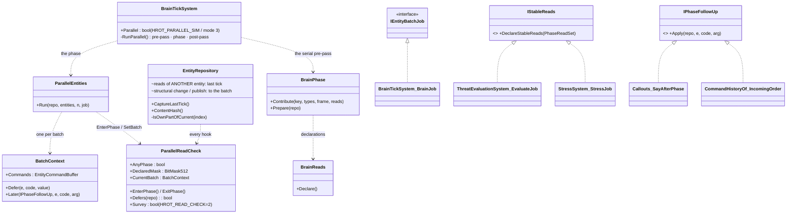
*What the picture shows that the prose hid: the rule lives in ONE place (the repository's own access paths + the batch), every per-entity
system reaches it through `ParallelEntities`; the brain adds only a pre-pass, a job and a post-pass; a helper that must touch another unit says
so through `Later`, a job that reads a stable type through `IStableReads`.*

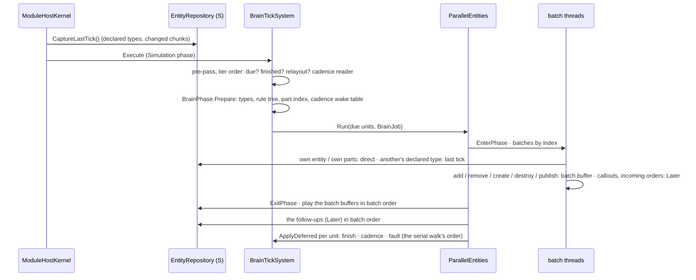

#### INVENTORY — the seams §18.5 builds on *(N-17, `2026-11-13`)*

| query | total | what it found |
|---|---|---|
| `scripts/cbm.sh search_graph '{"name_pattern":".*(Job\|Phase\|Staging\|SimJob\|ReadCheck).*","label":"Class"}'` | 64 (has_more) | the pre-existing job / phase classes (`ParallelEntities`, `BatchContext`, `FdpWorkerPool`, the per-system jobs) — the rule was built INTO them, no parallel set |
| `scripts/cbm.sh search_graph '{"name_pattern":".*(BatchJob\|StableReads\|PhaseFollowUp\|SimStepped\|ValueCopy).*","label":"Interface"}'` | 0 | ⚠ the graph predates tonight's types (a re-index produced no output) — grep below instead; coverage could not be checked |
| `grep` implementers of `IEntityBatchJob` | 6 files (`2026-11-13`; `UtilityPrescore` since retired, R-4219) | `UtilityPrescore`, `BrainTickSystem`, `ThreatEvaluationSystem`, `Callouts` (CalloutSystem), `StressSystem` (+ the declaration) — every per-entity phase |
| `grep` implementers of `IStableReads` · `IPhaseFollowUp` · `ISimSteppedSubsystem` · `IValueCopy` | 2 · 2 · 1 · 1 | threat + stress jobs · callouts + the incoming order · the editor · the traffic frame |

| as built | why | where |
|---|---|---|
| the rule is ALWAYS present (no compile switch); serial code pays one static load (`AnyPhase`) | §18.3 measured the check affordable | `EntityRepository.cs`, `ParallelReadCheck.cs` |
| an entity's PARTS are its own (`PartMetadata.ParentEntity`) — and, since F-11, what its job OWNS (`OwnAlso`, §18.6) | a brain writes its child sensors (§18.1a own-part) | `IsOwnPartOfCurrent` |
| inside a phase the world's command buffer IS the batch's | brain code records into `view.GetCommandBuffer()` | `EntityRepository.View.cs` |
| ⭐ an ADD is deferred ⇒ brain code adds a component WITH ITS FINAL VALUE (add-once), never "add default, then write it" | own-entity adds touch shared counters / logs and their order would follow the threads; 20 helpers converted | D-31 |
| registration and the per-frame indexes (rule tree, part index, cadence wake table) happen in the serial pre-pass, never inside the phase; a registration inside a phase is a checked defect | the type tables and the indexes are read lock-free by every batch thread | `BrainPhase` |
| cadenced brains read their events through a per-THREAD step window; the history's window buffers are per lane | one shared buffer would hand threads each other's events | `EventStreamHistory` |
| cross reads DECLARED: process-wide for brains (`BrainReads` — the survey's result), per JOB for "stable in this phase" (`IStableReads`) | a type stable in the threat phase is written in the brain phase; ⚠ the generator emitting each asset's set (§18.2) is still to do | `BrainReads.cs` |
| the instrument that finds what is missing: `HROT_READ_CHECK=2` (+ `HROT_READ_CHECK_OUT`) — every undeclared cross read / cross write / in-phase registration recorded with its first site | one rig run names them all (the throwing mode stops at the first) | `ParallelReadCheck.Survey` |
| ⭐ the gate: same `ContentHash` at 1 / 2 / 4 / 8 threads and across runs (`ParallelBrainsDeterminismTests`); the 300-man rig serial vs parallel behaves the same, 0 crashes, survey clean | — | §6 of the status file for the numbers |
| cover ties (F-9) by claim age, then entity index | two squad-mates can commit to one point in the same tick | DESIGN_Peek_And_Fire §10.7 |
| ⭐ every phase reads THIS tick's view: `Tick()` / a world sync mark it stale, `ParallelEntities.Run` re-takes it (`EnsureLastTickView`) — free when the kernel already did. ⛔ SUPERSEDED: "the first parallel tick takes it" — a world no kernel captures (the editor's preview copy) kept its FIRST view; later entities were read live ⇒ a thread-count-dependent world | the view is the rule's whole premise | `EntityRepository.EnsureLastTickView` (status D-41) |
| ⭐ body movement (`CarKinematicsSystem`) is a per-entity phase: neighbours' position / velocity from the tick-start view. ⛔ SUPERSEDED: a `ForEachParallel` reading neighbours LIVE (pre-existing, every host) — the stepped product run was repeatable at 1 thread only | the proven rule for a system whose entities read each other: read last tick | status D-42 |
| ⭐ the PRODUCT gate: the 1 000-man editor, stepped, the same orders at the same steps ⇒ the same world at 1 / 2 / 4 / 8 threads (`GET /world/hash?byType&rows`; EntityGuid excluded — minted at random) | — | status §2 N-15 ② |
| an egress mark (`SmartEgressUtil.MarkDirty`) inside a phase is a follow-up (`Later`) | `EgressSignals` grows ONE shared array; the publication state may be a first add — nothing reads the marks before egress | `SmartEgressUtil.cs` |

### 18.6 ⭐ AS BUILT — squad-level work in parallel PER SQUAD *(F-11, R-4212 ③; CE-4474; status D-36)*

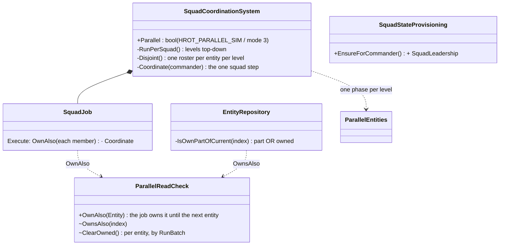
*What the picture shows that the prose hid: the squad's step is ONE method (`Coordinate`) for the serial walk and the job; the only new rule in
the repository is "a job may own more than its entity" — the squad brings its members into it, nothing else changes.*

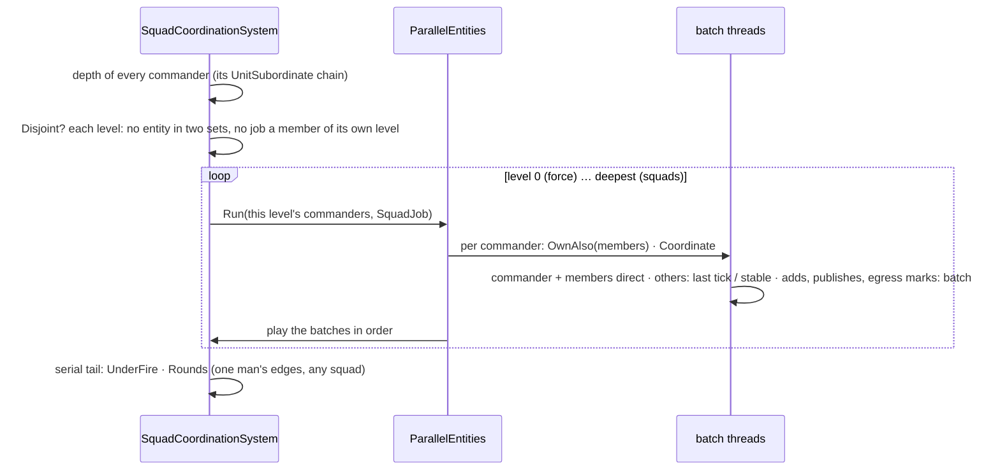

| as built | why | where |
|---|---|---|
| ⭐ the job is the SQUAD: it owns its commander AND its members (`ParallelReadCheck.OwnAlso`) | a squad's step writes its members (a successor's designation, each man's `SquadMemberSense`, a friend-down edge on a man) | `SquadCoordinationSystem.SquadJob` |
| ⭐ one phase per command LEVEL, top-down | rosters NEST — 41 of the 300-man rig's 43 commanders are themselves a roster's member (force → platoon → squad): within a level the sets are disjoint by construction (a man has one commander), and a level's members are the next level's jobs | `RunPerSquad` |
| a level whose sets overlap (a stale roster entry) ⇒ that tick runs the serial walk | the parallel result must never depend on it; the check is a stamp per entity index, no allocation once grown | `Disjoint` |
| `SquadLeadership` provisioned with the squad state (empty) | the first add was in `Succession`; in the phase it would land after `MemberDown` read it — the same tick lost (D-31's add-once rule) | `SquadStateProvisioning` |
| the serial tail stays serial (`UnderFire`, `Rounds`) | they walk one tick's edges by MAN, across squads | — |
| ⭐ the gate: same world and the same edges at 1 / 2 / 4 / 8 threads, and the serial walk's world and edge set, on a nested hierarchy created out of command order | — | `SquadCoordinationSystemTests.F11_TheSquadsInParallel_GiveTheSerialWorld_AtAnyThreadCount` |

### 18.7 ⭐ AS BUILT — the mode from what runs, the weapon phase, the serial work cut *(M-1…M-7, CE-4480…CE-4486, R-4218 / R-4219; branch `exp/threaded-build`; [status](blueprints/batches/STATUS_Mode_And_Serial_Systems.md) M-D1…M-D12)*

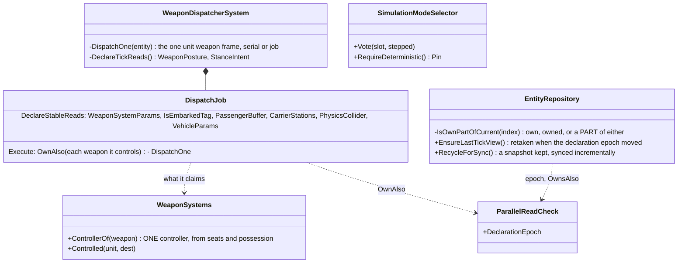
*What the picture shows that the prose hid: the weapon phase claims only what `ControllerOf` gives it — one controller per weapon makes the units'
sets disjoint by construction (the squads' argument: one commander per man), and the turret parts follow from "a part of an owned entity is owned".*

| as built | why (measured) | where |
|---|---|---|
| ⭐ the MODE is set by what runs: each kernel votes at its tick boundary (its clock stepped ⇒ Deterministic), a harness may pin it; any vote or pin wins; `HROT_SIM_MODE` removed | stepping, Run-to, filming and the regression all step the clock — one signal, no flag per feature (M-D3, M-D4) | `SimulationModeSelector`, `ModuleHostKernel` |
| the batch size is result-neutral (Throughput's `max(32, n/(threads×4))` = the fixed 32's world) | contiguous batches merged in batch order = entity order | M-1 |
| `UtilityPrescore` retired (§14 / §15 superseded) | a second mechanism for the brain work, unreachable whenever the brains are a phase | M-3 |
| ⭐ the weapon dispatcher is a per-entity phase; a job claims the weapon systems its unit controls; a part of an owned entity is owned | disjoint by `ControllerOf`; a station's turret is written directly in the same tick, as serially | `WeaponDispatcherSystem`, `IsOwnPartOfCurrent` |
| ⭐ the weapon phase's cross reads declared: the target's `WeaponPosture` / `StanceIntent` from the tick start, the controller lookups and the target's size as stable reads | the read-check survey (1 000 men, 4 threads): the force level read the target's posture while the target's job wrote it — the engagement mount differed between 4-thread runs | M-D10 |
| ⭐ a declaration EPOCH: a view taken before a type was declared is taken again | a phase declaring lazily (movement) read its neighbours LIVE on the first frame | `ParallelReadCheck.DeclarationEpoch`, `EnsureLastTickView` |
| a deferred publish makes its event stream as a direct one does | a squad phase's publish of an unregistered event threw at the batch's playback | `FdpEventBus.Publish`, M-D11 |
| `FriendNear` walks the frame grid with no lock (`FrameEntityGrid.AnyCandidate`); the callouts' no-echo check from a per-frame grid | the stress phase's men queued on one lock (1.3× at 8 threads on Windows); the say-pass walked every speaker per call | M-5, M-D8 |
| ⭐ module snapshots RECYCLED: kept, synced incrementally; chunks a module wrote are invalidated; a source REPLACED rather than advanced (`ContentEpoch`) is copied whole | each acquire copied every chunk of every table (≈ 30 ms a tick at 1 000 men) | `EntityRepository.RecycleForSync`, M-D7 |
| the registry's clone flag read lock-free | every managed table's sync took the global lock (≈ 25 ms a tick under contention) | `ComponentTypeRegistry.NeedsClone`, M-D6 |
| ⭐ the world hash counts FIELD bytes only (the managed layout) | two identical stepped runs differed only in padding — the gate compared history, not state | `EntityRepository.ContentHash`, M-D9 |
| ⭐ `Entity` has no undefined bytes: an explicit private always-zero field after `Generation` (size 8, hidden from every UI: they reflect public fields) | padding inside an opaque byte buffer (`WeaponChannel.State`) differed between runs — ⛔ was the "still open" row here | R-4222, CE-4507 (`d8e47f3c0`) |
| ⭐ the gate: the stepped 1 000-man run, every phase on, 1 / 2 / 4 / 8 threads ⇒ state equal (`EntityGuid` aside) | — | `scratchpad stepped-hash.py` → `scripts/stepped-hash.py` (CE-4501) |

### 18.8 ⭐ AS BUILT — what the squad drills taught under parallel brains: "own entity" covers its ADDS *(E-2 / E-3, CE-4508 / CE-4509; [status](blueprints/batches/STATUS_Entity_Padding_And_Squad_Drills.md))*

⭐ The drills ran in the kernel's frame order (E-2), serial and with `HROT_PARALLEL_SIM=1`: 78 of 228 red with parallel brains. ⛔ **None was the
accepted one-tick delay (R-4212).** Every one was the per-entity rule broken for a structural change on the job's OWN entity: the add is
deferred to the merge (it cannot be made in parallel), and the job's own later reads did not see it.

| the rule, as built | why (measured) | where |
|---|---|---|
| ⭐⭐ a MANAGED component a job adds to its own entity reads back to that job until the merge (`Has`, `Get`) | `SubordinateOrders.Record` (a read-modify-write) kept only the tick's LAST order — the plays re-sent the others (orders counted twice) | `BatchContext.RememberOwnManaged`, `EntityRepository.OwnPendingManaged` |
| ⭐⭐ an UNMANAGED add reads back through `TryGetOwnPendingAdd<T>` — never by `ref` (the value is not in the world's storage yet); an "add if absent, else mutate" helper builds on it | `ReportQueue.Enqueue`'s second report of a tick replaced the first (a hall's RoomClear lost to its Foothold) | `EntityRepository.TryGetOwnPendingAdd` |
| ⭐⭐ a CHILD created inside a phase is dressed in the SAME buffer: `EqsChildSensor.Ensure` hands back the pending child; ⚠ a buffer entity has a NEGATIVE index — test it with `!= default`, never `IsNull` | the survey and danger-area sensors landed bare and stayed so — never requested, never solved | `EqsChildSensor`, `WorldSurveyChildSensor`, `DangerAreaChildSensor` |
| ⭐ R-195 holds in the production order: an SOP wakes on the frame `RecentSenses` RECORDS a change (Input, one frame after the event was readable), as well as on the event's own frame | woken only on the event's frame it read an unchanged `RecentSenses` and reacted on its 0.2 s cadence — up to 17 frames late (serial too) | `BrainTickSystem.TickSopSlots`, `RecentSenses.RecordedAt` |

⭐ The drills: **228 / 228 serial and with parallel brains.** Rails: `PerEntityRuleTests.E3_*` (1 / 2 / 4 / 8 threads), `DangerAreaSensorSystemTests.E3_…`,
the drills themselves (12 red without the R-195 wake).

## 19. Windows scheduling: power throttling, hybrid cores, console pauses *(user, `2026-11-12`: "what about windows frontend / backend throttling and intel performance cores vs e-cores … i do not want headless mode running in console to be any slower")*

Measured: graph + grep for `PowerThrottling|SetProcessInformation|timeBeginPeriod|ThreadPriority|PriorityClass|EcoQoS|CpuSet|EfficiencyClass|ProcessorAffinity`
over `FDP` and `Hrot` ⇒ ONE hit (`OverlayCompileTracker.cs:36`, a BelowNormal compile thread). ⇒ ⛔ nothing today opts out of Windows' power
throttling, sets the simulation's thread priorities, or knows performance vs efficiency cores. ⚠ Every Windows measurement so far ran with
HIDDEN windows — a process Windows treats as background may already have been throttled (EcoQoS), so those numbers may be pessimistic.

| risk | what Windows does | ⭐ lean |
|---|---|---|
| background / hidden / console processes slowed | Windows 11 applies EcoQoS (power throttling: lower clocks, efficiency cores) to processes it deems background, and may ignore their timer-resolution requests | every HROT process opts OUT at start-up: `SetProcessInformation(ProcessPowerThrottling)` with `EXECUTION_SPEED` and `IGNORE_TIMER_RESOLUTION` off; per thread for the sim thread and the pool (`SetThreadInformation(ThreadPowerThrottling)`) |
| `Sleep(1)` / waits pace the loop at 15.6 ms | the default timer resolution | `timeBeginPeriod(1)` while a simulation runs (honoured once the opt-out above is in place) |
| background work delays frame work | equal thread priorities | the sim thread AboveNormal; the pool's FRAME lane Normal; its BACKGROUND lane (EQS, egress scan, recorder) BelowNormal |
| ⭐ Intel hybrid (P- + E-cores) | `Environment.ProcessorCount` counts both; a batch on an E-core finishes later and the whole parallel step waits for it | size the frame lane to the PERFORMANCE cores (`GetSystemCpuSetInformation`, `EfficiencyClass`), let the background lane use the efficiency cores; keep adaptive batches (stragglers absorbed). ⚠ The user's machine is AMD (no E-cores) ⇒ this can be designed and unit-tested, measured only on an Intel hybrid machine |
| ⭐ a console node FREEZES when someone clicks in its window | QuickEdit mode: a text selection blocks every write to the console ⇒ a thread that logs (a console line per step) stops, and the simulation with it | console hosts turn QuickEdit OFF at start-up (`SetConsoleMode`, clear `ENABLE_QUICK_EDIT_MODE`) |

⭐ **As built and verified on Windows** *(F-5 / F-6, CE-4505 / CE-4506)*: the opt-out lands on every process — ControlMask 5 / StateMask 0 read
back on each; each runner logs what it did once at start-up (`[Scheduling] power throttling: … · console QuickEdit: …`, `WindowsScheduling.Describe`).
⚠ Windows' default cost without it varies by day: 1.2–1.4× on `2026-11-13`, ~1.9× earlier — so the opt-out stays on, and a number measured
without it is not comparable.

### 11.2 ⭐ Scaling past 4 threads — measured on Windows *(`STATUS_Ui_Windows_Scaling.md` on exp/perf, CE-4451)*

| | measured (CGF on 6 cores of its own) |
|---|---|
| the flattening is NOT the CPU pin | whole frame at 8 threads 151.2 ms (own cores) vs 150.2 ms (pinned) |
| ⭐ BrainTick | 90.6 → 46.8 → 43.1 → 39.6 ms at 1 / 4 / 8 / 12 threads (2.3×) — a fit gives **~36 ms SERIAL** (the walk after the pre-score) + ~43 ms parallel |
| per system, 1 → 12 threads | Threat 4.7× (still falling) · Stress 2.7× (flat from 6) · Callouts no gain |
| unpinned (three nodes left to the scheduler) | SLOWER: serial 327 ms vs 229 pinned — the nodes contend; pinning helps every node |
| the whole CGF frame | best **1.50×** vs 1 thread |
⇒ ⭐ the census prize model (2.5× at 8 cores) was an upper bound; the measured ceiling today is the brain's SERIAL walk (~36 ms) — exactly what the
per-entity rule (§18, R-4212 / R-4214) converts. ⚠ Several nodes on one machine need a machine-wide core budget (inventory §7.2 F-15).
