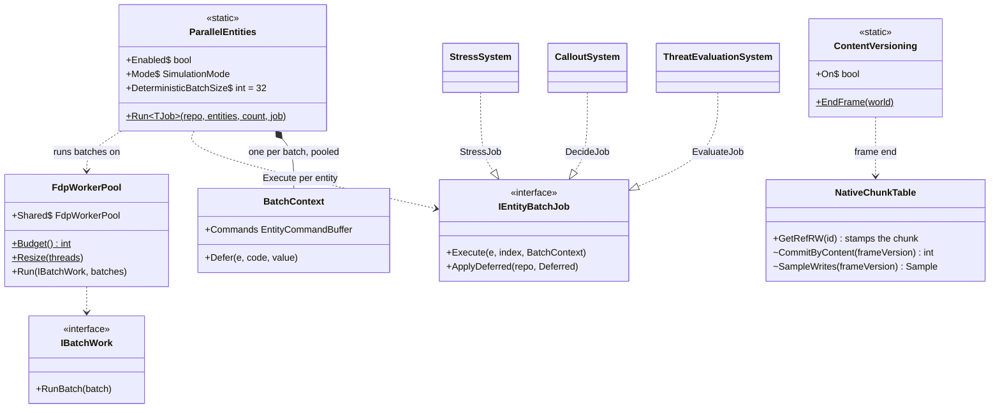
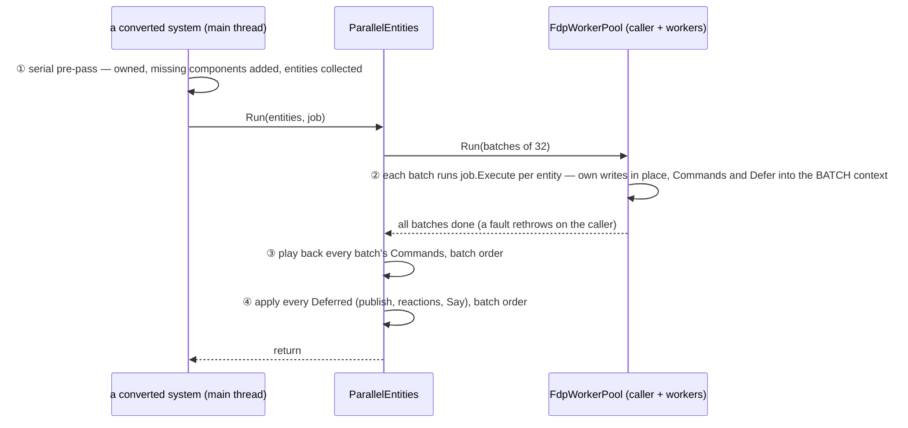
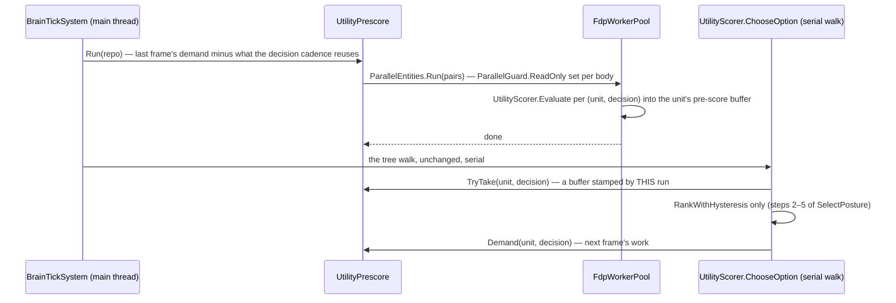

<!--STATUS
state: LIVE
build-state: DESIGN — options analysed, lean stated; NOT ruled
updated: 2026-11-12
current-answer: ⭐ §14 POC 3 as built (the cheap wins) · §13 POC 2 as built (the brain pre-score) · §12 R-4209 the sampled timer · §11 the aggregate (where the time is) · §10 after the experiment (R-4208, the emitter fix) · §9 the AS-BUILT of the overnight experiment (exp/parallel-sim) · §8 interleaving and quantizing (do less per frame) · §7 determinism is a switchable MODE (R-4207) and what per-batch buffers cost · §2 the lean · §1 what exists (measured) · §3 the options · §4 the hazards · §5 the staged plan · §6 open
stale-below: nothing
related-designs:
  - blueprints/batches/HANDOFF_Coordinator_To_Backend_Parallel_Sim_POC_2.md — CE-4440, POC 2: the serial 70 % on exp/parallel-sim-2
  - blueprints/batches/HANDOFF_Coordinator_To_Ui_Windows_Parallel_Sim_Measure.md — CE-4437, the 8-core Windows measurement of exp/parallel-sim
  - blueprints/batches/HANDOFF_Coordinator_To_Backend_Parallel_Simulation_Experiment.md — the overnight experiment (branch exp/parallel-sim) that tries §5 / §7 / §8
  - DESIGN_Threaded_Simulation_Presentation.md — the simulation on a worker thread (R-4205); this design parallelises INSIDE that worker's tick — the two add up, and share one core budget (its §11 F-20)
  - DESIGN_Evaluation_Cost_And_Cadence.md — §11h the measured per-system costs at 1 000 men these options target; §3 the brain cadence
  - DESIGN_Scale_Rig.md — §7.7 P-1 parallel EQS (built), the many-core Windows measurements
  - ../FDP/Engine/docs/Parallel-Processing-Production-Implementation.md — the existing ForEachParallel (adaptive batches, zero allocation)
  - ../FDP/Engine/docs/FDP-GDB-SoD-unified.md — FDP-DES-012: background modules on snapshots, commands back
-->

# DESIGN — run the simulation on many cores: parallel systems over many entities

## 0. The request

🔒 User, `2026-11-12`: *"I want to talk about how to parallelize much more than we do now. Single thread calculations of thousands of entities is
ineffective … There are many systems running over many entities. Many of those could be ok with writing stuff via command buffers, allowing parallel
runs. Pls analyze the options."*

## 1. What exists — measured `2026-11-12`

| fact | where |
|---|---|
| ⭐ the scheduler runs a phase's systems ONE AFTER ANOTHER, in `[UpdateAfter]` / `[UpdateBefore]` order — no system-level parallelism | `SystemScheduler.cs:222-231` |
| ⭐ a data-parallel loop EXISTS: `EntityQuery.ForEachParallel` — adaptive batches, a `ParallelHint` (light / medium / heavy), `FdpConfig.MaxDegreeOfParallelism`, pooled batch lists (zero allocation) | `EntityQuery.cs:~400-445`; `FDP/Engine/docs/Parallel-Processing-Production-Implementation.md` |
| ⭐ PER-THREAD command buffers EXIST: `GetCommandBuffer()` returns a `ThreadLocal` buffer; `FlushCommandBuffers()` plays them all back | `EntityRepository.View.cs:16-48`; `EntityCommandBuffer.cs:9-10` ("thread-safe for recording, each thread its own buffer; playback on the main thread") |
| who uses it today: car kinematics, linear kinematics, hull clearance, the raycast solver, the navmesh baker; the EQS solver runs parallel (P-1) | grep `ForEachParallel` / `Parallel.For` |
| ⛔ who does NOT: brains, weapons, stress, callouts, threat, squads — the CGF systems that cost the most | §11h of Evaluation Cost |
| the native event bus's `Write` is lock-free and safe for concurrent writers within a phase (only the end-of-frame swap must not overlap) | `NativeEventStream.cs:88-98` |
| background modules already run on other threads on snapshots, writing commands back (EQS, navigation, traffic) | FDP-DES-012; `EqsModule.cs:39` |

**Where the time goes at 1 000 men** (Evaluation Cost §11h, the user's Windows machine, ms per frame): the synchronous CGF simulation **38** — brains
9.8, weapons 7.3, stress 5.7, callouts 3.7, threat 2.0, squads 1.7, ~25 small ≈ 8 — the PostSimulation phase **9.5** (drone impacts 2.0, car
kinematics 1.7 — already parallel —, fire processing 1.4, map layers 1.1), the background snapshot copies 8.3.

**The write patterns of the hot non-brain systems** (grep of each file):

| system | in-place writes | to whom | bus publishes | loop |
|---|---|---|---|---|
| `StressSystem` | 2 × `Stress` | the man it loops over | 1 (`SensorChangedEvent`) | a cached list of people |
| `CalloutSystem` | 2 × `CalloutState` | the man it loops over | 0 | a cached list of men |
| `WeaponDispatcherSystem` | 6 (`WeaponChannel`, `WeaponState`, barrel heat, `AmmoLoadout`) | the mount / barrel / loadout it loops over | 0 | cached lists |
| `CgfThreatEvaluationSystem`, `SquadCoordinationSystem` | 0 | — | 0 | — |
| `BrainTickSystem` + the behaviours | ~100 sites | mostly the unit's own channels and state; some cross-entity (squad state, objective status, cover claims) | some | the tier queries |

⇒ ⭐ **the hot non-brain systems already have the shape that parallelises: a loop over entities, each writing only itself.** The brain is the hard one.

## 2. The lean

⭐ **Data-parallel loops INSIDE the hot systems (option A), made deterministic, starting with the systems that write only their own entity; the
brains last and behind a guard. System-level parallel scheduling (option B) not now.** Basis: §1 — the loop, the per-thread buffers and the batch
machinery exist; a handful of systems hold most of the cost; the per-entity loops write only their own entity.

| rejected (for now) | the one fact |
|---|---|
| B — run independent SYSTEMS concurrently from declared read / write sets | no system declares its reads and writes today (hundreds to annotate), in-place writes cannot be checked without an analyser, and a few systems dominate the cost — parallelising inside them gains more for less |
| C — move more systems to BACKGROUND modules (snapshot + commands) | each module pays its own snapshot copy (~4 ms each today, §11h) and adds a frame or more of latency; right for slow, lower-rate work (it is how EQS / navigation run), wrong for per-tick systems |
| D — split the men over more CGF NODES (processes) | ⏭ a cluster-level option for very large exercises; ⚠ UNVERIFIED whether more than one CGF node can own a partition of the units today |

## 3. The options in detail

| | A — parallel loops inside a system | B — parallel systems | C — background modules | D — more nodes |
|---|---|---|---|---|
| what runs at once | batches of entities of ONE system | different systems of one phase | a module on a snapshot, alongside the frame | whole simulations in other processes |
| what it needs | per-entity independence; cross-entity writes and structural changes via command buffers; deterministic merge | a read / write declaration per system and a scheduler that builds a parallel graph | the module rewritten to read a snapshot and write commands | ownership partitioning, the network |
| what exists | ✅ `ForEachParallel`, per-thread buffers | ⛔ | ✅ the kernel's async modules | ⚠ to check |
| determinism | ⚠ needs the merge of §4 | ⚠ the same plus ordering of systems | ✅ by slots (Time Architecture §17) | per node |
| cost | small per system (the self-writing ones); large for the brains | large (annotate everything) | medium per module | large |
| gain at 1 000 men (est., 24 cores) | the ~20 ms of weapons / stress / callouts / threat / squads → a few ms; the brains' ~10 → ~1–2 | overlaps systems — bounded by the biggest one | frees the tick, adds latency | scales out |

## 4. The hazards — what makes a system safe to run in parallel

| hazard | why it breaks | remedy |
|---|---|---|
| ⛔ **non-deterministic order** — per-thread buffers and events land in thread order, and which thread gets which batch varies run to run | stepped mode, replay, filming and the scenario regression's goldens require the same result every run — ⚠ only in the Deterministic MODE (§7) | ⭐ per-BATCH buffers (not per-thread), played back in batch order; events written per batch and appended in batch order — the result is then independent of the thread count |
| writes to ANOTHER entity in place | two batches writing one entity race | only through the command buffer (deferred to the batch merge) |
| structural changes (create, destroy, add / remove) mid-loop | invalidates the query | already command-buffer-only |
| shared caches: `Dictionary`, `ConditionalWeakTable`, static lists in systems and helpers | "collection modified", torn state | per-batch scratch, or computed before the loop |
| shared random number generators (2 files use `new Random` / `Random.Shared` in the AI) | not thread-safe; not deterministic across threads | a per-entity stream (seed from entity + tick), the expander's pattern |
| allocation in the parallel body (closures, LINQ) | GC pressure (R-2084) | `ForEachParallel` is zero-allocation; the body must be too |
| the cores — the threaded presentation's main thread (R-4205) and the background modules share the machine | oversubscription, UI stutter on small machines | one parallelism budget (cores − 2 when the presentation is threaded), `FdpConfig.MaxDegreeOfParallelism` |

⭐ **The safety net — a rail per converted system: run it SERIAL and PARALLEL on the same world and compare the world byte for byte**, at several
thread counts. A difference is a hazard the conversion missed. Plus the existing determinism rails and the scenario regression.

## 5. The staged plan *(once ruled)*

| step | what | gain | size |
|---|---|---|---|
| P-0 | ⭐ **deterministic per-batch merge** in `ForEachParallel` (per-batch buffers and event lists, merged in batch order) + the serial-vs-parallel rail harness | makes every later step safe | small, in Fdp.Core |
| P-1 | convert the self-writing hot systems: stress, callouts, weapon dispatcher, threat evaluation, squad coordination, and PostSimulation's drone impacts and fire processing | ~20 of the 47.5 ms → a few ms (to measure) | small each |
| P-2 | the inventory of the brain's writes (~100 sites): self vs cross-entity vs bus vs shared state; a Debug guard that knows "the entity this batch owns" and throws on a direct write to another | makes P-3 checkable | medium |
| P-3 | the brains in parallel: the tier loop over units in batches; cross-entity writes through the batch buffer | ~10 ms → ~1–2 ms | large (the behaviours' nodes) |
| P-4 | the long tail (~25 small systems) by measured cost | the rest | small each |
| later | B (parallel systems) only if, after P-1…P-4, many mid-sized systems remain | — | large |

## 6. Open

| question | why |
|---|---|
| which of the ~100 brain write sites are cross-entity | sizes P-3 |
| does any event consumer depend on the order of events within a frame | the per-batch merge makes order deterministic but different from today's serial order — goldens may need regenerating once |
| can more than one CGF node own a share of the units | option D |
| the parallelism budget with the threaded presentation | §4, Threaded design §11 F-20 |

## 7. ⭐ Determinism is a MODE, not a law — switchable against throughput *(user, `2026-11-12`; R-4207)*

🔒 User, `2026-11-12`: *"If Determinism mode goes against performance mode, these two are not necessary at the same time (determinism good for film
taking and regression test harnesses and special cases like stepped mode, real big scale simulation does not need) — needs to be switchable. What would
per batch buffers mean to performance?"*

| who needs determinism | who does not |
|---|---|
| the film director and its stills · the scenario regression and its goldens · the determinism rails · stepped mode and Run-to (Time Architecture §17, R-3035) · replaying a run to compare it | a big live exercise — 1 000 to 10 000 men at real time, where only throughput matters |

### 7.1 What per-batch buffers cost

⭐ **Almost nothing — the determinism is in the ORDER OF PLAYBACK, not in how work is shared out.** Threads still steal batches dynamically
(load balancing unchanged); each batch writes into its OWN pooled buffer instead of its thread's; at the end the buffers are played back in batch order
instead of thread order.

| | per-thread buffers (throughput) | per-batch buffers (deterministic) | difference |
|---|---|---|---|
| the parallel loop | the same batches, stolen dynamically | the same | none |
| recording a command | append to the thread's buffer | append to the batch's buffer | none |
| buffers alive | one per thread (~cores) | one per batch (~2 × cores, pooled — the adaptive batching targets 2 per core) | a few dozen small pooled objects, 0 B per steady frame once warm |
| playback | buffers in thread order — one serial pass over every command | buffers in batch order — the SAME serial pass | none: the same total commands |
| events | written straight into the bus, concurrently (lock-free) | written into the batch's list, appended to the bus in batch order | ⚠ one extra copy of each event — proportional to the EVENTS, not to the entities (tens to hundreds per tick) |
| a system that writes only its own entity (stress, callouts, weapons) | no buffer at all | no buffer at all | none |

⇒ the per-batch merge costs one copy of the events and a few pooled buffers — microseconds per tick. **It is not where determinism costs
performance.** ⭐ Measure it in P-0 to confirm.

### 7.2 Where determinism DOES cost performance

| deterministic behaviour | its cost | in throughput mode |
|---|---|---|
| ⭐ **stepped mode waits for background jobs on a step** (EQS, navigation — `ModuleHostKernel.cs:678-683`, Time Architecture §17) | the step waits the slowest job (EQS ~58 ms per run at 1 000 men, §11h) | never wait — results land when they land (today's continuous play already does this) |
| slow modules on SIM-time slots | a module can run only at its slot | wall-clock cadence (Scale Rig C-1, built) |
| results independent of the thread count — per-batch order, no parallel floating-point reductions in an unstable order | negligible (7.1); a stable reduction where one sums floats across batches | per-thread order, any reduction order |
| the same random stream every run | a per-entity seeded stream | the same (it is also faster than a shared locked one) |

⇒ ⭐ **the switch matters for the WAITS, not for the buffers.** Most of it already exists as the TIME mode: stepped (deterministic) vs continuous.

### 7.3 The switch

| | ⭐ lean |
|---|---|
| ONE setting, `SimulationMode { Deterministic, Throughput }`, read by the kernel and `ForEachParallel` | one place, not a flag per system |
| ⭐ chosen by WHAT IS RUNNING, not by hand: stepped mode, Run-to, filming, recording a regression, the test harnesses ⇒ Deterministic; continuous live play ⇒ Throughput | the user never has to remember it; stepped mode stays deterministic by construction (R-3035 unchanged) |
| the per-batch merge stays ON in both modes unless P-0 measures a cost | it is nearly free (7.1), and one merge path is simpler than two — ⛔ a second code path only if a number justifies it |
| the throughput mode is still CORRECT, only not repeatable — the same commands apply, possibly in another order | a run in throughput mode is valid; it simply cannot be compared byte for byte |
| the tests run BOTH modes: the serial-vs-parallel rails in Deterministic, a smoke run in Throughput | so the fast mode cannot rot |

## 8. ⭐ Do less every frame — INTERLEAVING and QUANTIZING *(user, `2026-11-12`; a lean, not ruled)*

🔒 User, `2026-11-12`: *"Also writing every frame and calculating every frame is what adds time. Interleaving and quantizing might help."*

Parallelism (§2–§5) makes the same work faster; these two make LESS work. They multiply.

### 8.1 Interleaving — an expensive per-entity system visits 1 / k of its entities each tick

| | |
|---|---|
| the idea | a system whose result changes slowly (stress recovery, callouts, threat evaluation, squad coordination, sight re-checks) updates each entity every k-th tick, the entities staggered by index — the cost per tick drops to 1 / k |
| ✅ precedents that exist | `CadenceGate` — brains and rules ticked `Periodic`, staggered `index % 10`, woken at once by a `SensorChangedEvent`, each slot reading every event since its own last tick (`Behavior/Cadence.cs`, CE-2382) · `DecisionCadence` — the combat decisions re-scored every 0.2 s on the man's own phase (CE-4395) · slow modules on a wall-clock cadence (Scale Rig C-1) · the presentation's `ChangeGate` (CE-1480) |
| ⚠ the trap, MEASURED | a slowed tick must receive the time ELAPSED since that entity's last update, not one frame's dt — ui found the brain's cadenced tick gets one frame's dt, so HSM timers run k times slow (Evaluation Cost §11h P-4) ⇒ ⭐ one rule: an interleaved system integrates `now − lastUpdate[entity]` |
| ⚠ the limit, MEASURED | the brains at 0.2 s saved only ~4 ms (§11h P-4): in a fight the senses wake most soldiers most ticks. Interleaving pays where the WAKES are rare — calm units, far from the fight, idle vehicles — so the period can follow a LEVEL OF DETAIL (near the fight / far / idle) |
| determinism | unchanged — the stagger is by entity index, the period by sim time |
| ⭐ lean | a shared interleave helper (the `CadenceGate` generalised: period, stagger, wake, elapsed dt) adopted by the slow-changing systems one by one, each with its measured saving and a rail that its result stays within a stated error of the every-tick result |

### 8.2 Quantizing — write only when the value MEANINGFULLY changes

| | |
|---|---|
| why a write costs more than the write | ✔ `GetRefRW` stamps the WHOLE 64 KB chunk's version whenever it hands out a writable reference (`NativeChunkTable.cs:158-178`) — whether or not the value then changes. A stamped chunk is then COPIED by every snapshot (the background modules' and the threaded presentation's, Threaded design §11 F-5), DIFFED by the recorder (format v8 block deltas) and SCANNED by egress |
| the idea | ① **check before write** — compare first, take the writable reference only when the value differs (FDP's own parallel doc names it, `Parallel-Processing-Production-Implementation.md` §4) · ② **quantize** slowly drifting floats (stress, suppression, morale, barrel heat, timers) to a step — the value changes only when it crosses a step, so a unit at rest writes nothing |
| ⚠ the limit | a chunk holds 128–4 096 entities: ONE changed man dirties his whole chunk. The gain is in tables where FEW entities change per tick (a calm unit's stress, an idle vehicle's heat), not in positions of a moving army |
| ⚠ what must NOT be quantized | the integrators' own state (positions, velocities, accumulated timers) — quantizing them changes the simulation. ⇒ quantize OBSERVED values, or keep the precise value where the integrator reads it |
| determinism | unchanged if the quantization is deterministic (a fixed step, no thread-dependent rounding) |
| ⭐ lean | MEASURE first which tables would gain, then convert those |

### 8.3 Measure first — one cheap instrument

⭐ **M-1, a per-table counter under `HROT_FRAME_STATS`:** per tick, how many writable references were handed out, how many of those left the value
unchanged (a compare in Debug), and how many chunks ended dirty. ⇒ it names the tables where check-before-write or quantizing pays, and the systems
whose writes are mostly no-ops. Same opt-in, 0 B pattern as ui's `KernelFrameTimings`.

### 8.4 In the plan (§5)

| step | what |
|---|---|
| M-1 | the write instrument (8.3) — with P-0 |
| P-5 | interleave the slow-changing systems by the shared helper, the elapsed-dt rule first; a level-of-detail period (near / far / idle) where M-1 and the wakes say it pays |
| P-6 | check-before-write and quantizing in the tables M-1 names; a rail per table that the observed behaviour stays within its stated error |

## 9. ⭐ As-built on `exp/parallel-sim` — the overnight experiment *(not merged; status: `blueprints/batches/STATUS_Backend_Parallel_Simulation_Experiment.md`)*

*What the picture shows that prose hid: the parallel path is a NEW runner beside `ForEachParallel`, not a change to it, and determinism lives
entirely in `ParallelEntities`' serial playback — the pool knows nothing about order.*

| deviation from §5 / §7 / §8 | why (measured) |
|---|---|
| ⭐ P-0 is a new runner (`Fdp.Core.Jobs.ParallelEntities` + `FdpWorkerPool`), not `ForEachParallel` changed | `ForEachParallel` allocates a closure + `ParallelOptions` per call and its per-thread buffers are its contract; struct jobs on a persistent pool give **0 B per steady run** (rail) |
| ⭐ Deterministic mode uses a FIXED batch size (32), not the adaptive 2-per-core | batch boundaries must not depend on the thread count, or the playback order (and so the result) differs between 4 and 8 cores |
| ⭐ "side effects deferred" is a second list beside the command buffer (`Defer(entity, code, value)` → `ApplyDeferred`) | publishes and reactions (a break, a callout) are not structural commands; replaying them in batch order is what makes Stress / Callouts equal to the serial loop |
| ⭐ §8.2 check-before-write grew a general form: **commit by content** (`ContentVersioning`, opt-in `HROT_CONTENT_VERSION=1`) | M-1 after per-site fixes: the 4 KB blackboard tier still stamps ~200 chunks / frame, ~50 % unchanged — the slots DO run and write back the same bytes, which no call site can avoid. ⚠ sound for frame-boundary readers only (a mid-frame A → B → A reader keeps B) |
| ⭐ P-2's inventory found the commander's `UnitRoster` / `SquadCognitiveState` taken writable by every soldier's READ (`SquadAssignment.cs`) | fixed read-only — both an E-4 and a P-3 hazard |
| P-3 (brains) not built | two order-dependent behaviours (cover claims read by friends in the same tick; EQS child sensors created and used at once) cannot give the serial answer without a behaviour change — §9 of the status file |
| ⚠ §8.1 interleaving: `CadenceGate.DueOnGrid` built and shared, Stress adopted it (opt-in) — and gained **0.3 of ~10 ms** | the step was not the cost; the per-event stimuli are (assumed, unprofiled). ⇒ interleave a system only after a profile shows its per-entity step dominates |
| D-5 measured: every remaining dirty chunk is a real change (0 % unchanged, was 50 % on the 4 KB blackboard tier) | the recorder / snapshot gain needs a RECORDED run — `scripts/parallel-sim-measure.py --content` |

## 10. ⭐ After the overnight experiment *(`exp/parallel-sim`, verdict "GO, with three changes" — [status](blueprints/batches/STATUS_Backend_Parallel_Simulation_Experiment.md) on `backend`)*

### 10.1 Cover claims seen one tick late — ruled *(R-4208)*

🔒 User, `2026-11-12`: *"Yes friend may see cover frame One frame late if it can recover from over-allocated covers."*

The experiment found two ORDER-DEPENDENT brain behaviours (cover claims read by friends in the same tick; EQS child sensors created and used at
once). Ruled: in Throughput mode a brain may read its friends' cover claims ONE TICK LATE (double-buffered) — on the condition that an OVER-ALLOCATED
cover recovers: when two units hold the same cover after a commit, one keeps it (a fixed rule — the earlier claim, then the lower id) and the other
re-picks on its next decision. ⭐ The acceptance rail: no cover held by two units for more than a bounded number of ticks, at 1 000 men. Deterministic
mode keeps the brains serial (R-4207).

### 10.2 Why the brains write back unchanged bytes — and the fix *(measured `2026-11-12`)*

M-1 measured the 4 KB blackboard table: ~150–200 of ~170–220 chunks stamped changed per tick, **half of them with identical bytes**. Three causes,
all in how a blueprint is compiled and stored — none is a bug in one behaviour:

| cause | code | effect |
|---|---|---|
| ① the generated tick assigns its state on every pass, whether or not it changed | e.g. `__bb.St.Walking = false;` on every tick the branch runs (`DangerCrossingBp_*_Bp.g.cs`, generated by the blueprint emitter) | a write of the same value |
| ② edge detectors keep their memory by rewriting it every tick | `prev.Above = isAbove ? 1 : 0;` in every When-node (same file, the `WhenNode` block) | same — the value changes only at an edge |
| ③ the change unit is the 64 KB CHUNK, stamped when the blackboard is handed out WRITABLE | `BlueprintTickSystem.cs:101-155` hands every slot a writable span; `GetComponentRW` / the tier's `Memory` stamp the whole chunk (~16 units' blackboards) | the stamp happens before anyone knows if a byte will change; one unit's real change also marks 15 neighbours |

| fix | what it does | lean *(revised `2026-11-12` after the user's question below)* |
|---|---|---|
| ⭐ **the emitter writes only on change and reports it** — `if (x != v) { x = v; wrote = true; }` for state and edge memory; the tick system stamps the chunk only when a slot reports a write | removes ① ② at the source and makes ③'s stamp precise; the check is a few BYTES the generated code already holds, not a 64 KB block; no shadow memory | ⭐ **first** — the cheapest real fix, in one place (the emitter), every blueprint benefits |
| **D-5 commit by content** (prototyped, opt-in) | at frame end a stamped chunk with unchanged bytes gets its previous version back — one engine policy, every writer covered | ⚠ **a safety net, not the fix** — see the cost below |
| a finer change unit (per entity row, not per chunk) | ③'s neighbour effect | ⛔ a kernel-wide change; only if recording / snapshot copies show it |

🔒 User, `2026-11-12`: *"Isn't the checking if the block has actually changed as expensive as actually copying the block?"* — ✔ **yes, and worse.**
The prototype keeps a SHADOW copy of every chunk (`NativeChunkTable.cs` on `exp/parallel-sim`, `CommitByContent`: `_cshadow`, `bytes.SequenceEqual(sh)`,
`bytes.CopyTo(sh)`) ⇒ per stamped chunk: a compare that reads 2 × 64 KB (in full when unchanged, early exit when changed) PLUS a 64 KB copy into the
shadow when it did change, and a second copy of the table in memory. ⇒ It costs about ONE copy per stamped chunk, and pays only where the chunk has
SEVERAL or EXPENSIVE consumers downstream (the recorder's delta, compression and disk; each background module's snapshot; the UI sync) — for one
plain copy it is a wash. ⇒ D-5 stays opt-in for tables with costly consumers (the recorder), measured on Windows (CE-4437 W-3); the fix for the
brains is the emitter.

## 11. ⭐ Aggregate `2026-11-12` — what the three experiments measured, and where the time is *(coordinator)*

Sources: the VM experiment ([status](blueprints/batches/STATUS_Backend_Parallel_Simulation_Experiment.md) on `backend`), the 8-core Windows run
(`STATUS_Ui_Windows_Parallel_Sim.md` on `exp/parallel-sim`), the threaded-analysis instruments (`STATUS_Threaded_Analysis_Instruments.md` and the
threaded design's §13.8, on `exp/threaded-analysis`).

| finding (CGF node, 1 000 men, demo-city, Windows Ryzen 7 6800H unless said) | number |
|---|---|
| the CGF frame, serial | **242 ms** (±2.3 %) |
| parallel (Stress, Threat, Callouts converted) | **1.07×** Deterministic 8 threads · **1.12×** Throughput 6 threads — real but small |
| where the frame goes | ⭐ **brains 105 ms (43 %)** · egress ~28 · weapon dispatcher ~21 · recorder ~20 (when recording; 1.6 MB garbage / frame) · stress 17 · callouts 15 · threat 7 · squads 7 |
| per system | Stress **2.5×** (17 → 6.5 ms, flat beyond 4 threads) · Threat ≥ 1.1× · ⛔ Callouts no gain |
| interleaving Stress (§8.1) | ⛔ **0.3 of ~10 ms** — the per-entity step was not the cost |
| D-5 commit by content | ⛔ **no measurable effect** — recorder 19.65 → 19.71 ms, file 1.76 MB/s both ways ⇒ the emitter fix (§10.2), not D-5 |
| ⭐ managed component READS stamp the chunk version (threaded analysis A1-2: `GetComponent<T>` → `ManagedComponentTable.GetRW`, `ManagedComponentTable.cs:181-196`) | ~438 000 UI reads a run mark chunks changed — ⛔ a race once the UI leaves the tick thread, and ⚠ false changes for the recorder and egress TODAY |

⇒ ⭐ **Converting more small systems cannot move the frame much: the serial 70 % is brains + egress + weapons + recorder.** The next evidence is a
PROFILE of those four (what inside them costs, how much is false change), before any more parallel work.

## 12. The per-query timer is SAMPLED *(R-4209)*

🔒 User, `2026-11-12`: *"sampled timer approved"* — on the proposal: `QueryTimings` (CE-3427) stays ON by default but times 1 call in 16 and scales
the time up; the call counts stay exact. POC 2 measured the always-timed version at ~13 ms of the brain on the VM (37 000 timed calls / frame at
1 000 men: two clock reads + a per-thread record each). Built in [CE-4443](blueprints/batches/HANDOFF_Coordinator_To_Backend_Parallel_Sim_POC_3.md).

## 13. ⭐ As-built on `exp/parallel-sim-2` — POC 2, the serial 70 % *(not merged; status: [`STATUS_Parallel_Sim_POC_2.md`](blueprints/batches/STATUS_Parallel_Sim_POC_2.md) on that branch)*

*What the picture shows that prose hid: the tree walk is untouched — only its most expensive leaf (67 % of the brain, Q-0) is computed ahead, in
parallel, from the world as it stood at the start of the brain phase; so no claim, assignment or reaction ever runs off the main thread.*

| deviation from §10 / the POC 2 handoff | why (measured) |
|---|---|
| ⭐ Q-4 is a parallel PRE-SCORE, not a parallel tree walk | the walk is tangled with shared state (§9, E-5); the scoring is pure reads (audited; `ParallelGuard` proves it in Debug) and is 67 % of the brain. ⇒ BrainTick −38 % on 2 threads. R-4208's cover claims stay serial — the rule waits for a walk that needs it |
| ⭐ §10.2's "emitter writes only on change" became a byte compare in the TICK PATHS (blueprint tick + the brain's per-tick store view) | no tick-contract change, no golden regeneration, 0 B; and the no-op writes were BTree / HSM, not blueprints |
| ⚠ even then the 4 KB tier stays ~50 % unchanged-dirty | the remaining stamps are real in-tick changes WRITTEN BACK within the frame (caller sampling, status D-11) — not yet found; D-5 (frame-end compare) is the only tool that catches them today |
| ⚠ off-frame egress (Egress §7) is a wash on the CGF | its replica sync is ON the main thread (11.8 ms) and the CGF's biggest translator (`EqsSensorConfigTopic`, 17 ms) builds every topic every frame before comparing (status D-4, D-7) ⇒ a change gate there first; then the recorder shares the replica (Q-3, D-12) |
| the per-query timer (`QueryTimings`, on by default) costs ~13 ms of the brain at 1 000 men | status D-1 |

## 14. ⭐ As-built on `exp/parallel-sim-3` — POC 3, the cheap wins *(not merged; status: [`STATUS_Parallel_Sim_POC_3.md`](blueprints/batches/STATUS_Parallel_Sim_POC_3.md) on that branch)*

| item | as built | measured (VM; Windows where noted) |
|---|---|---|
| §12 R-4209 the sampled timer | `QueryTimings.Begin` times 1 call in 16 (a per-thread xorshift draw — a fixed every-16th counter aliases with a fixed-order loop), scaled; counts exact; `HROT_QUERY_SAMPLE=1` times all | BrainTick 74.3 → 64.7 (sampled) → 58.3 (off) |
| the pre-score widened | `UtilityPrescore` scores CANDIDATE decisions (threat ranking, through `TopCandidate`) as well as option decisions | BrainTick 71.4 → 51.2 ms; Windows POC 2: 104 → 56, 2.0× at 8 threads |
| §10.2 stamp only on a change | unchanged; on this base it removes every unchanged-dirty chunk of the 4 KB tier (54 % → 0 %, dirty −45 %) — POC 2's residual did not reproduce | M-1 |
| the CGF's EqsSensorConfig egress | its cost was a LOCK + a new list per sensor per frame in `SimpleClusterStateCache.AllNodeIds` — one snapshot rebuilt on a set change, and the ids read once per scan | trace: the call gone from the profile |
| ⚠ the egress visit gate on the CGF | skips nothing: `OwnershipEgressSystem`'s managed READS stamp `DescriptorOwnership`'s chunk (A1-2) ⇒ "authority changed" ⇒ a full scan every frame. ⭐ A non-stamping managed read built opt-in (`HROT_MANAGED_READ_NO_STAMP=1`); the default is the user's call | gate stats: 0 skipped of ~6 M |
| the replica sync | its per-table copies on the worker pool (`EntityRepository.ParallelSync`); fully off the main thread is NOT safe (the next frame writes what it would read) | launch 11.9 → 8.4 ms; SimHost frame with off-frame egress 106 → 49 (Windows 92 → 40) |
