<!--STATUS
state: LIVE
updated: 2026-10-24 (§7d — U19 the idle gestures, CE-1308, behaviors' CE-2368 handoff) · 2026-10-21 (§7c — U8 the ExCon "Concealed" layer, CE-1169; the overnight items: U7 held items, U9 aim line, U11 police look, U12 toy, U13 band — CE-1169/1170/1172/1173/1174) · 2026-10-21 (§5 U7a + §7b — every soldier's weapon drawn as what it is, the MortarTeam's mortar, CE-1236, R-1022; the hand-weapon half of U7, CE-1169, built as HeldWeapons / HeldLook)
build-state: READY-TO-BUILD — the user approved every lean (§5) on `2026-10-18`; the parts that wait on a gap (§8) draw nothing until it lands (§7 marks each)
current-answer: §7f U21 the floating health bar (RECORDED, leans) · §7e U20 the mind-state bar (BUILT) · §7d U19 the idle gestures · §1 inventory · §2 classes · §3 sequences · §4 modules · §5 decisions (leans) · §6 claim table · §7 items · §8 gaps for backend / behaviors
stale-below: nothing.
known-rot: none.
known-conflict: none.
related-designs:
  - docs/DESIGN_Civilians_And_Crowd_Control.md — OWNS the data: §5h–§5l (armed people, escalation, riot, bomber), §7.7–§7.16 (gesture, armament, hands, pick-up, laid-down, pistol, stations, charge, held item); its §8 holds ui's U-1…U-6 and the cloud (U-4) — THIS document is ui's U-7…U-16 for the same programme.
  - docs/DESIGN_Map_3D_Mode.md — OWNS the block figure, its poses and kits (§6m carriage, §6n weapons, §6o faces, §6q outfits, §6r the shader surface).
  - docs/DESIGN_Visual_Effects.md — OWNS EffectLayer and ProjectileLayer (what lies on the ground, bursts, puffs).
  - docs/DESIGN_Entity_Control.md — OWNS the FPS station and its HUD (§8e, §8h).
  - docs/UX/UX_Feature_Entity_Symbology.md — OWNS the 2-D symbol, side colour and the entity card.
  - docs/DESIGN_Temperament_And_Stress.md — OWNS stress, nerve and the break (TS-4, TS-6, TS-8); §7e only draws them
  - docs/blueprints/Architect_Question_103_Idle_Life.md — OWNS idle life (R-2074): who is idle and calm, and the four idle gesture kinds §7d draws
-->

# People display — what a person holds, does, says and feels, drawn *(ui, `2026-10-18`)*

🔒 User, `2026-10-18`: *"write the ui half of the design. Lots to implement — pickable item, carried hand held objects (phone, stone,
grenade, weapons like pistol or knife...) Melee attack (fist punch or something), explosive vest, weapon being concealed, drawn or aimed at
someone, police officers easier identifiable look (typical cap on the head, various equipment on chest and belt — just texture), shouting
insults and shouting warnings and orders and talking as symbols floating above the head for a while, protesting/rioting civilian hand up
gesture animated a bit (not stiff), toy gun in hands rendered in orange color, police officer having baton in hand, animation of using it at
civilian, holding and using non lethal weapon (rubber projectile gun, taser...) if some of those are missing some backend implementation pls
record those as well... civilian mood or alerted mode or wound/pain/fear/anger and similar as facial expression or some floating indicator
above persons head (note it needs to be small as there can be many people next to each other so big ones would clutter the scene)"*

🔒 **APPROVED** — user, `2026-10-18`, on the leans U7…U18 below: *"Approved."* (`R-1005`).

## 1. INVENTORY *(2026-10-18 — three read-only sweeps over code + the design corpus; grep and `git grep origin/backend|behaviors`; ⚠ the
codebase-memory server did not connect and its CLI hung on one sweep, so no `search_graph` enumeration — the lists are grep results;
`check_index_coverage` NOT run)*

### 1.1 The data — what is on the wire (every node can draw it)

| what | where | on the wire | written by |
|---|---|---|---|
| ⭐ what is in his hand: `WeaponPosture.HeldItem` (`HeldItemKind` None · Weapon · Throwable · Phone · Binoculars) | `Combat/Components/WeaponPosture.cs:40-55`, `HeldItems.Set/Of` | ✅ `dtWeaponPosture` (127) | ⚠ **no production caller** — tests only (gap G7) |
| which weapon is up, posture, aimed-at target | `WeaponPosture.Kind` {AtEase, Ready, Aimed}, `Target`, `ActiveMount` | ✅ `dtWeaponPosture` | the weapon brain (`WeaponPostureOf`) |
| what an item LOOKS like | `WeaponMountDto.Appearance` → `ItemAppearanceDto {Look: None·Rifle·Pistol·LongObject·SmallObject, SizeM, Lethal?, ReachM}`; `ItemAppearances.Of` falls back to the category | TKB type data (every node has it) | catalogues; only the pistol sets one (`UrbanCombatTkbCatalog.cs:328`) |
| where a carried weapon sits | the carried entity's `IsEmbarkedTag.Seat` on the man: 1 Hands · 2 Back · 3 Hidden; `CarryStations.Hands/Back/IsConcealed` | ✅ (the replicated passenger list) | `StationWeaponBehavior` (`RestationEvent`) |
| the hands mount and what it holds | `PersonHands` (last mount of every person, `Hands = true`); the loaded round per mount | ✅ `dtWeaponAmmo` | pick-ups (`RoundPickUpSystem`) |
| laid down (surrender) | `WeaponAmmo.LaidDown` bitmask | ✅ `dtWeaponAmmo` | `SurrenderBehavior` |
| pick-up rifle 616 / pistol 617, the charge 618 | weapon-system types (`TkbEntityTypes.cs:48-52`, `NedTkbCatalog.cs:339-358`); `Charges.IsCharge` | ✅ ordinary entities | scenario / behaviours |
| stones and the stone source | munition 6038 (lies 60 s), area 8812 `StoneSource` | ✅ rounds as lightweight entities | behaviours |
| gesture | `Gesture.Kind` (`GestureKind` … Throwing, ⭐ **Warning** = 6, the police warning, 2 s) | ✅ `dtGesture` (143) | the CivilianHsm, `EscalationLadder` |
| effects on him | `EffectState` (stunned, irritated, knocked down, cowering) | ✅ `dtEffectState` (142) | `HealthApplicationSystem`, the HSM |
| a hostile act | `HostileAct {SinceSimTime, Kind}` | ✅ `dtHostileAct` (145) | `WeaponPostureOf`, the HSM |
| wounded / incapacitated | `Injury` computed from the replicated health (`EntityDamage`) | ✅ (health) | — |
| ⛔ **mood / mode** — `CivilianState {Fear, Anger, Attitude, Mode}`, `Crowd {MeanFear, MeanAnger}` | `Civilians/CivilianState.cs:44-82`, `CrowdSystem.cs:19-33` | ⛔ **brain node only** (`CognitiveComponentRegistry.cs:35-36`) | the HSM, `CivilianFearSystem`, `CrowdSystem` |
| ⛔ **speech** — insult, warning, order, talk | — | ⛔ **nothing exists** (searched shout, insult, chant, speech, utterance, verbal, megaphone: none); a warning is only `Gesture.Warning` + the brain-local `WarningLog` | — |
| melee — a fist, the police baton | `Melee.Strike/InReach` → a Blunt `DamageAssessedEvent` (1.5 m, knock-down 3 s) | ⚠ the HIT is (via `EffectState`); ⛔ **the swing is not** — no event says who struck whom | the HSM's fists (`CivilianBehavior.cs:586`), `HoldTheLineBehavior.cs:97` (the baton) |
| non-lethal | baton round 6036 on `BatonLauncher()` (SecurityLauncher 1203), stun grenade 6037, tear gas 6039/6040, smoke 6041 | ✅ rounds / effects | the weapon brain |
| ⛔ taser, pepper spray, a baton / knife / machete ITEM, a riot shield, a toy-gun type | searched code and the design: none (a toy gun exists only as a test type, `ArmamentTests.cs:28`) | — | — |

### 1.2 The drawing — what ui already has

| surface | today | where |
|---|---|---|
| the figure | parts 0-3 legs · 4 torso · 5 head · 6-9 arms · 10 weapon; extra parts appended after (the placard) | `ShapeKit.cs:510-520, 889, 1147` |
| arm overrides | `CarrierArms`, `HandleArms`, `AtWeapon`, `Cower`, `GestureArms` (⚠ STATIC), `Shouldered` (the launcher tube) | `ShapeKit.cs:873, 1055, 1081, 1111, 1154, 1180` |
| the rifle | one Metal limb, both hands on it, by posture | `ShapeKit.cs:823-848` |
| the pose pipeline | Descent → Held → FigurePose → Motion → Burdened → Shouldered → Gestured → seat drop | `EntityBodyLayer3D.cs:151-183` |
| per-man clocks | `MotionTracker` (by distance walked — still at rest), `PostureBlend` (0.3 s), `DeathFall` (0.6 s); ⛔ no time-based gesture clock | `MotionTracker.cs:21-141`, `ShapeKit.cs:1405, 1486` |
| outfits | `PoliceUniform` navy, no camo; the helmet box is chosen by `look.Soldier` — ⛔ no cap, no police helmet, no vest or belt | `Outfits.cs:78, 121`; `EntityBodyLayer3D.cs:265` |
| faces | painted by the shader (`BodySurface`: eyes, irises, brows, mouth, beard) — fixed per seed, ⛔ no expression parameter | `BodySurface.cs:19-61, 110-120` |
| overhead text | `EffectStateGizmo` / `GestureGizmo` (DOWN · STUNNED · … · HANDS UP / PROTEST / WARNING) — 🔴 **un-anchored: in 3-D it sits at his FEET** | `EffectStateGizmo.cs:17-82` |
| labels in 3-D | `LabelOverlay3D` lifts ANCHORED labels to the body top (`TopAbove`) | `RaylibGizmoSink3D.cs:50-92`, `EntityBodyLayer3D.cs:1154` |
| icons on the map | ⛔ none: the `Icon` primitive is a 4 px dot; gizmo text is ASCII Roboto (FontAwesome lives in ImGui only) | `RaylibGizmoSink3D.cs:86`, `RaylibPresentationShell.cs:214` |
| clutter control | layer bits (`Labels` on, `UnitDetails` off), per-primitive `Min/MaxZoomLod` (raw primitives only) | `DebugTraceLayers.cs:21-32`, `DebugPrimitive.cs:92` |
| things lying on the ground | lying rounds and grenades (`ProjectileLayer`), the dropped rifle by a dead man | `ProjectileLayer.cs:150-209`, `ShapeKit.cs:962` |

## 2. Classes

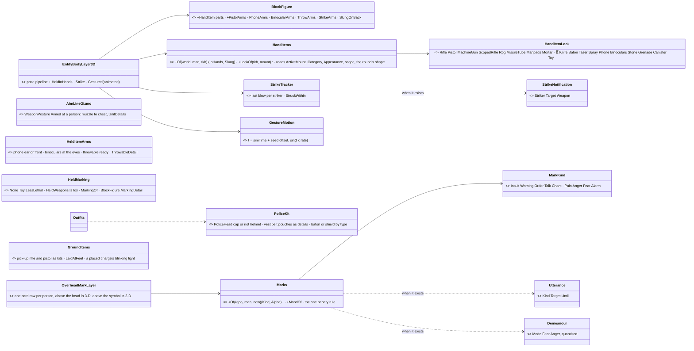
*Caption:* what the picture shows that prose hid — every NEW ui box reads data that is either on the wire today or one of three named gaps;
the figure grows by ONE pipeline step (`HeldInHands`) and ONE timed step (`Strike`), and everything above the head is ONE layer with ONE
priority rule, so marks never stack.

## 3. Sequences

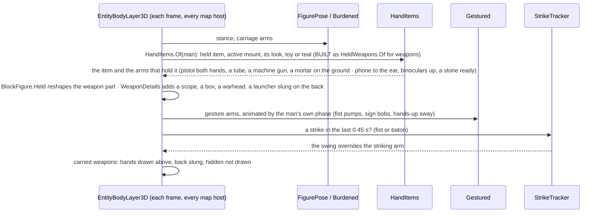

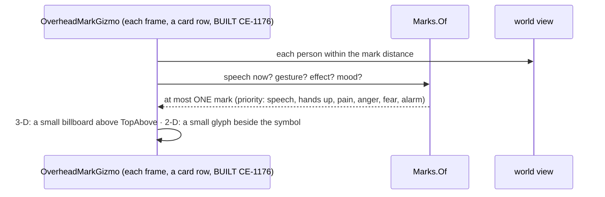

## 4. Modules — who registers it, who calls it each frame

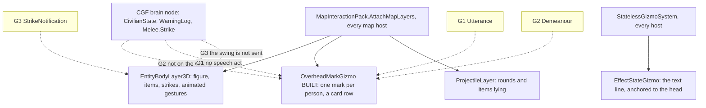
*Caption:* every reader is already called each frame on every map host; the yellow boxes are the data that lives only on the brain node (or
nowhere) — until they exist, the parts that read them draw nothing, and the rest builds now.

## 5. Decisions — leans *(✅ approved `2026-10-18`, `R-1005`)*

| # | decision | ⭐ lean | rejected — one line each |
|---|---|---|---|
| **U7** | what is in his hand | `HandItems.Of`: `HeldItem` first (Phone → to the ear while still, in hand while walking · Binoculars → raised to the eyes · Throwable → the hands round's look: stone a grey lump, grenade dark green, canister a can); Weapon → the `ActiveMount`'s `Appearance.Look` (Rifle the rifle · Pistol one hand, the other free · LongObject a baton / bar · SmallObject a knife); None → empty | a held-item entity: B-12 chose a byte, and an entity per phone is heavy |
| **U7a** (`CE-1236`, `2026-10-21`, R-1022) | a SOLDIER's weapon drawn as what it is | 🔒 User: *"The soldiers can have different type of weapons … they all have a single rifle-like rod. Could we make them distinguishable?"* — approved: *"approved. also in the mortar roof scenario I saw that the mortar shells are coming from two soldiers standing and there is no mortar rendered at all."* ⭐ The drawing's own vocabulary (`HeldLook`), from the SELECTED mount (`ActiveMount`, replicated): Pistol (its `Appearance`) both hands on it · MachineGun (category) longer, heavier, a box magazine, a folded bipod · ScopedRifle (`ScopeMagnification`) longer, a scope · Rpg (a rocket round) a slim tube with a warhead · MissileTube (Atgm) N-4's thick tube with a sight · Manpads (Sam, or a carried Igla / Stinger) a long tube with a grip box · Mortar (category or a bomb round — the MortarTeam's mount names no category) its deployed kit on the ground in front of him while his weapon is up, his hands at the tube's mouth; at ease the tube and baseplate on his back, his hands hanging. Tubes show in EVERY posture (on the shoulder when aimed, N-4). A launcher or mortar of his own he is not using rides upright on his back | adding MachineGun / Launcher to `ItemLook` — it is what an AI OBSERVER concludes (AW-15), and backend's data · a separate figure per soldier type — a man switches weapons · the tube only while aimed (as it was) — an RPG man walking reads as a rifleman · drawing the mortarman kneeling — the sim says he stands, and his head is drawn where he is seen and hit (as the lean, `CE-1193`) |
| **U8** | where a carried weapon sits | Hands drawn as U7 · Back slung across the back (today's carrier sling) · Hidden NOT drawn — a worn charge, a concealed pistol; ⭐ an exercise-control layer **"Concealed (ExCon)"**, off by default, outlines hidden items for the instructor | draw concealed items for everyone: defeats AW-15's per-observer identification |
| **U9** | drawn / aimed at someone | the posture as today (at ease low, ready, aimed — rifle and pistol each); ⭐ AIMED AT A PERSON adds a thin line from the muzzle to the target in 2-D and 3-D, on the `UnitDetails` layer (off by default) | an always-on line: a firefight becomes spaghetti |
| **U10** | melee | a 0.45 s swing of the striking arm (`StrikeTracker`, the `PostureBlend` shape): a fist — a straight punch; a baton — an overhead swing; a knife — a stab; started by G3's notification | animate from the VICTIM's knock-down: wrong man swings, and a miss shows nothing |
| **U11** | police look | ⭐ by `PersonKit.Security`: a PEAKED CAP (navy, white band) instead of hair; the shield man a RIOT HELMET with a visor; the uniform painted with a VEST panel (darker, two pouch boxes painted) and a BELT (black band, pouches) by `BodySurface` — texture only; the baton man a baton in the right hand (U7's LongObject once G4 gives him the item; until then from his type) | a new mesh: the block figure is boxes by design · a POLICE text badge: unreadable at map distance |
| **U12** | the toy gun | an item whose `Appearance.Look` is Rifle / Pistol and whose ground truth is harmless (`Lethal == false`, or no lethal round) is drawn in ORANGE (a toy's safety tip and body) | a separate toy shape: it must look like the gun to fool the observer — only the colour tells the truth |
| **U13** | non-lethal weapons | the baton-round launcher as today's launcher with a YELLOW band; the stun / gas grenade in hand as U7's Throwable; ⛔ the taser (yellow pistol + two darts drawn as thin lines on firing) and pepper spray (a small can + a short cone puff) wait on G5 | — |
| **U14** | the animated gestures | stateless motion on the man's own phase (`sin(simTime × rate + seed)`, no tracker): FistRaised pumps (forearm ±25°, 1.4 Hz) · HoldSign bobs (±6 cm, 0.8 Hz) · HandsUp sways (±8°, 0.5 Hz) · Waving waves the forearm (±30°, 1.8 Hz) · Warning holds still; each man out of step with his neighbours | a gesture clock per entity: state to keep and clear for a value that time alone gives |
| **U15** | speech above the head | a SMALL mark (≈ 14 px screen-space in 2-D, a 0.35 m billboard in 3-D, never larger than 20 px), shown while the act lasts and fading over its last 0.5 s: **insult** a red jagged balloon `#!` · **warning** a yellow triangle `!` · **order** a white balloon with an arrow · **talk** a grey balloon `…` · chant a balloon with a note; the warning shows TODAY from `Gesture.Warning`, the rest wait on G1 | text ("STOP!"): unreadable in a crowd and language-bound · a big comic balloon: the clutter the user named |
| **U16** | mood, alarm, pain | ⭐ BOTH, kept small: the FACE carries it close up (brows and mouth by a 5th shader parameter: calm · afraid — raised brows, open mouth · angry — lowered brows, tight mouth · in pain — squint, set by `Injury` Wounded) and a TINY DOT above the head at map distance (6 px: amber afraid, red angry, white alarmed, none when calm), only for people in an unusual state; ONE mark per person (U15 wins over U16); hidden beyond 300 m and on a layer toggle | an icon per emotion: twelve tiny icons are unreadable · nothing at a distance: the operator cannot see a crowd turning |
| **U17** | the overhead text line | fix the existing line to sit ABOVE the head in 3-D (anchor it to the entity, like the card) | leave it at the feet: measured wrong today |
| **U18** | items on the ground | a pick-up rifle / pistol lies as its look; a laid-down weapon lies at the man's feet (`WeaponAmmo.LaidDown`); a PLACED charge is a small box with a red blink; stones lie as today's rounds | — |

## 6. Claim table

| the lean rests on | code — how it IS | design — how it was MEANT to be |
|---|---|---|
| the held item, the posture and the active mount reach every node | ✅ `dtWeaponPosture` carries `HeldItem` beside `ActiveMount` (`SimDescriptors.cs:277-278`) | ✅ [backend's note to ui](blueprints/batches/NOTE_Backend_To_Ui_Armed_People_Drawing.md) |
| a hidden station must not be drawn | ✅ `CarryStations.IsConcealed` (`CarryStations.cs:33-60`) | ✅ Civilians AW-13 / AW-15 (per-observer identification) |
| a toy is told by its ground truth, not its look | ✅ `ItemAppearanceDto.Lethal` (`WeaponSuiteDto.cs:154-185`); `Armament.LethalInHand` | ✅ AW-15: "a toy gun is a rifle" to an observer |
| fear and anger are not on the wire | ✅ `CognitiveComponentRegistry.cs:35-36` registers `CivilianState` / `Crowd` on the brain only | ⛔ searched `docs/` + `.dev/`: no design puts them on the wire |
| no speech act exists | ✅ searched shout, insult, chant, speech, utterance, verbal, megaphone: none | ✅ Civilians §5j: a warning is an audible cue — not designed as data |
| the melee swing is not sent | ✅ `Melee.Strike` raises only a `DamageAssessedEvent` (`Melee.cs:16-52`) | ⛔ searched, none found |
| the overhead line sits at the feet in 3-D | ✅ `EffectStateGizmo` draws un-anchored x,y; `GizmoRenderer3D` puts un-anchored labels on the ground (`GizmoRenderer3D.cs:98-115`) | ✅ Symbology: labels above the unit |
| animation needs no new clock | ✅ `GlobalTime.TotalTime` is read every frame (`EntityBodyLayer3D.cs:104-106`); the seed exists per man | — |

## 7. Items *(ids from the ui block; each builds when its data exists)*

| id | what | needs | state |
|---|---|---|---|
| `CE-1169` | U7 + U8 — what is in his hand and where carried weapons sit (pistol, phone, binoculars, stone / grenade / canister in hand, slung on the back, hidden not drawn, the ExCon layer) | on the wire today; ⚠ the phone and binoculars show only once G7 sets them | ✅ READY · ⭐ the HAND-WEAPON half BUILT `2026-10-21` as `CE-1236` (§7b): the pistol, and every soldier's weapon (U7a) |
| `CE-1170` | U9 — aimed at a person: the line | on the wire today | ✅ READY |
| `CE-1171` | U10 — the melee swing (fist, baton, knife) | G3 (and G4 for the baton / knife as items) | ✅ the swing built `2026-10-19` (§7a); the items in the hand at rest still wait G4. ⭐ `CE-4062` (`2026-10-27`): drawn in a REPLAY too — `EffectSpawnSystem.TrackStrikes` runs before the spawner's replay gate (the recorded `StrikeNotification` replays onto the bus with each played or stepped frame; ⚠ not across a seek, which skips events) |
| `CE-1172` | U11 — the police look (cap, riot helmet, vest, belt, baton in hand) | ui only (baton in hand from his type until G4) | ✅ READY |
| `CE-1173` | U12 — the toy gun drawn orange | ✅ the data; a catalogue toy type is G6 | ✅ READY |
| `CE-1174` | U13 — non-lethal weapons (launcher band; taser, spray) | the launcher today; taser / spray G5 | ✅ partly READY |
| `CE-1175` | U14 — animated gestures | on the wire today | ✅ BUILT `2026-10-18` (§7a) |
| `CE-1176` | U15 — speech marks above the head | the warning today (`Gesture.Warning`); the rest G1 | ✅ partly READY |
| `CE-1177` | U16 — mood on the face and the tiny dot | pain today (`Injury`); fear / anger / alarm G2 | ✅ partly READY |
| `CE-1178` | U17 — the overhead text line above the head in 3-D | ui only | ✅ BUILT `2026-10-18` (§7a) |
| `CE-1179` | U18 — items on the ground (pick-up weapons, laid-down weapon, placed charge) | on the wire today | ✅ READY |
| `CE-1193` | the LEAN round a corner (backend's `Lean`, `CE-3257`; behaviors' poses note CB-21) | on the wire today | ✅ BUILT `2026-10-19` (§7a) |
| `CE-1236` | U7a — every soldier's weapon drawn as what it is (pistol, machine gun, scoped rifle, RPG / missile / MANPADS tubes, a man's own mortar on the ground, a launcher slung) | on the wire today | ✅ BUILT `2026-10-21` (§7b) |

### 7a. As built *(`2026-10-18`)*

| item | as built | deviation from §2–§5 |
|---|---|---|
| `CE-1178` (U17) | `EffectStateGizmo` writes its line as **row 50 of the entity card** (`EffectStateGizmo.Row`) — the card sits above the body top in 3-D and above the symbol in 2-D (Map 3-D §3.6: *"extra lines — any gizmo, rows 30+"*); a man with no network id (no card) keeps the loose line; ⭐ a person's card point is the top of what is DRAWN (`EntityBodyLayer3D.LabelTop` — the protest sign's board, raised hands), found by the frame rail: the card covered the sign. Rail `CE1178_TheOverheadLine_IsARowOfHisCard_NotTextAtHisFeet` | ⭐ the card, not a new anchored text: the user's U20 (Map 3-D) asked for ONE mechanism for per-entity text in 2-D and 3-D, and the card is it. ⚠ 2-D moves too — the line is now in the card above the symbol, no longer loose under it |
| `CE-1175` (U14) | `BlockFigure.GestureArms(…, t)` animates on `t` with no state (fist ±25° about the elbow 1.4 Hz · sign ±6 cm 0.8 Hz · hands-up ±8° about the shoulders 0.5 Hz · wave ±30° 1.8 Hz · warning and wind-up still); `t = 0` is the static pose. `EntityBodyLayer3D.GestureClock` = sim time + up to 10 s from his seed (network id, so the same on every node). Rail `CE1175_TheGestures_Move_OnEachMansOwnClock_AndStillReadAsTheGesture` | ⭐ no `GestureMotion` class: a clock function and a parameter carry it (§2 box updated) |
| `CE-1169` / `CE-1179` *(the pick-up weapons and the charge — part)* | three classes (`PickUpRifleWeaponSystem` 1.1.*.50.8 · `PickUpPistolWeaponSystem` .9 · `ExplosiveChargeWeaponSystem` .10, `EntityClassTable`) name their own kits (`WeaponKind.Rifle` / `Pistol` / `Charge`, `WeaponKits`): lying, they are a rifle, a pistol, a box with its detonator — no longer the generic HMG on its tripod. CARRIED (`DrawCarried`): a HIDDEN station is not drawn (U8); a hand weapon in his HANDS station is held level in front (`InHands`); a pistol in his back station is in its holster at the right hip (`OnHip`); the rest slung (`OnBack`). Rails `Map3DTests.CE1169_APickUpWeaponOrACharge_IsDrawnAsWhatItIs` (red-proved), frame `CE1169_V_ItemsOnTheGround_AreWhatTheyAre` ([`people-3-items-on-the-ground.png`](assets/map-3d/people-3-items-on-the-ground.png)) | ⭐ the user's *"classification in the TKB record or the DIS type"*: the DIS type, through the class table (the CE-1112 precedent) — the item's `Appearance.Look` would miss the rifle (its mount has none). ⚠ INTERIM: `InHands` is a level weapon at his hands, not yet U7's held-item poses (the aimed pistol, one hand), and the placed charge has no red blink yet (U18) — both stay in `CE-1169` / `CE-1179` |
| `CE-1195` (the throw) | `BlockFigure.ThrowArms(parts, crouched, soldier, phase)`: the right arm sweeps over the shoulder from the wind-up (the `Throwing` gesture's pose) to the follow-through (forward and down), easing out, the left arm swinging back; drawn for `ThrowSeconds` = 0.6 s after a shot from his HANDS mount (`RecentShots`, `PersonHands.MountIndex`) by `EntityBodyLayer3D.Thrown`, standing or crouched, free, alive, not cowering. Rail `Map3DTests.CE1195_AThrow_SweepsTheArmFromTheWindUpToTheFollowThrough` | ⭐ no state and nothing on the wire: the throw is the fire event every node already has (CE-3248 kept it in `RecentShots` for exactly this) |
| `CE-1171` (the blow, U10) | `StrikeTracker` (beside the world, as `RecentShots`): `EffectSpawnSystem` records every `StrikeNotification` (backend `CE-3266`, G3 — local or from the `MeleeStrike` topic) with its `MeleeWeapon` and sim time; `EntityBodyLayer3D.Struck` draws `BlockFigure.StrikeArms` for `StrikeSeconds` = 0.45 s, standing or crouched, free, alive, not cowering: a FIST punches straight out at the chin and back, a KNIFE stabs out at the belly with a 20 cm blade, a BATON swings from above the head over and down in front with a 60 cm stick; the left arm up as a guard, a soldier's rifle slung. Rails `Map3DTests.CE1171_*` (the poses, the window, a busy man) and `EffectTests.CE1171_*` (the spawner keeps a remote blow, no effect spawned) | ⭐ deviates from §2's `PostureBlend shape`: no blend state — the phase is the time since the strike, as the throw (`CE-1195`). ⭐ the blade / stick appear only DURING the swing; a man holding them at rest waits for G4's items. ⚠ empty in a replay (the spawner is off), as the throw |
| `CE-1193` (lean) | `EntityBodyLayer3D.LeanShear(world, e)` = the sim's shear (`Leans`, Hit Location §13 LN-2): body-frame `y' = y + sign · shift · z / eye`, ⭐ `shift` = HIS depth `Leans.ShiftOf(world, e)` (`CE-2371` AQ104 G, R-2079, `2026-10-25`: 0.4 m when `Lean.Depth` is unset, up to 0.6 m — a trained man leans shallow, a militiaman shows half his body; ⛔ SUPERSEDED: the fixed `Leans.Shift` 0.4 m) (eye 1.7 standing, 1.1 crouched — `EngineFallbacks`), multiplied into `kitToBody` for a FREE figure (not held, on a rope or jumping); identity when he does not lean or lies prone. ⭐ The eye and the muzzle tip read `kitToBody`, so the first-person view of a possessed leaning man and his muzzle flash move with him — backend's `PossessionStation.EyeOf` suggestion needs nothing more. Rails `CE1193_TheDrawnLean_IsTheSimsShear`, frame `CE1193_V_TheLeanIsDrawnAsTheSimLeans` ([`people-2-lean.png`](assets/map-3d/people-2-lean.png)) | ⚠ a shear, not behaviors' "upper body tilted, weapon leading" roll: the shear is what sight and the round use, so the head is drawn where he is seen and hit; a roll about the hip would put it elsewhere. ⚠ the eye height is the engine fallback, not the type's TKB eye (the sim's `EyeOf` resolves the type's); the same for the built-in figures |

### 7b. As built — every soldier's weapon (`CE-1236`, `2026-10-21`, ui; U7a, R-1022)

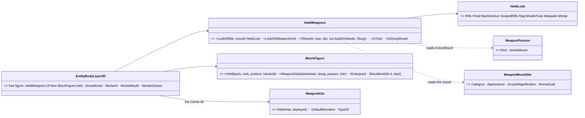

*Caption:* one classifier reads data every node already has, the figure keeps its parts and order (only the weapon part, and for the
pistol and mortar the hands, change), and the mortar is the EXISTING weapon-system kit (§6n) drawn at the man's feet — no new mortar
geometry, no new wire data.

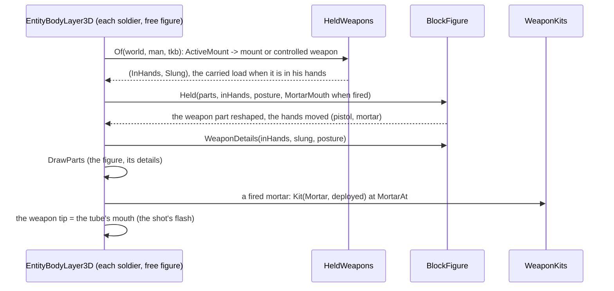

| as built | |
|---|---|
| classifier | `HeldWeapons.LookOf`: `Appearance.Look == Pistol` → Pistol; category Sam → Manpads, Atgm → MissileTube (Rpg when its round is a rocket), MachineGun, Mortar; else the round's shape (Rocket → Rpg, Missile → MissileTube, Bomb → Mortar); `ScopeMagnification > 1` → ScopedRifle; else Rifle. A controlled weapon system by its kind (`WeaponKits.TypeOf`) |
| figure | `BlockFigure.Held`: lengths machine gun 1.05 m, scoped 1.12 m, pistol 0.22 m at the right hand with the left forearm closed on it; tubes RPG 1.0 m × 0.08, MANPADS 1.5 m × 0.09, missile 1.10 m × 0.13 (N-4's), along the rifle line, on the shoulder when aimed; mortar: no weapon part, hands to `MortarMouth` (reach 0.62 m) or hanging |
| details | `BlockFigure.WeaponDetails` (part details, §6q's mechanism): MG box + bipod · scope · RPG warhead + grip · MANPADS grip box + seeker cap · missile sight · slung launcher / mortar tube (+ baseplate) upright on the back |
| mortar | `EntityBodyLayer3D.DrawMortar`: the deployed §6n kit at `MortarAt` (0.62 m ahead, 0.28 m right), laid at its default 60°; its mouth is the man's weapon tip (the muzzle flash) |
| the mortarman's stance (`CE-1238`, R-1023) | ⭐ a man firing a mortar of his own CROUCHES beside it — the BRAIN's stance (Indirect Fire §CE-1238), so the figure draws the sim; his hands still reach the tube's mouth (they are measured from his actual shoulders) |
| carried launcher | a controlled launcher in his hands (`ActiveMount` 32 + k) is drawn by the figure and NOT on his back (`_loadInHands`) |
| rails | `Map3DTests.CE1236_EveryWeapon_IsDrawnAsWhatItIs` (red-proved); frame `Map3DFrameRail.CE1236_V_EveryWeapon_IsDrawnAsWhatItIs` |
| deviation | ⚠ §2 named the classes `HandItems` / `HandItemLook`; built as `HeldWeapons` / `HeldLook` — the weapon half; the pocket items and the hands round join `HeldLook` when built (`CE-1169`) |

| | |
|---|---|
| 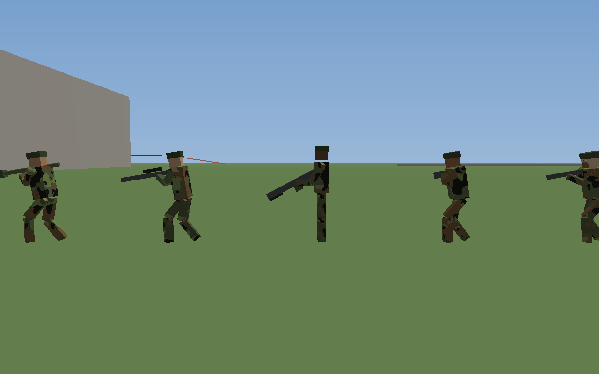 | 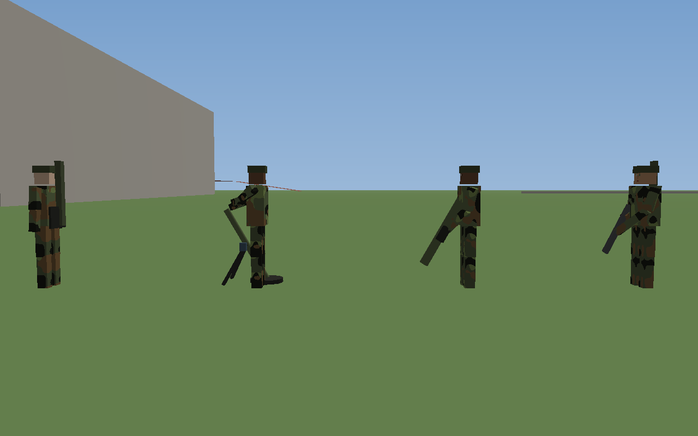 |
| *right to left: the rifle, the pistol (both hands), the PKM at Ready (box, bipod), the sniper (scope), the RPG on the shoulder (warhead)* | *right to left: the insurgent on his rifle with the RPG on his back, the Javelin at ease (sight), the MortarTeam firing (the mortar at his right side), the MortarTeam at ease (tube and baseplate on his back)* |
| 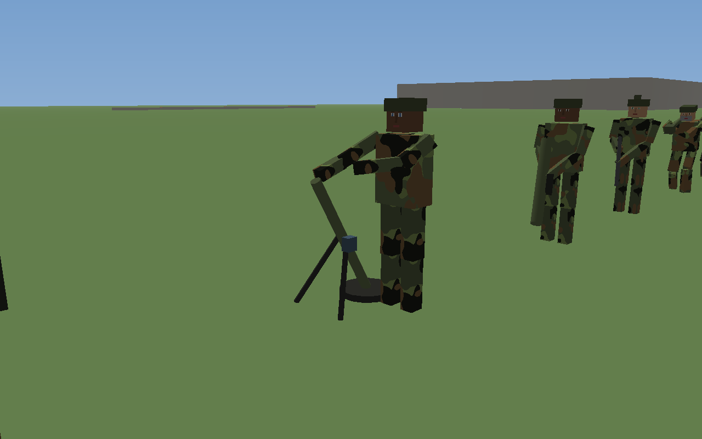 | |
| *the firing mortarman from his front: his right hand at the tube's mouth (measured on the first frame and moved: 0.62 m ahead and 0.28 m right put the tube a metre from either shoulder)* | |

### 7c. As built — the overnight `2026-10-21` items *(ui, PLAN_Ui_FPS_And_Quick_Wins §3a)*

| item | as built | rails |
|---|---|---|
| `CE-1169` U7 — what is in his hand (rest) | `EntityBodyLayer3D.HeldItemShown` (one step before `Gestured`, so a gesture, a throw or a blow wins) reads the replicated `HeldItem`: **Phone** to his ear while still, in front of him while he walks (a dark slab), **Binoculars** up at his eyes in both hands (a dark box), **Throwable** low and ready in the right hand with its round as its `Munition.Visual` looks (colour and size — `ThrowableDetail`, through `PersonHands.Holding`); a soldier's rifle slung meanwhile (`BlockFigure.HeldItemArms`, the `GestureArms` shape). ⭐ The data is LIVE now: behaviors set Phone (routine, the IED trigger), Throwable (a stone in hand), Binoculars (the operator, leaders). ⭐ **U8's ExCon layer `2026-10-21`:** `ConcealedItemGizmo` (`[GizmoProjector(IsEmbarkedTag)]`) outlines an item in a man's HIDDEN station (`CarryStations.IsConcealed`) — a dashed magenta ring at his hip and `hidden: <type name>` on his card — on the new layer `DebugTraceLayers.Concealed` (26), the toggle **Units ▸ Concealed (ExCon)**, OFF by default (`FirstUntoggledLayer` 26 → 27); a weapon on his back or in his hands is not outlined (the figure shows it) | `Map3DTests.CE1169_*` (incl. `CE1169_TheConcealedLayer_OutlinesOnlyWhatIsCarriedHidden`, red-proved) · `LayerControlGizmoTests` (defaults off) · frame `people-overnight-1-*.png` |
| `CE-1172` U11 — the police look | `Outfit.Police` / `.Riot` (from `PersonKit.Security`; Riot = the `SecurityShield` type): the head draws `BlockFigure.PoliceHead` — a PEAKED CAP (navy crown, white band, black peak), the shield man a RIOT HELMET with a visor — instead of hair or a helmet; the vest (darker), two pouches and the black belt are torso details. ⚠ **Deviation:** details, not a `BodySurface` shader parameter (the suit's shirt and tie are drawn the same way; a fifth parameter for a flat panel buys nothing). `EntityBodyLayer3D.PoliceKit` by TYPE until G4: the baton man's baton hanging from his right hand (the swing draws it while he strikes, CE-1171), and ⭐ round-out: the shield man's riot SHIELD upright in front of his left side | `Map3DTests.CE1172_*` · frame `people-overnight-2-*.png` |
| `CE-1173` U12 — the toy gun | `HeldWeapons.IsToy`: a mount that STATES a Rifle / Pistol appearance and names no round (G6's "looks like a rifle and fires nothing"; an old mount naming no round stays a weapon). A weapon-system TYPE with such a mount draws orange (`TypeLook.Toy`, every part); a toy in a soldier figure's hands is covered orange (`MarkingDetail`). ⚠ No catalogue toy type exists yet (G6) — the rail and the frame register one | `Map3DTests.CE1173_CE1174_*` |
| `CE-1174` U13 — non-lethal weapons | `HeldWeapons.MarkingOf` ⇒ `LessLethal` when every round the held mount names is non-lethal (`ItemAppearances.FiresLethal`): the baton launcher (`SecurityLauncher`) wears a YELLOW BAND a third of the way from its muzzle; the stun / gas grenade in hand is U7's Throwable. ⏳ Taser and pepper spray wait on G5 | same rail · frame `people-overnight-2-*.png` |
| `CE-1176` U15 — speech marks | `OverheadMarkGizmo` (Hrot.Common, auto-discovered): ONE row of the person's entity CARD — ⚠ **deviation:** not a new `IMapLayer`; the card already sits above the head in 3-D and above the symbol in 2-D on every host (U17's fix), so a row IS the design's place, with the Labels layer as its toggle. ASCII glyphs (the map's font): insult red `#!`, warning yellow `/!\`, order white `!>` (a challenge, the commands, the announcement), talk grey `...` (the team calls too), chant cyan `~~`; 14 px; fading over the last 0.5 s of the `Utterance`. The police `Gesture.Warning` shows as the warning. ⚠ G1 LANDED (`CE-3264`) but nothing writes it yet (behaviors `CE-2249`) — live today: the warning only | `Map3DTests.CE1176_CE1177_*` |
| `CE-1177` U16 — mood | `Marks.MoodOf`: pain (`Injury` Wounded) > anger > fear (`Demeanour` from its 2nd quarter) > alarm (mode Alarmed / Panic). Far: the same card row as a 12 px dot `o` (pink / red / amber / white) when no speech shows — U15 wins. Close: the FACE — a new shader uniform `faceMood` (brow lift, mouth open, eye squint; `BodySurface.Expression`): afraid raised brows and an open mouth, angry knitted brows and a tight mouth, in pain squeezed eyes. ⚠ "hidden beyond 300 m" not built (a card row has no distance cut; the layer toggle stands). G2 LANDED (`CE-3265`), no writer yet (`CE-2250`) — live today: pain | same rail · frame `people-overnight-3-faces-calm-afraid-angry-pain.png` |
| `CE-1179` U18 — the rest | a weapon LAID DOWN (his active own mount, `WeaponLaying.IsLaidDown`, replicated in `WeaponAmmo.LaidDown`) lies across his path a step in front of his feet (`BlockFigure.LaidAtFeet`, after the gestures — a hands-up gesture would sling it); a PLACED charge (no `IsEmbarkedTag`) blinks red a quarter second each second on sim time (`ChargeLightOn`), the same on every node | `Map3DTests.CE1179_*` · frame `people-overnight-4-laid-down-and-a-placed-charge.png` |
| `CE-1170` U9 — the aim line | `AimLineGizmo` (Hrot.Common, `[GizmoProjector(WeaponPosture)]`, auto-discovered on every map host): `Aimed` at a living PERSON (`PhysicsColliderReaders.IsPerson`) ⇒ a thin red-orange line from `Muzzle.TryOf(ActiveMount)` — or, with no muzzle data (a rifleman), his shoulder (1.4 m) half a metre toward the target — to the target's chest (1.2 m); on `UnitDetails`. ⭐ A non-zero Z is drawn at its height in 3-D, never draped (`GizmoRenderer3D`); 2-D draws it flat. None when ready, at a vehicle, at a dead man | `Map3DTests.CE1170_*` (red-proof: the person check removed ⇒ the vehicle case draws) |

### 7d. U19 — the IDLE gestures: a relaxed man smokes, shifts his weight, stretches, looks about *(`CE-1308`, ui, `2026-10-24`; behaviors' `CE-2368`, AQ103 I, R-2074 — [handoff](blueprints/batches/HANDOFF_Behaviors_To_Ui_Idle_Gestures.md))* — build-state: BUILT

🔒 User, `2026-10-24`: *"soldiers who are actually really idle or waiting in some boring job … Some of them could be smoking a cigarette,
some of them just moving their bodies, stepping from one leg to the other … that of course applies to civilians as well."* · and *"follow
their handoff regarding the idle gestures."*

**INVENTORY** *(`scripts/cbm.sh search_graph` name_pattern `.*(Gesture|Idle(Smok|Shift|Stretch|Look)|Sway|Fidget|Cigarette|Smok).*`, Method:
84 total — the relevant: `BlockFigure.GestureArms` (the six acts, animated on `t`), `EntityBodyLayer3D.Gestured` (the guard returning an idle kind
unchanged — behaviors' cross-lane stop-gap), `EntityBodyLayer3D.GestureClock` (U14's per-man clock), `EffectStateGizmo.GestureWord` (no label
for an idle kind), the `EntityGesture` translators; plus `MotionPose` (`KneeFlexL/R`, `HeadTurn`) and `EntityBodyLayer3D.FigureMotion`; ⚠
`check_index_coverage` not reachable through the CLI.)* ⇒ ⭐ **no new class, no new state**: the idle kinds are two more stateless functions on
the same clock.

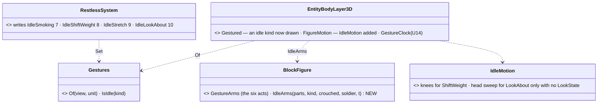
*What the picture shows that prose hid:* the idle kinds ride the SAME reader (`Gestures.Of`) and the SAME clock as the acts — nothing new
reaches the wire or keeps state; the drawing splits only by WHAT moves (arms → parts, legs and head → the motion pose).

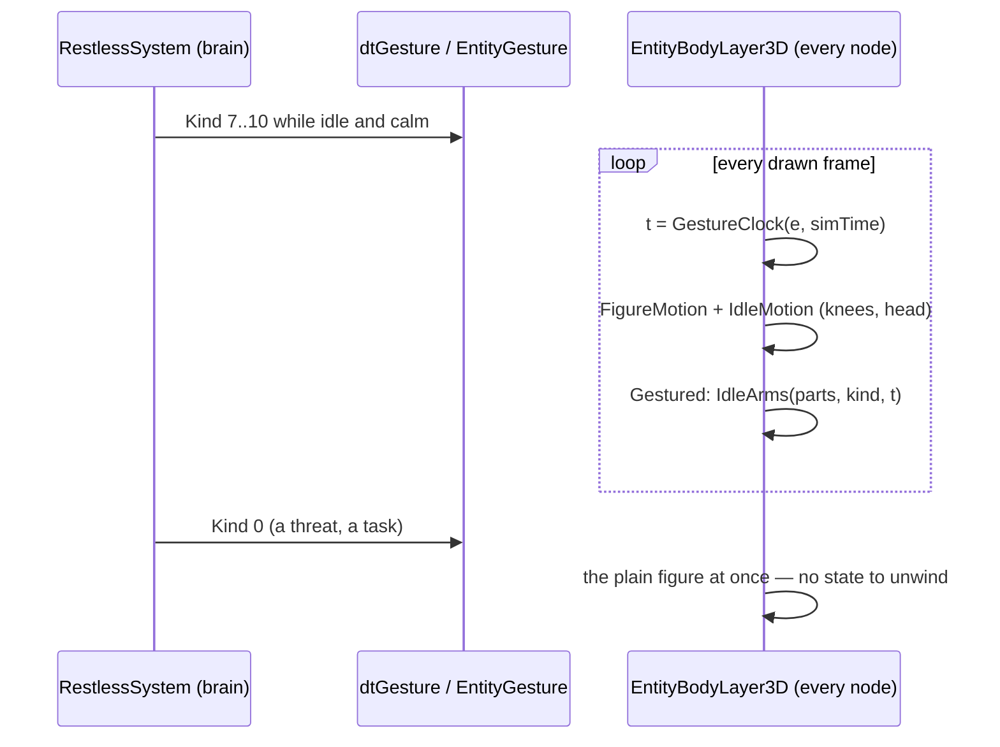

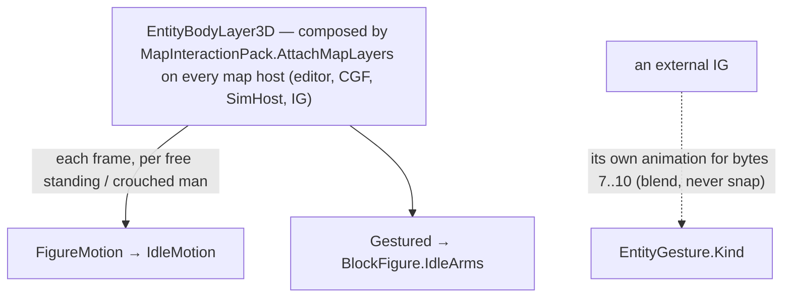
*The dashed edge is outside this repo:* the external IG gets only the byte — it must play its own idle animation.

| id | decision | ⭐ lean (taken, for the user to confirm) | rejected — one line each |
|---|---|---|---|
| **U19a** | smoking | the right hand to the lips and down on a 9 s cycle (up 1 s, at the lips 2.5 s, down 1 s, low 4.5 s), a cigarette (8 cm, pale) in the fingers; ⭐ a soldier keeps his rifle where his posture holds it, the left hand on it — only the right arm leaves | sling the rifle as the acts do — the handoff's fence: a mood, not an act |
| **U19b** | shifting weight | legs — the free knee bends (≈20°) and the upper body sways ≈4 cm over the standing leg, side to side on a 6 s cycle; fades out while he walks (`Moving`) | arms only — the user's own words are "stepping from one leg to the other" |
| **U19c** | stretch | a civilian: both arms up over his head, held 2 s in an 11 s cycle; a soldier: the right arm only (the left stays on the rifle) | both arms for a soldier — the rifle would float |
| **U19d** | looking about | ⭐ **his REAL eyes look about** — behaviors' idle glance (`RestlessSystem.Glance`, AQ103 I: a slow scan ±60° about his facing, 3 s a fixation) moves `LookOf.HeadYaw`, and the drawn head follows it (Entity Control LK-5) — true by construction. The drawn ±30° / 12 s sweep stays **only for a man whose eyes are not modelled** (no `LookState`) | the sweep regardless — the drawing would lie about where he looks · ⛔ *"the sweep while `HeadYaw` is 0"* (as first built, SUPERSEDED `2026-10-24`) — the glance passes straight ahead, and the fake sweep cut in there |
| **U19e** | where | standing and crouched, a free carriage, not destroyed, not cowering — the acts' own guard; nothing in 2-D (a mood has no label) | — |
| **U19f** | the external IG | the wire comment and Civilians §7.7: **7–10 are idle ANIMATIONS to blend, not poses to snap to** | — |

**As built** — `BlockFigure.IdleArms` (U19a, U19c) and `EntityBodyLayer3D.IdleMotion` (U19b, U19d), both stateless on `GestureClock`; `Gestured`
draws an idle kind through `IdleArms` instead of returning the figure unchanged. Rails: `Map3DTests.CE1308_*` (red-proved: 5 mutations, each red). ⭐ After behaviors' glance (`NOTE_Behaviors_To_Ui_Idle_Glance`): the drawn sweep keys on *no `LookState`*, not on `HeadYaw == 0`.
📌 **Live, `il-idle-life`, headless editor, `2026-10-24`:** over 45 s the ten men showed smoking, the weight shift and looking about, each
starting and ending at his own time (never in step); a stretch came later. Followed in 3-D (`POST /view/follow`): the posted Watchman's
hand went to his face and down again on the smoking cycle, the rifle staying in his other hand. ⚠ A threat stopping them was not staged —
the drawing reads `Gesture` every frame, so it stops the frame `RestlessSystem` clears it (behaviors' live run covers that half).

### 7e. U20 — the MIND-STATE bar: a soldier's stress (with his breaking point), a civilian's fear *(`CE-1309`, ui, `2026-10-24`)* — build-state: BUILT

🔒 User, `2026-10-24`: *"The soldier now have their psychical state as fright or nerve and stress etc stored as component, i would like to show
it on 3d map optionally, maybe as some bar chart floating above soldier's head or something, or just little colored percentage number if
nothing better and simpler indicator exists. There are already some warning icons i guess so somewhere next to them?"*

**INVENTORY** *(`scripts/cbm.sh search_graph` name_pattern `.*(Nervous|Stress|Fear|Morale|Suppress|Panic|Shaken|Pinned).*` label Class —
36 hits, the mind-state ones: `CivilianFear`, `CivilianFearSystem`, `PanicState`; grep `Stress|Demeanour|CivilianState|\.Card\(`; ⚠ coverage
not checkable through the CLI)*:

| what | where | on which node |
|---|---|---|
| `Stress {Level 0–1, Broken, …}` — a combatant's live stress | `FDP/…/Behavior/Components/Stress.cs`; kept by `StressSystem` (behaviors) | ⛔ **brain node only** (TS-8) — the editor runs the brains in-process (`EditorSubsystem.cs:1714` builds `CgfLogicPack`), so its map has it; an IG does not |
| his **breaking point** = effective nerve (`TemperamentOf.Effective(Nerve)`, never under 0.05) · **nervous** from 0.4 × it | `StressModel.BreakLevel` / `Nervousness` (`StressSystem.cs:155-176`, behaviors) | pure reads of `Stress` + `CombatTemperament` (FDP) |
| `CivilianState.Fear / Anger` 0–1 | `FDP/…/Civilians/CivilianState.cs:44-76` | ⛔ brain node only |
| `Demeanour {Mode, Fear, Anger}` in quarters — replicated | `Civilians/Demeanour.cs` (G2, `CE-3265`) | every node — ⚠ **no writer yet** (behaviors `CE-2250`) |
| the CARD above the head — rows: 0 frame · 10 health bar · 20 name · 45 the mark (speech / mood dot) · 46 hidden item | `EntityCards.cs`, `HealthBarGizmo.cs:59`, `OverheadMarkGizmo.cs:131`, `ConcealedItemGizmo.cs:39` | every node |
| layer toggles — the last toggled bit 27 (`Grid`), `FirstUntoggledLayer` 28 | `DebugTraceLayers.cs:66`, `LayerControlGizmo.cs:69, 118` | — |

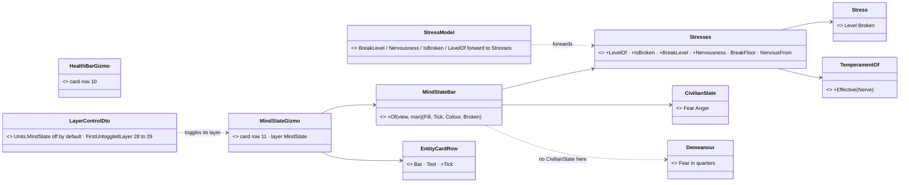
*Caption:* what the picture shows that prose hid — the breaking point is behaviors' arithmetic, so the drawing would have been a SECOND copy
of it; moving it beside `Stress` (FDP) gives one implementation that both the brain and the card read. The bar is one more card row, right
under the health bar — no new surface.

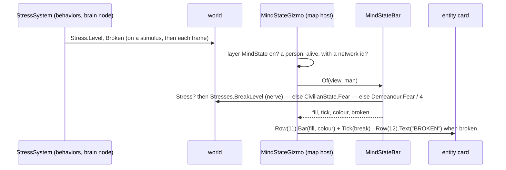
*Caption:* the card reads the brain's own numbers every frame — nothing new is sent; where the brain is not (an IG), there is nothing to read
and no row is drawn.

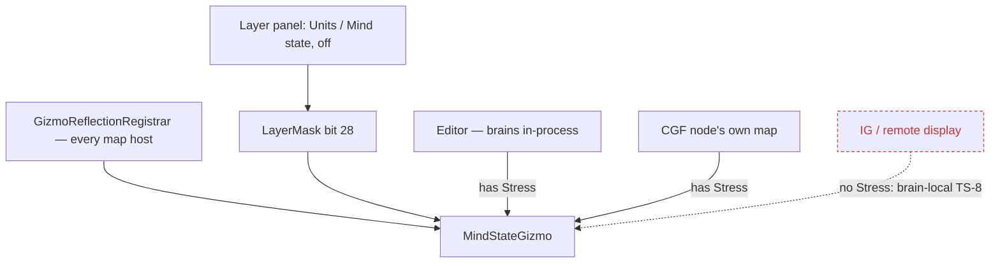
*Caption:* the dead edge — a display node never has `Stress` (TS-8), so on an IG the layer draws nothing for soldiers; civilians there would
show once behaviors writes `Demeanour` (`CE-2250`).

✅ **U20a–f approved** — 🔒 User, `2026-10-24`, on the built bar: *"Approved"* (`R-1035`).

| # | decision | ⭐ lean | rejected |
|---|---|---|---|
| **U20a** | the indicator | a thin BAR (the health bar's height) in the card, **right under the health bar** — filled to his stress, with a **white tick at his breaking point** (his nerve): the bar reaching the tick is him breaking | a percentage number — a number does not show how close he is to breaking · next to the mood dot (row 45) — a bar reads best beside the other bar |
| **U20b** | the colour | calm (under 0.4 × his breaking point) slate blue · nervous amber · broken red, with **BROKEN** written under it | one colour — the band is the useful part |
| **U20c** | civilians | the same row shows his FEAR (amber, no tick): `CivilianState.Fear` on the brain node, else the replicated `Demeanour` quarter | a separate civilian row — one row per man, as U15/U16 |
| **U20d** | when | only a man with something to show: stress over 2 % or broken; fear over 5 %; never a man down or a vehicle | always — every calm man would carry an empty bar |
| **U20e** | the switch | its own layer **"Mind state"** under Units, **off by default** (bit 28; `FirstUntoggledLayer` 28 → 29, the `CE-1288` precedent) | the Labels layer — it would be on for everyone |
| **U20f** | where it can show | wherever the brain runs (the editor, a CGF node's own map); ⛔ not on an IG — `Stress` is brain-local by TS-8 | ask for a replicated quantised stress now — no reader on another node yet (TS-8's own reasoning); asked later if wanted |

| claim the lean rests on | code — how it IS | design — how it was MEANT to be |
|---|---|---|
| the editor's world holds the brains | ✅ `EditorSubsystem.cs:1714` builds `CgfLogicPack`; live: `BehaviorState`, `Restless` on the editor's soldiers | ✅ TS-8 *"visible over HTTP … on the brain node"* |
| `Stress` appears only after a stimulus | ✅ `StressSystem.cs:247-252` (`Ensure` from `Add`) | ✅ TS-4 |
| breaking point = effective nerve | ✅ `StressSystem.cs:175` | ✅ Temperament & Stress TS-6 |
| a card row is one call and stacks by order | ✅ `EntityCards.cs:39` | ✅ Map 3-D §3.6 M14 |

**As built** — `MindStateBar.Of` + `MindStateGizmo` (`Hrot.Common/Diagnostics/Gizmos/MindStateGizmo.cs`; card rows 11 and 12), `Stresses` in
`Stress.cs` (FDP; `StressModel` forwards), `EntityCardRow.Tick`, `DebugTraceLayers.MindState = 28`, `Units.MindState`. Matches the diagrams.
⚠ **Found on the way:** behaviors' `StressSystem` was registered with no `[TickMode]` — R-3036's scheduler threw on the first frame of every
host running `CgfLogicPack` (the editor died on load). Fixed (`WhenTimeAdvances`, as its siblings) and guarded: `BrainSystemsDeclareTickModeTests`.
Rails: `Map3DTests.CE1309_*`, `GZH011_Tests.CE1309_*`.
📌 **Live, `uf-squad-under-fire`, headless editor:** within a second of contact Hostile 2 rose to 0.24 and Riflemen 1 and 4 to 0.21; followed
in 3-D with **Units → Mind state** on, Hostile 2's card showed the red bar past the white tick and **BROKEN** under it (his state line: `Break`).

### 7f. U21 — RECORDED: a short HEALTH BAR floating over a person's or vehicle's head, its own switch *(`CE-1313`, ui, `2026-10-24` — build-state: DESIGN, leans for the user)*

🔒 User, `2026-10-24`: *"I would like for a soldier to turn on a health bar on top of his head, not as part of the card, but just floating on
top of his head, something similar which is now shown for the psychic state. But shorter … when low health it's red, when it is in the middle
then it's yellow, and when it's close to full it's green. It should have its own separate checkbox for turning on and off, independently on
the label card. It needs to be just short. Otherwise, it would overlap too much with the guys standing next to him."* · *"The health bar should be available also for vehicles, not just people. And when the cart is on, then the floating individual health bar is not shown, because it is already part of the cart."* *("cart" = the card)*

| what exists | where |
|---|---|
| the card's health bar (row 10 of the card — on only with the whole card, the Labels layer) — its colours: green ≥ 66 %, yellow ≥ 33 %, red | `HealthBarGizmo.cs:52-56` |
| a primitive can sit in the WORLD, on the SCREEN or in the CARD — ⛔ nothing "screen-sized, anchored over a head" outside the card | `CoordinateSpace.cs` (World, Screen, EntityLocal, EntityCard) |
| the 3-D body layer knows the top of what is drawn for each man (`LabelTop`) and the camera | `EntityBodyLayer3D.cs` |

| # | ⭐ lean | rejected |
|---|---|---|
| **U21a** | drawn by the 3-D body layer itself at his `LabelTop` + a few pixels: **28 × 4 px** (a third of the card's width), the card's colours and thresholds (one `HealthColour` shared with `HealthBarGizmo`, not a second copy) | a second card — a card is one per entity; a world-space bar — it shrinks to nothing at distance and grows huge close up |
| **U21b** | its own layer row **Units → Health over head**, off by default, independent of Labels | riding on Labels — the user's point is to have it WITHOUT the card |
| **U21c** | ✅ **people AND vehicles** (alive, a person not inside a vehicle); ✅ **hidden whenever the card is shown** — the card already carries the health bar (user, `2026-10-24`) | ⛔ people only, and ⛔ *"under the card when both show"* — SUPERSEDED by the user the same day |
| **U21d** | 3-D only | 2-D — the symbol view already has the card; ask if wanted |

## 8. Gaps for the other lanes *(sent as [findings](blueprints/batches/HANDOFF_Ui_To_Backend_And_Behaviors_People_Display_Gaps.md))*

| # | gap | lean | owner |
|---|---|---|---|
| **G1** | a SPEECH act: insult, warning, order, talk, chant — who, to whom, until when | a replicated `Utterance {Kind, Target, Until}` in the Brain group, the `Gesture` shape; the HSM / ladder writes it | backend (component + wire) · behaviors (who says what, when) |
| **G2** | the MOOD on the wire | a replicated `Demeanour {Mode, Fear, Anger}` (three bytes, quantised to quarters), written when `CivilianState` crosses a quarter — never every tick | backend · behaviors |
| **G3** | the MELEE swing | a `StrikeNotification {Striker, Target, Weapon}` raised by `Melee.Strike` and replicated like `WeaponFireNotification` (a fist and a baton look different) | backend |
| **G4** | melee ITEMS — the police baton, a knife, a machete | mounts with `Appearance` (LongObject / SmallObject, `ReachM`) whose fire is `Melee.Strike`; the baton man (1202) carries one | backend (data) · behaviors (AW-19 knife) |
| **G5** | taser and pepper spray | munitions + an effect (taser: Stun at ≤ 7 m with two darts; spray: Irritant cone ≤ 3 m) on police types | backend · behaviors (when to use, the ladder rung) |
| **G6** | a toy-gun TYPE in the catalogue | a civilian type whose mount looks like a rifle and fires nothing (the test type made real) | backend |
| **G7** | nobody SETS the held item | the HSM / behaviours set `HeldItems` (a civilian on his phone, a lookout with binoculars) | behaviors |
| **G8** | the riot SHIELD | an item on the shield man (1201) — drawn by ui, and later a blocker for thrown items | backend |
