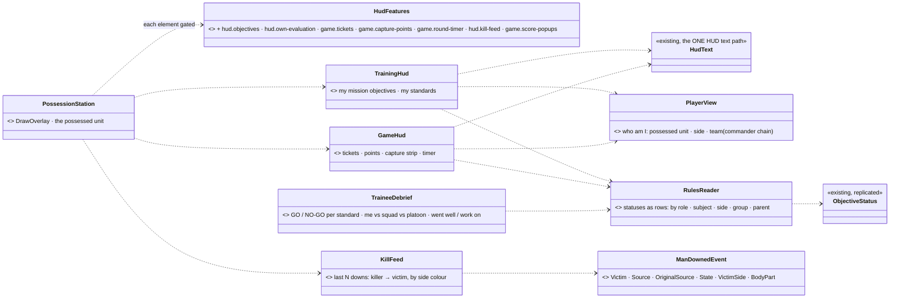
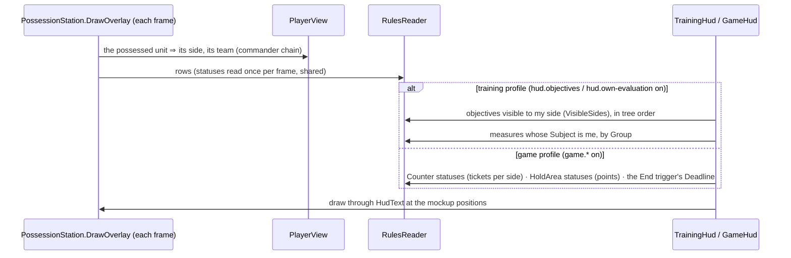
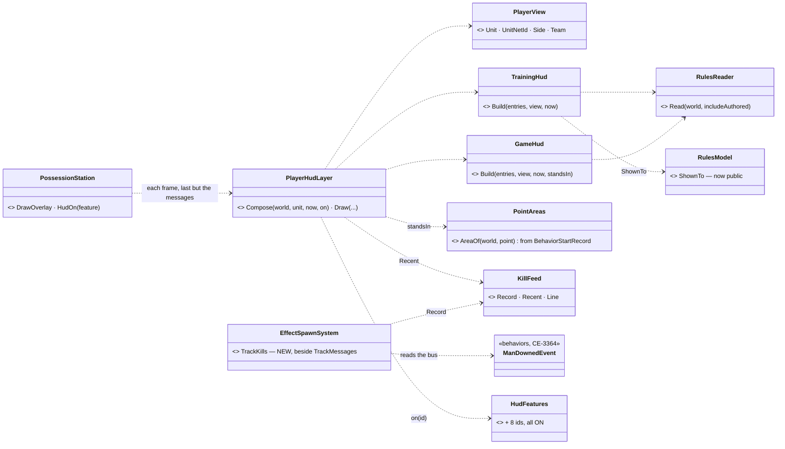
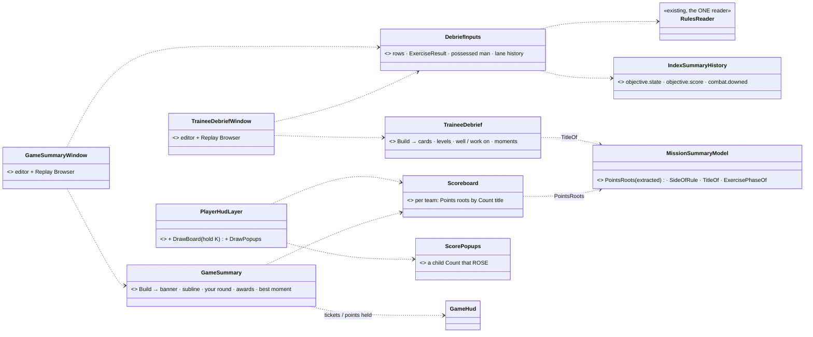

<!--STATUS
state: LIVE — DESIGN ✅ PH-1 … PH-7 APPROVED, PH-8 APPROVED AMENDED (R-4115: features stay ON by default; a scenario preset switches the other profile's elements off) (user, `2026-11-03`: *"approved"*)
updated: 2026-11-03 (H1 + H2 BUILT — §6 AS BUILT; PH-5 / PH-6 read ManDownedEvent; PH-6 / PH-7 rely on behaviors' S4 ①②④⑤ and backend's S7)
build-state: H1 BUILT · H2 BUILT · D1 BUILT · G1 BUILT
current-answer: §3 (decisions) · §4 (phases) · §6 (AS BUILT H1 + H2) · §7 (AS BUILT D1 + G1) — both win where they differ from §2
stale-below: nothing
known-rot: none
related-designs:
  - DESIGN_Man_Downed_Event.md — OWNS the one kill authority (`ManDownedEvent`); PH-7 (the kill feed) reads it — and needs its wire topic (D5)
  - docs/DESIGN_Scenario_Rules.md — OWNS the decisions: SR-106 (messages, built — CE-1461), SR-107 (the player's own evaluation on the HUD), SR-112 (the two profiles, the debrief, the round summary); §00.11 S4 (measures, group, MemberEvaluation — behaviors) and §00.12 S6 (capture, counters, whileTrue — backend)
  - docs/designs/rules-view/README.md — the mockups HudTraining · HudGame · TraineeDebrief · GameSummary; the SR rows win where they differ
  - docs/DESIGN_Node_Features.md — §9 the hud.* features (CE-4148) and §10 hud.messages (CE-1461): every HUD element here is one more Node Feature on the same rails
  - docs/DESIGN_Rules_View_UI.md — the instructor's side (rules view, mission summary); this doc is the PLAYER's side of the same data
  - docs/blueprints/batches/HANDOFF_Coordinator_To_Ui_Rules_View_And_Summary.md — item ⑧
  - docs/DESIGN_Man_Downed_Event.md — behaviors' ONE kill authority (CE-3364): the kill feed (PH-5) and the debrief's moments (PH-6) read it; its D5 defers the wire topic to PH-5
  - docs/blueprints/batches/HANDOFF_Coordinator_To_Behaviors_Rules_S4_Scores.md — behaviors builds the debrief's reads: pass mark ②, role / squad composites ①, score lane ④, debrief fields ⑤
  - docs/blueprints/batches/HANDOFF_Coordinator_To_Backend_Player_Score.md — backend builds the game score PH-7 reads (DESIGN_Scenario_Rules.md §00.13 S7 on backend)
-->

# DESIGN — **the player's HUD and debrief** *(handoff item ⑧; SR-107, SR-112)*

## 1. INVENTORY *(`2026-11-03`)*

**Queries:**
- graph: `.*(Debrief|Scoreboard|KillFeed|Hud)\w*$` Class → 3 (`PossessionStation.Hud`, `HudText`, an analyzer) — **no debrief, scoreboard or kill feed exists**.
- grep: `ObjectiveStatus` in `Hrot.Presentation` → **0** (no player-facing code reads the statuses yet) · `HudFeatures` (7 declared) · `DamageAssessedEvent` · the S4 / S6 as-built rows.
- ⚠ coverage unchecked (`check_index_coverage` is not in the CLI).

| measured | where | so |
|---|---|---|
| the possession HUD overlay = `PossessionStation.DrawOverlay` + `PossessionStation.Hud`; text through the ONE `HudText`; every element gated by a `hud.*` Node Feature (`HudFeatures`, 7 incl. `hud.messages`) | `Hrot.Presentation/Map3D/PossessionStation.cs:450, :718-934`; `HudText.cs`; `Hrot.Core/Infrastructure/HudFeatures.cs` | every new element is one more feature + one more draw call in the SAME overlay — never a second HUD |
| `ObjectiveStatus` replicated to every node (dt 171): role · state · owner · progress cur/need · value / target · `Score` · `Group` · `Title` · `Kind` · `Required` · `VisibleSides` · `Deadline` · `ExpectedAt`; `ObjectiveLinks {Subject, Parent}` | `Fdp.Toolkits/ScenarioRules/ObjectiveStatus.cs`; behaviors §00.10 / §00.11 | the training HUD and the debrief need NO new data |
| measures (`HitRatio`, `Count`, `ReportLatency`, `TimeTo`, `Sample`) carry `Score` with *lower is better* already folded in; `MemberEvaluation` = one inserted root per man (`Subject` = him) | behaviors §00.11, `NOTE_Behaviors_To_Ui_Rules_S4_Group_And_Measures.md` | "my standards" = the measures whose `Subject` is the possessed man, grouped by `Group` |
| game data: a capture point = a `HoldArea` status (`Owner`, `ProgressCur/Need` = seconds of advantage of `captureSeconds`); tickets = a `Counter` status (`Value`, `Target` = start); the comeback = `SkillAmplifier` on the World Environment; the round end = the End trigger | backend §00.12 S6 | the game top bar reads statuses only |
| every damage event names who caused it, rethrown grenades and clouds included (`DamageAssessedEvent.Source / OriginalSource`, `EntityHitDamage.OriginalSourceEntityId`) | CE-4155 ✅; `Fdp.Toolkits/Combat/Events/DetonationEvents.cs:26` | a kill feed can name the killer — the event a man goes DOWN on, with its source |
| ⛔ no per-PLAYER game score yet (points, streaks, team-kill −200, awards) | §00.12: *"Score per player, team-kill −200, awards and the bounty wait"* | score pop-ups, the scoreboard's points column and awards WAIT — not designed here |

## 2. The shape

*What the picture shows that prose hid:* ONE reader (`RulesReader`) turns the replicated statuses into rows for the HUD, the debrief — and the
instructor's rules view and summary (`DESIGN_Rules_View_UI.md`), so the player and the instructor can never see two different numbers. Every
element draws through the existing overlay and text path, each behind its own feature.

## 3. Decisions

| # | decision | ⭐ lean |
|---|---|---|
| **PH-1** | one reader for all screens | ⭐ `RulesReader` (pure, `Hrot.Presentation/Rules/`): statuses as rows with the queries every screen needs (by role, subject, side + `VisibleSides`, group, parent chain). The rules view (RV-3) and the summary (RV-8) use it too — ⛔ no screen reads `ObjectiveStatus` itself |
| **PH-2** | who "I" am | ⭐ `PlayerView`: the possessed unit, its side (`EntityInfo.ForceId`), its team = its commander chain (`UnitSubordinate`). Nothing possessed ⇒ no player HUD (the editor's map is the instructor's) |
| **PH-3** | the training HUD | ⭐ `hud.objectives` (top-right): the objectives visible to my side, required first, in tree order; a ✓ / ● / ○ by state; the active one's progress bar (`ProgressCur / Need`) or its time (`Deadline` − now). ⭐ `hud.own-evaluation` (below it, *My standards*): the measures whose `Subject` is me (or my team when none is mine), each `Value` vs `Target` coloured by `Score`. ⏳ `hud.coaching` (a live hint) waits — it needs a live per-leaf signal (behaviors' V-3), OFF by default anyway |
| **PH-4** | the game HUD | ⭐ `game.tickets` + `game.capture-points` + `game.round-timer` (one top bar): each side's `Counter` value · each point's letter coloured by `Owner`, the contested one striped by progress · the round time (the End trigger's `Deadline`, else elapsed); ⭐ a *Capturing B · 60 %* strip under it while the possessed man stands in a point that is changing hands. Which statuses are tickets / points is read from `Kind` (`Counter`, `HoldArea`) — ⛔ no hard-coded names |
| **PH-5** | the kill feed | ⭐ `hud.kill-feed` (top-right in game): the last 5 entries of behaviors' **`ManDownedEvent`** (CE-3364, the ONE kill authority — published once, by the damage applier, when a hit takes a man out of the fight): *killer → victim*, side-coloured; *"down"* when `State` = Incapacitated, *"killed"* when Dead; a head mark when `BodyPart` = head; `OriginalSource` when it differs (*"Fox (grenade, rethrown by Hawk) → Bobr"*). ⛔ NOT from `DamageAssessedEvent` (superseded `2026-11-03`): a reader of hits cannot tell a killing hit from a hit on a body already down — exactly the over-credit CE-3364 fixes. ✅ It reaches every node over **`dtManDowned` (175)** (behaviors `532b79c4d`): a remote node reads the same `ManDownedEvent` with `IsRemote = true`, ids resolved to its own entities, once per downing. ⚠ `HasBodyPart` + `BodyPart` (the head mark is `HasBodyPart != 0` and the head id). Recorded events ⇒ it also replays |
| **PH-6** | the trainee debrief | ⭐ `TraineeDebrief` window, always available once `ExerciseResult` is `Ended` and on any recording (SR-112 ①, demo rule): for the chosen man (default: the possessed one) — each standard as a card (`Value`, `Target`, the squad's mean = the same measure on his squad's / role's composite (behaviors S4 ①⑤), GO when `Score` ≥ `Pass` (S4 ②), else NO-GO), grouped by `Group`; his score vs his squad's and platoon's (the `MemberEvaluation` roots up the `Parent` chain); *went well / work on* = the measures with the best and worst margin. ⭐ **his moments** = a strip of the run with his standards' state changes (`objective.state`, built) and the downings he suffered (Subject = him) or caused (Other = him) on `combat.downed` (built) — each a seek; the *"you were downed by X (head) at 12:03"* card comes from the same event. ⏳ *replay from my eyes* needs the film director — a later phase. ⏳ progress across runs needs the trainee record (G7) |
| **PH-7** | the game score screens — **on backend's S7** (§00.13) | ⭐ all reads of the status wire (S7 P-9): **scoreboard** = per team, the men's `Points` roots (title *Score*, `Subject` = the man) with their `Count` children as columns (kills · assists · deaths · captures · team kills) and the team total (`MemberEvaluation aggregate: points`) · **+100 pop-up** (`game.score-popups`) = a child measure's `Value` rising for the possessed man, × its `Points`, with the child's `Title` (*+100 elimination*) · **awards** = the awards macro's `Best` objectives once Achieved: `Title` + `Subject` (the winner) + `Value` · **your best moment** = the largest rise of his root's `Value` in the recording's `objective.score` lane (behaviors S4 ④), a seek into the film · **round summary** (`GameSummary` window) = the winner banner from `ExerciseResult` + the scoreboard + *your round* (his children) + the awards. ⏳ streaks / bounty wait for S7 P-8; level / XP is not designed anywhere — left out |
| **PH-8** | the profiles | ✅ **AMENDED `2026-11-03`** (coordinator review, user *"approved"*): ⛔ NOT default OFF — R-4115 (*gameplay features are ON by default where installed*) stands; every `hud.*` / `game.*` element defaults ON, and a scenario's feature PRESET (the scenario layer of node-feature config, F-22 / P-7) switches the OTHER profile's elements off — a training scenario turns `game.*` off, a game scenario the training elements; `hud.messages` stays ON everywhere. ⛔ Superseded lean: ⭐ a profile is just a feature set (SR-112): training = `hud.objectives` + `hud.own-evaluation` + `hud.messages`; game = the `game.*` + `hud.kill-feed` + `hud.messages`; each element ON by default only in its profile's scenarios — ⭐ lean: default OFF, the scenario (or the run setup) turns the profile's features on; `hud.messages` stays ON everywhere (CE-1461) |

**Rejected — one line each:**
- *A HUD reading `ObjectiveStatus` directly* — the instructor's screens would compute the same rows a second way; one reader.
- *Hard-coding "tickets" and "points" by entity name* — the scenario author names them; the `Kind` says what they are.
- *Computing a game score in the ui* — the score is the engine's (R-4105); the ui only shows it.
- *A separate HUD window* — the possession overlay is the one HUD; a window is the debrief, after the run.

## 4. Phases

| phase | items | gate |
|---|---|---|
| **H1** ✅ BUILT (§6) | PH-1 `RulesReader` · PH-2 · PH-3 the training HUD | rails on the reader and the models (visibility by side, my measures, order, progress / time); a frame rail of the overlay; live: `showcase-bridgehead`, possess a Blue rifleman |
| **H2** ✅ BUILT (§6) | PH-4 the game top bar + capture strip · PH-5 the kill feed | rails on the models from synthetic statuses / events; a frame rail; live: `showcase-crossfire` |
| **D1** ✅ BUILT (§7) | PH-6 the trainee debrief | rails on the cards, GO / NO-GO, the chain comparison, went well / work on; a frame rail; live: a finished Bridgehead run and its recording |
| **G1** ✅ BUILT (§7) | PH-7 the scoreboard, pop-ups, awards, round summary | ✅ S7 is merged (`Points` roots, `Count` assists / teamKills / deaths / captures, `Best`): model rails on synthetic statuses against the as-built names; ✅ kills / assists / team kills read `ManDownedEvent` (CE-3364, `908dc63ad`); a frame rail; live: `showcase-crossfire` |

## 5. Claim table

| claim | code | design basis |
|---|---|---|
| no player-facing code reads the statuses yet | ✅ grep `ObjectiveStatus` in Presentation → 0 | — |
| the training HUD needs no new data | ✅ fields on dt 171 (§00.10 / §00.11) | ✅ SR-107, SR-112 |
| the game bar needs no new data | ✅ `HoldArea` / `Counter` statuses (§00.12) | ✅ SR-112 game profile |
| the kill feed can name the killer, once per downing | ✅ CE-3364 `ManDownedEvent` + `dtManDowned` (175) on every node (`Fdp.Toolkits/Combat/Events/ManDownedEvent.cs`) | ✅ SR-112 (kills / assists via CE-4155) |
| the per-player game score is a tree of measures on the wire | ⚠ designed (S7, `backend@8437b7bff`), being built | ✅ S7 P-1…P-9; R-4105 |
| the profile's features default OFF and the scenario turns them on | ✅ **measured `2026-11-03`: a scenario file has NO feature field (P-7 unbuilt)**; features are switched by `--feature` per process or a cluster `FeatureOverrides` run setting (CE-4229) | ✅ SR-112 *"a scenario / cluster picks a profile = a feature set"* |

## 6. AS BUILT — H1 + H2 *(ui, `2026-11-03`; CE-4226 H1, CE-4227 H2 game bar, CE-4228 kill feed; CE-4229 / CE-4230 the two gaps below)*

*Caption — what the picture shows: ONE reader (`RulesReader`, now with `includeAuthored:false` for the HUD — it shows what RUNS and must not parse every rule's JSON each frame), ONE side rule (`RulesModel.ShownTo`, shared with the rules view), ONE kill memory per world written beside the messages. The station owns no HUD logic: it passes its gate (`HudOn`) to the layer.*

| §2 / PH said | built | deviation — why |
|---|---|---|
| `PlayerView` · `TrainingHud` · `GameHud` · `KillFeed` pure models | `Hrot.Presentation/Rules/PlayerHud.cs` (`PlayerView`, `TrainingHud`, `GameHud`, `PointAreas`), `Map3D/KillFeed.cs`; the draw is `Map3D/PlayerHudLayer.cs` | `TrainingHud` / `GameHud` return models; the layer draws them. The **draw** is one static class, not a method per model, so the HUD's layout (top bar, right column) is in one place |
| 8 features (PH-3 … PH-5, `game.score-popups`) | `hud.objectives` · `hud.own-evaluation` · `game.tickets` · `game.capture-points` · `game.round-timer` · `hud.kill-feed` · `game.score-popups` · **`game.bounty-marker`** | `game.bounty-marker` is new: the bounty marker is not a score pop-up. All ON on every host (PH-8 amended; `HudFeatures.Declarations`) |
| a profile = a scenario's feature preset | **not buildable today** — see CE-4229 | `P-7` (scenario-stored presets) is unbuilt: a scenario file has no feature field. Today an element is switched off by `--feature id=off` per process or a cluster `FeatureOverrides` run setting. ⭐ **An element with no data draws nothing**, so with every feature ON a training scenario still shows no game bar (no `Counter` / capture point) and a game scenario no mission list (its objectives are `Counter` / `HoldArea` / `Bounty`, excluded by kind) |
| objectives: *visible to my side by `VisibleSides`* | a `VisibleSides` bit when set, else the rule's SIDE = `MissionSummaryModel.SideOfRule` (its subject's `EntityInfo.ForceId`, else Owner); a side-less rule is for everyone. `RulesModel.ShownTo` was made public for the rules view's filter | ⚠ **measured live: every running rule row (objectives AND `Counter`s) carries Owner `Neutral`** (showcase-bridgehead, showcase-crossfire) — Owner alone shows nothing / everything. Tickets are grouped by the same side rule |
| `Role == Objective`, tree order, required first | the summary's rule: a **LEAF** objective (no child rows), not under a `MemberEvaluation`, not kinds `Counter` / `Bounty` / `NoHarm` (a conduct standard) / `Points` / `Best` / `SelectionMean`, not a capture point, not authored. Flat list (composites like *Mission*, *Conduct* are not lines). Order = required first, then depth-first by network id. Live on bridgehead: *Clear / Hold the crossroads* (required, waiting) then *Reach phase line RED 0 / 4* | ⚠ **a capture point is a `HoldArea` whose `Reason` carries `owner`** — the status has no capture flag (CE-4230). A plain hold ("Hold the bridge") has no `owner` in its reason, a capture arm always writes it |
| game bar from `Kind` | tickets = a `Counter` with `Target > 0` per `Owner` (a lead counter starts at 0 and is not tickets); points = capture `HoldArea`s, letter = the title's last word when one letter, else A, B, C by order; clock = the earliest `Trigger` `Deadline` still ahead (a countdown), else the elapsed run time | `showcase-crossfire`'s *End* trigger has **no `deadlineSeconds`** (its 15 min is a `ScenarioTime` clause of its `when`), so the clock counts UP there. Authoring `deadlineSeconds: 900` on *End* makes it a countdown |
| contested point striped by progress | the owner's colour, the challenger's colour over `ProgressCur / ProgressNeed` of the box, diagonal stripes | the challenger is not a status field: an owned point's challenger is the other side; a neutral point's is read from the S6 reason (*"…, owner Neutral, Friend 6/10 s"*) — CE-4230 |
| *Capturing B · 60 %* strip | `PointAreas.AreaOf(world, point)` — the point's authored `area` from its `BehaviorStartRecord`, parsed by the ONE `AreaLink` converter (scenario options) and tested by `AreaLink.Contains` | ⚠ the record is written by the node that RUNS the brain: the editor and the all-in-one host have it; a remote Player node does not ⇒ no strip there (CE-4230). *Contested B* when the taker is the other side |
| kill feed from `ManDownedEvent` | `EffectSpawnSystem.TrackKills` (before the replay gate, with `TrackMessages`) → `KillFeed.In(world)`; names / sides / distance resolved at record time; last 5, 15 s, hidden if from the future of a replay seek | killer = `OriginalSource` when it differs from `Source` (the first thrower), *rethrown by* = `Source` — PH-5's own example (*"Fox (grenade, rethrown by Hawk) → Bobr"*). The arrow is `»`: the HUD font has no `→` glyph |
| STREAK ×n under the score | `STREAK x3` under the crosshair (`game.score-popups`) when my `Count` titled *Streak* ≥ 2 | the score pop-ups themselves are G1; the streak stands alone until then |
| bounty marker on the map and in the possession view | **possession view only**: a gold diamond + *BOUNTY* over each man a `Bounty` status that is Active names | the 2-D map layer needs a new `IMapLayer` with its own entity pass — not a simple seam; left for G1 (CE-4229) |

**Live (`2026-11-03`):** bridgehead — mission list + *Team standards* (the man has none of his own: his squad's, by the commander chain) drawn; crossfire — `149 A B C 149 0:46` bar, kill feed with head marks and distances, ticket / point / clock from `Kind`. The capturing strip and the streak / bounty were not seen live (no man stood in a changing point; no kill chain long enough) — covered by the model and frame rails only.

**Rails:** `PlayerHudTests` (the models, 18) · `KillFeedTests` (6) · `EffectTests.HudKillFeed` (the recorder gate + the declarations) · `HudFeaturesAreWiredOnEveryHostTests.ThePlayerHud_…` · `PlayerHudFrameRail` (xvfb: each part drawn, each feature off removes exactly its part).

## 7. AS BUILT — D1 + G1 *(ui, `2026-11-03`; CE-4231 the build, CE-4232 / CE-4233 the gaps below)*

*Caption — what the picture shows: nothing new is READ — the debrief, the board, the pop-ups and the summary are four views of the same `RulesReader` rows and the same lane history the mission summary uses; `PointsRoots` was EXTRACTED from the summary's game card (not copied), so card, scoreboard and summary select the same men.*

| PH said | built | deviation — why |
|---|---|---|
| debrief for the chosen man, default the possessed one; a picker of men with a member root | `TraineeDebrief.Roots` = children of a `MemberEvaluation` that are about somebody; picker = their subjects | ⚠ on `showcase-bridgehead` the roots are the SQUADS' (`Member standards`, subject *Blue Squad 1*), not riflemen: a man with no root of his own is shown by the nearest of his commander chain that has one, and the header says so (*"…his standards are Blue Squad 1's"*) |
| each standard a card: Value, Target, squad mean, GO / NO-GO, by Group | `StandardCard`; the mean = the evaluation's `"<title> (mean)"` `SelectionMean` (S4 ① ⑤), labelled by the evaluation's subject (*"Blue Platoon mean 0.10"* — a platoon, where only the platoon has an evaluation) | the mean is the evaluation's, not always a *squad's* |
| his score vs squad vs platoon | the `Scored` objective ancestors of his root, nearest first | labelled by their subject; two levels on bridgehead (*Members*, *Bridgehead*) |
| went well / work on = best / worst margin | the 3 best `Score − Pass` ≥ 0 / the 3 worst < 0 | data lines (*"Hit ratio: 0.12 · standard 0.25"*), not narrative |
| his moments = a strip | a **list** of `objective.state` changes of his standards + `combat.downed` he suffered (Subject) or caused (Other), each a seek | no drawn strip — a list with the same seeks |
| *"you were downed by X (head)"* from the recorded `ManDownedEvent` if readable | **from the `combat.downed` lane, WITHOUT the body part** — said on the card. A `TimelineIndex` holds lane entries, not the events | the head mark needs the recorded event at that frame: not readable from the index (CE-4233) |
| ⏳ replay from my eyes · progress across runs | two disabled buttons naming why (film director · gap G7) | — |
| `+100` pop-up | `ScorePopups`: a scored child of the possessed man's `Points` root whose `Value` rose × its `Points`, named by its `Title`; 2.5 s, floats up (`game.score-popups`) | a presentation memory (last values); first sight / a fall re-baselines |
| scoreboard | **hold K** (Tab is *next man*; K was free) → `PossessionStation.ScoreboardHeld` → `PlayerHudLayer.DrawBoard`; feature **`game.scoreboard`** (new, ON) | per team ≤ 8 rows + the viewer's own row, columns K D A CAPT TK STREAK SCORE (streak = live / best) |
| team total = the side `MemberEvaluation` (aggregate points) | its `Value` | — |
| GameSummary window | `GameSummary.Build`: banner from `SideResult.Outcome`, subline = points held + tickets (the HUD's own reading) + `Reason`, the board, *your round* (K/D, best streak, team kills + his scored children), awards (`Best` + Achieved: title, `Subject`, `Value`) | no level / XP (not designed); the mockup's accuracy / longest hit / time on point are not statuses and are left out; always opens (a running round says *ROUND IN PROGRESS*), `Available` only gates the label |
| *your best moment* = the largest rise of his root's `Value` in `objective.score` | the largest rise of that LANE if any, **else the densest 15 s of the kills he caused** (`combat.downed`, Other = him), the text says which | ⚠ the `objective.score` lane carries `Score`, and a `Points` root has NO target ⇒ its `Score` stays 0 ⇒ the lane never rises (CE-4232) |

**Rails:** `DebriefModelTests` (10: every card / screen field from synthetic statuses and lane entries) · `DebriefWindowsFrameRail` (both windows in a real ImGui frame, probe asserted) · `ScoreHudFrameRail` (xvfb: the board while K is held, a rise floats up, each feature off removes its part) · `EffectTests` declarations (16 features). Red-proof: awards without the *Achieved* filter fails `TheRoundSummary_…`.

## 8. AS BUILT — H3 *(ui, `2026-11-03`; CE-4236 selection · CE-4237 the build · CE-4238 the round-end clock)*

| change | as built | note |
|---|---|---|
| capture facts on the status (backend G-8, CE-4230) | `TrainingHud.IsCapturePoint` = `Status.Capture != 0`; the contested point's taker = `Status.Challenger`; `PointLine` carries `AreaX / AreaY / AreaRadius`, the strip shows while the man's ground position is inside it (`GameHud.Build(…, viewerAt:)`). ⛔ DELETED: the reason-text parsing, `PointAreas` and the `BehaviorStartRecord` read | a remote Player node has everything: the strip no longer depends on the node that runs the brain (§6's "no area ⇒ no strip" is superseded) |
| a rule's side | `MissionSummaryModel.SideOfRule`: authored entity's `ForceId` (not Neutral) → subject's → `Owner`; a macro-instanced rule skips the entity (template side). Used by the HUD (objectives, tickets), the scoreboard, the summary, the debrief AND the rules view's side filter / grouping | §6's *"Owner Neutral on every rule ⇒ the subject's side"* is superseded; see `DESIGN_Rules_View_UI.md` finding ⓐ |
| scenario presets (P-7) | verified live with `--mode all` `GET /features`: crossfire — IG and CGF `hud.objectives` / `hud.own-evaluation` off, source `scenario`; bridgehead — `game.tickets / capture-points / round-timer / score-popups / bounty-marker` and `hud.kill-feed` off, source `scenario` | ⚠ `game.scoreboard` (added in D1/G1, after the preset lists were written) is ON in bridgehead — harmless (no Points roots ⇒ nothing to show); a preset line for it is backend's to add. ⚠ the editor's debug API answers `GET /features` only in `--mode all` (no ECS node context in the editor host) |
| round timer counts down to a trigger's `ExpectedAt` | ⛔ **not done**: `GET /objectives` shows End's `expectedAt` = 0 on `showcase-crossfire` (behaviors has not filled it). The clock keeps counting UP. ⚠ once it is filled, EVERY timed trigger has one (the crate drops, sudden death …) — the HUD then needs to know which trigger ENDS the round (earliest is wrong) | CE-4238 |
| message-log selection | keyed by the message (`MessageSelection`), not its index | CE-4236; `MessageSelectionTests` |
