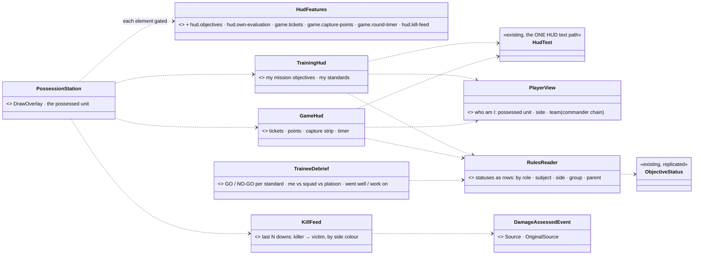
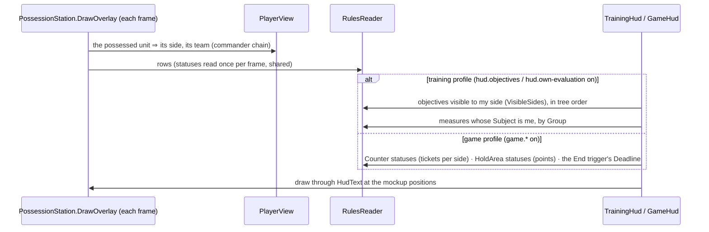

<!--STATUS
state: LIVE — DESIGN, leans PH-1 … PH-8 await the user
updated: 2026-11-03
build-state: DESIGN
current-answer: §3 (decisions) · §4 (phases)
stale-below: nothing
known-rot: none
related-designs:
  - docs/DESIGN_Scenario_Rules.md — OWNS the decisions: SR-106 (messages, built — CE-1461), SR-107 (the player's own evaluation on the HUD), SR-112 (the two profiles, the debrief, the round summary); §00.11 S4 (measures, group, MemberEvaluation — behaviors) and §00.12 S6 (capture, counters, whileTrue — backend)
  - docs/designs/rules-view/README.md — the mockups HudTraining · HudGame · TraineeDebrief · GameSummary; the SR rows win where they differ
  - docs/DESIGN_Node_Features.md — §9 the hud.* features (CE-4148) and §10 hud.messages (CE-1461): every HUD element here is one more Node Feature on the same rails
  - docs/DESIGN_Rules_View_UI.md — the instructor's side (rules view, mission summary); this doc is the PLAYER's side of the same data
  - docs/blueprints/batches/HANDOFF_Coordinator_To_Ui_Rules_View_And_Summary.md — item ⑧
-->

# DESIGN — **the player's HUD and debrief** *(handoff item ⑧; SR-107, SR-112)*

## 1. INVENTORY *(`2026-11-03`)*

**Queries:**
- graph: `.*(Debrief|Scoreboard|KillFeed|Hud)\w*$` Class → 3 (`PossessionStation.Hud`, `HudText`, an analyzer) — **no debrief, scoreboard or kill feed exists**.
- grep: `ObjectiveStatus` in `Hrot.Presentation` → **0** (no player-facing code reads the statuses yet) · `HudFeatures` (7 declared) · `DamageAssessedEvent` · the S4 / S6 as-built rows.
- ⚠ coverage unchecked (`check_index_coverage` is not in the CLI).

| measured | where | so |
|---|---|---|
| the possession HUD overlay = `PossessionStation.DrawOverlay` + `PossessionStation.Hud`; text through the ONE `HudText`; every element gated by a `hud.*` Node Feature (`HudFeatures`, 7 incl. `hud.messages`) | `Hrot.Presentation/Map3D/PossessionStation.cs:450, :718-934`; `HudText.cs`; `Hrot.Core/Infrastructure/HudFeatures.cs` | every new element is one more feature + one more draw call in the SAME overlay — never a second HUD |
| `ObjectiveStatus` replicated to every node (dt 171): role · state · owner · progress cur/need · value / target · `Score` · `Group` · `Title` · `Kind` · `Required` · `VisibleSides` · `Deadline` · `ExpectedAt`; `ObjectiveLinks {Subject, Parent}` | `Fdp.Toolkits/ScenarioRules/ObjectiveStatus.cs`; behaviors §00.10 / §00.11 | the training HUD and the debrief need NO new data |
| measures (`HitRatio`, `Count`, `ReportLatency`, `TimeTo`, `Sample`) carry `Score` with *lower is better* already folded in; `MemberEvaluation` = one inserted root per man (`Subject` = him) | behaviors §00.11, `NOTE_Behaviors_To_Ui_Rules_S4_Group_And_Measures.md` | "my standards" = the measures whose `Subject` is the possessed man, grouped by `Group` |
| game data: a capture point = a `HoldArea` status (`Owner`, `ProgressCur/Need` = seconds of advantage of `captureSeconds`); tickets = a `Counter` status (`Value`, `Target` = start); the comeback = `SkillAmplifier` on the World Environment; the round end = the End trigger | backend §00.12 S6 | the game top bar reads statuses only |
| every damage event names who caused it, rethrown grenades and clouds included (`DamageAssessedEvent.Source / OriginalSource`, `EntityHitDamage.OriginalSourceEntityId`) | CE-4155 ✅; `Fdp.Toolkits/Combat/Events/DetonationEvents.cs:26` | a kill feed can name the killer — the event a man goes DOWN on, with its source |
| ⛔ no per-PLAYER game score yet (points, streaks, team-kill −200, awards) | §00.12: *"Score per player, team-kill −200, awards and the bounty wait"* | score pop-ups, the scoreboard's points column and awards WAIT — not designed here |

## 2. The shape

*What the picture shows that prose hid:* ONE reader (`RulesReader`) turns the replicated statuses into rows for the HUD, the debrief — and the
instructor's rules view and summary (`DESIGN_Rules_View_UI.md`), so the player and the instructor can never see two different numbers. Every
element draws through the existing overlay and text path, each behind its own feature.

## 3. Decisions

| # | decision | ⭐ lean |
|---|---|---|
| **PH-1** | one reader for all screens | ⭐ `RulesReader` (pure, `Hrot.Presentation/Rules/`): statuses as rows with the queries every screen needs (by role, subject, side + `VisibleSides`, group, parent chain). The rules view (RV-3) and the summary (RV-8) use it too — ⛔ no screen reads `ObjectiveStatus` itself |
| **PH-2** | who "I" am | ⭐ `PlayerView`: the possessed unit, its side (`EntityInfo.ForceId`), its team = its commander chain (`UnitSubordinate`). Nothing possessed ⇒ no player HUD (the editor's map is the instructor's) |
| **PH-3** | the training HUD | ⭐ `hud.objectives` (top-right): the objectives visible to my side, required first, in tree order; a ✓ / ● / ○ by state; the active one's progress bar (`ProgressCur / Need`) or its time (`Deadline` − now). ⭐ `hud.own-evaluation` (below it, *My standards*): the measures whose `Subject` is me (or my team when none is mine), each `Value` vs `Target` coloured by `Score`. ⏳ `hud.coaching` (a live hint) waits — it needs a live per-leaf signal (behaviors' V-3), OFF by default anyway |
| **PH-4** | the game HUD | ⭐ `game.tickets` + `game.capture-points` + `game.round-timer` (one top bar): each side's `Counter` value · each point's letter coloured by `Owner`, the contested one striped by progress · the round time (the End trigger's `Deadline`, else elapsed); ⭐ a *Capturing B · 60 %* strip under it while the possessed man stands in a point that is changing hands. Which statuses are tickets / points is read from `Kind` (`Counter`, `HoldArea`) — ⛔ no hard-coded names |
| **PH-5** | the kill feed | ⭐ `hud.kill-feed` (top-right in game): the last 5 downs from `DamageAssessedEvent` (a man goes down) as *killer → victim · distance*, side-coloured; `OriginalSource` when it differs (*"Fox (grenade, rethrown by Hawk) → Bobr"*). Recorded events ⇒ it also replays |
| **PH-6** | the trainee debrief | ⭐ `TraineeDebrief` window, always available once `ExerciseResult` is `Ended` and on any recording (SR-112 ①, demo rule): for the chosen man (default: the possessed one) — each standard as a card (`Value`, `Target`, the squad's mean of the same measure, GO when `Score` ≥ its pass, else NO-GO), grouped by `Group`; his score vs his squad's and platoon's (the `MemberEvaluation` roots up the `Parent` chain); *went well / work on* = the measures with the best and worst margin. ⏳ *his moments* + *replay from my eyes* need the SR-103 rules lanes (RV-4) and the film director — a later phase. ⏳ progress across runs needs the trainee record (G7) |
| **PH-7** | what waits | ⏳ score pop-ups, the scoreboard's points, awards, *your best moment* and the round summary's XP — all need the per-player game score (§00.12 *"wait"*); the round summary (`GameSummary`) is designed when that data lands |
| **PH-8** | the profiles | ⭐ a profile is just a feature set (SR-112): training = `hud.objectives` + `hud.own-evaluation` + `hud.messages`; game = the `game.*` + `hud.kill-feed` + `hud.messages`; each element ON by default only in its profile's scenarios — ⭐ lean: default OFF, the scenario (or the run setup) turns the profile's features on; `hud.messages` stays ON everywhere (CE-1461) |

**Rejected — one line each:**
- *A HUD reading `ObjectiveStatus` directly* — the instructor's screens would compute the same rows a second way; one reader.
- *Hard-coding "tickets" and "points" by entity name* — the scenario author names them; the `Kind` says what they are.
- *Computing a game score in the ui* — the score is the engine's (R-4105); the ui only shows it.
- *A separate HUD window* — the possession overlay is the one HUD; a window is the debrief, after the run.

## 4. Phases

| phase | items | gate |
|---|---|---|
| **H1** | PH-1 `RulesReader` · PH-2 · PH-3 the training HUD | rails on the reader and the models (visibility by side, my measures, order, progress / time); a frame rail of the overlay; live: `showcase-bridgehead`, possess a Blue rifleman |
| **H2** | PH-4 the game top bar + capture strip · PH-5 the kill feed | rails on the models from synthetic statuses / events; a frame rail; live: `showcase-crossfire` |
| **D1** | PH-6 the trainee debrief | rails on the cards, GO / NO-GO, the chain comparison, went well / work on; a frame rail; live: a finished Bridgehead run and its recording |
| ⏳ | PH-7 (score, awards, round summary) | when the per-player score lands |

## 5. Claim table

| claim | code | design basis |
|---|---|---|
| no player-facing code reads the statuses yet | ✅ grep `ObjectiveStatus` in Presentation → 0 | — |
| the training HUD needs no new data | ✅ fields on dt 171 (§00.10 / §00.11) | ✅ SR-107, SR-112 |
| the game bar needs no new data | ✅ `HoldArea` / `Counter` statuses (§00.12) | ✅ SR-112 game profile |
| the kill feed can name the killer | ✅ CE-4155 as built | ✅ SR-112 (kills / assists via CE-4155) |
| a per-player game score does not exist yet | ✅ §00.12 *"wait"* | — (PH-7 waits) |
| the profile's features default OFF and the scenario turns them on | ⛔ **unmeasured**: how a scenario sets a feature today (`FeatureConfigsAtLoad`?) | ✅ SR-112 *"a scenario / cluster picks a profile = a feature set"* |
