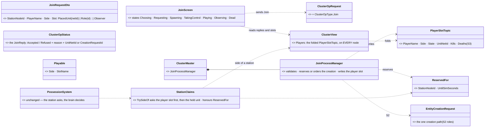
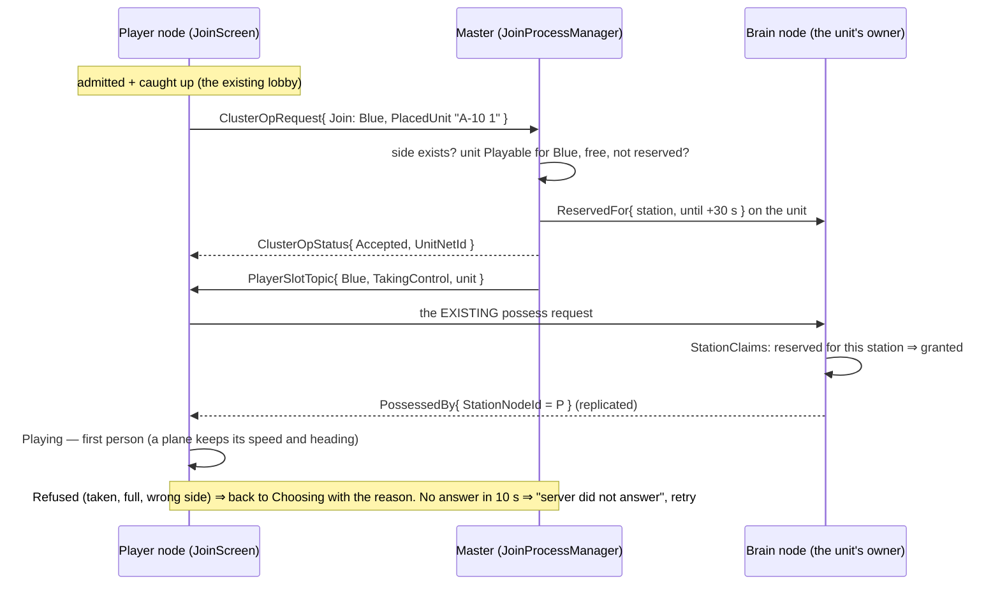
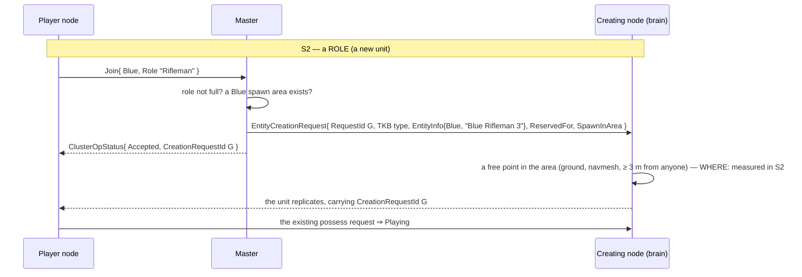
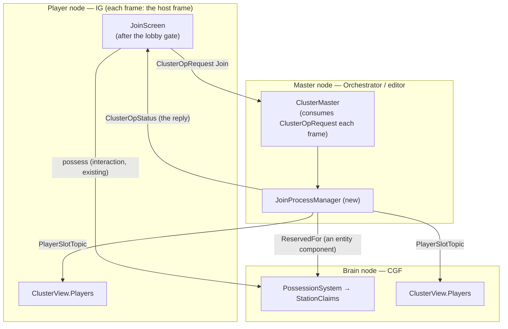

<!--STATUS
state: LIVE
build-state: DESIGN — S1 leans AGREED by the user (2026-10-31: "Agreed", "Great, sounds really good", "Yes, please"); S2/S3 leans to confirm when they start
updated: 2026-10-31 (first version — coordinator)
current-answer: §3 the diagrams · §4 decisions J-1..J-14 · §5 slices
stale-below: nothing
known-rot: none
known-conflict: none
related-designs:
  - docs/blueprints/Architect_Question_91_Player_Nodes.md — OWNS what a Player node is (an IG node, no Player role, acts by REQUESTS to the owner); this design adds the join a Player makes after it is admitted
  - docs/DESIGN_Cluster_Membership_Use_Cases.md — OWNS UC-17…24 (the multiplayer acceptance, CE-4080); §5 here adds the join / spawn / respawn cases to it
  - docs/blueprints/Architect_Question_110_Readiness_Protocol.md — OWNS admission (AdmissionPolicy, the Lobby) — the join starts only once a Player is admitted and caught up
  - docs/DESIGN_Cluster_Load_Phase.md — §11.8 OWNS the Player's waiting / lobby screen (HostGatePolicy.Player); the join screens follow it
  - docs/DESIGN_Entity_Control.md — §8q OWNS R-4096 (StationClaims: no taking another player's unit or seat) and §8c possession on a cluster; this design gives §8q the player FACTION it lacks and adds the reservation it honours
  - docs/DESIGN_Unit_Camera.md — OWNS the Observer camera (free / follow / eyes) an observer joins into
  - docs/designs/air-attack/DESIGN_Air_Operations.md — §6 OWNS the pilot models and "a hand-over keeps the pose", which make a plane taken in flight keep flying
  - docs/DESIGN_Entity_Creation_Unification.md — OWNS EntityCreationRequest (the one creation path) and CreationRequestId, which a Player uses to find its new unit
  - docs/DESIGN_Decision_Layer.md — §4 OWNS the paused task a possession leaves and resumes (a placed AI unit taken by a player)
  - docs/DESIGN_Add_Entity_Picker.md — D6 is the EDITOR's side choice when placing; not the player's (cited so the two are not confused)
-->

# DESIGN — **a player joins the game** *(side → role or unit → spawn → possess, or observe)*

> 🔒 **User, `2026-10-31`:** *"a player that is joining a game will somehow need to choose the side. And once that is done, you will also need
> to choose the character to be played. Could be one of predefined player roles. Which might include a set of weapons … spawn locations for red
> team, spawn location for blue team, and there could be many of them, and the game should probably pick one randomly and random place inside that
> area, which is not occupied by any other player yet. Maybe in some scenarios there could be the characters already existing as entities inside
> the scenario, and in such a case the player could be offered picking one of them. And then once done, the game should possess that entity … And
> I would like also some observer mode … free flight and looking at the scene."* · *"What about if the player wants to possess an aircraft which is
> already in the air?"* · *"We might also think about some competition system … how many enemies was killed by a player … when the player presses
> some key like tab. This is for slice 2 or something … First we need to resolve how the player joins at all."*

**The idea in one line:** the player sends **one join request to the master**; the master alone decides (one thread ⇒ no races), records
the player's side and slot in a **player-state topic every node reads**, and either reserves a placed unit or orders a new one through the ONE
creation path; the player sees its unit arrive **in its own replicated world** and takes it with the **existing** possess request.

## 1. INVENTORY *(`2026-10-31`)*

Queries run: `scripts/cbm.sh search_graph` Class `.*(Player|Spawn|Respawn|Lobby|Join|Observer|Spectat|Loadout|Kit|Role|Side|Force|Team).*`
(14 hits, none a join / spawn-point / loadout class) · grep `class .*(Player|Possess|Spawn|Zone|Observer|Spectator|Loadout|Seat)` (80) ·
a docs sweep of `docs/` + `.dev/` (an Explore agent: player nodes, membership, admission, possession, observer, spawn, loadout, score).

| what exists | where | used here as |
|---|---|---|
| a Player = an IG node (`-m player` → `ig`), admitted, caught up (UC-21: 1.8–3.9 s), a lobby screen | `HrotRunnerConfiguration.cs:369`; Q91 §0; Cluster Load Phase §11.8 | the host the join runs on |
| possession by request, decided on the brain; R-4096 claims | `PossessionSystem`, `EntityOrders.Possess`, `StationClaims` (Entity Control §8c, §8q) | how a player takes its unit — unchanged |
| a station's side = the side of the unit it holds; **"a separate player-faction concept does not exist yet"** | `StationClaims.TrySideOf`; Entity Control §8q.3 | the gap J-4 fills |
| who possesses what, on every node | `PossessedBy { StationNodeId, Mode, Epoch }` + its translators | the player's "I have it" signal |
| one creation intent with a request GUID; the unit carries the GUID on every node | `EntityCreationRequest.RequestId`; `CreationRequestId` (`NetworkSpawningSystem.cs:204`, rides `EntityMaster` — `EntityMasterIngressTranslator.cs:222`) | the player's "my unit arrived" signal |
| a request / answer pair to the master | `ClusterOpRequest { RequestId, OperationType, PayloadJson }` (Volatile, KeepAll) · `ClusterOpStatus { RequestId, StatusCode, ResultJson }` (TransientLocal, depth 64, readers filter by id) | the join's wire — one more `ClusterOpType` |
| the master's node list | `NodeRoster` (from `NodeHeartbeat`), `GET /cluster/roster` | ⚠ master-internal — a brain cannot read it ⇒ J-5's topic |
| a master-written, per-key, late-joiner-safe topic | `ClusterStateTopic` (Reliable, TransientLocal, KeepLast 1) | the shape of J-5's `PlayerSlotTopic` |
| drawn areas with their OWN type + component | `WeatherRegion`, `StoneSource` in `PlacementToolRegistry.Graphics` (Area tool) | the shape of the spawn area (S2) |
| a plane possessed in flight keeps flying | `FixedWingModel.Manual` (`:56-72`, *"possessed already flying"*); the look starts on the hull's heading (`PossessionStation.cs:1286`) | J-11 — no new code |
| the observer camera | Unit Camera §3/§4/§8 (BUILT) | J-10 |
| the kill cam knows the killer | `PossessionStation` `FallScreen(…, killer, …)` | the score's source (S3) |

## 2. What it rests on — claim table

| claim | code — how it IS | design — how it was MEANT to be |
|---|---|---|
| a join cannot be an entity interaction (no target yet) | ✅ target/actor ride the header (`InteractionMessages.cs`) | ✅ Entity Interactions R-221 |
| a Player acts by REQUESTS; the owner decides | ✅ IG node, possess via interaction | ✅ Q91 §0, §4-L.4 |
| a new unit is recognisable by its request on every node | ✅ `CreationRequestId` on `EntityMaster` | ✅ Entity Creation Unification §3.4d |
| the master's request/answer pair exists and late joiners replay answers | ✅ `ClusterOpRequest` / `ClusterOpStatus` QoS | ✅ CE-3023 comments there |
| a brain cannot read the master's roster | ✅ `NodeRoster` lives in `Hrot.Orchestrator` | ⛔ searched, no design gives players a shared side |
| a placed AI unit resumes its task when released | — | ✅ Decision Layer §4 (R-199 / R-203) |
| a plane taken in flight keeps speed and heading | ✅ `FixedWingModel.cs:71`, `PossessionStation.cs:1286` | ✅ Air Ops §6 *"a hand-over keeps the pose"* |
| where the free-point search runs (terrain + navmesh) | ⛔ **not measured — S2's first step** (the master's node may hold no navmesh) | — |

## 3. Diagrams

*What the picture shows that prose hid:* nothing new decides possession — the join only feeds the EXISTING rule (`StationClaims`) two
facts it lacked (the player's side, the reservation), so R-4096 and the join cannot disagree.

*Caption:* `ClusterMaster` already consumes `ClusterOpRequest` every frame, so the join is reached by construction once the process
manager is registered beside the others; ⚠ the edge that could go silently dead is **`PlayerSlotTopic` → the brain's `ClusterView`** —
without it `StationClaims` falls back to "the held unit's side" and R-4096 still works, but an observer or a dead player has no side.
The rail for it runs master and brain on two nodes.

## 4. Decisions

| # | decision | rule | status |
|---|---|---|---|
| **J-1** | the request | ⭐ one `ClusterOpType.Join` (the next free value in BOTH `ClusterOpType` enums — 27 on `2026-10-31`, check at build) carrying `JoinRequestDto` as `PayloadJson`; the reply is the op's `ClusterOpStatus` | ✅ agreed |
| **J-2** | who decides | ⭐ the MASTER (`JoinProcessManager`, beside the other process managers) — one thread ⇒ two joiners cannot take one slot | ✅ agreed |
| **J-3** | the player's waiting | ⭐ the states of §3 (Choosing → Requesting → Spawning → TakingControl → Playing), each with a 10 s timeout and retry; success is read from the player's OWN world (`CreationRequestId`, `PossessedBy`), a refusal from the reply | ✅ agreed |
| **J-4** | the player's side | ⭐ chosen at join, written by the master in the player slot; `StationClaims.TrySideOf` asks it first, then the held unit (today's rule as the fallback) | ✅ agreed |
| **J-5** | the "roster" players see | ⭐ `PlayerSlotTopic`, keyed by station, master-written, TransientLocal + KeepLast 1 (the `ClusterStateTopic` shape), folded into `ClusterView.Players` on every node. The node roster stays the master's own | ✅ agreed |
| **J-6** | the reservation | ⭐ `ReservedFor { StationNodeId, UntilSimSeconds }` on the unit (30 s), honoured by `StationClaims`; cleared on possess or expiry | ✅ agreed |
| **J-7** | placed units | ⭐ a scenario unit with `Playable { Side, SlotName }` (authored in the editor's Details) is offered; a taken one is greyed with its holder; a free one runs as AI until taken (its task paused on possess, resumed on release) | ✅ agreed |
| **J-8** | roles (S2) | ⭐ the scenario's per-side list: a TKB person type + a display name + a max count; **the kit is that type's weapon suite** (no loadout system in v1). No list declared ⇒ the person types already present on that side | ✅ agreed |
| **J-9** | spawn areas (S2) | ⭐ a new map graphic (Area tool, its own TKB type, the `WeatherRegion` pattern) carrying `Side` + a facing; a random area of the side, a random free point inside (ground, navmesh, ≥ 3 m from anyone). Where the search runs: S2's first measurement | ✅ agreed |
| **J-10** | observer | ⭐ `Join{Observer}`: the slot says Observer; the existing Observer camera (free / follow / eyes); sees everything in v1; may join a side later | ✅ agreed |
| **J-11** | an aircraft in flight | ⭐ just a placed unit (J-7), shown with its height and speed; nothing new — it keeps speed (held throttle), heading (the look starts on the hull) and pose; a crew seat (the Apache's gunner) is a seat slot | ✅ agreed |
| **J-12** | death (S2) | ⭐ the existing kill cam, then the role screen after the scenario's respawn delay (default 10 s; 0 = no respawn ⇒ observer) | ✅ agreed (lean) |
| **J-13** | the score (S3) | ⭐ kills, deaths, team kills per player in the player slot, counted by the master from the killer the kill cam already resolves and the shooter's `PossessedBy` | ⏭ S3 |
| **J-14** | the scoreboard key (S3) | ⭐ HOLD `Tab` shows it; a TAP keeps the squad switch (Entity Control §8j T-1) | ⏭ S3, to confirm |

**Rejected — one line each:**
- *The player creates its own unit* — two joiners race for one spot; Q91: a Player requests, the owner decides.
- *An entity interaction for the join* — there is no target entity yet.
- *The master possesses on the player's behalf* — possession stays "the station asks, the brain decides"; the reservation gives the same safety.
- *No reply, only watching the world* — a refusal ("role full") would show only as a timeout.
- *The player's side in its own heartbeat* — the player would decide its own side; the master must validate it.
- *A loadout system first* — the TKB types already are kits; kit variants are S3.
- *Spawn POINTS* — players stack on one point; an area with a free-point search scales.

## 5. Slices

| slice | builds | done when |
|---|---|---|
| **S1** | J-1…J-7, J-10, J-11: the join op + `JoinProcessManager`, `PlayerSlotTopic` + `ClusterView.Players`, `ReservedFor` + `StationClaims`, `Playable` (+ its editor checkbox), the side / unit / observer screens on the Player | a Player joins Blue, takes a placed rifleman and an A-10 in flight; a second Player is refused the same unit with its holder named; an observer flies free; a two-node rail carries the slot to the brain. New UCs in the membership use cases: **UC-25** join a placed unit · **UC-26** refused (taken) · **UC-27** observer · **UC-28** a plane in flight |
| **S2** | J-8, J-9, J-12: roles, spawn areas (measure where the search runs first), respawn | a role spawns in a free point of its side's area and is possessed; a full role is refused; death returns to the role screen after the delay |
| **S3** | J-13, J-14: score + scoreboard; kit variants; choosing the spawn area on the map; spawning on the squad | — |

⚠ **Before S1 runs live:** CE-4080's UC-17 crash (a Player crashing in `FpsCameraDriver.Aim` on possession) is FIXED (`f752491af`) and UC-17 passed live afterwards — ⚠ the membership use cases' UC-17 row still reads 🔴 (stale); still open from that run: **CE-4086** (a Player promotes a replica before its first pose), which a join ends in.
