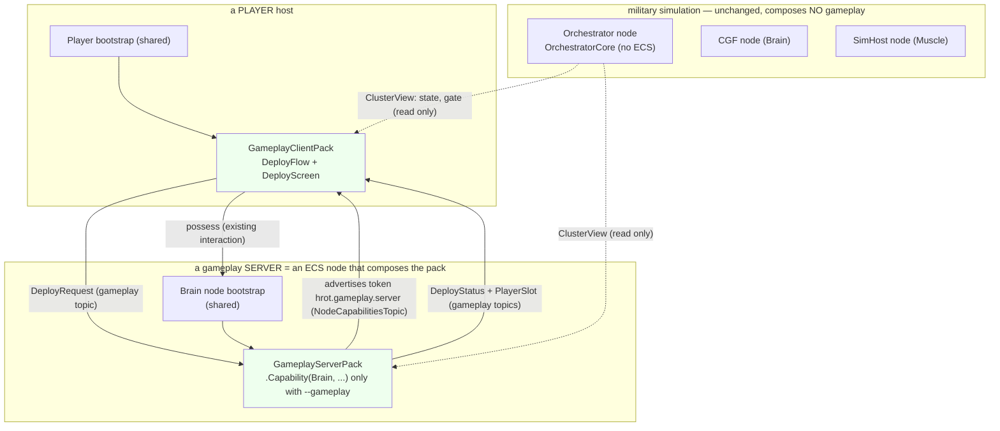
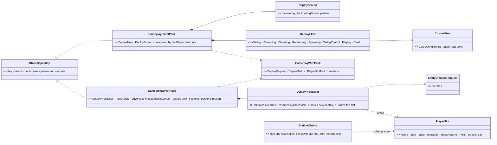
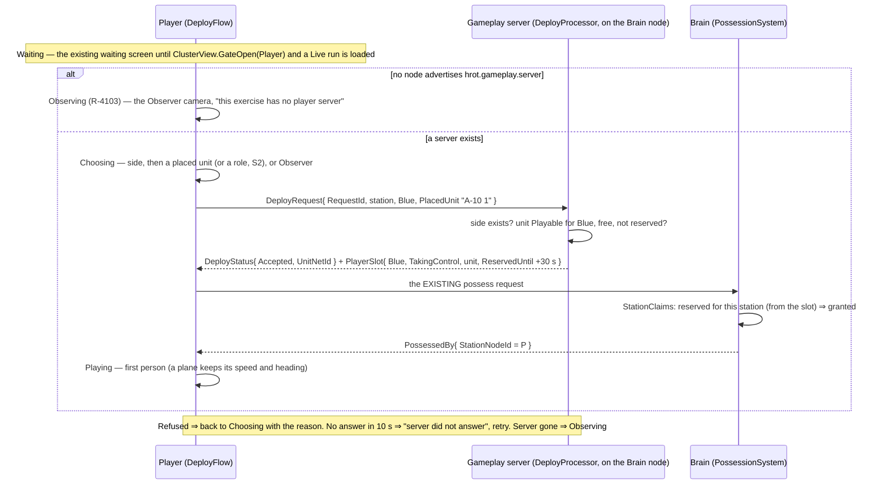

<!--STATUS
state: LIVE
build-state: DESIGN — the architecture APPROVED by the user 2026-10-31 (§2 R-4101…R-4103; §5 D-1…D-16 "Accepted"); S1 next
updated: 2026-10-31 (rev 2 — gameplay as PACKS composed by choice, never in the orchestrator; the name DEPLOY; a Player with no gameplay server observes) · 2026-10-31 (rev 1 — superseded, see HISTORY)
current-answer: §2 the rulings · §4 the diagrams · §5 decisions D-1…D-16 · §6 slices · §7a the AUDIT of hard-wired gameplay (G1…G7, B1/B2; candidates await the user)
stale-below: §8 HISTORY (rev 1: the join on the master's ClusterOpRequest, a ReservedFor component — superseded)
known-rot: docs/blueprints/Architect_Question_91_Player_Nodes.md §0 "a Player is an ordinary IG node (NodeRole.Map2D), no Player role" — the NAME is superseded by R-4101 (IG is the obsolete name of the Player); being a player stays a composition choice
known-conflict: none
related-designs:
  - docs/blueprints/Architect_Question_91_Player_Nodes.md — OWNS what a Player node is in the CLUSTER (admitted, caught up, acts by REQUESTS to the owner); this design adds what it does as a GAME client once admitted
  - docs/DESIGN_Node_Roles_And_Policies.md — §3.2–§3.4 OWN composition by role (R-4000 one code path; R-4005 a role is what a host does); the gameplay packs are composed through that same mechanism
  - docs/DESIGN_Cluster_Membership_Use_Cases.md — OWNS UC-17…24 (the multiplayer acceptance, CE-4080); §6 here adds UC-25…28
  - docs/blueprints/Architect_Question_110_Readiness_Protocol.md — OWNS admission (AdmissionPolicy, the Lobby); a deploy starts only once a Player is admitted and caught up
  - docs/DESIGN_Cluster_Load_Phase.md — §11.8 OWNS the Player's waiting screen (LoadingScreen, HostGatePolicy.Player); the deploy screen follows it
  - docs/DESIGN_Entity_Control.md — §8q OWNS R-4096 (StationClaims); D-8 gives it a player's side and reservation from the player slot when a gameplay server exists
  - docs/DESIGN_Unit_Camera.md — OWNS the Observer camera every observer uses
  - docs/designs/air-attack/DESIGN_Air_Operations.md — §6 OWNS the pilot models and "a hand-over keeps the pose" (a plane deployed into in flight)
  - docs/DESIGN_Entity_Creation_Unification.md — OWNS EntityCreationRequest (the one creation path) and CreationRequestId (how a Player finds its new unit)
  - docs/DESIGN_Decision_Layer.md — §4 OWNS the paused task a possession leaves and resumes
  - Hrot/Engine/Hrot.Traffic/TrafficPack.cs — the PRECEDENT for an optional feature as packs (Serving on one node, Mirroring on the others)
-->

# DESIGN — **a player deploys into the game** *(side → placed unit or role → spawn → possess, or observe)*

> 🔒 **User, `2026-10-31`:** *"a player that is joining a game will somehow need to choose the side. And once that is done, you will also need
> to choose the character to be played … spawn locations for red team, spawn location for blue team … the game should possess that entity … And I
> would like also some observer mode"* · *"The naming should be distinct from generic node joining"* · *"Deploy name is accepted."*

## 1. The idea in one line

A **gameplay server** — a pack an ECS node composes only when the exercise is a game — owns every player decision; a **Player** host
composes a **gameplay client** pack (the deploy screens); the two talk on their **own** gameplay topics. The orchestrator, the master and
the CGF / SimHost roles are **untouched**: a military simulation composes none of it and runs exactly as before.

## 2. Rulings (✅ user, `2026-10-31`)

| id | ruling | the user's words |
|---|---|---|
| **R-4101** | **"IG" is the obsolete name of the PLAYER.** New work says *Player*; where code or docs say IG, the Player is meant | 🔒 *"the IG is just an obsolete name for something we now call player"* · *"IG is no longer used, this is a relict"* |
| **R-4102** | **Gameplay is an EXTRA, composed as packs — never in the orchestrator, never degrading the military simulator.** CGF, SimHost and the orchestrator stay usable with no gameplay; a node becomes a gameplay server, and a host becomes a player, by the COMPONENTS it composes into the shared bootstrap | 🔒 *"the gameplay logic is just an extra which shouldn't reduce or degrade the general military simulation use of the simulator"* · *"The system should stay something like a toolkit where we can assemble the desired functionality from components"* · *"being a player is a composition choice"* |
| **R-4103** | **A Player with no gameplay server in the cluster is an OBSERVER** | 🔒 *"An ES player without a gameplay server capabilities in the system becomes an observer."* |
| **R-4104** | **A gameplay feature MAY live in the core when it is SWITCHABLE** — on or off, the off state leaving the military simulation exactly as without it (nothing recorded, nothing drawn). A pack is still the answer for gameplay that adds DECISIONS or WIRE (the deploy server, AW-23) | 🔒 *"It's usually not a big problem if some feature is hard-coded as part of the core, but it needs to be switchable on or off in such a case."* |

## 3. INVENTORY *(`2026-10-31`)*

Queries run: `scripts/cbm.sh search_graph` Class `.*(Player|Spawn|Respawn|Lobby|Join|Observer|Spectat|Loadout|Kit|Role|Side|Force|Team).*`
→ 14 (none a join / deploy / spawn-point / loadout class) · grep `class .*(Player|Possess|Spawn|Zone|Observer|Spectator|Loadout|Seat)` → 80 ·
grep `class .*(Pack|Plugin|Feature|Composer)` → 19 packs · a docs sweep of `docs/` + `.dev/` (player nodes, membership, admission, possession,
observer, spawn, loadout, score).

| what exists | where | used here as |
|---|---|---|
| composition by role: a host's plan declares `.Capability(role, INodeCapability)`; the shared base registers their systems and modules | `NodeCompositionPlan.Capability`, `INodeCapability` (`Hrot.Common/Infrastructure/NodeCapability.cs:142, :276`) | how BOTH gameplay packs are plugged in |
| an optional feature as packs | `TrafficPack.Serving()` / `.Mirroring()` (`IgNodeBootstrapper.cs:249`, `CgfNodeBootstrapper.cs:139`, `SimHostNodeBootstrapper.cs:312`) | the precedent |
| a node advertises capability TOKENS to the cluster | `NodeCapabilitiesTopic` (durable), `CapabilityTokens`, `NodeRoster.Supports(node, token)` | `hrot.gameplay.server` — how a Player learns a server exists |
| the orchestrator has NO ECS world | `OrchestratorSubsystem.cs:44-48` (*"this subsystem has no ECS kernel"*) | why the server is NOT there |
| the master's request pair is read only by the master | `ClusterOpMasterTranslator` reads; `ClusterOpEgressTranslator` only writes | why the deploy does NOT ride it |
| a Player's waiting screen, composed once per process | `LoadingScreen` (Player policy), `LocalWindowController.ComposeRunControls`; gate `ClusterView.GateOpen(Player)` = `IsLocalPlayReady ∧ CanOperate` | the deploy screen's pattern and its "may I start?" |
| possession by request, decided on the brain; R-4096 claims; a station's side from the held unit | `PossessionSystem`, `EntityOrders.Possess`, `StationClaims` (Entity Control §8c, §8q) | unchanged; D-8 adds the slot as a first source |
| a new unit carries its request's GUID on every node | `CreationRequestId` (`NetworkSpawningSystem.cs:204`, on `EntityMaster` — `EntityMasterIngressTranslator.cs:222`) | the Player's "my unit arrived" |
| who possesses what, on every node | `PossessedBy { StationNodeId, Mode, Epoch }` + translators | the Player's "I have it" |
| drawn areas with their own TKB type | `WeatherRegion`, `StoneSource` (`PlacementToolRegistry.Graphics`) | the spawn area (S2) |
| a plane possessed in flight keeps flying | `FixedWingModel.cs:56-72` (*"possessed already flying"*); the look starts on the hull's heading (`PossessionStation.cs:1286`) | D-12 — no new code |

## 4. Diagrams

*What the picture shows that prose hid:* every gameplay box is GREEN and hangs off a shared bootstrap through `.Capability` — remove the
two packs and the graph is exactly today's military simulation; the orchestrator never points at gameplay, it is only READ.

*What the picture shows that prose hid:* the only arrow from shared code INTO gameplay is `StationClaims ..> PlayerSlot` — optional, "when
present"; with no slots it is today's rule.

## 5. Decisions (✅ "Accepted", `2026-10-31`)

| # | decision | rule |
|---|---|---|
| **D-1** | the name | ⭐ **Deploy** — distinct from a node joining the cluster: `DeployRequest`, `DeployStatus`, `DeployProcessor`, `DeployFlow`, `DeployScreen` |
| **D-2** | where the server logic lives | ⭐ the **gameplay server pack**, composed by an ECS node that owns the units (the Brain node) **only when gameplay is switched on** (`--gameplay`; `-m server` = orchestrator + CGF + SimHost in one process with it). Never in the orchestrator (R-4102) |
| **D-3** | how the Player knows | ⭐ the server advertises the token `hrot.gameplay.server` on `NodeCapabilitiesTopic`. No token ⇒ the Player observes (R-4103). One server per cluster: a second one stands down (the roster's duplicate-name pattern) |
| **D-4** | the Player side | ⭐ the **gameplay client pack** (`DeployFlow` + `DeployScreen`), composed by the Player host only: `-m player` composes it (R-4101: Player is the host's name; `-m ig` is the obsolete alias). The screen is an overlay composed once per process beside `LoadingScreen` |
| **D-5** | the wire | ⭐ a **gameplay wire pack**: `DeployRequest` (Volatile, KeepAll — a queue), `DeployStatus` (TransientLocal, readers filter by id), `PlayerSlotTopic` (keyed by station, TransientLocal, KeepLast 1). Composed only with the gameplay packs — the military-sim wire is untouched |
| **D-6** | when a Player may deploy | ⭐ only once its gate is open (`ClusterView.GateOpen(Player)`) **and** the cluster is in a Live run (paused at its start or running). No scenario ⇒ the waiting screen (*"Waiting for the server to load a scenario"*, AQ108 D16 — to be added); Edit / Preview ⇒ waiting; back to Idle ⇒ waiting again |
| **D-7** | the Player's states | ⭐ `DeployFlow`: Waiting → (Observing) / Choosing → Requesting → Spawning → TakingControl → Playing → Dead (S2), each with a 10 s timeout and retry; success read from the Player's OWN world (`CreationRequestId`, `PossessedBy`), refusal from `DeployStatus` |
| **D-8** | the player's side and the reservation | ⭐ held in the **player slot** (the server never writes a unit it does not own); `StationClaims` asks the slot first, then the held unit (today's rule, the whole rule with no gameplay) |
| **D-9** | placed units | ⭐ `Playable { Side, SlotName }` on a scenario unit (the editor's Details); a taken one greyed with its holder; a free one runs as AI until taken |
| **D-10** | roles (S2) | ⭐ the scenario's per-side list (TKB person type + name + max count); the kit is that type's weapon suite; none declared ⇒ the person types present on that side |
| **D-11** | spawn areas (S2) | ⭐ a map graphic (Area tool, its own TKB type) with `Side` + facing; a random area, a random free point (ground, navmesh, ≥ 3 m from anyone) — searched by the server, which has the world |
| **D-12** | an aircraft in flight | ⭐ a placed unit; it keeps speed, heading and pose; a crew seat is a seat slot |
| **D-13** | observer | ⭐ the Observer camera; sees everything in v1; may deploy later |
| **D-14** | death (S2) | ⭐ the kill cam, then the deploy screen after the scenario's respawn delay (default 10 s; 0 ⇒ observer) |
| **D-15** | score (S3) | ⭐ kills / deaths / team kills in the player slot, counted by the server from the kill cam's killer and the shooter's `PossessedBy` |
| **D-16** | scoreboard (S3) | ⭐ hold `Tab`; a tap keeps the squad switch |

**Rejected — one line each:**
- *The server logic in the orchestrator* — it has no ECS world; it would query units, sides and free spots across nodes, and gameplay would sit in the military-sim core (R-4102).
- *The deploy on the master's `ClusterOpRequest`* — only the master reads it; the orchestrator would have to forward gameplay.
- *A gameplay flag inside the shared bootstrap* — a switch read everywhere instead of a component composed where wanted (R-4102: a toolkit).
- *The Player creates its own unit* — two Players race for one spot; the server decides.
- *The server possesses for the Player* — possession stays "the station asks, the brain decides".
- *A loadout system first* · *spawn POINTS* — as rev 1 (§8).

## 6. Slices

| slice | builds | done when |
|---|---|---|
| **S1** | D-1…D-9, D-12, D-13: the three packs (`Hrot.Gameplay`), the server token, `DeployProcessor` for placed units, `PlayerSlotTopic`, `StationClaims` reading the slot, `Playable` + its editor checkbox, `DeployFlow` + `DeployScreen` (waiting, observer, side, unit) | a military-sim cluster boots and runs with **no** gameplay topic on the wire (a rail); with a server, a Player deploys into a placed rifleman and an A-10 in flight; a second Player is refused the same unit with its holder named; a Player with no server observes. New use cases **UC-25** deploy into a placed unit · **UC-26** refused (taken) · **UC-27** no server ⇒ observer · **UC-28** a plane in flight |
| **S2** | D-10, D-11, D-14: roles, spawn areas, respawn | a role spawns at a free point of its side's area and is possessed; a full role is refused; death returns to the deploy screen after the delay |
| **S3** | D-15, D-16: score + scoreboard; kit variants; choosing the area on the map | — |

⚠ **Before S1 runs live:** CE-4080's possession crash is FIXED (`f752491af`; ⚠ the use cases' UC-17 row still reads 🔴, stale); still open
from that run: **CE-4086** (a Player promotes a replica before its first pose), which every deploy ends in.

## 7. Open — measure at the start of the slice

| question | when |
|---|---|
| does `ClusterView` (or the Player) already read `NodeCapabilitiesTopic`, or does the token need a reader on the Player? | S1 step 1 |
| `-m server` — the exact subsystem set and whether the Brain and the orchestrator share a process cleanly today (`-m all` does) | S1 |
| how `StationClaims` reaches the slots on the Brain (the client pack's reader, or a tiny shared reader in the wire pack) | S1 |

## 7a. AUDIT — gameplay that is hard-wired today *(`2026-10-31`, R-4102; verified by grep at the sites named)*

🔒 **User, `2026-10-31`:** *"if you find the gameplay logic too much hard-coded into the system now, not respecting the role-based plugin and
composition mechanism, please mark it and we need to refactor"* · *"taking different seats in a vehicle, embarking, disembarking. This is all
classic military stuff"* · *"The border between what is classical military training and what is a gameplay is a bit fuzzy, so we might need to
choose on individual case basis."*

⭐ **R-4104 (below in §2) answers G1–G4 with a SWITCH, not a move:** a cluster run setting **Game feedback** (the `SetRunSettings` path that carries AQ108 D15 *Ask to keep recordings* — the master broadcasts, every host reads `ClusterView`); OFF by default; the gameplay server pack turns it ON when present; an instructor may toggle it. G7 and the deploy stay in packs (they add decisions and wire).

**How it is wired:** `PossessionStation` (the FPS station) is built on EVERY map host — `ScenarioEditor/Map/MapInteractionPack.cs:572`; its hit
memory is fed from the shared `EffectSpawnSystem` (`Effects/EffectSystems.cs:70, :151`, `HitFeedback.In(world).Record`). No `.Capability(...)` seam.

| # | what | where | verdict | moves to |
|---|---|---|---|---|
| **G1** | the hit marker round the crosshair (red when he is down) | `PossessionStation.cs:447-480` (`DrawHitFeedback`) | ✅ **gameplay** — no real sight says "you hit him" | the gameplay CLIENT pack: an overlay the station hosts |
| **G1b** | the damage arc pointing at who hit you | same | ❓ **candidate**, lean gameplay — some training sims show one | — |
| **G2** | the hit memory behind G1/G3 | `Effects/HitFeedback.cs`, recorded in `EffectSystems.cs:70, :151` | ✅ **gameplay** (its only readers are G1/G3) | ⭐ behind the same switch: nothing recorded while it is off |
| **G3** | "KILLED by X" + the 3 s kill cam from the shooter's eye | `FallScreen.cs:15-75`, `PossessionStation.cs:493-562` | ✅ **gameplay** — R-4102 names the kill cam | ⭐ behind the same switch; off ⇒ a killed unit is released to the map (the operator's view) |
| **G4** | after death, Tab takes a living squad mate | `PossessionStation.cs:574-579` | ❓ **candidate**, lean gameplay — right after death it IS a respawn (the same Tab alive is operator possession, unchanged) | — |
| **G5** | the spread ring (the weapon's real spread) | `PossessionStation.cs:679-693` | ❓ **candidate**, lean military training — a teaching aid showing the sim's true spread | — |
| **G6** | near misses darken the screen edges | `PossessionStation.cs:126-128, 657-662` | ❓ **candidate**, lean military training — stands in for suppression | — |
| **G7** | AW-23: a possessed unit that kills friends turns Hostile | designed, NOT built (`DESIGN_Civilians_And_Crowd_Control.md` §5h; only the generic `SourceEntityId` exists) | ✅ **gameplay** when built — its trigger is "held by a station" | the gameplay SERVER pack — never in `ForceLevels` / `KnownCombatants` |
| **B1** | the gate policy chosen by HOST KIND | `RunMode/HostGatePolicies.cs:34` (`hostKind == RunHostKind.Ig ? Player : Operator`) | ✅ **composition defect** (not gameplay): a kind test in shared code | the Player host COMPOSES its policy (a capability on its plan) |
| **B2** | `IsPlayer` branches | `RunMode/NodeRunControls.cs:29, 56` · `Panels/LoadingScreen.cs:55-74` · `Hrot.ClusterRunner/Presentation/LocalWindowController.cs:148` | ✅ composition defect — follows B1 (they read the policy; fine once the policy is composed) | re-read from the composed policy |
| — | NOT findings: seats, switching seats, embark / disembark, the use key, operator possession, the alive Tab squad switch, the command wheel, the compass and friend markers, `StationClaims` (R-4096: one station per unit — multi-operator concurrency; its `OtherSide` refusal is "you cannot board an enemy-crewed vehicle"), the civilians' laws-of-war rules (AW-22) | | military training | — |

## 8. ⛔ HISTORY — rev 1 (`2026-10-31`, superseded the same day)

Rev 1 carried the request on the master's `ClusterOpRequest` (a new `ClusterOpType.Join`), put a `JoinProcessManager` into `OrchestratorCore`,
and reserved a unit with a `ReservedFor` component written by the master. ⛔ Superseded: the orchestrator has no ECS world and must stay free
of gameplay (R-4102); the master does not own units, so it may not write their components; "Join" collided with a node joining the cluster.
