<!--STATUS
state: LIVE
build-state: BUILT (S1, §9.4/§9.5 — run live) · BUILT (S2, §10.4/§10.5 — run live) — the architecture APPROVED by the user 2026-10-31 (§2 R-4101…R-4103; §5 D-1…D-16 "Accepted")
updated: 2026-11-05 (§9 S1 technical design, §7 answered there) · 2026-10-31 (rev 2 — gameplay as PACKS composed by choice, never in the orchestrator; the name DEPLOY; a Player with no gameplay server observes) · 2026-10-31 (rev 1 — superseded, see HISTORY)
current-answer: §10 S2 design (roles, spawn areas, death, respawn) · §9 S1 technical design (classes, sequence, who ticks what; §7's three answers) · §2 the rulings · §4 the diagrams · §5 decisions D-1…D-16 · §6 slices · §7a the AUDIT of hard-wired gameplay (G1…G7, B1/B2; candidates await the user)
stale-below: §8 HISTORY (rev 1: the join on the master's ClusterOpRequest, a ReservedFor component — superseded)
known-rot: docs/blueprints/Architect_Question_91_Player_Nodes.md §0 "a Player is an ordinary IG node (NodeRole.Map2D), no Player role" — the NAME is superseded by R-4101 (IG is the obsolete name of the Player); being a player stays a composition choice
known-conflict: none
related-designs:
  - docs/UX/DESIGN_Seats_And_Hats.md — the Player and the Observer as SEATS (what they may do), possession as the Embodied hat
  - docs/PLAN_Training_And_Gameplay_Engine.md — the ranked engine items (scenario rules, skill amplifier, performance evaluation, fun features) the deploy's S2/S3 feed
  - docs/DESIGN_Node_Features.md — OWNS the feature switches: the deploy server is the feature gameplay.deploy-server (D-3), and §7a's G1…G6 become hud.* features
  - docs/blueprints/Architect_Question_91_Player_Nodes.md — OWNS what a Player node is in the CLUSTER (admitted, caught up, acts by REQUESTS to the owner); this design adds what it does as a GAME client once admitted
  - docs/DESIGN_Node_Roles_And_Policies.md — §3.2–§3.4 OWN composition by role (R-4000 one code path; R-4005 a role is what a host does); the gameplay packs are composed through that same mechanism
  - docs/DESIGN_Cluster_Membership_Use_Cases.md — OWNS UC-17…24 (the multiplayer acceptance, CE-4080); §6 here adds UC-25…28
  - docs/blueprints/Architect_Question_110_Readiness_Protocol.md — OWNS admission (AdmissionPolicy, the Lobby); a deploy starts only once a Player is admitted and caught up
  - docs/DESIGN_Cluster_Load_Phase.md — §11.8 OWNS the Player's waiting screen (LoadingScreen, HostGatePolicy.Player); the deploy screen follows it
  - docs/DESIGN_Entity_Control.md — §8q OWNS R-4096 (StationClaims); D-8 gives it a player's side and reservation from the player slot when a gameplay server exists
  - docs/DESIGN_Unit_Camera.md — OWNS the Observer camera every observer uses
  - docs/designs/air-attack/DESIGN_Air_Operations.md — §6 OWNS the pilot models and "a hand-over keeps the pose" (a plane deployed into in flight)
  - docs/DESIGN_Entity_Creation_Unification.md — OWNS EntityCreationRequest (the one creation path) and AllocateNetworkId (how the deploy server knows the man it asked for — CE-4266)
  - docs/DESIGN_Decision_Layer.md — §4 OWNS the paused task a possession leaves and resumes
  - Hrot/Engine/Hrot.Traffic/TrafficPack.cs — the PRECEDENT for an optional feature as packs (Serving on one node, Mirroring on the others)
-->

> ⛔ **HISTORY note (R-4223, CE-4528, `2026-11-14`)** — the Node MCP server (`tools/ai-debug-mcp`: its tool catalog, generated `SKILL.md`, skill parts and generators) named in this document is **removed**. The debug API is plain HTTP and describes itself: `GET /help` (or `Hrot.ClusterRunner --help-api` before anything is started) and `GET /capabilities` — [`DESIGN_Debug_Api_Http_Only.md`](DESIGN_Debug_Api_Http_Only.md). Every mention of the server, its tools or its generated files below is HISTORY; tool names map to routes in `GET /help`.

# DESIGN — **a player deploys into the game** *(side → placed unit or role → spawn → possess, or observe)*

> 🔒 **User, `2026-10-31`:** *"a player that is joining a game will somehow need to choose the side. And once that is done, you will also need
> to choose the character to be played … spawn locations for red team, spawn location for blue team … the game should possess that entity … And I
> would like also some observer mode"* · *"The naming should be distinct from generic node joining"* · *"Deploy name is accepted."*

## 1. The idea in one line

A **gameplay server** — a pack an ECS node composes only when the exercise is a game — owns every player decision; a **Player** host
composes a **gameplay client** pack (the deploy screens); the two talk on their **own** gameplay topics. The orchestrator, the master and
the CGF / SimHost roles are **untouched**: a military simulation composes none of it and runs exactly as before.

## 2. Rulings (✅ user, `2026-10-31`)

| id | ruling | the user's words |
|---|---|---|
| **R-4101** | **"IG" is the obsolete name of the PLAYER.** New work says *Player*; where code or docs say IG, the Player is meant | 🔒 *"the IG is just an obsolete name for something we now call player"* · *"IG is no longer used, this is a relict"* |
| **R-4102** | **Gameplay is an EXTRA, composed as packs — never in the orchestrator, never degrading the military simulator.** CGF, SimHost and the orchestrator stay usable with no gameplay; a node becomes a gameplay server, and a host becomes a player, by the COMPONENTS it composes into the shared bootstrap | 🔒 *"the gameplay logic is just an extra which shouldn't reduce or degrade the general military simulation use of the simulator"* · *"The system should stay something like a toolkit where we can assemble the desired functionality from components"* · *"being a player is a composition choice"* |
| **R-4103** | **A Player with no gameplay server in the cluster is an OBSERVER** | 🔒 *"An ES player without a gameplay server capabilities in the system becomes an observer."* |
| **R-4104** | **A gameplay feature MAY live in the core when it is SWITCHABLE** — on or off, the off state leaving the military simulation exactly as without it (nothing recorded, nothing drawn). A pack is still the answer for gameplay that adds DECISIONS or WIRE (the deploy server, AW-23) | 🔒 *"It's usually not a big problem if some feature is hard-coded as part of the core, but it needs to be switchable on or off in such a case."* |

## 3. INVENTORY *(`2026-10-31`)*

Queries run: `scripts/cbm.sh search_graph` Class `.*(Player|Spawn|Respawn|Lobby|Join|Observer|Spectat|Loadout|Kit|Role|Side|Force|Team).*`
→ 14 (none a join / deploy / spawn-point / loadout class) · grep `class .*(Player|Possess|Spawn|Zone|Observer|Spectator|Loadout|Seat)` → 80 ·
grep `class .*(Pack|Plugin|Feature|Composer)` → 19 packs · a docs sweep of `docs/` + `.dev/` (player nodes, membership, admission, possession,
observer, spawn, loadout, score).

| what exists | where | used here as |
|---|---|---|
| composition by role: a host's plan declares `.Capability(role, INodeCapability)`; the shared base registers their systems and modules | `NodeCompositionPlan.Capability`, `INodeCapability` (`Hrot.Common/Infrastructure/NodeCapability.cs:142, :276`) | how BOTH gameplay packs are plugged in |
| an optional feature as packs | `TrafficPack.Serving()` / `.Mirroring()` (`IgNodeBootstrapper.cs:249`, `CgfNodeBootstrapper.cs:139`, `SimHostNodeBootstrapper.cs:312`) | the precedent |
| a node advertises capability TOKENS to the cluster | `NodeCapabilitiesTopic` (durable), `CapabilityTokens`, `NodeRoster.Supports(node, token)` | `hrot.gameplay.server` — how a Player learns a server exists |
| the orchestrator has NO ECS world | `OrchestratorSubsystem.cs:44-48` (*"this subsystem has no ECS kernel"*) | why the server is NOT there |
| the master's request pair is read only by the master | `ClusterOpMasterTranslator` reads; `ClusterOpEgressTranslator` only writes | why the deploy does NOT ride it |
| a Player's waiting screen, composed once per process | `LoadingScreen` (Player policy), `LocalWindowController.ComposeRunControls`; gate `ClusterView.GateOpen(Player)` = `IsLocalPlayReady ∧ CanOperate` | the deploy screen's pattern and its "may I start?" |
| possession by request, decided on the brain; R-4096 claims; a station's side from the held unit | `PossessionSystem`, `EntityOrders.Possess`, `StationClaims` (Entity Control §8c, §8q) | unchanged; D-8 adds the slot as a first source |
| ⛔ SUPERSEDED `2026-11-05` (CE-4266): ~~a new unit carries its request's GUID on every node — `CreationRequestId`~~ — removed; the deploy server pre-allocates the man's network id (`EntityCreation.AllocateNetworkId`) and finds him by it | `GameplayServerPack.SpawnerOf`, `DeployProcessorSystem.ResolveSpawns` | the server's "the man exists" |
| who possesses what, on every node | `PossessedBy { StationNodeId, Mode, Epoch }` + translators | the Player's "I have it" |
| drawn areas with their own TKB type | `WeatherRegion`, `StoneSource` (`PlacementToolRegistry.Graphics`) | the spawn area (S2) |
| a plane possessed in flight keeps flying | `FixedWingModel.cs:56-72` (*"possessed already flying"*); the look starts on the hull's heading (`PossessionStation.cs:1286`) | D-12 — no new code |

## 4. Diagrams

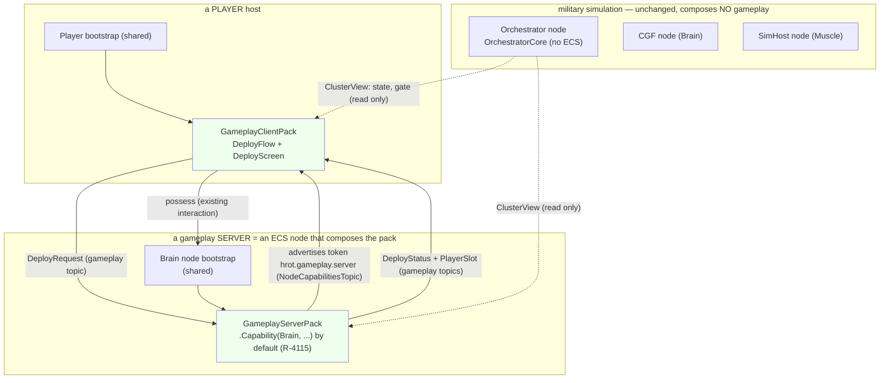

*What the picture shows that prose hid:* every gameplay box is GREEN and hangs off a shared bootstrap through `.Capability` — remove the
two packs and the graph is exactly today's military simulation; the orchestrator never points at gameplay, it is only READ.

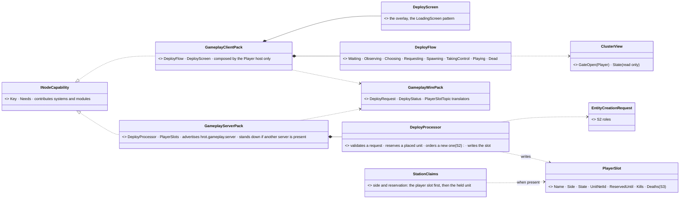

*What the picture shows that prose hid:* the only arrow from shared code INTO gameplay is `StationClaims ..> PlayerSlot` — optional, "when
present"; with no slots it is today's rule.

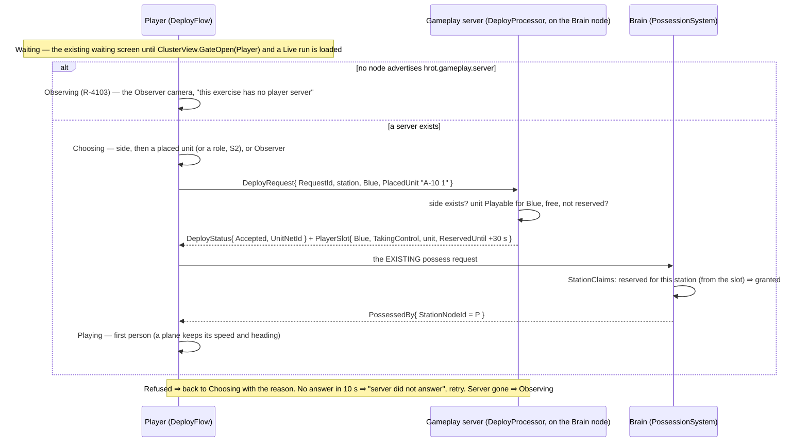

## 5. Decisions (✅ "Accepted", `2026-10-31`)

| # | decision | rule |
|---|---|---|
| **D-1** | the name | ⭐ **Deploy** — distinct from a node joining the cluster: `DeployRequest`, `DeployStatus`, `DeployProcessor`, `DeployFlow`, `DeployScreen` |
| **D-2** | where the server logic lives | ⭐ the **gameplay server pack**, composed by an ECS node that owns the units (the Brain node) **only when gameplay is switched on** (`--gameplay`; `-m server` = orchestrator + CGF + SimHost in one process with it). Never in the orchestrator (R-4102) |
| **D-3** | how the Player knows | ⭐ **revised `2026-10-31` by DESIGN_Node_Features:** the server is the FEATURE `gameplay.deploy-server`, declared by the gameplay server pack; "a server exists" = a node advertises it (`hrot.feature.gameplay.deploy-server`) AND reports it ON. None ⇒ the Player observes (R-4103). One server per cluster: a second one stands down (the roster's duplicate-name pattern) · ⛔ was: its own token `hrot.gameplay.server` |
| **D-4** | the Player side | ⭐ the **gameplay client pack** (`DeployFlow` + `DeployScreen`), composed by the Player host only: `-m player` composes it (R-4101: Player is the host's name; `-m ig` is the obsolete alias). The screen is an overlay composed once per process beside `LoadingScreen` |
| **D-5** | the wire | ⭐ a **gameplay wire pack**: `DeployRequest` (Volatile, KeepAll — a queue), `DeployStatus` (TransientLocal, readers filter by id), `PlayerSlotTopic` (keyed by station, TransientLocal, KeepLast 1). Composed only with the gameplay packs — the military-sim wire is untouched |
| **D-6** | when a Player may deploy | ⭐ only once its gate is open (`ClusterView.GateOpen(Player)`) **and** the cluster is in a Live run (paused at its start or running). No scenario ⇒ the waiting screen (*"Waiting for the server to load a scenario"*, AQ108 D16 — to be added); Edit / Preview ⇒ waiting; back to Idle ⇒ waiting again |
| **D-7** | the Player's states | ⭐ `DeployFlow`: Waiting → (Observing) / Choosing → Requesting → Spawning → TakingControl → Playing → Dead (S2), each with a 10 s timeout and retry; success read from the Player's OWN world (`CreationRequestId`, `PossessedBy`), refusal from `DeployStatus` |
| **D-8** | the player's side and the reservation | ⭐ held in the **player slot** (the server never writes a unit it does not own); `StationClaims` asks the slot first, then the held unit (today's rule, the whole rule with no gameplay) |
| **D-9** | placed units | ⭐ `Playable { Side, SlotName }` on a scenario unit (the editor's Details); a taken one greyed with its holder; a free one runs as AI until taken |
| **D-10** | roles (S2) | ⭐ the scenario's per-side list (TKB person type + name + max count); the kit is that type's weapon suite; none declared ⇒ the person types present on that side |
| **D-11** | spawn areas (S2) | ⭐ a map graphic (Area tool, its own TKB type) with `Side` + facing; a random area, a random free point (ground, navmesh, ≥ 3 m from anyone) — searched by the server, which has the world |
| **D-12** | an aircraft in flight | ⭐ a placed unit; it keeps speed, heading and pose; a crew seat is a seat slot |
| **D-13** | observer | ⭐ the Observer camera; sees everything in v1; may deploy later |
| **D-14** | death (S2) | ⭐ the kill cam, then the deploy screen after the scenario's respawn delay (default 10 s; 0 ⇒ observer) |
| **D-15** | score (S3) | ⭐ kills / deaths / team kills in the player slot, counted by the server from the kill cam's killer and the shooter's `PossessedBy` |
| **D-16** | scoreboard (S3) | ⭐ hold `Tab` — and Tab does nothing else. 🔒 R-3076 (user, `2026-11-05`): *"i do not like a single key used for 2 completely different purposes; rather put the 'next man' to something else."* ⇒ the next man is **J** (Shift+J the previous; also the fall screen's squad mate). ⛔ Was: *a tap keeps the squad switch*; and ui's CE-4231 had built hold **K** |

**Rejected — one line each:**
- *The server logic in the orchestrator* — it has no ECS world; it would query units, sides and free spots across nodes, and gameplay would sit in the military-sim core (R-4102).
- *The deploy on the master's `ClusterOpRequest`* — only the master reads it; the orchestrator would have to forward gameplay.
- *A gameplay flag inside the shared bootstrap* — a switch read everywhere instead of a component composed where wanted (R-4102: a toolkit).
- *The Player creates its own unit* — two Players race for one spot; the server decides.
- *The server possesses for the Player* — possession stays "the station asks, the brain decides".
- *A loadout system first* · *spawn POINTS* — as rev 1 (§8).

## 6. Slices

| slice | builds | done when |
|---|---|---|
| **S1** | D-1…D-9, D-12, D-13: the three packs (`Hrot.Gameplay`), the server token, `DeployProcessor` for placed units, `PlayerSlotTopic`, `StationClaims` reading the slot, `Playable` + its editor checkbox, `DeployFlow` + `DeployScreen` (waiting, observer, side, unit) | a military-sim cluster boots and runs with **no** gameplay topic on the wire (a rail); with a server, a Player deploys into a placed rifleman and an A-10 in flight; a second Player is refused the same unit with its holder named; a Player with no server observes. New use cases **UC-25** deploy into a placed unit · **UC-26** refused (taken) · **UC-27** no server ⇒ observer · **UC-28** a plane in flight |
| **S2** | D-10, D-11, D-14: roles, spawn areas, respawn | a role spawns at a free point of its side's area and is possessed; a full role is refused; death returns to the deploy screen after the delay |
| **S3** | D-15, D-16: score + scoreboard; kit variants; choosing the area on the map | ✅ D-15/D-16: the scoreboard is ui's CE-4231 over S7's per-man `Points` roots, on hold Tab (R-3076). ✅ kit variants (user `2026-11-05`, *"Kit variants lean accepted"*): a role offers up to four alternative person TKB types as its kits, each with its own label — the kit is that type's weapon suite, no loadout system (§5 rejected one). Area choice: the Player may name one of its side's spawn areas, else a random one |

⚠ **Before S1 runs live:** CE-4080's possession crash is FIXED (`f752491af`; ⚠ the use cases' UC-17 row still reads 🔴, stale); still open
from that run: **CE-4086** (a Player promotes a replica before its first pose), which every deploy ends in.

## 7. Open — measure at the start of the slice

| question | when |
|---|---|
| does `ClusterView` (or the Player) already read `NodeCapabilitiesTopic`, or does the token need a reader on the Player? | S1 step 1 |
| `-m server` — the exact subsystem set and whether the Brain and the orchestrator share a process cleanly today (`-m all` does) | S1 |
| how `StationClaims` reaches the slots on the Brain (the client pack's reader, or a tiny shared reader in the wire pack) | S1 |

## 7a. AUDIT — gameplay that is hard-wired today *(`2026-10-31`, R-4102; verified by grep at the sites named)*

🔒 **User, `2026-10-31`:** *"if you find the gameplay logic too much hard-coded into the system now, not respecting the role-based plugin and
composition mechanism, please mark it and we need to refactor"* · *"taking different seats in a vehicle, embarking, disembarking. This is all
classic military stuff"* · *"The border between what is classical military training and what is a gameplay is a bit fuzzy, so we might need to
choose on individual case basis."*

⛔ **SUPERSEDED `2026-10-31` (user: *"game feedback should be unified to node features, Nothing separate."*, R-4114): there is NO separate run setting — each G item is its own `hud.*` Node Feature (DESIGN_Node_Features), declared by the gameplay client pack.** ⛔ WAS: ⭐ **R-4104 (below in §2) answers G1–G4 with a SWITCH, not a move:** a cluster run setting **Game feedback** (the `SetRunSettings` path that carries AQ108 D15 *Ask to keep recordings* — the master broadcasts, every host reads `ClusterView`); OFF by default; the gameplay server pack turns it ON when present; an instructor may toggle it. G7 and the deploy stay in packs (they add decisions and wire).

**How it is wired:** `PossessionStation` (the FPS station) is built on EVERY map host — `ScenarioEditor/Map/MapInteractionPack.cs:572`; its hit
memory is fed from the shared `EffectSpawnSystem` (`Effects/EffectSystems.cs:70, :151`, `HitFeedback.In(world).Record`). No `.Capability(...)` seam.

| # | what | where | verdict | moves to |
|---|---|---|---|---|
| **G1** | the hit marker round the crosshair (red when he is down) | `PossessionStation.cs:447-480` (`DrawHitFeedback`) | ✅ **gameplay** — no real sight says "you hit him" | the gameplay CLIENT pack: an overlay the station hosts |
| **G1b** | the damage arc pointing at who hit you | same | ✅ **gameplay** (R-4113, user `2026-10-31`: *"everything which is used when the player possesses an entity … through the first person or over the shoulder view"*) — a `hud.*` feature | — |
| **G2** | the hit memory behind G1/G3 | `Effects/HitFeedback.cs`, recorded in `EffectSystems.cs:70, :151` | ✅ **gameplay** (its only readers are G1/G3) | ⭐ behind the same switch: nothing recorded while it is off |
| **G3** | "KILLED by X" + the 3 s kill cam from the shooter's eye | `FallScreen.cs:15-75`, `PossessionStation.cs:493-562` | ✅ **gameplay** — R-4102 names the kill cam | ⭐ behind the same switch; off ⇒ a killed unit is released to the map (the operator's view) |
| **G4** | after death, **J** takes a living squad mate *(R-3076; was Tab)* | `PossessionStation.cs:574-579` | ✅ **gameplay** (R-4113, user `2026-10-31`: *"everything which is used when the player possesses an entity … through the first person or over the shoulder view"*) — a `hud.*` feature | — |
| **G5** | the spread ring (the weapon's real spread) | `PossessionStation.cs:679-693` | ✅ **gameplay** (R-4113, user `2026-10-31`: *"everything which is used when the player possesses an entity … through the first person or over the shoulder view"*) — a `hud.*` feature | — |
| **G6** | near misses darken the screen edges | `PossessionStation.cs:126-128, 657-662` | ✅ **gameplay** (R-4113, user `2026-10-31`: *"everything which is used when the player possesses an entity … through the first person or over the shoulder view"*) — a `hud.*` feature | — |
| **G7** | AW-23: a possessed unit that kills friends turns Hostile | designed, NOT built (`DESIGN_Civilians_And_Crowd_Control.md` §5h; only the generic `SourceEntityId` exists) | ✅ **gameplay** when built — its trigger is "held by a station" | the gameplay SERVER pack — never in `ForceLevels` / `KnownCombatants` |
| **B1** | the gate policy chosen by HOST KIND | `RunMode/HostGatePolicies.cs:34` (`hostKind == RunHostKind.Ig ? Player : Operator`) | ✅ **composition defect** (not gameplay): a kind test in shared code | the Player host COMPOSES its policy (a capability on its plan) |
| **B2** | `IsPlayer` branches | `RunMode/NodeRunControls.cs:29, 56` · `Panels/LoadingScreen.cs:55-74` · `Hrot.ClusterRunner/Presentation/LocalWindowController.cs:148` | ✅ composition defect — follows B1 (they read the policy; fine once the policy is composed) | re-read from the composed policy |
| — | NOT findings: seats, switching seats, embark / disembark, the use key, operator possession, the alive Tab squad switch, the command wheel, the compass and friend markers, `StationClaims` (R-4096: one station per unit — multi-operator concurrency; its `OtherSide` refusal is "you cannot board an enemy-crewed vehicle"), the civilians' laws-of-war rules (AW-22) | | military training | — |

⭐ **AS BUILT `2026-11-02` (ui):** G1–G6 are the `hud.*` Node Features — `DESIGN_Node_Features.md` §9 (CE-4148 `69303ae00`). B1/B2 — the Player COMPOSES its gate policy: `NodeRunProfile.Policy` (optional; `GatePolicy = Policy ?? table`), `IgApplication.RunProfile` sets `HostGatePolicy.Player`, `IgSubsystem` returns it; `HostGatePolicies.For` answers `Operator` for every kind; grep rail `NoProductionCodeUnderHrotEngine_TestsRunHostKindIg` (CE-4149 `c24577f57`). The waiting screen is unchanged (`LoadingScreen` / `NodeRunControls` / `LocalWindowController` already read the policy).

## 8. ⛔ HISTORY — rev 1 (`2026-10-31`, superseded the same day)

Rev 1 carried the request on the master's `ClusterOpRequest` (a new `ClusterOpType.Join`), put a `JoinProcessManager` into `OrchestratorCore`,
and reserved a unit with a `ReservedFor` component written by the master. ⛔ Superseded: the orchestrator has no ECS world and must stay free
of gameplay (R-4102); the master does not own units, so it may not write their components; "Join" collided with a node joining the cluster.

### 7b. ✅ The user's rulings, `2026-10-31` *(R-4113, R-4114)*

> 🔒 *"I consider everything which is used when the player possesses an entity in the virtual world through the first person or over the shoulder
> view as gameplay features. The server mode should instantiate brain, muscle with movement, perception and navigation, orchestrator, traffic.
> Waiting for the server screen is okay, should be added. D15 lean approved. D14 is a scenario parameter with a default value. game feedback
> should be unified to node features, Nothing separate."*

| item | ruling |
|---|---|
| G1b · G4 · G5 · G6 | ✅ gameplay (R-4113) — each a `hud.*` Node Feature of the gameplay client pack |
| ~~⚠ open~~ ✅ answered | R-4113 is NARROWED to the HUD aids: seats, seat switching, embark / disembark, the use key, operator possession and the alive Tab stay military — the earlier ruling stands (user, `2026-10-31`) |
| `-m server` (S1) | ✅ composes: Brain · Muscle (movement) · Perception · Navigation · orchestrator · traffic |
| the waiting screen | ✅ add *"Waiting for the server to load a scenario"* (AQ108 D16) — tracker **CE-4156** |
| D-15 score | ✅ the score IS a set of evaluation measures whose subject is the player's unit (`DESIGN_Scenario_Rules.md` §10.3, SR-82 attribution) — one counter, not two |
| D-14 respawn delay | ✅ a SCENARIO PARAMETER (`DESIGN_Scenario_Rules.md` SR-41 / SR-68) with a default (10 s) |
| "Game feedback" | ✅ no separate run setting — Node Features only (R-4114) |

### 7c. ✅ Gameplay is ON by default where its pack is installed *(R-4115, user `2026-10-31`)*

> 🔒 *"I would like to have the whole gameplay features and fun factors switched on by default when the packs and modules that are bringing those
> features are installed. And I want that packs and features installed now as part of the unified and shared bootstrap … I just wanted to make the
> system cleaner by moving those stuff to related packs and not to be scattered across the whole system. making every feature switchable on or off
> relax the need to strictly categorize everything into military and gameplay. The possibility to switch a feature on and off is much more important than in what pack it is implemented."*

| what changes | |
|---|---|
| D-2 | ⛔ SUPERSEDED: the gameplay server pack is NOT gated by `--gameplay` — the shared bootstrap composes it on the Brain-role node by default; `gameplay.deploy-server` is ON by default and switchable off (a pure military exercise turns it off) |
| D-4 | the gameplay client pack is composed on every Player host by the shared bootstrap; its `hud.*` features (G1, G1b, G3, G4, G5, G6) default ON |
| R-4103 (no server ⇒ observer) | still true — but now only when the deploy server feature is switched OFF |
| the packs | exist for CLEANLINESS (gameplay code in one place, not scattered). ⭐ PRECISELY (`2026-10-31`, checked against `DESIGN_Node_Features.md` tiers ①–③): a pack is ALWAYS composed by the shared bootstrap — composition is fixed at boot (tier ①) and its availability tokens are static (tier ②) — and "runs when a feature is on" means its SYSTEMS are idle while all its features are off and work as soon as one is on (tier ③, `NodeFeatures.On`, per system). ⇒ a cluster operation flips it at runtime: a Live feature at once, an AtLoad feature at the next load (F-9). ⛔ a pack is never loaded or unloaded at runtime; the one thing a cluster op cannot do is turn on a feature on a node that never composed its pack (the override is validated against the advertised tokens) |

## 9. S1 — the technical design *(backend, `2026-11-05`, from the Deploy handoff; `build-state: READY-TO-BUILD`)*

### 9.1 INVENTORY *(measured `2026-11-05`)* and §7's three answers

Queries: `scripts/cbm.sh search_graph` Class `.*(Deploy|PlayerSlot|Gameplay|Playable).*` → 7, none of D-1…D-16 · Class `.*Pack$` → 15
(`TrafficPack` the precedent) · `scripts/find.sh NodeCapabilitiesTopic` → 40 files · reads below.

| §7 question | ✅ measured answer |
|---|---|
| does the Player read `NodeCapabilitiesTopic`? | ✅ **yes** — every ECS node's `NedReplicationModule` builds `ClusterCapabilityIngestSystem` (`Routing/ClusterCapabilityIngestSystem.cs`) over the factory's `SimpleClusterStateCache` (`NedNetworkFactory.cs:57-59`), so `cache.Supports(node, "hrot.feature.gameplay.deploy-server")` works on the Player. ⛔ **But `NodeHeartbeat.FeaturesOn` reaches only the master's roster** — S1 adds it to the same ingest (`cache.FeatureOn(node, id)`) |
| `-m server` | ✅ `orchestrator, simhost, cgf, traffic` in one process (`HrotRunnerConfiguration.cs:290`); SimHost = `MuscleGround│Perception│NavigationSolver` (`SimHostApp.cs:186`), CGF = `Brain` — exactly §7b's set. Live: `-m server` ran `bc-house-defended` with a Player joining late (`DESIGN_Cluster_Load_Phase.md` §11.10c) |
| how `StationClaims` reaches the slots | ✅ `StationClaims` (`Fdp.Toolkits/Behavior/Possession/StationClaims.cs`) is a static rule over REPLICATED world state, read by the station, the brain's arbiter, the use key and seat switching ⇒ the slots must be in EVERY such node's world. ⭐ A tiny per-world seam in the toolkit (`StationReservations.Of(world)`, the `AttributeInterpreterProvider.GetDescriptorMap(world)` shape), FILLED by the wire pack's slot reader on the Brain and on the Player |

### 9.2 Diagrams

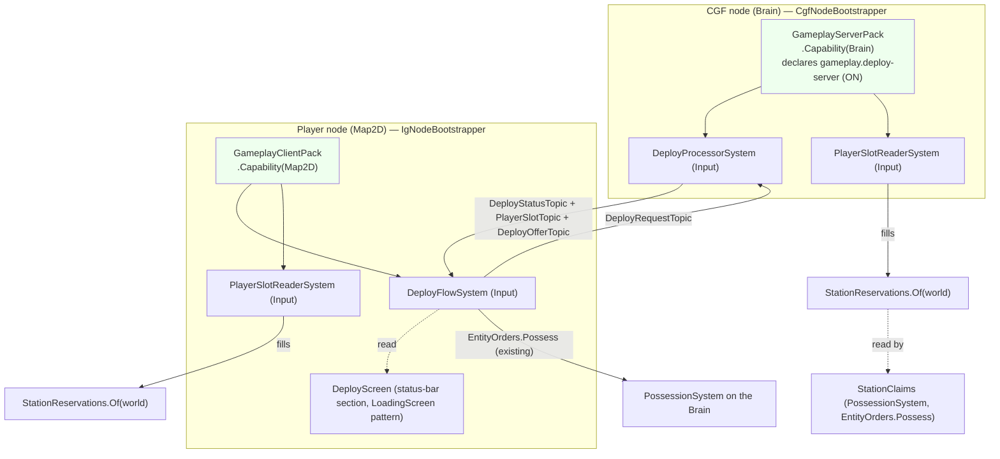

*What the picture shows that prose hid:* who CALLS each system per frame — every gameplay system is in its pack's Input list, ticked by the
node's kernel like `TrafficMirrorSystem`; no system is reached through the orchestrator; with the feature OFF the server systems return at
their first line and create no DDS reader or writer (the "no gameplay topic on the wire" rail).

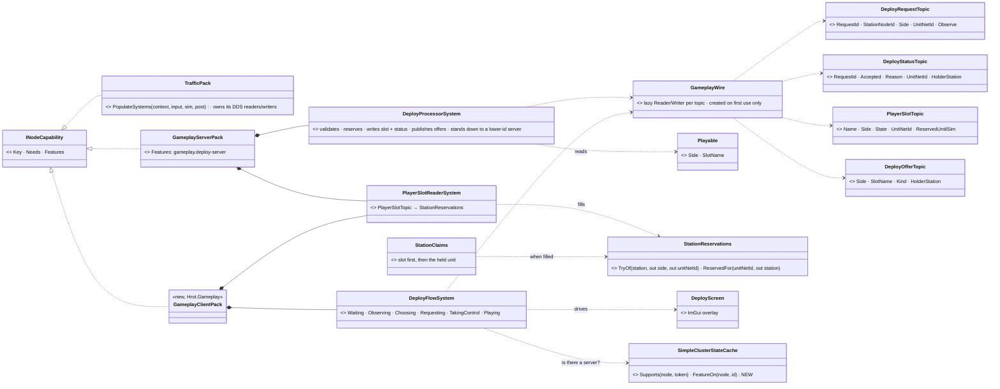

*What the picture shows that prose hid:* the only shared-code arrow INTO gameplay data is `StationClaims ..> StationReservations` — a
toolkit type with no gameplay vocabulary, empty unless a slot reader fills it; and the Player learns which units it may take from
`DeployOfferTopic`, so `Playable` never needs a NED descriptor (the military-sim wire stays untouched).

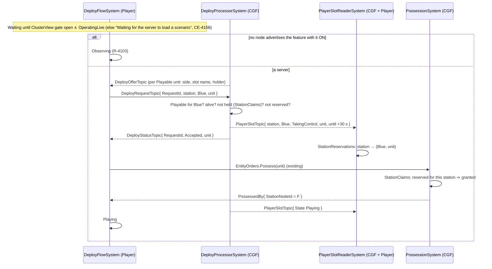

### 9.3 Decisions this adds *(within D-1…D-13; none is a new user decision)*

| # | decision | why |
|---|---|---|
| S1-a | the gameplay wire is OWNED BY THE PACK (lazy `DdsReader`/`DdsWriter`, the `TrafficMirrorSystem` shape) — not NED translators | a translator pack is composed into every node's replication module; the pack's own readers exist only where the pack is composed and only once the feature is ON — which is what makes the "no gameplay topic on the wire" rail true by construction |
| S1-b | `DeployOfferTopic` carries the playable units to the Player | the Player must list "a placed unit" (D-7) without `Playable` becoming a NED descriptor; the server owns the units and knows who holds them |
| S1-c | `StationReservations` in `Fdp.Toolkits` beside `StationClaims` | `StationClaims` is in the toolkit; the reservation is generic (a station may hold a claim on a unit) and carries no gameplay word |
| S1-d | a reservation that is not taken in 30 s lapses; a slot whose station leaves the roster is disposed | D-8's `ReservedUntil`; the departure is the ingest's `NodeDeparted` |
| S1-e | one server: the lowest node id that advertises the feature ON serves; the others stand down | D-3's "a second one stands down" — deterministic with no extra wire |

Rejected — one line each: *Playable as a NED descriptor* — puts gameplay on the military-sim wire (R-4102). *The slots as a replicated
component on the unit* — the server would write a unit it may not own (D-8). *Possession by the server* — rejected in §5 already.

### 9.4 AS BUILT — S1 part A, the server side *(backend, `2026-11-05`; `build-state` for part A: BUILT)*

| part | where | as built |
|---|---|---|
| topics | `Hrot/Engine/Hrot.Gameplay/GameplayTopics.cs` | the four of §9.2, QoS as D-5 |
| wire | `GameplayWire.cs` | lazy reader/writer per topic over the node's participant; `CreatedCount` — nothing exists until a gated system first touches it |
| feature | `GameplayFeatures.cs` | `gameplay.deploy-server`, Live, ON by default, declared by `GameplayServerPack.Features` |
| server | `DeployProcessorSystem.cs` (Input, `[NodeFeature]`) | validates (exists · `Playable` · side · alive · `StationClaims.ForPossess`) → slot `TakingControl` until sim `now + 30 s` + status; → `Playing` when `PossessedBy` that station; lapse / `NodeDeparted` ⇒ slot disposed; offers ~1 Hz and on change |
| election | `DeployServerElection.cs` | delegates over the cluster cache (`AllNodeIds`, `Supports`, `FeatureOn`), built by `CgfNodeBootstrapper` from `NedReplicationModule.ClusterCache` — `Hrot.Gameplay` references no NED layer; the lowest id with the feature ON serves, re-read ~1 s; a server that loses stands down and retracts its slots and offers |
| reader | `PlayerSlotReaderSystem.cs` | `PlayerSlotTopic` → `StationReservations.Of(world)`; the server composes a `[NodeFeature]` subclass, the Player the plain class (a `[NodeFeature]` naming an id the Player does not declare throws at registration) |
| `Playable` | `Hrot.Core/Components/Common/Playable.cs`, `GlobalComponentIds.Playable = 481` | unmanaged `{ Side, SlotName }`, recorded + saved, in `HrotSharedComponentRegistry` |
| composition | `CgfNodeBootstrapper.cs` | `.Capability(Brain, GameplayServerPack)` after `TrafficPack.Mirroring()` |

**Deviations from §9.2 / §9.3, each argued:**
1. ⭐ The processor ALSO writes `StationReservations` when it accepts or disposes a slot — two requests for one unit in the SAME frame would otherwise both pass (the reader learns of the slot a DDS round trip later).
2. An Observe request is acknowledged on `DeployStatusTopic` (Accepted, unit 0), so the Player's flow has one answer path.
3. `PlayerSlotTopic.Name` is the unit's `Playable.SlotName` (the request carries no player name); an observer's is empty.

**Rails** — `Hrot.SimHost.Tests/GameplayDeployServerTests` (10, real DDS, each red-proved by a compiling mutation): accept · refusals by name (wrong side, not playable, missing, dead, held, reserved) · Playing · the 30 s lapse · departure · observe · reader fills / clears · the election · ⭐ the WIRE rail: feature OFF ⇒ `CreatedCount == 0` and a peer holding the opposite ends matches nothing; ON ⇒ they match.
✅ **Decided and built `2026-11-06` (handoff item ④, CE-4270 batch) — Esc from `Playing` returns the Player to the deploy screen and frees the unit.**
The S2 transition already does it: Esc releases the possession (`PossessionStation.Release` → `EntityOrders.Unpossess`); the server sees the holder change
(`DeployProcessorSystem.Progress`, `Playing` and `HolderOf(unit) != station`) and sets the slot `Choosing` with unit 0, which clears the station's
reservation (`SetSlot` → `StationReservations.Set(station, side, 0)`); the flow follows the slot (`Playing → Choosing`). Rails:
`GameplayDeployServerTests.AReleasedUnit_SendsThePlayingSlotBackToChoosing_AndFreesTheUnit`, `GameplayDeployFlowTests.AReleasedUnit_SendsThePlayerBackToChoosing`;
proved live by the full-cycle script's "P1 leaves by Esc" step (UC-17…32). ⛔ was: *"⚠ Open: a `Playing` slot whose unit is released (Esc) keeps the
reservation until the station leaves."*

### 9.5 AS BUILT — S1 part B, the Player side, and S1 LIVE *(backend, `2026-11-05`; S1 `build-state`: BUILT)*

| part | where | as built |
|---|---|---|
| client pack | `Hrot.Gameplay/GameplayClientPack.cs` | `.Capability(Map2D, …)` in `IgNodeBootstrapper`; composes the slot reader (gated on "a server exists") and `DeployFlowSystem` |
| flow | `DeployFlowSystem.cs` | D-7's states; Waiting text *"Waiting for the server to load a scenario"* (CE-4156); "a server exists" = `DeployServerElection.AnyServer()` (the ONE election, asked a second question); Possess through the node's own `EntityOrders`; Playing read from the Player's own `PossessedBy`; 10 s timeouts; server gone ⇒ Observing |
| screen | `Hrot.Presentation/Panels/DeployScreen.cs` | a status-bar section beside `LoadingScreen`, composed only for the Player gate policy; the logic is in the flow |
| HTTP | `GET` / `POST /deploy` (`DebugApiHost`, `DeployFlowApi`) | the flow's state, offers and slot; a request or an observe |
| editor (D-9) | `Hrot.Editor.AiShared/Shell/EntityPlayableView.cs` | a Details section (Playable · side · slot name) on the scenario workspace |

**Deviations, each argued:** the request writer and status reader are made on ENTERING Choosing, not on the click (`DeployRequestTopic` is Volatile — a writer made at the click loses the first request to discovery); a Player with no server still makes nothing ·
the slot reader on the Player is gated on "a server exists" (else it would make a `PlayerSlotTopic` reader with no server) · the flow is found per world (`DeployFlowSystem.Of(world)`, the `StationReservations.Of` shape) ·
the editor toggle writes the editor world directly, as the Brain tab does — no edit-command path for authored components exists.

**Rails:** `GameplayDeployFlowTests` (9, real DDS, injected clocks — every D-7 transition, the CE-4156 text, a refusal clears the unit) · `TheDeployRoutesTests` (4) · `ThePlayableViewTests` (3) · `DeployScreenRulesTests` (2) ·
`GameplayPacksAreComposedOnTheRightHostsTests` + `IgNodeBootstrapperTests` (CGF serves, the Player is a client, SimHost and the editor neither); 20 mutations each reddened its rail.

**📐 LIVE `2026-11-05`** — UC-25…28 all ✅ (`DESIGN_Cluster_Membership_Use_Cases.md` §2.1): two Players on `-m server` deploy, the second is refused with the holder named, a wrong side is refused,
an A-10 deployed into in flight keeps 150 m/s and its altitude, and with the feature off the Player observes. One defect found and fixed on the way: a refused request kept reporting the refused unit (`f6261a148`).
⚠ **Not yet:** the ImGui drawing of `DeployScreen` (no display here) and the Observer camera call — the Player's free camera is the observer view today.

## 10. S2 — roles, spawn areas, death and respawn *(backend, `2026-11-05`; `build-state: BUILT` — the as-built is §10.4)*

### 10.1 INVENTORY *(measured `2026-11-05`)*

Queries: `scripts/cbm.sh search_graph` Class `.*(SpawnArea|SpawnPoint|Respawn|Region|PlacementTool).*` (no spawn class; `PlacementToolRegistry`) ·
`.*(ScenarioParam|ScenarioParameter|ParamBinding).*` · `.*(Navmesh|NavMesh).*(Sample|Query|Point|Nearest).*` (`NavmeshSamplesGenerator`) ·
`.*(KillCam|FallScreen|Death|Killed).*` (`FallScreen`) · Interface `.*(Ground|Height|Elevation|Terrain).*(Query|…)` (`ITerrainProvider`) · grep below.

| what exists | where | used here as |
|---|---|---|
| a drawn AREA with its own TKB type | `StoneSource` / `WeatherRegion` (`NedTkbCatalog.cs:1126-1136`, `MapGraphicDef`; `PlacementToolKind.Area`, `PlacementToolRegistry.cs:52`); its outline `WeatherField.TryOutline`, the point test `ItemSources.Inside` (`Combat/ItemSources.cs:28-60`) | the spawn area = one more area type |
| a bare scenario-settings entity | the "Traffic" template (`NedTkbCatalog.cs:1139`) — no position | the shape of a role entity |
| scenario parameters bound into entity fields at load | `ScenarioParams.Prepare` (`ScenarioLoadStep.cs:183-195`, SR-41) | the respawn delay (D-14, §7b) |
| ground height on any host with terrain | `WorldQuery.Of(world).GroundHeightAt` (`World/WorldQuery.cs`; used by `DroneImpactSystem.cs:82`) | the spawn point's Z on CGF |
| ⚠ the navmesh is NOT on CGF | `INavmeshProvider` is set by `EngineBackedNavigationModule` (SimHost, editor) and the fakes only | ⛔ the server cannot project to the navmesh; ⭐ SimHost's crowd snaps a new unit's start (`DotRecastDtCrowdProvider.cs:266`) |
| the one creation path | `EntityCreation.Publish(EntityCreationRequest)` (`EntityCreation.cs:125`), on the bootstrapper (`SharedApplicationBootstrapper.cs:557`); the new unit carries `CreationRequestId` everywhere (`NetworkSpawningSystem.cs:203`) | the server spawns a role's man and finds him again |
| the kill cam | the `hud.kill-cam` feature (`HudFeatures`, `PossessionStation`, `FallScreen`) | the death screen — nothing new |

### 10.2 Diagrams

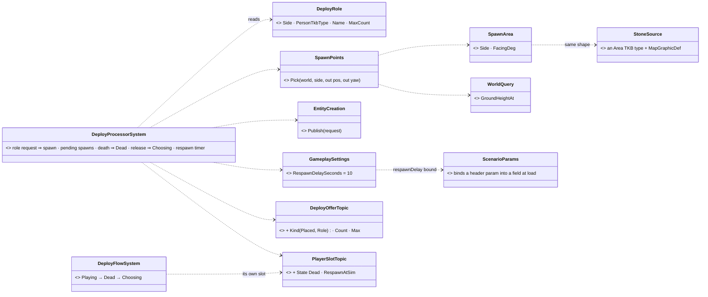

*What the picture shows that prose hid:* every new piece of data is an authored, unmanaged component on an ENTITY the editor already knows how to
place and save (an area, a bare settings entity, the World Environment) — no new storage, no new wire for the military simulation; the only wire that
grows is the gameplay pack's own two topics.

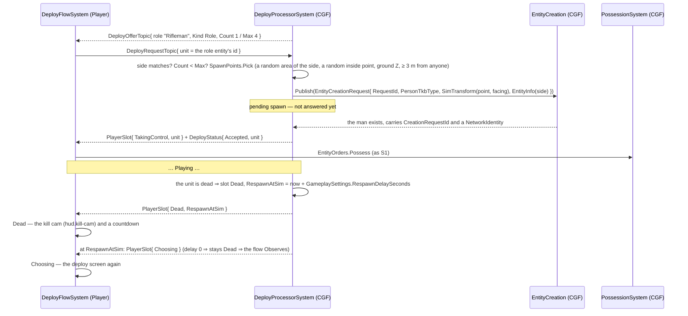

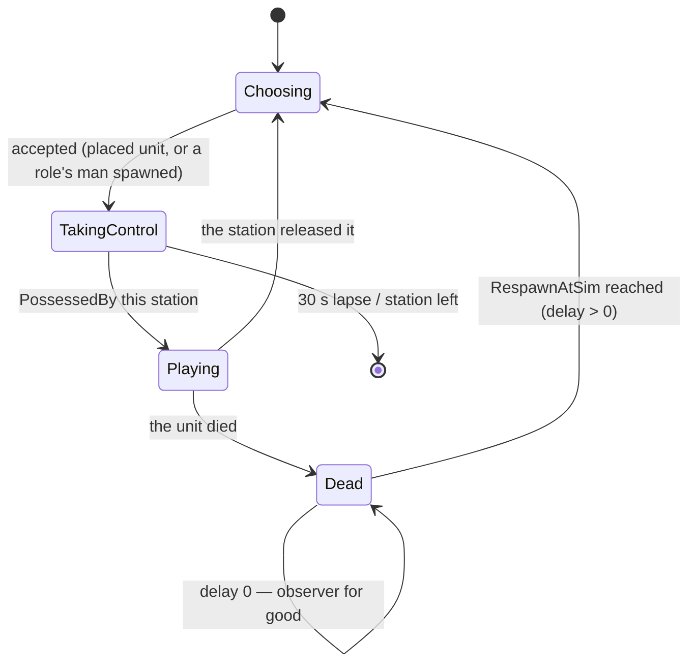

*What the picture shows that prose hid:* the slot life on the SERVER is the whole rule — the Player only mirrors it; and S1's open gap (a released
unit kept its reservation) is the `Playing → Choosing` edge.

### 10.3 Decisions *(within D-10, D-11, D-14; no new user decision)*

| # | decision | why |
|---|---|---|
| S2-a | a ROLE is a bare authored entity (TKB "Deploy Role", no position) carrying `DeployRole` — one entity per role | D-10's "per-side list" with no variable-length component (an unmanaged component cannot hold a list; a managed list would be recorded every change); the editor already places, edits and saves entities. ⭐ None declared ⇒ the server offers one role per person TKB type present on that side, unlimited |
| S2-b | a SPAWN AREA is one more Area TKB type (`StoneSource` shape) carrying `SpawnArea { Side, FacingDeg }` | D-11; the outline and the inside test exist (`WeatherField.TryOutline`, the `ItemSources` even-odd test — moved to one shared helper, not copied) |
| S2-c | the free point: up to 20 random inside points; Z = `GroundHeightAt`; refused when any entity with a position is within 3 m (a direct scan — a spawn is a user action, not per frame); no area of the side ⇒ refused "no spawn area" | ⛔ no navmesh on CGF (measured); SimHost's crowd snaps the start onto the navmesh, as for any created man |
| S2-d | the respawn delay is `GameplaySettings.RespawnDelaySeconds` on the World Environment, default 10, bindable by a scenario parameter (`respawnDelay`) | §7b: a scenario parameter with a default; 0 ⇒ observer (D-14) |
| S2-e | a role's request is answered only once the man EXISTS (pending spawn, found by `CreationRequestId`); 10 s ⇒ refused "spawn timed out" | the Player possesses a unit by its network id |

Rejected — one line each: *project to the navmesh on the server* — CGF has no `INavmeshProvider`. *Roles as a list on the World Environment* — a
variable-length component is managed and recorded per change. *Roles defined per spawn area* — D-10 is per side; an area only says where.
*The Player spawns its own man* — rejected in §5 (two Players race for one spot).

*Module diagram:* unchanged from §9.2 — S2 adds no system; it grows `DeployProcessorSystem` (CGF, Input, `[NodeFeature]`) and `DeployFlowSystem` (Player, Input), each ticked by its node's kernel as there.

### 10.4 AS BUILT — S2, roles · spawn areas · death and respawn *(backend, `2026-11-05`; `build-state`: BUILT)*

| part | where | as built |
|---|---|---|
| components | `Hrot.Core/Components/Common/GameplayComponents.cs`; ids `GlobalComponentIds` **482** `DeployRole` · **483** `SpawnArea` · **484** `GameplaySettings` (free on all four lanes `2026-11-05`) | unmanaged, `[DataPolicy(Default)]` (recorded + saved), registered in `HrotSharedComponentRegistry` |
| TKB | `TkbEntityTypes` **8814** `SpawnArea`, **8815** `DeployRole`; `NedTkbCatalog` ("Spawn Area" = a `MapGraphicDef` area like "Stone Source"; "Deploy Role" = a bare template like "Traffic") | `PlacementToolRegistry.Graphics`: Spawn Area = `Area` tool; Deploy Role = `Point` tool (see deviation 4) |
| born with | `AreaAuthoringArm.BornWith` adds `SpawnArea{Friend, 0°}`; `GameplayBirth.BornWith` (beside `MacroBirth`, called from `ScenarioSpawnAdapter.ArmPlacement`) adds `DeployRole` | fields edit in Details through the generic Components view (see "not verified") |
| containment | `WeatherField.AreaEntityContains` — the one area-entity containment | `ItemSources`' private `Inside` is **deleted**, it calls the shared one (deviation 1) |
| the free point | `Hrot.Gameplay/SpawnPoints.cs` — `Pick(world, side, rng, out pos, out yawDeg, out reason)` | a random area of the side → ≤ 20 random points of its bounding box that pass the containment → Z = `WorldQuery.GroundHeightAt` (the area's own Z with no terrain) → refused within 3 m XY of any alive positioned entity that is not itself an area; refusals "no spawn area for <side>" / "no free point" |
| wire | `DeployOfferTopic` + `Kind` (`DeployOfferKind`: Placed 0 / Role 1) · `Count` · `Max`; `PlayerSlotTopic` + `RespawnAtSim`; `PlayerSlotState.Dead = 3` | a Role offer's `UnitNetId` is its Deploy Role entity's network id; an IMPLICIT role (no role declared on the side) is `-(person TKB type)` |
| server | `DeployProcessorSystem` (+ `RoleSpawner` delegate; the pack builds it from `EntityCreation.RequestEntityCreation`) | role request ⇒ side · `RoleFull` · `SpawnPoints.Pick` ⇒ ONE man through the creation path, owner = this node ⇒ a **pending spawn** answered only once the man exists (`CreationRequestId` + `NetworkIdentity`) ⇒ slot TakingControl + status Accepted(his id); 10 s ⇒ "spawn timed out"; men named "<role> <n>" |
| slot life | `DeployProcessorSystem.Progress` | Playing + unit dead/gone ⇒ **Dead**, `RespawnAtSim = now + delay` (`GameplaySettings` on the World Environment, 10 when absent); Playing + `HolderOf != station` ⇒ **Choosing** (closes §9.4's gap); Dead + `now ≥ RespawnAtSim` ⇒ Choosing; delay 0 ⇒ `RespawnAtSim = 0` = Dead for good. Dead/Choosing slots hold a side only in `StationReservations` |
| client | `PlayerSlotReaderSystem` keeps the latest slot per station (`TryGetSlot`); `DeployFlowSystem.Slots` reads it; `DeployFlowState.Dead` | Playing → Dead (`Reason` "killed — respawn in N s" from `RespawnAtSim` and the Player's sim clock, "killed — observing" when 0) → Choosing; Playing → Choosing when released. `GET /deploy` reports `respawnAt` and each offer's `kind/count/max` |
| screen | `DeployScreen` | the Dead line; role rows "name  n / max" (greyed "full"); "Keep observing" for a delay of 0 |
| delay | scenario parameter `respawnDelay` | `header.params` + `header.world.{GameplaySettings, ParamBindings}` — the World section becomes the World Environment entity BEFORE `ScenarioParams.Prepare` (`ScenarioLoadStep`), so the existing `ParamBindings` path reaches it; nothing new built |

**Deviations from §10.2 / the brief, each argued:**
1. ⭐ **The shared inside helper already existed.** `WeatherField.AreaEntityContains` (+ `Contains`) is the one even-odd containment; `ItemSources.Inside` was the DUPLICATE. It was deleted and `ItemSources.At` calls the shared one — rather than "moving" it to a second shared place (which would have made two).
2. `SpawnPoints.Pick` has an extra `out string reason` (the refusal text has to travel).
3. The server spawns through **`EntityCreation.RequestEntityCreation`** (the AUTHOR affordance — a new intent), not `Publish(new EntityCreationRequest)`, which `EntityCreation.cs` reserves for TRANSLATORS. Owner = the creation pack's own node, as `SimHostScenarioManager` does.
4. **Deploy Role is placed with the Point tool** (so it has a position that means nothing). "Like Traffic" could not be followed literally: Traffic has no editor creation path to copy (measured: no editor/presentation code creates a `TrafficDemand` entity — scenario files author it). The Point tool + `GameplayBirth` is the existing born-with pattern (`MacroBirth`).
5. The respawn state is carried as `RespawnAtSim = 0` for "never" (delay 0), not infinity.
6. `SimClock.Of(view)` returns the INTERFACE, boxing a struct per call (24 B/frame): both systems keep one boxed clock (`_clock ??=`) — found by the hot-path rail.

**Rails** — `Hrot.SimHost.Tests`: `GameplayDeployServerTests` (S2: role spawn + point + answer-after-man · full / wrong side / no area · timeout · implicit + declared offers · death ⇒ Dead ⇒ Choosing · settings delay and 0 · release · **0 B per steady frame**), `GameplayDeployFlowTests` (S2: Playing → Dead → Choosing with the countdown · delay 0 observing · release), `GameplaySpawnPointsTests` (inside a concave outline · terrain Z · clearance and the area's own anchor · refusals · the shared containment), `GameplaySettingsScenarioTests` (the `respawnDelay` binding; save/load in the World section); `Hrot.Presentation.Tests`: catalogue golden (8814, 8815), arming, born-with, the row text. Each red-proved by a compiling mutation (report).
⚠ **Not verified live:** a Deploy Role / Spawn Area / `GameplaySettings` is edited in Details only through the generic Components view (not exercised); a Deploy Role or Spawn Area entity must exist on the CGF node's world to be read — placed units are Brain-owned, and these bare / area entities follow the same creating-Brain rule as the World Environment and the Weather Region, but **no NED descriptor carries `DeployRole`/`SpawnArea` to a node that does not own them** (S1's `Playable` has the same property).

### 10.5 S2 LIVE *(backend, `2026-11-05`)*

📐 `-m server` + two `-m player`, scenario `s2-respawn` (a blue Spawn Area, a "Rifleman" role max 1, `GameplaySettings.RespawnDelaySeconds` 5): UC-29…31 ✅
(`DESIGN_Cluster_Membership_Use_Cases.md` §2.1) — the role's man spawned inside the area facing 90°, the Player Playing; the second Player refused `RoleFull`;
killed ⇒ `Dead` *"killed — respawn in 5 s"* ⇒ `Choosing` 5.2 s later, the role free again.
⭐ **Two flow defects found live and fixed (`615bd99ea`)**, both on the role path the S2 rails did not drive end to end: ① the flow possessed the id it ASKED for
(the role entity) instead of the unit the server NAMED (the man); ② a local Possess refusal returned to Choosing at once — but a man just spawned is not on the
Player yet (his replica waits for its first pose, CE-4086), so it is now retried every 500 ms until the 10 s deadline. Rails in `GameplayDeployFlowTests`.
⚠ The `-m server` HTTP API edits one subsystem's world at a time: kill a unit through the perspective whose node owns `Health` (here `Scenario`).

## 11. S3 — kits, the spawn area, the scoreboard key *(backend, `2026-11-05`; `build-state: BUILT` — the as-built is §11.1; the map click S3-d is ui's)*

✅ User `2026-11-05`: *"Kit variants lean accepted"* · R-3076 (Tab = the scoreboard only, next man = J — BUILT, see D-16).
⭐ The scoreboard itself is ui's CE-4231 (`Scoreboard.Build` over S7's per-man `Points` roots, `PlayerHudLayer.DrawBoard`) — nothing to build for D-15/D-16 beyond R-3076.

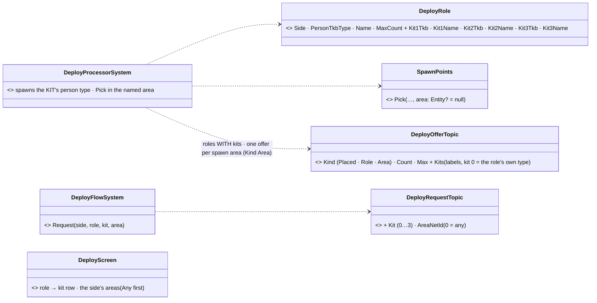

*What the picture shows that prose hid:* a kit is only another person TKB type on the SAME role (count and max are the role's, shared by its kits); an
area is offered exactly like a unit, so the Player's screen lists both from one topic and the request names them by the same kind of id.

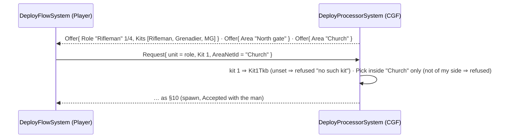

| # | decision | why |
|---|---|---|
| S3-a | up to THREE extra kits per role (four with the role's own type) as fixed fields — unmanaged, no list | the accepted lean; an unmanaged component cannot hold a list (§10.3 S2-a's reason) |
| S3-b | a kit shares the role's count and max | a kit is a variant of ONE role, not a second role |
| S3-c | `AreaNetId` 0 ⇒ a random area of the side (S2's rule); a named area of another side ⇒ refused `WrongSide` | the Player may choose, never must |
| S3-d | the area on the MAP (click to choose) is ui's — ⭐ **BUILT `2026-11-05` (ui, CE-3370; as-built §11.2)**: `DeployAreaMapLayer` outlines the chosen side's areas while Choosing and a click inside one selects it, through the SAME `DeployAreaChoice` the screen's list holds | the deploy flow's API is the one seam |

Rejected — one line each: *a kit as AmmoLoadout overrides* — a loadout system, rejected in §5. *One role entity per kit* — splits the role's count and max.
*Area as a separate request* — two round trips for one decision.

### 11.2 AS BUILT — S3-d, the area on the Player's map *(ui, `2026-11-05`, CE-3370)*

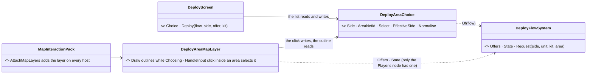
*What the picture shows:* the choice has ONE owner (`DeployAreaChoice`), so list and map cannot disagree; `DeployScreen.Deploy` is the only place it becomes a `Request`. No backend change. The layer is attached by the shared pack (no host can lack it), is 2-D only, is not an `ISceneLayer` (never filmed), and acts only where a `DeployFlowSystem` exists — the Player.
Rails: `DeployAreaMapLayerTests` (`Hrot.Presentation.Tests/Map2D`) — the click rules, list = click, the request's `RequestedAreaNetId`, and a frame rail for the outline.

### 11.1 AS BUILT — S3, kits and the spawn-area choice *(backend, `2026-11-05`; `build-state`: BUILT)*

| part | where | as built |
|---|---|---|
| kits | `DeployRole` (`GameplayComponents.cs`) | `Kit1Tkb…Kit3Tkb` (long, 0 = none) + `Kit1Name…Kit3Name` (`FixedString32`); kit 0 = the role's own `PersonTkbType`/`Name`; `KitTkb(n)`; still `[DataPolicy(Default)]` — saves and loads (rail) |
| wire | `GameplayTopics.cs` | `DeployRequestTopic` + `Kit` (byte) · `AreaNetId` (int); `DeployOfferTopic` + `Kits` (`[DdsManaged] List<string>`), all APPENDED LAST (R-42); `DeployOfferKind.Area = 2` |
| offers | `DeployProcessorSystem.PublishAreaOffers` / `RefreshKits` | every `SpawnArea` entity of EVERY side with a network id ⇒ Kind Area (id, side, `EntityInfo.Name` or "Spawn area"); a role with ≥ 1 extra kit carries `Kits` = labels BY KIT NUMBER (0 = the role's name, "" = unset, unset name ⇒ "Kit n"); an implicit role carries ONE (its type); the label list is rebuilt only when a name changed |
| server | `HandleRole` | `Kit` ⇒ `role.KitTkb(kit)`; kit > 3 or a set-less kit ⇒ refused `NoSuchKit` (an implicit role has only kit 0); kits share the role's `AliveOf`/`Max` (S3-b); the man is still "<role name> <n>"; `AreaNetId ≠ 0` ⇒ `Pick(…, only: area)` |
| the free point | `SpawnPoints.Pick(…, out reason, Entity? only = null)` | with `only`: not an alive spawn area with an outline ⇒ `NoSuchArea`; another side's ⇒ `WrongSide`; else the same ≤ 20 tries in THAT area; an id the map does not know ⇒ `NoSuchArea` |
| flow | `DeployFlowSystem.Request(side, unit, kit = 0, areaNetId = 0)` | both ride the request; `RequestedKit`/`RequestedAreaNetId` read back; `DeployOffer` gains `Kits` and `IsArea` |
| HTTP | `DeployFlowApi` | `GET /deploy` offers carry `kind` (Placed/Role/Area), `count`, `max`, `kits[]`; `POST /deploy` takes optional `kit` (0…3) and `areaNetId` — a wrong type or range is a 400 and sends nothing; route doc + `tool-catalog.mjs` regenerated |
| screen | `DeployScreen` | a role row expands to its kits ("Rifleman — Grenadier", one `KitRows` button each, unset ones hidden); the chosen side's areas ("Any area" first, selected by default) whose choice rides a ROLE request; units and areas are listed apart (`OffersOf` / `AreasOf`); a side is listed for its units, never for an area alone |

**Deviations / notes, argued:**
1. `SpawnPoints.Pick`'s named-area parameter is called `only` (the local is `area`) and, as in S2, the signature has `out string reason`.
2. A role WITHOUT extra kits sends `Kits` as an empty list, so the Player's offer carries `null` (not an empty list): `DeployOffer` equality stays value-like for the existing rails.
3. The area choice rides role requests only; a placed unit ignores it (it never spawns).
4. The Deploy Role's kit fields edit in Details through whatever edits `DeployRole` today — the generic Components view; ⚠ not exercised live (same caveat as §10.4). No Details section was added.
5. The area offers' names are cached at first sight (an area renamed later keeps its first label until the server restarts) — areas are authored and rarely renamed; a role's labels DO refresh (they are compared each pass).

**Rails** — `Hrot.SimHost.Tests`: `GameplayDeployServerTests` (kit spawns its type / `NoSuchKit` / the shared Max · a named area is the only one used, with `WrongSide` / `NoSuchArea` · every area offered, kit labels · the `DeployRole` scenario round-trip), `GameplayDeployFlowTests` (the request carries kit and area · the flow reads area offers and kit labels, `GET` reports them), `GameplaySpawnPointsTests` (a named area); `Hrot.Presentation.Tests` `DeployScreenRulesTests` (kit rows, areas apart); `Hrot.Editor.Tests` `TheDeployRoutesTests` (`POST` kit/area and the 400s). The S2 0-allocation steady-frame rail stays green. Each red-proofed by a compiling mutation.

### 11.2 S3 LIVE *(backend, `2026-11-05`)*

📐 UC-32 ✅ (`DESIGN_Cluster_Membership_Use_Cases.md` §2.1): offers carry the kit labels and one Area offer per spawn area; kit 1 in a named area spawns the kit's
type inside that area; an unset kit is refused `NoSuchKit`. ✅ **Facing settled `2026-11-05`** (yaw sampled every 0.5 s on owner and Player): born at 180°, held 180°; the −11.8° was a one-sample heading transient at the
possession HANDOVER (re-run: −32.2° for one sample, both nodes, then 180°) — not the spawn. Filed **CE-3368**. ⚠ Known (§11.1 deviation 4): an area renamed while the server runs keeps its first label until the server restarts.
