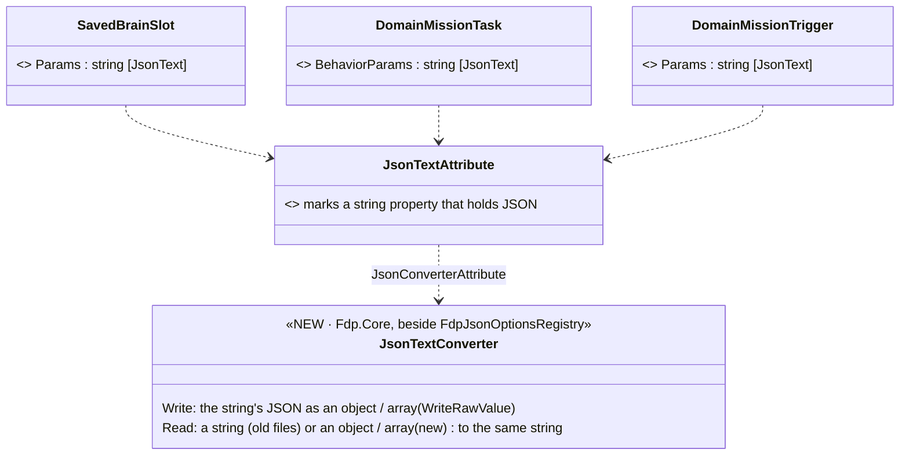
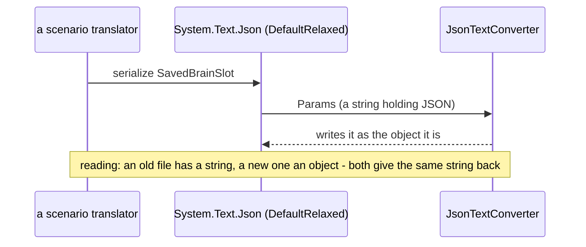
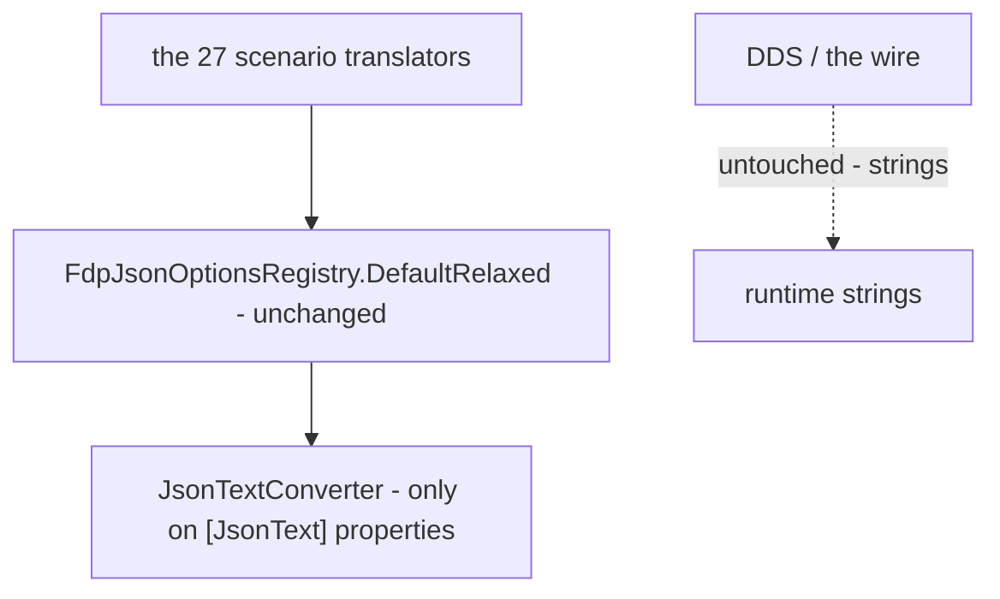

<!--STATUS
state: LIVE
build-state: DESIGN — for the user (Q1–Q4)
updated: 2026-11-07 (first version — the user: "Storing JSON strings inside a JSON string type seems weird … it reads very badly by human because it's double quoted")
current-answer: §1 measured · §2 the design · §3 questions
stale-below: nothing
known-rot: none
known-conflict: none
related-designs:
  - UX/DESIGN_Mission_Plan_Editor.md — §5.7: a task's then / give-up conditions are stored the same way, and become readable objects too
  - DESIGN_Scenario_Rules.md — a rule's params (and its `when`) are saved through the brain snapshot as the same JSON-in-a-string
  - DESIGN_Sensors_And_Doctrine.md — §7.5 OWNS the brain snapshot (`{Name, Params JSON, Origin}`) whose `Params` this changes on disk only
-->

# DESIGN — behaviour params and conditions written as JSON objects in scenario files, not as escaped strings

## 0. Why

🔒 *"Storing JSON strings inside a JSON string type seems weird. What would it take to use normal JSON object instead of storing the JSON string?
This is the case for any behavior parameter we are using. In the scenario, it looks weird. It reads very badly by human because it's double quoted
and not easily readable."* (user, `2026-11-07`)

## 1. Measured *(2026-11-07)*

| fact | where |
|---|---|
| **117 of 127** scenario files carry escaped JSON: `"Params": "{\"Advance\": {\"Objective\": [46.3, …` (**539**, the brain snapshot's `Behavior` / `Sop` blocks) · `"behaviorParams": "{\"…` (**88**, mission plan tasks) | `scenarios/*/scenario.json` |
| in memory these are **C# strings**, parsed where used (`RestlessSystem.cs:117`, `RulesModel.cs:302`, `MissionPresentationGizmo.cs:50` …) and sent as strings on the wire (`MissionDescriptors.cs:31`, DDS) | — |
| the scenario's entity blocks are written by translators (27 `IEntityScenarioTranslator`s) through ONE options object, `FdpJsonOptionsRegistry.DefaultRelaxed` — `BrainSnapshotTranslator.Node` / `Read` | `BrainSnapshotTranslator.cs:89-100` |
| ⚠ `DefaultRelaxed` has **88** users (orchestration, transfer, debug API, behaviours …) — a GLOBAL converter change would reach all of them | grep |
| the reader already accepts a block as a string OR an object (`raw switch { JsonNode / JsonElement Object / string }`) | `BrainSnapshotTranslator.cs:96-100` |

## 2. The design — the disk shape changes, nothing else does

⭐ **The C# property stays a `string`** (runtime, wire, every parser untouched). One converter changes only how that string is WRITTEN to and READ
from JSON: written as the JSON value it contains, read from either form.



*What the picture shows: the converter is attached to the PROPERTY, not added to the shared options — so of the 88 users of
`DefaultRelaxed`, only the marked fields change, and only in their JSON form.*





**Before → after** (`scenarios/bc-house-clear`):

```json
"Behavior": { "Name": "ClearBuilding", "Params": "{\"Building\": [47, 105, 0], \"Speed\": 2}" }
```
```json
"Behavior": { "Name": "ClearBuilding", "Params": { "Building": [47, 105, 0], "Speed": 2 } }
```

| rule | |
|---|---|
| **read both forms, forever** | an old file (string) and a new one (object) load to the same in-memory string |
| **write the object form** | from the first save after the change |
| **a value that is not valid JSON** is written as the string it is | never lose an author's text |
| **the 117 files rewritten once** by loading and saving them through the serializer (a script, one commit) — or left to migrate on their next save (Q2) | a round-trip rail per marked field: string → object → the same string, and old file → load → identical world |

## 3. Questions — leans

| # | question | ⭐ lean | rejected |
|---|---|---|---|
| **Q1** | which fields | every string property that holds JSON AND reaches a scenario or a saved file: `SavedBrainSlot.Params`, `DomainMissionTask.BehaviorParams`, `DomainMissionTrigger.Params` (measured), plus any the builder's inventory finds (a rule's `JsonParams`, a step's `ArgsJson` …) | change the C# types to `JsonNode`: touches every parser, the wire and the runtime for a readability fix |
| **Q2** | the existing 117 files | **rewrite them once** (load + save, one commit) so the repo reads well now | migrate on next save: files would stay escaped for months |
| **Q3** | the debug API / MCP output of the same types | **objects there too** (they are serialized with the same converter) — easier to read; the MCP reads both | strings only in the API: two shapes for one field |
| **Q4** | where it is built | a small backend item, before the mission plan editor's M5 (its conditions then land readable from the start) | — |
