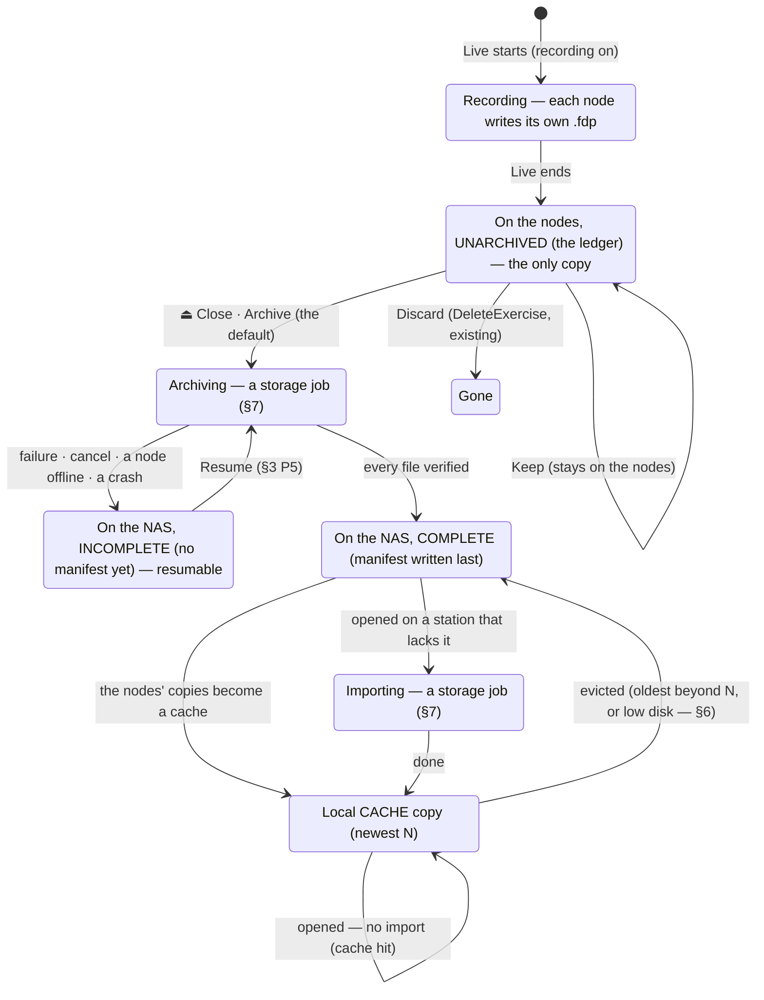
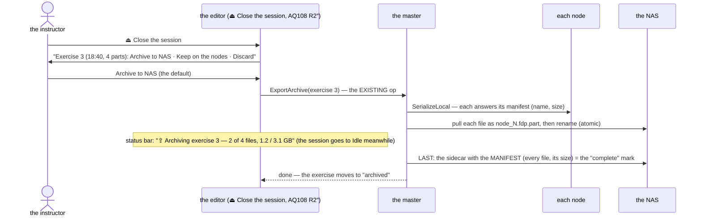
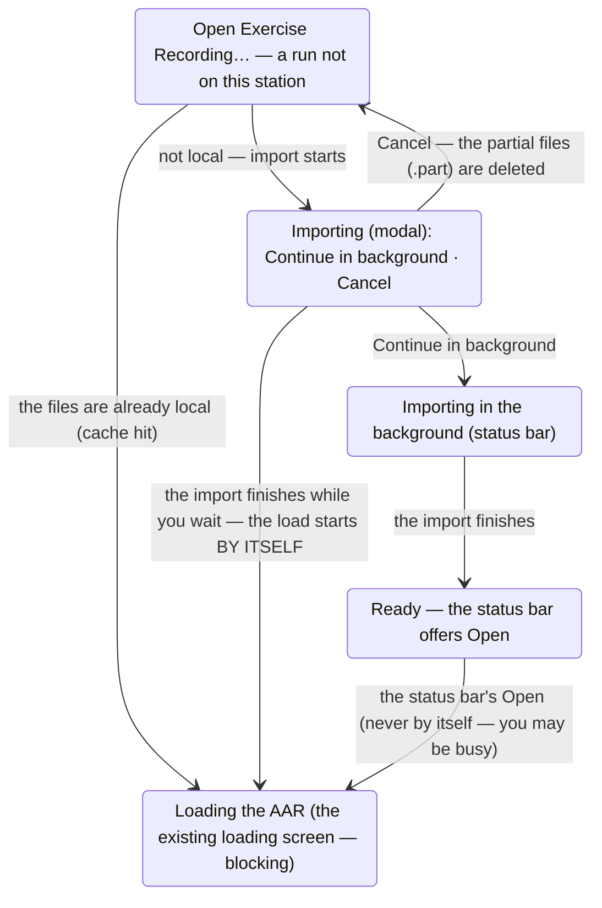
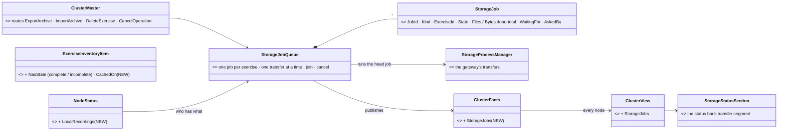
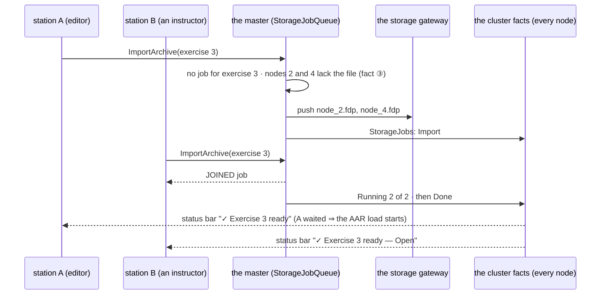
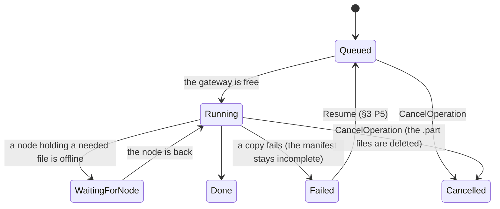
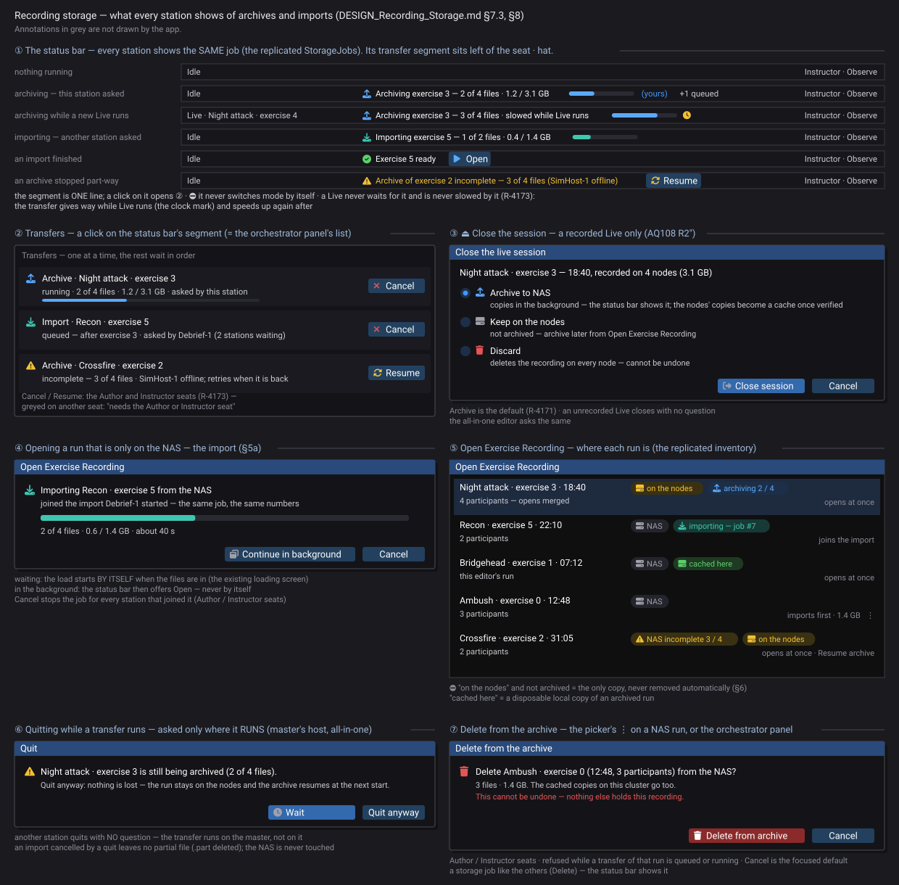

<!--STATUS
state: LIVE
build-state: READY-TO-BUILD (CE-4330) — §1–§7 decided (R-4171, R-4172, R-4173); §8 the visual; Q8 (delete from the NAS) open, not part of CE-4330
updated: 2026-11-08 (⭐ PROMOTED to the ONE owning design of recording files — moved from docs/DESIGN_Recording_Storage.md and retitled; the user: "it's probably a whole design document regarding the management of the recording files, importing and exporting")
current-answer: ⭐ §00 scope + the life of a recording (what this owns, what neighbours own) · §1 measured · §2 the gaps · §3 the proposal (P5 where you resume) · §4 decisions · §5 opening from the NAS — always import · §5a wait or background · §6 the local cache · §7 the distributed model (jobs, facts, one queue; §7.4 decided) · ⭐ §8 the visual · ⭐ §9 an AAR on a different cluster (Q9)
stale-below: nothing
known-rot: none
known-conflict: designs/mgmt-1/DESIGN.md §13 — written before the build; its §13.3 layout (/archives/, .fdprec + .meta.json, drill_manifest.json) is NOT the as-built ({NAS}/exercises/<id>/node_N.fdp + Orchestrator.json + scenario/, §1 here). This design is the current answer for WHAT happens to a recording; mgmt-1 §12.6/§13.1 stay the answer for HOW the gateway moves bytes.
related-designs:
  - designs/mgmt-1/DESIGN.md — OWNS the transport: §12.4 the SMB pull gateway, §12.6 StorageGatewayModule, §13.1 the export phases, §13.3a the scenario copy taken at Live start (CE-3119)
  - blueprints/Architect_Question_108_Run_Mode_Picker.md — OWNS the run controls: §0 R2″ (Live ends in two steps — ⏏ Close asks here), D15 (discard), CE-4100 (ask to keep recordings)
  - UX/DESIGN_Scenario_Lifecycle_Review.md — LC-19 (the recording picker), LC-21 (recordings out of TEMP)
  - UX/DESIGN_Review_Perspective.md — OWNS opening a run: a participant group opens merged and needs every node's file in ONE place
  - DESIGN_Checkpoint_And_Dry_Run_Restore.md — OWNS checkpoints INSIDE a recording (D13: no trim inside a recording; ExerciseRetention.Prune is the only clean-up)
  - designs/file-sync-1/Detailed Design.md — OWNS the deployment's ARTIFACT distribution (manifests, publish gate); the source of "operator-triggered deletion only", which §6 keeps
  - DESIGN_Artifact_Staging.md — OWNS staging the TKB / terrain from the shared root to the nodes (the same staging tree the recordings live in)
  - DESIGN_Distributed_Scenario_Persistence.md — the same pull pattern for scenario saves
-->

# DESIGN — recording storage: where a recording lives, and how it moves (collect · archive · import · cache · discard)

## 00. ⭐ Scope — the ONE owning design of recording files *(`2026-11-08`)*

🔒 User: *"it's probably a whole design document regarding the management of the recording files, importing and exporting. Maybe there is already one
from the old times when the existing features were implemented, but now we are adding something more."*

**Searched** (`grep` over `docs/` + `.dev/` for `ExportArchive|ImportArchive|StorageGateway|SMB Pull|ExerciseRetention|PrefetchArchive|HydrateLedger`, ~30 files
ranked by hits): ⛔ **no single owning design existed** — the pieces were spread over five places, none covering the whole life of a recording:

| piece | where it was | covers | why it was not enough |
|---|---|---|---|
| the gateway and the export / import phases | [mgmt-1 §12.4–§13](designs/mgmt-1/DESIGN.md) (`.dev/_DONE/mgmt-1`, cgf-1 near-copy) | HOW bytes move (one outbound NAS connection) | written before the build: its §13.3 layout is not the as-built; nothing about WHEN an archive runs, partial archives, status, concurrency or local copies |
| the scenario copy in the archive | mgmt-1 §13.3a (CE-3119) | the `scenario/` folder | one artefact |
| keep / discard at the end | [AQ108](blueprints/Architect_Question_108_Run_Mode_Picker.md) D15, CE-4100 | the question and `DeleteExercise` (unarchived only) | no archive step |
| pruning old exercises | CE-3218 (tracker row + `ExerciseRetention.cs` doc comment only — ⛔ no design) | the disk not filling | count only, by exercise |
| "operator-triggered deletion only" | [file-sync-1](designs/file-sync-1/Detailed%20Design.md) | artifacts | a different subsystem; its principle is reused |

⇒ ⭐ **This document is now the owner** (moved from `docs/DESIGN_Recording_Storage.md`). mgmt-1 keeps the transport; this one owns **what happens
to a recording, where it is, and what every station knows about it.**

### The life of a recording

*What the picture shows that the sections below spread out: a recording is ALWAYS in exactly one of two safe places — the only copy on the nodes
(never removed automatically) or complete on the NAS (local copies are disposable). Every arrow out of those two is a storage job (§7), visible on
every station.*

| ⛔ gap the picture exposes | lean |
|---|---|
| **no way to DELETE a run from the NAS** — `DeleteExercise` removes only an UNARCHIVED one (`AssetInventoryProcessManager.cs:220-225`, returns false for an archived id) | ✅ **Q8 decided (R-4174)**: *Delete from archive* wherever NAS runs are listed (the picker's ⋮, the orchestrator panel), behind a confirmation dialog (§8 ⑦); a storage job of kind **Delete** (one at a time, like the rest); the cached copies go too; Author / Instructor; refused while a transfer of that run is queued or running. Part of CE-4330 |

## 0. Why

## 0. Why

🔒 User, `2026-11-08`: *"Could you please check how the recording files, once they are produced by the nodes, how they get transferred to a shared
NAS location? … I think we might be missing some recording collection step at the end of the live exercise … sometimes the exercise is recorded just
to be sure, but at the end the instructor decides that there is no point in keeping those recordings … we should start some background operation
across the cluster that copies the recordings produced on the NAS, and making sure that this operation is shown somehow, maybe in the status bar, so
the user doesn't accidentally close the whole application … If that happens, how do we find out that on the NAS there is inconsistent state?"*

## 1. Measured *(`2026-11-08`, grep + read)*

| fact | where |
|---|---|
| each node records its OWN `.fdp` into its staging: `{root}/nodes/node-N/exercises/<id>/` | `OrchestrationConstants.cs:13, 37` |
| the master keeps an **UNARCHIVED ledger** of every live run (memory + a ledger file), created on each `OperatingLive` entry | `AssetInventoryProcessManager.cs` (`_unarchivedLedger`; AQ108 :1676) |
| **archiving EXISTS**: `ExportArchive` — the master fans out `SerializeLocal`, each node answers with its file manifest (`ReferenceArchiveHandler`), the master PULLS the files over SMB to `{NAS}/exercises/<id>/node_N.fdp` (`StorageGatewayModule.PullToNasAsync`), then writes the sidecar (`Orchestrator.json`) and the scenario copy and drops the ledger entry | `ReferenceArchiveHandler.cs:24-31` · `StorageProcessManager.cs:110-160` · `AssetInventoryProcessManager.cs:163-178` · mgmt-1 §13 |
| ⛔ **nothing triggers it at the end of a run** — only the orchestrator panel's *Export to NAS ▶* (`ClusterScenarioPanel.cs:1042`) and HTTP (`DebugApiService.Master.cs:441`) | grep `StorageOpType.Export` |
| ⭐ the editor's *Open Exercise Recording…* lists the **UNARCHIVED** exercises (the ledger + the run in progress) — recordings still ON THE NODES, replayed by each node from its own staging; the ARCHIVED ones on the NAS are NOT listed there (replaying them needs `ImportArchive`, which exists — a prefetch NAS → nodes — but the picker does not offer it) | `EditorSubsystem.cs:4213` (`UiCache.AvailableExercises`) · `AssetInventoryProcessManager.cs:181-210` · `StorageProcessManager.cs:71-75` |
| keep / discard exists as an option: *Keep this recording?* when the cluster's *ask to keep recordings* is on (CE-4100); **Discard** deletes the ledger entry, the scenario copy and the exercise's staging directories (`ExerciseRetention.Delete`); **Keep** leaves it unarchived on the nodes | `ClusterTimeTransportAdapter.cs:275` · `AssetInventoryProcessManager.cs:216-232` · `ClusterMaster.RunSettings.cs:171-188` |
| a pull copies each file with `File.Copy` to its FINAL name; a CANCELLED pull deletes its in-flight files; a partial failure answers *Rejected* and KEEPS the ledger entry | `StorageGatewayModule.cs:201-245` · `StorageProcessManager.cs:150-160` |
| ⚠ the NAS scan counts a folder as **ARCHIVED when it holds ANY `.fdp`** (the sidecar optional) | `StorageGatewayModule.ScanNasExercises`, `:794-805` |
| ⚠ the "unarchived" list = the ledger MINUS the archived ids | `AssetInventoryProcessManager.cs:192-194` |
| the archive's progress is visible only as the orchestrator panel's op state; nothing guards closing the app during a pull | — |

## 2. The gaps

| # | gap | consequence |
|---|---|---|
| **G1** | no collection step at the end of a run — an archive happens only if someone presses *Export to NAS* in the orchestrator panel | recordings pile up on the nodes; a node machine cleaned or replaced takes its part with it |
| **G2** | archived exercises are not in the editor's picker | an archived run cannot be reopened from the editor; and the all-in-one editor / Replay Browser can open a participant GROUP only when every node's file is reachable — which is what the NAS is for |
| **G3** | ⚠ **a half-copied exercise looks ARCHIVED**: one `.fdp` on the NAS is enough for the scan, and then the exercise disappears from the "unarchived" list — so it can no longer be exported again from the UI | an interrupted archive silently loses the re-try |
| **G4** | a process that DIES mid-copy (the app closed, a crash) leaves a truncated `.fdp` under its final name; only a CANCEL cleans up | a corrupt file that looks whole |
| **G5** | no progress, no close guard | the user closes the app mid-copy (the user's case) |
| **G6** | keep / discard is an optional question at ■, and *Keep* means "on the nodes" — there is no "archive" answer | the decision the instructor actually makes (archive or throw away) has no button |

## 3. The proposal

*What it shows: the collection is the EXISTING `ExportArchive`, triggered by the instructor's answer at the end; completeness is a manifest
written LAST, so anything without it is visibly incomplete.*

| # | ⭐ proposal | fixes |
|---|---|---|
| **P1** | **the end asks about the recording**: ⏏ *Close the live session?* (AQ108 R2″) becomes *"Close the session — Exercise 3 (18:40, 4 parts): **Archive to NAS** · Keep on the nodes · Discard"*; it replaces the optional *Keep this recording?* | G1, G6 |
| **P2** | **the archive runs in the background on the master** (the existing op); the **status bar** shows it — *"⇪ Archiving exercise 3 — 2 of 4 files, 1.2 / 3.1 GB"*, a click opens the details; the session may go to Idle meanwhile (a new briefing can start — the pull reads finished files) | G5 |
| **P3** | **closing the app during an archive asks**: *"Exercise 3 is still being archived (2 of 4 files). Wait · Close anyway — the exercise stays on the nodes and the archive resumes next time"* — the editor's existing exit prompt gains this line | G5 |
| **P4** | **complete = a manifest written LAST**: the sidecar lists every file with its size; files land as `*.fdp.part` and are renamed when whole; the NAS scan counts an exercise ARCHIVED only when the manifest is present AND every listed file matches — otherwise it is **INCOMPLETE** | G3, G4 |
| **P5** | **an incomplete archive RESUMES — where** (the user: *"Where can we select the option to continue?"*): ① **by itself** — the master re-tries every incomplete archive whose exercise its ledger still holds, at start-up and whenever the missing node comes back (the files are still on the nodes: they are deleted only after a VERIFIED archive, Q2); ② **the status bar** says it while it waits: *"⚠ Exercise 3 archive incomplete — waiting for node-3 (2 of 4 files)"*, a click opens the details with *Resume now*; ③ **the recording picker's row**: *"⚠ incomplete — 3 of 4 files · Resume archive"*; ④ **the orchestrator panel**'s archive list, the same action. ⭐ It re-runs the SAME pull — it already skips a file of the same size and time | G3 |
| **P6** | **the picker lists both**: *on the nodes* and *archived* (with where each is — §7.3, §8 ⑤); opening an archived one IMPORTS first everywhere (§5 — ⛔ SUPERSEDED: this row first said the all-in-one editor and the Replay Browser read the NAS files directly) | G2 |

## 4. Decisions — ✅ the user, `2026-11-08` (R-4171)

| # | | |
|---|---|---|
| **Q1** | the default answer at the end | ✅ **Archive to NAS** — 🔒 *"Yes, the default answer is to archive to NAS."* |
| ~~Q2~~ | ~~after a VERIFIED archive, delete the nodes' local copies~~ (🔒 *"once archived securely, we delete the on-the-node recordings"*) | ⛔ SUPERSEDED by Q2′ (R-4172) |
| **Q2′** | the local copies after a verified archive | ✅ **kept as a CACHE: the newest N stay, older ones go — and only an ARCHIVED one is ever removed** (§6) — 🔒 *"Maybe my previous lean to delete the recordings immediately from local storage is not a good idea unless there is not enough space. I think the older recordings might be deleted only, but a few of recent ones, they should stay."* |
| **Q3** | a run not recorded | ✅ no question — 🔒 *"if we are not recording, we cannot ask if we want to archive. So, no question if no recording."* HTTP passes the answer |
| **Q4** | the all-in-one editor | ✅ the same — 🔒 *"the all-in-one editor is no difference. It also copies to NAS."* |

## 5. ⭐ Opening a run from the NAS — ALWAYS IMPORT *(the user's question, measured `2026-11-08`)*

🔒 User: *"how can we open the recordings from the NAS? … direct access … or … importing the recordings from the archive to the local storage …
The direct remote access has one drawback, which is the Windows licensing for file share clients … maybe none of these consideration is actually
valid because when we start the AAR, we might always want to import the files from the NAS"*

| measured | where |
|---|---|
| the platform ALREADY forbids nodes to touch the NAS: a Windows client OS accepts **~20 inbound SMB connections**, so ONE storage gateway (with the master) does every NAS read and write over its own OUTBOUND connection — the *SMB Pull Gateway* pattern | [mgmt-1 §12.4](designs/mgmt-1/DESIGN.md) (*"~20 on client SKUs causes cascading connection failures"*), `:2371` |
| the import exists: `ImportArchive` → the gateway reads `{NAS}/exercises/<id>/node_N.fdp` and PUSHES each node its own file into its staging (`PrefetchArchiveAsync`) | `StorageGatewayModule.cs:701-725` · `StorageProcessManager.cs:71-75` |

⭐ **Decision (lean, matching the user's last thought): every opener IMPORTS first, never reads the NAS directly.**

| why | |
|---|---|
| the connection limit | nodes never connect to the NAS — a plain Windows PC can be the NAS (no Samba, no server licence needed); only the gateway's ONE connection |
| replay needs fast random access | seeking reads keyframes all over the file — local disk, not a share |
| it already exists | `ImportArchive`; the picker just has to call it (G2) |
| the run stays reviewable if the NAS goes away mid-session | the files are local |

| who opens | the import |
|---|---|
| a cluster's AAR | the gateway pushes each node ITS file (existing) — progress in the status bar (*"⇩ Importing exercise 3 — 2 of 4 files"*), then the AAR starts |
| the all-in-one editor (a participant group) | the gateway (in-process) copies ALL the files to the local staging, then the merged Review opens them |
| the standalone Replay Browser | the same: a local copy, then open |
| ⭐ a run already local and matching the manifest | no copy — the import is skipped |
| the local copy afterwards | a CACHE (§6): the newest stay, so a recent run opens with NO import |

### 5a. ⭐ The import never blocks the station — wait, or let it run in the background *(the user, `2026-11-08`)*

🔒 *"the user is allowed to put this import to the background, and it's indicated on the status bar, or he can decide to wait, and once the files have been imported, then the actual loading happens automatically"*

*What it shows: the long part (the copy) is optional to wait for; the short part (the load) always shows the existing blocking loading screen,
and it starts by itself only when you chose to wait.*

| rule | |
|---|---|
| **the import dialog** | *"Importing exercise 3 from the NAS — 2 of 4 files, 1.2 / 3.1 GB · ~40 s"* · **Continue in background** · **Cancel**; while it shows, the station is NOT frozen — the dialog is the progress, the rest of the UI stays usable (only another AAR open is refused, said) |
| **in the background** | the status bar: *"⇩ Importing exercise 3 — 2 of 4 files"*; when done *"✓ Exercise 3 ready — Open"*; ⛔ never switches mode by itself — the user may be editing |
| **the load** | the EXISTING loading screen (blocking, as today) |
| **closing the app during an import** | the close guard (P3) names it; closing CANCELS the import (no partial file stays: `.part`), nothing on the NAS is touched |

## 6. ⭐ The local cache — the newest stay, never an un-archived one *(R-4172)*

| rule | |
|---|---|
| ⛔ **an UN-archived recording is never removed automatically** | it is the only copy (the operator's Keep / Discard decides) |
| ⭐ **an ARCHIVED recording's local copy is a cache** | the newest **N** stay (default 5 — `FDP_KEEP_EXERCISES` / `--keep-exercises`, the existing `ExerciseRetention`), older ones are removed |
| **space** | when a disk's free space drops below a threshold (default 10 %), the OLDEST archived copies go first until it is above — never an un-archived one |
| **when** | after each archive completes and at start-up (the existing retention pass) |
| **an import** | lands in the same cache — a run opened once stays local while it is among the newest |

⚠ This keeps the platform's rule *"recordings are user data — operator-triggered deletion only"* (`ExerciseRetention.cs:13-16`, file-sync design): what
is removed is always a COPY whose record is on the NAS.

⛔ **Rejected:** direct reads from the NAS share — the ~20-connection limit on a Windows NAS and slow seeking; auto-detecting how many nodes will
connect — unnecessary once nothing but the gateway connects.

## 7. ⭐ The distributed model — who runs a transfer, how every station sees it, what stops two at once *(`2026-11-08`)*

🔒 User: *we should define how this import is indicated inside the system, because we have distributed system. Many nodes want to share and show the status. Also, whether something is already on NAS or on local system. This sounds like several new cluster operations. I'm not sure if they are all defined. And how to find out that there is an import already in progress, and how to avoid importing something else in parallel to it.*

### 7.1 Measured — what exists and what does not

| | today | where |
|---|---|---|
| the cluster ops | `ExportArchive` (6), `ImportArchive` (7), `DeleteExercise`, `CancelOperation` (13) — all routed to the MASTER | `ClusterOpType.cs`, `ClusterMaster.cs:531-570` |
| the transfers | run by the master's storage gateway only (the SMB pull gateway — nodes never touch the NAS, §5) | `StorageProcessManager`, `StorageGatewayModule` |
| an op's status on every node | ✅ the `ClusterOpStatus` DDS topic → every node's `ClusterView` keeps the last 32 outcomes by request id — ⛔ only *InProgress / Success / Rejected*: no kind, no exercise, no progress | `ClusterFactsIngress.cs:113-135`, `ClusterView.cs:18-19` |
| where an exercise is | ✅ replicated to every node: `AvailableExercises` (the ledger — originals on the nodes, + the run in progress), `ArchivedExercises` (the NAS scan), `UnarchivedLocalExercises` | `ClusterView.cs:189-195`, `AssetInventoryProcessManager.cs:181-210` |
| ⛔ which node holds a CACHE copy | not known — an import pushes to EVERY node of the exercise | `ClusterMaster.BuildNodeDistributionTargetsForExercise` |
| ⛔ two transfers at once | nothing prevents it: the master starts an Export or an Import whenever asked; only the orchestrator panel greys ITS button while its own op runs | `ClusterMaster.cs:2037-2095` · `ClusterScenarioPanel.cs:1028-1045` |

### 7.2 ⭐ The model — no new operations; three new REPLICATED facts and one queue

| ⭐ rule | |
|---|---|
| **ONE runner — the master's storage gateway** runs every archive, import and discard (as today); any station ASKS with the existing ops (`ExportArchive`, `ImportArchive`, `DeleteExercise`, `CancelOperation`) — ⛔ no node copies anything on its own | the gateway pattern (§5) |
| **a STORAGE JOB per request**, kept by the master in ONE queue: `{ JobId (the request id), Kind (Archive / Import / Discard / Delete — R-4174), ExerciseId, State (Queued / Running / WaitingForNode / Done / Failed / Cancelled), FilesDone / FilesTotal, BytesDone / BytesTotal, WaitingFor (a node), AskedBy (a station) }` | NEW — the master's `StorageJobQueue` |
| **fact ① `StorageJobs`** — the queue, replicated on the cluster facts (as the inventory is), on every change and at most a few times a second while bytes move | NEW field on the facts every node already reads ⇒ every station's status bar shows the same jobs |
| **fact ② where each exercise is** — `ExerciseInventoryItem` gains: *original on the nodes* (the ledger), *on the NAS: complete / incomplete N of M* (the manifest, §3 P4), *cached on: [nodes]* | NEW fields on the item every node already receives |
| **fact ③ a node's local recordings** — each node reports the exercise folders in its staging (id + size), on change | NEW field on the node's status the master already reads ⇒ the master knows who needs an import (§7.3) |
| ⭐ **one job per exercise** — a request for an exercise that already has a Queued / Running job JOINS it: the answer carries the existing JobId | two stations opening the same archived run import it ONCE |
| ⭐ **one transfer at a time** — other jobs wait as *Queued* (the gateway's one NAS connection; the bandwidth stays predictable) | the user sees *"Queued — after exercise 3"* |
| **Discard refused while a job on that exercise runs** | said: *"exercise 3 is being archived"* |
| **Cancel** — any station with the seat to do it (Author / Instructor) sends `CancelOperation(JobId)`; the gateway deletes its `.part` files | the existing op |
| **an import pushes only to the nodes that lack the file** (fact ③), and skips the job entirely when every node has it | the cache hit of §5a, decided by the master |
| **the master restarts mid-job** | jobs are not persisted; on start the master re-derives: an incomplete NAS manifest of a ledger exercise ⇒ a new Archive job (§3 P5); a node finds `.part` files at start and deletes them |

*What the picture shows: the transfers already have ONE runner; what is new is that the runner keeps a QUEUE and PUBLISHES it, so every station sees
the same jobs and asks for the same exercise only once.*

*What it shows: the second request does not start a second copy; both stations follow the ONE job through the replicated facts.*

### 7.3 What every station SHOWS

| where | what |
|---|---|
| **the status bar** (every station) | the RUNNING job: *"⇪ Archiving exercise 3 — 2 of 4 files, 1.2 / 3.1 GB"* / *"⇩ Importing exercise 5 — 1 of 2 files"* · *"+1 queued"*; a job THIS station asked for is marked *(yours)*; a click opens the job list (cancel, resume) |
| **the recording picker's row** | where the exercise is: *on the nodes* · *archived* · *⚠ archive incomplete 3 / 4* · *cached here* · *importing (job #7)* — and opening it JOINS a running import instead of starting one |
| **the orchestrator panel** | the same job list (the monitor) |
| **the import dialog** (§5a) | the ONE job's progress — ⭐ so a station that joined sees the same numbers |

### 7.4 Decisions — ✅ the user, `2026-11-08` (R-4173)

🔒 User: *"Live runs shouldn't be restricted or limited by pending import or export. Up to one transfer at a time. Q7, yes. We will need some visual
design for the dialogues and the status bar and the indication whatsoever."*

| # | ✅ decision | ⭐ what it means for the build |
|---|---|---|
| **Q5** | **a Live is never restricted or limited by a transfer** | ⭐ starting a Live never waits for, asks about or cancels a job; ⭐ while a Live runs the job GIVES WAY (a lower rate — the status bar's clock mark) and speeds up after. Acceptance: a live run's frame time and DDS latency with a transfer running = without (measured by the build, numbers in the report) |
| **Q6** | **at most one transfer at a time** | the queue (§7.2): the head job runs, the rest are *Queued* in order |
| **Q7** | **Cancel / Resume: the Author and Instructor seats** | from any station; greyed on another seat with the reason |
| **Q8** | ✅ **Delete from archive, behind a confirmation** (R-4174) — 🔒 *"somewhere where we are listing the recordings on NAS, there should be an option to delete them, Guarded with a confirmation dialog"* | §00, §8 ⑦; StorageJob.Kind gains **Delete** |

## 8. ⭐ The visual — [`UX/recording-storage-visual.svg`](UX/recording-storage-visual.svg)

Generated by `scripts/gen-recording-storage-mockup.py` (house style, `mockup_kit`). ⭐ It is the acceptance spec for the build's look (R-4138):
① the status bar's transfer segment in its six states · ② the Transfers popover (= the orchestrator panel's list) · ③ ⏏ Close the session —
Archive / Keep / Discard · ④ the import dialog (joined, Continue in background) · ⑤ the picker's location chips · ⑥ the quit guard, asked
only where the transfer runs · ⑦ Delete from the archive (R-4174). Scope: only these; the rest of the editor is context, drawn unchanged (R-4151).

## 9. ⭐ An AAR on a DIFFERENT cluster — fewer, more or other nodes than recorded *(measured `2026-11-08`)*

🔒 User: *"what happens if we want to run a replay AAR on different number of nodes than there were when the recordings were produced?"*

| measured | where |
|---|---|
| **every ECS node records the WHOLE world it sees** (its own entities and the replicas of everyone else's) — Plan A | R-4012; `RecordingMetadata.NodeId` (`RecordingMetadata.cs:61`) — ⛔ the node's ROLE is not recorded |
| **an import fetches one file per node of the CURRENT cluster, by node id**: node *k* gets `node_k.fdp` | `ClusterMaster.BuildNodeDistributionTargetsForExercise` `:2676-2692` (the active roster) · `StorageGatewayModule.PrefetchArchiveAsync` `:703-740` |
| **a node with no file is a LISTENER**: restores nothing, takes the world from the replaying nodes' flood | `ReplayModule.cs:78-86` (R-4012, Q91 §4-P) |
| ⚠ **an import answers *Success* even when files failed** — the failure count is not read | `StorageProcessManager.cs:96-104` |
| the all-in-one editor and the Replay Browser open ALL the files in ONE merged world | [Review perspective](UX/DESIGN_Review_Perspective.md) §2.2 |

| the cluster at AAR time | ⭐ what happens today | ⭐ what changes (proposal) |
|---|---|---|
| **the same nodes** | each restores its own recording | — |
| **FEWER** (node 4 is gone) | node 4's file is never fetched. The world is still COMPLETE — every other node recorded node 4's entities as replicas. ⛔ Lost: what only node 4 held (its units' brain / task state, its local-only components, its own view) | the AAR start says it: *"node 4 (CGF-2) is not in this cluster — its units replay as seen by the others; their brains are not inspectable"* · the full detail is one click away: open the run on the all-in-one editor / Replay Browser (merged, every file) |
| **MORE** (a new node 6) | node 6 has no file ⇒ a listener: it shows the world the replaying nodes send | — (a display station joining an AAR is the normal case) |
| **OTHER nodes under the SAME ids** (node 2 was a SimHost, now an IG) | ⛔ node 2 gets the SimHost's file and replays it — nothing checks | **record the node's role** in the metadata and, at import, give a file only to a node of the SAME role; otherwise the node listens and the start names the mismatch |
| **a file missing on the NAS** | the node silently listens (the import says Success) | the job reports *"3 of 4 files"* (§7) and the AAR start names the missing node |

⭐ **Why this is enough — and no re-mapping is needed:** a recording is not a node's *share* of the world, it is a node's *view* of all of it.
Any one file replays the whole exercise; more files add only what each node alone knew. ⇒ an AAR on any cluster shape shows the full world;
⛔ re-assigning node 4's file to another node is rejected — that node would replay node 4's world on top of its own (two restores, one world).

**Q9** — ⭐ lean: the three proposal cells above as **CE-4331** (the role in the metadata + the import matches by role · the participant check at
the AAR start · the import's failure count read) — small, backend; ⛔ not in CE-4330.

---
_coordinator lane, 2026-11-08_
