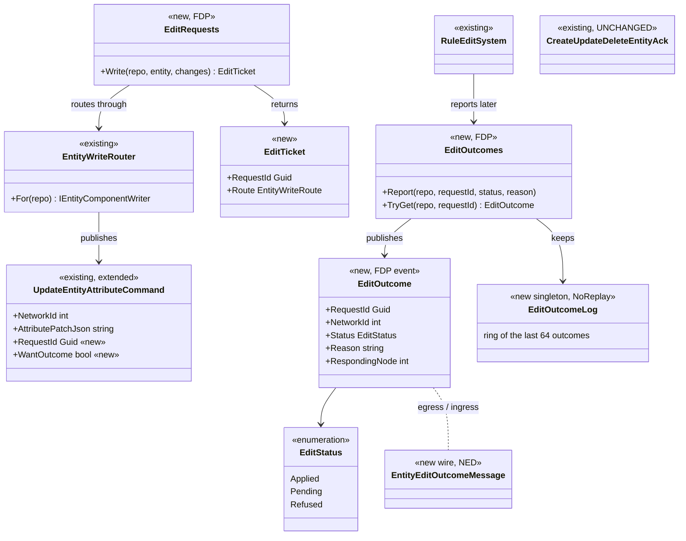
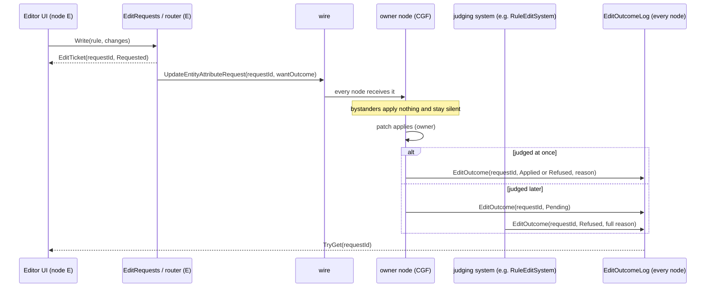
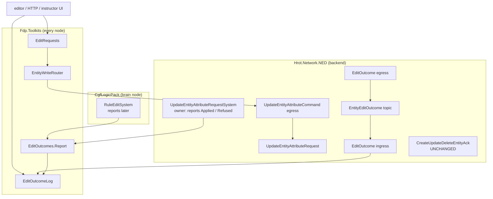

<!--STATUS
state: LIVE
updated: 2026-11-03
build-state: DESIGN — the sub-questions in §4 await the user (leans given)
current-answer: §1 inventory · §2 the diagrams · §4 the sub-questions with leans
stale-below: nothing
known-rot: none
known-conflict: none
related-designs:
  - docs/DESIGN_Cgf_AxisB_Rotation_Slice.md — OWNS the write router (§11.3: apply here or ask the owner) that every remote edit goes through; this design adds the ANSWER
  - docs/DESIGN_Entity_Creation_Unification.md — OWNS the creation request and its ack (§3.4d); ⛔ that ack and CreateUpdateDeleteEntityAck stay as they are (R-2082)
  - docs/DESIGN_Scenario_Rules.md — §00.11a the rule live edit (RuleEdit 433) and RV-5 rule control: the first two users of the outcome
  - docs/DESIGN_Rules_View_UI.md — §7 RE-7: the editor shows a refused live edit under the field it names
  - docs/DESIGN_Entity_Brain_View.md — the brain journal (never on the wire), which keeps its own "edit refused" entry
-->

# DESIGN — the outcome of a remote edit *(behaviors, `CE-2380`, R-2082)*

🔒 User, `2026-11-03`: *"That kind of acknowledgement message needs to be left as is. We need to create another one which fulfills the need for
any kind of UI edits. Made remotely."* (R-2082)

**The problem.** An edit made in a UI on one node (the editor, an instructor station, the HTTP API) reaches the entity's owner through the write
router, and the owner applies or refuses it — but **nothing tells the editing node which.** The rule live edit squeezes its refusal into the
rule's 64-character status `Reason`; every other remote edit is silent.

## 1. INVENTORY *(2026-11-03; `scripts/cbm.sh search_graph` name_pattern `.*(EntityWriteRouter|WriteRoute|AttributeChangeRequests|PublishOnto|TryPublishJsonPatch).*` → 24 results; `search_graph` name_pattern `.*(Ack|Reply|Result|Outcome|Response|Refus|Reject).*` label Class; grep of every production caller; `check_index_coverage` not available through the CLI)*

| what | where | role here |
|---|---|---|
| `EntityWriteRouter.For(repo).Write(entity, changes)` | `FDP/…/Replication/Attributes/EntityWriteRouter.cs` | ⭐ THE one remote-edit path: apply here when this node owns it, else publish a request. Returns only `Direct / Requested / Refused` (local) |
| `EntityAttributeChangeRequests.TryPublishJsonPatch` | `…/EntityAttributeChangeRequests.cs:90` | the JSON arm of the same path |
| `UpdateEntityAttributeCommand { NetworkId, AttributePatchJson, binary changes }` | `FDP/…/Replication/Events/UpdateEntityAttributeCommand.cs:28` | the FDP-internal request; ⛔ no request id |
| `UpdateEntityAttributeRequest { RequestId, EntityId, …, RequireAck }` (wire) | `Hrot.Network.NED/GenericMessages.cs:264` | the egress mints a fresh `RequestId` and sends `RequireAck = false` (`…EgressTranslator.cs:100-104`) |
| `UpdateEntityAttributeRequestSystem` + `EcsPatchContext` | `Hrot.Network.NED/Systems/…` · `FDP/…/Patching/EcsPatchContext.cs:197` | every node receives the request; each applies what it owns and **records the rest as "refused" (not its own)** ⇒ a bystander's refusal is normal, not an answer |
| `CreateUpdateDeleteEntityAck` + `IUpdateEntityAttributeAckSink` | `GenericMessages.cs:294` · `Systems/IUpdateEntityAttributeAckSink.cs` | ⛔ **left as is (R-2082)**: status code + component bitmask, for external requesters |
| `RuleCommands.Control / Edit` | `FDP/…/ScenarioRules/RuleCommands.cs:22,37` | rule control and the live edit, through the router, with the rule's own `Seq` |
| `RuleEditSystem` | `Hrot.AI.Behaviors/Brains/Objectives/RuleEditSystem.cs:30-50` | judges a live edit LATER (held while the trigger acts, R3) — the verdict is not known when the patch lands |
| other production callers | `ScenarioToolRegistrations.cs:219` (map drag) · `ScenarioClockEdit.cs:53,69` · `DebugApiService.cs:3034` (`PATCH` an entity) · `MacroExpansionSystem.cs:493` · `HostileActs.cs:86` | UI edits (drag, clock, HTTP) and two non-UI ones (macros, hostile acts) |

⇒ **No outcome message exists** apart from the ack R-2082 keeps. The request already carries a `RequestId` on the wire.

## 2. The diagrams

*What the picture shows that prose hid: the request side only GAINS two fields on the existing internal command; the answer is a separate
event + message, and the existing ack is untouched.*

*What the picture shows: only the OWNER answers (every node receives the request), and a deferred judge answers with the SAME request id.*

*What the picture shows: who calls what each frame — the owner's request system and the deferred judges are the only reporters; every node's
log is filled by the ingress, so the UI on any node reads its own world.*

## 3. What stays as it is

| | |
|---|---|
| `CreateUpdateDeleteEntityAck`, `RequireAck`, the creation ack | ⛔ untouched (R-2082) |
| `EntityWriteRouter.Write` and its callers | unchanged; `EditRequests.Write` is a thin entry that also returns the request id. Callers that do not care (macros, hostile acts) keep calling the router and get no outcome |
| the rule status `Reason` and the journal's "edit refused" entry | stay (short text for the HUD and the rules view; the journal for the Brain tab) |

## 4. The sub-questions *(leans; the user decides)*

| # | question | ⭐ lean | why / blast radius | rejected |
|---|---|---|---|---|
| **A** | when does the owner answer? | ⭐ **only when the request asks** (`WantOutcome`) — UI edits ask, macros and hostile acts do not | no traffic for the non-UI writes; one new bool on the internal command and on the wire request (additive) | always answer: every macro patch would send a message nobody reads |
| **B** | who answers? | ⭐ **the node that applied at least one component, or that owns the entity when nothing applied** | every node receives the request and each "refuses" what it does not own (`EcsPatchContext.cs:197`) — a bystander answering would report a false refusal | every receiving node: N answers, all but one wrong |
| **C** | an edit judged later (the rule live edit, rule control) | ⭐ **the owner answers `Pending` at once; the judge answers the final verdict with the same request id** — the record the judge reads (`RuleEdit`, `RuleControl`) carries the `RequestId` it came with | the request id must reach the judge: the attribute handlers store it on the record they write. `RuleEdit` / `RuleControl` gain one field each | the judge answers alone: the UI cannot tell "slow" from "lost" |
| **D** | where does the requesting UI read it? | ⭐ **a small ring on every node (`EditOutcomeLog`, last 64, `NoReplay`)**, filled by the ingress, plus the bus event | the editor reads its own world (`EditorSubsystem.cs:293`) — the outcome must be IN that world; a ring is unmanaged-friendly | only a bus event: a UI that polls once a frame can miss it |
| **E** | the reason's size | ⭐ **a `string` on the event and the message, capped at 1 000 characters** | a message, not a recorded component (CLAUDE.md's unmanaged rule is for recorded components); the ring keeps a fixed-size copy (`FixedString512`) | `FixedString64` like the status: the cut that started this |
| **F** | a local (owned) edit | ⭐ **the same outcome, reported at once** — the UI uses one API whether or not this node owns the entity | `--mode all` and a lone editor own their entities | a different path for local edits: two code paths in every UI |

**Build order once approved:** ① FDP: `EditRequests`, `EditOutcome`, `EditOutcomes`, `EditOutcomeLog` + rails · ② NED (backend's project, cross-lane, said in the
commit): the two fields on the request, the outcome topic, egress + ingress, the owner's report in `UpdateEntityAttributeRequestSystem` · ③ rules: `RuleEdit`
/ `RuleControl` carry the request id, `RuleEditSystem` and `TriggerBehavior.Control` report · ④ the HTTP `POST /objectives/{id}/edit|control` and `PATCH
/entities/{id}` answer with the request id and `GET /edits/{requestId}` reads the log · ⑤ a note to ui (the editor's Apply reads the outcome).
