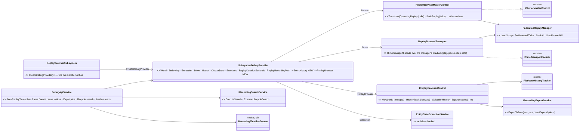
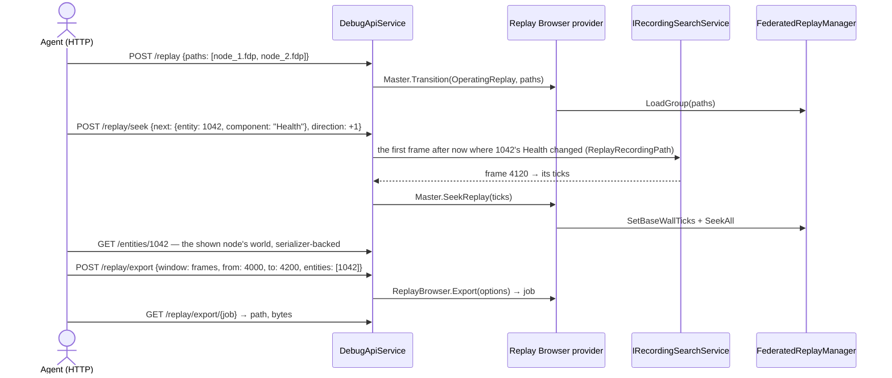
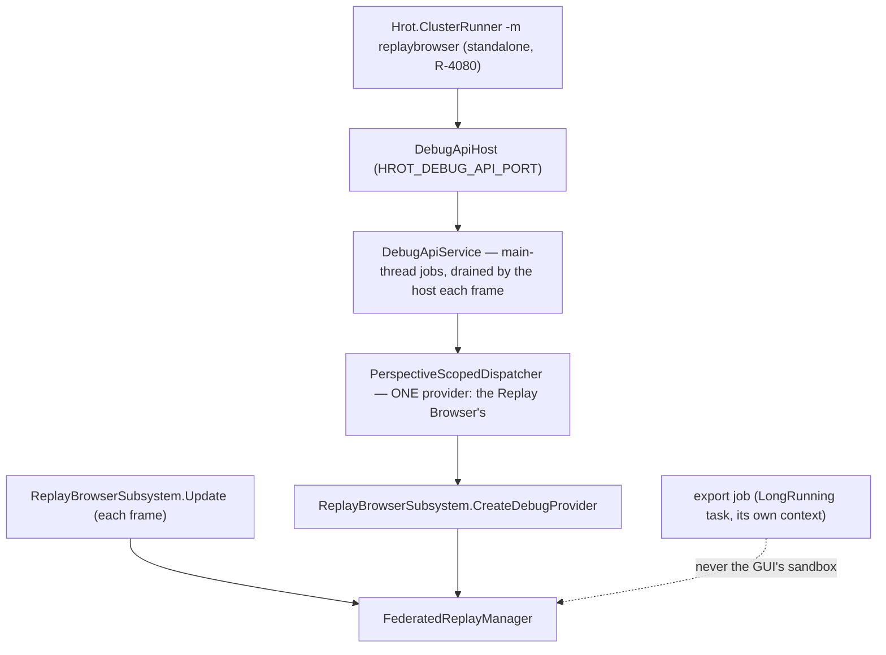
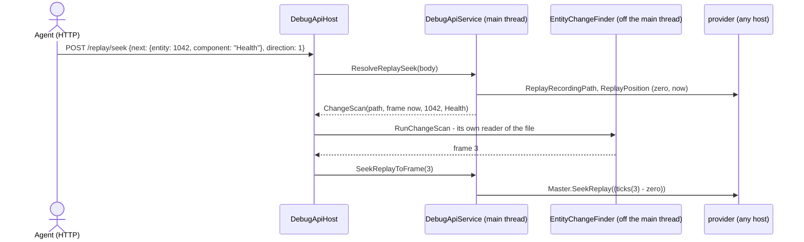

<!--STATUS
state: LIVE
build-state: BUILDING — steps 1–3 (RB-1…RB-5) BUILT 2026-10-26, as-built in §7; R-4080, R-4081, R-4083 (RB-7, POST /selection reopened) ruled; RB-1…RB-6, RB-8 leans
updated: 2026-10-26 (§7.3 step 3 as-built — view, histories, export jobs) · 2026-10-26 (§7.2 step 2 as-built — the seek forms on every host, lifecycle search, /events; the lifecycle search's network-id defect fixed) · 2026-10-26 (§7 step 1 as-built — backend) · 2026-10-26 (R-4083: POST /selection reopened, RB-7) · 2026-10-26 (R-4082: built by ONE lane, backend — the ui handoff withdrawn unstarted) · 2026-10-26 (first version — coordinator, from the user's request after backend's R-3053…R-3055 left the Replay Browser with no HTTP control)
current-answer: §0 rulings and leans · §1 before / now / needed · §2 the feature map · §3 UML · §4 claim table · §5 INVENTORY · §6 build · §7 as-built (where it deviates from §3)
stale-below: none
known-rot: none
known-conflict: none
related-designs:
  - DESIGN_Http_Control_Through_The_Cluster_Master.md — OWNS the route table every host answers (R-3053…R-3055); this design makes the Replay Browser answer the SAME routes and adds only what no other host has. Built by the same lane, backend (R-4082)
  - designs/replay-browser-2/DESIGN.md — OWNS the Replay Browser itself (its sandbox, federation, search, diff, export, histories) — the features this design exposes
  - DESIGN_Agent_Shared_View.md — OWNS the readers of one unit (brain, journal, view, selection) and R-1029's value review that withdrew POST /selection (RB-7)
  - DESIGN_Director_Timeline_Editor.md — OWNS the timeline index and its lanes (R-4073, R-4079) that GET /timeline/* reads
  - Predicate-Infrastructure-Capabilities.md — OWNS the condition model /replay/search and seek-to-next-change run on
-->

# The Replay Browser over the AI debug HTTP API — every feature, through the shared routes

🔒 **User, `2026-10-26`:** *"backed unified the replay control across hosts which likely broke the replay browser ai http control; we of
course still need the replay browser to be controllable via ai debug http … preferrably using the existing api as replay broser should need
just a few specific things (like seek to next change) which is not supported by usual replay in other hosts"* · *"--mode all is not meant to
include replay browser. Replay browser is always a standalone offline host. the export to json should be added as well, no replay browser
feature should be excluded from ai debug http api"*.

## 0. Rulings and leans

| # | | |
|---|---|---|
| ✅ **R-4080** | **The Replay Browser is always a standalone, offline host** — never composed with other subsystems (already enforced: `HrotRunnerConfiguration.cs:249-257`). ⇒ in its process its debug provider is the only one, so no "any node" fallback can confuse it with a cluster | user |
| ✅ **R-4081** | **Every Replay Browser feature is reachable over the AI debug HTTP API — JSON export included, none excluded — through the SAME routes other hosts answer wherever the meaning is the same; new routes only for what no other host has** | user |
| ⭐ RB-1 | **The Replay Browser fills the provider members the shared routes already read**: `Master` (an `IClusterMasterControl` over its `FederatedReplayManager`: `Transition` to `OperatingReplay` opens, to `Idle` closes, `SeekReplay` seeks; the rest refuse), `ClusterState` (Idle / OperatingReplay), `Exercises` (what it can open on disk), `ReplayDurationSeconds`, `ReplayRecordingPath` (the shown node's file), `Drive` (play / pause / step / timescale), `Extraction` (⭐ serializer-backed — it holds `_scenarioSerializer` and does not pass it today: the silent-default pattern, CE-171's reflection fallback) | a second, Replay Browser-only route family — two ways to say "seek" |
| ⭐ RB-2 | **optional fields on existing routes, resolved once for every host**: `POST /replay {path \| paths}` (a file or a node group not in the inventory — a cluster host refuses) · `POST /replay/seek {frame}`, `{frames: ±n}` (step back, rewind = `{frame: 0}`), `{next: {entity, component?}, direction}` (next / previous change), `{next: {lane}, direction}` (next event in a timeline lane), `{cause: {frame, entity}}` (the causality jump) — the forms that are LOOKUPS over the recording resolve to a time in the debug service, then the ordinary seek; so they work on a cluster replay too | per-host resolution — the cluster hosts would never get them |
| ⭐ RB-3 | **one Replay Browser-only seam for what only it has**: `IReplayBrowserControl` on the provider — `View(node \| merged)`, `History(back \| forward)` (the playback waypoints), `Export(options) → job`, `SelectionHistory(back \| forward)` | each as a field on a shared route — they have no meaning on a cluster host |
| ⭐ RB-4 | **JSON export as a job**: `POST /replay/export {window: full \| frames \| time, from, to, format: absolute \| changelog, entities?: [ids], includeEntities, includeEvents, minified, epsilon}` → `{job}`; `GET /replay/export/{job}` → state, path, bytes. It runs `IRecordingExportService.ExportToJson` off the main thread as the panel does (`LongRunning`), never on the GUI's sandbox | a synchronous route — an hour's recording blocks the request |
| ⭐ RB-5 | **the gaps in shared routes, closed for every host**: `POST /replay/search` gains the LIFECYCLE mode (`ExecuteLifecycleSearch`; today only `ExecuteSearch`) · `GET /events` reads the active provider's event history (a provider member; today only the editor's) — in the Replay Browser the recorded events at the current frame | — |
| ⭐ RB-6 | **timeline reads for every host with an index**: `GET /timeline/lanes`, `GET /timeline/events?lane=&from=&to=&entity=`, `POST /timeline/lanes {IndexedLaneDefinition}` (a user's lane — the catalogue's existing `Register`) | the agent scanning the file for what the index already holds |
| ✅ RB-7 — **R-4083** | **`POST /selection {entity}` REOPENED, on every host — through the UI's own request path** (`SelectEntityCommand` → `SelectionRequestSystem`, the click's path; ⛔ never a direct `SelectionState` write, AV-4's rejected alternative); the selection history (RB-3) rides on it. 🔒 User: *"Reopen rb 7 if the feature makes sense"*. ⭐ **Why it makes sense** (measured): the agent's OWN work needs no selection — every selection-driven panel takes an explicit id over HTTP (§2) — but POINTING THE OPERATOR at a unit does: `/entities/{id}/focus` only centres the camera (`DebugApiService.cs:1838` publishes `CenterOnEntityCommand`), while the Replay Browser's inspector, diff and seek-to-change follow the SELECTION ⇒ after *"look at 1042 at frame 4120"* its panels still show the old unit. No route answers that ⇒ it passes AV-13's value test that withdrew it | keep it withdrawn — the operator's panels could not be pointed at the unit an agent means |
| ⭐ RB-8 | **the map routes the other hosts answer, answered here too**: `GET /view`, `POST /view/follow`, `POST /entities/{id}/focus`, `GET/POST /map/layers`, `POST /entities/{id}/debug` (the map menu's pins and AI trace) | — |

## 1. Before, now, needed

| | before `a5b0a922f` | now | needed |
|---|---|---|---|
| where replay ran | a SECOND copy of the Replay Browser engine inside the editor's debug service (`/replay/load` … a private sandbox) | the cluster master on every host (R-3054); the private copy retired | ⭐ the Replay Browser itself — its provider fills the shared members (RB-1) |
| the Replay Browser app | reads only (world, entity map, gizmos) — ⛔ never controllable | the same; every control route fails there (no master, no drive, no state) | RB-1 … RB-8 |

## 2. The feature map — every Replay Browser feature → its route

| feature (panel) | route | kind |
|---|---|---|
| open a file / a node group (Timeline, Federation) | `POST /replay {path \| paths}` · `GET /exercises` | shared + field |
| close | `POST /replay/stop` | shared |
| status: frame, frames, span, nodes, view, rate | `GET /replay/status` (+ those fields) | shared + fields |
| play, pause, rate | `POST /sim/play`, `/sim/pause`, `/sim/timescale` | shared (`Drive`) |
| step forward | `POST /sim/step` | shared (`Drive`) |
| step back, rewind, slider | `POST /replay/seek {frames: -1}`, `{frame: 0}`, `{frame}` / `{atSeconds}` | shared + fields |
| back / forward (playback history) | `POST /replay/history {back \| forward}` | Replay Browser only |
| next / previous change of an entity (Diff) | `POST /replay/seek {next: {entity, component?}, direction}` | shared + field |
| the component diff (Diff) | `POST /diff/capture` → seek → `POST /diff/compare` | shared |
| causality jump (Event browser) | `POST /replay/seek {cause: {frame, entity}}` | shared + field |
| events at the frame (Event browser) | `GET /events` | shared (gap closed, RB-5) |
| search — every mode, results seek + select (Search) | `POST /replay/search {condition}` · `{lifecycle}` | shared (gap closed, RB-5) |
| inspector: entities, components | `GET /entities`, `GET /entities/{id}` | shared (serializer-backed, RB-1) |
| brain, journal, history | `GET /entities/{id}/brain`, `/journal`, `/journal/history` | shared |
| single node / merged view (Federation) | `POST /replay/view {node \| "merged"}` | Replay Browser only |
| entity selection and its back / forward | `GET /selection` · `POST /selection` (RB-7, R-4083) · `POST /selection/history {back \| forward}` | shared / Replay Browser only |
| JSON export, every option (Timeline) | `POST /replay/export {…}` · `GET /replay/export/{job}` | Replay Browser only |
| Event Timeline: lanes, events, user lanes | `GET /timeline/lanes`, `GET /timeline/events`, `POST /timeline/lanes` | shared (RB-6) |
| the map: camera, follow, centre, layers, pins / AI trace | `GET /view`, `POST /view/follow`, `POST /entities/{id}/focus`, `/map/layers`, `POST /entities/{id}/debug` | shared (RB-8) |
| what this host can do | `GET /capabilities` | shared — reports the Replay Browser's cells |

## 3. UML


*What the picture shows that prose hid: the Replay Browser plugs into the SAME provider seam every host fills — the routes do not know it
is there. Only `IReplayBrowserControl` is its own, and it holds just the four things no cluster host has.*


*What it shows: a Replay Browser-specific request ("next change") is a LOOKUP followed by the ordinary seek — the same two steps a cluster
host would run — so no host needs its own seek.*


*The module view: one provider, so every "any node" fallback lands on it by construction (R-4080). The export runs on its own context, as
the panel's export does.*

## 4. Claim table

| claim | code — how it IS | design — how it was MEANT |
|---|---|---|
| the shared routes read provider members the Replay Browser does not fill | ✅ `ISubsystemDebugProvider.cs:61-90`; `ReplayBrowserSubsystem.CreateDebugProvider` fills world, entity map, gizmo buffer only | ✅ HTTP-through-master §3 (one seam per host) |
| the debug service prefers the active provider and falls back to any node for cluster facts | ✅ `PerspectiveScopedDispatcher.cs:205-244` | ✅ Q54-2 · ⇒ harmless here: one provider (R-4080) |
| the Replay Browser is refused in a combined run | ✅ `HrotRunnerConfiguration.cs:249-257` | ✅ R-4080 |
| the old surface was a second engine copy in the debug service | ✅ `a5b0a922f^` `DebugApiHost.cs:1081-1157` (load, seek, step ±, status, entities, unload, brain, journal, history, selection, search over a private `ReplayBrowserContext`) | ✅ retired by R-3054 |
| the browser seeks through its manager | ✅ ui's D1 (`ReplayTimelinePanel.cs:539-543`, `FederatedReplayManager.cs:125-183`) | ✅ Timeline design §9 |
| `/replay/search` runs no lifecycle search | ✅ `DebugApiService.Brain.cs:278` calls `ExecuteSearch` only; `IRecordingSearchService.ExecuteLifecycleSearch` exists | ✅ replay-browser-2 §6.3 (both) |
| `/events` reads the editor's history only | ✅ `_editorEventHistory ?? throw NotSupportedHere("events.read")` | ⛔ searched, no design for other hosts' event history |
| dumps fall back to reflection without a provided extraction | ✅ `DebugApiService.cs:293-310` (CE-171) | ✅ CE-171 |
| export options | ✅ `JsonExportOptions.cs:9-27` (window, format, frames, times, selection, entity, entities, events, minified, epsilon) | ✅ replay-browser-2 §3 |
| the causality jump is a seek to the event's frame + 1 with the target selected | ✅ `ReplayBrowserSubsystem.ExecuteCausalityJump` | ✅ replay-browser-2 §4.7 |

## 5. INVENTORY

```
scripts/cbm.sh search_graph name_pattern=".*(DebugProvider|DebugSurface|MasterControl|ReplayRecordingPath).*" → ISubsystemDebugProvider,
   IProvidesDebugSurface, SubsystemDebugProvider; CreateDebugProvider on CGF, SimHost, IG, ExCon, Orchestrator, Traffic, Stride, ReplayBrowser
grep: IClusterMasterControl + OrchestrationBusMasterControl (the one implementation), PerspectiveScopedDispatcher (AnyNode members),
   DebugApiService.Master.cs (EnterReplay, SeekReplayTo, StopReplay, GetReplayStatus), DebugApiService.Brain.cs (SearchReplay, journal history),
   the old /replay/* routes at a5b0a922f^, ReplayBrowserSubsystem windows (ReplayTimelineWindow, EventTimelineWindow, ComponentDiffWindow,
   ReplaySearchWindow, FederationWindow) + EventBrowserPanel, EntityInspectorPanel, PlaybackHistoryTracker, EntitySelectionHistory,
   ExecuteCausalityJump, SetViewMode, JsonExportOptions, IRecordingExportService
check_index_coverage is not available through the CLI ⇒ these lists are not proof of completeness
```

## 6. Build — ONE lane, the BACKEND lane (R-4082)

🔒 **User, `2026-10-26`:** *"Ui id not building anything niw. Better if all http stuff handle by a single lane."* · *"Wait it is nit visual so lets give it to backend"* — ⭐ every step below, the map and selection routes included; handed over as [HANDOFF_Coordinator_To_Backend_Replay_Browser_Http](blueprints/batches/HANDOFF_Coordinator_To_Backend_Replay_Browser_Http.md). ⛔ The ui handoff of the same work is WITHDRAWN (it was never started).


| step | builds | accepted when |
|---|---|---|
| **1** | RB-1: the provider members (master control, transport, state, exercises, duration, recording path, serializer-backed extraction) | `POST /replay {path}`, `/replay/seek {atSeconds}`, `/sim/*`, `GET /entities/{id}` drive and read a `-m replaybrowser` host; a typed component dumps as its DTO, not `FixedElementField` |
| **2** | RB-2 seek forms + RB-5 (lifecycle search, `/events`) | every row of §2 marked "shared" answers on the Replay Browser; the lookups also resolve on the editor's own replay |
| **3** | RB-3 + RB-4: view, histories, export jobs | §2's "Replay Browser only" rows answer; an export's file equals the panel's for the same options |
| **4** | RB-6 timeline reads · RB-8 map routes · RB-7 if the user reopens it | the whole §2 table answers; the MCP catalog and skill regenerated (R-1030) |

## 7. As-built *(backend, `2026-10-26`)*

### 7.1 Step 1 — RB-1, the provider members

| as built | where | why / deviation |
|---|---|---|
| the provider fills `Master`, `Drive`, `ClusterState` (Idle / OperatingReplay), `Exercises`, `ReplayDurationSeconds`, `ReplayRecordingPath`, a serializer-backed `Extraction` and the new `ReplayBrowser` seam | `ReplayBrowserSubsystem.DebugSurface.cs` (`BuildDebugProvider`) | as §3. ⭐ `Extraction` is rebuilt per world (every seek rebinds it) over the host's own `ScenarioSerializer` (CE-171) |
| `ReplayBrowserMasterControl`: `OperatingReplay` opens an exercise **found on disk** (none named ⇒ the newest, as a cluster master picks), then seeks `TargetWallTicks` after the zero; `Idle` closes; `SeekReplay` seeks; storage / checkpoint / cancel / dump refuse with a reason | same file | ⭐ the debug service now turns a master's `InvalidOperationException` into the route's error (`DebugApiService.Master.cs` `PublishTransition`, `SeekReplayTo`) — a master that acts in place can say why it refused |
| ⚠ **DEVIATION** — `POST /replay {path \| paths}` goes through `IReplayBrowserControl.Open(paths, atSeconds)`, not `Master.Transition(OperatingReplay, paths)` | `DebugApiService.OpenRecordingFiles` | ⛔ `TransitionStateIntent` is the cluster's wire intent and carries no paths (`ClusterOpIntents.cs:11-22`); adding them would put files on a message every master reads. ⭐ The route is unchanged (RB-2); a host with no `ReplayBrowser` seam refuses a path |
| the exercises on disk: `RecordingGroupInventory.Scan(stagingRoot)` — every `nodes/node-N/exercises/<id>/*.fdp` and `shared/exercises/<id>/*.fdp`, grouped by the **sidecar's** exercise id, one file per node (a local copy wins over its archived twin) | `Fdp.Toolkits/ReplayBrowser/Federation/RecordingGroupInventory.cs` | ⭐ beside `FederatedReplayManager`, whose `LoadGroup` validation it mirrors. ⛔ `StorageGatewayModule.ScanNasExercises` lists ids only (no node files) and lives in the orchestrator |
| the replay's zero = the earliest first frame across the loaded nodes; `atSeconds` / `TotalTime` = seconds after it | `ReplayZeroTicks`, `SeekToSeconds` | the cluster's C9 meaning (`DebugApiService.EnterReplay`) |
| ONE play state: the timeline panel's when there is one, else the headless host's; playback (`Update`) runs headless too | `IsPlaying` / `PlaybackRate` | ⭐ an agent drives a `--headless` Replay Browser; ⛔ before, the frame loop ran only with a window |
| ONE open path: the timeline panel's `OnLoadGroup` and `POST /replay` both call `OpenGroup`; `ReplayTimelinePanel.SetManager(null)` on close | `ReplayBrowserSubsystem.cs` | ⚠ cross-lane edit (ui's panel, one signature) |
| `GET /replay/status` gains `browser: {exerciseId, frame, frames, atSeconds, spanSeconds, primaryNode, view, playing, rate, nodes[]}` on the Replay Browser, `null` elsewhere | `IReplayBrowserControl.Status` | RB-2's status fields |
| capability `replay.browser` | `DebugCapabilities.ReplayBrowser` | measured from the seam being wired |

Rails: `ReplayBrowserSubsystemTests.RB1_*` (a recorded two-node exercise on disk, driven only through the provider: open by inventory, seek, step,
play headless to the end, rate, refuse storage, close), `RB2_*` (open by path at a moment; a mismatched group refused);
`TheClusterControlRoutesTests.RB1_*` / `RB2_*` (a cluster host refuses a path; a refusing master answers an error; the status field);
`TheDebugProvidersDoNotUnderReportTests.TheReplayBrowser_PassesTheMembersTheSharedReplayRoutesRead` (8 rows).

### 7.2 Step 2 — RB-2 the seek forms, RB-5 lifecycle search and `/events`


*What the picture shows that prose hid: the whole-file scan never runs on the main thread or in the shown world, and the seek that
follows is the ordinary one — so the form works on the editor and a cluster node exactly as on the Replay Browser.*

| as built | where | why / deviation |
|---|---|---|
| ⭐ a new provider member `ReplayPosition` (the replay's zero and now, wall ticks) — the Replay Browser's federation, a cluster node's `ReferenceReplayLoadHandler.ReplayPosition` (the master's anchor, else its first frame; the replay clock), the editor's own recorder | `ISubsystemDebugProvider`, `EcsNodeDebugProvider`, `DebugApiService.ReplayPositionOrNull` | ⚠ not in §3's class diagram: a frame becomes `atSeconds = (ticks(frame) − zero)`, and only the host knows its zero. ⭐ It is shared, not Replay Browser-only — RB-2 asks the lookups to resolve on every host |
| `{frame}`, `{frames: ±n}` (from the frame shown now), `{cause: {frame, entity}}` (frame + 1; the entity is echoed — selecting it is `POST /selection`, step 4) resolve on the main thread and seek | `DebugApiService.ReplaySeek.cs` | as RB-2 |
| `{next: {entity, component?}, direction}` — a `ChangeScan` the host runs off the main thread in a reader of its own, then the seek; `{found: false}` when nothing changes that way | `DebugApiHost` `/replay/seek` | ⭐ ONE finder, `EntityChangeFinder` (`Fdp.Toolkits/ReplayBrowser/Diff`), extracted from the Diff panel's seek-to-change, which now calls it. ⭐ The dump is a `ScenarioSerializer`'s (CE-171): the reflection fallback collapses a fixed array to its first element and would miss a change past it |
| `POST /replay/search {lifecycle: {...}}` (or a condition with `"$type":"Lifecycle"`) — each matching unit's first and last frame | `DebugApiService.SearchReplay` | RB-5 |
| 🔴 **FOUND AND FIXED** — the replay search's lifecycle `NetworkId` mode compared the target with the entity's INDEX ("simplified … for test compatibility"); the live breakpoint had the right rule (BP-512). ⭐ ONE rule now, `LifecycleIdentity.IsNetworkId`, used by both | `RecordingSearchService.MatchesLifecycleCriteria`, `DataBreakpointManager` | ⛔ two implementations of one predicate had drifted; the HTTP form would have matched the wrong unit |
| `GET /events` reads the active provider's `EventHistory` (a new provider member) when the host keeps none of its own; `bus=world` includes a replayed world's `Replay` captures | `DebugApiService._eventHistory`, `GetEvents` | RB-5 |
| 🔴 **FOUND AND FIXED** — the Replay Browser's event history did not follow the shown frame: the federation seeks and steps with the history suppressed, so after the load its Event Browser panel showed frame 0's events at every frame. ⭐ Now a step adds the frame's events, a step back rewinds, a jump starts over (`CaptureEventsAtTheNewFrame`) | `ReplayBrowserSubsystem.DebugSurface.cs` | the panel's history and `GET /events` are the one history |

Rails: `TheClusterControlRoutesTests.RB2_*` ×3 (a frame, a step back and a causality jump resolve to their moment; `next` is a scan in its own
reader, forward / backward / none; refused outside a replay), `RB5_The_replay_search_has_the_Search_panels_lifecycle_mode` (red-proved: index
rule ⇒ no span), `ReplayBrowserSubsystemTests.RB5_*` (red-proved: no capture ⇒ frame 0 only); `TheNetworkIdPredicateAnswersTests` (the
breakpoint's rule, unchanged behaviour).

### 7.3 Step 3 — RB-3 the Replay Browser's own seam, RB-4 the JSON export

| as built | where | why / deviation |
|---|---|---|
| `POST /replay/view {view: "merged" \| "<nodeId>"}` — the Federation panel's switch (`SetViewMode`, `SetLocalEntitiesProvider`) | `IReplayBrowserControl.View` | RB-3 |
| `POST /replay/history {direction}` — the playback waypoints (the Timeline's ◀ ▶); `POST /selection/history {direction}` — the units selected; `GET /replay/status`'s `browser` carries `canGoBack` / `canGoForward` for both | `History`, `SelectionHistory` | ⭐ on a HEADLESS host the playback history moves the federation too (`WireHeadlessHistories`) — a windowed host wires it with its panels. ⚠ The selection history moves nothing headless yet: no selection systems run there (step 4, RB-7) |
| `POST /replay/export {window: full \| frames \| time, from, to, format: absolute \| changelog \| incremental, entities: [networkId], entityIndex, includeEntities, includeEvents, minified, epsilon, output}` → `{job, state, path}`; `GET /replay/export/{job}` → `{state: running \| done \| failed, path, bytes, error}` | `StartExport` | RB-4 — the Timeline panel's own call (`IRecordingExportService.ExportToJson` of the shown node's recording on a `LongRunning` task, never the GUI's sandbox). ⭐ `entities` are network ids resolved in the shown node's world, whose handles are the recording's. ⚠ `format` adds `incremental`, which the panel also offers (`ExportFormatMode`) and §0 RB-4 did not list |
| every other host answers these four routes `NOT_SUPPORTED_HERE(replay.browser)` | `DebugApiService.ReplayBrowser.cs` | §0 RB-3: no meaning on a cluster host |

Rails: `ReplayBrowserSubsystemTests.RB3_*` (node / merged view; the playback history back and forward, headless), `RB4_*` (⭐ the job's file is
byte-identical to the panel's export for the same options; bad window, unknown unit, unknown job), `TheClusterControlRoutesTests.RB3_*` (a cluster host
refuses all four; a malformed direction is told so).

