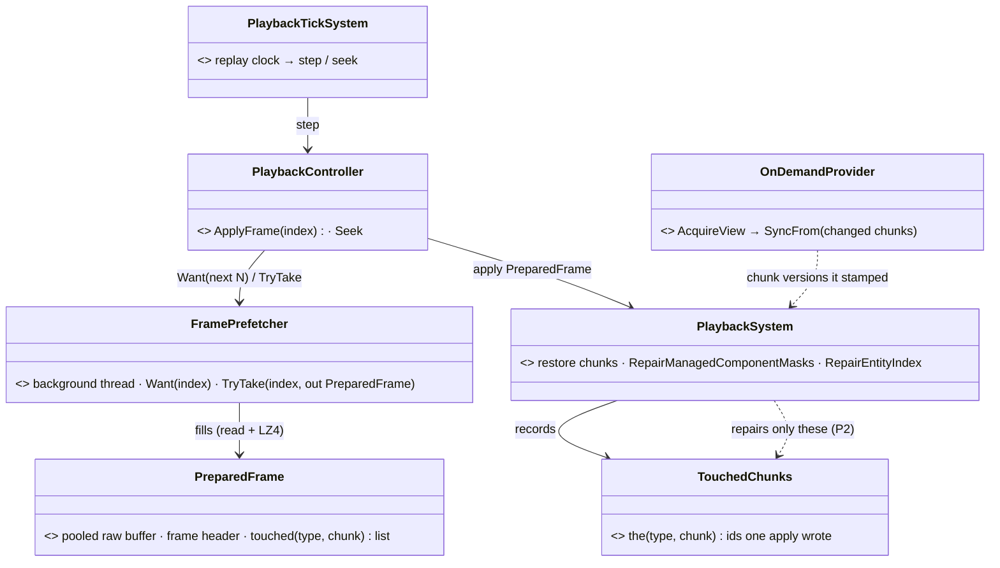
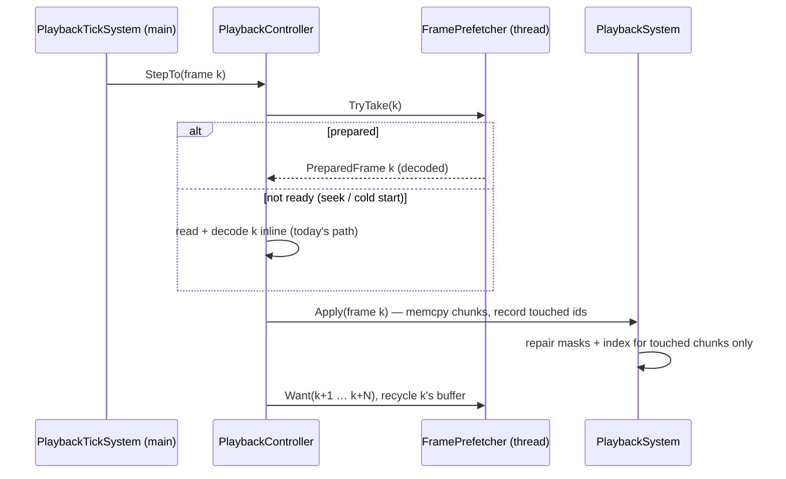
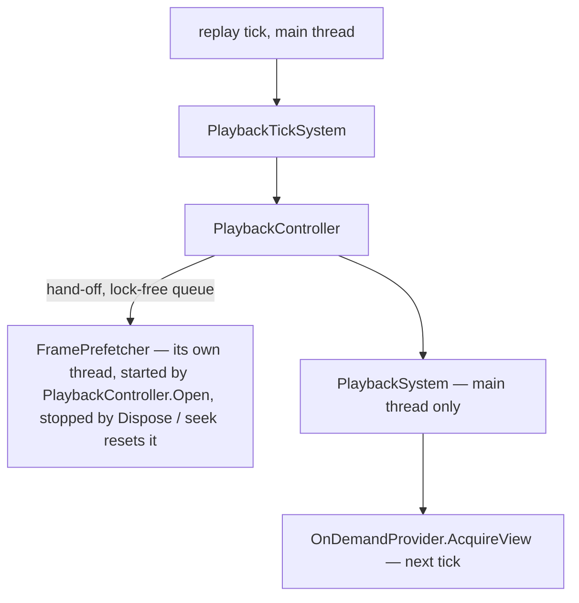

<!--STATUS
state: LIVE
build-state: BUILT — P1, P2, P4, P5, P6 (2026-11-11, as-built in §3a) · P3 not built (measure-gated, see §3a)
updated: 2026-11-11 (§3a as-built; Q1 decided)
current-answer: §3a AS-BUILT (read it first) · §2 the picture · §3 the phases (the plan) · §4 leans
stale-below: nothing
known-rot: none
known-conflict: FDP/Engine/docs/FDP-FlightRecorder.md DES-004 §5 says playback is "read, LZ4-decompress, ApplyFrame" synchronously — P1 SUPERSEDES that for playback
related-designs:
  - ../FDP/Engine/docs/FDP-FlightRecorder.md — OWNS the format (DES-001…011): deltas per changed chunk, keyframes, DES-006 §5.1 "touchedChunkIds → partial repair" (built here as P2)
  - DESIGN_Replay_Time_Axis_And_Review.md — §12q/§12s the changed-bytes rule and the paused frames; §12t the replay clock (PlaybackTickSystem)
  - designs/replay-and-modules/DESIGN.md — §2.1 which systems run in a replay (egress keeps running)
  - DESIGN_Checkpoint_And_Dry_Run_Restore.md — the running recording IS the checkpoint stream (R-3040): a format change (P6) touches restore
  - blueprints/batches/MEASURE_Ui_Replay_Frame_Cost.md — the measurements this design is built on (§1–§7)
-->

# DESIGN — replay playback that keeps up: prepare ahead, apply cheaply, copy only what changed (CE-1478, CE-4407)

🔒 User, `2026-11-11`: *"If the live mode can handle both calculating all the entities as well as recording in real time, then it would be weird if we couldn't
just replay the same stuff without calculating the entities … prepare some buffers in advance, read from disk, decompress, prepare, and then just quickly apply.
… This is unacceptable, the slowness."*

## 1. What was measured *(MEASURE_Ui_Replay_Frame_Cost.md; Linux, 4 cores, software GL — draw not representative)*

| | live running | live paused | replay playing | replay paused |
|---|---|---|---|---|
| frame | 2 000 ms (the sim) | 214 | 212 | 194 |
| update / draw / ui | 1 900 / 120 / 36 | 78 / 100 / 21 | 89 / 79 / 24 | 65 / 81 / 28 |

| replay-ONLY cost | size | cause (file) |
|---|---|---|
| read + LZ4 decode of a recorded frame | 12 ms median, 56 ms max, on the main thread | `PlaybackController.ApplyFrame` — DES-004 §5 synchronous by design |
| `RepairManagedComponentMasks` | **34 of 61 ms** apply; 15 ms on a frame with NO chunks | `PlaybackSystem` — walks every entity, not the touched chunks (DES-006 §5.1's partial repair never built) |
| `RepairEntityIndex` | 6.8 ms | same — whole index |
| the view copy after an apply (`OnDemandProvider.AcquireView` → `SyncFrom`) | ~110 ms on the tick after an apply | the restore stamps ~840 chunks as changed; only **5.4 %** of their 64-byte blocks differ |
| a recorded frame | ~58 MB raw (16 MB `BlueprintBlackboard4096`) | the delta's unit is the whole chunk's used prefix (DES-010 §5) |

| NOT replay-specific (same in live) | size |
|---|---|
| `StatelessGizmoSystem` | ~40 ms every tick, no change test |
| MapLayerAssignment + StyleResolution + MapCulling + CycloneEgress | ~15 ms every tick, no change test |
| `EntityCardRenderer.Layout` garbage | ~4 MB per frame |

⚠ The user's < 1 fps was the **Replay Browser** on the scale-1 recording; this was the editor's replay of demo-city. P5 measures the Replay Browser.

## 2. The picture

*What the picture shows that prose hid: the expensive halves (disk + LZ4) move to a thread the main loop never waits on, and both repairs read the
SAME touched list the apply already knows — nothing new walks the world.*

*The prefetcher is owned by the controller (one per open recording, every host — editor and Replay Browser — by construction); it never touches the world.*

## 3. Phases

| # | what | owner files | gate |
|---|---|---|---|
| **P1** | `FramePrefetcher`: a background thread reads + decodes the next N frames (N = 3, bounded memory: N pooled raw buffers grown to the largest frame) into `PreparedFrame`s; `ApplyFrame` takes a prepared one or falls back inline; a seek / reverse step flushes it | `Fdp.Core/FlightRecorder` (backend's — stated cross-lane) | read + decode leave the main thread: a rail times `ApplyFrame` with a prepared frame (no file / LZ4 on the caller's thread); 0 B steady; seek correctness rails unchanged (`Fdp.Core.Tests` FlightRecorder, `Fdp.Toolkits.Tests` replay) |
| **P2** | partial repair (DES-006 §5.1): `RepairManagedComponentMasks` + `RepairEntityIndex` over the apply's touched chunks only; a keyframe still repairs all | `PlaybackSystem` | 34 + 7 ms → measured; a frame with no chunks costs ~0; equivalence rail: partial repair == full repair over random deltas |
| **P3** | restore stamps a chunk's version only when its bytes differ (memcmp vs the table) — the view copy then copies only moved chunks | `PlaybackSystem` / the table's `RestoreChunk` | ⚠ only 3 % of chunks are identical ⇒ small win alone; ships with P6 or skipped (measure) |
| **P4** | ui's own garbage: `EntityCardRenderer.Layout` 0 B steady | ui | the 0 B rail |
| **P5** | measure the **Replay Browser** on a 1 000-man recording (the user's path) with the same split | — | a §8 in MEASURE |
| **P6** ✅ approved (Q1) | **block-level deltas** (format): record per changed 64-byte block (or per changed row) instead of the chunk's used prefix — ~20× smaller frames, decode, apply and view copy | `RecorderSystem`, `PlaybackSystem`, the format version | kept only if correct (replay, seek, checkpoint restore rails) AND measured faster (§4 Q1) |

## 3a. AS-BUILT `2026-11-11` (ui lane; supersedes the plan rows above where they differ)

| # | state · sha | measured (1 000-man recording, 5 647 entities; Linux 4 cores; MEASURE §8–§9) | deviation from §3 |
|---|---|---|---|
| **P1** FramePrefetcher | ✅ `8f8ee8100` · `Fdp.Core/FlightRecorder/FramePrefetcher.cs`, `PlaybackController` (lazy start on the first apply, own `FileShare.ReadWrite` handle, depth 3, `prefetchDepth` ctor arg, `HROT_REPLAY_PREFETCH`) | read + LZ4 decode (12 ms median, 56 max) leave the applying thread: every frame after the cold start / a seek is `prefetched` in the `[ReplayApply]` log | none; ⚠ the first delta after a keyframe is still inline (the worker aims at k+1 only after the keyframe's apply) |
| **P2** partial repair | ✅ `ab4ae2543`, fixed `ab540c431` | repair **74 → 7 ms** median in the Browser (apply 109 → 32 ms; the 91 frames play in 5.9 s instead of 11.7 s) | ⛔ **SUPERSEDES the plan's "walk the touched chunks" for the managed masks**: scanning every managed table over each restored MASK chunk cost 50–90 ms (500 000–800 000 pairs) — more than the whole pass — so only (managed table, chunk) the apply wrote are scanned; the rest of the win is skipping the ~500 000 DEAD index slots (`RepairEntityIndex`, the full mask pass gathers live entities once). The entity-index pass is partial over the restored hot / cold chunks + destroyed entities. A keyframe, the first apply onto a world and an apply that registered a table repair everything (`ForceFullRepair` forces it) |
| **P3** | ⏸ not built | — | the view copy is per CHUNK version; P6 does not change which chunks are touched (every changed chunk still stamps), so P3 stays measure-gated |
| **P4** | ✅ `44687dff3` · `EntityCardRenderer.Layout` | **0 B** once warm (was ~4.15 MB per frame): pooled `Card`s (now a class, valid until the next Layout), reused grouping arrays, cached strings / widths; `Draw(IReadOnlyList)` | `Card` is a pooled class, not a record |
| **P5** | ✅ `3e9a63bd2` · MEASURE §8 | the Browser: see §3a-bis | filed CE-1479 |
| **P6** block deltas | ✅ KEPT (format **v8**) · `ba74db0ae` + measuring switches | live recording of the same scenario: delta raw **55.6 MB → 8.1 MB** median (file 76 MB / 59 deltas → 44.6 MB / 73 deltas); recorder **main-thread cost 48 → 44 ms** median (no regression); replay apply **31 → 20 ms** median (prefetched, repair 7 both); worker decode of a frame ~7× fewer bytes | 64-byte blocks with run coalescing, not rows: the biggest type (a 4 096-byte row) moves ~1 % of its blocks (MEASURE §5), a row record would rewrite all of it. Entity-index chunks (3 % of a frame) and managed chunks stay whole. The first delta after a keyframe has no base ⇒ whole chunks (as before) |

### 3a-bis — the Replay Browser
Browser plays the 91 frames in **11.7 s → 5.9 s** (P1 + P2); apply 109 → 32 ms; the render frame that holds applies 1 615 → 682 ms. The remaining Browser-only cost is its pacing (CE-1479): one recorded frame per 1/60 s, up to 10 applies per render frame.

### 3a-ter — P6 format and rails
- **Format v8**: a component record inside a delta chunk entry may have type id `| RecorderSystem.BlockRecordFlag` (`0x40000000`; component ids are < 512, the entity-index ids −1/−2 are negative so a reader tests `typeId > 0`): payload `[totalBytes][runCount]{[firstBlock][blockCount][bytes]}`; the reader reads v6–v8 (`MIN_READABLE_FORMAT_VERSION` unchanged), a v7 build rejects v8 by version.
- Recorder: `RecorderSystem.BlockDeltas` (default on; `HROT_RECORD_BLOCK_DELTAS=0` for measuring), diff against the `_lastChunkBytes` the recorder already keeps (CE-3332), blocks past the old used-prefix length count as moved, a payload not smaller than the prefix falls back to the whole record. Playback: `PlaybackSystem.ApplyBlockRuns` copies runs in place (`IUnmanagedComponentTable.RestoreChunkRangeFromBuffer`), reading the payload straight from the frame's `MemoryStream` buffer.
- Rails: `BlockDeltaTests` (block recording == whole-prefix recording of the same seeded session at every frame and through 20 random seeks; smaller raw deltas, v8 header), `PartialRepairTests`, `FramePrefetcherTests`, `Map3DGizmoTests.P4_*`.
- ⚠ **Not red-provable**: the entity-index partial revival path and the hot-chunk mask scan (dropped) — the recorder always rewrites a cold chunk with its hot chunk, so no recording reaches a state where they differ from the full repair; documented in `RepairManagedComponentMasksPartial`.

## 4. Leans (the user reviews)

| | question | lean | why / blast radius |
|---|---|---|---|
| **Q1** ✅ | P6 block-level deltas? | **APPROVED as an experiment** (user `2026-11-11`: *"File format change is no issue. feel free to try the approach. Just the final decision is about if it still works and if it works faster."*) — kept only if replay, seek and checkpoint restore stay correct AND it measures faster; built after P1–P2 | the biggest structural win (5.4 % of bytes change), but: the format is strict (DES-008 exact match) ⇒ older recordings need a reader for the old format or become unreadable; the running recording is the checkpoint stream (R-3040) ⇒ checkpoint / dry-run restore move with it; the recorder's main-thread cost rises (a block diff per chunk) — measure on live |
| **Q2** | the generic per-tick costs (gizmo pass 40 ms, layer / style / culling / egress 15 ms) — change-gate them? | **yes, as their own item (not replay's)** | they cost the same in live paused; gating on chunk versions helps live and replay alike — a separate design (owners: ui gizmos, the map layers) |
| **Q3** ✅ accepted | prefetch depth | **3 frames** | 3 × ~60 MB raw = bounded; a keyframe (≤ 112 MB) may grow one buffer — pooled, never shrunk |
| **Q4** ✅ accepted | does a replay start playing by itself? | **no** (CE-4407's lean) | the user starts it |

## 5. INVENTORY *(2026-11-11)*

`search_graph` Class `.*(Playback|Recorder|Prefetch|FrameCache|OnDemandProvider).*` — the replay core: `PlaybackController`, `PlaybackSystem`, `PlaybackTickSystem`
(Hrot.Common), `RecorderSystem`, `AsyncRecorder` (the recorder's double buffer + LZ4 worker — the precedent P1 mirrors), `OnDemandProvider`. ⛔ No playback prefetch,
decode-ahead or frame cache exists (also searched in `docs/`, `.dev/`, FDP docs: none — design sweep 2026-11-11). `WorldSnapshotRing` is the UNDO ring, not a replay buffer.
