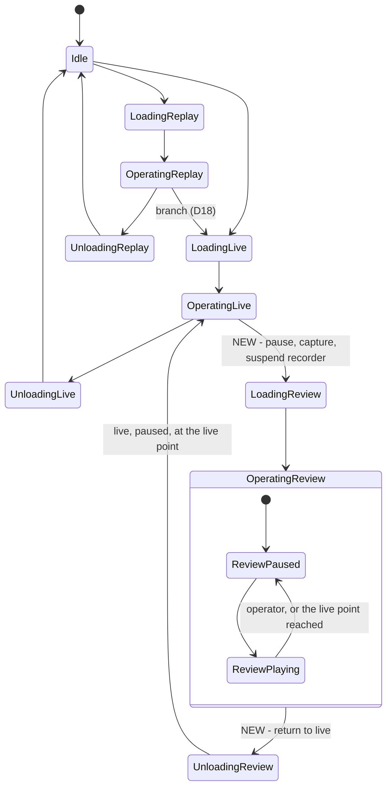
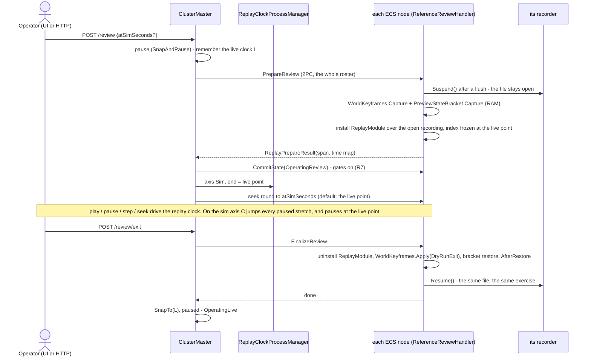
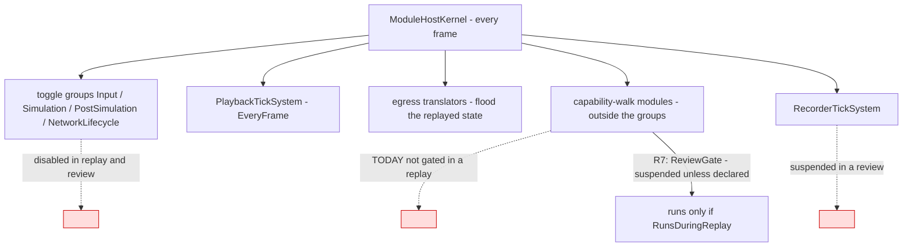
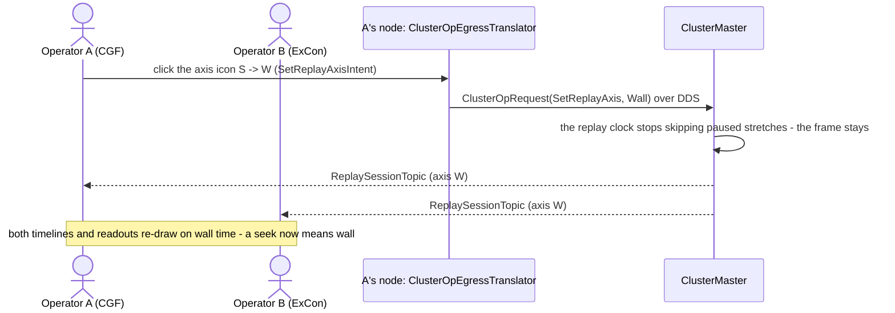
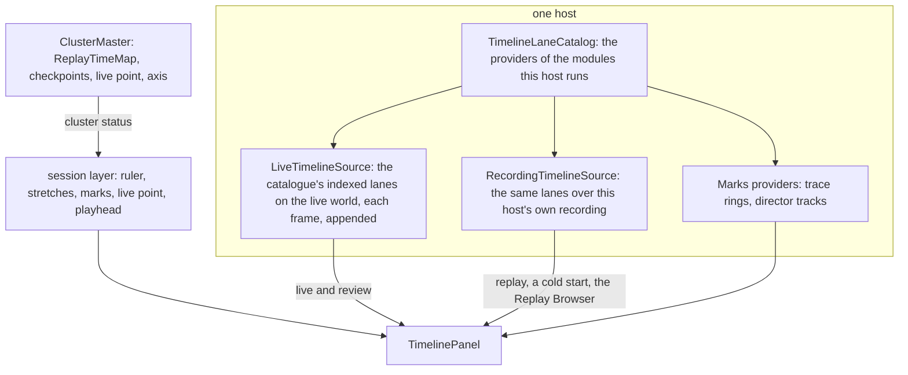
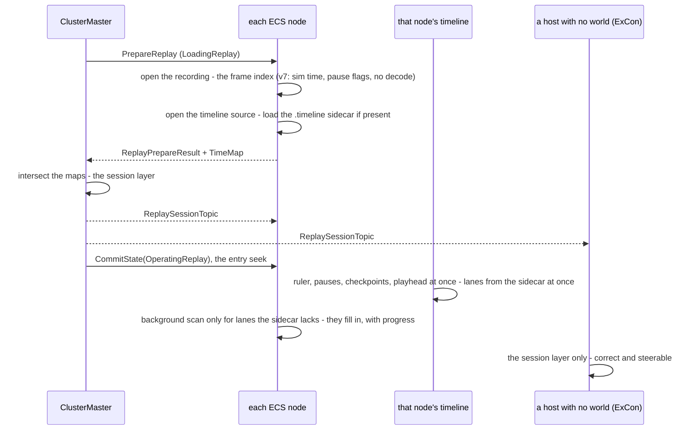

<!--STATUS
state: LIVE
build-state: DESIGN — ⛔ NOT READY-TO-BUILD: §11 (critical review, 4 blockers, 11 major) — D-A…D-H await the user, then R4 / R6 / §3c / §3b / §7 amended. Principles ⭐ APPROVED 2026-10-26 (R-3057: R1…R12; R-3058: the axis switches at runtime; R-3059: no state change on a left click, any host; R-3060: the existing toolbar grown by two icons, the Replay Browser keeps its own controls; R-3061: the mode indicator opens a menu, never acts); §8 the system changes, §9 the live-host UI; nothing built. ⭐ P0 (§7) changes data NOW
updated: 2026-10-26 (§11 — critical review: F1–F21 with file:line, D-A…D-H for the user, what is missing before READY-TO-BUILD) · 2026-10-26 (R-3061 — the mode icon is an INDICATOR whose click opens a menu (never an action), Edit and Preview get their own; §10 the timeline panel's zoom / pan reviewed against the built code, its interaction spec) · 2026-10-26 (R-3060 — §9 rewritten: ASCII wireframes, the existing time-control section grown by a mode icon and an axis icon, Stop = back to live in a review, the Replay Browser keeps its own controls, §9f the messages incl. ReplaySessionTopic, §9g what loading includes) · 2026-10-26 (R-3059 — the timeline's left click never changes state, seeking in its right-click menu; one UI for review, cluster replay and the Replay Browser; every control from any host; §9 wireframes, §9d who fills the timeline on each host) · 2026-10-26 (approved — R-3057, R-3058; §3a the state-machine additions as a table, §8 every system change, §9 the review UI on a live cluster host) · 2026-10-26 (first version — backend, from the user's request: the sim-time seek/step that skips unchanged pauses, its UI, and During Action Review)
current-answer: ⭐ §11 FIRST (the review that blocks the build) · §0 the decision · §1 claim table · §2 INVENTORY · §3 UML (§3a the state machine) · §4 the time model · §5 decisions (approved) · §6 HTTP · §7 build order · §8 the system changes · §9 the live-host UI
stale-below: nothing
known-rot: R4's jump by SnapTo, R6's dry-run keyframe and §3c's SnapAndPause entry / SnapTo exit are WRONG — §11 F1, F3, F14 (leans there); §8 row 4's "26-byte-longer" header is 9 bytes longer (F17)
known-conflict: DESIGN_Director_Timeline_Editor.md TL-4 (time = frame index + wall ticks) and TE-19 (a live host never seeks) — this design ADDS a sim axis and makes a seek on a live host ENTER a review (R10); both stand until the user approves §5
related-designs:
  - DESIGN_Http_Control_Through_The_Cluster_Master.md — OWNS the replay routes and R-3056 (wall axis; the sim form deferred) that §5 R1–R4 extend
  - DESIGN_Checkpoint_And_Dry_Run_Restore.md — OWNS the dry run's RAM keyframe, AfterRestore, SnapTo (D5) and the branch copy (D18) that DAR's return reuses (R6)
  - designs/mgmt-1/DESIGN.md — OWNS §8.12 "Always Recording" (paused frames are kept on purpose), §8.10 replay gates, §8.11 the branch, §3 the operator state machine
  - designs/replay-and-modules/DESIGN.md — OWNS the replay isolation table (§2.1), "restore the world, re-derive the protocol" (§2.1d) and §5.7 (recording and replay modules exclusive — R8 relaxes it for a review)
  - DESIGN_System_State_Inventory.md — OWNS the K/A/B/C/S/X classes that decide which module state survives a review (R7)
  - DESIGN_Director_Timeline_Editor.md — OWNS the one timeline panel and its index (TL-4, TE-17, TE-19, §9b gap ① FrameSimTime) that R10 extends
  - DESIGN_Film_Director.md — §3c "instant replays" asks DAR's question ("can the recording be shown while the live run is paused, then the live world come back untouched?"); this answers it
  - DESIGN_Scenario_Regression.md — §10-1 H1b needs a sim-frame address through the product's control (R1/R3)
  - DESIGN_Replay_Browser_Debug_Http.md — OWNS the Replay Browser's seek forms and timeline over HTTP; the browser gets the same axis (R10)
  - blueprints/DESIGN_Time_Architecture.md — OWNS SnapTo (§12a) and the replay clock (§12: the playhead is the time controller's TotalTime)
  - blueprints/Architect_Question_91_Player_Nodes.md — §4-P OWNS the replay zero (R-4012), the entry seek round and the end-of-replay pause (P7)
-->
# The replay's time axis, and **During Action Review** (DAR)

🔒 **User, `2026-10-26`:** *"design the seek/step form that works with simulation time and skips the unchanged pauses including the UI for it in
the replay browser and not just there (also in the live cluster hosts) … resolve the question about how we choose what is the time axis we work
with? how we identify what is 'unchanged pause' to skip? What the time line will show in both modes? … having the design early might change what
the http api and data structures … look like now"* · DAR: *"Live simulation gets paused (and its state remembered so it can be restored to live
later). We switch to a temporary replay mode … At any point … return back to the live simulation, to where we paused it … When the DAR replay
reaches the paused live point, it is paused automatically."* · *"If any simulation state changed during the pause, it will be replayed as a
sudden change at the time of the unpause."* · *"statefull modules that does not use snapshot save/restore stays in memory … need to make sure
during DAR that do not respond to any messages replayed during DAR."*

## 0. The decision (leans — §5)

⭐ **ONE replay clock (wall), TWO views of it.** Every recorded frame already carries both clocks — wall ticks in its index, the run's
`GlobalTime` in its body — but only wall is cheap to read. ⇒ **P0, now:** the recorder writes the frame's SIM time and a HALTED / CHANGED
flag into the frame index (format v7). From that, each node builds a **`ReplayTimeMap`** (wall ↔ sim, with the paused stretches), the master
aggregates one for the cluster, and the **SIM axis** is the wall clock with every paused stretch collapsed to an instant: a seek in sim seconds
is a lookup, a sim-axis play jumps over the stretches, and whatever changed inside one lands at once — *"a sudden change at the time of the
unpause."* Nodes keep aligning on wall ticks (R-4012) — no second alignment rule.

⭐ **DAR is a REVIEW of the live run, in place:** `OperatingLive → LoadingReview → OperatingReview → UnloadingReview → OperatingLive`. Entry
pauses live, captures each node's world in RAM (the dry run's keyframe — D14), SUSPENDS the live recorder and replays that recording up to the
live point on the SIM axis. Exit puts the RAM keyframe back (`AfterRestore`), snaps the clock to the live point, resumes the SAME recording —
live, paused. Everything that is not world state does not run during the review, so it neither changes nor hears anything (R7).

## 1. Claim table — what the leans rest on

| the lean rests on | code — how it IS | design — how it was MEANT to be |
|---|---|---|
| paused frames are recorded, on purpose | ✅ `RecorderTickSystem` is `EveryFrame` (`RecorderTickSystem.cs:17`), writes every frame (`:86-127`) | ✅ mgmt-1 §8.12 *"The AsyncRecorder does not go idle when simulation time is paused"*; invariant *"never assume a one-to-one mapping between simulation ticks and wall-clock time"* |
| the frame index holds wall ticks only | ✅ `FrameOuterHeader` = sizes, `Tick` (render counter), `FrameType`, `WallClockTicks` (`FrameOuterHeader.cs:11-16`); `FrameType` is Delta / Keyframe only | ✅ Director Timeline §9b gap ① leans to store `FrameSimTime[]` |
| the recorder HAS the sim time when it writes the header | ✅ it reads `GlobalTime` for the wall stamp in the same lines (`RecorderTickSystem.cs:86-88`) | — |
| a paused frame = recorded `DeltaTime == 0` | ✅ `GlobalTime.IsAdvancing => DeltaTime > 0` (`GlobalTime.cs:79`); master stepping writes 0 on non-step frames (`MasterSyncController.cs:625-630`) | ✅ R-126: the one source of "paused" is the clock |
| nodes align on wall ticks | ✅ seek payload = relative wall ticks + the master's anchor (`ClusterMaster.cs:1871`, `ReferenceReplayLoadHandler.cs:215-235`); playhead = anchor + `TotalTime` (`PlaybackTickSystem.cs:103`) | ✅ R-4012 one zero; R-3056 wall axis |
| nodes' sim clocks match only at step boundaries | ✅ slaves snap `TotalTime` to the step's target (`SlaveSyncController.cs:394-406`), else follow the synced wall clock | — ⇒ a second, sim-based alignment rule is rejected (R4) |
| live → replay today DESTROYS the live world | ✅ planned `OperatingLive → UnloadingLive → Idle → LoadingReplay` (`HrotStateGraph.cs:44-50`); Idle runs `WorldBoundaryReset.Clear` (deletes on the wire) | ✅ R-4019 entering Idle empties the world ⇒ DAR needs its own edge (R5) |
| a RAM keyframe + `AfterRestore` + `SnapTo` returns a world | ✅ the dry run: `ReferencePreviewHandler.cs:178-237`; clock `PreviewClockProcessManager.cs:39-55` | ✅ Checkpoint D14, D5, D4 |
| replayed EVENTS never reach live logic | ✅ the cluster replay leaves `PlaybackController.EventBus` null (`PlaybackSystem.cs:195-205`) | ✅ replay-and-modules §2.1c (state restore, not re-execution) |
| modules outside the toggle groups are NOT gated in a replay | 🔴 ✅ only the four toggle groups are switched (`ReferenceReplayLoadHandler.cs:342-348`); capability-walk modules keep ticking (`SharedApplicationBootstrapper.cs:262-264`) | ⛔ searched — no design names it; R7 closes it |
| a replay already pauses itself at a point | ✅ `ReplayProcessManager.cs:60-96` publishes `PauseTimeIntent` at the end | ✅ AQ91 P7 |
| the recording file can be read while its writer holds it | ⚠ `PlaybackController` opens `FileShare.Read` (`:72`), the writer `FileAccess.Write` (`AsyncRecorder.cs:127-132`); `RecordingSlice` opens `ReadWrite` (`:28`) and reads a live recording (checkpoint restore) | ⛔ unmeasured for `PlaybackController` — **measure first (§7 M1)** |
| SUMO (class X) cannot be restored, only frozen | ✅ `DESIGN_System_State_Inventory.md` §2c; SUMO does not step in replay (R-4027) | ✅ R-4027 |

## 2. INVENTORY *(codebase-memory `search_graph` + grep, `2026-10-26`; ⚠ `check_index_coverage` is not available through the CLI)*

| query | total | what it found |
|---|---|---|
| `search_graph name_pattern ".*Replay.*(Time\|Clock\|Controller\|Handler\|Module).*" label Class` | 12, `has_more: false` | `EcsRecordReplayController`, `ReferenceReplayLoadHandler`, `ReplayMasterModule`, `ReplayModule`, `ReplayTimelinePanel(+ViewModel)`, `ReplayTimelineWindow` (+ tests) — ⛔ no replay clock or time-map class exists |
| grep `FrameSimTime\|SimTime\b` over `FDP/Toolkits/Fdp.Toolkits/ReplayBrowser/Timeline` | 0 | the timeline index keeps `FrameTicks[]` only (`TimelineIndex.cs:35`) |
| grep `DuringAction\|Review` states / ops over `Orchestration/Enums` | 0 | no review state or op |
| grep `ISystemStateful\|IStatefulSystem\|ISnapshotRestorable` | 0 | state classes are a document + rail (`EverySystemStateFieldIsClassifiedTests`), not an interface |
| the timelines (grep `SliderInt\|ITimelineCursor\|##OrcSeek`) | 4 | `ReplayTimelinePanel` (frame slider), `TimelinePanel` (Event Timeline, wall ruler), `ClusterScenarioPanel` `##OrcSeek` (wall seconds), Director `TakeTimeline` (sim seconds — a plan, not a scrubber) |

## 3. UML

### 3a. The cluster states — what DAR adds


*What the picture shows that prose hid:* a review never touches Idle, so nothing is deleted on the wire and no content reloads; and its ONLY
exit is back to live — a review that wants a replay or a stop goes through `OperatingLive` (the planner's BFS gives that path for free).

**The additions, exactly** *(both enum copies — `Fdp.Toolkit.Orchestration.ClusterState` and the DDS mirror `Hrot.NED.Descriptors.Orchestration.ClusterState` — stay
value-identical, as today)*:

| kind | added | today's neighbour it mirrors |
|---|---|---|
| states | `LoadingReview = 50`, `OperatingReview = 51`, `UnloadingReview = 52` | the Replay block 40 / 41 / 42 |
| sub-states of `OperatingReview` | `ReviewPaused` ⇄ `ReviewPlaying` — the cluster clock's pause, as in `OperatingLive`; ⭐ entering pauses; the live point pauses | `OperatingLive`'s paused / playing |
| edges (`HrotStateGraph`) | `OperatingLive → LoadingReview` · `LoadingReview → OperatingReview` · `OperatingReview → UnloadingReview` · `UnloadingReview → OperatingLive` | ⛔ no edge from a review to Idle, a replay or a branch |
| node ops (`NodeOpType`, both copies) | `PrepareReview` (on `LoadingReview`), `FinalizeReview` (on `UnloadingReview`) — chosen by the master's prepare-op mapping (`ClusterMaster.cs:1477-1486`) | `PrepareReplay` / `FinalizeReplay` |
| the request | the ordinary `TransitionState` to `OperatingReview` + `atSeconds \| atSimSeconds` (default: the live point); `TransitionState` to `OperatingLive` from a review = the return | R-3055: one request, the planner plans the way |
| refusals | a review only from `OperatingLive` (playing or paused); a second review while one runs is the same state (a seek) | the checkpoint restore's "only from OperatingLive" |
| the session's settings | `ReplayAxis` (Sim \| Wall, runtime — R-3058) and the live point (wall + sim) travel in the cluster status beside the state | `ReplayAnchorWallTicks`, `DurationSeconds` |
| what each state means on a node | `LoadingReview`: flush + `Suspend` the recorder, RAM keyframe, replay module over the open recording; `OperatingReview`: the replay's gates + `ReviewGate`; `UnloadingReview`: uninstall the replay module, rewind (`AfterRestore`), `Resume` the recorder | `LoadingReplay` / `OperatingReplay` / `UnloadingReplay` — ⛔ minus their Idle on either side |

### 3b. Classes — existing (grey) and new


*What the picture shows that prose hid:* ONE new data type (`ReplayTimeMap`) serves the cluster master, the Replay Browser and every timeline —
built from the frame index, never from decoding — and the review's return is the dry run's existing rewind, not a new restore.

### 3c. Sequence — enter and leave a review


*What the picture shows that prose hid:* the live clock L is remembered by the MASTER (the clock is the master's — D5), the world by each
NODE; and the recorder is suspended, not finalised, so the exercise's history stays one straight line.

### 3d. Modules — who runs each frame during a review


*What the picture shows that prose hid:* the red edge — modules registered outside the four toggle groups keep running in a replay TODAY. For
a replay that is harmless only by luck; for a review it would let in-memory live state move. R7 is the fix, and it fixes replay too.

## 4. The time model — the answers to the user's questions

| question | answer |
|---|---|
| **what is a "paused stretch"** | a maximal run of consecutive frames whose recorded `DeltaTime == 0` (the `Halted` flag). ⭐ The clock's own word for it (R-126) — never inferred from wall gaps |
| **what is "unchanged"** | a paused stretch none of whose frames carries a change (the `Changed` flag: the recorder wrote a chunk, a destruction or an event besides `GlobalTime`). ⭐ It only decides the TIMELINE MARK (hollow vs filled) — on the sim axis EVERY stretch collapses, changed or not, and its changes apply at once at the unpause instant (the user's rule) |
| **what is sim time** | the recorded `GlobalTime.TotalTime` of the frame — the run's own clock, scaled (a 2× live run has 2 s of sim per wall second) |
| **how the axis is chosen** | it is a VIEW of one replay clock: `axis = Sim \| Wall`, held by the master per replay / review session and by the Replay Browser per viewer. Default **Sim** for a review and a replay once built (R2); `atSeconds` keeps meaning wall (R-3056); a sim form is `atSimSeconds` |
| **a sim seek** | `wall = map.WallAt(sim, Edge.AfterStretch)` → the ordinary wall seek (R-4012). A sim time that is a paused instant lands at the stretch's END, so its changes are shown |
| **a sim play** | the master's clock runs wall time at `rate × wall/sim` of the current segment (constant within a segment); at a stretch's start it `SnapTo`s the stretch's end — the playback applies the stretch's frames in one seek |
| **a sim step** | `+dt` of SIM → its wall time; never lands inside a stretch |
| **the timeline, Wall axis** | wall seconds after the zero; paused stretches shaded (filled = changed) |
| **the timeline, Sim axis** | sim seconds; each stretch drawn as a tick at its instant (hollow = unchanged, filled = changed); the review's live point a marker at the right end |

## 5. Decisions — ✅ APPROVED `2026-10-26` (R-3057)

🔒 **User, verbatim:** *"Leans approved."* · *"The sim/wall time line mode needs to be changeble at runtime - chznges the mode of thr timrline and seeking and playback (skipping/not skipping pauses)."* (R-3058 — R2 below as amended) · *"clicking timeline itself can not start review (accidental click) - timeline should allow right click menu having seek-related item(s)."* · *"replay in live cluster hosts (and replay browser) needs to share similar ui"* · *"control needs to work from any host (events/network commands to cluster master)"* · *"each host can have different timeline content (whatever the host knows)"* (R-3059 — R10 as amended, §9b–§9e) · R-3060: the §9 quote (*"no new toolbar, we extend the existing one (the time control one)."*)

| # | question | ⏳ lean | rejected — one line |
|---|---|---|---|
| **R1** | where does a frame's sim time live | ⭐ **the frame index (format v7)**: `FrameOuterHeader` + `double SimTime` + `byte Flags` (Halted, Changed) — written from the `GlobalTime` the recorder already reads; `PlaybackController` reads v6 too, building the same index by decoding each body's `GlobalTime` once at open | a `.timeline` sidecar from a decode pass — slow on first open, absent on cluster nodes · deriving pauses from wall gaps — wall runs on while paused (§8.12), so the gaps prove nothing |
| **R2** ✅ *(amended, R-3058)* | the default axis, who chooses, and when | ⭐ **switchable at RUNTIME**, and the switch changes all three at once: what the timeline draws, what a seek means and how playback runs (skip / do not skip paused stretches). In a cluster it is the SESSION's setting, held by the master (it drives the cluster's replay clock — §9b): any operator's switch changes it for all; in the Replay Browser it is the viewer's. ⭐ **default Sim**; a switch keeps the frame on screen (no seek) and only changes what comes next. `atSeconds` stays wall forever (R-3056); `atSimSeconds` is always sim, whatever the axis | change `atSeconds` to sim — silently moves every existing script's seeks · one global setting — two operators want different views |
| **R3** | how one cluster agrees on the map | each node builds `ReplayTimeMap` from its own index and returns it in `ReplayPrepareResult`; the master INTERSECTS the paused stretches (a stretch is the cluster's only where every recording node paused) and keeps the anchor node's sim times | the master reads files — it has none on a pure orchestrator · trust one node — a late joiner's map misses the start |
| **R4** | how sim playback is driven | ⭐ **the wall clock stays the only replay clock**; the master's `ReplayClockProcessManager` sets its rate per segment and snaps over stretches (§4) — nodes are untouched | each node plays by its own sim clock — nodes' sim clocks agree only at step boundaries, a second alignment rule |
| **R5** | the review's states | NEW `LoadingReview`, `OperatingReview`, `UnloadingReview` (play / pause are sub-states, as in live); edges only `OperatingLive → LoadingReview → OperatingReview → UnloadingReview → OperatingLive`; the master refuses a review from any other state | reuse `OperatingReplay` with a flag — its exits (branch, Idle) are wrong for a review and every reader of the state would need the flag · route through Idle — R-4019 deletes the world |
| **R6** | how live comes back | ⭐ **the dry run's RAM keyframe** per node (`WorldKeyframes.Capture` / `Apply(DryRunExit)` + `PreviewStateBracket` + `AfterRestore`), the clock by the master's `SnapTo(L)`; unconsumed step events kept (`ApplyKeepingUnconsumedEvents`, D2) | restore through the recording (B4) — forks a new segment (D8) and needs the open file flushed and indexed · a second world per node (sandbox, Replay-Browser style) — every reader, every host and the IG would have to switch worlds; it doubles memory |
| **R7** | what runs during a review (the user's "must not respond") | ⭐ the replay's gates (toggle groups off, ELM gated, world-state ingress frozen, no replayed events on the bus) **+ NEW `ReviewGate`**: during a replay AND a review the kernel suspends every module and system registered outside the toggle groups unless it declares `[RunsDuringReplay]` (playback, egress, presentation, recorder). Class S and X state (sessions, SUMO) is therefore frozen and deaf; A / B are re-derived by `AfterRestore` on exit; C is empty (in the ECS, restored by the keyframe). A rail: every module outside the groups declares, and the SUMO step does not run in a review | gate each module by hand — the gap §3d shows is exactly a module someone forgot · let them run and filter their inputs — every module would need its own filter |
| **R8** | the live recording during a review | ⭐ **suspended, not finalised**: no frame is written while the world is the replayed one; exit resumes the SAME file and exercise (one straight history, a wall gap the Sim axis never shows); the review's wall interval goes into `.meta.json` (`Reviews[]`) so the Wall axis can label it. ⚠ relaxes replay-and-modules §5.7 (recording and replay exclusive) for a review only: both modules installed, only the replay one running | finalise and branch on exit (D18) — a new exercise per review, history copied each time · keep recording during the review — writes replayed frames into the live history |
| **R9** | the live point and the end of the review | the live point = the last frame written before `Suspend` (wall + sim); the review's replay ends there; reaching it on play pauses (the existing end-of-replay pause, folded into `ReplayClockProcessManager`); a seek past it clamps to it | let the review play past the end — there is nothing recorded |
| **R10** ✅ *(amended, R-3059)* | the timeline UI — every host | ONE timeline (R-4068): axis toggle; stretches shaded (Wall) or ticks (Sim); checkpoint marks (they carry sim time already — `CheckpointMark`); in a review the live-point marker and a "back to live" button. ⭐ **A left click NEVER changes the state** (an accidental click must not start a review or move a replay): it selects an event. Seeking is in the **right-click menu** (§9b) — on a live host its items ENTER a review there (amends TE-19); in a review / replay the playhead handle drags. The Replay Browser and `ClusterScenarioPanel`'s slider use the same index and axis | a separate review timeline — two timelines for one recording |
| **R11** | HTTP | `POST /review {atSeconds \| atSimSeconds}`, `POST /review/exit`; `/replay/seek` and `/review/seek` take `atSimSeconds`; `POST /replay/axis {Sim \| Wall}`; `/replay/status` adds `simSeconds`, `axis`, `review: {livePoint: {atSeconds, simSeconds}}`; `/sim/play\|pause\|step\|timescale` drive the review clock as they drive the replay clock | a review as `POST /replay {review: true}` — one route with two exits |
| **R12** | when | ⭐ **P0 now** (R1: the header + the status's `simSeconds`), everything else when the user schedules it — P0 is the only part whose absence makes today's recordings worse later | build all now — the user asked for the design first |

## 6. HTTP and UI — the shape, for the API to stay compatible now

| surface | now (R-3056) | with this design |
|---|---|---|
| `/replay/status` | `sim.totalTime` = seconds after the zero (wall) | + `simSeconds` (the frame's recorded sim time) — ⭐ P0 · + `axis` · + `review` |
| `/replay/seek` | `atSeconds` (wall), `frame`, `frames`, `cause`, `next` | + `atSimSeconds`; `frames: ±n` on the Sim axis steps over stretches |
| `/sim/step` in a replay | `+dt` of the replay clock (wall) | `+dt` of the session's axis |
| new | — | `POST /review`, `POST /review/exit`, `POST /replay/axis` |
| timelines | frame slider (Replay Browser), wall ruler (Event Timeline), wall-seconds slider (cluster panel) | the one panel with the axis toggle, stretches, marks, the live point |

## 7. Build order — measure first

| step | what | accepted when |
|---|---|---|
| **M1** | ⚠ measure: `PlaybackController` over a recording its writer still holds (open, index, seek) — `RecordingSlice` already does it | a review's replay reads the open file, or the reader opens `ReadWrite` |
| **P0** | R1: v7 header (`SimTime`, `Flags`), v6 read by decoding; `/replay/status` `simSeconds` | a stepped live run's index shows 601 sim frames and the paused stretches without decoding (the CE-4053 recording) |
| **P1** | `ReplayTimeMap` + `ReplayPrepareResult` + the master's map; `atSimSeconds`; the axis setting; `ReplayClockProcessManager` | a sim seek lands every node on the same sim frame; a sim play crosses a recorded pause in one frame |
| **P2** | `ReviewGate` (R7) — fixes the replay gap too | the rail: every module outside the groups declares; nothing undeclared ticks in a replay |
| **P3** | the review states, `ReferenceReviewHandler`, recorder `Suspend` / `Resume`, `/review` routes | live → review → live leaves the world byte-identical (the dry-run oracle), the recording one straight file |
| **P4** | the timeline UI on every host (R10) | a seek on a live host's timeline enters a review |

## 8. The system changes — every component, by phase *(✅ approved design; nothing built)*

| # | component (file) | change | phase |
|---|---|---|---|
| 1 | `FrameOuterHeader` (`Fdp.Core/FlightRecorder`) | v7: `+ double SimTime`, `+ byte Flags` (bit 0 `Halted`, bit 1 `Changed`); `FdpConfig.FORMAT_VERSION = 7` | P0 |
| 2 | `AsyncRecorder.CaptureFrame` / `CaptureKeyframe` | stamp `SimTime` and `Flags` from the `GlobalTime` it is handed; report whether the body held anything besides `GlobalTime` (chunks, destructions, events) → `Changed` | P0 |
| 3 | `PlaybackController` (+ `FrameMetadata`) | index `SimTime` + `Flags`; ⭐ read v6 too — build the same two fields by decoding each frame's `GlobalTime` once at open | P0 |
| 4 | `RecordingSlice`, `PlaybackSystem` (header readers) | the header 25 → 34 bytes (F17); v6 / v7 by the file's version | P0 |
| 5 | the D18 branch copy (`RecordingModule` history copy) | a branch of a v6 parent rewrites the copied headers to v7 — ⛔ never one file with two header sizes | P0 |
| 6 | `/replay/status` | `+ simSeconds` (the recorded sim time of the frame on screen) | P0 |
| 7 | `ReplayTimeMap` (NEW, `Fdp.Toolkits/Replay`) | segments (wall span, sim span, rate), paused stretches (wall span, changed?), `SimAt` / `WallAt(edge)` / `NextUnpause` / `Intersect` / `FromRecording(PlaybackController)` | P1 |
| 8 | `ReplayPrepareResult` + `ReplayConsensusAggregator` | carry each node's map; the master intersects the stretches (R3) | P1 |
| 9 | `ReplayClockProcessManager` (NEW, master; absorbs `ReplayProcessManager`) | holds `ReplayAxis` (R-3058) and the map; Sim axis: the clock's rate per segment, `SnapTo` over a stretch; pauses at the end / the live point; a switch keeps the frame | P1 |
| 10 | intents: `SeekReplayIntent` `+ SimSeconds`; NEW `SetReplayAxisIntent`; the cluster status `+ Axis`, `+ SimSeconds`, `+ LivePoint` (and their DDS mirrors in `OrchestrationMessages`) | the master turns a sim target into wall ticks — nodes unchanged | P1 |
| 11 | `TimelineIndex` + sidecar (schema 3) | `+ FrameSimTime[]`, `+ FrameFlags[]` — read from the frame index, not decoded | P1 |
| 12 | HTTP (`DebugApiService` + routes + `DebugApiRouteDocs` + `CapabilityManifest`, MCP catalog regenerated — R-1030) | `atSimSeconds` on `/replay/seek` and `/review/seek`; `POST /replay/axis`; status `axis` | P1 |
| 13 | Replay Browser: `FederatedReplayManager`, `IReplayBrowserControl` | the same map per node group; its axis is the viewer's; sim seeks / play through the map | P1 |
| 14 | `ReviewGate` (kernel) + `[RunsDuringReplay]` | in a replay AND a review, suspend every module / system outside the four toggle groups unless declared; rail: every one outside the groups declares | P2 |
| 15 | `ClusterState` + `NodeOpType` (both copies), `HrotStateGraph`, the master's prepare-op mapping, the review refusals | §3a | P3 |
| 16 | `ReferenceReviewHandler` (NEW, every ECS node; shares the capture / rewind of `ReferencePreviewHandler` — extracted, not copied) | `PrepareReview` / `FinalizeReview` (§3c) | P3 |
| 17 | `RecorderTickSystem` / `RecordingModule` | `Suspend()` / `Resume()` — flush, keep the file open, write nothing in between; `.meta.json` `Reviews[]` | P3 |
| 18 | `EcsRecordReplayController` + `PlaybackController` | `BeginReview` / `EndReview`: a `ReplayModule` over the OPEN recording (opened `FileShare.ReadWrite`, index frozen at the live point) — M1 first | P3 |
| 19 | the master's return | `SnapTo(L)` after `UnloadingReview` (the `PreviewClockProcessManager` pattern), live paused | P3 |
| 20 | `/review`, `/review/exit`, status `review: {livePoint}` | R11 | P3 |
| 21 | `ITimeTransportFacade` (+ `ClusterTimeTransportAdapter`, `EditorTimeTransportFacade`) | `+ Mode` (Live / Review / Replay), `+ Axis`, `SetAxis`, `EnterReview(t?)`, `ExitReview()`, `LivePoint`, `Seek(t)` (the timeline's menu); `Stop` in a review = back to live | P4 |
| 22 | `MainToolbarTimeControlSection` (the EXISTING time-control section) | ⭐ two glyphs only: the mode icon (● / ⟲ / ▶, clickable live ⇄ review) before the three existing buttons and the axis icon (S / W) after the rate; ■ shows ⏏ "Back to live" in a review; the readout on the active axis (§9a) | P4 |
| 23 | `TimelinePanel` + `ITimelineCursor` (the ONE timeline, R-4068) | positions in the active axis; stretches shaded (Wall) or ticks (Sim); the live point; a click in the past on a live host = `EnterReview(t)` (amends TE-19) | P4 |
| 24 | `ClusterScenarioPanel` + `ClusterUiCache` | the seek slider on the active axis; the cache reads `ReplaySessionTopic` (axis, map, live point, checkpoints) | P4 |
| 25 | ⛔ withdrawn (R-3060) — no status-bar chip: the toolbar's mode icon says it | — | — |
| 26 | `DESIGN_Director_Timeline_Editor.md` (ui's) | TL-4 gains the sim axis; TE-19's live row becomes "the right-click menu enters a review" (R-3059) — amended by its owner when P4 is scheduled | P4 |
| 27 | `TimelineContextMenu` (NEW, beside `TimelinePanel`) + the panel's zoom / pan / time stamps on the active axis | the right-click items of §9b per mode; a left click selects, never seeks (R-3059) | P4 |
| 28 | `LiveTimelineSource` (NEW — TE-17's, not built) | the catalogue's indexed lanes evaluated on the live world each frame, appended; frozen at the live point for a review | P4 |
| 29 | the session layer (NEW, in `TimelinePanel`) | ruler, stretches, checkpoint marks, live point, playhead from the cluster status + `ReplayTimeMap` — identical on every host, the only layer on ExCon / Orchestrator | P4 |
| 30 | `TimelineLaneContext` | `+ Live` beside `Recording`, so a provider says where its lanes apply | P4 |
| 31 | `ClusterOpEgressTranslator` / `ClusterOpMasterTranslator` + `ClusterOpType` (both copies) | carry `SetReplayAxisIntent` and `SeekReplayIntent.SimSeconds` from any host (§9d) | P1 |
| 32 | `ReplaySessionTopic` (NEW DDS topic, TransientLocal) — the master publishes, every host's `ClusterUiCache` reads | the session layer (§9f) | P1 |
| 33 | `LiveTimelineSource` → `.timeline` sidecar at `FinalizeLive` | a just-finished exercise replays fully indexed (§9g) | P4 |
| 34 | `ReplayTimelinePanel` (the Replay Browser's own controls) | `+` the S / W axis icon (the viewer's) — nothing else (R-3060) | P1 |

## 9. The review UI on a live cluster host *(R-3059 as amended by R-3060)*

🔒 **User, `2026-10-26`:** *"no new toolbar, we extend the existing one (the time control one). there is too many buttons suggested, timeline
panel with well working zoom and pan with time stamps and right click menu handles the seeks, and the 3 already existing time control
buttons (play/pause, step, stop) should suffice then. Sim/wall should be a toggle icon, nothing big. toolbar has limited space. Same the
review/replay indicator - different colored switchable icon. Replay browser should keep its own specific time controls (no durian action
review there applicable). May STOP icon could change shape/color/tooltip to "back to live" while in DAR, so only a next press will stop
the live session. "live host never seeks" is supreseded by DAR."*

### 9a. The toolbar — the EXISTING time-control section, grown by two small icons *(R-3060, R-3061)*

🔒 **User, `2026-10-26`:** *"starting review at live point means the review is just about to end as it reached the live point. I think it
should be icon that open some kind of menu on click (offering to change mode maybe? only if there is anything meaningful to offer) but should
not do any immediate action, it is mainly an indicator or the live/replayy/review mopde, not an action button. If there is a preview mode, it
needs to have its own indicator icon as well."*

Today (`MainToolbarTimeControlSection`, registered by the editor and CGF — `ShellTimeControlToolbar`):

```
 … │  ⏸   ⏭   ■    12:31.4   1×  │ …
       play/pause · step · stop · time · rate
```

Grown — the same three buttons, the same readout and rate, ⭐ plus the **mode indicator** in front and the **axis icon** behind:

```
 EDIT      … │ (✎)  ▶   ⏭   ■    00:00.0   1×  [S] │ …     grey ✎ — indicator only, no menu
 PREVIEW   … │ (◐)  ⏸   ⏭   ■    00:14.2   1×  [S] │ …     violet ◐ — the dry run; ■ returns to edit; no menu
 LIVE      … │ (●)  ⏸   ⏭   ■    12:31.4   1×  [S] │ …     green ●  — click opens the LIVE menu
 REVIEW    … │ (⟲)  ▶   ⏭  (⏏)   07:04.0   2×  [S] │ …     amber ⟲  — click opens the REVIEW menu; ■ became green ⏏ Back to live
 REPLAY    … │ (▶)  ⏸   ⏭   ■    03:12.7   1×  [W] │ …     blue ▶   — click opens the REPLAY menu
```

⭐ **The mode indicator never acts on a click — it opens a menu, and only where the menu has something worth offering:**

```
 LIVE ● ─────────────────────────────┐   REVIEW ⟲ ───────────────────────────┐   REPLAY ▶ ────────────────────────────┐
 │ Live · ua-tank-ammo · 12:31.4      │   │ Review · 5:27 behind live          │   │ Replay · exercise 3f2a… · 18:40     │
 │ ─────────────────────────────────  │   │ ─────────────────────────────────  │   │ ─────────────────────────────────── │
 │ ⟲ Review the last 30 s             │   │ ⟲ Restart from 30 s before live    │   │ ⑂ Go live from here (a new branch)… │
 │ ⟲ Review the last 2 min            │   │ ⟲ Restart from 2 min before live   │   └─────────────────────────────────────┘
 │ ⟲ Review the last 10 min           │   │ ⟲ Restart from a checkpoint     ▸  │
 │ ⟲ Review from a checkpoint      ▸  │   │ ⏏ Back to live (12:31.4)           │
 │ ⟲ Review from the start            │   └────────────────────────────────────┘
 │ ─────────────────────────────────  │
 │ ⚑ Mark this moment                 │    ⚑ = take a checkpoint with an automatic label (R-3044 — a named
 └────────────────────────────────────┘      keyframe; no second "bookmark" mechanism), shown on the timeline
```

| mode | indicator | menu |
|---|---|---|
| Edit | grey ✎ | none — nothing runs |
| Preview (the dry run) | violet ◐ | none — ■ returns to edit (its one meaningful action is already a button) |
| Live | green ● | review the last 30 s / 2 min / 10 min, from a checkpoint ▸, from the start · ⚑ mark this moment (a checkpoint) |
| Review | amber ⟲ | restart from 30 s / 2 min before live, from a checkpoint ▸ · ⏏ back to live |
| Replay | blue ▶ | ⑂ go live from here — the existing branch (D18 / R-3047), behind a confirmation |
| none (Idle) | nothing | — |

| element | what it shows | click | tooltip |
|---|---|---|---|
| **mode indicator** (NEW, one glyph) | ✎ / ◐ / ● / ⟲ / ▶ by colour | opens its menu (above) — ⛔ never an immediate action | the mode; in a review the live point and the distance to it |
| ⏯ play / pause (exists) | | the cluster clock in live, the replay clock in a review / replay (skips paused stretches on S) | |
| ⏭ step (exists) | | `+dt` on the active axis — never lands inside a paused stretch on S | |
| ■ stop (exists) | ■ — in a review it CHANGES to ⏏ green **Back to live** | live: stop the run · review: back to live (so only a SECOND press, now in live, stops) · replay: leave it · preview: back to edit | "Stop the exercise" / "Back to live — 12:31.4, 5:27 ahead" / "Leave the replay" / "Back to edit" |
| time readout (exists) | the playhead on the active axis | | sim / wall; in a review "−5:27 to live" |
| rate (exists) | | | |
| **axis icon** (NEW, one glyph) | **S** = sim (pauses collapsed) · **W** = wall | toggles S ⇄ W for the SESSION (R-3058) — ruler, seek and playback at once | "Sim time — pauses skipped" / "Wall time — pauses shown" |

⛔ Withdrawn: the separate state chip, jump-to-start, seek-history back / forward, step back, "Review…" / "Back to live" buttons (first draft);
⛔ "click ● = review at the live point" (R-3060's first form — a review starting at its own end; R-3061).

### 9b. The timeline panel — zoom, pan, time stamps; the seeks are in its right-click menu

```
┌ Timeline ────────────────────────────────────────────────────── [S] ┐
│  05:30     05:40     05:50     06:00     06:10     06:20     06:30  │  ← time stamps on the active axis, re-labelled as you zoom
│ ──┼─────────┼─────────┼─────────┼─────────┼─────────┼─────────┼──── │
│ Life      ·         ·                    ·                          │
│ Combat         x    x  x          ◯              ●      x           │  ◯ / ● a collapsed pause (S): unchanged / with edits
│ Tasks     ──────────────▬▬▬▬▬▬▬▬──────────                          │
│ Checkp.               ⚑ before-assault                              │
│                           ▼ playhead                          ┃ live│  ┃ the live point (review) — the right edge in live
└─────────────────────────────────────────────────────────────────────┘
   wheel = zoom at the cursor · drag on the ruler = pan · drag ▼ = scrub (review / replay only)
   left click = select the event (details, the unit) — ⛔ never seeks, never starts a review
```

Right-click menu, live (anything in the past):

```
┌────────────────────────────────────┐
│ ⟲ Review from 05:52                │
│ ⟲ Review from 05:52 and play       │
│ ⟲ Review from this event (hit)     │   ← only on an event
└────────────────────────────────────┘
```

Right-click menu, review / replay:

```
┌────────────────────────────────────┐
│ Seek here (06:02)                  │
│ Play from here                     │
│ Seek to this event (hit 06:02.4)   │   ← only on an event
│ ◀ Previous event in this lane      │
│ ▶ Next event in this lane          │
│ ── on a collapsed pause ─────────  │
│ Seek to before the pause's edits   │
│ Seek to after them (the unpause)   │
│ ───────────────────────────────    │
│ ⏏ Seek to the live point           │   ← review only
│ Copy the time                      │
└────────────────────────────────────┘
```

| axis | ruler | paused stretch | playback |
|---|---|---|---|
| **S** (sim) | sim seconds | one tick: ◯ unchanged, ● with edits (they appear at once, at the unpause) | skips it |
| **W** (wall) | wall seconds after the zero | a shaded span (darker = with edits) | plays through it (nothing moves) |

### 9c. The Replay Browser keeps its own controls

⭐ The Replay Browser has no live run, so no review: its own time controls (`ReplayTimelinePanel` — slider, step, play, rate, export) stay,
and gain only the **[S] / [W] axis icon** (the viewer's, no cluster — R-3058). Its timeline panel (`TimelinePanel`, already built there) is
the same panel as on the live hosts — the same zoom, pan, stamps and the review / replay right-click menu.

```
 Replay Browser — its own row (exists), + the axis icon:
 │ ⏮  ◀  ⏯  ▶  ⏭   frame 2 431 / 9 870   00:41.2 / 09:58.3   4×   [S] │  export …
```

⭐ **TE-19's "a live host never seeks" is SUPERSEDED** by the review (user, above): a live host seeks by entering a review.

### 9d. Every control from ANY host — an intent, the master decides

⭐ A control never acts on its own node: it publishes an INTENT on the node's bus; `ClusterOpEgressTranslator` (exists: `PauseTimeIntent`
`:55`, `TransitionStateIntent` `:91`, `SeekReplayIntent` `:162`) carries it as a `ClusterOpRequest` over DDS to the master; the master
validates, plans, drives; every host re-draws from what the master publishes. ⇒ CGF, an IG, SimHost, ExCon and the editor control a review
identically, and two operators always see one session.


*What the picture shows that prose hid:* the axis changes how the MASTER drives the replay clock, so it is one setting the master owns and
publishes — two operators never see two playbacks of one replay.

### 9e. Who fills the timeline on each host — ⭐ each shows what IT knows

⭐ **Two layers.** The **session layer** is the cluster's and the SAME on every host: the ruler on the active axis, the paused stretches,
the checkpoint marks, the live point and the review's span, the playhead — all from the master's status and its `ReplayTimeMap`, never from a
local file. The **event lanes** are the host's own: its catalogue holds the lane providers of the modules IT hosts (R-4078 — *"the module that
owns the data registers its provider"*; R-4079 — lanes are definitions, never code), evaluated on the world IT holds.


*What the picture shows that prose hid:* nothing crosses hosts except the session layer — so every host agrees on WHERE time is and how it is
drawn, and each shows only the events it can actually see; a host with no world (ExCon, Orchestrator) still has a correct, steerable timeline.

| mode | source of the event lanes | why |
|---|---|---|
| live | `LiveTimelineSource` (TE-17, NEW): the catalogue's indexed lanes evaluated on the live world each frame, appended | no file read, nothing to rebuild on entering a review |
| review | the SAME live source, frozen at the live point — its history IS the recording's up to there | the review shows what live showed |
| cluster replay | `RecordingTimelineSource` over the node's OWN recording (built; sidecar cached) | each node holds its own recording (R-4012) |
| Replay Browser | `RecordingTimelineSource` over the shown node's recording (built) | offline |
| a cold start (the host restarted mid-exercise) | `RecordingTimelineSource` for the frames before it started, then live | its recording holds them |

| host | what it knows ⇒ what its lanes show *(examples)* |
|---|---|
| editor (a one-node cluster) | everything — it owns the whole world |
| CGF | the brain lanes (journal, orders, reports, decisions — R-4076) of the units it owns; life / combat for every unit it holds |
| SimHost | the muscle / physics lanes of what it simulates; life / combat |
| IG | what it renders — life, effects, the camera / view lanes |
| ExCon, Orchestrator | ⭐ the session layer only (no world, no recording); ⏭ later, optionally, one node's lanes read over HTTP (`GET /timeline/events`, RB-6) |

⭐ A lane whose data a host does not hold is not offered there (its provider is not registered, or `Applies` is false) — ⛔ never an empty lane
that reads as "nothing happened". `TimelineLaneContext` gains `Live` beside `Recording`, so a provider can say where it applies.

### 9f. The messages — what is new on the wire

| message | kind / QoS | from → to | new or changed | carries |
|---|---|---|---|---|
| `TransitionStateIntent` → `ClusterOpRequest(TransitionState)` | command (exists) | any host → master | ⭐ no new type: targets `OperatingReview` (enter) / `OperatingLive` (back) | `atSeconds \| atSimSeconds` in the payload |
| `SeekReplayIntent` → `ClusterOpRequest(ReplaySeek)` | command (exists) | any host → master | changed: `+ SimSeconds` | a sim target; the master turns it into wall ticks |
| `SetReplayAxisIntent` → `ClusterOpRequest(SetReplayAxis)` | command | any host → master | ⭐ NEW intent + `ClusterOpType` value (both copies) | `Sim \| Wall` |
| `NodeOpCommand(PrepareReview / FinalizeReview)` | command (exists) | master → every node | NEW `NodeOpType` values (both copies) | the review's request id |
| `NodeOpStatus.ResultJson` for `PrepareReplay` / `PrepareReview` | reply (exists) | node → master | changed payload: `ReplayPrepareResult + TimeMap` (the node's segments and paused stretches, from its frame index) + the live point (review) | JSON |
| `ClusterStateTopic` | state, TransientLocal (exists) | master → all | changed: the three review values of `ClusterState` | |
| **`ReplaySessionTopic`** | ⭐ NEW state, Reliable + TransientLocal, KeepLast 1 (as `ClusterStateTopic`) | master → all | NEW | the SESSION LAYER: session / exercise id, the zero, the length, the axis, the cluster's `ReplayTimeMap` (segments, paused stretches with their changed flag), checkpoint marks (label, wall, sim), the live point and the review's span — JSON. Republished when the axis or the map changes |
| the clock | (exists — the cluster time pulse) | master → all | ⛔ unchanged | wall seconds after the zero; a host turns them into sim seconds with the session's map — ⛔ no per-frame sim message |

### 9g. When the timeline has content — what is inside "loading", what fills in after


*What the picture shows that prose hid:* "loading" holds only what is cheap — opening the file and its frame index, and the sidecar; the slow
part (scanning lanes) is never inside a cluster transition, and a host waits for nothing it cannot draw.

| question | answer |
|---|---|
| **how a host waits for the timeline's content from the master** | ⭐ it does not poll: `ReplaySessionTopic` is TransientLocal, so every host — a late joiner included — receives the newest sample; until a sample with the CURRENT session / exercise id (from `ClusterStateTopic`) arrives, the panel shows its frame with "waiting for the session…". ⚠ DDS orders no two topics, so the host matches by id, never by arrival order |
| **is the recording scan part of `LoadingReplay`** | ⭐ the CHEAP part is: each node opens its recording and its frame index (v7 — sim time and pause flags without decoding) and loads the `.timeline` sidecar — that is what `PrepareReplay` must do anyway to return its span and time map. ⛔ The lane SCAN is not: it can take minutes on a long recording and would hold the whole cluster's transition; it runs in the background afterwards and the lanes fill in with the progress the panel already shows (`RecordingTimelineSource.Progress`) |
| **so what shows right after the recording opens** | the session layer (ruler on the axis, pauses, checkpoints, playhead) at once on every host; the lanes at once wherever the sidecar exists, else filling in |
| **why the sidecar usually exists** | ⭐ NEW: at `FinalizeLive` each node writes the `.timeline` sidecar from its `LiveTimelineSource` (the lanes it already evaluated live) — so replaying a just-finished exercise opens fully indexed; only lanes added since are scanned |
| **a review** | ⛔ no scan at all: the live source's history up to the live point IS the timeline; the session sample adds the live point and the map |
| **the Replay Browser** | as today (its own process): open → sidecar → background scan; its session layer is local (its own map from its files) |

## 10. The timeline panel's zoom and pan — a critical review of what is built, and the interaction it needs

🔒 **User, `2026-10-26`:** *"Not sure how well the pan/zoom of the timeline is solved … these are crucial features so pls take a critical
look and use your experience from other sw to identify gaps and flaws there."*

📐 **Read: `FDP/Engine/Fdp.Presentation/ImGui/Panels/Timeline/TimelinePanel.cs` (236 lines) and `TimelineLayout.cs` (265 lines), ui's
CE-1302 R1-b.** ⭐ The foundations are good and stay: density bins when crowded / glyphs when sparse, clustering with counts, priority on
top, cost = pixels × lanes × log(events) (two binary searches a bin), zoom maths anchored at the cursor (`ZoomAbout`), an overview strip
with the window as a bracket. ⛔ What follows is what breaks the review use, or what every mature timeline has and this one lacks.

### 10a. Defects in the built code *(each measured — file:line)*

| # | defect | where | why it matters |
|---|---|---|---|
| T1 | 🔴 **the view resets to the WHOLE extent whenever the extent changes** — and a live source's extent grows every frame | `TimelinePanel.cs:70-74` | in live (and a review's source while live) no zoom or pan survives one frame — the panel is unusable for its main DAR job |
| T2 | 🔴 **a left click SEEKS** (release without drag) | `TimelinePanel.cs:196-199` | contradicts R-3059 (an accidental click must not move a replay or start a review) |
| T3 | left drag PANS on the lanes | `:191-195` | the same gesture is needed for the playhead scrub and a range selection; pan belongs elsewhere (10c) |
| T4 | zoom only with **Ctrl+wheel**, only while over a **lane row** — not over the ruler, the overview or empty space; the plain wheel scrolls the ImGui window | `:189-190` | the first thing every user tries (the wheel over the ruler) does the wrong thing |
| T5 | the wheel's MAGNITUDE is ignored (`MouseWheel > 0 ? 0.8 : 1.25`) | `:190` | a trackpad sends many small deltas per gesture ⇒ each one is a full 25 % step: a flick zooms 10× |
| T6 | no horizontal wheel (`io.MouseWheelH`) | — | trackpad two-finger sideways / Shift+wheel do nothing |
| T7 | the closest zoom is **0.1 s** (`minSpan = TicksPerSecond / 10`) | `:190` | a frame is 16.7 ms: individual frames, the shot-then-hit order, a step's effect cannot be inspected |
| T8 | ruler labels: steps under 1 s use `m:ss.f` — past one hour the HOURS vanish (`TimeSpan` `m` is 0-59); labels are not measured, so long ones overlap; no minor ticks; the step list ends at 2 h | `:164-166`, `TimelineLayout.cs:253-264` | a long exercise mislabels or crowds its own ruler |
| T9 | the overview only RE-CENTRES the bracket on the mouse; its edges cannot be dragged to zoom | `:144-149` | the cheapest way to zoom on a long recording is missing |
| T10 | `_dragging` is cleared only on a release over a lane row | `:196-200` | a drag released over the ruler leaves it set: the next click is ignored |
| T11 | the ruler, the overview and the lanes scroll together vertically | `:86-102` | with many lanes the ruler leaves the screen while you pan |
| T12 | the playhead can leave the window; nothing follows it during play, nothing points to it when off-screen | `:111-112` | press play, the cursor walks out of view |
| T13 | time is wall ticks only (TL-4) | `TimelineWindow` | the Sim axis (R-3058) needs the window, the ruler and `XOf` in the active axis |

### 10b. Gaps against mature timelines *(experience: Perfetto / Chrome tracing, DaVinci / Premiere, Audacity, Grafana live, Tacview-style debriefing)*

| gap | what users expect | for DAR |
|---|---|---|
| **follow modes** | live: the window stays pinned to the live edge ("tail") until the user pans away, then a `⇥ Live` chip re-pins it; playback: the window pages (or scrolls) to keep the playhead in view | ⭐ essential — live and review are this panel's main use |
| **fit / presets** | double-click the ruler = fit all; `F` fit, `0`…`3` = last 30 s / 2 min / 10 min / all; "zoom to selection" | the operator thinks "the last two minutes" |
| **range selection** | Shift+drag on the ruler selects a span showing its duration: zoom to it · loop it in a review · export it · review from its start | ⭐ loop a range is the classic debrief move |
| **hover readout** | a thin cursor line through the lanes with the time at the mouse (on the active axis) | the user sees what "Seek here" will pick before right-clicking |
| **snapping** | a seek or a range edge snaps to an event within a few pixels, and to a frame boundary | "seek to the shot" without pixel hunting |
| **keyboard** (panel focused only) | ←/→ one frame, Shift+←/→ prev / next event, Home / End, +/− zoom, Space play / pause | precise review; ⛔ never stolen from the map when the panel is not focused |
| **zoom history** | Backspace / mouse-back returns to the previous view | after a deep zoom, one key back |
| **off-screen playhead** | an arrow at the edge where the playhead is; click = bring it into view | |
| **unavailable zones** | shade before a node's first frame (a late joiner) and after the live point | the user sees why a seek clamps |
| **collapsed pauses on S** | a break mark on the ruler (a small zigzag) at each collapsed pause, the ◯ / ● tick as its hit target | the time on the ruler is continuous, the world is not |
| **an axis switch keeps the view** | S ⇄ W maps the visible window through the time map — the same FRAMES stay in view, not the same numbers | otherwise the switch throws the user elsewhere |
| **view state is the viewer's** | zoom / pan / follow are per host and per user; only the axis is the session's (R-3058) | two operators zoom independently |

### 10c. The interaction spec — the one mapping every host's timeline obeys

| input | over the ruler / overview | over the lanes |
|---|---|---|
| wheel | ⭐ zoom about the mouse — proportional to the delta (smooth on a trackpad) | scroll the lanes vertically (the ruler and overview stay — sticky) |
| Ctrl+wheel, pinch | zoom about the mouse | zoom about the mouse |
| Shift+wheel, horizontal wheel | pan | pan |
| left drag | ruler: pan · overview: move the bracket; its EDGES: zoom | ⛔ nothing on empty space (a drag never pans or seeks by accident) |
| Shift+left drag | select a range | select a range |
| middle drag | pan | pan |
| left click | — | select the event (details, the unit) — ⛔ never seeks (R-3059) |
| drag the playhead ▼ | scrub (review / replay) — seek on release | — |
| double-click | fit all (ruler) | zoom to the event's cluster |
| right click | the seek menu (§9b) | the seek menu, with the event under the mouse |

| zoom limits | |
|---|---|
| closest | ⭐ about 10 frames across the panel (≈ 0.17 s at 60 Hz) — every frame a distinct column (T7) |
| widest | the whole extent (the session's zero → the live point / the end) |
| step | `factor = 1.0015 ^ (−wheelDelta × 120)` — a notch ≈ 15 %, a trackpad smooth (T5) |

| ruler | |
|---|---|
| steps | 1·2·5 × 10ⁿ frames → 0.1 s … 1 s, 2, 5, 10, 15, 30 s, 1, 2, 5, 10, 15, 30 min, 1, 2, 6, 12 h (T8) |
| labels | measured, never overlapping (a label is skipped when it would collide); minor ticks unlabelled |
| format | by the step AND the extent: `h:mm:ss` once the extent passes an hour, `m:ss.f` below a second, `+frame` at the closest zoom; sim / wall per the axis, "−5:27" in a review |

### 10d. Where it is fixed

⭐ T1–T13 and 10b–10c are the timeline panel's — ui's component (`DESIGN_Director_Timeline_Editor.md`, CE-1302). Filed as **CE-3330** for
the ui lane (T1, T2 and T12 first: without them the panel cannot serve live or a review); this section is the spec it builds against, and
its owner folds it into that design's §2b when it does.

## 11. ⛔ Critical review `2026-10-26` — NOT READY TO BUILD: the gaps and flaws, with a lean each

🔒 **User, `2026-10-26`:** *"yes please take a critical look and find gaps and flaws."* — two independent passes (backend's, and an
unanchored reviewer's that had not seen backend's conclusions); every finding below is checked against code (file:line). ⚠ They overturn
parts of R4, R6 and §3c — marked; the user decides D-A…D-H.

### 11a. Blockers — as designed, the return is NOT "exactly where we paused"

| # | flaw | evidence | ⏳ lean (fix) |
|---|---|---|---|
| **F1** | the return's keyframe is the DRY RUN's: it omits every singleton and every `NoPreview` type — `PositionGeodetic`, `DomainMissionPlan`, `SubordinateOrders`, `PausedTask`, `PendingAuthorityGrants`, `Lifespan`, … come back EMPTY; versioned singletons keep the last REPLAYED value (`SoundTimeline` resumes its numbering in the past — its guard only rejects values newer than the clock, `SoundEmissionSystem.cs:47-55`) | `WorldKeyframes.cs:55` (`NodeDryRun = Snapshotable, Singletons: false`); `Apply` → `repo.Clear()` | ⭐ capture with `CaptureOptions.Recording` (every recorded type AND the singletons) — the review replaces singletons, so it must put them back; rail: live → review → live leaves the world identical, singletons included. ⚠ R6 amended |
| **F2** | what the review puts ON THE WIRE is never taken back: replayed entities (alive in the past, dead at the live point) keep their newest DDS samples, TransientLocal hands them to late joiners, other nodes rebuild them as zombie ghosts; historic samples win over the live owner's until it republishes | a restore deletes nothing (`CycloneNetworkCleanupSystem.cs:52-57`: only `WorldEpoch.Ended`); ingress keeps the newest sample (`CycloneNetworkIngressSystem.cs:92-104`) | ⭐ **D-A: a review is WIRE-SILENT** — egress suppressed, ingress frozen; each node replays ITS OWN recording, which holds its full view, ghosts included (replay-and-modules §2.3). Nothing is published, so nothing must be taken back |
| **F3** | the pause and the return's snap DESTROY live kernel state: `SnapAndPause` bumps the timeline epoch ⇒ the kernel restarts the event accumulator, resets every slow module to "never ran" and DISCARDS in-flight async results — at entry (before the capture!) and again at exit | `MasterSyncController.cs:517-519`; `ModuleHostKernel.cs:570-592` | ⭐ enter with the BARRIER pause (`SwitchToDeterministic`) on a step with no slot run in flight (as the recorder defers checkpoints, CE-3316), never a snap; exit with CHECKPOINT semantics — `ResumeAfterRestore` (slots resume, unconsumed step events delivered, D2), not the dry run's. ⚠ §3c amended |
| **F4** | a failure during a review strands nodes: a node loss → `Degraded` / Idle, a master loss → every node Idle; the replay module stays installed (`IsReplayActive` true), the recorder is never finalised, and the NEXT live load is claimed as a *branch from a replay* — copying replayed history into a new exercise | `ClusterMaster.cs:711-742`; `ClusterSlave.cs:641-692`; `ReferenceReplayLoadHandler.cs:169,178,264-289` | ⭐ **D-C**: the review handler reacts to Idle — removes the replay module, FINALISES the recorder (the live point in `.meta.json`), drops the RAM keyframe. ⭐ Entry forces a labelled keyframe at the live point (`review-<n>`, R-3044), so a lost review is recoverable by the existing checkpoint restore (B4) |

### 11b. Major

| # | flaw | evidence | ⏳ lean |
|---|---|---|---|
| F5 | the nodes may capture DIFFERENT frames: `PrepareReview` (node-op topic) and the pause (time topic) are unordered | DDS orders no two topics | the master sends `PrepareReview` only after the barrier pause has landed on every node (all acks) |
| F6 | messages in flight at the live point: world EVENTS are dropped while a node restores (shots, hits, mission control); command-like samples on state topics (ownership hand-overs, attribute writes) land on the live world AFTER the return | `CycloneNetworkIngressSystem.cs:99-101`; `DeferredTakeOwnershipIngressTranslator`, `OwnershipUpdateTranslator` | a QUIESCE round at entry: each node drains its ingress and finishes in-flight protocols on the paused step before it captures; the D-A silence keeps anything new from arriving |
| F7 | world-changing commands are NOT refused in a review: `/entities/spawn`, `/component`, `/order`, `/possess`, `/ownership/transfer`, `/missions/*/run`, `/scenario/save` (would save the REPLAYED world); map orders wired once (`MapInteractionPack.cs:348`); ExCon has no gate | `DebugApiHost.cs:618-1562` | **D-E**: ONE guard — the master refuses world-changing ops in `OperatingReview` / `OperatingReplay`; the debug API answers 409 *"a review shows the past — return to live first"*; the map hides its order actions; `/scenario/save` refused |
| F8 | the exit's order is unsafe: a seek still in flight snaps the live clock back into history (`ReplaySeekProcessManager.cs:59`); `PlaybackTickSystem` runs one more frame after the module's removal is requested and can overwrite the restored world; any seek pauses even live (`:49`) | `ClusterMaster.cs:1859` (no state check on seeks) | the master refuses new seeks and drains pending ones before `UnloadingReview`; the node awaits the module's removal, then applies the keyframe; seeks refused outside a replay / review |
| F9 | entry installs the replay module BEFORE its gates are on (prepare vs commit): for a frame `PlaybackTickSystem` runs over the LIVE world, its anchor unset — it can seek or `SoftClear` | `ReferenceReplayLoadHandler.cs:186-205` vs `298-309`; `PlaybackTickSystem.cs:100-110,197-206` | gates first, module second; `Abort` after a partial prepare is a full rollback (apply the keyframe, resume the recorder) |
| F10 | a node without the review handler answers `Success, IsParticipating=false` and silently STAYS LIVE (recording, ingress open) | `ClusterSlave.cs:505-515` | the master requires every ECS node's participation (by capability) or refuses the review |
| F11 | resuming the recorder writes everything destroyed DURING the review (every seek, `SoftClear`, the exit's apply) into the first live delta — a later replay of the exercise would destroy live entities; episode recorders keep recording replayed frames | `AsyncRecorder.cs:201,240`; `EcsRecordReplayController.cs:237-251` | on resume: clear the destruction log and force a keyframe (D4 / D8); suspend the episode recorders too |
| F12 | the wall clock across the return: the master's virtual wall after `SnapTo(L)` is below the last recorded stamp, so `Math.Max` stamps a flat run of frames (in stepped mode for steps worth the whole review); slaves stamp physical time — master and slaves disagree about the gap | `RecorderTickSystem.cs:88`; `MasterSyncController.cs:357`; `SlaveSyncController.cs:65,452` | the return restores the master's wall to its last recorded stamp (only sim time is snapped); the review's span goes into `Reviews[]`; the gap rule is one: the time map skips the review span on every node |
| F13 | the live point is found by DURATION: an open recording has `Duration = 0` (written on Dispose) ⇒ `TotalFrames / 60`; the end pause is a barrier with 0.2 s lookahead — at 4× it overshoots past the 2 s grace and the node Listens (`SoftClear`) | `EcsRecordReplayController.cs:121-131`; `TimeConfig.cs:75`; `PlaybackController.cs:41` | the live point = the MINIMUM over the nodes of their last frame's wall stamp; the end is an exact clamp in `ReplayClockProcessManager` (never a duration timer) |
| F14 | 🔴 **in a STEPPED recording every gap between steps is `dt == 0`** — the time map would hold one "pause" per step (tens of thousands), and R4's jump-by-`SnapTo` would pause and reset the epoch at every step | design §1; `MasterSyncController.cs:171-172` (`SnapTo` = `SnapAndPause`) | ⭐ **D-H**: the frame's flag records the clock's `HaltReason` (`PausedByOperator` vs `SteppingHeld`, `HaltReason.cs:44`); only OPERATOR pauses are stretches (marks, skipping); stepping gaps collapse silently; the sim-axis jump is a NEW non-pausing seek (no epoch bump). ⚠ R1 / R4 amended |
| F15 | ■ changes to ⏏ under the cursor: a double press across the state change returns to live and then STOPS the exercise | §9a | for 3 s after a return ■ asks "Stop the exercise?" (or ignores the press); the tooltip says so |

### 11c. Minor

| # | flaw | ⏳ lean |
|---|---|---|
| F16 | M1 is now answered by the code: the writer opens `FileShare.Read`, the reader `FileShare.Read` ⇒ on Windows the review's reader cannot open the live file (`AsyncRecorder.cs:131-132`, `PlaybackController.cs:72`); on Linux .NET only advises — a Linux test passes falsely. The index also adds a frame before its payload is complete (`:158-171`) | the reader opens `FileShare.ReadWrite` (as `RecordingSlice:28`); `Suspend` waits for writes; measure on WINDOWS |
| F17 | v7 header: 25 → 34 bytes (not "26 longer"); decoding a v6 recording at open is slow — it contradicts §9g's "loading holds only what is cheap" | §8 row 1 corrected; a v6 recording gets its time map from the background scan (the timeline fills in), not inside `PrepareReplay` |
| F18 | `ReplaySessionTopic` matched by exercise / session id cannot tell a review from live (same exercise, same session) | `+ ReviewId` (the master mints one per review) |
| F19 | the review's playback rate carries into live | the return restores the live rate |
| F20 | 25 checks of `ClusterState.OperatingReplay` in 14 files and 42 `IsReplayActive` readers need a decision each (the toolbar is DISABLED in a review by `ClusterTimeTransportAdapter.cs:76-80`; the editor's Stop does nothing outside a preview, `EditorTimeTransportFacade.cs:173`; …) | one predicate `ClusterStates.IsReplaying(s)` (replay or review) for the shared behaviour, explicit review cases where they differ; a rail lists every check |
| F21 | the `Changed` flag may be set on EVERY paused frame (singletons, ghost writes) | measure on the CE-4053 recording before relying on ◯ / ● |

### 11d. Decisions for the user *(leans)*

| # | question | ⏳ lean |
|---|---|---|
| **D-A** | does a review publish on the wire? | ⭐ **no — wire-silent**: each node shows its own recording (ghosts included); ingress frozen, egress off. Kills F2, most of F6 and any queue growth |
| **D-B** | the return's semantics | ⭐ the checkpoint's (`ResumeAfterRestore`, the recorded types + singletons, the unconsumed events), entered on a quiet barrier-paused step |
| **D-C** | a node or the master lost during a review | ⭐ the review is abandoned; every node finalises its recording at the live point; the live run is recoverable with the existing checkpoint restore from the forced `review-<n>` keyframe — not automatic |
| **D-D** | a node joining during a review | ⭐ held: it joins after the return (catch-up already skips a replay) |
| **D-E** | world-changing commands during a review | ⭐ refused at the master + 409 on the debug API + hidden on the map |
| **D-F** | who may start / end a review | any operator; the master serialises; no lock — every host shows ⟲ |
| **D-G** | a node whose recording does not cover the reviewed moment (a late joiner) | ⭐ shows nothing there (the timeline shades it) — wire-silence means no other node's flood fills it |
| **D-H** | what is a pause in a stepped run | ⭐ only an OPERATOR pause (`HaltReason.PausedByOperator`); stepping gaps collapse with no mark |

### 11e. What is still missing before `READY-TO-BUILD`

1. the user's answers to D-A…D-H; then R4, R6, §3c, §4, §8 amended to them (the leans above);
2. the class diagram (§3b) brought up to §8: `ReplaySessionTopic`, `SetReplayAxisIntent`, `LiveTimelineSource`, `TimelineContextMenu`, the mode indicator, the quiesce round, `ClusterStates.IsReplaying`;
3. §3c redrawn: barrier pause → quiesce → forced `review-<n>` keyframe → capture (Recording options) → wire-silent replay; exit: drain seeks → remove the module → apply → `ResumeAfterRestore` → restore wall + rate → resume the recorder with a keyframe;
4. §7 build order re-cut to §8's phases (M1 on Windows first);
5. measurements: M1 (Windows share modes), M2 (the `Changed` flag on CE-4053's recording), M3 (capture + apply time of a `Recording` keyframe on `uc-urban-battle`, the review's entry / exit latency);
6. the rails named per phase: live → review → live identical (world + singletons + the next N steps' trajectory = the straight run — R1's oracle reused); a review leaves nothing on the wire; a failure during a review leaves a finalised recording and a restorable `review-<n>`.
