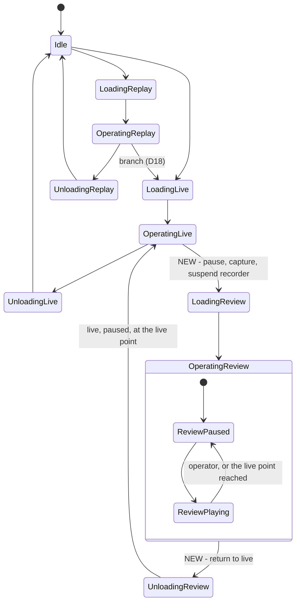
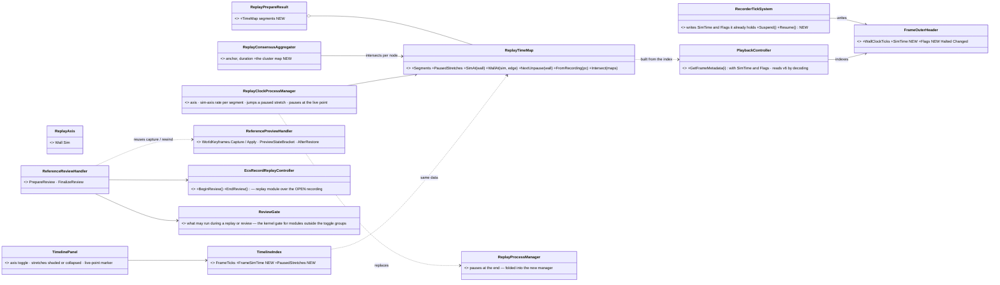
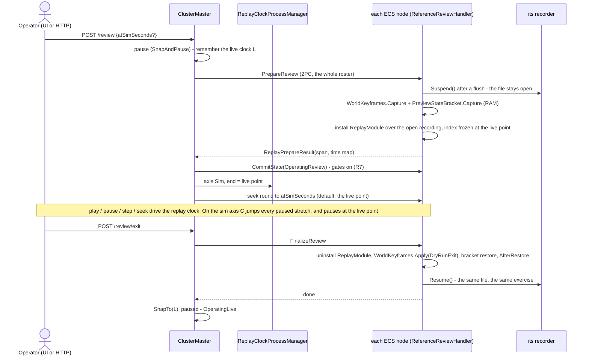
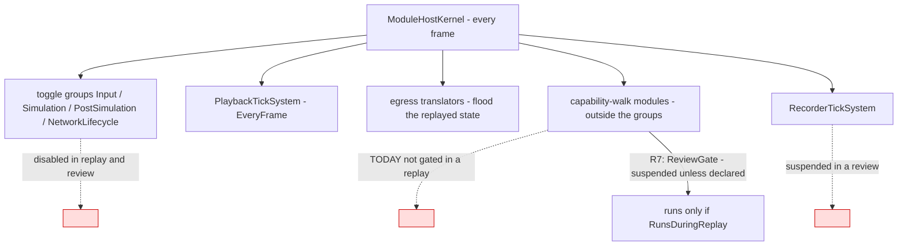

<!--STATUS
state: LIVE
build-state: DESIGN — leans R1…R12 (§5) await the user; nothing built. ⭐ P0 (§7) is the part that changes data NOW so the rest stays cheap
updated: 2026-10-26 (first version — backend, from the user's request: the sim-time seek/step that skips unchanged pauses, its UI, and During Action Review)
current-answer: §0 the decision · §1 claim table · §2 INVENTORY · §3 UML · §4 the time model · §5 decisions with leans · §6 HTTP and UI · §7 build order
stale-below: nothing
known-rot: none
known-conflict: DESIGN_Director_Timeline_Editor.md TL-4 (time = frame index + wall ticks) and TE-19 (a live host never seeks) — this design ADDS a sim axis and makes a seek on a live host ENTER a review (R10); both stand until the user approves §5
related-designs:
  - DESIGN_Http_Control_Through_The_Cluster_Master.md — OWNS the replay routes and R-3056 (wall axis; the sim form deferred) that §5 R1–R4 extend
  - DESIGN_Checkpoint_And_Dry_Run_Restore.md — OWNS the dry run's RAM keyframe, AfterRestore, SnapTo (D5) and the branch copy (D18) that DAR's return reuses (R6)
  - designs/mgmt-1/DESIGN.md — OWNS §8.12 "Always Recording" (paused frames are kept on purpose), §8.10 replay gates, §8.11 the branch, §3 the operator state machine
  - designs/replay-and-modules/DESIGN.md — OWNS the replay isolation table (§2.1), "restore the world, re-derive the protocol" (§2.1d) and §5.7 (recording and replay modules exclusive — R8 relaxes it for a review)
  - DESIGN_System_State_Inventory.md — OWNS the K/A/B/C/S/X classes that decide which module state survives a review (R7)
  - DESIGN_Director_Timeline_Editor.md — OWNS the one timeline panel and its index (TL-4, TE-17, TE-19, §9b gap ① FrameSimTime) that R10 extends
  - DESIGN_Film_Director.md — §3c "instant replays" asks DAR's question ("can the recording be shown while the live run is paused, then the live world come back untouched?"); this answers it
  - DESIGN_Scenario_Regression.md — §10-1 H1b needs a sim-frame address through the product's control (R1/R3)
  - DESIGN_Replay_Browser_Debug_Http.md — OWNS the Replay Browser's seek forms and timeline over HTTP; the browser gets the same axis (R10)
  - blueprints/DESIGN_Time_Architecture.md — OWNS SnapTo (§12a) and the replay clock (§12: the playhead is the time controller's TotalTime)
  - blueprints/Architect_Question_91_Player_Nodes.md — §4-P OWNS the replay zero (R-4012), the entry seek round and the end-of-replay pause (P7)
-->
# The replay's time axis, and **During Action Review** (DAR)

🔒 **User, `2026-10-26`:** *"design the seek/step form that works with simulation time and skips the unchanged pauses including the UI for it in
the replay browser and not just there (also in the live cluster hosts) … resolve the question about how we choose what is the time axis we work
with? how we identify what is 'unchanged pause' to skip? What the time line will show in both modes? … having the design early might change what
the http api and data structures … look like now"* · DAR: *"Live simulation gets paused (and its state remembered so it can be restored to live
later). We switch to a temporary replay mode … At any point … return back to the live simulation, to where we paused it … When the DAR replay
reaches the paused live point, it is paused automatically."* · *"If any simulation state changed during the pause, it will be replayed as a
sudden change at the time of the unpause."* · *"statefull modules that does not use snapshot save/restore stays in memory … need to make sure
during DAR that do not respond to any messages replayed during DAR."*

## 0. The decision (leans — §5)

⭐ **ONE replay clock (wall), TWO views of it.** Every recorded frame already carries both clocks — wall ticks in its index, the run's
`GlobalTime` in its body — but only wall is cheap to read. ⇒ **P0, now:** the recorder writes the frame's SIM time and a HALTED / CHANGED
flag into the frame index (format v7). From that, each node builds a **`ReplayTimeMap`** (wall ↔ sim, with the paused stretches), the master
aggregates one for the cluster, and the **SIM axis** is the wall clock with every paused stretch collapsed to an instant: a seek in sim seconds
is a lookup, a sim-axis play jumps over the stretches, and whatever changed inside one lands at once — *"a sudden change at the time of the
unpause."* Nodes keep aligning on wall ticks (R-4012) — no second alignment rule.

⭐ **DAR is a REVIEW of the live run, in place:** `OperatingLive → LoadingReview → OperatingReview → UnloadingReview → OperatingLive`. Entry
pauses live, captures each node's world in RAM (the dry run's keyframe — D14), SUSPENDS the live recorder and replays that recording up to the
live point on the SIM axis. Exit puts the RAM keyframe back (`AfterRestore`), snaps the clock to the live point, resumes the SAME recording —
live, paused. Everything that is not world state does not run during the review, so it neither changes nor hears anything (R7).

## 1. Claim table — what the leans rest on

| the lean rests on | code — how it IS | design — how it was MEANT to be |
|---|---|---|
| paused frames are recorded, on purpose | ✅ `RecorderTickSystem` is `EveryFrame` (`RecorderTickSystem.cs:17`), writes every frame (`:86-127`) | ✅ mgmt-1 §8.12 *"The AsyncRecorder does not go idle when simulation time is paused"*; invariant *"never assume a one-to-one mapping between simulation ticks and wall-clock time"* |
| the frame index holds wall ticks only | ✅ `FrameOuterHeader` = sizes, `Tick` (render counter), `FrameType`, `WallClockTicks` (`FrameOuterHeader.cs:11-16`); `FrameType` is Delta / Keyframe only | ✅ Director Timeline §9b gap ① leans to store `FrameSimTime[]` |
| the recorder HAS the sim time when it writes the header | ✅ it reads `GlobalTime` for the wall stamp in the same lines (`RecorderTickSystem.cs:86-88`) | — |
| a paused frame = recorded `DeltaTime == 0` | ✅ `GlobalTime.IsAdvancing => DeltaTime > 0` (`GlobalTime.cs:79`); master stepping writes 0 on non-step frames (`MasterSyncController.cs:625-630`) | ✅ R-126: the one source of "paused" is the clock |
| nodes align on wall ticks | ✅ seek payload = relative wall ticks + the master's anchor (`ClusterMaster.cs:1871`, `ReferenceReplayLoadHandler.cs:215-235`); playhead = anchor + `TotalTime` (`PlaybackTickSystem.cs:103`) | ✅ R-4012 one zero; R-3056 wall axis |
| nodes' sim clocks match only at step boundaries | ✅ slaves snap `TotalTime` to the step's target (`SlaveSyncController.cs:394-406`), else follow the synced wall clock | — ⇒ a second, sim-based alignment rule is rejected (R4) |
| live → replay today DESTROYS the live world | ✅ planned `OperatingLive → UnloadingLive → Idle → LoadingReplay` (`HrotStateGraph.cs:44-50`); Idle runs `WorldBoundaryReset.Clear` (deletes on the wire) | ✅ R-4019 entering Idle empties the world ⇒ DAR needs its own edge (R5) |
| a RAM keyframe + `AfterRestore` + `SnapTo` returns a world | ✅ the dry run: `ReferencePreviewHandler.cs:178-237`; clock `PreviewClockProcessManager.cs:39-55` | ✅ Checkpoint D14, D5, D4 |
| replayed EVENTS never reach live logic | ✅ the cluster replay leaves `PlaybackController.EventBus` null (`PlaybackSystem.cs:195-205`) | ✅ replay-and-modules §2.1c (state restore, not re-execution) |
| modules outside the toggle groups are NOT gated in a replay | 🔴 ✅ only the four toggle groups are switched (`ReferenceReplayLoadHandler.cs:342-348`); capability-walk modules keep ticking (`SharedApplicationBootstrapper.cs:262-264`) | ⛔ searched — no design names it; R7 closes it |
| a replay already pauses itself at a point | ✅ `ReplayProcessManager.cs:60-96` publishes `PauseTimeIntent` at the end | ✅ AQ91 P7 |
| the recording file can be read while its writer holds it | ⚠ `PlaybackController` opens `FileShare.Read` (`:72`), the writer `FileAccess.Write` (`AsyncRecorder.cs:127-132`); `RecordingSlice` opens `ReadWrite` (`:28`) and reads a live recording (checkpoint restore) | ⛔ unmeasured for `PlaybackController` — **measure first (§7 M1)** |
| SUMO (class X) cannot be restored, only frozen | ✅ `DESIGN_System_State_Inventory.md` §2c; SUMO does not step in replay (R-4027) | ✅ R-4027 |

## 2. INVENTORY *(codebase-memory `search_graph` + grep, `2026-10-26`; ⚠ `check_index_coverage` is not available through the CLI)*

| query | total | what it found |
|---|---|---|
| `search_graph name_pattern ".*Replay.*(Time\|Clock\|Controller\|Handler\|Module).*" label Class` | 12, `has_more: false` | `EcsRecordReplayController`, `ReferenceReplayLoadHandler`, `ReplayMasterModule`, `ReplayModule`, `ReplayTimelinePanel(+ViewModel)`, `ReplayTimelineWindow` (+ tests) — ⛔ no replay clock or time-map class exists |
| grep `FrameSimTime\|SimTime\b` over `FDP/Toolkits/Fdp.Toolkits/ReplayBrowser/Timeline` | 0 | the timeline index keeps `FrameTicks[]` only (`TimelineIndex.cs:35`) |
| grep `DuringAction\|Review` states / ops over `Orchestration/Enums` | 0 | no review state or op |
| grep `ISystemStateful\|IStatefulSystem\|ISnapshotRestorable` | 0 | state classes are a document + rail (`EverySystemStateFieldIsClassifiedTests`), not an interface |
| the timelines (grep `SliderInt\|ITimelineCursor\|##OrcSeek`) | 4 | `ReplayTimelinePanel` (frame slider), `TimelinePanel` (Event Timeline, wall ruler), `ClusterScenarioPanel` `##OrcSeek` (wall seconds), Director `TakeTimeline` (sim seconds — a plan, not a scrubber) |

## 3. UML

### 3a. The cluster states — what DAR adds

*What the picture shows that prose hid:* a review never touches Idle, so nothing is deleted on the wire and no content reloads; and its ONLY
exit is back to live — a review that wants a replay or a stop goes through `OperatingLive` (the planner's BFS gives that path for free).

### 3b. Classes — existing (grey) and new

*What the picture shows that prose hid:* ONE new data type (`ReplayTimeMap`) serves the cluster master, the Replay Browser and every timeline —
built from the frame index, never from decoding — and the review's return is the dry run's existing rewind, not a new restore.

### 3c. Sequence — enter and leave a review

*What the picture shows that prose hid:* the live clock L is remembered by the MASTER (the clock is the master's — D5), the world by each
NODE; and the recorder is suspended, not finalised, so the exercise's history stays one straight line.

### 3d. Modules — who runs each frame during a review

*What the picture shows that prose hid:* the red edge — modules registered outside the four toggle groups keep running in a replay TODAY. For
a replay that is harmless only by luck; for a review it would let in-memory live state move. R7 is the fix, and it fixes replay too.

## 4. The time model — the answers to the user's questions

| question | answer |
|---|---|
| **what is a "paused stretch"** | a maximal run of consecutive frames whose recorded `DeltaTime == 0` (the `Halted` flag). ⭐ The clock's own word for it (R-126) — never inferred from wall gaps |
| **what is "unchanged"** | a paused stretch none of whose frames carries a change (the `Changed` flag: the recorder wrote a chunk, a destruction or an event besides `GlobalTime`). ⭐ It only decides the TIMELINE MARK (hollow vs filled) — on the sim axis EVERY stretch collapses, changed or not, and its changes apply at once at the unpause instant (the user's rule) |
| **what is sim time** | the recorded `GlobalTime.TotalTime` of the frame — the run's own clock, scaled (a 2× live run has 2 s of sim per wall second) |
| **how the axis is chosen** | it is a VIEW of one replay clock: `axis = Sim \| Wall`, held by the master per replay / review session and by the Replay Browser per viewer. Default **Sim** for a review and a replay once built (R2); `atSeconds` keeps meaning wall (R-3056); a sim form is `atSimSeconds` |
| **a sim seek** | `wall = map.WallAt(sim, Edge.AfterStretch)` → the ordinary wall seek (R-4012). A sim time that is a paused instant lands at the stretch's END, so its changes are shown |
| **a sim play** | the master's clock runs wall time at `rate × wall/sim` of the current segment (constant within a segment); at a stretch's start it `SnapTo`s the stretch's end — the playback applies the stretch's frames in one seek |
| **a sim step** | `+dt` of SIM → its wall time; never lands inside a stretch |
| **the timeline, Wall axis** | wall seconds after the zero; paused stretches shaded (filled = changed) |
| **the timeline, Sim axis** | sim seconds; each stretch drawn as a tick at its instant (hollow = unchanged, filled = changed); the review's live point a marker at the right end |

## 5. Decisions — one per open question; ⏳ leans await the user

| # | question | ⏳ lean | rejected — one line |
|---|---|---|---|
| **R1** | where does a frame's sim time live | ⭐ **the frame index (format v7)**: `FrameOuterHeader` + `double SimTime` + `byte Flags` (Halted, Changed) — written from the `GlobalTime` the recorder already reads; `PlaybackController` reads v6 too, building the same index by decoding each body's `GlobalTime` once at open | a `.timeline` sidecar from a decode pass — slow on first open, absent on cluster nodes · deriving pauses from wall gaps — wall runs on while paused (§8.12), so the gaps prove nothing |
| **R2** | the default axis, and who chooses | a session VIEW setting, `Sim \| Wall`; ⭐ **default Sim** for a review and a replay, per viewer in the Replay Browser; `atSeconds` stays wall forever (R-3056 — no meaning changes under existing callers) | change `atSeconds` to sim — silently moves every existing script's seeks · one global setting — two operators want different views |
| **R3** | how one cluster agrees on the map | each node builds `ReplayTimeMap` from its own index and returns it in `ReplayPrepareResult`; the master INTERSECTS the paused stretches (a stretch is the cluster's only where every recording node paused) and keeps the anchor node's sim times | the master reads files — it has none on a pure orchestrator · trust one node — a late joiner's map misses the start |
| **R4** | how sim playback is driven | ⭐ **the wall clock stays the only replay clock**; the master's `ReplayClockProcessManager` sets its rate per segment and snaps over stretches (§4) — nodes are untouched | each node plays by its own sim clock — nodes' sim clocks agree only at step boundaries, a second alignment rule |
| **R5** | the review's states | NEW `LoadingReview`, `OperatingReview`, `UnloadingReview` (play / pause are sub-states, as in live); edges only `OperatingLive → LoadingReview → OperatingReview → UnloadingReview → OperatingLive`; the master refuses a review from any other state | reuse `OperatingReplay` with a flag — its exits (branch, Idle) are wrong for a review and every reader of the state would need the flag · route through Idle — R-4019 deletes the world |
| **R6** | how live comes back | ⭐ **the dry run's RAM keyframe** per node (`WorldKeyframes.Capture` / `Apply(DryRunExit)` + `PreviewStateBracket` + `AfterRestore`), the clock by the master's `SnapTo(L)`; unconsumed step events kept (`ApplyKeepingUnconsumedEvents`, D2) | restore through the recording (B4) — forks a new segment (D8) and needs the open file flushed and indexed · a second world per node (sandbox, Replay-Browser style) — every reader, every host and the IG would have to switch worlds; it doubles memory |
| **R7** | what runs during a review (the user's "must not respond") | ⭐ the replay's gates (toggle groups off, ELM gated, world-state ingress frozen, no replayed events on the bus) **+ NEW `ReviewGate`**: during a replay AND a review the kernel suspends every module and system registered outside the toggle groups unless it declares `[RunsDuringReplay]` (playback, egress, presentation, recorder). Class S and X state (sessions, SUMO) is therefore frozen and deaf; A / B are re-derived by `AfterRestore` on exit; C is empty (in the ECS, restored by the keyframe). A rail: every module outside the groups declares, and the SUMO step does not run in a review | gate each module by hand — the gap §3d shows is exactly a module someone forgot · let them run and filter their inputs — every module would need its own filter |
| **R8** | the live recording during a review | ⭐ **suspended, not finalised**: no frame is written while the world is the replayed one; exit resumes the SAME file and exercise (one straight history, a wall gap the Sim axis never shows); the review's wall interval goes into `.meta.json` (`Reviews[]`) so the Wall axis can label it. ⚠ relaxes replay-and-modules §5.7 (recording and replay exclusive) for a review only: both modules installed, only the replay one running | finalise and branch on exit (D18) — a new exercise per review, history copied each time · keep recording during the review — writes replayed frames into the live history |
| **R9** | the live point and the end of the review | the live point = the last frame written before `Suspend` (wall + sim); the review's replay ends there; reaching it on play pauses (the existing end-of-replay pause, folded into `ReplayClockProcessManager`); a seek past it clamps to it | let the review play past the end — there is nothing recorded |
| **R10** | the timeline UI — every host | ONE timeline (R-4068): axis toggle; stretches shaded (Wall) or ticks (Sim); checkpoint marks (they carry sim time already — `CheckpointMark`); in a review the live-point marker and a "back to live" button. ⭐ **On a live host, a seek on the timeline ENTERS a review at that moment** (changes TE-19's "a live host never seeks"); the Replay Browser and `ClusterScenarioPanel`'s slider use the same index and axis | a separate review timeline — two timelines for one recording |
| **R11** | HTTP | `POST /review {atSeconds \| atSimSeconds}`, `POST /review/exit`; `/replay/seek` and `/review/seek` take `atSimSeconds`; `POST /replay/axis {Sim \| Wall}`; `/replay/status` adds `simSeconds`, `axis`, `review: {livePoint: {atSeconds, simSeconds}}`; `/sim/play\|pause\|step\|timescale` drive the review clock as they drive the replay clock | a review as `POST /replay {review: true}` — one route with two exits |
| **R12** | when | ⭐ **P0 now** (R1: the header + the status's `simSeconds`), everything else when the user schedules it — P0 is the only part whose absence makes today's recordings worse later | build all now — the user asked for the design first |

## 6. HTTP and UI — the shape, for the API to stay compatible now

| surface | now (R-3056) | with this design |
|---|---|---|
| `/replay/status` | `sim.totalTime` = seconds after the zero (wall) | + `simSeconds` (the frame's recorded sim time) — ⭐ P0 · + `axis` · + `review` |
| `/replay/seek` | `atSeconds` (wall), `frame`, `frames`, `cause`, `next` | + `atSimSeconds`; `frames: ±n` on the Sim axis steps over stretches |
| `/sim/step` in a replay | `+dt` of the replay clock (wall) | `+dt` of the session's axis |
| new | — | `POST /review`, `POST /review/exit`, `POST /replay/axis` |
| timelines | frame slider (Replay Browser), wall ruler (Event Timeline), wall-seconds slider (cluster panel) | the one panel with the axis toggle, stretches, marks, the live point |

## 7. Build order — measure first

| step | what | accepted when |
|---|---|---|
| **M1** | ⚠ measure: `PlaybackController` over a recording its writer still holds (open, index, seek) — `RecordingSlice` already does it | a review's replay reads the open file, or the reader opens `ReadWrite` |
| **P0** | R1: v7 header (`SimTime`, `Flags`), v6 read by decoding; `/replay/status` `simSeconds` | a stepped live run's index shows 601 sim frames and the paused stretches without decoding (the CE-4053 recording) |
| **P1** | `ReplayTimeMap` + `ReplayPrepareResult` + the master's map; `atSimSeconds`; the axis setting; `ReplayClockProcessManager` | a sim seek lands every node on the same sim frame; a sim play crosses a recorded pause in one frame |
| **P2** | `ReviewGate` (R7) — fixes the replay gap too | the rail: every module outside the groups declares; nothing undeclared ticks in a replay |
| **P3** | the review states, `ReferenceReviewHandler`, recorder `Suspend` / `Resume`, `/review` routes | live → review → live leaves the world byte-identical (the dry-run oracle), the recording one straight file |
| **P4** | the timeline UI on every host (R10) | a seek on a live host's timeline enters a review |
