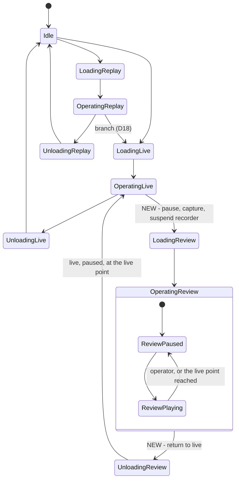
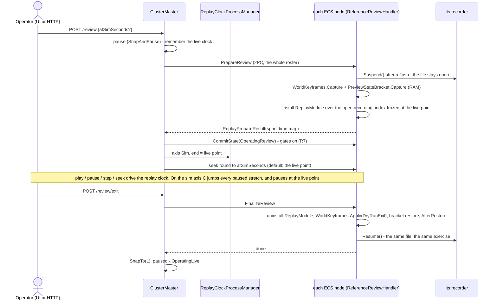
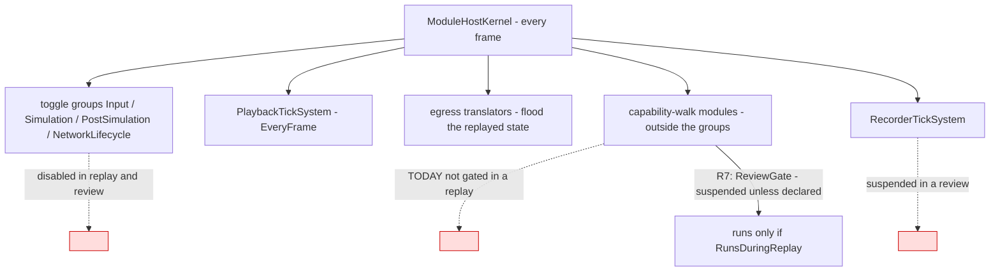
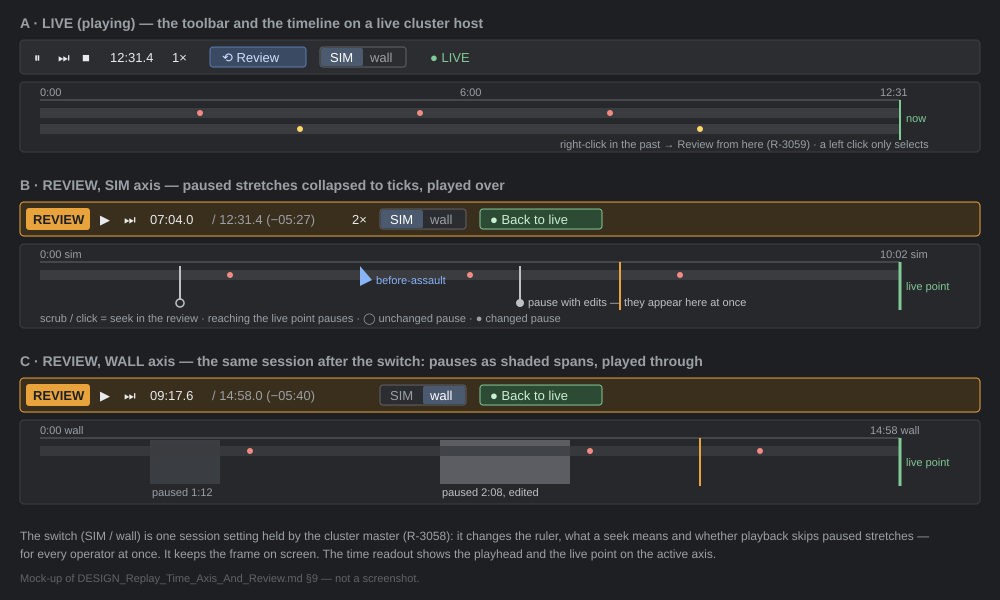
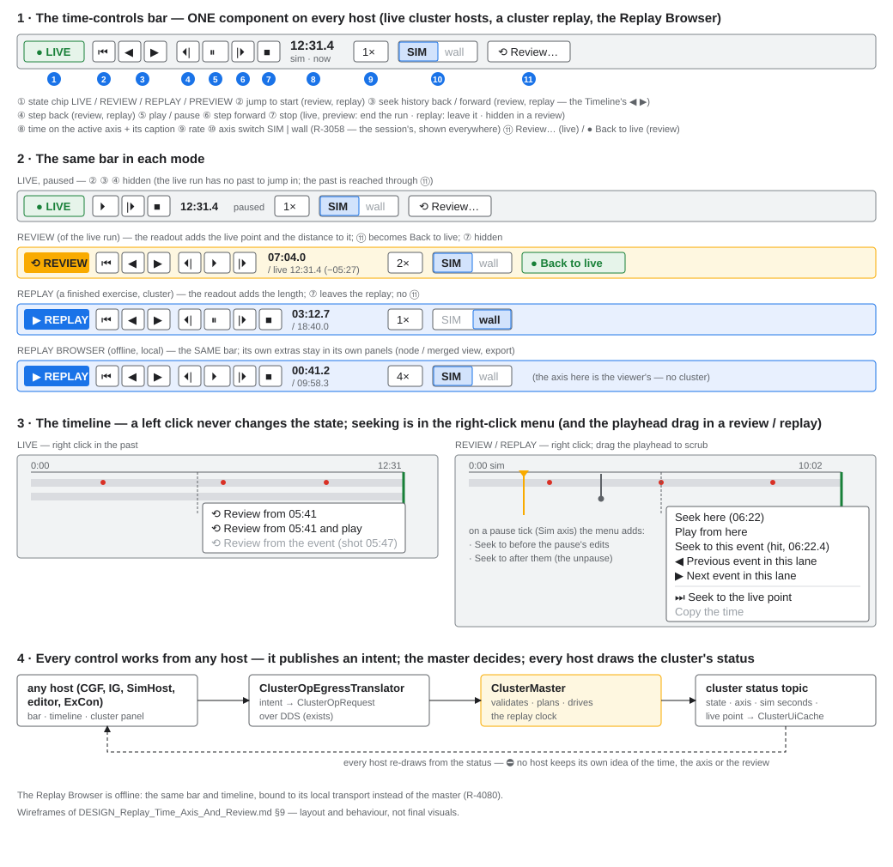
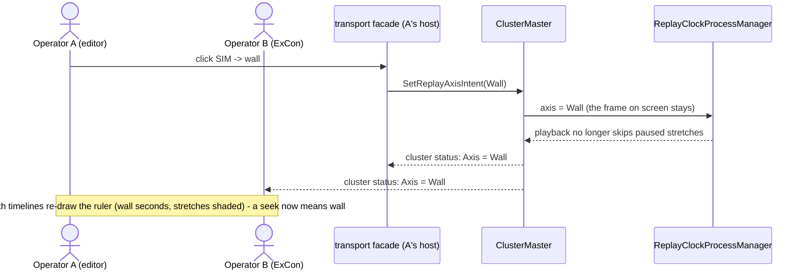
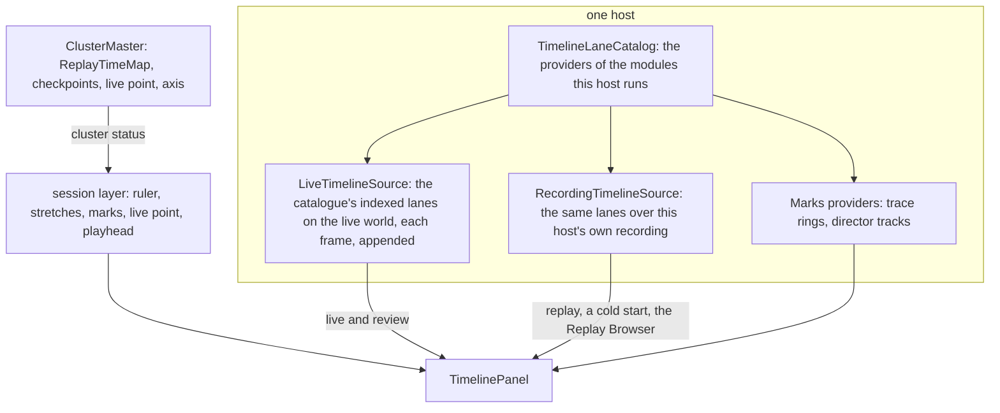

<!--STATUS
state: LIVE
build-state: DESIGN — ⭐ APPROVED 2026-10-26 (R-3057: R1…R12; R-3058: the axis switches at runtime; R-3059: no state change on a left click, one UI, any host); §8 the system changes, §9 the live-host UI; nothing built. ⭐ P0 (§7) changes data NOW
updated: 2026-10-26 (R-3059 — the timeline's left click never changes state, seeking in its right-click menu; one UI for review, cluster replay and the Replay Browser; every control from any host; §9 wireframes, §9d who fills the timeline on each host) · 2026-10-26 (approved — R-3057, R-3058; §3a the state-machine additions as a table, §8 every system change, §9 the review UI on a live cluster host) · 2026-10-26 (first version — backend, from the user's request: the sim-time seek/step that skips unchanged pauses, its UI, and During Action Review)
current-answer: §0 the decision · §1 claim table · §2 INVENTORY · §3 UML (§3a the state machine) · §4 the time model · §5 decisions (approved) · §6 HTTP · §7 build order · §8 the system changes · §9 the live-host UI
stale-below: nothing
known-rot: none
known-conflict: DESIGN_Director_Timeline_Editor.md TL-4 (time = frame index + wall ticks) and TE-19 (a live host never seeks) — this design ADDS a sim axis and makes a seek on a live host ENTER a review (R10); both stand until the user approves §5
related-designs:
  - DESIGN_Http_Control_Through_The_Cluster_Master.md — OWNS the replay routes and R-3056 (wall axis; the sim form deferred) that §5 R1–R4 extend
  - DESIGN_Checkpoint_And_Dry_Run_Restore.md — OWNS the dry run's RAM keyframe, AfterRestore, SnapTo (D5) and the branch copy (D18) that DAR's return reuses (R6)
  - designs/mgmt-1/DESIGN.md — OWNS §8.12 "Always Recording" (paused frames are kept on purpose), §8.10 replay gates, §8.11 the branch, §3 the operator state machine
  - designs/replay-and-modules/DESIGN.md — OWNS the replay isolation table (§2.1), "restore the world, re-derive the protocol" (§2.1d) and §5.7 (recording and replay modules exclusive — R8 relaxes it for a review)
  - DESIGN_System_State_Inventory.md — OWNS the K/A/B/C/S/X classes that decide which module state survives a review (R7)
  - DESIGN_Director_Timeline_Editor.md — OWNS the one timeline panel and its index (TL-4, TE-17, TE-19, §9b gap ① FrameSimTime) that R10 extends
  - DESIGN_Film_Director.md — §3c "instant replays" asks DAR's question ("can the recording be shown while the live run is paused, then the live world come back untouched?"); this answers it
  - DESIGN_Scenario_Regression.md — §10-1 H1b needs a sim-frame address through the product's control (R1/R3)
  - DESIGN_Replay_Browser_Debug_Http.md — OWNS the Replay Browser's seek forms and timeline over HTTP; the browser gets the same axis (R10)
  - blueprints/DESIGN_Time_Architecture.md — OWNS SnapTo (§12a) and the replay clock (§12: the playhead is the time controller's TotalTime)
  - blueprints/Architect_Question_91_Player_Nodes.md — §4-P OWNS the replay zero (R-4012), the entry seek round and the end-of-replay pause (P7)
-->
# The replay's time axis, and **During Action Review** (DAR)

🔒 **User, `2026-10-26`:** *"design the seek/step form that works with simulation time and skips the unchanged pauses including the UI for it in
the replay browser and not just there (also in the live cluster hosts) … resolve the question about how we choose what is the time axis we work
with? how we identify what is 'unchanged pause' to skip? What the time line will show in both modes? … having the design early might change what
the http api and data structures … look like now"* · DAR: *"Live simulation gets paused (and its state remembered so it can be restored to live
later). We switch to a temporary replay mode … At any point … return back to the live simulation, to where we paused it … When the DAR replay
reaches the paused live point, it is paused automatically."* · *"If any simulation state changed during the pause, it will be replayed as a
sudden change at the time of the unpause."* · *"statefull modules that does not use snapshot save/restore stays in memory … need to make sure
during DAR that do not respond to any messages replayed during DAR."*

## 0. The decision (leans — §5)

⭐ **ONE replay clock (wall), TWO views of it.** Every recorded frame already carries both clocks — wall ticks in its index, the run's
`GlobalTime` in its body — but only wall is cheap to read. ⇒ **P0, now:** the recorder writes the frame's SIM time and a HALTED / CHANGED
flag into the frame index (format v7). From that, each node builds a **`ReplayTimeMap`** (wall ↔ sim, with the paused stretches), the master
aggregates one for the cluster, and the **SIM axis** is the wall clock with every paused stretch collapsed to an instant: a seek in sim seconds
is a lookup, a sim-axis play jumps over the stretches, and whatever changed inside one lands at once — *"a sudden change at the time of the
unpause."* Nodes keep aligning on wall ticks (R-4012) — no second alignment rule.

⭐ **DAR is a REVIEW of the live run, in place:** `OperatingLive → LoadingReview → OperatingReview → UnloadingReview → OperatingLive`. Entry
pauses live, captures each node's world in RAM (the dry run's keyframe — D14), SUSPENDS the live recorder and replays that recording up to the
live point on the SIM axis. Exit puts the RAM keyframe back (`AfterRestore`), snaps the clock to the live point, resumes the SAME recording —
live, paused. Everything that is not world state does not run during the review, so it neither changes nor hears anything (R7).

## 1. Claim table — what the leans rest on

| the lean rests on | code — how it IS | design — how it was MEANT to be |
|---|---|---|
| paused frames are recorded, on purpose | ✅ `RecorderTickSystem` is `EveryFrame` (`RecorderTickSystem.cs:17`), writes every frame (`:86-127`) | ✅ mgmt-1 §8.12 *"The AsyncRecorder does not go idle when simulation time is paused"*; invariant *"never assume a one-to-one mapping between simulation ticks and wall-clock time"* |
| the frame index holds wall ticks only | ✅ `FrameOuterHeader` = sizes, `Tick` (render counter), `FrameType`, `WallClockTicks` (`FrameOuterHeader.cs:11-16`); `FrameType` is Delta / Keyframe only | ✅ Director Timeline §9b gap ① leans to store `FrameSimTime[]` |
| the recorder HAS the sim time when it writes the header | ✅ it reads `GlobalTime` for the wall stamp in the same lines (`RecorderTickSystem.cs:86-88`) | — |
| a paused frame = recorded `DeltaTime == 0` | ✅ `GlobalTime.IsAdvancing => DeltaTime > 0` (`GlobalTime.cs:79`); master stepping writes 0 on non-step frames (`MasterSyncController.cs:625-630`) | ✅ R-126: the one source of "paused" is the clock |
| nodes align on wall ticks | ✅ seek payload = relative wall ticks + the master's anchor (`ClusterMaster.cs:1871`, `ReferenceReplayLoadHandler.cs:215-235`); playhead = anchor + `TotalTime` (`PlaybackTickSystem.cs:103`) | ✅ R-4012 one zero; R-3056 wall axis |
| nodes' sim clocks match only at step boundaries | ✅ slaves snap `TotalTime` to the step's target (`SlaveSyncController.cs:394-406`), else follow the synced wall clock | — ⇒ a second, sim-based alignment rule is rejected (R4) |
| live → replay today DESTROYS the live world | ✅ planned `OperatingLive → UnloadingLive → Idle → LoadingReplay` (`HrotStateGraph.cs:44-50`); Idle runs `WorldBoundaryReset.Clear` (deletes on the wire) | ✅ R-4019 entering Idle empties the world ⇒ DAR needs its own edge (R5) |
| a RAM keyframe + `AfterRestore` + `SnapTo` returns a world | ✅ the dry run: `ReferencePreviewHandler.cs:178-237`; clock `PreviewClockProcessManager.cs:39-55` | ✅ Checkpoint D14, D5, D4 |
| replayed EVENTS never reach live logic | ✅ the cluster replay leaves `PlaybackController.EventBus` null (`PlaybackSystem.cs:195-205`) | ✅ replay-and-modules §2.1c (state restore, not re-execution) |
| modules outside the toggle groups are NOT gated in a replay | 🔴 ✅ only the four toggle groups are switched (`ReferenceReplayLoadHandler.cs:342-348`); capability-walk modules keep ticking (`SharedApplicationBootstrapper.cs:262-264`) | ⛔ searched — no design names it; R7 closes it |
| a replay already pauses itself at a point | ✅ `ReplayProcessManager.cs:60-96` publishes `PauseTimeIntent` at the end | ✅ AQ91 P7 |
| the recording file can be read while its writer holds it | ⚠ `PlaybackController` opens `FileShare.Read` (`:72`), the writer `FileAccess.Write` (`AsyncRecorder.cs:127-132`); `RecordingSlice` opens `ReadWrite` (`:28`) and reads a live recording (checkpoint restore) | ⛔ unmeasured for `PlaybackController` — **measure first (§7 M1)** |
| SUMO (class X) cannot be restored, only frozen | ✅ `DESIGN_System_State_Inventory.md` §2c; SUMO does not step in replay (R-4027) | ✅ R-4027 |

## 2. INVENTORY *(codebase-memory `search_graph` + grep, `2026-10-26`; ⚠ `check_index_coverage` is not available through the CLI)*

| query | total | what it found |
|---|---|---|
| `search_graph name_pattern ".*Replay.*(Time\|Clock\|Controller\|Handler\|Module).*" label Class` | 12, `has_more: false` | `EcsRecordReplayController`, `ReferenceReplayLoadHandler`, `ReplayMasterModule`, `ReplayModule`, `ReplayTimelinePanel(+ViewModel)`, `ReplayTimelineWindow` (+ tests) — ⛔ no replay clock or time-map class exists |
| grep `FrameSimTime\|SimTime\b` over `FDP/Toolkits/Fdp.Toolkits/ReplayBrowser/Timeline` | 0 | the timeline index keeps `FrameTicks[]` only (`TimelineIndex.cs:35`) |
| grep `DuringAction\|Review` states / ops over `Orchestration/Enums` | 0 | no review state or op |
| grep `ISystemStateful\|IStatefulSystem\|ISnapshotRestorable` | 0 | state classes are a document + rail (`EverySystemStateFieldIsClassifiedTests`), not an interface |
| the timelines (grep `SliderInt\|ITimelineCursor\|##OrcSeek`) | 4 | `ReplayTimelinePanel` (frame slider), `TimelinePanel` (Event Timeline, wall ruler), `ClusterScenarioPanel` `##OrcSeek` (wall seconds), Director `TakeTimeline` (sim seconds — a plan, not a scrubber) |

## 3. UML

### 3a. The cluster states — what DAR adds

*What the picture shows that prose hid:* a review never touches Idle, so nothing is deleted on the wire and no content reloads; and its ONLY
exit is back to live — a review that wants a replay or a stop goes through `OperatingLive` (the planner's BFS gives that path for free).

**The additions, exactly** *(both enum copies — `Fdp.Toolkit.Orchestration.ClusterState` and the DDS mirror `Hrot.NED.Descriptors.Orchestration.ClusterState` — stay
value-identical, as today)*:

| kind | added | today's neighbour it mirrors |
|---|---|---|
| states | `LoadingReview = 50`, `OperatingReview = 51`, `UnloadingReview = 52` | the Replay block 40 / 41 / 42 |
| sub-states of `OperatingReview` | `ReviewPaused` ⇄ `ReviewPlaying` — the cluster clock's pause, as in `OperatingLive`; ⭐ entering pauses; the live point pauses | `OperatingLive`'s paused / playing |
| edges (`HrotStateGraph`) | `OperatingLive → LoadingReview` · `LoadingReview → OperatingReview` · `OperatingReview → UnloadingReview` · `UnloadingReview → OperatingLive` | ⛔ no edge from a review to Idle, a replay or a branch |
| node ops (`NodeOpType`, both copies) | `PrepareReview` (on `LoadingReview`), `FinalizeReview` (on `UnloadingReview`) — chosen by the master's prepare-op mapping (`ClusterMaster.cs:1477-1486`) | `PrepareReplay` / `FinalizeReplay` |
| the request | the ordinary `TransitionState` to `OperatingReview` + `atSeconds \| atSimSeconds` (default: the live point); `TransitionState` to `OperatingLive` from a review = the return | R-3055: one request, the planner plans the way |
| refusals | a review only from `OperatingLive` (playing or paused); a second review while one runs is the same state (a seek) | the checkpoint restore's "only from OperatingLive" |
| the session's settings | `ReplayAxis` (Sim \| Wall, runtime — R-3058) and the live point (wall + sim) travel in the cluster status beside the state | `ReplayAnchorWallTicks`, `DurationSeconds` |
| what each state means on a node | `LoadingReview`: flush + `Suspend` the recorder, RAM keyframe, replay module over the open recording; `OperatingReview`: the replay's gates + `ReviewGate`; `UnloadingReview`: uninstall the replay module, rewind (`AfterRestore`), `Resume` the recorder | `LoadingReplay` / `OperatingReplay` / `UnloadingReplay` — ⛔ minus their Idle on either side |

### 3b. Classes — existing (grey) and new

*What the picture shows that prose hid:* ONE new data type (`ReplayTimeMap`) serves the cluster master, the Replay Browser and every timeline —
built from the frame index, never from decoding — and the review's return is the dry run's existing rewind, not a new restore.

### 3c. Sequence — enter and leave a review

*What the picture shows that prose hid:* the live clock L is remembered by the MASTER (the clock is the master's — D5), the world by each
NODE; and the recorder is suspended, not finalised, so the exercise's history stays one straight line.

### 3d. Modules — who runs each frame during a review

*What the picture shows that prose hid:* the red edge — modules registered outside the four toggle groups keep running in a replay TODAY. For
a replay that is harmless only by luck; for a review it would let in-memory live state move. R7 is the fix, and it fixes replay too.

## 4. The time model — the answers to the user's questions

| question | answer |
|---|---|
| **what is a "paused stretch"** | a maximal run of consecutive frames whose recorded `DeltaTime == 0` (the `Halted` flag). ⭐ The clock's own word for it (R-126) — never inferred from wall gaps |
| **what is "unchanged"** | a paused stretch none of whose frames carries a change (the `Changed` flag: the recorder wrote a chunk, a destruction or an event besides `GlobalTime`). ⭐ It only decides the TIMELINE MARK (hollow vs filled) — on the sim axis EVERY stretch collapses, changed or not, and its changes apply at once at the unpause instant (the user's rule) |
| **what is sim time** | the recorded `GlobalTime.TotalTime` of the frame — the run's own clock, scaled (a 2× live run has 2 s of sim per wall second) |
| **how the axis is chosen** | it is a VIEW of one replay clock: `axis = Sim \| Wall`, held by the master per replay / review session and by the Replay Browser per viewer. Default **Sim** for a review and a replay once built (R2); `atSeconds` keeps meaning wall (R-3056); a sim form is `atSimSeconds` |
| **a sim seek** | `wall = map.WallAt(sim, Edge.AfterStretch)` → the ordinary wall seek (R-4012). A sim time that is a paused instant lands at the stretch's END, so its changes are shown |
| **a sim play** | the master's clock runs wall time at `rate × wall/sim` of the current segment (constant within a segment); at a stretch's start it `SnapTo`s the stretch's end — the playback applies the stretch's frames in one seek |
| **a sim step** | `+dt` of SIM → its wall time; never lands inside a stretch |
| **the timeline, Wall axis** | wall seconds after the zero; paused stretches shaded (filled = changed) |
| **the timeline, Sim axis** | sim seconds; each stretch drawn as a tick at its instant (hollow = unchanged, filled = changed); the review's live point a marker at the right end |

## 5. Decisions — ✅ APPROVED `2026-10-26` (R-3057)

🔒 **User, verbatim:** *"Leans approved."* · *"The sim/wall time line mode needs to be changeble at runtime - chznges the mode of thr timrline and seeking and playback (skipping/not skipping pauses)."* (R-3058 — R2 below as amended) · *"clicking timeline itself can not start review (accidental click) - timeline should allow right click menu having seek-related item(s)."* · *"replay in live cluster hosts (and replay browser) needs to share similar ui"* · *"control needs to work from any host (events/network commands to cluster master)"* · *"each host can have different timeline content (whatever the host knows)"* (R-3059 — R10 as amended, §9b–§9d)

| # | question | ⏳ lean | rejected — one line |
|---|---|---|---|
| **R1** | where does a frame's sim time live | ⭐ **the frame index (format v7)**: `FrameOuterHeader` + `double SimTime` + `byte Flags` (Halted, Changed) — written from the `GlobalTime` the recorder already reads; `PlaybackController` reads v6 too, building the same index by decoding each body's `GlobalTime` once at open | a `.timeline` sidecar from a decode pass — slow on first open, absent on cluster nodes · deriving pauses from wall gaps — wall runs on while paused (§8.12), so the gaps prove nothing |
| **R2** ✅ *(amended, R-3058)* | the default axis, who chooses, and when | ⭐ **switchable at RUNTIME**, and the switch changes all three at once: what the timeline draws, what a seek means and how playback runs (skip / do not skip paused stretches). In a cluster it is the SESSION's setting, held by the master (it drives the cluster's replay clock — §9b): any operator's switch changes it for all; in the Replay Browser it is the viewer's. ⭐ **default Sim**; a switch keeps the frame on screen (no seek) and only changes what comes next. `atSeconds` stays wall forever (R-3056); `atSimSeconds` is always sim, whatever the axis | change `atSeconds` to sim — silently moves every existing script's seeks · one global setting — two operators want different views |
| **R3** | how one cluster agrees on the map | each node builds `ReplayTimeMap` from its own index and returns it in `ReplayPrepareResult`; the master INTERSECTS the paused stretches (a stretch is the cluster's only where every recording node paused) and keeps the anchor node's sim times | the master reads files — it has none on a pure orchestrator · trust one node — a late joiner's map misses the start |
| **R4** | how sim playback is driven | ⭐ **the wall clock stays the only replay clock**; the master's `ReplayClockProcessManager` sets its rate per segment and snaps over stretches (§4) — nodes are untouched | each node plays by its own sim clock — nodes' sim clocks agree only at step boundaries, a second alignment rule |
| **R5** | the review's states | NEW `LoadingReview`, `OperatingReview`, `UnloadingReview` (play / pause are sub-states, as in live); edges only `OperatingLive → LoadingReview → OperatingReview → UnloadingReview → OperatingLive`; the master refuses a review from any other state | reuse `OperatingReplay` with a flag — its exits (branch, Idle) are wrong for a review and every reader of the state would need the flag · route through Idle — R-4019 deletes the world |
| **R6** | how live comes back | ⭐ **the dry run's RAM keyframe** per node (`WorldKeyframes.Capture` / `Apply(DryRunExit)` + `PreviewStateBracket` + `AfterRestore`), the clock by the master's `SnapTo(L)`; unconsumed step events kept (`ApplyKeepingUnconsumedEvents`, D2) | restore through the recording (B4) — forks a new segment (D8) and needs the open file flushed and indexed · a second world per node (sandbox, Replay-Browser style) — every reader, every host and the IG would have to switch worlds; it doubles memory |
| **R7** | what runs during a review (the user's "must not respond") | ⭐ the replay's gates (toggle groups off, ELM gated, world-state ingress frozen, no replayed events on the bus) **+ NEW `ReviewGate`**: during a replay AND a review the kernel suspends every module and system registered outside the toggle groups unless it declares `[RunsDuringReplay]` (playback, egress, presentation, recorder). Class S and X state (sessions, SUMO) is therefore frozen and deaf; A / B are re-derived by `AfterRestore` on exit; C is empty (in the ECS, restored by the keyframe). A rail: every module outside the groups declares, and the SUMO step does not run in a review | gate each module by hand — the gap §3d shows is exactly a module someone forgot · let them run and filter their inputs — every module would need its own filter |
| **R8** | the live recording during a review | ⭐ **suspended, not finalised**: no frame is written while the world is the replayed one; exit resumes the SAME file and exercise (one straight history, a wall gap the Sim axis never shows); the review's wall interval goes into `.meta.json` (`Reviews[]`) so the Wall axis can label it. ⚠ relaxes replay-and-modules §5.7 (recording and replay exclusive) for a review only: both modules installed, only the replay one running | finalise and branch on exit (D18) — a new exercise per review, history copied each time · keep recording during the review — writes replayed frames into the live history |
| **R9** | the live point and the end of the review | the live point = the last frame written before `Suspend` (wall + sim); the review's replay ends there; reaching it on play pauses (the existing end-of-replay pause, folded into `ReplayClockProcessManager`); a seek past it clamps to it | let the review play past the end — there is nothing recorded |
| **R10** ✅ *(amended, R-3059)* | the timeline UI — every host | ONE timeline (R-4068): axis toggle; stretches shaded (Wall) or ticks (Sim); checkpoint marks (they carry sim time already — `CheckpointMark`); in a review the live-point marker and a "back to live" button. ⭐ **A left click NEVER changes the state** (an accidental click must not start a review or move a replay): it selects an event. Seeking is in the **right-click menu** (§9b) — on a live host its items ENTER a review there (amends TE-19); in a review / replay the playhead handle drags. The Replay Browser and `ClusterScenarioPanel`'s slider use the same index and axis | a separate review timeline — two timelines for one recording |
| **R11** | HTTP | `POST /review {atSeconds \| atSimSeconds}`, `POST /review/exit`; `/replay/seek` and `/review/seek` take `atSimSeconds`; `POST /replay/axis {Sim \| Wall}`; `/replay/status` adds `simSeconds`, `axis`, `review: {livePoint: {atSeconds, simSeconds}}`; `/sim/play\|pause\|step\|timescale` drive the review clock as they drive the replay clock | a review as `POST /replay {review: true}` — one route with two exits |
| **R12** | when | ⭐ **P0 now** (R1: the header + the status's `simSeconds`), everything else when the user schedules it — P0 is the only part whose absence makes today's recordings worse later | build all now — the user asked for the design first |

## 6. HTTP and UI — the shape, for the API to stay compatible now

| surface | now (R-3056) | with this design |
|---|---|---|
| `/replay/status` | `sim.totalTime` = seconds after the zero (wall) | + `simSeconds` (the frame's recorded sim time) — ⭐ P0 · + `axis` · + `review` |
| `/replay/seek` | `atSeconds` (wall), `frame`, `frames`, `cause`, `next` | + `atSimSeconds`; `frames: ±n` on the Sim axis steps over stretches |
| `/sim/step` in a replay | `+dt` of the replay clock (wall) | `+dt` of the session's axis |
| new | — | `POST /review`, `POST /review/exit`, `POST /replay/axis` |
| timelines | frame slider (Replay Browser), wall ruler (Event Timeline), wall-seconds slider (cluster panel) | the one panel with the axis toggle, stretches, marks, the live point |

## 7. Build order — measure first

| step | what | accepted when |
|---|---|---|
| **M1** | ⚠ measure: `PlaybackController` over a recording its writer still holds (open, index, seek) — `RecordingSlice` already does it | a review's replay reads the open file, or the reader opens `ReadWrite` |
| **P0** | R1: v7 header (`SimTime`, `Flags`), v6 read by decoding; `/replay/status` `simSeconds` | a stepped live run's index shows 601 sim frames and the paused stretches without decoding (the CE-4053 recording) |
| **P1** | `ReplayTimeMap` + `ReplayPrepareResult` + the master's map; `atSimSeconds`; the axis setting; `ReplayClockProcessManager` | a sim seek lands every node on the same sim frame; a sim play crosses a recorded pause in one frame |
| **P2** | `ReviewGate` (R7) — fixes the replay gap too | the rail: every module outside the groups declares; nothing undeclared ticks in a replay |
| **P3** | the review states, `ReferenceReviewHandler`, recorder `Suspend` / `Resume`, `/review` routes | live → review → live leaves the world byte-identical (the dry-run oracle), the recording one straight file |
| **P4** | the timeline UI on every host (R10) | a seek on a live host's timeline enters a review |

## 8. The system changes — every component, by phase *(✅ approved design; nothing built)*

| # | component (file) | change | phase |
|---|---|---|---|
| 1 | `FrameOuterHeader` (`Fdp.Core/FlightRecorder`) | v7: `+ double SimTime`, `+ byte Flags` (bit 0 `Halted`, bit 1 `Changed`); `FdpConfig.FORMAT_VERSION = 7` | P0 |
| 2 | `AsyncRecorder.CaptureFrame` / `CaptureKeyframe` | stamp `SimTime` and `Flags` from the `GlobalTime` it is handed; report whether the body held anything besides `GlobalTime` (chunks, destructions, events) → `Changed` | P0 |
| 3 | `PlaybackController` (+ `FrameMetadata`) | index `SimTime` + `Flags`; ⭐ read v6 too — build the same two fields by decoding each frame's `GlobalTime` once at open | P0 |
| 4 | `RecordingSlice`, `PlaybackSystem` (header readers) | the 26-byte-longer header; v6 / v7 by the file's version | P0 |
| 5 | the D18 branch copy (`RecordingModule` history copy) | a branch of a v6 parent rewrites the copied headers to v7 — ⛔ never one file with two header sizes | P0 |
| 6 | `/replay/status` | `+ simSeconds` (the recorded sim time of the frame on screen) | P0 |
| 7 | `ReplayTimeMap` (NEW, `Fdp.Toolkits/Replay`) | segments (wall span, sim span, rate), paused stretches (wall span, changed?), `SimAt` / `WallAt(edge)` / `NextUnpause` / `Intersect` / `FromRecording(PlaybackController)` | P1 |
| 8 | `ReplayPrepareResult` + `ReplayConsensusAggregator` | carry each node's map; the master intersects the stretches (R3) | P1 |
| 9 | `ReplayClockProcessManager` (NEW, master; absorbs `ReplayProcessManager`) | holds `ReplayAxis` (R-3058) and the map; Sim axis: the clock's rate per segment, `SnapTo` over a stretch; pauses at the end / the live point; a switch keeps the frame | P1 |
| 10 | intents: `SeekReplayIntent` `+ SimSeconds`; NEW `SetReplayAxisIntent`; the cluster status `+ Axis`, `+ SimSeconds`, `+ LivePoint` (and their DDS mirrors in `OrchestrationMessages`) | the master turns a sim target into wall ticks — nodes unchanged | P1 |
| 11 | `TimelineIndex` + sidecar (schema 3) | `+ FrameSimTime[]`, `+ FrameFlags[]` — read from the frame index, not decoded | P1 |
| 12 | HTTP (`DebugApiService` + routes + `DebugApiRouteDocs` + `CapabilityManifest`, MCP catalog regenerated — R-1030) | `atSimSeconds` on `/replay/seek` and `/review/seek`; `POST /replay/axis`; status `axis` | P1 |
| 13 | Replay Browser: `FederatedReplayManager`, `IReplayBrowserControl` | the same map per node group; its axis is the viewer's; sim seeks / play through the map | P1 |
| 14 | `ReviewGate` (kernel) + `[RunsDuringReplay]` | in a replay AND a review, suspend every module / system outside the four toggle groups unless declared; rail: every one outside the groups declares | P2 |
| 15 | `ClusterState` + `NodeOpType` (both copies), `HrotStateGraph`, the master's prepare-op mapping, the review refusals | §3a | P3 |
| 16 | `ReferenceReviewHandler` (NEW, every ECS node; shares the capture / rewind of `ReferencePreviewHandler` — extracted, not copied) | `PrepareReview` / `FinalizeReview` (§3c) | P3 |
| 17 | `RecorderTickSystem` / `RecordingModule` | `Suspend()` / `Resume()` — flush, keep the file open, write nothing in between; `.meta.json` `Reviews[]` | P3 |
| 18 | `EcsRecordReplayController` + `PlaybackController` | `BeginReview` / `EndReview`: a `ReplayModule` over the OPEN recording (opened `FileShare.ReadWrite`, index frozen at the live point) — M1 first | P3 |
| 19 | the master's return | `SnapTo(L)` after `UnloadingReview` (the `PreviewClockProcessManager` pattern), live paused | P3 |
| 20 | `/review`, `/review/exit`, status `review: {livePoint}` | R11 | P3 |
| 21 | `ITimeTransportFacade` (+ `ClusterTimeTransportAdapter`, `EditorTimeTransportFacade`, the Replay Browser transport) | `+ Axis`, `SetAxis`; `CanSeek` / `Seek(t)` (TE-19, in the axis's units); `+ IsReviewing`, `CanReview`, `EnterReview(t?)`, `ExitReview()`, `LivePoint` | P4 |
| 22 | `MainToolbarTimeControlSection` (shared toolbar, every host that registers it) | ⟲ Review / ● Back to live, the SIM / wall switch, the time on the active axis + "− to live" (§9) | P4 |
| 23 | `TimelinePanel` + `ITimelineCursor` (the ONE timeline, R-4068) | positions in the active axis; stretches shaded (Wall) or ticks (Sim); the live point; a click in the past on a live host = `EnterReview(t)` (amends TE-19) | P4 |
| 24 | `ClusterScenarioPanel` + `ClusterUiCache` | the Review button beside Load Replay; the seek slider on the active axis; the cache holds axis, sim seconds, live point, review state | P4 |
| 25 | the status bar | a REVIEW state chip (with "− to live") beside the cluster state | P4 |
| 26 | `DESIGN_Director_Timeline_Editor.md` (ui's) | TL-4 gains the sim axis; TE-19's live row becomes "the right-click menu enters a review" (R-3059) — amended by its owner when P4 is scheduled | P4 |
| 27 | `TimelineContextMenu` (NEW, beside `TimelinePanel`) | the right-click items of §9b per mode; a left click selects, never seeks (R-3059) | P4 |
| 28 | `LiveTimelineSource` (NEW — TE-17's, not built) | the catalogue's indexed lanes evaluated on the live world each frame, appended; frozen at the live point for a review | P4 |
| 29 | the session layer (NEW, in `TimelinePanel`) | ruler, stretches, checkpoint marks, live point, playhead from the cluster status + `ReplayTimeMap` — identical on every host, the only layer on ExCon / Orchestrator | P4 |
| 30 | `TimelineLaneContext` | `+ Live` beside `Recording`, so a provider says where its lanes apply | P4 |
| 31 | `ClusterOpEgressTranslator` / `ClusterOpMasterTranslator` + `ClusterOpType` (both copies) | carry `SetReplayAxisIntent` and `SeekReplayIntent.SimSeconds` from any host (§9b″) | P1 |

## 9. The review UI on a live cluster host

*What the picture shows that prose hid:* the review is not a new window — it is the SAME toolbar and the SAME timeline in another state; the
live point is the timeline's right edge in both axes, and the switch re-draws the ruler without moving the frame.

### 9a. Where it lives — every host with the shared toolbar or the timeline

| host | toolbar transport (`MainToolbarTimeControlSection`) | timeline (`TimelinePanel`) | cluster panel (`ClusterScenarioPanel`) |
|---|---|---|---|
| editor (a one-node cluster) | ✅ registers it (`EditorSubsystem.cs:5350`) | P4 (TE-17's live source) | ✅ `ClusterControlWindow` |
| CGF | ✅ (`CgfSubsystem.cs:1866`) | P4 | — |
| ExCon / Orchestrator | — | P4 (when it hosts a timeline) | ✅ `ClusterControlWindow` / `OrchestratorWindow` |
| SimHost / IG | — (no transport today) | P4 | — |

⭐ A host gets the review by having the transport or the timeline — ⛔ no host-specific review UI: the controls call the facade, the facade
sends the master's intents (R-3054).

### 9b. The controls — wireframes *(R-3059)*

*What the picture shows that prose hid:* the review, a cluster replay and the Replay Browser are ONE bar and ONE timeline — only which buttons
are visible changes; and nothing on the timeline changes the state on a left click.

| # | control | live | review | cluster replay | Replay Browser | does | intent (→ the master) |
|---|---|---|---|---|---|---|---|
| ① | state chip | LIVE | ⟲ REVIEW | ▶ REPLAY | ▶ REPLAY | says what the world on screen is | — (the cluster status) |
| ② | ⏮ to start | — | ✅ | ✅ | ✅ | seek to the zero | `SeekReplayIntent` |
| ③ | ◀ ▶ seek history | — | ✅ | ✅ | ✅ | back / forward through the jumps (the Timeline's ◀ ▶, `PlaybackHistoryTracker`) | `SeekReplayIntent` to the waypoint |
| ④ | step back | — | ✅ | ✅ | ✅ | `−dt` on the active axis | `SeekReplayIntent` |
| ⑤ | play / pause | ✅ | ✅ | ✅ | ✅ | the cluster clock (live) or the replay clock | `ResumeTimeIntent` / `PauseTimeIntent` (exist) |
| ⑥ | step forward | ✅ | ✅ | ✅ | ✅ | `+dt` on the active axis (skips stretches on Sim) | `StepTimeIntent` (exists) |
| ⑦ | stop | ✅ ends the run | — | ✅ leaves the replay | ✅ closes | | `TransitionStateIntent(Idle)` (exists) |
| ⑧ | time | now | playhead + `/ live` + `(−to live)` | playhead + `/ length` | playhead + `/ length` | the active axis | — (status `SimSeconds`, `LivePoint`) |
| ⑨ | rate | ✅ | ✅ | ✅ | ✅ | | `SetTimeScaleIntent` (exists) |
| ⑩ | SIM \| wall | ✅ (decides the next review) | ✅ | ✅ | ✅ (the viewer's) | the ruler, the seek, the playback's skipping (R-3058) | NEW `SetReplayAxisIntent` |
| ⑪ | ⟲ Review… / ● Back to live | Review… (at the live point, paused) | Back to live | — | — | | `TransitionStateIntent(OperatingReview / OperatingLive)` |

**The timeline's mouse** *(R-3059)*:

| gesture | live | review / replay / Replay Browser |
|---|---|---|
| left click | selects the event under it (its details, the unit); ⛔ never seeks, never enters a review | the same — ⛔ never seeks |
| drag the playhead handle | — | scrub (a seek on release) |
| right click | **Review from here** · **Review from here and play** · **Review from the event** (when on one) | **Seek here** · **Play from here** · **Seek to this event** · **◀ / ▶ Previous / Next event in this lane** (RB-2's `next.lane`) · **Seek to the live point** (review) · on a pause tick: **Seek to before / after the pause's edits** · Copy the time |
| wheel / drag on the ruler | zoom / pan (TE-18) | zoom / pan |

### 9b′. One UI for the review, a cluster replay and the Replay Browser

⭐ The bar (`MainToolbarTimeControlSection`) and the timeline (`TimelinePanel` + `TimelineContextMenu`, NEW) are the shared components; each
host binds them to ITS transport — ⛔ no second implementation (R-4068):

| host | transport the bar and the timeline call | where the state comes from |
|---|---|---|
| a live cluster host (CGF, SimHost, IG, editor, ExCon) — live, review, cluster replay | `ClusterTimeTransportAdapter` (the editor: `EditorTimeTransportFacade`) → intents on the node's bus | the cluster status → `ClusterUiCache` |
| the Replay Browser (offline, R-4080) | its own transport (`ReplayBrowserTransport`, local seeks through `FederatedReplayManager`) | itself |

The Replay Browser keeps its extras in its own panels (node / merged view, export, search); everything that moves time is the shared bar.

### 9b″. Every control from ANY host — an intent, the master decides *(R-3059)*

⭐ A control never acts on its own node's clock or world: it publishes an INTENT on its node's bus; `ClusterOpEgressTranslator` (exists:
`PauseTimeIntent` `:55`, `TransitionStateIntent` `:91`, `SeekReplayIntent` `:162`) carries it as a `ClusterOpRequest` over DDS to the
master; the master validates, plans and drives; every host re-draws from the cluster status. ⇒ an operator on CGF, an IG or ExCon starts,
steers and ends a review exactly as one on the editor, and two operators always see one session.

| new on that path | where |
|---|---|
| `SetReplayAxisIntent` + its `ClusterOpType` (both copies) | egress line in `ClusterOpEgressTranslator`, master line in `ClusterOpMasterTranslator` |
| `SeekReplayIntent.SimSeconds` | the existing seek line |
| the review request | ⛔ nothing new — `TransitionStateIntent` to `OperatingReview` / `OperatingLive` (R-3055) with `atSeconds \| atSimSeconds` |
| the cluster status fields `Axis`, `SimSeconds`, `LivePoint`, the review state | the status topic → `ClusterUiCache` on every node |

### 9c. A switch of the axis — one session setting, every operator

*What the picture shows that prose hid:* the axis is not a view preference in a cluster — it changes how the master drives the replay clock, so
it is ONE setting the master owns and broadcasts; two operators can never see two different playbacks of one replay.

### 9d. Who fills the timeline on each host — ⭐ each shows what IT knows

⭐ **Two layers.** The **session layer** is the cluster's and the SAME on every host: the ruler on the active axis, the paused stretches,
the checkpoint marks, the live point and the review's span, the playhead — all from the master's status and its `ReplayTimeMap`, never from a
local file. The **event lanes** are the host's own: its catalogue holds the lane providers of the modules IT hosts (R-4078 — *"the module that
owns the data registers its provider"*; R-4079 — lanes are definitions, never code), evaluated on the world IT holds.

*What the picture shows that prose hid:* nothing crosses hosts except the session layer — so every host agrees on WHERE time is and how it is
drawn, and each shows only the events it can actually see; a host with no world (ExCon, Orchestrator) still has a correct, steerable timeline.

| mode | source of the event lanes | why |
|---|---|---|
| live | `LiveTimelineSource` (TE-17, NEW): the catalogue's indexed lanes evaluated on the live world each frame, appended | no file read, nothing to rebuild on entering a review |
| review | the SAME live source, frozen at the live point — its history IS the recording's up to there | the review shows what live showed |
| cluster replay | `RecordingTimelineSource` over the node's OWN recording (built; sidecar cached) | each node holds its own recording (R-4012) |
| Replay Browser | `RecordingTimelineSource` over the shown node's recording (built) | offline |
| a cold start (the host restarted mid-exercise) | `RecordingTimelineSource` for the frames before it started, then live | its recording holds them |

| host | what it knows ⇒ what its lanes show *(examples)* |
|---|---|
| editor (a one-node cluster) | everything — it owns the whole world |
| CGF | the brain lanes (journal, orders, reports, decisions — R-4076) of the units it owns; life / combat for every unit it holds |
| SimHost | the muscle / physics lanes of what it simulates; life / combat |
| IG | what it renders — life, effects, the camera / view lanes |
| ExCon, Orchestrator | ⭐ the session layer only (no world, no recording); ⏭ later, optionally, one node's lanes read over HTTP (`GET /timeline/events`, RB-6) |

⭐ A lane whose data a host does not hold is not offered there (its provider is not registered, or `Applies` is false) — ⛔ never an empty lane
that reads as "nothing happened". `TimelineLaneContext` gains `Live` beside `Recording`, so a provider can say where it applies.
