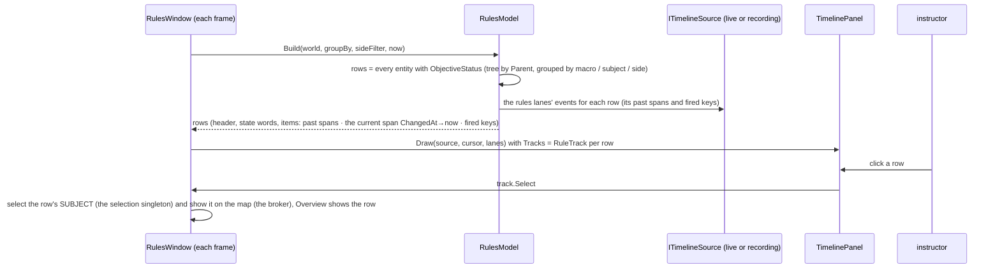
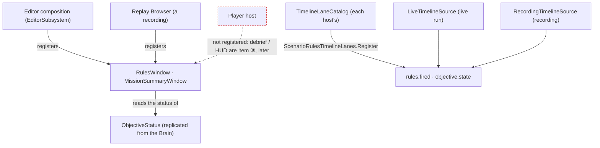
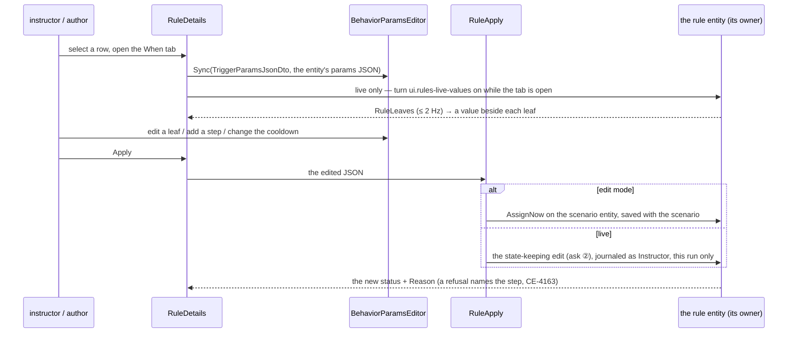
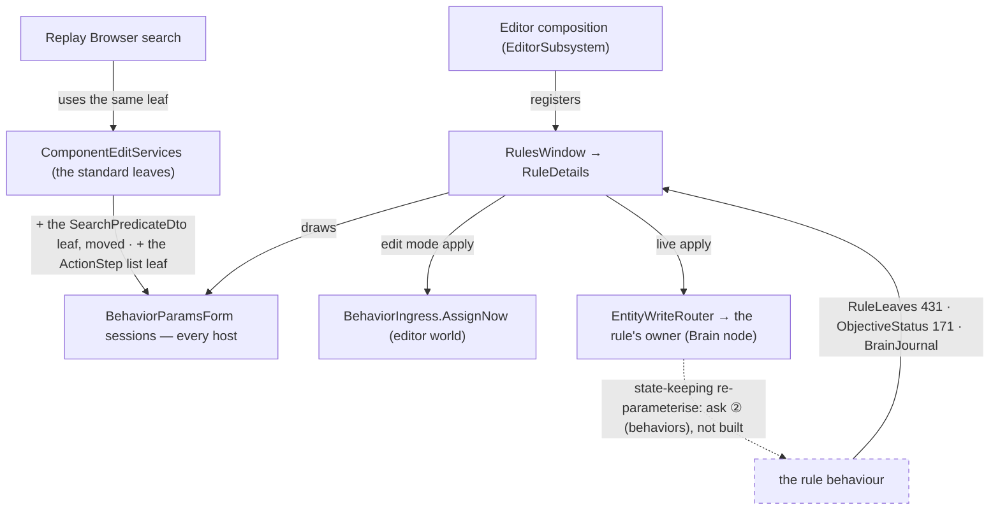

<!--STATUS
state: LIVE — DESIGN, leans RV-1 … RV-9 await the user
updated: 2026-11-03 (§7 the rule editor designed; RV-4 built by behaviors; R3 all on the wire; ManDownedEvent for casualties; RV-8 extended to the whole summary on behaviors' B3–B5 + backend's S7; RV-6 Waits on / Starts)
build-state: DESIGN
current-answer: §3 (decisions) · §4 (phases) · §7 (the rule editor, RE-1 … RE-10)
stale-below: nothing
known-rot: none
related-designs:
  - docs/DESIGN_Scenario_Rules.md — OWNS the decisions this builds: SR-56 (objectives view), SR-103 (rules lanes), SR-105 / SR-109 / SR-110 (the rules view), SR-111 (mission summary), SR-112 (debrief / HUD — later here)
  - docs/designs/rules-view/README.md — the nine mockups (Main, MissionSummary, …); the SR rows win where they differ
  - docs/DESIGN_Director_Timeline_Editor.md — OWNS the ONE timeline panel (TE-21 / R-4075) and its lanes (§9c); TL-X1…X5 here extend it for every host
  - docs/DESIGN_Entity_Hierarchy_Views.md — the entity tree; the rules view's row tree is NOT that tree (rows are objectives / triggers, not entities in a relation)
  - docs/DESIGN_Macro_Authoring_Editor.md — the parameter bindings a trigger's Do tab will show (⛓ chips, MA-1)
  - docs/DESIGN_Man_Downed_Event.md — behaviors' ONE kill authority (CE-3364); the summary's casualty events and the kill feed read it
  - docs/DESIGN_Player_HUD_And_Debrief.md — the PLAYER's side of the same data; shares RulesReader (PH-1)
  - docs/blueprints/batches/HANDOFF_Coordinator_To_Behaviors_Rules_S4_Scores.md — behaviors builds what RV-8 reads: role composites ①, pass mark + Group ②, the score-history lane ④ (joins RV-4's provider), the debrief reads ⑤
  - docs/blueprints/batches/HANDOFF_Coordinator_To_Backend_Player_Score.md — backend's per-player game score; design DESIGN_Scenario_Rules.md §00.13 S7 (on backend) — the summary's game card reads it
-->

# DESIGN — **the rules view and the mission summary** (ui half of [HANDOFF_Coordinator_To_Ui_Rules_View_And_Summary](blueprints/batches/HANDOFF_Coordinator_To_Ui_Rules_View_And_Summary.md))

The handoff's items ① CE-4167 (the timeline extensions), ② the rules view, ③ connectors + expected bars, ⑤ runtime control and ⑥ the first half of the mission summary are designed here: their data exists. ⭐ **Updated `2026-11-02`:** behaviors delivered V-1 / V-2 / V-4 on `behaviors` (`59a8e5d23`, `DESIGN_Scenario_Rules.md` §00.10), which moved ③ and ⑤ from waiting to buildable.
Items ④ (live leaf values, V-3), ⑦ and ⑧ wait for behaviors' data (V-3 as built, B3–B5) and are only placed here, not designed.
⭐ **Updated `2026-11-03` (user: *"behaviors is already working on B3 to B5, backend on per-player scores … rely on them in the design"*):** ⑦ (*scores by level*, headline, trend, pass mark, attention, *why*) is now designed in RV-8 on the data the two handoffs build ([behaviors S4 ①②④⑤](blueprints/batches/HANDOFF_Coordinator_To_Behaviors_Rules_S4_Scores.md), [backend S7](blueprints/batches/HANDOFF_Coordinator_To_Backend_Player_Score.md)); ⑧ (debrief / HUD) lives in `DESIGN_Player_HUD_And_Debrief.md`.
⭐ **Updated again `2026-11-02`:** behaviors' S4 landed (`behaviors@02c50f84c`, [NOTE_Behaviors_To_Ui_Rules_S4_Group_And_Measures](blueprints/batches/NOTE_Behaviors_To_Ui_Rules_S4_Group_And_Measures.md)): `ObjectiveStatus.Group` (the section a standard is shown under), the measure kinds (`HitRatio` · `Count` · `ReportLatency` · `TimeTo` · `Sample`; `Score` already folds *lower is better*) and `MemberEvaluation` (one inserted root per member, `Subject` = the man). ⇒ the rules view groups measures by `Group`; the summary's *scores by level* (⑦) and the trainee debrief (⑧) become designable on this data — a later section, after R1–R4.

## 1. INVENTORY *(`2026-11-02`)*

**Queries:**
- graph: `.*(Objective|Rules|Trigger|Mission).*` Class → 80. **None is a view of objectives or triggers**: they are mission plans, BDC messages and various `*Rules` helpers.
- graph: `.*Timeline\w*(Window|Panel|Track|Host)$` → hosts found by grep instead: `EventTimelineWindow`, `ReplayTimelineWindow`, and `DirectorTracks` (3 `ITimelineTrack`s).
- grep: `ObjectiveStatus` / `ObjectiveLinks` / `ExerciseResult` · `IndexedLaneDefinition` providers (3: combat, behaviour, replication) · `GetObjectives` (debug API).
- ⚠ Coverage was not checked: `check_index_coverage` is not in the CLI.
- `2026-11-03` (RV-8 extension): graph `.*Injury.*` Class → `Injury` (`InjuryState Ok · Wounded · Incapacitated · Dead`, derived) · grep `Pass` in `ObjectiveStatus.cs` on `behaviors@bd3c05487` → none (S4 ② not landed) · read both handoffs + backend's §00.13 S7 (`backend@8437b7bff`).

| measured | where | so |
|---|---|---|
| the ONE timeline panel draws read-only LANES from an index and editable TRACKS above them; a track item is a `Key` or a `From…To` `Segment` with a colour; the row label is a flat `Label` drawn at a fixed `LabelWidth` | `Fdp.Presentation/ImGui/Panels/Timeline/TimelinePanel.cs:415-487` (`DrawTrack`); `ITimelineTrack.cs` | the rules view = one track per objective / trigger (SR-110). The panel lacks: styles beyond Key / Segment (TL-X2), a tree with a status in the label column (TL-X3), links between items on different rows (TL-X1), a connect gesture (TL-X4), a *Coming up* strip (TL-X5) |
| ⚠ the panel draws NOTHING without an index extent: `if (to <= from) { "No recording." ; return; }` | `TimelinePanel.cs:142-148` | in edit mode before a run there are no frames ⇒ the rules view would be blank ⇒ RV-2 (the extent also comes from the tracks) |
| a LIVE index exists: `LiveTimelineSource` evaluates the registered indexed lanes on the live world each frame | `Fdp.Toolkits/ReplayBrowser/Timeline/LiveTimelineSource.cs` | the rules view runs live and on a recording through the SAME source seam (`ITimelineSource`) |
| hit positions of every drawn track item are already collected each frame (`_trackHits`: track id, item id, x, y) | `TimelinePanel.cs:97, :451` | TL-X1's connectors are drawn from these after the tracks, with no second layout |
| `ObjectiveStatus` (replicated): role (Objective · Measure · Trigger), state, trigger state (Disarmed … Done), owner side, progress cur / need, value / target, score, points, `ChangedAt`, `LastFired`, `FireCount`, reason, title, kind, required, scored, weight, visible sides · `ObjectiveLinks {Subject, Parent}` · `ExerciseResult` | `Fdp.Toolkits/ScenarioRules/ObjectiveStatus.cs`, `ObjectiveLinks.cs`, `ExerciseResult.cs` | every row, its tree, its state words and its CURRENT span come from these. ⛔ They hold only the CURRENT state + when it changed, not history |
| ⛔ the SR-103 provider `ScenarioRulesTimelineLanes` (`rules.fired`, `objective.state`, …) is designed, NOT built; neither the ui nor the behaviors handoff lists it | grep `IndexedLaneDefinition` → 3 providers, none for rules; `DESIGN_Scenario_Rules.md` SR-103 | the PAST at actual times (item ②, "✅ now") needs it ⇒ RV-4 |
| ✅ **delivered by behaviors (`59a8e5d23`)**: `ObjectiveStatus` (on topic 171, every node) gained `DependsOn` / `ActsOn` (≤ 8 net ids each: the entities a trigger's `when` names / its `do` targets), `HoldFor` · `Delay` · `Cooldown` · `Deadline` and `ExpectedAt` (sim s of the next thing the owner knows will happen; 0 = unknown). Runtime control = `RuleControl` (430, brain-local) written through `EntityWriteRouter` as three attributes `Rule.Request` (40) · `Rule.Seq` (41) · `Rule.Origin` (42) in ONE write; the owner honours a new `Seq` once and journals it | `DESIGN_Scenario_Rules.md` §00.10 V-1, V-2, V-4 (behaviors) | ⭐ connectors (X1) = `DependsOn` → this row and this row → `ActsOn`; the dashed expected bar (X2) = now → `ExpectedAt`; Fire / Disarm / Re-arm / Reset / Activate are ONE router write each — ⛔ the ui never re-derives timing or links (V-2) |
| `MacroOrigin` / `MacroInstance` on macro entities; the Scenario view groups by them (W-M1) | `Fdp.Toolkits/Scenario/Macros/MacroTypes.cs`; `ScenarioHierarchyAdapter` | the rules view's *group by macro* uses the same link |
| selecting an entity + *Show on map* already have one path (the selection singleton, `CenterOnEntitySystem` / `MapCamera.FocusOn` through the broker) | CE-4049; CE-4206 R3 | a row click goes the SAME way (SR-56: *"the ORBAT's own jump"*) |

## 2. The shape

*What the picture shows that prose hid:* the rules view adds NO drawing of its own. It is a model (no ImGui, railed as data) feeding tracks into
the ONE panel. Every visual it needs is a general panel extension (X1–X5), which the director's tracks get too. The past comes from a
lane provider, so the AAR, the director and the rules view read the same index (SR-103).

*What the picture shows that prose hid:* the windows read only REPLICATED data and the shared lanes. So any node that receives `ObjectiveStatus`
(the editor, a Replay Browser on a recording) can host them, with no Brain-side code. The Player is deliberately not a host yet.

## 3. Decisions

| # | decision | ⭐ lean |
|---|---|---|
| **RV-1** | the panel extensions (CE-4167), general for every host | ⭐ **X2**: `TimelineTrackItem.Style` (`Solid` default · `Expected` dashed outline · `Hatched` · `Pinned` diamond). **X3**: an optional `ITimelineTrack.Header` (`TrackHeader`: depth, text, status text + colour, icon, collapsible). The panel draws the label column as an indented tree with the status right-aligned. A collapsed node hides its descendants (tracks are given in tree order, so depth decides). **X1**: optional `ITimelineTrack.Links` (from my item → another track's item), drawn after all tracks as an elbow line with an arrowhead, from the `_trackHits` positions. A link whose end is not drawn (scrolled away, collapsed) is not drawn. **X4**: optional `CanConnect` / `Connect(fromItem, toTrack)`. A drag from a small handle at an item's right end onto another row calls it; nothing happens on a track that does not opt in. **X5**: `ComingUp.Of(tracks, now, n)`, a pure list of the next `Expected` / `Pinned` items after now, drawn as a strip below the lanes when the host turns it on. ⭐ All default-off members ⇒ the director and the trace lanes are unchanged until they opt in |
| **RV-2** | a blank panel before a run | ⭐ the extent also covers the TRACKS' items and `[0, now]`, so tracks draw in edit mode with no recording (today: "No recording."). The lanes keep their own rule |
| **RV-3** | the rows | ⭐ one `RuleTrack` per entity with `ObjectiveStatus` (objectives, measures, triggers). The tree comes from `ObjectiveLinks.Parent`. **Group by** macro (`MacroOrigin.Instance` → its `MacroInstance.Macro`, else *Scenario*) · subject (`ObjectiveLinks.Subject`'s name) · side (`Owner`). **Side** filter = `Owner`, which also respects `VisibleSides`. The state in words follows the mockup: *Achieved* · *Active 6:10* (since `ChangedAt`) · *Armed* · *Cooldown · 1/2* (`FireCount` of max when known) · *Acting* (the step count waits for A1). The status colour follows the legend |
| **RV-4** | the PAST at actual times | ✅ **BUILT by behaviors** (`4e6d57c10`, [NOTE_Behaviors_To_Ui_Rules_Timeline_Lanes_Built](blueprints/batches/NOTE_Behaviors_To_Ui_Rules_Timeline_Lanes_Built.md)): `ScenarioRulesTimelineLanes` (`Fdp.Toolkits/ScenarioRules/`) in the one shipped catalogue — `objective.state` (Value = the `ObjectiveState` number), `rules.fired` (Value = `FireCount`; ⚠ the first sight carries the count it has — skip Value 0), `objective.score` (hidden; Value = `Score`, X = `Target`). ⭐ ui reads them, never a second provider; a new rules lane goes INTO that class. ⭐ `rules.fired` as the COUNT moving (not the `Fired` state edge) is right for the view: one diamond per fire, even a fire that re-arms within the frame. The row's past = those entries + the current span `ChangedAt → now`. ⭐ **Casualties** for *key events* (RV-8) and the debrief's moments: ✅ **`combat.downed`** (behaviors `532b79c4d`, `CombatTimelineLanes.Downed`): Subject = the victim, Other = who downed him (`Source`), Value = `InjuryState` (2 down · 3 dead), X = the victim's side — live and recorded |
| **RV-5** | acting on a row | ⭐ click = select the row (the Overview) AND its SUBJECT through the selection singleton; *Show on map* = the broker's existing focus. The right-click menu and the details' buttons: *Fire now* · *Disarm* · *Re-arm* · *Reset* (triggers) · *Activate* / *Deactivate* (objectives) — each ONE `EntityWriteRouter.For(world).Write(entity, [Rule.Request, Rule.Seq, Rule.Origin = Instructor])`, `Seq` = the last seen + 1 (behaviors' `DebugApiService.ControlObjective` is the precedent: reuse its rule, not a copy). An item not valid in the row's state is disabled with the reason (a final trigger: *"needs Reset"*). ⭐ A live edit is FOR THIS RUN ONLY (SR-109) — the view never writes the scenario file. ⭐ The result shows as the row's new state and the owner's `Reason`, not as a ui-side guess |
| **RV-6** | the window | ⭐ `RulesWindow` (*Window ▸ Rules*), PerspectiveBound like the timeline windows. Toolbar: *Group by*, *Side*, *Follow now*, search; *Timeline* only (Graph / List later). Centre: the panel in a Rules host (its own lanes hidden except the rules lanes). Right: details of the selected row with the **Overview / Status** tab: title, kind, state, owner, subject (link), progress, value / target, score, required / scored, reason, fired n× / last, ⭐ **Waits on** (`DependsOn`, each a link that selects that row) and **Starts** (`ActsOn`, the entities its Do creates or orders — a macro instance named with its unit count). ⭐ the other tabs: **§7 the rule editor** (RE-1 … RE-10). ⭐ Opens on a recording too, through the Replay Browser's source |
| **RV-7** | *"objectives about this unit"* (SR-56) | ⭐ one section in the entity inspector (the CE-1134 inspector): every row whose `ObjectiveLinks.Subject` is this entity, each with its state words and a link that selects it in the rules view. Empty ⇒ not drawn |
| **RV-8** | the mission summary (⑥ + ⑦), as the mockup | ⭐ `MissionSummaryModel` (pure) + `MissionSummaryWindow` (read-only, *Window ▸ Mission summary*, side switch *Blue / Red / Both*). ⛔ **Every number is a READ** of the replicated tree — behaviors builds the aggregation (S4 ①②④⑤), backend the game score (S7); the ui sums nothing. Per side: **headline** = the side's evaluation root (the `MemberEvaluation` whose `Subject` is the side / its top unit) — `Score`, the **trend** (its change over the last 10 min from the `objective.score` lane, RV-4) and the **pass mark** (`Pass`, S4 ②; *"not yet decided"* while the root is not closed) · **required objectives n / N** (`Required`, role Objective, `Owner` = side) with each state and progress · **forces** = strength (alive men with `EntityInfo` of the side), **wounded** / **down** / **dead** (`Injury.StateOf` = `Wounded` / `Incapacitated` / `Dead` — a STATE read, so a revived man counts as alive again, which an event count would not), macro-inserted (`MacroOrigin`, named by its instance) · **attention** = the measures of that side whose `Score < Pass`, worst margin first, each *"`Title` `Value` (target `Target`)"* · **result** from `ExerciseResult`. Below: **scores by level** — a tree table with three groupings: *Command chain* (the `MemberEvaluation` roots up `ObjectiveLinks.Parent`: platoon ▸ squad ▸ man), *Objectives* (the objective tree), *Roles* (the role composites, S4 ①); columns = `Score`, trend, and one column per measure `Group` (the member's child composite or measure in that group) · **why this score** for the selected row = its children: `Title`, `Value` vs `Target`, `Weight`, pass / fail, `Required` ✓ — and *Show the moments on the timeline →* (opens the rules view filtered to that row's subtree) · **mission objectives** (the list) · **key events** = the `objective.state` and `rules.fired` lane entries of the run + casualties from `combat.downed` (X = side ⇒ the side filter) (*"Blue KIA: Rifleman Svoboda"*, *"down"* for Incapacitated), newest first, each a seek on the timeline. ⭐ **A game scenario** (the game profile, S7): the card's headline is the side's team points (`MemberEvaluation aggregate: points`) and *scores by level* lists the men's `Points` roots — the same tree read, no game-specific model. ⏳ *Export report* later. ⭐ The same window opens on a recording |
| **RV-9** | where they live | ⭐ models in `Hrot.Presentation` (`Rules/`), pure and railed as data. The panel extensions in `Fdp.Presentation` (the panel's own assembly). The lanes provider in `Fdp.Toolkits/ScenarioRules`. Frame rails under `xvfb-run -a` for the panel extensions (one per X) and one for each window |

**Rejected — one line each:**
- *A rules-specific Gantt control* — R-4075: one panel; two timelines scrub and seek twice.
- *Reading history from a new store on the status* — SR-103 already rules the past is indexed lanes, which the AAR and the director share.
- *The rules view's tree as the entity tree's fourth relation* — its rows are objectives and triggers ordered by dependency and time, not entities in a parent relation; the entity tree stays entities (HV).
- *Computing scores or a pass mark in the summary* — the summary is a view; aggregation is behaviors' B3, never a second copy (the handoff's ⛔).
- *Hiding the not-yet-wired actions* — a menu whose shape changes when data arrives teaches the user twice; disabled with the reason is honest.

## 4. Phases

| phase | items | gate |
|---|---|---|
| **R1** | RV-1 X2 + X3 + RV-2 (styles, tree headers, extent from tracks) · RV-4 the lanes provider | rails: each style drawn (frame rail); the tree hides collapsed descendants; an empty index still draws tracks; the lanes index a state change and a fire (live + recording) |
| **R2** | RV-3 · RV-5 · RV-6 · RV-7 (the rules view, now-data) | rails on `RulesModel` (tree, grouping, side filter, state words, past spans from the lanes); a frame rail of the window; live check on a scenario with objectives and triggers |
| **R3** | RV-8 whole — ⭐ **`2026-11-03`: everything it reads is on the wire** (behaviors S4 ①②④⑤ + backend S7 merged at `ui@` this commit): `Pass` on every status (`ObjectiveStatus.Pass`, one `ObjectiveRules.PassOf`) · role means = `SelectionMean` children of the evaluation titled `All <role>`, group `roles` · standard means `<title> (mean)` (the squad's mean of a standard) · the score history `objective.score` · S7 `Points` roots, `Count` kills / assists / deaths / captures / team kills, `Best` awards · ✅ casualties from `combat.downed` (CE-3364 D5) | rails on `MissionSummaryModel` from synthetic statuses against the AS-BUILT names (counts per side, wounded / down / dead, inserted, the three level groupings, group columns, why = children with `Pass`, attention, trend from lane entries, key events); a frame rail; live: `showcase-bridgehead` (training), `showcase-crossfire` (game card) |
| **R4** | RV-1 X1 + X5 (connectors, Coming up) used by the rules view from `DependsOn` / `ActsOn` / `ExpectedAt` (③) · X4 (connect) on synthetic tracks only — the *drag to connect* that WRITES a `when` waits for the trigger editor (④) | rails + frame rail |

## 5. Claim table

| claim | code | design basis |
|---|---|---|
| the panel blanks with no index extent | ✅ `TimelinePanel.cs:142-148` | — (a gap, not a decision) |
| a live index source exists | ✅ `LiveTimelineSource.cs` | ✅ CE-3330 TE-17 |
| the status holds no history | ✅ `ObjectiveStatus.cs` fields | ✅ SR-103 (the past is lanes) |
| no rules lanes provider exists | ✅ grep, 3 providers, none for rules | ✅ SR-103 lean names it; ⛔ no handoff owns it |
| drawing the view needs no Brain-side change for ② ③ ⑤ ⑥ | ✅ all fields replicated, control through the router (`59a8e5d23`) | ✅ the handoff's "✅ now" column + §00.10 |
| who builds the lanes provider | ✅ behaviors built it (`4e6d57c10`) | ✅ S4 handoff ④ |
| the summary needs no ui-side aggregation | ✅ `Pass` (`ObjectiveStatus.cs:42`), `SelectionMean` (`Brains/Objectives/SelectionMeanBehavior.cs`), S7 `Points` / `Best` / `Count` — merged | ✅ S4 ①②④⑤ as built (`DESIGN_Scenario_Rules.md` §00.11), S7 as built (§00.13) |
| wounded is readable on every node | ✅ `Injury.StateOf` derived from replicated `Health` (`Injury.cs:8-31`) | ✅ `DESIGN_Injury_States.md` (CE-2155) |
| *Waits on / Starts* need no new data | ✅ `DependsOn` / `ActsOn` on the status (`ObjectiveStatus.cs:68-72`) | ✅ behaviors V-1 (§00.10) |

## 6. AS BUILT — R1 *(ui, `2026-11-03`, CE-4167 part 1: RV-1 X2 + X3, RV-2 — general panel extensions, no rules view yet)*

⭐ Built as designed in §3 RV-1 / RV-2; the rest of this design stays `DESIGN`. All in `FDP/Engine/Fdp.Presentation/ImGui/Panels/Timeline/` (ui-only, no cross-lane edit). Every new member defaults OFF, so the director's tracks are unchanged (rail: no `Header`, every item `Solid`, flat label column).

| | as built | where |
|---|---|---|
| **X2** item styles | `TimelineTrackItemStyle { Solid, Expected, Hatched, Pinned }` = one more optional last field on `TimelineTrackItem`. Decisions are pure (`TrackLayout.DrawOf` → `ItemDraw`): *Solid* = today (fill + edge + grips ≥ 6 px; a key a filled diamond) · *Expected* = dashed outline, no fill, no grips (a key: a hollow diamond) · *Hatched* = outline + diagonal lines (`HatchLines`, clipped to the box), no fill · *Pinned* = a diamond at the start with a vertical tick (a Pinned **segment** is drawn solid with the diamond and tick at its start). Dashes: `Dashes` | `ITimelineTrack.cs`, `TrackLayout.cs`, `TimelinePanel.DrawTrack` |
| **X3** tree rows | `record TrackHeader(Depth, Text, Status?, StatusColour?, Icon?, Collapsible)` and `ITimelineTrack.Header` (default null). With a header the label column draws indent by depth, the expand arrow (`v` / `>`, a click toggles), the icon, the text and the status right-aligned in its colour (`PlanHeader`; the status is dropped, never overdrawn, when there is no room after the text). `TrackLayout.Visible` hides the tracks after a collapsed node that are DEEPER, up to the next at its depth or shallower (siblings stay; a header-less track ends a collapse). The panel keeps the collapsed set by track id (`SetCollapsed` / `IsCollapsed`, so a host can restore it). ⚠ The label column widens from 84 to 240 px ONLY while a drawn track has a header (`LabelWidthFor`) | same + `DrawHeader` |
| **RV-2** extent | no recording (index extent `to <= from`) but tracks with items ⇒ the extent is `[min(0, every From), max(now, every To / From)]` in sim seconds, at least 10 s wide (`ExtentOfTracks`), and the tracks and the ruler draw instead of *"No recording."*. `now` = the cursor's playhead on a sim axis, else 0. ⚠ **Deviation / finding:** a host with no recording has NO wall time map, so on its wall axis a sim-second item cannot be placed — the panel then puts the tracks on a plain sim axis of its own (`TimelineAxis.Sim` over an identity map, ticks = seconds) for that frame, and the playhead is its sim zero. A recording keeps its own extent; the lanes keep their own rule (no index ⇒ none). `TimelineView.MinSpan` needed no change (default 1/6 s; the extent is never narrower than 10 s) | `TimelinePanel.Draw`, `TrackLayout.ExtentOfTracks` |

Rails: `TimelineTrackStylesAndTreeTests` (pure: each style's geometry, dashes and hatch bounds, header indent / arrow / icon / status, collapse hides deeper not siblings, label width, extent from tracks) · `DirectorTracksTests.CE4167_…` (director tracks at the defaults) · `TimelinePanelFrameRail.CE4167_R1_…` (a real frame, NO recording: every style, a two-level tree with statuses, collapse; screenshots viewed, not committed). Red-proofs (each compiles): X2 — `Expected` given a fill · X3 — `Visible` hiding every following track (siblings too) · RV-2 — the extent starting at the first item instead of `min(0, …)`.

## 7. The rule editor — the trigger and objective tabs *(DESIGN, `2026-11-03`; handoff items ④ ⑤; leans RE-1 … RE-10 await the user)*

🔒 *User, `2026-11-03`: "What is the status of trigger editor, are you planning to implement it together with the objective view/editor? Are they
related?"* → *"yes, send the asks to behaviors and design the editor"*. Mockups: [`TriggerDetails`](designs/rules-view/mockup/TriggerDetails.html) ·
[`ObjectiveDetails`](designs/rules-view/mockup/ObjectiveDetails.html) · [`EditAtRuntime`](designs/rules-view/mockup/EditAtRuntime.html); decisions SR-109, SR-95, SR-93/94.

### 7.1 INVENTORY *(`2026-11-03`)*
**Queries:** graph `.*(Trigger|Objective|Rule|Action)(Params|Step|Catalog|Catalogue|Dto|Spec).*` Class → `BehaviorActionCatalog` (the BLUEPRINT action catalogue, not the rule steps) + test doubles · graph `.*(ParamsPanel|ParamsForm|ParamsEditor|StructEdit|DtoForm|FieldEditor|AssetEditCommand).*` Class → 25, among them **`BehaviorParamsForm` / `BehaviorParamsEditor`** (`Hrot.Presentation/Behavior/`), `PredicateValueFieldEditor`, `PickableLeafFieldEditor`, `AssetEditCommand` · graph `.*(Predicate|Condition)(Builder|Editor|Form|Panel|Widget).*` → `PredicateBuilderState` (breakpoints) only · grep `RegisterFieldEditor<` · `TriggerParamsJsonDto` · `ActionStep` · `RunActionsState` · `ApplyTask`. ⚠ coverage not checked (no `check_index_coverage` in the CLI).

| measured | where | so |
|---|---|---|
| a rule entity runs a behaviour whose params are ONE DTO: a trigger = `TriggerParamsJsonDto { common, when: SearchPredicateDto, holdFor, delay, cooldown, repeat, maxFires, fireIfTrueWhenArmed, whileTrue, do: List<ActionStep> }`; an objective / measure = its kind's DTO (`HoldAreaParamsJsonDto`, `CountParamsJsonDto` …, each with `common`) | `Hrot.Core/MapDefinitions/Behavior/ObjectiveParamsJsonDtos.cs:18-313` | the tabs are VIEWS of one params document, not separate models |
| **THE ONE PARAMS FORM** edits any behaviour's params as a StructEdit document and gives back the JSON an assignment carries; the AI section and the mission panel draw it | `BehaviorParamsForm.cs:24-139` (CE-3043 / CE-1023) | ⭐ the editor draws THIS. ⛔ no rule-specific form |
| the editor already applies a task's params: edit mode `BehaviorIngress.AssignNow` (the scenario entity), running `AssignBehaviorEvent` (a RE-assign) | `EntityAiDetailsView.cs:171-173` | edit mode needs nothing new. ⚠ running restarts the rule (its fire count, cooldown and progress are lost) ⇒ ask ② |
| the condition builder for `SearchPredicateDto` exists: `PredicateValueFieldDrawer`, but it is `internal` to `ReplaySearchPanel`, and its field editor is registered only in the Replay Browser's service, gated by the field NAME `Predicate` | `ReplaySearchPanel.cs:272`, `PredicateValueFieldDrawer.cs:23`, `PredicateValueFieldEditor.cs:19`, `ReplayBrowserSubsystem.cs:1013`; the standard `ComponentEditServices` (`:19-28`) lacks it | ⭐ make it a STANDARD leaf (by type), so `when` gets the same builder the replay search and breakpoints use |
| a step = `ActionStep : BindableNode { act, args: JsonObject }`; the catalogue gives each action's `ShortName`, `Fqn`, `ParamsType` and a `Refusal` | `ActionList.cs:22-30`, `ActionCatalogue.cs:19` | the Do row's args are a params document of `ParamsType`, drawn by the same form machinery; ⛓ binds through `BindableNode` (MA-1) |
| live leaf values `RuleLeaves` (431, ≤ 8 `{Label, Value, Measured}`), sent only while `ui.rules-live-values` is on; runtime control `RuleControl` | §00.10 V-3 / V-4 as built (behaviors) | the When tab shows a value per leaf; the buttons are RV-5 |
| ⛔ no step progress on the status: `RunActionsState { Index, Failed, FailedStep }` stays in the runner | `ActionList.cs:132`; `ObjectiveStatus.cs` | ask ① |

### 7.2 The shape

*What the picture shows that prose hid:* there is ONE params document per selected rule and ONE form. The tabs only choose which of its fields to
draw. The condition builder and the step list are field editors INSIDE that form, so the same builder serves the trigger, the replay search and
the breakpoints, and a step's arguments are drawn exactly as a task's params are.

*What the module diagram shows:* moving the predicate leaf into the standard services makes the Replay Browser and the editor share ONE builder
by construction. The dashed edge is the one runtime piece that does not exist: until it does, live mode offers the control buttons only.

### 7.3 Decisions

| # | decision | ⭐ lean |
|---|---|---|
| **RE-1** | trigger and objective editors | ⭐ ONE `RuleDetails` panel in the rules view (RV-6's right pane): trigger tabs **Overview · When · Do · Rules · History · Bindings**, objective tabs **Status · Settings · Results · History** (the mockups). The same panel opens from the entity inspector's *objectives about this unit* (RV-7) |
| **RE-2** | the form | ⭐ `BehaviorParamsEditor` on the rule entity's behaviour params; `RuleTabs` (pure) maps each tab to its fields. **Header** (every tab's top) = `common` (title, required, scored, points, group, visible to). ⛔ No per-tab DTO, no second form |
| **RE-3** | the When tab | ⭐ move `PredicateValueFieldDrawer` out of `ReplaySearchPanel` into `Fdp.Presentation/ImGui/Editing` as a standard leaf, registered in `ComponentEditServices` by TYPE (drop the `Predicate` name gate); the Replay Browser keeps drawing it. The two rule additions (`OnEntity` with its ref, `ScenarioTime`) use the existing ref picking (CE-4206). **Live:** `LiveLeafOverlay` shows `RuleLeaves` beside each leaf (✓ / ✗ and `Measured`), matched by `Label`; `ui.rules-live-values` is on only while a When tab is open. ⏳ the *true over time* strip (a leaf history) later |
| **RE-4** | the Do tab | ⭐ `ActionListFieldEditor`, a standard leaf for `List<ActionStep>`: one row per step (drag to reorder, ✕); *+ Add step* opens the ONE generic picker (CE-4168) over the `ActionCatalogue` (ShortName, Fqn on hover; an action with a `Refusal` shown disabled with it); the step's `args` are a nested params document of the action's `ParamsType`, inline under the row. ⛓ chips on step fields (MA-1, `BindableNode`). **Live:** the running step marked, *step 2 / 3* — ⏳ needs ask ① |
| **RE-5** | the Rules tab (trigger) · Settings (objective) | ⭐ the remaining fields of the same document: holdFor · delay · cooldown · repeat · maxFires · fire if true when armed · while true; the objective's kind fields (area, min men, hold seconds …). Area / entity fields pick on the map (`PickableLeafFieldEditor`, existing) |
| **RE-6** | History · Results · Status | ⭐ History = the rule entity's brain journal (CE-1249, the Brain tab's drawing), instructor edits included, each a timeline seek. Results = its children (RV-8's *why this score*, the same model). Status / Overview = RV-6 |
| **RE-7** | applying an edit | ⭐ **Apply / Revert** buttons (no write per keystroke). **Edit mode:** `AssignNow` on the scenario entity, as the AI section does (`EntityAiDetailsView.ApplyTask`); saved with the scenario. **Live:** a live edit lasts this run only and never writes the scenario file (SR-109). ⛔ Not by the existing running path, because `AssignBehaviorEvent` restarts the rule. ⏳ It waits for ask ② (a state-keeping edit); until then the fields are read-only in live mode with *"needs the live edit (behaviors)"*, and the RV-5 buttons work. An assignment refusal (CE-4163) shows under the field or step it names |
| **RE-8** | *+ Add* | ⭐ a menu of rule kinds: Trigger + every objective / measure kind from the behaviour registry (those whose params carry `common`). It creates a rule entity (TKB `Trigger` 8861 / `Objective` 8860) through the ONE entity-creation path the Add Entity picker uses, parented to the selected row, and opens its form. Edit mode only (a live insert is a macro insertion, SR-191) |
| **RE-9** | drag to connect (X4) | ⭐ on a Trigger row: dropping a row on it ANDs `OnEntity { Ref: the dropped row, Predicate: ObjectiveStatus.State == Achieved }` into its `when` (wrapped in `And` when one exists) **in the same form document**, so it shows in the When tab and is applied by RE-7. Edit mode only |
| **RE-10** | where | ⭐ `RuleDetails`, `RuleTabs`, `LiveLeafOverlay`, `RuleApply` in `Hrot.Presentation/Rules/`; the predicate leaf and `ActionListFieldEditor` in `Fdp.Presentation/ImGui/Editing/` (shared by every host). ⏳ *Graph* / *List* views later |

**Rejected — one line each:**
- *A trigger-specific form per tab* — `BehaviorParamsForm` is the ruled one form (CE-1023 deleted the last second one).
- *A second condition builder for `when`* — the replay search's builder edits the same `SearchPredicateDto` (SR-95: one condition language).
- *Live edits by re-assigning the behaviour* — it restarts the rule; the mockup's live edit keeps it running (SR-109).
- *Writing on every keystroke* — a half-typed condition would be assigned and refused; Apply also gives one journal entry per edit.
- *Editing the step list as raw JSON* — the catalogue knows each action's params type; a typed form is checked before it is sent.

### 7.4 Phases

| phase | items | gate |
|---|---|---|
| **R5** | RE-1 … RE-6, RE-7 edit mode, RE-8, RE-9, RE-10 | rails: `RuleTabs` (every DTO's fields land in exactly one tab) · the predicate leaf drawn from the standard services (and still in the Replay Browser) · `ActionListFieldEditor` (add / reorder / remove → the JSON the runtime parses; a refused action disabled) · `LiveLeafOverlay` matching · Apply in edit mode = the scenario entity's params · connect writes the `OnEntity` AND · frame rails for the two tab sets; live: author a trigger on `showcase-bridgehead`, save, reload |
| **R6** | RE-4 live step marks (ask ①) · RE-7 live edits (ask ②) | as behaviors' asks land: rails against the as-built names; a live run: change a cooldown while armed, the fire count stays |

### 7.5 Claim table

| claim | code | design basis |
|---|---|---|
| the tabs need no new data model | ✅ `TriggerParamsJsonDto` and the kind DTOs hold every field the mockup shows | ✅ SR-109 tab list |
| one form edits behaviour params everywhere | ✅ `BehaviorParamsForm.cs:24` | ✅ CE-3043 / CE-1023 |
| the condition builder can be shared | ✅ `PredicateValueFieldDrawer` draws `SearchPredicateDto`; ⚠ `internal` and name-gated today | ✅ SR-95 (one condition language) |
| edit mode applies through the existing ingress | ✅ `EntityAiDetailsView.cs:171-173` | ✅ §7.6 of `DESIGN_Sensors_And_Doctrine.md` (the AI section) |
| the live path today restarts the rule | ✅ `AssignBehaviorEvent` = a re-assign | ✅ SR-109 wants this run only, state kept ⇒ ask ② |
| ⛔ **undo** of an edit-mode Apply | ⛔ **not measured**: whether `AssignNow` on a scenario entity is on the editor's undo stack | — measure at R5 start; if not, it joins the one undo path the scenario edits use, never a rules-only stack |
| ⛔ **+ Add** creates a rule entity through the Add Entity path | ⛔ **not measured**: that the creation request carries a behaviour + params for a non-spatial entity | the catalogue lists `Objective` 8860 / `Trigger` 8861 (`EntityTypeCatalogTests` golden) — measure at R5 start |
