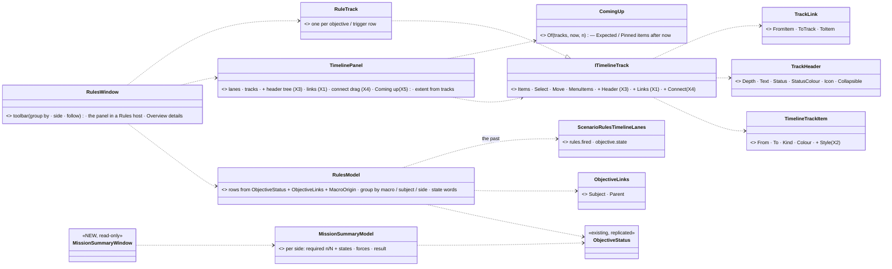
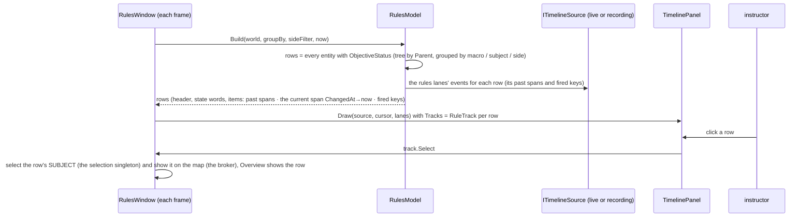
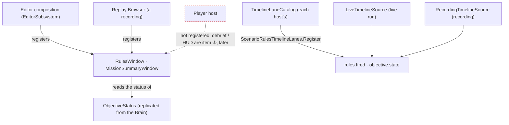

<!--STATUS
state: LIVE — DESIGN, leans RV-1 … RV-9 await the user
updated: 2026-11-02
build-state: DESIGN
current-answer: §3 (decisions) · §4 (phases)
stale-below: nothing
known-rot: none
related-designs:
  - docs/DESIGN_Scenario_Rules.md — OWNS the decisions this builds: SR-56 (objectives view), SR-103 (rules lanes), SR-105 / SR-109 / SR-110 (the rules view), SR-111 (mission summary), SR-112 (debrief / HUD — later here)
  - docs/designs/rules-view/README.md — the nine mockups (Main, MissionSummary, …); the SR rows win where they differ
  - docs/DESIGN_Director_Timeline_Editor.md — OWNS the ONE timeline panel (TE-21 / R-4075) and its lanes (§9c); TL-X1…X5 here extend it for every host
  - docs/DESIGN_Entity_Hierarchy_Views.md — the entity tree; the rules view's row tree is NOT that tree (rows are objectives / triggers, not entities in a relation)
  - docs/DESIGN_Macro_Authoring_Editor.md — the parameter bindings a trigger's Do tab will show (⛓ chips, MA-1)
-->

# DESIGN — **the rules view and the mission summary** (ui half of [HANDOFF_Coordinator_To_Ui_Rules_View_And_Summary](blueprints/batches/HANDOFF_Coordinator_To_Ui_Rules_View_And_Summary.md))

The handoff's items ① CE-4167 (the timeline extensions), ② the rules view, and ⑥ the first half of the mission summary are designed here. Their data exists.
Items ③ ④ ⑤ ⑦ ⑧ wait for behaviors' data (A1–A4, B3–B5) and are only placed here, not designed.

## 1. INVENTORY *(`2026-11-02`)*

**Queries:**
- graph: `.*(Objective|Rules|Trigger|Mission).*` Class → 80. **None is a view of objectives or triggers**: they are mission plans, BDC messages and various `*Rules` helpers.
- graph: `.*Timeline\w*(Window|Panel|Track|Host)$` → hosts found by grep instead: `EventTimelineWindow`, `ReplayTimelineWindow`, and `DirectorTracks` (3 `ITimelineTrack`s).
- grep: `ObjectiveStatus` / `ObjectiveLinks` / `ExerciseResult` · `IndexedLaneDefinition` providers (3: combat, behaviour, replication) · `GetObjectives` (debug API).
- ⚠ Coverage was not checked: `check_index_coverage` is not in the CLI.

| measured | where | so |
|---|---|---|
| the ONE timeline panel draws read-only LANES from an index and editable TRACKS above them; a track item is a `Key` or a `From…To` `Segment` with a colour; the row label is a flat `Label` drawn at a fixed `LabelWidth` | `Fdp.Presentation/ImGui/Panels/Timeline/TimelinePanel.cs:415-487` (`DrawTrack`); `ITimelineTrack.cs` | the rules view = one track per objective / trigger (SR-110). The panel lacks: styles beyond Key / Segment (TL-X2), a tree with a status in the label column (TL-X3), links between items on different rows (TL-X1), a connect gesture (TL-X4), a *Coming up* strip (TL-X5) |
| ⚠ the panel draws NOTHING without an index extent: `if (to <= from) { "No recording." ; return; }` | `TimelinePanel.cs:142-148` | in edit mode before a run there are no frames ⇒ the rules view would be blank ⇒ RV-2 (the extent also comes from the tracks) |
| a LIVE index exists: `LiveTimelineSource` evaluates the registered indexed lanes on the live world each frame | `Fdp.Toolkits/ReplayBrowser/Timeline/LiveTimelineSource.cs` | the rules view runs live and on a recording through the SAME source seam (`ITimelineSource`) |
| hit positions of every drawn track item are already collected each frame (`_trackHits`: track id, item id, x, y) | `TimelinePanel.cs:97, :451` | TL-X1's connectors are drawn from these after the tracks, with no second layout |
| `ObjectiveStatus` (replicated): role (Objective · Measure · Trigger), state, trigger state (Disarmed … Done), owner side, progress cur / need, value / target, score, points, `ChangedAt`, `LastFired`, `FireCount`, reason, title, kind, required, scored, weight, visible sides · `ObjectiveLinks {Subject, Parent}` · `ExerciseResult` | `Fdp.Toolkits/ScenarioRules/ObjectiveStatus.cs`, `ObjectiveLinks.cs`, `ExerciseResult.cs` | every row, its tree, its state words and its CURRENT span come from these. ⛔ They hold only the CURRENT state + when it changed, not history |
| ⛔ the SR-103 provider `ScenarioRulesTimelineLanes` (`rules.fired`, `objective.state`, …) is designed, NOT built; neither the ui nor the behaviors handoff lists it | grep `IndexedLaneDefinition` → 3 providers, none for rules; `DESIGN_Scenario_Rules.md` SR-103 | the PAST at actual times (item ②, "✅ now") needs it ⇒ RV-4 |
| no trigger / objective DEFINITION reaches a non-Brain node (behaviors A1 measures it) | the behaviors handoff, A1 | dependency connectors and expected bars wait (③) |
| `MacroOrigin` / `MacroInstance` on macro entities; the Scenario view groups by them (W-M1) | `Fdp.Toolkits/Scenario/Macros/MacroTypes.cs`; `ScenarioHierarchyAdapter` | the rules view's *group by macro* uses the same link |
| selecting an entity + *Show on map* already have one path (the selection singleton, `CenterOnEntitySystem` / `MapCamera.FocusOn` through the broker) | CE-4049; CE-4206 R3 | a row click goes the SAME way (SR-56: *"the ORBAT's own jump"*) |

## 2. The shape

*What the picture shows that prose hid:* the rules view adds NO drawing of its own. It is a model (no ImGui, railed as data) feeding tracks into
the ONE panel. Every visual it needs is a general panel extension (X1–X5), which the director's tracks get too. The past comes from a
lane provider, so the AAR, the director and the rules view read the same index (SR-103).

*What the picture shows that prose hid:* the windows read only REPLICATED data and the shared lanes. So any node that receives `ObjectiveStatus`
(the editor, a Replay Browser on a recording) can host them, with no Brain-side code. The Player is deliberately not a host yet.

## 3. Decisions

| # | decision | ⭐ lean |
|---|---|---|
| **RV-1** | the panel extensions (CE-4167), general for every host | ⭐ **X2**: `TimelineTrackItem.Style` (`Solid` default · `Expected` dashed outline · `Hatched` · `Pinned` diamond). **X3**: an optional `ITimelineTrack.Header` (`TrackHeader`: depth, text, status text + colour, icon, collapsible). The panel draws the label column as an indented tree with the status right-aligned. A collapsed node hides its descendants (tracks are given in tree order, so depth decides). **X1**: optional `ITimelineTrack.Links` (from my item → another track's item), drawn after all tracks as an elbow line with an arrowhead, from the `_trackHits` positions. A link whose end is not drawn (scrolled away, collapsed) is not drawn. **X4**: optional `CanConnect` / `Connect(fromItem, toTrack)`. A drag from a small handle at an item's right end onto another row calls it; nothing happens on a track that does not opt in. **X5**: `ComingUp.Of(tracks, now, n)`, a pure list of the next `Expected` / `Pinned` items after now, drawn as a strip below the lanes when the host turns it on. ⭐ All default-off members ⇒ the director and the trace lanes are unchanged until they opt in |
| **RV-2** | a blank panel before a run | ⭐ the extent also covers the TRACKS' items and `[0, now]`, so tracks draw in edit mode with no recording (today: "No recording."). The lanes keep their own rule |
| **RV-3** | the rows | ⭐ one `RuleTrack` per entity with `ObjectiveStatus` (objectives, measures, triggers). The tree comes from `ObjectiveLinks.Parent`. **Group by** macro (`MacroOrigin.Instance` → its `MacroInstance.Macro`, else *Scenario*) · subject (`ObjectiveLinks.Subject`'s name) · side (`Owner`). **Side** filter = `Owner`, which also respects `VisibleSides`. The state in words follows the mockup: *Achieved* · *Active 6:10* (since `ChangedAt`) · *Armed* · *Cooldown · 1/2* (`FireCount` of max when known) · *Acting* (the step count waits for A1). The status colour follows the legend |
| **RV-4** | the PAST at actual times | ⭐ build the SR-103 provider `ScenarioRulesTimelineLanes` (two indexed lanes: `objective.state` = a value change of `ObjectiveStatus.State` on objectives and measures, and `rules.fired` = `TriggerState` → `Fired`), registered like `CombatTimelineLanes`. The row's past spans and fired diamonds are read from those events, plus the current span `ChangedAt → now` from the status. ⚠ Cross-lane: `Fdp.Toolkits/ScenarioRules` is behaviors' folder. No handoff lists this item, and the view's past depends on it. Said in the commit and a note to behaviors |
| **RV-5** | acting on a row (now) | ⭐ click = select the row (the Overview) AND its SUBJECT through the selection singleton; *Show on map* = the broker's existing focus. The right-click menu now: *Show subject on map*, *Select subject*. ⏳ *Fire · Disarm · Re-arm · Set state* wait for behaviors A4 (⑤); they appear disabled with *"needs runtime control (behaviors A4)"* so the menu's shape is final |
| **RV-6** | the window | ⭐ `RulesWindow` (*Window ▸ Rules*), PerspectiveBound like the timeline windows. Toolbar: *Group by*, *Side*, *Follow now*, search; *Timeline* only (Graph / List later). Centre: the panel in a Rules host (its own lanes hidden except the rules lanes). Right: details of the selected row with the **Overview / Status** tab: title, kind, state, owner, subject (link), progress, value / target, score, required / scored, reason, fired n× / last. ⏳ When / Do / Rules / History / Bindings tabs need A1–A4. ⭐ Opens on a recording too, through the Replay Browser's source |
| **RV-7** | *"objectives about this unit"* (SR-56) | ⭐ one section in the entity inspector (the CE-1134 inspector): every row whose `ObjectiveLinks.Subject` is this entity, each with its state words and a link that selects it in the rules view. Empty ⇒ not drawn |
| **RV-8** | the mission summary, first half (⑥) | ⭐ `MissionSummaryModel` (pure) + `MissionSummaryWindow` (read-only, *Window ▸ Mission summary*), one card per side: **required objectives n / N** (`Required`, role Objective, `Owner` = side) with each state · **forces** = strength (alive units with `EntityInfo` of that side), casualties (`CombatLife.IsDestroyed`), macro-inserted (with `MacroOrigin`) · **result** from `ExerciseResult` (*running* until it ends). A list of the mission objectives with their states. ⛔ NO score, trend or pass mark: that is behaviors' B3 aggregation (⑦), never computed in the ui. ⭐ The same window opens on a recording |
| **RV-9** | where they live | ⭐ models in `Hrot.Presentation` (`Rules/`), pure and railed as data. The panel extensions in `Fdp.Presentation` (the panel's own assembly). The lanes provider in `Fdp.Toolkits/ScenarioRules`. Frame rails under `xvfb-run -a` for the panel extensions (one per X) and one for each window |

**Rejected — one line each:**
- *A rules-specific Gantt control* — R-4075: one panel; two timelines scrub and seek twice.
- *Reading history from a new store on the status* — SR-103 already rules the past is indexed lanes, which the AAR and the director share.
- *The rules view's tree as the entity tree's fourth relation* — its rows are objectives and triggers ordered by dependency and time, not entities in a parent relation; the entity tree stays entities (HV).
- *Computing scores or a pass mark in the summary* — the summary is a view; aggregation is behaviors' B3, never a second copy (the handoff's ⛔).
- *Hiding the not-yet-wired actions* — a menu whose shape changes when data arrives teaches the user twice; disabled with the reason is honest.

## 4. Phases

| phase | items | gate |
|---|---|---|
| **R1** | RV-1 X2 + X3 + RV-2 (styles, tree headers, extent from tracks) · RV-4 the lanes provider | rails: each style drawn (frame rail); the tree hides collapsed descendants; an empty index still draws tracks; the lanes index a state change and a fire (live + recording) |
| **R2** | RV-3 · RV-5 · RV-6 · RV-7 (the rules view, now-data) | rails on `RulesModel` (tree, grouping, side filter, state words, past spans from the lanes); a frame rail of the window; live check on a scenario with objectives and triggers |
| **R3** | RV-8 the summary's first half | rails on `MissionSummaryModel` (counts per side, casualties, inserted, result); a frame rail |
| **R4** | RV-1 X1 + X4 + X5 (connectors, connect, Coming up) on synthetic tracks | rails + frame rail. ⏳ The rules view USES them when behaviors A1 / A2 deliver (③) |

## 5. Claim table

| claim | code | design basis |
|---|---|---|
| the panel blanks with no index extent | ✅ `TimelinePanel.cs:142-148` | — (a gap, not a decision) |
| a live index source exists | ✅ `LiveTimelineSource.cs` | ✅ CE-3330 TE-17 |
| the status holds no history | ✅ `ObjectiveStatus.cs` fields | ✅ SR-103 (the past is lanes) |
| no rules lanes provider exists | ✅ grep, 3 providers, none for rules | ✅ SR-103 lean names it; ⛔ no handoff owns it |
| drawing the view needs no Brain-side change for ② and ⑥ | ✅ all fields replicated | ✅ the handoff's "✅ now" column |
| who builds the lanes provider | ⛔ **not decided** by any handoff | RV-4 proposes ui; behaviors may prefer to own it |
