<!--STATUS
state: LIVE — DESIGN ✅ RV-1 … RV-9 APPROVED + RE-1 … RE-10 APPROVED with four amendments (§7.4) (user, `2026-11-03`: *"approved"*)
updated: 2026-11-03 (§7 the rule editor designed; RV-4 built by behaviors; R3 all on the wire; ManDownedEvent for casualties; RV-8 extended to the whole summary on behaviors' B3–B5 + backend's S7; RV-6 Waits on / Starts)
build-state: DESIGN
current-answer: §3 (decisions) · §4 (phases) · §7 (the rule editor, RE-1 … RE-10)
stale-below: nothing
known-rot: none
related-designs:
  - docs/DESIGN_Scenario_Rules.md — OWNS the decisions this builds: SR-56 (objectives view), SR-103 (rules lanes), SR-105 / SR-109 / SR-110 (the rules view), SR-111 (mission summary), SR-112 (debrief / HUD — later here)
  - docs/designs/rules-view/README.md — the nine mockups (Main, MissionSummary, …); the SR rows win where they differ
  - docs/DESIGN_Director_Timeline_Editor.md — OWNS the ONE timeline panel (TE-21 / R-4075) and its lanes (§9c); TL-X1…X5 here extend it for every host
  - docs/DESIGN_Entity_Hierarchy_Views.md — the entity tree; the rules view's row tree is NOT that tree (rows are objectives / triggers, not entities in a relation)
  - docs/DESIGN_Macro_Authoring_Editor.md — the parameter bindings a trigger's Do tab will show (⛓ chips, MA-1)
  - docs/DESIGN_Man_Downed_Event.md — behaviors' ONE kill authority (CE-3364); the summary's casualty events and the kill feed read it
  - docs/DESIGN_Player_HUD_And_Debrief.md — the PLAYER's side of the same data; shares RulesReader (PH-1)
  - docs/blueprints/batches/HANDOFF_Coordinator_To_Behaviors_Rules_S4_Scores.md — behaviors builds what RV-8 reads: role composites ①, pass mark + Group ②, the score-history lane ④ (joins RV-4's provider), the debrief reads ⑤
  - docs/blueprints/batches/HANDOFF_Coordinator_To_Backend_Player_Score.md — backend's per-player game score; design DESIGN_Scenario_Rules.md §00.13 S7 (on backend) — the summary's game card reads it
-->

# DESIGN — **the rules view and the mission summary** (ui half of [HANDOFF_Coordinator_To_Ui_Rules_View_And_Summary](blueprints/batches/HANDOFF_Coordinator_To_Ui_Rules_View_And_Summary.md))

The handoff's items ① CE-4167 (the timeline extensions), ② the rules view, ③ connectors + expected bars, ⑤ runtime control and ⑥ the first half of the mission summary are designed here: their data exists. ⭐ **Updated `2026-11-02`:** behaviors delivered V-1 / V-2 / V-4 on `behaviors` (`59a8e5d23`, `DESIGN_Scenario_Rules.md` §00.10), which moved ③ and ⑤ from waiting to buildable.
Items ④ (live leaf values, V-3), ⑦ and ⑧ wait for behaviors' data (V-3 as built, B3–B5) and are only placed here, not designed.
⭐ **Updated `2026-11-03` (user: *"behaviors is already working on B3 to B5, backend on per-player scores … rely on them in the design"*):** ⑦ (*scores by level*, headline, trend, pass mark, attention, *why*) is now designed in RV-8 on the data the two handoffs build ([behaviors S4 ①②④⑤](blueprints/batches/HANDOFF_Coordinator_To_Behaviors_Rules_S4_Scores.md), [backend S7](blueprints/batches/HANDOFF_Coordinator_To_Backend_Player_Score.md)); ⑧ (debrief / HUD) lives in `DESIGN_Player_HUD_And_Debrief.md`.
⭐ **Updated again `2026-11-02`:** behaviors' S4 landed (`behaviors@02c50f84c`, [NOTE_Behaviors_To_Ui_Rules_S4_Group_And_Measures](blueprints/batches/NOTE_Behaviors_To_Ui_Rules_S4_Group_And_Measures.md)): `ObjectiveStatus.Group` (the section a standard is shown under), the measure kinds (`HitRatio` · `Count` · `ReportLatency` · `TimeTo` · `Sample`; `Score` already folds *lower is better*) and `MemberEvaluation` (one inserted root per member, `Subject` = the man). ⇒ the rules view groups measures by `Group`; the summary's *scores by level* (⑦) and the trainee debrief (⑧) become designable on this data — a later section, after R1–R4.

## 1. INVENTORY *(`2026-11-02`)*

**Queries:**
- graph: `.*(Objective|Rules|Trigger|Mission).*` Class → 80. **None is a view of objectives or triggers**: they are mission plans, BDC messages and various `*Rules` helpers.
- graph: `.*Timeline\w*(Window|Panel|Track|Host)$` → hosts found by grep instead: `EventTimelineWindow`, `ReplayTimelineWindow`, and `DirectorTracks` (3 `ITimelineTrack`s).
- grep: `ObjectiveStatus` / `ObjectiveLinks` / `ExerciseResult` · `IndexedLaneDefinition` providers (3: combat, behaviour, replication) · `GetObjectives` (debug API).
- ⚠ Coverage was not checked: `check_index_coverage` is not in the CLI.
- `2026-11-03` (RV-8 extension): graph `.*Injury.*` Class → `Injury` (`InjuryState Ok · Wounded · Incapacitated · Dead`, derived) · grep `Pass` in `ObjectiveStatus.cs` on `behaviors@bd3c05487` → none (S4 ② not landed) · read both handoffs + backend's §00.13 S7 (`backend@8437b7bff`).

| measured | where | so |
|---|---|---|
| the ONE timeline panel draws read-only LANES from an index and editable TRACKS above them; a track item is a `Key` or a `From…To` `Segment` with a colour; the row label is a flat `Label` drawn at a fixed `LabelWidth` | `Fdp.Presentation/ImGui/Panels/Timeline/TimelinePanel.cs:415-487` (`DrawTrack`); `ITimelineTrack.cs` | the rules view = one track per objective / trigger (SR-110). The panel lacks: styles beyond Key / Segment (TL-X2), a tree with a status in the label column (TL-X3), links between items on different rows (TL-X1), a connect gesture (TL-X4), a *Coming up* strip (TL-X5) |
| ⚠ the panel draws NOTHING without an index extent: `if (to <= from) { "No recording." ; return; }` | `TimelinePanel.cs:142-148` | in edit mode before a run there are no frames ⇒ the rules view would be blank ⇒ RV-2 (the extent also comes from the tracks) |
| a LIVE index exists: `LiveTimelineSource` evaluates the registered indexed lanes on the live world each frame | `Fdp.Toolkits/ReplayBrowser/Timeline/LiveTimelineSource.cs` | the rules view runs live and on a recording through the SAME source seam (`ITimelineSource`) |
| hit positions of every drawn track item are already collected each frame (`_trackHits`: track id, item id, x, y) | `TimelinePanel.cs:97, :451` | TL-X1's connectors are drawn from these after the tracks, with no second layout |
| `ObjectiveStatus` (replicated): role (Objective · Measure · Trigger), state, trigger state (Disarmed … Done), owner side, progress cur / need, value / target, score, points, `ChangedAt`, `LastFired`, `FireCount`, reason, title, kind, required, scored, weight, visible sides · `ObjectiveLinks {Subject, Parent}` · `ExerciseResult` | `Fdp.Toolkits/ScenarioRules/ObjectiveStatus.cs`, `ObjectiveLinks.cs`, `ExerciseResult.cs` | every row, its tree, its state words and its CURRENT span come from these. ⛔ They hold only the CURRENT state + when it changed, not history |
| ⛔ the SR-103 provider `ScenarioRulesTimelineLanes` (`rules.fired`, `objective.state`, …) is designed, NOT built; neither the ui nor the behaviors handoff lists it | grep `IndexedLaneDefinition` → 3 providers, none for rules; `DESIGN_Scenario_Rules.md` SR-103 | the PAST at actual times (item ②, "✅ now") needs it ⇒ RV-4 |
| ✅ **delivered by behaviors (`59a8e5d23`)**: `ObjectiveStatus` (on topic 171, every node) gained `DependsOn` / `ActsOn` (≤ 8 net ids each: the entities a trigger's `when` names / its `do` targets), `HoldFor` · `Delay` · `Cooldown` · `Deadline` and `ExpectedAt` (sim s of the next thing the owner knows will happen; 0 = unknown). Runtime control = `RuleControl` (430, brain-local) written through `EntityWriteRouter` as three attributes `Rule.Request` (40) · `Rule.Seq` (41) · `Rule.Origin` (42) in ONE write; the owner honours a new `Seq` once and journals it | `DESIGN_Scenario_Rules.md` §00.10 V-1, V-2, V-4 (behaviors) | ⭐ connectors (X1) = `DependsOn` → this row and this row → `ActsOn`; the dashed expected bar (X2) = now → `ExpectedAt`; Fire / Disarm / Re-arm / Reset / Activate are ONE router write each — ⛔ the ui never re-derives timing or links (V-2) |
| `MacroOrigin` / `MacroInstance` on macro entities; the Scenario view groups by them (W-M1) | `Fdp.Toolkits/Scenario/Macros/MacroTypes.cs`; `ScenarioHierarchyAdapter` | the rules view's *group by macro* uses the same link |
| selecting an entity + *Show on map* already have one path (the selection singleton, `CenterOnEntitySystem` / `MapCamera.FocusOn` through the broker) | CE-4049; CE-4206 R3 | a row click goes the SAME way (SR-56: *"the ORBAT's own jump"*) |

## 2. The shape

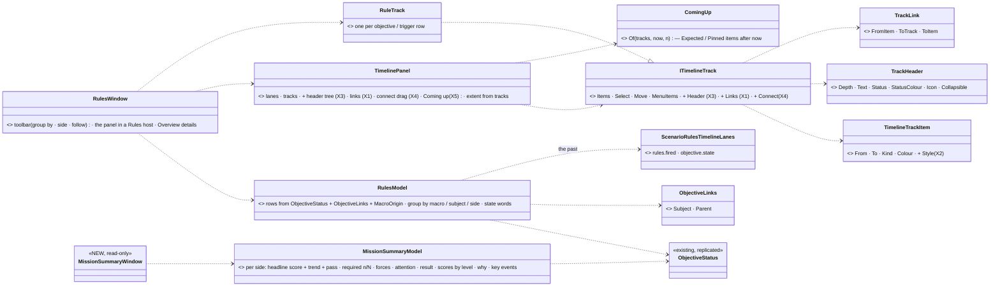

*What the picture shows that prose hid:* the rules view adds NO drawing of its own. It is a model (no ImGui, railed as data) feeding tracks into
the ONE panel. Every visual it needs is a general panel extension (X1–X5), which the director's tracks get too. The past comes from a
lane provider, so the AAR, the director and the rules view read the same index (SR-103).

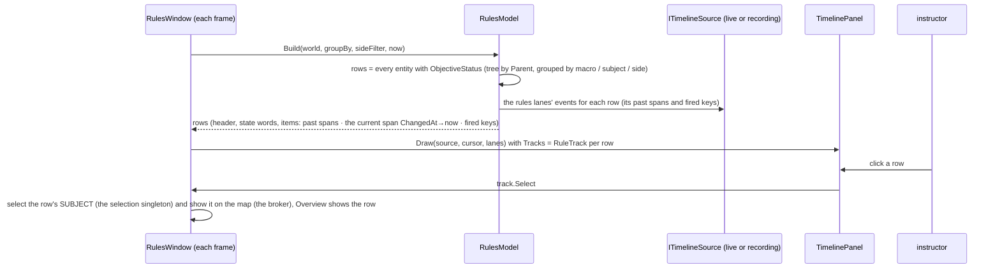

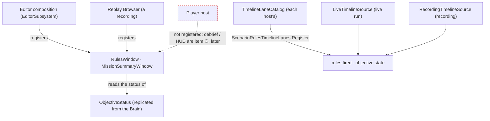

*What the picture shows that prose hid:* the windows read only REPLICATED data and the shared lanes. So any node that receives `ObjectiveStatus`
(the editor, a Replay Browser on a recording) can host them, with no Brain-side code. The Player is deliberately not a host yet.

## 3. Decisions

| # | decision | ⭐ lean |
|---|---|---|
| **RV-1** | the panel extensions (CE-4167), general for every host | ⭐ **X2**: `TimelineTrackItem.Style` (`Solid` default · `Expected` dashed outline · `Hatched` · `Pinned` diamond). **X3**: an optional `ITimelineTrack.Header` (`TrackHeader`: depth, text, status text + colour, icon, collapsible). The panel draws the label column as an indented tree with the status right-aligned. A collapsed node hides its descendants (tracks are given in tree order, so depth decides). **X1**: optional `ITimelineTrack.Links` (from my item → another track's item), drawn after all tracks as an elbow line with an arrowhead, from the `_trackHits` positions. A link whose end is not drawn (scrolled away, collapsed) is not drawn. **X4**: optional `CanConnect` / `Connect(fromItem, toTrack)`. A drag from a small handle at an item's right end onto another row calls it; nothing happens on a track that does not opt in. **X5**: `ComingUp.Of(tracks, now, n)`, a pure list of the next `Expected` / `Pinned` items after now, drawn as a strip below the lanes when the host turns it on. ⭐ All default-off members ⇒ the director and the trace lanes are unchanged until they opt in |
| **RV-2** | a blank panel before a run | ⭐ the extent also covers the TRACKS' items and `[0, now]`, so tracks draw in edit mode with no recording (today: "No recording."). The lanes keep their own rule |
| **RV-3** | the rows | ⭐ one `RuleTrack` per entity with `ObjectiveStatus` (objectives, measures, triggers). The tree comes from `ObjectiveLinks.Parent`. **Group by** macro (`MacroOrigin.Instance` → its `MacroInstance.Macro`, else *Scenario*) · subject (`ObjectiveLinks.Subject`'s name) · side (`Owner`). **Side** filter = `Owner`, which also respects `VisibleSides`. The state in words follows the mockup: *Achieved* · *Active 6:10* (since `ChangedAt`) · *Armed* · *Cooldown · 1/2* (`FireCount` of max when known) · *Acting* (the step count waits for A1). The status colour follows the legend |
| **RV-3a** | the rows BEFORE a run *(added `2026-11-03`, found by the live check)* | ⭐ 📐 **measured live, `showcase-bridgehead` in edit mode: `GET /objectives` → 0** — `ObjectiveStatus` / `ObjectiveLinks` are written only by the running brain, so in edit mode the view (and the rule editor, §7) had NO rows. A rule entity there carries only its AUTHORED definition: `Behavior { Name: "Trigger" \| a kind, Params: JSON }` (+ `BehaviorStartRecord`), `TkbIdentity` 8861 Trigger / 8860 Objective, `EntityInfo`. ⭐ `RulesReader` reads a row from the STATUS when the entity has one, else from the AUTHORED params: `common` (`ObjectiveRules.cs:27-47`: title · subject · parent · required · scored · weight · points · group · visibleSides · pass) gives the tree (Parent), the groupings and the side filter; the kind = `Behavior.Name`; the state words = *Authored* (role from the kind: Trigger / a measure kind / an objective kind); no past spans. *Waits on* / *Starts* from the `when` / `do` refs (`OnEntity.ref`, a step's `target`), the same derivation behaviors' V-1 does at assignment. ⛔ Not a second model: ONE row type, two sources, the status wins when present (a running rule) |
| **RV-4** | the PAST at actual times | ✅ **BUILT by behaviors** (`4e6d57c10`, [NOTE_Behaviors_To_Ui_Rules_Timeline_Lanes_Built](blueprints/batches/NOTE_Behaviors_To_Ui_Rules_Timeline_Lanes_Built.md)): `ScenarioRulesTimelineLanes` (`Fdp.Toolkits/ScenarioRules/`) in the one shipped catalogue — `objective.state` (Value = the `ObjectiveState` number), `rules.fired` (Value = `FireCount`; ⚠ the first sight carries the count it has — skip Value 0), `objective.score` (hidden; Value = `Score`, X = `Target`). ⭐ ui reads them, never a second provider; a new rules lane goes INTO that class. ⭐ `rules.fired` as the COUNT moving (not the `Fired` state edge) is right for the view: one diamond per fire, even a fire that re-arms within the frame. The row's past = those entries + the current span `ChangedAt → now`. ⭐ **Casualties** for *key events* (RV-8) and the debrief's moments: ✅ **`combat.downed`** (behaviors `532b79c4d`, `CombatTimelineLanes.Downed`): Subject = the victim, Other = who downed him (`Source`), Value = `InjuryState` (2 down · 3 dead), X = the victim's side — live and recorded |
| **RV-5** | acting on a row | ⭐ click = select the row (the Overview) AND its SUBJECT through the selection singleton; *Show on map* = the broker's existing focus. The right-click menu and the details' buttons: *Fire now* · *Disarm* · *Re-arm* · *Reset* (triggers) · *Activate* / *Deactivate* (objectives) — each ONE `EntityWriteRouter.For(world).Write(entity, [Rule.Request, Rule.Seq, Rule.Origin = Instructor])`, `Seq` = the last seen + 1 (behaviors' `DebugApiService.ControlObjective` is the precedent: reuse its rule, not a copy). An item not valid in the row's state is disabled with the reason (a final trigger: *"needs Reset"*). ⭐ A live edit is FOR THIS RUN ONLY (SR-109) — the view never writes the scenario file. ⭐ The result shows as the row's new state and the owner's `Reason`, not as a ui-side guess |
| **RV-6** | the window | ⭐ `RulesWindow` (*Window ▸ Rules*), PerspectiveBound like the timeline windows. Toolbar: *Group by*, *Side*, *Follow now*, search; *Timeline* only (Graph / List later). Centre: the panel in a Rules host (its own lanes hidden except the rules lanes). Right: details of the selected row with the **Overview / Status** tab: title, kind, state, owner, subject (link), progress, value / target, score, required / scored, reason, fired n× / last, ⭐ **Waits on** (`DependsOn`, each a link that selects that row) and **Starts** (`ActsOn`, the entities its Do creates or orders — a macro instance named with its unit count). ⭐ the other tabs: **§7 the rule editor** (RE-1 … RE-10). ⭐ Opens on a recording too, through the Replay Browser's source |
| **RV-7** | *"objectives about this unit"* (SR-56) | ⭐ one section in the entity inspector (the CE-1134 inspector): every row whose `ObjectiveLinks.Subject` is this entity, each with its state words and a link that selects it in the rules view. Empty ⇒ not drawn |
| **RV-8** | the mission summary (⑥ + ⑦), as the mockup | ⭐ `MissionSummaryModel` (pure) + `MissionSummaryWindow` (read-only, *Window ▸ Mission summary*, side switch *Blue / Red / Both*). ⛔ **Every number is a READ** of the replicated tree — behaviors builds the aggregation (S4 ①②④⑤), backend the game score (S7); the ui sums nothing. Per side: **headline** = the side's evaluation root (the `MemberEvaluation` whose `Subject` is the side / its top unit) — `Score`, the **trend** (its change over the last 10 min from the `objective.score` lane, RV-4) and the **pass mark** (`Pass`, S4 ②; *"not yet decided"* while the root is not closed) · **required objectives n / N** (`Required`, role Objective, `Owner` = side) with each state and progress · **forces** = strength (alive men with `EntityInfo` of the side), **wounded** / **down** / **dead** (`Injury.StateOf` = `Wounded` / `Incapacitated` / `Dead` — a STATE read, so a revived man counts as alive again, which an event count would not), macro-inserted (`MacroOrigin`, named by its instance) · **attention** = the measures of that side whose `Score < Pass`, worst margin first, each *"`Title` `Value` (target `Target`)"* · **result** from `ExerciseResult`. Below: **scores by level** — a tree table with three groupings: *Command chain* (the `MemberEvaluation` roots up `ObjectiveLinks.Parent`: platoon ▸ squad ▸ man), *Objectives* (the objective tree), *Roles* (the role composites, S4 ①); columns = `Score`, trend, and one column per measure `Group` (the member's child composite or measure in that group) · **why this score** for the selected row = its children: `Title`, `Value` vs `Target`, `Weight`, pass / fail, `Required` ✓ — and *Show the moments on the timeline →* (opens the rules view filtered to that row's subtree) · **mission objectives** (the list) · **key events** = the `objective.state` and `rules.fired` lane entries of the run + casualties from `combat.downed` (X = side ⇒ the side filter) (*"Blue KIA: Rifleman Svoboda"*, *"down"* for Incapacitated), newest first, each a seek on the timeline. ⭐ **A game scenario** (the game profile, S7): the card's headline is the side's team points (`MemberEvaluation aggregate: points`) and *scores by level* lists the men's `Points` roots — the same tree read, no game-specific model. ⏳ *Export report* later. ⭐ The same window opens on a recording |
| **RV-9** | where they live | ⭐ models in `Hrot.Presentation` (`Rules/`), pure and railed as data. The panel extensions in `Fdp.Presentation` (the panel's own assembly). The lanes provider in `Fdp.Toolkits/ScenarioRules`. Frame rails under `xvfb-run -a` for the panel extensions (one per X) and one for each window |

**Rejected — one line each:**
- *A rules-specific Gantt control* — R-4075: one panel; two timelines scrub and seek twice.
- *Reading history from a new store on the status* — SR-103 already rules the past is indexed lanes, which the AAR and the director share.
- *The rules view's tree as the entity tree's fourth relation* — its rows are objectives and triggers ordered by dependency and time, not entities in a parent relation; the entity tree stays entities (HV).
- *Computing scores or a pass mark in the summary* — the summary is a view; aggregation is behaviors' B3, never a second copy (the handoff's ⛔).
- *Hiding the not-yet-wired actions* — a menu whose shape changes when data arrives teaches the user twice; disabled with the reason is honest.

## 4. Phases

| phase | items | gate |
|---|---|---|
| **R1** | RV-1 X2 + X3 + RV-2 (styles, tree headers, extent from tracks) · RV-4 the lanes provider | rails: each style drawn (frame rail); the tree hides collapsed descendants; an empty index still draws tracks; the lanes index a state change and a fire (live + recording) |
| **R2** | RV-3 · RV-5 · RV-6 · RV-7 (the rules view, now-data) | rails on `RulesModel` (tree, grouping, side filter, state words, past spans from the lanes); a frame rail of the window; live check on a scenario with objectives and triggers |
| **R3** | RV-8 whole — ⭐ **`2026-11-03`: everything it reads is on the wire** (behaviors S4 ①②④⑤ + backend S7 merged at `ui@` this commit): `Pass` on every status (`ObjectiveStatus.Pass`, one `ObjectiveRules.PassOf`) · role means = `SelectionMean` children of the evaluation titled `All <role>`, group `roles` · standard means `<title> (mean)` (the squad's mean of a standard) · the score history `objective.score` · S7 `Points` roots, `Count` kills / assists / deaths / captures / team kills, `Best` awards · ✅ casualties from `combat.downed` (CE-3364 D5) | rails on `MissionSummaryModel` from synthetic statuses against the AS-BUILT names (counts per side, wounded / down / dead, inserted, the three level groupings, group columns, why = children with `Pass`, attention, trend from lane entries, key events); a frame rail; live: `showcase-bridgehead` (training), `showcase-crossfire` (game card) |
| **R4** | RV-1 X1 + X5 (connectors, Coming up) used by the rules view from `DependsOn` / `ActsOn` / `ExpectedAt` (③) · X4 (connect) on synthetic tracks only — the *drag to connect* that WRITES a `when` waits for the trigger editor (④) | rails + frame rail |

## 5. Claim table

| claim | code | design basis |
|---|---|---|
| the panel blanks with no index extent | ✅ `TimelinePanel.cs:142-148` | — (a gap, not a decision) |
| a live index source exists | ✅ `LiveTimelineSource.cs` | ✅ CE-3330 TE-17 |
| the status holds no history | ✅ `ObjectiveStatus.cs` fields | ✅ SR-103 (the past is lanes) |
| no rules lanes provider exists | ✅ grep, 3 providers, none for rules | ✅ SR-103 lean names it; ⛔ no handoff owns it |
| drawing the view needs no Brain-side change for ② ③ ⑤ ⑥ | ✅ all fields replicated, control through the router (`59a8e5d23`) | ✅ the handoff's "✅ now" column + §00.10 |
| who builds the lanes provider | ✅ behaviors built it (`4e6d57c10`) | ✅ S4 handoff ④ |
| the summary needs no ui-side aggregation | ✅ `Pass` (`ObjectiveStatus.cs:42`), `SelectionMean` (`Brains/Objectives/SelectionMeanBehavior.cs`), S7 `Points` / `Best` / `Count` — merged | ✅ S4 ①②④⑤ as built (`DESIGN_Scenario_Rules.md` §00.11), S7 as built (§00.13) |
| wounded is readable on every node | ✅ `Injury.StateOf` derived from replicated `Health` (`Injury.cs:8-31`) | ✅ `DESIGN_Injury_States.md` (CE-2155) |
| *Waits on / Starts* need no new data | ✅ `DependsOn` / `ActsOn` on the status (`ObjectiveStatus.cs:68-72`) | ✅ behaviors V-1 (§00.10) |

## 6. AS BUILT — R1 *(ui, `2026-11-03`, CE-4167 part 1: RV-1 X2 + X3, RV-2 — general panel extensions, no rules view yet)*

⭐ Built as designed in §3 RV-1 / RV-2; the rest of this design stays `DESIGN`. All in `FDP/Engine/Fdp.Presentation/ImGui/Panels/Timeline/` (ui-only, no cross-lane edit). Every new member defaults OFF, so the director's tracks are unchanged (rail: no `Header`, every item `Solid`, flat label column).

| | as built | where |
|---|---|---|
| **X2** item styles | `TimelineTrackItemStyle { Solid, Expected, Hatched, Pinned }` = one more optional last field on `TimelineTrackItem`. Decisions are pure (`TrackLayout.DrawOf` → `ItemDraw`): *Solid* = today (fill + edge + grips ≥ 6 px; a key a filled diamond) · *Expected* = dashed outline, no fill, no grips (a key: a hollow diamond) · *Hatched* = outline + diagonal lines (`HatchLines`, clipped to the box), no fill · *Pinned* = a diamond at the start with a vertical tick (a Pinned **segment** is drawn solid with the diamond and tick at its start). Dashes: `Dashes` | `ITimelineTrack.cs`, `TrackLayout.cs`, `TimelinePanel.DrawTrack` |
| **X3** tree rows | `record TrackHeader(Depth, Text, Status?, StatusColour?, Icon?, Collapsible)` and `ITimelineTrack.Header` (default null). With a header the label column draws indent by depth, the expand arrow (`v` / `>`, a click toggles), the icon, the text and the status right-aligned in its colour (`PlanHeader`; the status is dropped, never overdrawn, when there is no room after the text). `TrackLayout.Visible` hides the tracks after a collapsed node that are DEEPER, up to the next at its depth or shallower (siblings stay; a header-less track ends a collapse). The panel keeps the collapsed set by track id (`SetCollapsed` / `IsCollapsed`, so a host can restore it). ⚠ The label column widens from 84 to 240 px ONLY while a drawn track has a header (`LabelWidthFor`) | same + `DrawHeader` |
| **RV-2** extent | no recording (index extent `to <= from`) but tracks with items ⇒ the extent is `[min(0, every From), max(now, every To / From)]` in sim seconds, at least 10 s wide (`ExtentOfTracks`), and the tracks and the ruler draw instead of *"No recording."*. `now` = the cursor's playhead on a sim axis, else 0. ⚠ **Deviation / finding:** a host with no recording has NO wall time map, so on its wall axis a sim-second item cannot be placed — the panel then puts the tracks on a plain sim axis of its own (`TimelineAxis.Sim` over an identity map, ticks = seconds) for that frame, and the playhead is its sim zero. A recording keeps its own extent; the lanes keep their own rule (no index ⇒ none). `TimelineView.MinSpan` needed no change (default 1/6 s; the extent is never narrower than 10 s) | `TimelinePanel.Draw`, `TrackLayout.ExtentOfTracks` |

Rails: `TimelineTrackStylesAndTreeTests` (pure: each style's geometry, dashes and hatch bounds, header indent / arrow / icon / status, collapse hides deeper not siblings, label width, extent from tracks) · `DirectorTracksTests.CE4167_…` (director tracks at the defaults) · `TimelinePanelFrameRail.CE4167_R1_…` (a real frame, NO recording: every style, a two-level tree with statuses, collapse; screenshots viewed, not committed). Red-proofs (each compiles): X2 — `Expected` given a fill · X3 — `Visible` hiding every following track (siblings too) · RV-2 — the extent starting at the first item instead of `min(0, …)`.

## 6b. AS BUILT — R2 *(ui, `2026-11-03`, CE-4216: RV-3, RV-5, RV-6, RV-7 — the rules view, now-data)*

⭐ Built as designed in §3 RV-3 / RV-5 / RV-6 / RV-7 over RV-4 (behaviors' lanes) and §6's panel extensions; RV-8 (the mission summary) and RV-1 X1 / X4 / X5 are R3 / R4. Window ▸ Rules on the editor, **and on a recording in the Replay Browser** (the source seam: the same class, a different world and source).

| | as built | where |
|---|---|---|
| **reader** | `RulesReader.Read(world)` = every entity with `ObjectiveStatus` (+ `ObjectiveLinks`, the macro through `MacroOrigin.Instance` → the managed `MacroInstance.Macro`). ⭐ The ONE reader — the player HUD (PH-1) reads the same shape; ⛔ no second parse of the status | `Hrot.Presentation/Rules/RulesModel.cs` |
| **RV-3** model | `RulesModel.Build(world, RulesOptions, IRulesHistory?, now)` → `RulesView` of groups of `RuleRow` (pure, no ImGui). Tree from `ObjectiveLinks.Parent` (a cycle cannot loop it). Group by **Macro** (the instance's macro path; authored rows under *Scenario*, first) · **Subject** (the subject's name; *(no subject)* last) · **Side** (`Owner`: Blue / Red / Neutral). Side filter = `Owner` or a `VisibleSides` bit; the search is by title and keeps a match's ancestors so the tree stays whole. State in words + colour per the mockup legend (`StateWords`, `ColourOf`): objective / measure by `ObjectiveState`, *Active m:ss* since `ChangedAt`; an active trigger by its machine (*Armed · Holding · Waiting · Acting n/N · Cooldown · n× · Done · Disarmed*). The past: `IndexRulesHistory` reads the `objective.state` / `rules.fired` lanes at the frames' sim times → spans change→change, the last to *now* in the status's own state (a trigger that is holding / waiting / cooling is **hatched**), fires as **Pinned** diamonds; no history ⇒ the one span `ChangedAt → now`; `ExpectedAt` ⇒ an **Expected** stretch | same |
| **tracks** | `RuleTrack : ITimelineTrack` per row — `TrackHeader` (depth, title, state words in the state's colour, role icon `O` / `M` / `T` — the panel font has no ◎ ◈ ⚡), spans as Segment items, fires as Key items. A group is a `RuleTrack` with a header only. The panel is given NO lanes: the tracks carry the same history | `Hrot.Presentation/Rules/RuleTrack.cs` |
| **RV-5** actions | `RuleCommands` (`Fdp.Toolkits/ScenarioRules`) = the ONE write: `Control` / `Edit` through `EntityWriteRouter`, `Seq` = the entity's last + 1; **`DebugApiService.ControlObjective` / `EditObjective` now call it** (cross-lane edit, named in the commit: result and refusal text unchanged) and the window calls it with `RuleOrigin.Instructor`. `DisabledReason(status, request)` mirrors the owner's refusals; the menu and the buttons list EVERY item (a trigger: *Fire now · Disarm · Re-arm · Reset*; an objective / measure: *Activate · Deactivate · Reset*) and an invalid one is **disabled WITH its reason** (menu label *"Fire now — it is acting"*, button tooltip). A host that cannot ask (a recording) passes `blocked` ⇒ every item carries that reason | `RuleCommands.cs`, `RulesModel.ActionsOf`, `RulesWindow` |
| **RV-6** window | toolbar *Group by · Side · Follow now · search* · the timeline panel (only the tracks) · the Overview on the right (title, kind, state, owner, subject, progress, value / target, score, pass GO / NO-GO, required / scored, reason, fired n× / last, deadline; *Waits on* (`DependsOn`) and *Starts* (`ActsOn`) as links — a rule link selects THAT row, an entity link selects the entity — a started macro instance is named *"macro m, n units"*) · the buttons + *Show on map*. A click on a row's **header or span** selects the row AND its subject through the host's ONE selection (`Action<int>`: the editor `SelectNetworkEntity`, the Replay Browser the selection request); *Show on map* centres through `CenterOnEntityCommand`. `RulesWindow.Probe` (also in the panel snapshot) is what a rail reads | `Hrot.Presentation/Windows/RulesWindow.cs` |
| **RV-7** | ⚠ **Deviation:** not a section of *"the CE-1134 inspector"* — CE-1134 is the map's centre-on (the brief's pointer was wrong). It is a **Details tab, *Objectives***, in the shared `EntityDetailsBundle` (so every host gets it): offered for ONE selected unit that some rule is about, and only then; its rows are `ObjectivesAboutModel.Of` = the rules view's own rows filtered by subject; a click calls the host's `OpenRule` (`EntityDetailsHostServices.OpenRule`, passed by the editor and the Replay Browser) which selects the row in Window ▸ Rules and focuses it. Rank 32 (below Components 30 … the default view is the highest rank, so the tab never becomes the default) | `Hrot.Editor.AiShared/Shell/EntityObjectivesView.cs`, `EntityDetailsBundle.cs` |
| **RV-3a** rows before a run | `RulesReader.Read` = the rows with an `ObjectiveStatus` (they win) PLUS every entity whose `BehaviorStartRecord` params carry a `common` block and has no status. `AuthoredRules.Parse` reads the params with `JsonDocument` (tolerant: bad JSON or no `common` ⇒ not a rule) and fills a SYNTHETIC `ObjectiveStatus` — title (else the entity's name), kind = the behaviour name, role (*Trigger* → Trigger; `Count · HitRatio · ReportLatency · TimeTo · Sample · Points · Best · SelectionMean` → Measure; else Objective), group, required / scored / weight / points / pass / deadline / `VisibleSides`, `Owner` = the subject's `EntityInfo.ForceId` (else the rule's own, else Neutral), `DependsOn` = every `ref` in the `when` (recursive), `ActsOn` = every `target` / `ref` in the `do` steps (≤ 8 each). Tree = `common.parent`. The row is `Authored`: state word *Authored* (grey), no spans / fires / expected, every action listed and **disabled with *"not running — start the exercise"*** (`RulesModel.ActionsOf(RuleRow)`), the Overview without score lines. ⚠ A link authored only as `"@Key"` / a GUID (no `NetworkId`) reads as none before a run. ⚠ The measure kinds are a name list in `AuthoredRules.MeasureKinds` (the kind registry is not reachable from the reader; the TKB type 8860 / 8861 does not tell measure from objective) | `Hrot.Presentation/Rules/AuthoredRules.cs` |

**Deviations, argued.** ① RV-7 as above (a tab, not a section: the Brain tab's embeds are about behaviours; a tab that appears only when there is something to show gives *"empty ⇒ not drawn"* for free, on every host). ② `ITimelineTrack.SelectRow()` (a default no-op) — a click on a track's header picks the row; the arrow alone folds a node (before, any header click folded it; no existing rail relied on that). ③ A track item with its own `Colour` now tints its segment fill and outline in the panel (it was a fixed blue; items without a colour are unchanged) — the rules view's state colours need it. ④ *Cooldown · n/max* needs the trigger's max fires, which the status does not carry: it shows *n×*. ⑤ Rows without a durable network id are skipped (they cannot be asked, linked or selected).

Rails (all ui-owned): `RulesModelTests` (30 + the authored ones: tree from parent, kind to role, the three groupings and the side filter, Waits on / Starts from when / do, the status wins, not-a-rule params; the tree, a cycle, the three groupings, the side filter incl. `VisibleSides`, the search, every state word and colour, spans from lane entries, the index history, fires, Waits on / Starts, the macro naming, the actions and their reasons, the Overview, RV-7's rows) · `RulesWindowFrameRail` under `xvfb-run -a` (the rows drawn with headers; a click on a span and on a header selects the row and its subject; an acting trigger's *Fire now* disabled with its reason; a failed objective's *Activate* disabled, *Show on map* disabled without a subject; on a recording every action carries *"a recording is read-only"* and asking writes nothing) · `TheObjectivesViewTests` (the tab offered only for a unit a rule is about, never the default, `OpenRule` forwarded on the CONSTRUCTED tab) · the DebugApi's `TheObjectivesRouteShowsTheTreeTests` (control + edit through the shared helper, unchanged). Red-proof: `ShownTo` without the `VisibleSides` clause ⇒ `TheSideFilter_…` red (reverted; 30/30). RV-3a: `ExtentWithoutItems` off => `InEditMode_...` red (reverted).

## 6c. AS BUILT — R3 *(ui, `2026-11-03`, CE-4217: RV-8 — the mission summary)*

⭐ Built as designed in §3 RV-8. **⛔ The ui sums nothing**: every number is a READ of a replicated `ObjectiveStatus` (`Score`, `Pass`, `Value`, `Target`, `Weight`), of `ExerciseResult`, of a lane entry, or a COUNT of men by injury state. The rows are `RulesReader`'s — the summary is a second consumer of the ONE reader. Window ▸ **Mission summary** on the editor and on a recording (Replay Browser), read-only, side switch *Blue / Red / Both*.

| | as built | where |
|---|---|---|
| **history** | `IndexSummaryHistory(TimelineIndex)`: the `objective.score` lane per rule (the trend), and the entries of `objective.state` · `rules.fired` · `combat.downed` with the frame's sim time **and wall ticks** (the seek target). A fire of Value 0 is skipped | `Rules/MissionSummaryModel.cs` |
| **headline** (precisely) | the side's **OVERALL score** = its **top-most scored ROOT**: a scored objective-role row whose side (its subject's `EntityInfo.ForceId`, else `Owner`) is the side and whose `Parent` is none, or is a row of another side or a neutral aggregate (a game's *All players*). *Bridgehead* (the root over Mission / Conduct / Members) wins over *Members* (one part of it: it is a row of *Scores by level*); a `MemberEvaluation` is the headline only when it IS the root (a game's `members: side` evaluation, or a scenario whose only root it is). **Several roots** for the side: the first is the **required** one with the **largest weight** (then the lowest id), the others ride along as *(title, score)* (`Others`). *Score*, *Pass* = that root's, **trend** = Score now − the last `objective.score` entry at or before now − 10 min (else the first entry: *since start*; fewer than two entries ⇒ none, never a guess), **decided** = the row is final or `ExerciseResult.Phase == Ended` (else *not yet decided*), GO = `Score ≥ Pass` when `Pass > 0`. *(W-R3b `2026-11-03`: the first cut took the top-most `MemberEvaluation` first — on Bridgehead 0.78 instead of 0.58; superseded.)* |
| **required n / N** | the **leaf objectives of the exercise itself** — role Objective, no children, not a `MemberEvaluation`, not under one, not a `Points` root — with `Required` and `Owner` = the side; each with its state words, colour and progress |
| **forces** | a count of the side's **men**: `Health` + `InjuryThresholds` + `EntityInfo` side, not a unit commander (`CombatEffective.IsUnit`), not a rule entity. ⚠ `ObjectiveCensus.IsMan` (Hrot.AI.Behaviors) is not reachable from `Hrot.Presentation`; this is its test **without its in-the-fight clause**, because the card counts the down and the dead. `Injury.StateOf` ⇒ wounded / down / dead; in the fight = the rest; **inserted** = carries `MacroOrigin`, named by the instance's macro (*"test/qrf ×12"*) |
| **attention** | the measures (role Measure, not `Points`) whose subject is the side's, with `Pass > 0` and `Score < Pass`, **worst margin first** (`Pass − Score`): *"Title Value (target Target)"* |
| **result** | `ExerciseResult`: phase, the side's outcome / points / score, reason |
| **scores by level** | three tables over the same rows: **Command chain** = the `MemberEvaluation` rows (named by their subject) and the rows whose `Parent` is one (the man's member root), by `Parent` · **Objectives** = every non-trigger row not in the evaluation, by `Parent` · **Roles** = the `SelectionMean` rows, role means (`group roles`) first. Columns = Score · trend · **one per measure group**: a cell is the `Score` of the row's CHILD in that group (the first by id) — never a sum |
| **why** | `MissionSummary.Why(id)` = the children by `Parent`, measures first: value vs target (a measure) or score, weight (0 = 1), pass / fail (`Score ≥ Pass`), required ✓. *Show the moments on the timeline →* calls the host, which opens Window ▸ Rules filtered to the subtree: `RulesOptions.SubtreeOf` (the rule and everything under it, ancestors above it dropped) + `RulesWindow.ShowSubtree` + a toolbar chip with its way out |
| **key events** | the three lanes, newest first (≤ 200): an objective's verdict (*achieved / failed / skipped* — starting is not news), a trigger *fired*, a casualty (*"Blue KIA: Rifleman Svoboda"* / *down*, side from the lane's X); each is a **seek** on the host's timeline cursor (`ITimelineCursor.Seek(ticks)`), where it can seek |
| **game card** (S7) | a side has one when a **`Points`-kind root whose parent is a `MemberEvaluation`** exists for it: team points = **that evaluation's own `Value`** (never the sum of the men's); each man's `Points` root (`Value`) with his `Count` children by title (kills, assists, deaths, captures …), ranked by what the roots say; awards = the `Best` rows with a subject |
| **export** | *Export report* listed, disabled, tooltip "later" |

**Deviations / findings (measured live on `showcase-bridgehead` and `showcase-crossfire`, numbers equal `GET /objectives`).** ⓐ A rule's side (`SideOfRule`) — ⭐ **AMENDED `2026-11-03` (W-H3, backend's answer: `Owner` is a CAPTURE field, written only by `HoldArea`)**: its OWN entity's `EntityInfo.ForceId` when authored and not Neutral, else its subject's, else `Owner` (a rule expanded from a MACRO carries the template's side — *Friend* for every man — so for it the subject's side wins; measured: Red's scores landed on the Blue scoreboard). The rules view's side filter and its *Side* grouping use it too (they read `Owner` before). ⛔ SUPERSEDED: *its subject's side, else Owner*. ⓑ **Attention skips measures under a `Points` root** (the S7 counters kills / assists …: Score 0 < Pass is how a counter starts, not a standard missed), and each line names its subject (*"Hit ratio 0.02 (target 0.3) · Blue Squad 3"*); the window shows the worst five and *"… and n more"*. ⓒ On a game card the headline is the side's **team points** (the evaluation's own `Value`); the players table lists each man's `Points` and counts. ① Window ids: `editor_mission_summary`, `rb_mission_summary`. ② A group column reads ONE child (the first by id): a member with two measures in one group shows the first — the model will not add them; a role / standard mean placed by S4 under the evaluation fills the unit rows' cells. ③ *Cooldown*-style words come from `RulesModel` (one place). ④ Forces count bodies that still EXIST: a destroyed entity is in none of the states — the KIA line of the key events (lane) carries those.

Rails (ui-owned): `MissionSummaryModelTests` (14: headline, fallback, trend both ways, required, forces, attention order, the three groupings, group columns, why, key events from the three lanes, the index history, the game card, the subtree filter) · `MissionSummaryWindowFrameRail` under `xvfb-run -a` (cards, a row's why, the side switch, export disabled). Red-proofs: `Why` with the pass / fail inverted ⇒ `Why_IsTheChildrenWithPassFail…` red; restoring the first cut (a `MemberEvaluation` counted as a root AND preferred — an ordering change alone stayed green, so it proved nothing) ⇒ `TheHeadline_IsTheSidesOverallRoot…` red (both reverted).

## 6d. AS BUILT — R4 *(ui, `2026-11-03`, CE-4221: RV-1 X1 · X4 · X5 used by the rules view; CE-4223 part 0)*

⭐ Built as §3 RV-1 / §4 row R4 say. Every new `ITimelineTrack` member defaults OFF ⇒ the director's and the trace lanes' tracks are unchanged (`TrackConnectorsAndComingUpTests.ADirectorLikeTrack_HasEveryNewMemberOff` · `TimelinePanelFrameRail.CE4221_R4_…`'s last step). All in `FDP/Engine/Fdp.Presentation/ImGui/Panels/Timeline/` (a cross-lane edit: the shared panel).

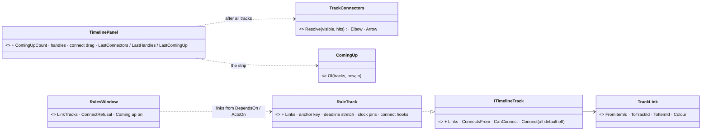
*What the picture shows:* the panel only DRAWS what a track hands it (links, handles) and says WHAT was dropped WHERE; the rules view decides which rows link and what a drop means.

| | as built |
|---|---|
| **X1 connectors** | `TrackConnectors.Resolve` (the visible tracks and this frame's item hits): a link is drawn only when BOTH items were drawn (`TrackItemHit` gained `XEnd`, the item's right end) — a collapsed row or an item scrolled out leaves no hit, so no arrow and no second layout. Elbow with an arrowhead; its vertical run is kept inside the row (a source that runs to *now* sits at the edge) |
| **X4 connect** | a `ConnectsFrom` item shows a small handle at its right end; pressing it starts a connect drag (not an item drag); the row under the mouse that answers `CanConnect` is outlined; the release calls `Connect(item, row)` ONCE. A track that did not opt in has no handle, and a drag that starts elsewhere is not a connect |
| **X5 Coming up** | `ComingUp.Of`: Expected / Pinned items after now, soonest first, ties in track order; an Expected SEGMENT happens at its end; the same moment named by a stretch and a diamond on one row is one line. The strip is drawn below the lanes (the lanes give it the room) when `ComingUpCount > 0` |
| **rules view** | arrows `X → the trigger that waits on X` (`DependsOn`) and `rule → what it starts` (`ActsOn`), one per pair; a deadline = an Expected stretch + a Pinned diamond, a `ScenarioTime` condition of a trigger's `when` = a Pinned diamond (`RulesModel.ClockPins`, read from the authored params the node holds); an authored row (edit mode) carries ONE grey anchor key at 0 — where an arrow enters and the handle sits (`InEditMode_TheAuthoredRulesAreDrawn…` now expects it); Coming up on (5). The window's probe lists `Arrows` and `ComingUp` |

**Findings.** ① ⭐ **The editor's death on ImGui's 16-bit vertex limit (CE-4223) was this panel's:** an Expected / Hatched item whose end is far outside the window was dashed / hatched over its whole length. Now clipped to the row and budgeted; the live `FrameStats` line names the largest draw list (the Event Browser, ≈ 10 k — measured, not the cause). ② A live source runs to *now* and its target started at 0, so the arrows point back to the left over the row — true to "waits on", noisy to look at. ③ ~~A scenario's authored `when` links by key / GUID read 0 before a run, so edit mode showed few arrows~~ — SUPERSEDED (CE-4225, §7.8): `AuthoredRules` resolves them through `LiveRefScope`; `showcase-bridgehead` shows 10 edit-mode arrows. ④ Pre-existing, not fixed: on a plain sim axis with no recording the hover readout is garbage (`1065488423:34`), and a view carried over from a live run opens on its last seconds.

Rails: `TrackConnectorsAndComingUpTests` (5: a link → the connector from the source's end to the target's start · the hidden-end rule · elbow and arrow geometry · Coming up's filter / order / cap / ties · every default off) · `TimelinePanelFrameRail.CE4221_R4_…` (a real frame: the arrow's pixels, handles only on opt-in tracks, a drag calls `Connect` once and only where accepted, a collapsed target hides the arrow, no Coming up when off) · `RuleEditorR5cTests` (the links from `DependsOn` / `ActsOn`; deadline and clock pins) · `DrawListVertexRail` (500 Event Browser rows ≈ 10 k; 20 far items 4 928). Red-proof: A2 inverted (§7.8) reddens R5c's rails; the connector rail's own mutation was not run. **Live (`showcase-bridgehead`, live run):** nine arrows (`GET /panels/editor_rules` → `arrows`), Coming up listing *Reach phase line RED deadline 15:00 · Ease off clock 20:00 · End clock 45:00* (screenshots viewed, not committed).

## 7. The rule editor — the trigger and objective tabs *(DESIGN, `2026-11-03`; handoff items ④ ⑤; ✅ RE-1 … RE-10 APPROVED (user, `2026-11-03`: *"approved"*) with the four amendments of §7.4)*

🔒 *User, `2026-11-03`: "What is the status of trigger editor, are you planning to implement it together with the objective view/editor? Are they
related?"* → *"yes, send the asks to behaviors and design the editor"*. Mockups: [`TriggerDetails`](designs/rules-view/mockup/TriggerDetails.html) ·
[`ObjectiveDetails`](designs/rules-view/mockup/ObjectiveDetails.html) · [`EditAtRuntime`](designs/rules-view/mockup/EditAtRuntime.html); decisions SR-109, SR-95, SR-93/94.

### 7.1 INVENTORY *(`2026-11-03`)*
**Queries:** graph `.*(Trigger|Objective|Rule|Action)(Params|Step|Catalog|Catalogue|Dto|Spec).*` Class → `BehaviorActionCatalog` (the BLUEPRINT action catalogue, not the rule steps) + test doubles · graph `.*(ParamsPanel|ParamsForm|ParamsEditor|StructEdit|DtoForm|FieldEditor|AssetEditCommand).*` Class → 25, among them **`BehaviorParamsForm` / `BehaviorParamsEditor`** (`Hrot.Presentation/Behavior/`), `PredicateValueFieldEditor`, `PickableLeafFieldEditor`, `AssetEditCommand` · graph `.*(Predicate|Condition)(Builder|Editor|Form|Panel|Widget).*` → `PredicateBuilderState` (breakpoints) only · grep `RegisterFieldEditor<` · `TriggerParamsJsonDto` · `ActionStep` · `RunActionsState` · `ApplyTask`. ⚠ coverage not checked (no `check_index_coverage` in the CLI).

| measured | where | so |
|---|---|---|
| a rule entity runs a behaviour whose params are ONE DTO: a trigger = `TriggerParamsJsonDto { common, when: SearchPredicateDto, holdFor, delay, cooldown, repeat, maxFires, fireIfTrueWhenArmed, whileTrue, do: List<ActionStep> }`; an objective / measure = its kind's DTO (`HoldAreaParamsJsonDto`, `CountParamsJsonDto` …, each with `common`) | `Hrot.Core/MapDefinitions/Behavior/ObjectiveParamsJsonDtos.cs:18-313` | the tabs are VIEWS of one params document, not separate models |
| **THE ONE PARAMS FORM** edits any behaviour's params as a StructEdit document and gives back the JSON an assignment carries; the AI section and the mission panel draw it | `BehaviorParamsForm.cs:24-139` (CE-3043 / CE-1023) | ⭐ the editor draws THIS. ⛔ no rule-specific form |
| the editor already applies a task's params: edit mode `BehaviorIngress.AssignNow` (the scenario entity), running `AssignBehaviorEvent` (a RE-assign) | `EntityAiDetailsView.cs:171-173` | edit mode needs nothing new. ⚠ running restarts the rule (its fire count, cooldown and progress are lost) ⇒ ask ② |
| the condition builder for `SearchPredicateDto` exists: `PredicateValueFieldDrawer`, but it is `internal` to `ReplaySearchPanel`, and its field editor is registered only in the Replay Browser's service, gated by the field NAME `Predicate` | `ReplaySearchPanel.cs:272`, `PredicateValueFieldDrawer.cs:23`, `PredicateValueFieldEditor.cs:19`, `ReplayBrowserSubsystem.cs:1013`; the standard `ComponentEditServices` (`:19-28`) lacks it | ⭐ make it a STANDARD leaf (by type), so `when` gets the same builder the replay search and breakpoints use |
| a step = `ActionStep : BindableNode { act, args: JsonObject }`; the catalogue gives each action's `ShortName`, `Fqn`, `ParamsType` and a `Refusal` | `ActionList.cs:22-30`, `ActionCatalogue.cs:19` | the Do row's args are a params document of `ParamsType`, drawn by the same form machinery; ⛓ binds through `BindableNode` (MA-1) |
| live leaf values `RuleLeaves` (431, ≤ 8 `{Label, Value, Measured}`), sent only while `ui.rules-live-values` is on; runtime control `RuleControl` | §00.10 V-3 / V-4 as built (behaviors) | the When tab shows a value per leaf; the buttons are RV-5 |
| ⛔ no step progress on the status: `RunActionsState { Index, Failed, FailedStep }` stays in the runner | `ActionList.cs:132`; `ObjectiveStatus.cs` | ask ① |

### 7.2 The shape

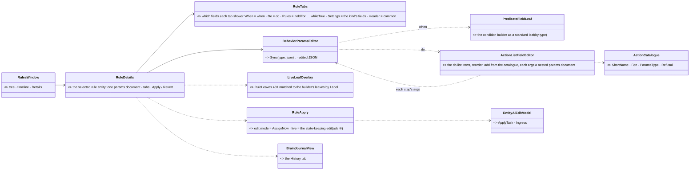
*What the picture shows that prose hid:* there is ONE params document per selected rule and ONE form. The tabs only choose which of its fields to
draw. The condition builder and the step list are field editors INSIDE that form, so the same builder serves the trigger, the replay search and
the breakpoints, and a step's arguments are drawn exactly as a task's params are.

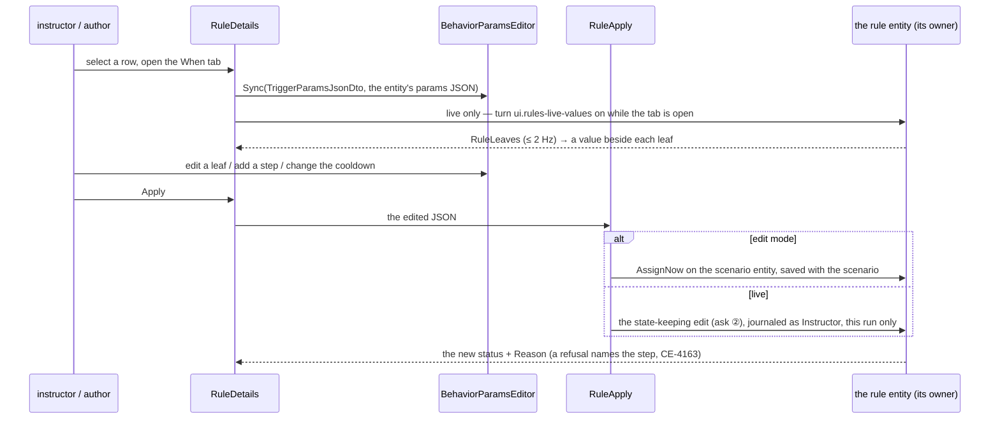

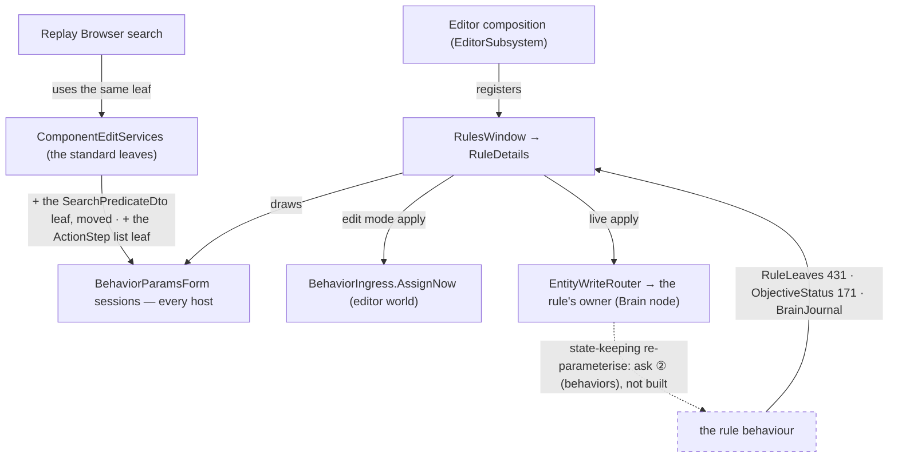
*What the module diagram shows:* moving the predicate leaf into the standard services makes the Replay Browser and the editor share ONE builder
by construction. The dashed edge is the one runtime piece that does not exist: until it does, live mode offers the control buttons only.

### 7.3 Decisions

| # | decision | ⭐ lean |
|---|---|---|
| **RE-1** | trigger and objective editors | ⭐ ONE `RuleDetails` panel in the rules view (RV-6's right pane): trigger tabs **Overview · When · Do · Rules · History · Bindings**, objective tabs **Status · Settings · Results · History** (the mockups). The same panel opens from the entity inspector's *objectives about this unit* (RV-7) |
| **RE-2** | the form | ⭐ `BehaviorParamsEditor` on the rule entity's behaviour params; `RuleTabs` (pure) maps each tab to its fields. **Header** (every tab's top) = `common` (title, required, scored, points, group, visible to). ⛔ No per-tab DTO, no second form |
| **RE-3** | the When tab | ⭐ move `PredicateValueFieldDrawer` out of `ReplaySearchPanel` into `Fdp.Presentation/ImGui/Editing` as a standard leaf, registered in `ComponentEditServices` by TYPE (drop the `Predicate` name gate); the Replay Browser keeps drawing it. The two rule additions (`OnEntity` with its ref, `ScenarioTime`) use the existing ref picking (CE-4206). **Live:** `LiveLeafOverlay` shows `RuleLeaves` beside each leaf (✓ / ✗ and `Measured`), matched by `Label`; `ui.rules-live-values` is on only while a When tab is open. ⏳ the *true over time* strip (a leaf history) later |
| **RE-4** | the Do tab | ⭐ `ActionListFieldEditor`, a standard leaf for `List<ActionStep>`: one row per step (drag to reorder, ✕); *+ Add step* opens the ONE generic picker (CE-4168) over the `ActionCatalogue` (ShortName, Fqn on hover; an action with a `Refusal` shown disabled with it); the step's `args` are a nested params document of the action's `ParamsType`, inline under the row. ⛓ chips on step fields (MA-1, `BindableNode`). **Live:** the running step marked, *step 2 / 3* — ⏳ needs ask ① |
| **RE-5** | the Rules tab (trigger) · Settings (objective) | ⭐ the remaining fields of the same document: holdFor · delay · cooldown · repeat · maxFires · fire if true when armed · while true; the objective's kind fields (area, min men, hold seconds …). Area / entity fields pick on the map (`PickableLeafFieldEditor`, existing) |
| **RE-6** | History · Results · Status | ⭐ History = the rule entity's brain journal (CE-1249, the Brain tab's drawing), instructor edits included, each a timeline seek. Results = its children (RV-8's *why this score*, the same model). Status / Overview = RV-6 |
| **RE-7** | applying an edit | ⭐ **Apply / Revert** buttons (no write per keystroke). **Edit mode:** `AssignNow` on the scenario entity, as the AI section does (`EntityAiDetailsView.ApplyTask`); saved with the scenario. **Live:** a live edit lasts this run only and never writes the scenario file (SR-109). ⛔ Not by the existing running path, because `AssignBehaviorEvent` restarts the rule. ⏳ It waits for ask ② (a state-keeping edit); until then the fields are read-only in live mode with *"needs the live edit (behaviors)"*, and the RV-5 buttons work. An assignment refusal (CE-4163) shows under the field or step it names |
| **RE-8** | *+ Add* | ⭐ a menu of rule kinds: Trigger + every objective / measure kind from the behaviour registry (those whose params carry `common`). It creates a rule entity (TKB `Trigger` 8861 / `Objective` 8860) through the ONE entity-creation path the Add Entity picker uses, parented to the selected row, and opens its form. Edit mode only (a live insert is a macro insertion, SR-191) |
| **RE-9** | drag to connect (X4) | ⭐ on a Trigger row: dropping a row on it ANDs `OnEntity { Ref: the dropped row, Predicate: ObjectiveStatus.State == Achieved }` into its `when` (wrapped in `And` when one exists) **in the same form document**, so it shows in the When tab and is applied by RE-7. Edit mode only |
| **RE-10** | where | ⭐ `RuleDetails`, `RuleTabs`, `LiveLeafOverlay`, `RuleApply` in `Hrot.Presentation/Rules/`; the predicate leaf and `ActionListFieldEditor` in `Fdp.Presentation/ImGui/Editing/` (shared by every host). ⏳ *Graph* / *List* views later |

### 7.4 ✅ Approved with four amendments *(coordinator review, user `2026-11-03`: *"approved"*)*

| # | amends | the amendment |
|---|---|---|
| A1 | RE-1 | ⭐ a rule entity expanded from a macro instance (`MacroOrigin`) is READ-ONLY in `RuleDetails`, saying *"from macro X — edit the macro or its args"* with a jump to the instance (SR-43); only the macro file's own entities (when the macro is opened) are editable |
| A2 | RE-9 | drag to connect writes the predicate BY KIND of the dropped row: an objective / measure ⇒ `ObjectiveStatus.State == Achieved`; a trigger ⇒ `TriggerState == Fired` |
| A3 | RE-8 | the citation: a live insert is `InsertMacro` (SR-171 / macros S3b B1), not SR-191 |
| A4 | RE-3 | before dropping the `Predicate` name gate, list every `SearchPredicateDto` field the type registration now reaches and confirm each wants the builder |
| ⭐ | RE-4, RE-7 | the two waits are GONE: behaviors built ① `StepCur` / `StepCount` on the status and ② `RuleEdit` (433, the state-keeping live edit with a refusal reason) — `DESIGN_Scenario_Rules.md` §00.11a ⇒ the live step marker and live Apply are buildable now |

**Rejected — one line each:**
- *A trigger-specific form per tab* — `BehaviorParamsForm` is the ruled one form (CE-1023 deleted the last second one).
- *A second condition builder for `when`* — the replay search's builder edits the same `SearchPredicateDto` (SR-95: one condition language).
- *Live edits by re-assigning the behaviour* — it restarts the rule; the mockup's live edit keeps it running (SR-109).
- *Writing on every keystroke* — a half-typed condition would be assigned and refused; Apply also gives one journal entry per edit.
- *Editing the step list as raw JSON* — the catalogue knows each action's params type; a typed form is checked before it is sent.

### 7.4 Phases

| phase | items | gate |
|---|---|---|
| **R5** | RE-1 … RE-6, RE-7 edit mode, RE-8, RE-9, RE-10 | rails: `RuleTabs` (every DTO's fields land in exactly one tab) · the predicate leaf drawn from the standard services (and still in the Replay Browser) · `ActionListFieldEditor` (add / reorder / remove → the JSON the runtime parses; a refused action disabled) · `LiveLeafOverlay` matching · Apply in edit mode = the scenario entity's params · connect writes the `OnEntity` AND · frame rails for the two tab sets; live: author a trigger on `showcase-bridgehead`, save, reload |
| **R6** | RE-4 live step marks (ask ①) · RE-7 live edits (ask ②) | as behaviors' asks land: rails against the as-built names; a live run: change a cooldown while armed, the fire count stays |

### 7.5 Claim table

| claim | code | design basis |
|---|---|---|
| the tabs need no new data model | ✅ `TriggerParamsJsonDto` and the kind DTOs hold every field the mockup shows | ✅ SR-109 tab list |
| one form edits behaviour params everywhere | ✅ `BehaviorParamsForm.cs:24` | ✅ CE-3043 / CE-1023 |
| the condition builder can be shared | ✅ `PredicateValueFieldDrawer` draws `SearchPredicateDto`; ⚠ `internal` and name-gated today | ✅ SR-95 (one condition language) |
| edit mode applies through the existing ingress | ✅ `EntityAiDetailsView.cs:171-173` | ✅ §7.6 of `DESIGN_Sensors_And_Doctrine.md` (the AI section) |
| the live path today restarts the rule | ✅ `AssignBehaviorEvent` = a re-assign | ✅ SR-109 wants this run only, state kept ⇒ ask ② |
| **undo** of an edit-mode Apply — ✅ **measured `2026-11-03`** | ⛔ **there is NO scenario-wide undo for entity edits**: the AI section's `AssignNow` has none; the only undo lists are local — `HeaderParamsSchemaSource`'s `(Label, Redo, Undo)` list behind the Parameters window (`HeaderParamsSchemaSource.cs:21-38`, CE-4210) and `GizmoUndoStack` for map gizmo edits (two copies: `Fdp.Toolkits/Diagnostics/Gizmos/UndoRedo/` and `GizmoMap.Presentation/`) | ⭐ **lean (inside the approved RE-7 rule "never a rules-only stack"):** extract that `(Label, Redo, Undo)` list into ONE shared `EditHistory` (`Hrot.Presentation`), adopted by the Parameters window and the rule editor in R5; Apply pushes *"edit <rule>"* with the previous params JSON as its undo. The AI section and the two gizmo stacks joining it is filed as a separate row (a duplicate found, not fixed in R5) |
| **+ Add** creates a rule entity — ✅ **measured `2026-11-03` (R5c)** | ✅ **YES, through the existing path:** `EntityCreation.RequestEntityCreation(tkbType, initialComponents: [BehaviorStartRecord{ Name, Json }])` (`Hrot.Common/EntityCreation/EntityCreation.cs:208`, the pack the Add Entity picker and the debug API's spawn route end in) creates a non-spatial TKB 8860 / 8861 entity (no transform) carrying its authored params; live: *New HoldArea* appeared under *Mission* a few frames later with its form openable. The Add Entity picker itself arms a MAP placement tool, which a rule (no body) does not use — it is not the seam, `RequestEntityCreation` is. ⛔ no second creation path was written | the catalogue lists `Objective` 8860 / `Trigger` 8861 (`EntityTypeCatalogTests` golden) |
| **A4 — what a by-type `SearchPredicateDto` leaf reaches** — ✅ **measured `2026-11-03`** | grep of every `SearchPredicateDto` field / property: ① `TriggerParamsJsonDto.When` (`ObjectiveParamsJsonDtos.cs:314`) — ✅ wants it; ② the `Predicate` children of the compound DTOs inside `SearchPredicateDto.cs` (`:67, :81, :129, :289, :383` — Not, OnEntity, BehaviorParam …) — ✅ the builder itself draws them (today's name gate was exactly these); ③ breakpoint / watch `Condition` (`BreakpointTypes.cs:48`, `WatchPersistence.cs:19`, `DebugSessionPersistence.cs:88`) — not drawn through `ComponentEditServices` forms (the breakpoint manager has its own `PredicateBuilderState`), so unaffected; ④ two locals in `DebugApiService` — not fields of a form | ⇒ ⭐ the by-type registration is safe: the only NEW reach is `when`, which is the point. ⚠ ③ is a second builder state (`PredicateBuilderState`) beside the drawer — a duplicate to fold, filed with the undo one |

### 7.6 AS BUILT — R5a *(ui, `2026-11-03`, CE-4218: RE-1 · RE-2 · RE-3 · RE-5 · RE-6 · RE-7 edit mode · A1 · A4 + the shared `EditHistory`)*

⭐ Built as designed in §7.3 / §7.4 for the EDIT mode; RE-4 (the Do list), RE-7 live, RE-8, RE-9 and the Bindings tab are **R5b** (placeholders say so). The Rules window's right pane is now `RuleDetails` (host passes `RuleEditorServices`; without them the pane is the R2 Overview, so the Replay Browser's recording window is unchanged).

| | as built | where |
|---|---|---|
| **tabs** (RE-1 / RE-2) | `RuleTabs` (pure): a trigger = **Overview · When · Rules · Do · Bindings · History**, an objective / measure = **Status · Settings · Results · History**. Fields by CLR member: `When` → When, `Do` → Do, every other trigger field (hold for, delay, cooldown, repeat, max fires, fire if true when armed, while true) → Rules; an objective's every non-`common` field → Settings; **`common` = the header, drawn above every tab**. The rail walks EVERY rule DTO of `ParamsDtoRegistry` (≥ 15) and asserts each member is in exactly one tab or the header. The form is `BehaviorParamsEditor` → `BehaviorParamsForm.DrawFields(…, only)` (a new optional field filter) — ⛔ no second form | `Rules/RuleTabs.cs`, `Rules/RuleDetails.cs` |
| **Apply** (RE-7, edit mode) | **Apply / Revert / Undo / Redo** (no write per keystroke). Apply = the AI section's **`EntityAiEditModel.ApplyTask(…, running: false)` → `AssignNow`** (the host passes it as a delegate; `Hrot.Presentation` cannot see the editor assembly) and pushes ONE entry *"edit <title>"* to the shared `EditHistory` whose undo re-applies the previous JSON. A refusal changes nothing and pushes nothing. **Edit mode = the row is authored (no `ObjectiveStatus`)**; a running rule is read-only: *"live edits come in R5b"* (the RV-5 buttons keep working) | `RuleDetails.Apply` |
| **read-only** | the fields are drawn disabled WITH the reason: **A1** a rule from a macro (`MacroOrigin`) = *"from macro X — edit the macro or its args"* + a *Go to the macro instance* button (selects the instance through the host's ONE selection); a running rule; a recording (*"a recording is read-only"*); a kind with no params form | `RuleDetails.ReadOnlyReason` |
| **EditHistory** | `Hrot.Presentation/Edits/EditHistory.cs` — the Parameters window's `ParamsEditHistory` extracted (+ `Push` for a step already applied, `Count`); the editor holds ONE (`EditorSubsystem.EditHistory`) that `HeaderParamsSchemaSource` AND the rule editor use. ⛔ Still no scenario-wide undo; the remaining private stacks are **CE-4219** | |
| **RE-6** | **History** = the entity's brain journal in the Brain tab's own words (`BrainSnapshot.Read(…).Changes`, passed as a delegate; *"no journal"* in edit mode — the journal lives on the Brain node); **Results** = `MissionSummary.Why` (the children with pass / fail) | |
| **RE-3 / A4** | ⚠ **Measured, and the premise was narrower than the design said:** `PredicateValueFieldDrawer` is NOT the condition builder — the `when` tree is already drawn by the form's polymorphic container (`ComponentEditDrawer`, a type combo from `JsonDerivedType`). The drawer is the VALUE leaf of a property match (Numeric / String, whose kind and range depend on the sibling component and property). So: the drawer moved to `Fdp.Presentation/Editing` (public, registry optional) and `PredicateValueFieldEditor` is registered BY TYPE in `ComponentEditServices` — ⭐ **gated by a new `[PredicateValue]` on the three members that are value leaves** (`PropertyMatchDto` · `BehaviorParamPredicateDto` · `BlueprintVariablePredicateDto`), **no longer by the name `Predicate`**. That name gate also caught `OnEntityPredicateDto.Predicate` and `CountMatchingPredicateDto.Predicate` — sub-trees — which the Replay Browser drew as *"(Select PropertyPath first)"*; they are now drawn normally (a fix). Breakpoints (`PredicateBuilderState`) untouched. The Replay Browser keeps registering the same editor and drawing the same drawer. Live: the Counter-attack trigger's `when` (OnEntity → PropertyMatch `State == Active`) shows the polymorphic tree with the value as an enum combo | `Fdp.Presentation/Editing/PredicateValueField*.cs`, `PredicateValueAttribute.cs` |

**Deviations / findings.** ① Tabs are a strip of buttons (ImGui's tab bar cannot be set from a rail and its `BeginTabItem` overload shows a close box). ② **Found live: the first click on *Undo* crashed the editor** — `CanUndo` changed between `BeginDisabled` and `EndDisabled` and ImGui asserts. Fixed (the state is read once) and the frame rail now CLICKS Undo in a real frame. ③ A `Type` field (`PropertyMatch.ComponentType`) draws as `RuntimeType` with a combo that does not list the component types: the standard services lack the Replay Browser's `TypeFieldEditor` — not a rule-editor blocker (the authored value round-trips), noted for R5b. ④ Nullable `Scored` / `StartActive` draw as tree rows, as in the AI section. ⑤ The pick context for entity links is a scoped `MapPickBroker` of its own (one broker holds one pending pick).

Rails: `RuleEditorTests` (9: every field of every rule DTO in exactly one tab · the trigger's split · A4's member set · the standard services give a property match's value the leaf and OnEntity's sub-tree not · `EditHistory` push / undo / redo / redo-tail · Apply changes the params, ONE entry, undo restores, redo re-applies · a refused Apply changes nothing · A1 read-only · running / recording read-only) · `RulesWindowFrameRail.TheRuleEditor_…` (real frame: both tab sets, each tab's fields, Apply then a CLICK on Undo) · the Parameters window's rails (`ParamAuthoringRailsTests`) and the Replay Browser's (`Fdp.Presentation.Tests` Replay / Predicate / Editing / Search / Timeline: 212) green. Red-proof: `TabOfField` sending the Rules fields nowhere ⇒ `EveryFieldOfEveryRuleDto…` red (`TriggerParamsJsonDto.HoldFor … in 0`; reverted). **Live (`showcase-bridgehead`, EDIT mode):** *Counter-attack* ⇒ When tab shows its OnEntity condition; Rules tab, cooldown 0 → 25, **Apply** ⇒ `GET /entities/1045` `Cooldown 25`; **Undo** ⇒ 0; **Redo** ⇒ 25.

### 7.7 AS BUILT — R5b *(ui, `2026-11-03`, CE-4220: RE-4 · RE-7 live · RE-3 live · the `Type` leaf)*

⭐ Built as §7.3 / §7.4 say, **R5c** (RE-8 + Add, RE-9 drag to connect, the Bindings tab) not touched. Prior state: §7.6 said *"the Do tab draws a placeholder"* and *"a running rule is read-only: live edits come in R5b"* — both SUPERSEDED here.

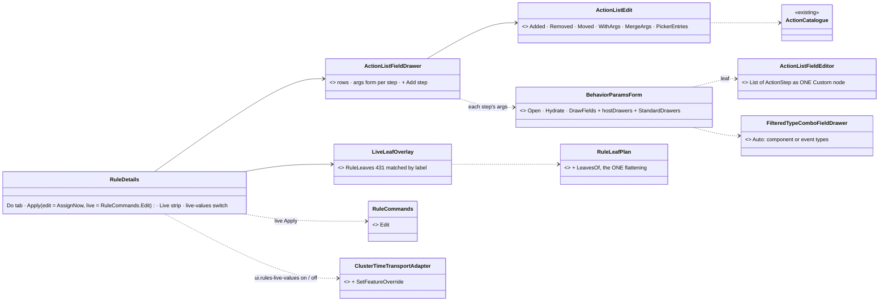
*What the picture shows:* the step list is one leaf of the ONE params form (its drawer is handed in by the host, because it holds the nested step sessions), and both live features end in existing paths — the write in `RuleCommands.Edit`, the leaf values in the cluster feature override.

| | as built | where |
|---|---|---|
| **RE-4 Do tab** | one row per step: number, act, `^ v x`, the args INLINE as a params document of the action's `ParamsType` (same `BehaviorParamsForm.Open` / `ComponentEditDrawer` a task uses; an edit overlays the form's JSON on the step's original args, so a key the type does not know survives). *+ Add step* (leads the list, so a long list keeps it reachable) opens the ONE picker (`rules.add-step`): ShortName, full name as the detail, a refused action DISABLED with its reason. The list serialises with `ActionStep.ToJson` | `Behavior/ActionListFieldDrawer.cs`, `Fdp.Presentation/ImGui/Editing/ActionListFieldEditor.cs` |
| **Type leaf** | `TypeFieldEditor` in `ComponentEditServices`; the combo is `FilteredTypeComboFieldDrawer` (public; new `Auto` mode: an `EventType` field lists event types, any other the component types — the Replay search's own `ComponentTypeRegistry` list). Every params form gets it through `BehaviorParamsForm.StandardDrawers`; the Replay Browser keeps its own registration | |
| **step marker** | `StepCur / StepCount` while Acting: the row is marked (a drawn triangle — the panel font has no ▶) and *step n / N* shown; a failed step (index kept, not Acting) is red with the status `Reason` | |
| **RE-7 live** | Apply = `RuleCommands.Edit` (complete params, origin `BehaviorOrigin.Operator`); never in `EditHistory` (the bar says *this run only*, Undo / Redo are off live). The verdict comes from the owner: *sent*, *pending (acting)* from the editor's own Seq, then the journal's *edited by …* ⇒ *applied - the rule's state is kept* or *edit refused by …* ⇒ *refused - edit refused: …* (the status Reason). A kind with no state keeper is read-only up front: **the editor's registry binds NO keepers** (`BindKeepers` runs in CGF's loader), so the editor DISCOVERS the keeper names (`BehaviorSchemaDiscovery.KeeperNames`, the same scan, nothing bound) | `Rules/RuleDetails.cs`, `EditorSubsystem.BuildRuleLiveServices` |
| **RE-3 live** | the node feature `ui.rules-live-values` goes on, cluster-wide, while a When tab of a live trigger is open and off on leaving it or when the window is closed (`SetFeatureOverride` = `SetRunSettingsIntent { FeatureOverrides }`, other overrides kept). **Deviation: a Live strip under the When form, not a value beside each leaf** — the `when` is the polymorphic container, so a per-leaf value would need a drawer for every predicate kind. Matched by label, in order, on the label cut to a `FixedString32` (found live: the owner's OnEntity label arrives cut) | `Rules/LiveLeafOverlay.cs` |

**Findings / deviations.** ① The step drawer lives in `Hrot.Presentation`, not `Fdp.Presentation` (RE-10): the picker (`NodeEditor.UI`) is not reachable from there; only the leaf editor is shared. ② ⛔ **R5a bug fixed:** `Prepare` ran twice a frame and the second call re-synced the form to the entity's OLD params, so a typed value snapped back (Apply still worked from the staged copy). The form now reopens only when the entity's params change. ③ ⛓ chips on step fields wait for the Bindings tab (R5c). ④ The editor crashed three times in the live check — **not this work**: the container's memory cap killed it twice (a build server and the editor together) and ImGui asserted once on a 16-bit vertex overflow from the Event Browser's long list; closing the right-hand panels and stopping the build servers made the run stable. ⑤ The picker's double-click does not confirm a row (OK does) — the picker's own behaviour.

Rails: `RuleEditorR5bTests` (11: add / reorder / remove → what `ActionList.Get` / `Validate` parse · args round-trip and an unknown key kept · picker rows and a refused one disabled · the standard leaves · live Apply writes the complete JSON as Operator and never touches `EditHistory` · pending while Acting then applied · refusal shown · a kind with no keeper read-only · the strip matched by label, and a cut label) · `RulesWindowFrameRail.TheDoTab_…` (real frame, `xvfb-run`: rows, marker *step 2 / 3*, CLICKS on + Add step, ^ and x, live Apply, the When tab switching the feature on and the strip drawn, off on leaving) · `FilteredTypeComboFieldDrawerTests.CE4220_Auto_…` · existing `RuleEditorTests` 9 · `RulesModelTests` · `MissionSummaryModelTests` · `RulesWindowFrameRail` · `Fdp.Presentation.Tests` Replay / Predicate / Editing / Search / Timeline (213) green. Red-proof: the live origin sent as `Superior` ⇒ `LiveApply_WritesTheCompleteParams…` red (`Expected … 3, Actual … 2`; reverted). **Live (`showcase-bridgehead`, live run):** *Counter-attack* ⇒ Do tab rows (InsertMacro · Order · Message); cooldown 0 → 33, **Apply live** ⇒ `GET /objectives` `timing.cooldown 33`, `fireCount 0` (state kept), the History tab *edited by Operator*, the bar *applied - the rule's state is kept, this run only*; the When tab turned the feature on (the owner's `leaves` filled). **Edit mode:** + Add step ⇒ Message ⇒ Apply ⇒ `GET /entities/1045` carries four steps.

### 7.8 AS BUILT — R5c *(ui, `2026-11-03`, CE-4222: RE-8 · RE-9 + A2 · the Bindings tab)*

⭐ Built as §7.3 / §7.4 say. Prior state: §7.6 / §7.7 listed RE-8, RE-9 and the Bindings tab as *placeholders* — SUPERSEDED here. ⚠ **The link form below (`ref: X`, `parent` as a bare network id) is SUPERSEDED by §7.9** (the GUID form, stable across a save).

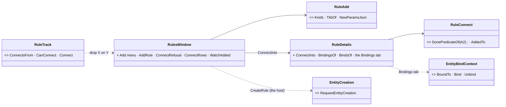
*What the picture shows:* a drop never writes — it edits the SAME form document RE-7 applies, and + Add and the drop both end in paths that already existed.

| | as built |
|---|---|
| **RE-9 + A2** | dropping row X on a trigger row Y (edit mode): `RuleConnect.AddedTo` ANDs `OnEntity { ref: X, predicate: PropertyMatch(ObjectiveStatus.State \| TriggerState, Equals, Numeric v..v) }` into Y's `when` — **by X's kind (A2)**: an objective / measure ⇒ `State == Achieved` (2), a trigger ⇒ `TriggerState == Fired` (5). No `when` ⇒ the condition itself; an existing AND compound gets one more condition; any other `when` is wrapped in a new AND compound; the same rule twice is refused. The shape is what the authored triggers carry (checked live against *Push harder* on `showcase-bridgehead`). `RuleDetails.ConnectInto` reopens the form on the new JSON (the form's own serialisation), shows the When tab and leaves it a PENDING edit; **Apply** writes it through RE-7 as ONE undo entry. Refused, with the reason: a live run, a recording, a rule from a macro (A1), a non-trigger target, itself. ⚠ Found live: a scenario stores its params camelCase (`operator`, `conditions`) — read key-insensitively, or the existing AND was wrapped instead of appended to |
| **RE-8 + Add** | `+ Add` (toolbar, edit mode only) lists the Trigger first, then every behaviour whose params type carries `common` (`ParamsDtoRegistry`, 20 kinds); the host's `CreateRule` calls `EntityCreation.RequestEntityCreation(8861 \| 8860, initialComponents: [BehaviorStartRecord])` — measured in §7.5. `common.title` = *New <kind>*, `common.parent` = the selected row; when the entity appears the window selects it and opens its When / Settings tab. Refused with the reason in a live run, on a recording, and on a host with no creation path |
| **Bindings** | the rule entity's `ParamBindings` (`Behavior.Params.<field>` → param) listed, and the params form drawn with the AI section's own `EntityBindContext` (the ⛓ chip / button, the same bind drawer; params in scope = the resident header's). With no parameter declared the tab says so (*a macro file declares them*); a rule from a macro instance is read-only (A1). Not run live with a declared parameter: the chip is the CE-4210 drawing, unchanged |

Rails: `RuleEditorR5cTests` (A2 by kind · none / one / wrapped / camelCase-appended / twice-refused · the drop is a pending edit, Apply is one undo entry, Undo restores · refused for live / recording / macro / non-trigger / itself · the kinds and TKB types · `AddRule` asks with the title and the selected parent, selects the entity when it appears, refuses live / no-host · the Bindings list and edit through the one context, A1) · `RulesWindowFrameRail.TheConnectDrag_…` (a real frame: a drop on a non-trigger does nothing; objective then trigger onto *Push harder* ⇒ OnEntity then AND(State, TriggerState) via Apply; two Undos restore). Red-proof: `DonePredicateOf` testing the role the wrong way ⇒ `A2_…` and the drag rail red (`Expected "State", Actual "TriggerState"`); reverted. **Live (`showcase-bridgehead`, edit mode):** drag *Hold the crossroads* onto *Push harder* ⇒ the form shows the compound; **Apply** ⇒ `GET /entities/1048` `when` = AND(original, `OnEntity Ref 1038 State == 2`); **Undo** ⇒ the original `when` back; *+ Add ▸ HoldArea* with *Mission* selected ⇒ *New HoldArea* under *Mission*, selected, Settings open; the Bindings tab of *Counter-attack* ⇒ *No field is fed from a parameter*, the form below.

### 7.9 AS BUILT — R5d *(ui, `2026-11-03`, CE-4225 · CE-4224: the link form a connect and a new rule's parent are written in)*

⭐ §7.8 wrote the dropped row's link as `{"NetworkId": n}` and `+ Add`'s `common.parent` the same — **SUPERSEDED here.** A network id is not stable across a save and reload.

| | before → after (measured on `showcase-bridgehead`, edit mode: drag *Hold the crossroads* onto *Push harder* → Apply → save-as a scratch copy → reload it) |
|---|---|
| **saved file** | `"Ref": 1038` → `{"NetworkId": 1038, "Ref": "<hold's guid>"}` |
| **reloaded copy** | *Hold the crossroads* is now 1039; the old link names 1038 = *Clear the crossroads* → by GUID it still names *Hold the crossroads* |
| **live run of the copy** | *Push harder* `dependsOn [Bridgehead, Clear the crossroads]` ✗ → `[Bridgehead, Hold the crossroads]` ✓ |

| | as built |
|---|---|
| **the writer** | `RuleConnect.LinkOf(row, scope)` = `ReferenceLeafDrawers.PickToLink` (the entity PICKER's own: `Exact` = the entity's GUID) through the `EntityLink` JSON converter ⇒ `{"NetworkId", "Ref": guid}`, the shape the scenario's authored triggers carry; an entity with no GUID gets the bare id, as the picker does. Used by the connect's `ref` (`AddedTo(json, x, link, …)`, the duplicate test compares by GUID when the link has one) and by `+ Add`'s `common.parent` (`RuleAdd.NewParamsJson(kind, parentLink)`) |
| **the reader** | `AuthoredRules.LinkId(el, scope)`: a number · a numeric string · an `"@Key"` / GUID (`RefSpec.TryParse` → `LiveRefScope.TryResolve`) · an object — **its `Ref` wins over its `NetworkId`** (the id is the unstable half). `AuthoredRules.ScopeOf(world)` = the editor's ONE resolver (`new LiveRefScope(repo)`, 250 ms policy; the picker's, the load's and the macro expander's are this class). Unresolvable ⇒ the object's own id, else none. Edit mode: 0 → 10 arrows |
| **CE-4224** | found on the way: `SaveResolver` threw on `Entity.Null` (`AmmoLoadout`'s unused rows) and the editor died on EVERY save of `showcase-bridgehead`. A null entity now saves as the empty GUID and loads as `Entity.Null`; the error names the component. No unit rail yet (the live round trip is the evidence) |

Rails: `RuleEditorR5cTests.AConnectsLinkAndANewRulesParent_AreWrittenInTheStableForm_TheEntitysGuid` (the `ref` and the `parent` carry the GUID; a copy each; a stale id with the right GUID is the same rule; no GUID ⇒ bare id) · `AuthoredRules_ResolveAGuidOnly_AKey_AndAStaleIdWithTheRightGuid_BeforeARun` (GUID-only, `@Key`, stale id + right GUID → the rule the GUID names; a bare id stays an id; an unknown key is none). Red-proof: `LinkOf` passing no scope (the bare id) ⇒ the first rail red; reverted.

### 7.10 AS BUILT — Rules Runnable ② ③ *(ui, `2026-11-03`, CE-4240 the instructor's End · CE-4241 what went to whom)*

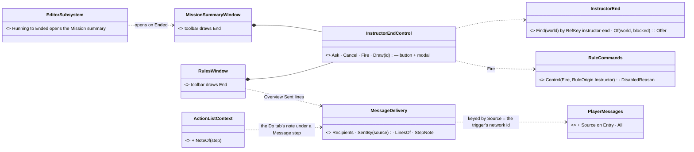
*What the picture shows that prose hid:* the End button adds NO command path (it is `Fire` on a rule found by KEY, so a round ends by the very path an automatic end takes, SR-116), and *what went to whom* adds NO record (it reads the store the player's message log already fills, keyed by the event's own `Source`).

| | as built |
|---|---|
| **② which trigger** | the entity carrying `RefKey` **`instructor-end`** (backend's content, `163c88934`: both showcases), found by that KEY — ⛔ never by title (the title is prose and translated). No such entity ⇒ the button is **disabled and says *"this scenario has no instructor-end trigger"***; authored-not-running ⇒ *"not running — start the exercise"*; the exercise already past Running ⇒ *"the exercise has already ended"*; a recording ⇒ its read-only reason; otherwise the owner's own words (`RuleCommands.DisabledReason(Fire)`, e.g. *"it is fired"*) |
| **② where** | the Rules toolbar and the Mission summary toolbar, ONE `InstructorEndControl` each over the same `InstructorEnd.Of`. A click opens the modal *End the exercise now?* (End now / Cancel); *End now* writes `RuleCommands.Control(Fire, RuleOrigin.Instructor)` — the same write the DebugApi's `POST /objectives/{id}/control` makes. The answer (`done here` / `requested of the owner`) shows beside the button |
| **② opens on the end** | `EditorSubsystem` sees the world's `ExerciseResult.Phase` go Running → Ended and focuses **Window ▸ Mission summary** (once per run). ⚠ the Trainee debrief needs a man chosen and the Game summary is a game's: both stay one click away in the Window menu — not opened for the user |
| **③ the data (measured)** | `PlayerMessageEvent { MessageId · OriginNodeId · ToKind (All/Side/Station/Unit/Instructor) · ToValue · Text · Seconds · SentAt · Source }`: a managed bus event (not `[EventId]`-recorded), carried on the `PlayerMessage` topic **with `Source` = the sending trigger's network id** (`PlayerMessageTranslators.cs`), kept per world in `PlayerMessages` while `hud.messages` is on (ON by default on every host). `Entry` simply never copied `Source`: now it does (+ `All`). **No cross-lane edit, no wire change** |
| **③ shown** | the **Overview** of a trigger lists *Sent: 0:05  to everyone (every side, unit and player): "Seize the crossroads…"* (one line per delivery, oldest first); the **Do tab** puts a line under every *Message* step — its authored address in words (*the Blue side… · unit "Alpha 1-1" (#12, Red) and its player · the player at station 3 · the instructor only*) and *not sent yet* or *sent 1x, at 1:01* (delivered text matched to the step's, a `{subject}` template included). Players are named by address (a side, a unit, a station) — which man sits at a station is not in the message |
| **③ limit** | the store is this node's MEMORY (cap 300): a message sent before the node started, or on a recording opened cold, is not in it — the step then reads *not sent yet*. A recorded `PlayerMessage` lane would make it replayable: not built (no demand yet) |

Rails: `RunnableRulesTests` — `TheEndButton_IsDisabledSayingWhy_WhenThereIsNoInstructorEndTrigger` (a trigger titled *End* / a wrong key is not it) · `…FindsTheTriggerByItsKey…` · `…RefusesWithTheOwnersReason_AfterTheEnd_OnARecording_AndWhileTheTriggerIsNotRunning` · `TheEndControl_AsksBeforeFiring_CancelWritesNothing` · `TheRulesAndSummaryWindows_BothCarryTheSameEndControl` · `ABriefingToAll_NamesItsRecipientsAndWhen` · `Recipients_ResolveSideUnitStationAndInstructor` · `AMessageStep_ShowsItsAuthoredAddress_NotSentYet_ThenWhenItWasSent_ASubjectTemplateMatches` · `ThePlayerMessageStore_KeepsTheSource_AndStillAddressesByViewer`.

## 8. The game-master palette *(DESIGN, `2026-11-03`; `HANDOFF_Coordinator_To_Ui_Rules_Runnable.md` ⑥; SR-104 Z2 · Z3 · Z4; leans GM-1 … GM-5)*

### 8.1 INVENTORY *(`2026-11-03`)*
**Queries:** grep `SetSkillAmplifier` → `SkillVerbs.cs:13-41` (`SetSkillAmplifierParams { Side, Tiers −2…+2 }`, instant, writes on the World Environment's owner) · grep route docs `/(action|run|verb)` → none (no "run an action now" path exists) · `RuleAdd` / `RuleCommands` (built here, R5c / R2) · `TriggerBehavior.cs:140` (*"'when' is required"*) · CE-4166 (a condition already true at arming is not an edge, unless `fireIfTrueWhenArmed`) · `EntityCreationRequest.IsTransient` (`EntityCreationRequest.cs:106-126`, → `ScenarioIgnoreTag`, SR-104 Z6) · `ScenarioTimePredicateDto` (`SearchPredicateDto.cs:52, :71`). ⚠ coverage not checked (no `check_index_coverage` in the CLI).

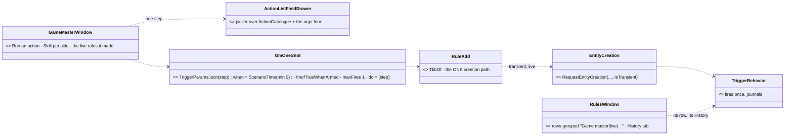
*What the picture shows that prose hid:* the palette adds NO command path — a hand-run action is a one-shot TRIGGER made through the one creation
path, so it fires through the same runner, journals itself, and shows in the rules view like any rule.

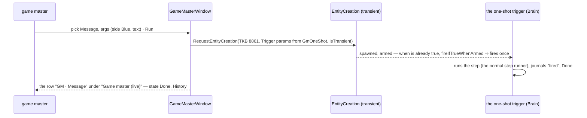

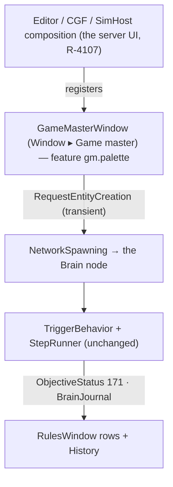

### 8.2 Decisions *(leans — the handoff's two leans taken)*

| # | decision | ⭐ lean |
|---|---|---|
| **GM-1** | *run any shared action by hand* | ⭐ a **transient one-shot trigger** — `when = ScenarioTime { Clock: Elapsed, Min: 0 }` (always true) + `fireIfTrueWhenArmed: true` + `maxFires: 1` + `do = [the step]`, `common.title` *"GM · <action>"*, created through `RuleAdd`'s ONE creation path with `IsTransient` (never saved, SR-104 Z6). The step is edited with the Do tab's own drawer (picker + args form, R5b). ⛔ no new command, no second runner |
| **GM-2** | *on the selection* | ⭐ the args form pre-fills the first `EntityLink` target field from the current selection and the first side field from the selection's side; the user can change both |
| **GM-3** | the per-side skill slider | ⭐ one row per side, −2…+2 tiers, showing the current `SkillAmplifier`; a change is GM-1 with `SetSkillAmplifier { Side, Tiers }` (no direct write — the verb is the one writer) |
| **GM-4** | where the made rules show | ⭐ the rules view groups them under **"Game master (live)"** (their `common.title` prefix); their History is the journal. Edit mode: the palette is disabled — *"the game master acts on a running exercise"* |
| **GM-5** | MSEL | ⭐ **= the rules view's *Coming up* + the timeline** (the handoff's lean) — no separate panel |

**Rejected — one line each:**
- *A debug-API "run action" route called by the window* — a second path beside the triggers; nothing journals it as a rule.
- *A permanent GM trigger re-armed with new params* — a live edit per click; a transient one-shot is simpler and leaves a row per action.
- *Writing the skill amplifier directly* — `SetSkillAmplifier` is its one writer.

| claim | code | design basis |
|---|---|---|
| no run-action path exists | ✅ route docs grep: none | ✅ SR-104 Z3 ("one action palette, nothing separate") |
| a trigger needs a `when`; an already-true one fires only with `fireIfTrueWhenArmed` | ✅ `TriggerBehavior.cs:140`; CE-4166 | ✅ §00.9 S2-c |
| a transient entity is never saved | ✅ `EntityCreationRequest.cs:106-126` | ✅ SR-104 Z6 |
| ⛔ a rule entity created LIVE through the creation path gets its brain on the Brain node | ⛔ **not measured live** — `+ Add` was proven in EDIT mode only | measure first at build |
