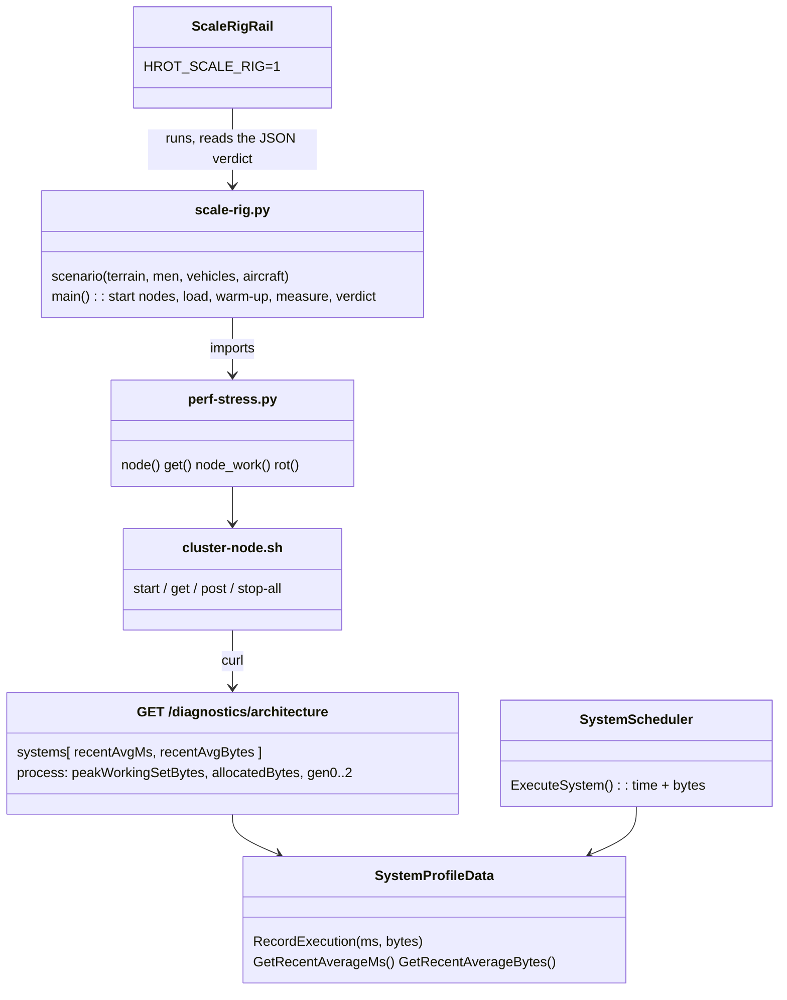
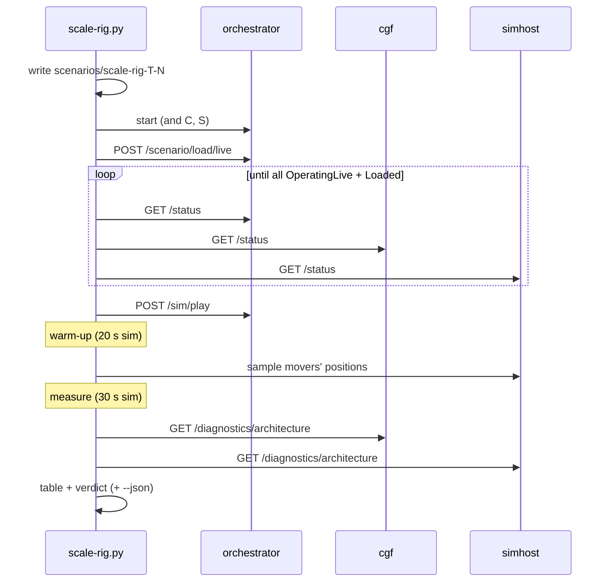
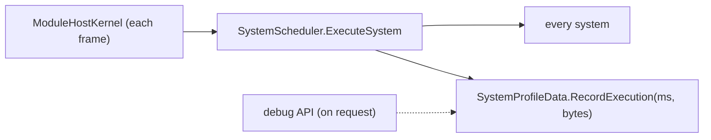
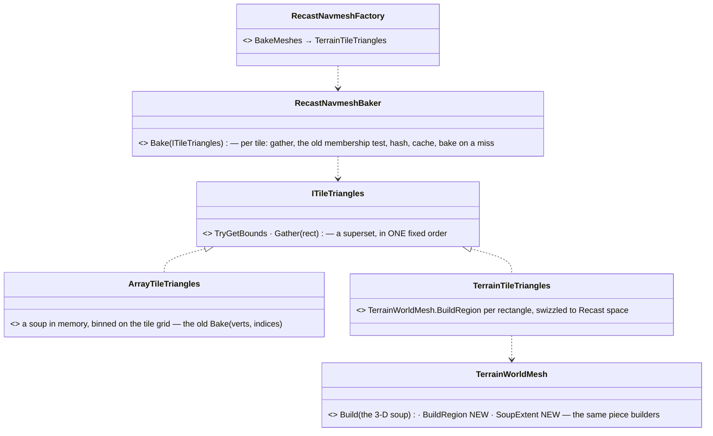
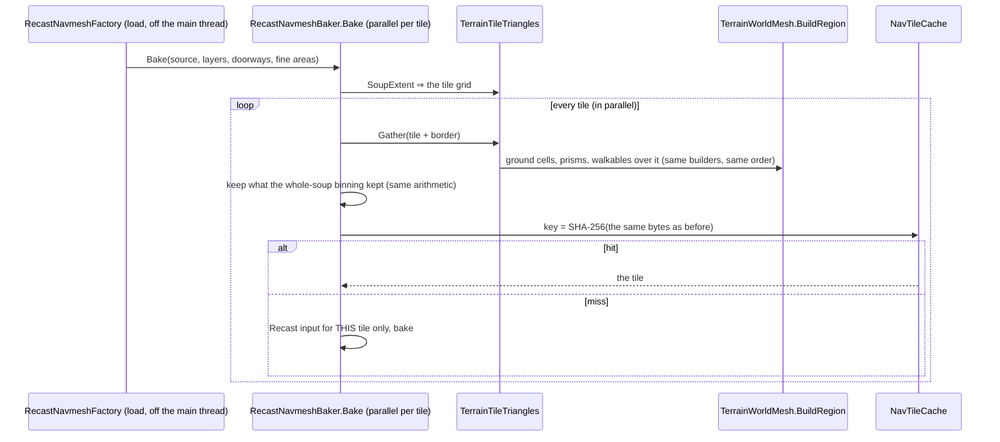
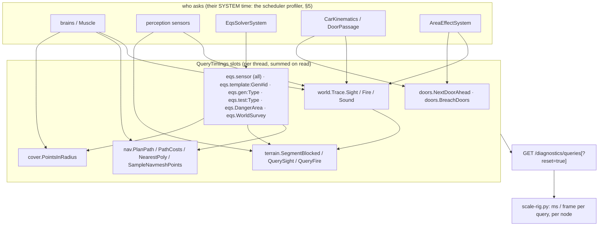

<!--STATUS
state: LIVE
build-state: BUILT (L-2, CE-4364) — baselines below; L-4 adds its findings to §5
updated: 2026-11-10 (§7.6 C-1 + G-1 built and re-measured · §7 many-core Windows measurements · §6 world-query timings, recording off by default — backend) · 2026-11-09 (backend — first version)
current-answer: §1 decisions · §3 how to run · §4 baselines · §5 findings (L-4) · §6 the world-query timings (CE-3427, the terrain's own cost) · ⭐ §7 on a physical many-core machine (2026-11-10, LATEST: the EQS cadence, the GC-bound bake, the frame split; §7.6 C-1 + G-1 built)
related-designs:
  - PLAN_Large_Terrain.md — P-0 is this rig; §8 the budgets (R-4192)
  - DESIGN_Evaluation_Cost_And_Cadence.md §11 — perf-stress.py, whose cluster machinery the rig imports; §0e the garbage tables
  - designs/navig-2/Navigation_Design_v2_0.md §14 — NavTileCache (warm = the tiles from HROT_NAVTILE_CACHE)
-->

# DESIGN — the scale rig (`scripts/scale-rig.py`)

**What it answers:** does a terrain with N soldiers / vehicles / aircraft meet the large-terrain budgets (R-4192) on every node?

| budget (R-4192) | read from |
|---|---|
| load ≤ **30 s** warm (navmesh from the cache) | wall time from `POST /scenario/load/live` until every node is `OperatingLive` and its own load `Loaded` |
| sim frame ≤ **10 ms** (1 000 soldiers + 50 vehicles + 10 aircraft, busiest node) | the node's **work per frame** = Σ its leaf systems' recent ms (the scheduler's profiler) |
| **0 B** garbage per steady frame | Σ its leaf systems' recent **bytes** per execution (⭐ new: `SystemProfileData` records them, CE-4364) |
| ≤ **4 GB** per node | the process's peak working set (`/diagnostics/architecture` → `process`) |

## 1. Decisions

| # | options | chosen | why |
|---|---|---|---|
| R1 | (a) one process: brain + muscle in the SimHost integration harness (the handoff's lean) · (b) one process per node through `cluster-node.sh`, as `perf-stress.py` | ⭐ **(b)** | measured: the harness hosts the muscle only (`SimHostInstance`: no CGF, a flat world, no terrain load); (b) exists, already reports per-node work, and the budgets are PER NODE. ⇒ reuse, not a second rig — `scale-rig.py` imports `perf-stress.py`'s `node` / `get` / `node_work` |
| R2 | garbage by (a) `GC.GetTotalAllocatedBytes` over a window · (b) per system in the scheduler | ⭐ **(b)**, plus (a) as `process.allocatedBytes` | (a) counts the debug API's own polling and every thread; (b) names the system to fix. Cost: one counter read per system per frame (`GC.GetAllocatedBytesForCurrentThread`, no allocation) |
| R3 | orders: `FollowRoute` per man · a squad order | ⭐ squads **`SquadMarch`** to a road point 150–300 m away (men follow as subordinates); vehicles (TKB 2001) and aircraft (TKB 405) on looping `RoutePlan`s (TKB 8802) + `FollowRoute` — road loops ≤ 1 km, 2 km squares at 400 m AGL | measured: `FollowRoute` on a man under a squad never moved him (intent mode None, speed 0); `SquadMarch` moved 11 of 12 sampled movers. Health 100 000 so the load stays constant |
| R3b | one side or two | `--sides 1` (all Friend: perception + movement) is the SCALE load; `--sides 2` adds combat | measured: two sides at 96 men on demo-city met and fought — 9 771 entities on the CGF (munitions), work 206 ms (Debug); the terrain question is separated from the combat one |
| R4 | warm load | two runs: the first bakes into `HROT_NAVTILE_CACHE`, the second is the warm number | the cache is on disk by design (Navigation v2 §14 P2) |
| R5 | the rail | `ScaleRigRail` (`Category=Scale`), skipped unless `HROT_SCALE_RIG=1`; it runs the script and fails on its verdict | the budgets live in ONE place (the script's `BUDGET`) |

## 2. Picture





**Who runs each frame** (the only new per-frame code is two counter reads in the scheduler):



**INVENTORY** (graph queries run, `scripts/cbm.sh`): `search_graph RecordExecution` → one definition (`SystemProfileData.cs:40`);
`trace_path RecordExecution inbound` → `SystemScheduler.ExecuteSystem` / `ExecuteGroup` / `ProfiledManualSystemWrapper.Execute` (→ `ExecuteSystem`),
`ModuleHostKernel.ExecuteModuleSafe`, the Cyclone translators (their own profiles, not in the systems list); `search_graph GetArchitecture` →
`DebugApiService.Diagnostics.cs:254` (+ the system-test client). ⇒ timing every system already passes through `ExecuteSystem`, so recording the bytes there covers them all.

## 3. Run it

```
dotnet build Hrot/Runner/Hrot.ClusterRunner -c Release
export HROT_RUNNER_DLL=$PWD/Hrot/Runner/Hrot.ClusterRunner/bin/Release/net8.0/Hrot.ClusterRunner.dll
python3 scripts/terrain-scale.py --seed 1                     # the scale terrain (L-1)
python3 scripts/scale-rig.py --terrain scale-1 --men 1000 --vehicles 50 --aircraft 10 --json out.json
HROT_SCALE_RIG=1 dotnet test Hrot/Runner/Hrot.ClusterRunner.Integration.Tests --filter Category=Scale
```

## 4. Baselines *(Release, this cloud VM: 4 cores, 15 GB; orchestrator + cgf + simhost on the one VM; `--sides 1`; warm-up 20 s, measured 30 s sim; real-time factor 1.0 in every run)*

| terrain | load | cgf work / garbage / peak | simhost work / garbage / peak | top cost (ms) | top garbage (B / frame) | movers moved |
|---|---|---|---|---|---|---|
| demo-city, 96 men | 15.0 s ✅ | 14.8 ms ⛔ · 612 KB ⛔ · 1.22 GB | 5.8 ms · 338 KB ⛔ · 1.03 GB | cgf: Recorder 4.9, CycloneEgress 1.8, BrainTick 1.2 | WeaponAmmoMirror 202 K, DebugPrimitivesBatchPublisher 200 K (both nodes) | 11 / 12 |
| demo-city, 296 men | 18.3 s ✅ | 26.6 ms ⛔ · 1.33 MB ⛔ · 1.37 GB | 14.6 ms ⛔ · 545 KB ⛔ · 1.25 GB | cgf: Recorder 8.3, BrainTick 3.4, CycloneEgress 3.2 | WeaponAmmoMirror 623 K, DebugPrimitives 323 K | 11 / 12 |
| demo-city, 1 000 men + 50 vehicles + 10 aircraft | 22.8 s ✅ | 87.1 ms ⛔ · 5.1 MB ⛔ · 1.88 GB | 72.9 ms ⛔ · 1.48 MB ⛔ · 1.55 GB | simhost: **CarKinematics 43.0**; cgf: BrainTick 20.0, Recorder 19.5, WeaponAmmoMirror 8.8 | WeaponAmmoMirror 2.3 M, Recorder 1.0 M, DebugPrimitives 0.9 M | 3 / 12 (crowded 800 m city) |
| **scale-1** (5.5 km, 1 651 houses), 96 men, cold | ⛔ **never loaded** — both loading nodes ejected (heartbeat timeout) during the terrain step, simhost at 4.4 GB; the catch-up then failed | | | | | |

⇒ the cold scale load is the first wall — L-4 §5 measures it stage by stage in one process.

## 5. Findings and fixes (L-4, `CE-4366`) — the biggest measured cost first

### 5.1 The terrain load at scale — measured stage by stage *(Release, one process, `scale-1`: 5.5 km at 1 m, 1 651 houses → 84 607 prisms, 6 911 doors)*

| stage | before | after | fix |
|---|---|---|---|
| height grid read | 5.9 s / 813 MB (as a 1 m `.asc`) | **0.31 s / 127 MB** | L-3's binary store |
| parse + building expansion | 2.2 s, 0.32 GB | 2.5 s, 0.32 GB | — (not over budget) |
| ⛔ the whole terrain soup for the navmesh input (`TerrainWorldMesh.Build`: 4 vertices per 1 m cell) | 9.4 s, 61.4 M triangles, **peak 7.0 GB** | **not built on a sim node** | §5.2 the per-tile bake |
| navmesh, cold (105 800 tiles, 2 layers; 4 cores) | never finished on the cluster (nodes ejected) | 536 s, **peak 1.46 GB** | §5.2 |
| navmesh, warm (every tile from `NavTileCache`) | — | 47.4 s → 31.5 s (no Recast input for a hit) → **16.0 s** (the tile key hashed in one call, not 4 bytes per interop call) | §5.2 |
| ⛔ the cover points (`TerrainCoverProvider.Build`: "inside a solid?" and "something stands here?" scanned all 84 607 prisms per point) | **51.9 s** | **0.4 s** | both asked through the world's spatial index (`TerrainWorld.InsideFootprint`, + a height-banded form) — rail `CoverBuildIndexedTests` (the indexed build = the scanning one, 4 terrains; red-proved) |
| object index (Bepu) | 0.6 s | 0.6 s | — |
| ⇒ the terrain step in one process, warm | — | parse 2.5 + index 0.6 + navmesh 16.0 + cover 0.4 ≈ **19.5 s ✅ (≤ 30 s)** | |
| on the CLUSTER (cgf + simhost load at once on the 4-core VM), warm cache, before the cover fix | — | ready after **183.6 s** — simhost's navmesh 56.6 s (sharing the cores), then the cover build on BOTH nodes; scale-1 now runs: 96 men, 10 / 12 movers moved, simhost peak 2.54 GB | |

### 5.2 📐 The per-tile bake *(a non-local fix: Fdp.Toolkits.Navigation.Recast + TerrainWorldMesh)*





**Who calls it each frame:** nobody — a load-time (and Nav v2 §14 rebake-time) path.

| # | decision | measured |
|---|---|---|
| N-1 | each tile's triangles from the terrain, not from a global soup | peak 7.0 → 1.46 GB (cold) / 1.20 GB (warm) |
| N-2 | ⭐ **the tiles and their cache keys unchanged** — the region build uses the same piece builders in the same order, the baker the same membership test, the key the same byte stream | rail `TileSourceEqualityTests` (5 shipped terrains: the per-tile bake takes every tile from the whole-soup bake's cache, and a fresh bake of each is byte-identical; red-proved by reversing the piece order); and the OLD code's cache (base worktree, demo-city) serves the new code: **2 312 of 2 312 tiles from the cache, 0 baked** — a user's cache stays valid |
| N-3 | the Recast input (`RcSampleInputGeomProvider`, its chunky index) only on a miss | warm 47.4 → 31.5 s |
| N-4 | the tile key hashed in ONE `SHA256.HashData` call over the same bytes | warm 31.5 → 16.0 s |
| N-5 | the 3-D view still builds the whole soup (the editor) — 61 M triangles at 1 m is ui's U-1 (level of detail), not changed here | tracker row for ui · ⭐ designed in [DESIGN_Map_3D_Mode.md](DESIGN_Map_3D_Mode.md) §6ah (chunks by level of detail, the same builders) |


### 5.3 The cluster load and the frame's garbage *(scale-1 on the 3-node cluster, Release)*

| # | finding (measured) | fix | rail |
|---|---|---|---|
| C-1 | ⛔ **every headless node spins one core while idle** — `SubsystemOrchestrator.Run` never waits; a windowed node's software-GL draw on Xvfb took 3 cores. Three nodes on this 4-core VM starved the terrain load (simhost's warm bake 53 s on the node vs 14 s alone) | the rig starts its nodes `--headless` (`HROT_NODE_ARGS`, new in `cluster-node.sh`) with **`HROT_HEADLESS_MAX_HZ=240`** — an opt-in cap in the headless loop: idle **102 % → 4.9 %** of a core | measured by `/proc` ticks; ⚠ the cap is OPT-IN (every lane's headless runs and tests use this loop) — making it the default is a tracker row |
| C-2 | ⛔ **the gizmo batch is built and sent with nobody reading it** — `DebugPrimitivesBatchPublisherSystem` copies every primitive into a fresh `byte[]` each frame: 0.2 MB (demo-city) … **1.08 MB per frame** (scale-1) on every node | no matched reader (`IReaderAwareWriter` on the Cyclone adapter: the publication-matched count) ⇒ no copy, no sample | `DebugPrimitivesBatchPublisherTests.CE4366_*` — no reader: 0 writes, **0 B**; a reader: the frame; a writer that cannot tell: still publishes (red-proved) |
| C-3 | ⛔ **the brain's biggest garbage: `WeaponAmmoMirrorSystem`** 0.2 MB at 96 men, **2.3 MB per frame at 1 000** — `WeaponAmmo` had no typed `Equals`, so the unchanged-ammo test boxed both structs per unit per frame | `WeaponAmmo : IEquatable<WeaponAmmo>` comparing the bytes (exactly what `ValueType.Equals` compared for this all-primitive struct) | `WeaponAmmoMirrorSystemTests.CE4366_ASteadyFrame_AllocatesNothingPerUnit` (10 vs 500 units, same bytes per frame; red-proved by forcing the boxed call) |
| C-4 | the cluster load before C-1: **ready after 70 s** (was 184 s before §5.1's fixes; never before L-4) | — | re-measured after C-1 below |

**Baselines on scale-1 before C-1…C-3** *(windowed nodes, unpaced)*:

| men | load | cgf work / garbage | simhost work / garbage | peak | movers moved |
|---|---|---|---|---|---|
| 96 | 69.8 s | 23.1 ms · 1.47 MB | 23.4 ms · 1.24 MB | 2.07 GB | 11 / 12 |
| 296 | 70.5 s | 33.7 ms · 2.05 MB | 31.2 ms · 1.37 MB | 2.46 GB | 9 / 12 |
| 1 000 + 50 + 10 | 70.1 s | 89.0 ms · 4.23 MB | 45.4 ms · 1.55 MB | 3.08 GB ✅ | 1 / 12 ⚠ |

**Baselines on scale-1 AFTER C-1…C-3** *(headless nodes paced at 240 Hz, Release, warm tile cache)*:

| men | load | cgf work / garbage | simhost work / garbage | peak | movers moved |
|---|---|---|---|---|---|
| 96 | 51.7 s | 17.1 ms · 123 KB | 13.0 ms · 104 KB | 1.53 GB | 11 / 12 |
| 296 | 36.7 s | 28.7 ms · 240 KB | 19.2 ms · 146 KB | 1.62 GB | 11 / 12 |
| 1 000 + 50 + 10 | **35.6 s** (was 70.1) | **69.7 ms · 0.49 MB** (was 89.0 · 4.23) | **31.7 ms · 0.28 MB** (was 45.4 · 1.55) | **1.99 GB** (was 3.08) ✅ | 4 / 12 ⚠ CE-3424 |

### 5.4 Still over budget — each a row with its numbers *(the biggest first)*

| cost at 1 000 men (cgf / simhost) | owner | row |
|---|---|---|
| `RecorderTickSystem` 18.7 ms + 0.2 MB / frame (cgf) | the recorder (backend's recording storage) | CE-3425 |
| `BrainTickSystem` 14.6 ms (cgf) | behaviors (the brain) | CE-3425 |
| `CycloneEgressSystem` 8.8 / 9.0 ms + `CycloneNetworkIngressSystem` 0.15 MB / frame | network egress (backend) | CE-3425 |
| the warm load ≈ 36 s on a 4-core VM shared by three nodes (≈ 19.5 s alone) | measured on a 1-machine cluster; the budget is per node on its own machine | — |

## 6. ⭐ The world-query timings — the TERRAIN's cost apart from the logic's *(`CE-3427`, backend `2026-11-10`; build-state: BUILT)*

> 🔒 **User, `2026-11-10`:** *"focus on terrain dependent stuff like the eqs and sensor stuff timing only with 1000 men moving and fighting … We can run
> without the recorder. Brain costs can be ignored."*


*What the picture shows: a query is timed WHERE IT IS ANSWERED, whoever asks — so a sight line asked by a brain is the terrain's cost, not
the brain's. Slots nest (a `world.Trace.Fire` contains its `terrain.QueryFire`); the doors' two slots are the whole-terrain scans found by
reading the code (§6 table).*

| # | decision | why |
|---|---|---|
| Q-1 | `Fdp.Toolkit.Diagnostics.QueryTimings`: named slots, a per-THREAD buffer, summed on read; two `Stopwatch` reads per call | the scheduler's profiler times systems, not what they ask; ⛔ a shared `Interlocked` counter would contend across the parallel systems. 0 B per steady call (rail, red-proved) |
| Q-2 | timed where ANSWERED (terrain, navmesh, EQS, cover, door scans), not where asked | one hook per query serves every asker; brain time stays out of it |
| Q-3 | the rig runs with **recording OFF** (`/run-settings recordLiveRuns:false`, CE-4090) unless `--record` | the recorder (18.7 ms on cgf, §5.4) is not the terrain's; a live load without recording runs the same systems |
| Q-4 | `--keep` leaves the nodes up after the report | to inspect what a measurement found (CE-3424's stuck movers) |

**Not timed, on purpose:** `GroundHeightAt` / `SurfaceZ` (called per entity per frame; the timer's two reads would cost a large share of
the call). **Whole-terrain scans found by reading** (timed now, not yet measured at scale): `EnterableShelter` (every door per query —
its generator's slot), `DoorPassageSystem.NextDoorAhead` (every door per door mark), `WorldSurveySolve` (every building), `BreachDoors`
(every door per detonation).

### 6.1 📐 First measurement — scale-1, 1 000 men, one side (no fight yet), recording OFF *(Release, 4-core VM, `2026-11-10`)*

| query family | where | per frame | per call | what it means |
|---|---|---|---|---|
| ⛔ **EQS sensors** (`eqs.sensor (all)`) | SimHost | 20.4 solves · **9.3 ms** | avg 456 µs, worst 121 ms (one solve) | ⭐ the module is meant to run at 10 Hz; one run takes ≈ 600 ms (≈ 1 350 of the 2 000 sensors), so it runs ≈ 1.3 Hz and each soldier's perception refreshes ≈ once a second |
| ⛔ hearing (`eqs.gen:AcousticSensorGenerator`) | SimHost | 10.2 · 6.6 ms | **650 µs** | already a grid broadphase — the cost follows the men within hearing range, not the terrain's size |
| sight (`eqs.gen:VisualSensorGenerator`) | SimHost | 10.2 · 2.6 ms | 260 µs | same |
| ⛔ **navmesh paths** (`nav.PlanPath`) | SimHost | 0.32 · 1.0 ms | **avg 3.1 ms, worst 202 ms** | long paths on the 5.5 km mesh; `PathfindingSolverSystem` also makes ≈ 1 MB of garbage per frame |
| terrain traces (`world.Trace.*`, `terrain.*`) | both | < 1 call | 2–3 µs | ✅ negligible — but a ONE-side run barely fires; the fight run is what exercises fire and sound |
| cover (`cover.PointsInRadius`) | CGF | 473 · 0.12 ms | 0.2 µs | ✅ the grid works |
| door scan (`doors.NextDoorAhead`) | SimHost | 51 · 0.005 ms | 0.1 µs | ✅ cheap here (few door marks); the scan is still O(doors) |

⚠ Two cluster findings on the way: the first run LOST the CGF node just after the window (the cluster then paused itself), and a paused
SimHost still burned ≈ 1.5 cores. ⏭ The fight run (two sides in contact, some in houses) — CE-3427.

### 6.2 ⭐ The sensors' cost was four whole-world scans per solve — fixed *(CE-3427, backend `2026-11-10`)*

📐 Found by the slots, not by a trace: `dotnet-trace`'s sampled thread time lost the frames below the solver (it charged 97 % to the timer's
own `End`); the slots showed the generators' own work (`Select` 3 µs, the shot ring 2 µs) was small and the rest was set-up.

| what each sight / hearing solve did | cost found | fix | rail (red-proved) |
|---|---|---|---|
| `DoorStates.Of` (hearing twice: its ears, the world query) — the per-thread table's HIT check walked every door entity | 239 µs a call (6 911 doors) | the hit is O(1) while `EntityRepository.StructuralChanges` is unchanged since the table was built (a background solve's snapshot has none within its run); after a structural change the walk decides as before | `CE3427_TheHeldDoorTable_IsCheckedWithoutWalkingTheDoors_UntilSomethingStructuralHappens` (+ CE-2414's rail still guards destroys) |
| `ScenarioTime.TryClock` — called twice per weather sample, each a query BUILT per call walking the whole entity index for one entity | ≈ 75 µs a solve (10 000 entities) | the clock entity remembered per thread (re-checked live; a clock added moves the add counter; "none" held one frame only) | `CE3427_TheClock_IsFoundOnce_AndEveryChangeIsStillSeen` (0 B per call) |
| `WeatherField.Contributors` / `GlobalOf` — two more whole-index walks per sample (the regions, the global weather) | ≈ 160 µs a solve | the region list and the environment entity found once per thread per (repository, frame, structural changes), re-checked live | `CE3427_TheWeatherEntities_AreFoundOncePerFrame_AndEveryChangeIsStillSeen` |

**Result — scale-1, 1 000 men, one side, recording off (Release):**

| | before | after |
|---|---|---|
| a hearing solve | 675 µs | **14 µs** |
| a sight solve | 258 µs | **9 µs** |
| one EQS run (the 10 Hz background module) | **584 ms** (it managed ≈ 1.3 Hz) | **23 ms** (10 Hz holds, ≈ 0.23 of a core) |
| sensor solves per SimHost frame | 20 | 94 |

⭐ **Parallelising the solver is NOT needed for this load** — weighed and set aside: the solver's start rule depends on the counted cost
of every earlier sensor (deterministic by design, Sensors & Doctrine §5.3), and its solves have side effects (the shot ring's cursor on the
per-thread command buffer, the result pool, the memory stage, twin answers, raycast submission), so parallel solving would need a
compute / apply split and speculative chunks to keep the same answers. Four scans removed bought ≈ 25×, more than four cores could.
⏭ Left on this list: `nav.PlanPath` (3.2 ms average, 208 ms worst on the 5.5 km mesh), the door table's one rebuild per solve run, and
the FIGHT run (two sides in contact) that exercises the sight test, fire and sound traces.

### 6.3 📐 The FIGHT run — two sides, 1 000 men, scale-1, recording off *(CE-3427, `2026-11-10`, after §6.2)*

| | first fight run | after the bounded A* |
|---|---|---|
| `nav.PlanPath` (SimHost) | ⛔ avg **128 ms**, worst **21.6 s** | avg 2.8 ms, worst 266 ms |
| `PathfindingSolverSystem` | 873 ms per run, 5.5 MB garbage a frame | 111 ms, 1.8 MB |
| EQS sensors (sight + hearing) | 31–36 µs a solve | same — the scans are gone (§6.2) |
| ⛔ EQS tactical queries | `PathCostScoreTest` 2.2 ms a batch (worst 186 ms) · `DonutGenerator` template 6.6 ms | 1.5 ms (worst 108 ms) · 4.9 ms |
| sight lines (`terrain.SegmentBlocked`) | 337 a frame, 1.7 µs | 394, 1.6 µs ✅ |
| fire and sound traces | 32–44 a frame, 1.5–3.5 µs | ✅ negligible |
| ⛔ `DoorStates.Of` on CGF | 2.5 ms, rebuilt on the main thread each frame | 2.0 ms |

**Then the path costs on our own Dijkstra** (Nav v2 §15 — reused per-thread arrays, stopping at its goals; DotRecast's node pool allocated
88 B per polygon on every query):

| the same fight | before | after |
|---|---|---|
| `nav.PathCosts` (the EQS path-cost batch) | 1.9 ms avg, 96 ms worst, **178 KB / frame** garbage, ≈ 800 polygons | **168 µs**, 8.8 ms, **0 B**, ≈ 215 polygons |
| `EqsSolverSystem` per run | 198 ms, 4.8 MB | 111 ms, 93 KB |
| EQS solves per SimHost frame | 14 | 27 |

**Then the A* on the same machinery** (`CircleSearch.RunAStar`, Detour's `FindPath` rules; Nav v2 §15):

| the same fight | before | after |
|---|---|---|
| `nav.PlanPath` | 2.4 ms avg, 203 ms worst, 27 KB / frame | **183 µs**, 31 ms, **0 B** — and 5.2 paths a frame served (was 0.67) |
| `PathfindingSolverSystem` per run | 100 ms, 1.7 MB | 23 ms |
| SimHost garbage per frame | 2.0 MB | **0.37 MB** |

**Then the door table kept across frames** (CGF main thread; held while no door state was written and no door entity added since the
build, the door entities re-walked once per frame): `DoorStates.Of` on CGF **2.0 ms → 0.23 ms** a call. ⭐ And in that same run **10 / 12
sampled movers moved** (1 / 12 before the path fixes) — the slow, garbage-heavy paths were CE-3424's main cause (tracker row).

⏭ **What is left is GENUINE terrain work, not waste:** `CheapLineOfSightTest` (440 µs a batch: each candidate × up to 4 body points × a
1.8 µs sight line, plus a fire trace) and `ThreatExposureTest` (375 µs: candidates × known threats × sight), inside the tactical templates
(`DonutGenerator` / `GridGenerator` ≈ 1.2 ms each). ⭐ That is what parallel solving on a many-core node would buy (§6.4) — the point at
which a PHYSICAL machine is needed.

### 6.4 ⭐ What this VM can and cannot tell — and when a PHYSICAL machine is needed *(user, `2026-11-10`: "today's machines have 16+ cores … let me know when this is necessary")*

| question | this VM (4 cores, three nodes sharing them) | needs a physical machine |
|---|---|---|
| a query's cost per call (µs), a scan removed, garbage per frame | ✅ valid — what §6.2 / §6.3 fixed | — |
| ⭐ does solving sensors / paths IN PARALLEL scale | ⛔ cannot show it: the spare cores do not exist here | ⭐ **yes — before building a parallel EQS or path solver**, measure the single-thread version's headroom there first |
| the final verdict: frame ≤ 10 ms, load ≤ 30 s per node | ⚠ pessimistic (three nodes share four cores; load measured 34.8 s on the cluster, ≈ 19.5 s for one node alone) | ⭐ **yes — once the known costs are fixed**, one node per machine as deployed |
| network egress / ingress (`CycloneEgress` ≈ 9 ms) | ⚠ loopback only | ⭐ yes — real NICs between nodes |

⭐ On a many-core node the EQS and path solvers already run on their OWN background threads (`SlowBackground`), off the frame; parallel
solving inside them would buy FRESHER perception and faster replies at larger counts, not a shorter frame.


## 7. ⭐ On a PHYSICAL many-core machine *(CE-3427, backend `2026-11-10`; the measurements §6.4 asked for)*

📐 **Machine:** AMD Family 25 Model 68 (8 cores / 16 logical CPUs), Windows 11, .NET 8, Release; the three nodes on the ONE machine
(`--pin` gives each its own logical CPUs: orchestrator 2, cgf 7, simhost 7). Recording off, `--queries 30–50`, each run twice, the
second quoted. The rig runs natively on Windows since `9a4b05053` (`scripts/cluster_launch.py`, §3).

### 7.1 The table — scale-1, warm tile cache

| run | load | SimHost EQS run | sensor solve avg | solves / s | `nav.PlanPath` avg / worst | moved |
|---|---|---|---|---|---|---|
| M-1 march, 1 000 men, 1 side | 24.1 s ✅ (VM 34.8) | 16.8 ms | 6.8 µs | ≈ 6 100 | 44 µs / 8.6 ms | 9 / 12 |
| M-2 fight, 1 000 men | 23.8 s ✅ | **110 ms** (VM 126) | 248 µs | ≈ 1 350 | 203 µs / 18.6 ms | 7 / 12 |
| M-2 pinned (`--pin`) | 29.1 s | 128 ms | 308 µs | ≈ 1 360 | 235 µs / 21.4 ms | 7 / 12 |
| M-4 fight, 2 000 men | 24.7 s | 178 ms | 512 µs | ≈ 620 | 174 µs / 17.9 ms | 3 / 12 |
| M-4 fight, 3 000 men | 25.0 s | 228 ms | 845 µs | ≈ 385 | 194 µs / 14.8 ms | 5 / 12 |

*Sight-heavy tests at 1 000 / 2 000 / 3 000 men:* `CheapLineOfSightTest` 434 / 649 / 876 µs a batch, `ThreatExposureTest` 371 / 629 /
888 µs — **each grows with the men** (more threats per candidate), so a solve costs more units and fewer sensors are solved: at 3 000
men a sensor refreshes ≈ every 15 s. `terrain.SegmentBlocked` stays 1.7–1.9 µs a line ✅. CGF: `BrainTickSystem` dominates (ignored,
user) — 19 / 78 / 188 ms.

### 7.2 ⭐ M-3 — where the EQS time goes: the HOST, not the solver *(phase slots `eqs.run.*`, `EqsSolverSystem.Execute`)*

| fight, 1 000 men | frame-counted (before C-1) | wall clock (`HROT_SLOW_WALLCLOCK=1` experiment, then C-1 built — §7.6) |
|---|---|---|
| run (start → end) | 120 ms — 99 % the solves (schedule 0.4 ms, memory flush 1 ms) | 110 ms |
| **idle (end → next start)** | ⛔ **230 ms** (worst 711) | 31 ms (≈ one frame to harvest) |
| runs / s | ⛔ **2.9** (the policy says 10) | 7.1 |
| sensor solves / s | ≈ 1 350 | **≈ 2 900** (2.2×) |

📐 **Why:** in live play `ModuleHostKernel.ShouldRunThisFrame` counts `60 / Hz` RENDERED frames, and counts them only from the run's
HARVEST (`FramesSinceLastRun` is not advanced while the task runs) — so a 120 ms run then waits ≈ 6 more frames, and more when frames are
slow. ⛔ That contradicts the stated intent — 🔒 *"the 10Hz and such were meant to be wall clock to ease the CPU"* (user, `2026-10-21`,
DESIGN_Time_Architecture §17). Stepped mode is not affected (sim-time slots, R-3035).
⇒ ⭐ **the first lever is the cadence, not parallelism**: honouring 10 Hz wall clock doubles perception throughput with no new
threading. Then the run itself (110 ms ≥ the 100 ms period) is the limit ⇒ ⭐ **P-1 parallel solving is justified** (the resume's
M-3 rule) — and the budget (150 000 units a run, `EqsSolverSystem.DefaultBudgetUnits`) decides how much fresher.

### 7.3 ⭐ M-5 — the cold bake is GC-bound *(1 000 men, scale-1, an empty `HROT_NAVTILE_CACHE`; load = both loading nodes baking)*

| GC | cold load | SimHost peak | note |
|---|---|---|---|
| workstation (the default — the runner sets nothing) | 321.9 s | 1.8 GB | VM (4 cores): 475 s — 4× the cores bought 1.5× |
| workstation, `DOTNET_GCgen0size=0x4000000` (64 MB) | 209.0 s | 1.9 GB | |
| server, all 16 heaps (`DOTNET_gcServer=1`) | **118.4 s** | ⛔ 4.9 GB | over the 4 GB budget |
| **server, 4 heaps** (`DOTNET_GCHeapCount=4`) | **126.6 s** | **2.5 GB** ✅ | |

📐 The bake (`RecastNavmeshBaker`, a `Parallel.For` over 106 260 tiles) allocates per tile (gather lists, DotRecast's build buffers); under
the workstation GC every gen0 collection stops every bake thread (SimHost: 33 931 gen0 in the cold load). On the WARM fight server GC
changes nothing measurable in the frame work (EQS 118 vs 118 ms) and cuts SimHost gen0 collections 5 679 → 265; CGF's peak rises
0.84 → 1.96 GB with all heaps.

### 7.4 The rig's frame figure counted background runs *(fixed)*

⛔ `node_work` summed every system's recent ms, so an Asynchronous module's run (`EqsSolverSystem`, `PathfindingSolverSystem` — per RUN,
on their own thread) was added to the node's FRAME. ⭐ Now split: `work ms/frame` = systems of Synchronous / FrameSynced modules,
`bg ms/run` = Asynchronous ones (`/diagnostics/architecture` → each module's `runMode`). Fight, 1 000 men (`--sides 2`): **SimHost frame 36.1 ms** (was reported 173), background **118.9 ms a run** (`EqsSolverSystem`
102, `PathfindingSolverSystem` 13.6, `LocalGridBuilderSystem` 3.1); CGF frame 76 ms (`BrainTickSystem` 18.6 — out of scope, user;
`CycloneEgressSystem` ≈ 16). ⚠ The rows of a manual system (`RegisterManualSystem`) named their module **"Unknown"** — the kernel now records
them per module (`ModuleEntry.ManualSystems`, rail `TickModeGuardTests.AManualSystem_IsNamedByItsModule`, red-proved), as
module-phase-manual §3.7 meant (*"registered for diagnostics"*). ⇒ the 10 ms frame budget is now judged on the frame; the egress (≈ 15 ms on
both nodes, loopback) is the largest remaining frame cost the terrain programme does not own.

### 7.5 What it means for the backlog *(RESUME_Backend_Large_Terrain_Perf §4, re-ranked)*

| # | item | lean |
|---|---|---|
| ✅ **C-1** | live-play cadence of slow modules = wall clock, from DISPATCH | ✅ **BUILT `2026-11-10`** (user: yes) — §7.6 |
| ✅ **G-1** | the runner on server GC, 4 heaps | ✅ **BUILT `2026-11-10`** (user: yes) — §7.6 |
| P-1 | parallel EQS solving | ⭐ justified once C-1 lands (the run, 110 ms, is then the limit) — design first |
| P-2 | the sight-heavy tests | ⭐ next to P-1: they are what grows with the men (§7.1) |
| P-3 / P-4 | A* worst case / path solver drops | A* worst 15–21 ms, flat with the men ⇒ low |

### 7.6 ✅ C-1 and G-1 BUILT — re-measured with the defaults *(`2026-11-10`, user: "C-1 yes / G-1 yes")*

| what | where |
|---|---|
| **C-1** live play: a slow module runs every `1/Hz` s of wall clock from its last DISPATCH | `ModuleHostKernel.ShouldRunThisFrame` / `SlowModulesByWallClock` ← `FdpConfig.SlowModulesByWallClock` (off by default, so unpaced tests keep a cadence that does not depend on machine speed; ON in `Hrot.ClusterRunner` `Program.Main` — every node and the editor; `FDP_SLOW_WALLCLOCK=0` bisects). Stepped mode untouched. 📄 [Time §17](blueprints/DESIGN_Time_Architecture.md) |
| **G-1** the runner on server GC, 4 heaps, not affinitized | `Hrot.ClusterRunner.csproj` `ServerGarbageCollection` + `runtimeconfig.template.json` (`HeapCount 4`, `NoAffinitize` — three nodes on one machine would otherwise pin their heaps to the same four CPUs); `DOTNET_*` still overrides |

| fight, 1 000 men, `--sides 2` (Release, 16 cores) | before (§7.1–7.3) | ⭐ now |
|---|---|---|
| EQS runs / s · start to start | 2.9 · 345 ms | **6.8 · 147 ms** |
| idle end → next start | 230 ms | 33 ms |
| sensor solves / s | ≈ 1 350 | **≈ 2 790** (2.1×) |
| EQS run | 110–120 ms | 113 ms |
| SimHost frame · CGF frame | 36.1 · 76 ms | 37.0 · 86 ms (`BrainTickSystem` 24, ignored) |
| SimHost gen0 / gen1 / gen2 | 5 679 / … | 367 / 135 / 27 |
| warm load | 23.8 s | 20.7 s |
| ⭐ cold load (empty tile cache) · SimHost peak | 321.9 s · 1.8 GB | **119.0 s · 2.74 GB** ✅ (< 4 GB) |

⇒ the run itself (113 ms ≥ the 100 ms period) is now the limit ⇒ **P-1 parallel EQS solving is next** (design first).
