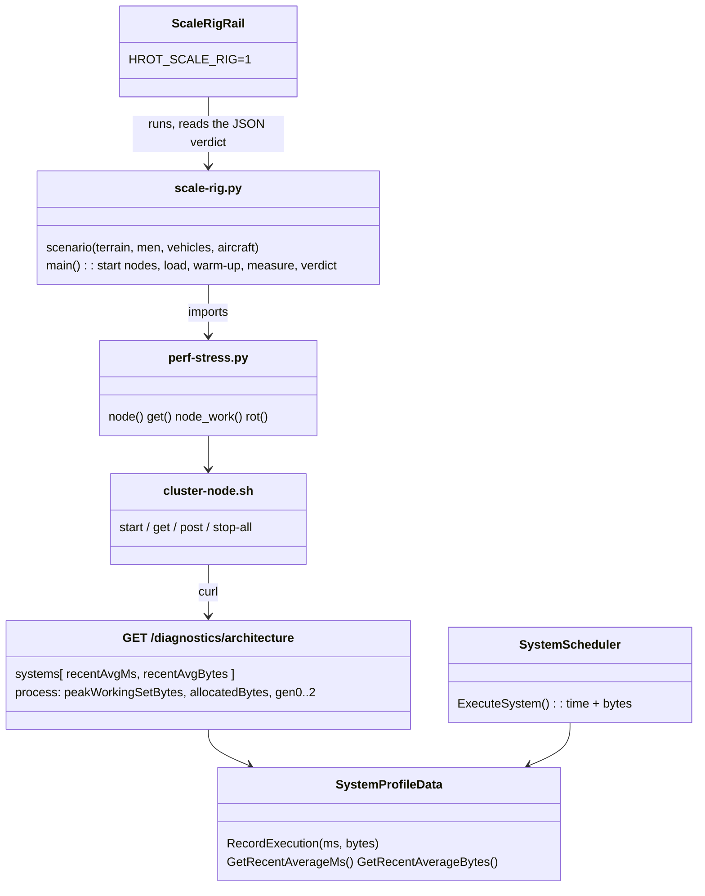
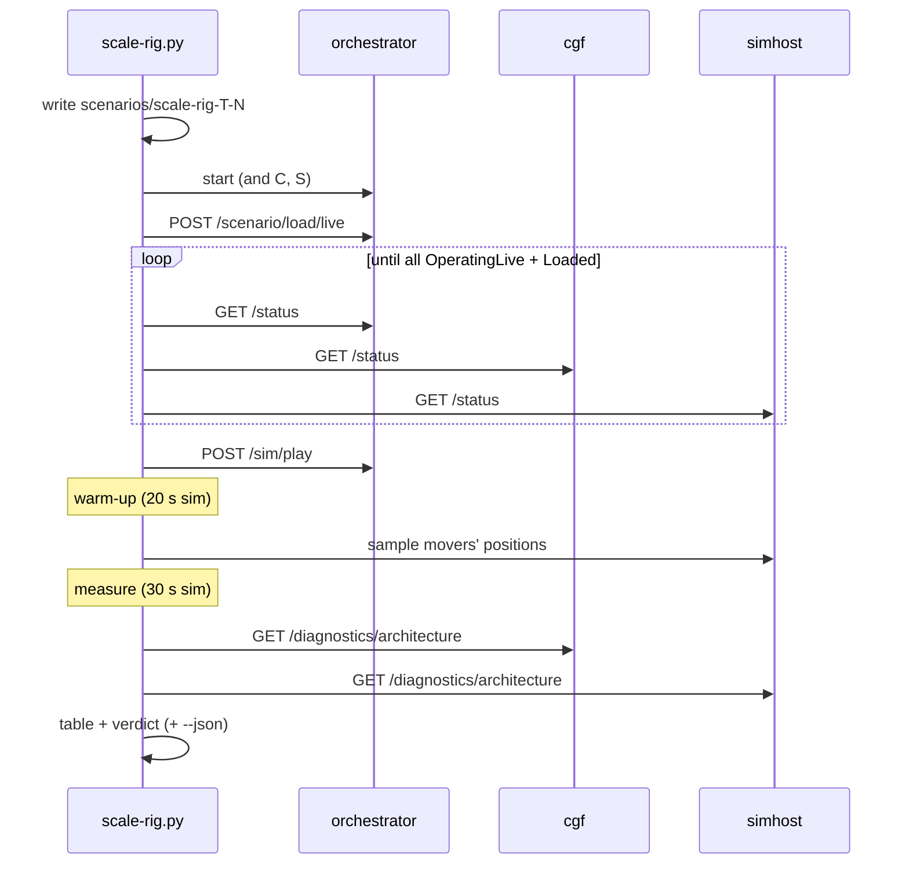
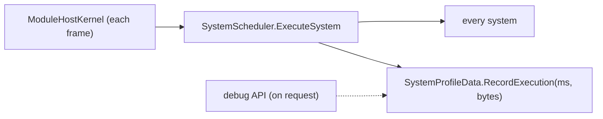
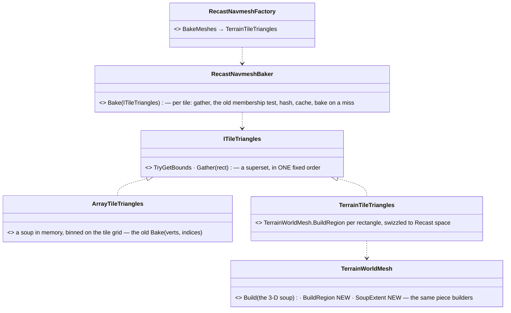
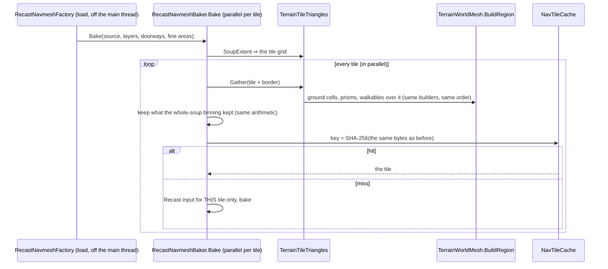

<!--STATUS
state: LIVE
build-state: BUILT (L-2, CE-4364) — baselines below; L-4 adds its findings to §5
updated: 2026-11-09 (backend — first version)
current-answer: §1 decisions · §3 how to run · §4 baselines · §5 findings (L-4)
related-designs:
  - PLAN_Large_Terrain.md — P-0 is this rig; §8 the budgets (R-4192)
  - DESIGN_Evaluation_Cost_And_Cadence.md §11 — perf-stress.py, whose cluster machinery the rig imports; §0e the garbage tables
  - designs/navig-2/Navigation_Design_v2_0.md §14 — NavTileCache (warm = the tiles from HROT_NAVTILE_CACHE)
-->

# DESIGN — the scale rig (`scripts/scale-rig.py`)

**What it answers:** does a terrain with N soldiers / vehicles / aircraft meet the large-terrain budgets (R-4192) on every node?

| budget (R-4192) | read from |
|---|---|
| load ≤ **30 s** warm (navmesh from the cache) | wall time from `POST /scenario/load/live` until every node is `OperatingLive` and its own load `Loaded` |
| sim frame ≤ **10 ms** (1 000 soldiers + 50 vehicles + 10 aircraft, busiest node) | the node's **work per frame** = Σ its leaf systems' recent ms (the scheduler's profiler) |
| **0 B** garbage per steady frame | Σ its leaf systems' recent **bytes** per execution (⭐ new: `SystemProfileData` records them, CE-4364) |
| ≤ **4 GB** per node | the process's peak working set (`/diagnostics/architecture` → `process`) |

## 1. Decisions

| # | options | chosen | why |
|---|---|---|---|
| R1 | (a) one process: brain + muscle in the SimHost integration harness (the handoff's lean) · (b) one process per node through `cluster-node.sh`, as `perf-stress.py` | ⭐ **(b)** | measured: the harness hosts the muscle only (`SimHostInstance`: no CGF, a flat world, no terrain load); (b) exists, already reports per-node work, and the budgets are PER NODE. ⇒ reuse, not a second rig — `scale-rig.py` imports `perf-stress.py`'s `node` / `get` / `node_work` |
| R2 | garbage by (a) `GC.GetTotalAllocatedBytes` over a window · (b) per system in the scheduler | ⭐ **(b)**, plus (a) as `process.allocatedBytes` | (a) counts the debug API's own polling and every thread; (b) names the system to fix. Cost: one counter read per system per frame (`GC.GetAllocatedBytesForCurrentThread`, no allocation) |
| R3 | orders: `FollowRoute` per man · a squad order | ⭐ squads **`SquadMarch`** to a road point 150–300 m away (men follow as subordinates); vehicles (TKB 2001) and aircraft (TKB 405) on looping `RoutePlan`s (TKB 8802) + `FollowRoute` — road loops ≤ 1 km, 2 km squares at 400 m AGL | measured: `FollowRoute` on a man under a squad never moved him (intent mode None, speed 0); `SquadMarch` moved 11 of 12 sampled movers. Health 100 000 so the load stays constant |
| R3b | one side or two | `--sides 1` (all Friend: perception + movement) is the SCALE load; `--sides 2` adds combat | measured: two sides at 96 men on demo-city met and fought — 9 771 entities on the CGF (munitions), work 206 ms (Debug); the terrain question is separated from the combat one |
| R4 | warm load | two runs: the first bakes into `HROT_NAVTILE_CACHE`, the second is the warm number | the cache is on disk by design (Navigation v2 §14 P2) |
| R5 | the rail | `ScaleRigRail` (`Category=Scale`), skipped unless `HROT_SCALE_RIG=1`; it runs the script and fails on its verdict | the budgets live in ONE place (the script's `BUDGET`) |

## 2. Picture





**Who runs each frame** (the only new per-frame code is two counter reads in the scheduler):



**INVENTORY** (graph queries run, `scripts/cbm.sh`): `search_graph RecordExecution` → one definition (`SystemProfileData.cs:40`);
`trace_path RecordExecution inbound` → `SystemScheduler.ExecuteSystem` / `ExecuteGroup` / `ProfiledManualSystemWrapper.Execute` (→ `ExecuteSystem`),
`ModuleHostKernel.ExecuteModuleSafe`, the Cyclone translators (their own profiles, not in the systems list); `search_graph GetArchitecture` →
`DebugApiService.Diagnostics.cs:254` (+ the system-test client). ⇒ timing every system already passes through `ExecuteSystem`, so recording the bytes there covers them all.

## 3. Run it

```
dotnet build Hrot/Runner/Hrot.ClusterRunner -c Release
export HROT_RUNNER_DLL=$PWD/Hrot/Runner/Hrot.ClusterRunner/bin/Release/net8.0/Hrot.ClusterRunner.dll
python3 scripts/terrain-scale.py --seed 1                     # the scale terrain (L-1)
python3 scripts/scale-rig.py --terrain scale-1 --men 1000 --vehicles 50 --aircraft 10 --json out.json
HROT_SCALE_RIG=1 dotnet test Hrot/Runner/Hrot.ClusterRunner.Integration.Tests --filter Category=Scale
```

## 4. Baselines *(Release, this cloud VM: 4 cores, 15 GB; orchestrator + cgf + simhost on the one VM; `--sides 1`; warm-up 20 s, measured 30 s sim; real-time factor 1.0 in every run)*

| terrain | load | cgf work / garbage / peak | simhost work / garbage / peak | top cost (ms) | top garbage (B / frame) | movers moved |
|---|---|---|---|---|---|---|
| demo-city, 96 men | 15.0 s ✅ | 14.8 ms ⛔ · 612 KB ⛔ · 1.22 GB | 5.8 ms · 338 KB ⛔ · 1.03 GB | cgf: Recorder 4.9, CycloneEgress 1.8, BrainTick 1.2 | WeaponAmmoMirror 202 K, DebugPrimitivesBatchPublisher 200 K (both nodes) | 11 / 12 |
| demo-city, 296 men | 18.3 s ✅ | 26.6 ms ⛔ · 1.33 MB ⛔ · 1.37 GB | 14.6 ms ⛔ · 545 KB ⛔ · 1.25 GB | cgf: Recorder 8.3, BrainTick 3.4, CycloneEgress 3.2 | WeaponAmmoMirror 623 K, DebugPrimitives 323 K | 11 / 12 |
| demo-city, 1 000 men + 50 vehicles + 10 aircraft | 22.8 s ✅ | 87.1 ms ⛔ · 5.1 MB ⛔ · 1.88 GB | 72.9 ms ⛔ · 1.48 MB ⛔ · 1.55 GB | simhost: **CarKinematics 43.0**; cgf: BrainTick 20.0, Recorder 19.5, WeaponAmmoMirror 8.8 | WeaponAmmoMirror 2.3 M, Recorder 1.0 M, DebugPrimitives 0.9 M | 3 / 12 (crowded 800 m city) |
| **scale-1** (5.5 km, 1 651 houses), 96 men, cold | ⛔ **never loaded** — both loading nodes ejected (heartbeat timeout) during the terrain step, simhost at 4.4 GB; the catch-up then failed | | | | | |

⇒ the cold scale load is the first wall — L-4 §5 measures it stage by stage in one process.

## 5. Findings and fixes (L-4, `CE-4366`) — the biggest measured cost first

### 5.1 The terrain load at scale — measured stage by stage *(Release, one process, `scale-1`: 5.5 km at 1 m, 1 651 houses → 84 607 prisms, 6 911 doors)*

| stage | before | after | fix |
|---|---|---|---|
| height grid read | 5.9 s / 813 MB (as a 1 m `.asc`) | **0.31 s / 127 MB** | L-3's binary store |
| parse + building expansion | 2.2 s, 0.32 GB | 2.5 s, 0.32 GB | — (not over budget) |
| ⛔ the whole terrain soup for the navmesh input (`TerrainWorldMesh.Build`: 4 vertices per 1 m cell) | 9.4 s, 61.4 M triangles, **peak 7.0 GB** | **not built on a sim node** | §5.2 the per-tile bake |
| navmesh, cold (105 800 tiles, 2 layers; 4 cores) | never finished on the cluster (nodes ejected) | 536 s, **peak 1.46 GB** | §5.2 |
| navmesh, warm (every tile from `NavTileCache`) | — | 47.4 s → 31.5 s (no Recast input for a hit) → **16.0 s** (the tile key hashed in one call, not 4 bytes per interop call) | §5.2 |
| ⛔ the cover points (`TerrainCoverProvider.Build`: "inside a solid?" and "something stands here?" scanned all 84 607 prisms per point) | **51.9 s** | **0.4 s** | both asked through the world's spatial index (`TerrainWorld.InsideFootprint`, + a height-banded form) — rail `CoverBuildIndexedTests` (the indexed build = the scanning one, 4 terrains; red-proved) |
| object index (Bepu) | 0.6 s | 0.6 s | — |
| ⇒ the terrain step in one process, warm | — | parse 2.5 + index 0.6 + navmesh 16.0 + cover 0.4 ≈ **19.5 s ✅ (≤ 30 s)** | |
| on the CLUSTER (cgf + simhost load at once on the 4-core VM), warm cache, before the cover fix | — | ready after **183.6 s** — simhost's navmesh 56.6 s (sharing the cores), then the cover build on BOTH nodes; scale-1 now runs: 96 men, 10 / 12 movers moved, simhost peak 2.54 GB | |

### 5.2 📐 The per-tile bake *(a non-local fix: Fdp.Toolkits.Navigation.Recast + TerrainWorldMesh)*





**Who calls it each frame:** nobody — a load-time (and Nav v2 §14 rebake-time) path.

| # | decision | measured |
|---|---|---|
| N-1 | each tile's triangles from the terrain, not from a global soup | peak 7.0 → 1.46 GB (cold) / 1.20 GB (warm) |
| N-2 | ⭐ **the tiles and their cache keys unchanged** — the region build uses the same piece builders in the same order, the baker the same membership test, the key the same byte stream | rail `TileSourceEqualityTests` (5 shipped terrains: the per-tile bake takes every tile from the whole-soup bake's cache, and a fresh bake of each is byte-identical; red-proved by reversing the piece order); and the OLD code's cache (base worktree, demo-city) serves the new code: **2 312 of 2 312 tiles from the cache, 0 baked** — a user's cache stays valid |
| N-3 | the Recast input (`RcSampleInputGeomProvider`, its chunky index) only on a miss | warm 47.4 → 31.5 s |
| N-4 | the tile key hashed in ONE `SHA256.HashData` call over the same bytes | warm 31.5 → 16.0 s |
| N-5 | the 3-D view still builds the whole soup (the editor) — 61 M triangles at 1 m is ui's U-1 (level of detail), not changed here | tracker row for ui |


### 5.3 The cluster load and the frame's garbage *(scale-1 on the 3-node cluster, Release)*

| # | finding (measured) | fix | rail |
|---|---|---|---|
| C-1 | ⛔ **every headless node spins one core while idle** — `SubsystemOrchestrator.Run` never waits; a windowed node's software-GL draw on Xvfb took 3 cores. Three nodes on this 4-core VM starved the terrain load (simhost's warm bake 53 s on the node vs 14 s alone) | the rig starts its nodes `--headless` (`HROT_NODE_ARGS`, new in `cluster-node.sh`) with **`HROT_HEADLESS_MAX_HZ=240`** — an opt-in cap in the headless loop: idle **102 % → 4.9 %** of a core | measured by `/proc` ticks; ⚠ the cap is OPT-IN (every lane's headless runs and tests use this loop) — making it the default is a tracker row |
| C-2 | ⛔ **the gizmo batch is built and sent with nobody reading it** — `DebugPrimitivesBatchPublisherSystem` copies every primitive into a fresh `byte[]` each frame: 0.2 MB (demo-city) … **1.08 MB per frame** (scale-1) on every node | no matched reader (`IReaderAwareWriter` on the Cyclone adapter: the publication-matched count) ⇒ no copy, no sample | `DebugPrimitivesBatchPublisherTests.CE4366_*` — no reader: 0 writes, **0 B**; a reader: the frame; a writer that cannot tell: still publishes (red-proved) |
| C-3 | ⛔ **the brain's biggest garbage: `WeaponAmmoMirrorSystem`** 0.2 MB at 96 men, **2.3 MB per frame at 1 000** — `WeaponAmmo` had no typed `Equals`, so the unchanged-ammo test boxed both structs per unit per frame | `WeaponAmmo : IEquatable<WeaponAmmo>` comparing the bytes (exactly what `ValueType.Equals` compared for this all-primitive struct) | `WeaponAmmoMirrorSystemTests.CE4366_ASteadyFrame_AllocatesNothingPerUnit` (10 vs 500 units, same bytes per frame; red-proved by forcing the boxed call) |
| C-4 | the cluster load before C-1: **ready after 70 s** (was 184 s before §5.1's fixes; never before L-4) | — | re-measured after C-1 below |

**Baselines on scale-1 before C-1…C-3** *(windowed nodes, unpaced)*:

| men | load | cgf work / garbage | simhost work / garbage | peak | movers moved |
|---|---|---|---|---|---|
| 96 | 69.8 s | 23.1 ms · 1.47 MB | 23.4 ms · 1.24 MB | 2.07 GB | 11 / 12 |
| 296 | 70.5 s | 33.7 ms · 2.05 MB | 31.2 ms · 1.37 MB | 2.46 GB | 9 / 12 |
| 1 000 + 50 + 10 | 70.1 s | 89.0 ms · 4.23 MB | 45.4 ms · 1.55 MB | 3.08 GB ✅ | 1 / 12 ⚠ |

**Baselines on scale-1 AFTER C-1…C-3** *(headless nodes paced at 240 Hz, Release, warm tile cache)*:

| men | load | cgf work / garbage | simhost work / garbage | peak | movers moved |
|---|---|---|---|---|---|
| 96 | 51.7 s | 17.1 ms · 123 KB | 13.0 ms · 104 KB | 1.53 GB | 11 / 12 |
| 296 | 36.7 s | 28.7 ms · 240 KB | 19.2 ms · 146 KB | 1.62 GB | 11 / 12 |
| 1 000 + 50 + 10 | **35.6 s** (was 70.1) | **69.7 ms · 0.49 MB** (was 89.0 · 4.23) | **31.7 ms · 0.28 MB** (was 45.4 · 1.55) | **1.99 GB** (was 3.08) ✅ | 4 / 12 ⚠ CE-3424 |

### 5.4 Still over budget — each a row with its numbers *(the biggest first)*

| cost at 1 000 men (cgf / simhost) | owner | row |
|---|---|---|
| `RecorderTickSystem` 18.7 ms + 0.2 MB / frame (cgf) | the recorder (backend's recording storage) | CE-3425 |
| `BrainTickSystem` 14.6 ms (cgf) | behaviors (the brain) | CE-3425 |
| `CycloneEgressSystem` 8.8 / 9.0 ms + `CycloneNetworkIngressSystem` 0.15 MB / frame | network egress (backend) | CE-3425 |
| the warm load ≈ 36 s on a 4-core VM shared by three nodes (≈ 19.5 s alone) | measured on a 1-machine cluster; the budget is per node on its own machine | — |
