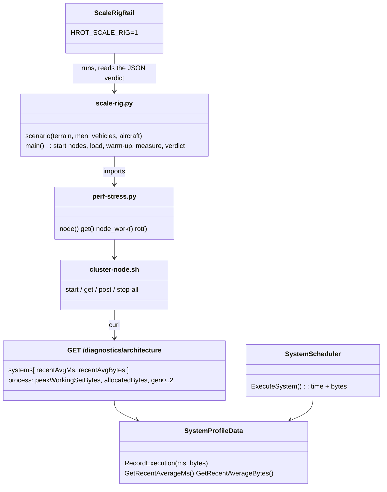
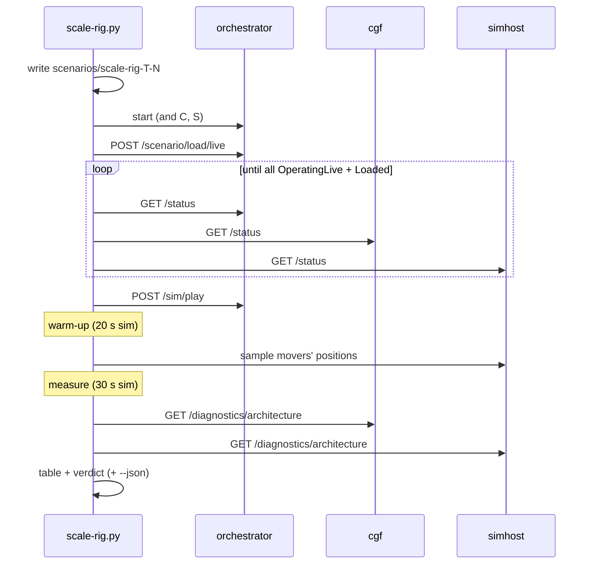
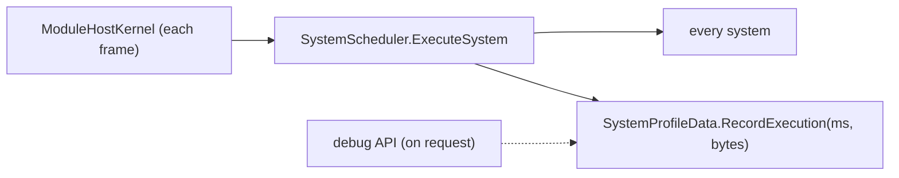

<!--STATUS
state: LIVE
build-state: BUILT (L-2, CE-4364) — baselines below; L-4 adds its findings to §5
updated: 2026-11-09 (backend — first version)
current-answer: §1 decisions · §3 how to run · §4 baselines · §5 findings (L-4)
related-designs:
  - PLAN_Large_Terrain.md — P-0 is this rig; §8 the budgets (R-4192)
  - DESIGN_Evaluation_Cost_And_Cadence.md §11 — perf-stress.py, whose cluster machinery the rig imports; §0e the garbage tables
  - designs/navig-2/Navigation_Design_v2_0.md §14 — NavTileCache (warm = the tiles from HROT_NAVTILE_CACHE)
-->

# DESIGN — the scale rig (`scripts/scale-rig.py`)

**What it answers:** does a terrain with N soldiers / vehicles / aircraft meet the large-terrain budgets (R-4192) on every node?

| budget (R-4192) | read from |
|---|---|
| load ≤ **30 s** warm (navmesh from the cache) | wall time from `POST /scenario/load/live` until every node is `OperatingLive` and its own load `Loaded` |
| sim frame ≤ **10 ms** (1 000 soldiers + 50 vehicles + 10 aircraft, busiest node) | the node's **work per frame** = Σ its leaf systems' recent ms (the scheduler's profiler) |
| **0 B** garbage per steady frame | Σ its leaf systems' recent **bytes** per execution (⭐ new: `SystemProfileData` records them, CE-4364) |
| ≤ **4 GB** per node | the process's peak working set (`/diagnostics/architecture` → `process`) |

## 1. Decisions

| # | options | chosen | why |
|---|---|---|---|
| R1 | (a) one process: brain + muscle in the SimHost integration harness (the handoff's lean) · (b) one process per node through `cluster-node.sh`, as `perf-stress.py` | ⭐ **(b)** | measured: the harness hosts the muscle only (`SimHostInstance`: no CGF, a flat world, no terrain load); (b) exists, already reports per-node work, and the budgets are PER NODE. ⇒ reuse, not a second rig — `scale-rig.py` imports `perf-stress.py`'s `node` / `get` / `node_work` |
| R2 | garbage by (a) `GC.GetTotalAllocatedBytes` over a window · (b) per system in the scheduler | ⭐ **(b)**, plus (a) as `process.allocatedBytes` | (a) counts the debug API's own polling and every thread; (b) names the system to fix. Cost: one counter read per system per frame (`GC.GetAllocatedBytesForCurrentThread`, no allocation) |
| R3 | orders: `FollowRoute` per man · a squad order | ⭐ squads **`SquadMarch`** to a road point 150–300 m away (men follow as subordinates); vehicles (TKB 2001) and aircraft (TKB 405) on looping `RoutePlan`s (TKB 8802) + `FollowRoute` — road loops ≤ 1 km, 2 km squares at 400 m AGL | measured: `FollowRoute` on a man under a squad never moved him (intent mode None, speed 0); `SquadMarch` moved 11 of 12 sampled movers. Health 100 000 so the load stays constant |
| R3b | one side or two | `--sides 1` (all Friend: perception + movement) is the SCALE load; `--sides 2` adds combat | measured: two sides at 96 men on demo-city met and fought — 9 771 entities on the CGF (munitions), work 206 ms (Debug); the terrain question is separated from the combat one |
| R4 | warm load | two runs: the first bakes into `HROT_NAVTILE_CACHE`, the second is the warm number | the cache is on disk by design (Navigation v2 §14 P2) |
| R5 | the rail | `ScaleRigRail` (`Category=Scale`), skipped unless `HROT_SCALE_RIG=1`; it runs the script and fails on its verdict | the budgets live in ONE place (the script's `BUDGET`) |

## 2. Picture





**Who runs each frame** (the only new per-frame code is two counter reads in the scheduler):



**INVENTORY** (graph queries run, `scripts/cbm.sh`): `search_graph RecordExecution` → one definition (`SystemProfileData.cs:40`);
`trace_path RecordExecution inbound` → `SystemScheduler.ExecuteSystem` / `ExecuteGroup` / `ProfiledManualSystemWrapper.Execute` (→ `ExecuteSystem`),
`ModuleHostKernel.ExecuteModuleSafe`, the Cyclone translators (their own profiles, not in the systems list); `search_graph GetArchitecture` →
`DebugApiService.Diagnostics.cs:254` (+ the system-test client). ⇒ timing every system already passes through `ExecuteSystem`, so recording the bytes there covers them all.

## 3. Run it

```
dotnet build Hrot/Runner/Hrot.ClusterRunner -c Release
export HROT_RUNNER_DLL=$PWD/Hrot/Runner/Hrot.ClusterRunner/bin/Release/net8.0/Hrot.ClusterRunner.dll
python3 scripts/terrain-scale.py --seed 1                     # the scale terrain (L-1)
python3 scripts/scale-rig.py --terrain scale-1 --men 1000 --vehicles 50 --aircraft 10 --json out.json
HROT_SCALE_RIG=1 dotnet test Hrot/Runner/Hrot.ClusterRunner.Integration.Tests --filter Category=Scale
```

## 4. Baselines *(Release, this cloud VM: 4 cores, 15 GB; orchestrator + cgf + simhost on the one VM; `--sides 1`; warm-up 20 s, measured 30 s sim; real-time factor 1.0 in every run)*

| terrain | load | cgf work / garbage / peak | simhost work / garbage / peak | top cost (ms) | top garbage (B / frame) | movers moved |
|---|---|---|---|---|---|---|
| demo-city, 96 men | 15.0 s ✅ | 14.8 ms ⛔ · 612 KB ⛔ · 1.22 GB | 5.8 ms · 338 KB ⛔ · 1.03 GB | cgf: Recorder 4.9, CycloneEgress 1.8, BrainTick 1.2 | WeaponAmmoMirror 202 K, DebugPrimitivesBatchPublisher 200 K (both nodes) | 11 / 12 |
| demo-city, 296 men | 18.3 s ✅ | 26.6 ms ⛔ · 1.33 MB ⛔ · 1.37 GB | 14.6 ms ⛔ · 545 KB ⛔ · 1.25 GB | cgf: Recorder 8.3, BrainTick 3.4, CycloneEgress 3.2 | WeaponAmmoMirror 623 K, DebugPrimitives 323 K | 11 / 12 |
| demo-city, 1 000 men + 50 vehicles + 10 aircraft | 22.8 s ✅ | 87.1 ms ⛔ · 5.1 MB ⛔ · 1.88 GB | 72.9 ms ⛔ · 1.48 MB ⛔ · 1.55 GB | simhost: **CarKinematics 43.0**; cgf: BrainTick 20.0, Recorder 19.5, WeaponAmmoMirror 8.8 | WeaponAmmoMirror 2.3 M, Recorder 1.0 M, DebugPrimitives 0.9 M | 3 / 12 (crowded 800 m city) |
| **scale-1** (5.5 km, 1 651 houses), 96 men, cold | ⛔ **never loaded** — both loading nodes ejected (heartbeat timeout) during the terrain step, simhost at 4.4 GB; the catch-up then failed | | | | | |

⇒ the cold scale load is the first wall — L-4 §5 measures it stage by stage in one process.

## 5. Findings (L-4)

_see the L-4 section_
