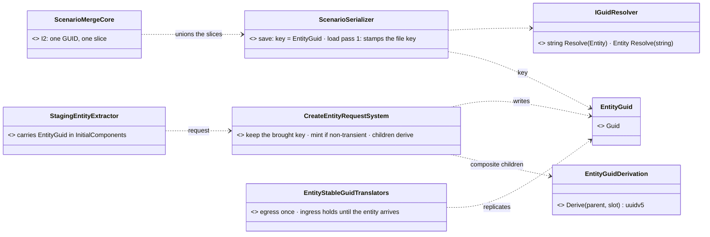
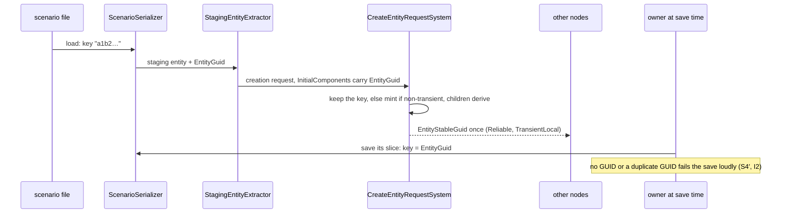

<!--STATUS
state: LIVE
build-state: S1–S7 BUILT (merged 2026-11-01, §00b); S8–S10 NOT BUILT — S9's remap premise was false (§00b "STOPPED"); ⭐ S9′ ✅ accepted 2026-11-01 — build right after S0: after S0 no save-direction remap is needed — a rule + one field + a migration step; tracker CE-4153
updated: 2026-11-01 (superseded revisions removed; the diagrams redrawn to the as-built)
current-answer: §00b as-built + findings (read first) · §00 / §00c / §00a the decisions S1–S11 (+ S2′ S2″ S4′) · §0 the stable-GUID model G1–G6 and §0b why GUIDs · §0a, §1 measurements · §2 retired decision ids · §3 diagrams (as built) · §4 acceptance
stale-below: nothing — superseded revisions removed 2026-11-01; full history at commit de422e11b (`git show de422e11b:docs/DESIGN_Scenario_Entity_Keys.md`)
known-rot: none
known-conflict: none
related-designs:
  - docs/DESIGN_Scenario_Macros.md — OWNS scenario macros (the expander, macro files, params + bindings, RefKey scoping); derived GUIDs for macro-made entities (G2) and RefKey scoping are used by the expander
  - docs/DESIGN_Scenario_Rules.md — §9.3 SR-50 asked for this (scenario macros need short, remappable entity keys; SR-45 remaps macro-local ids)
  - docs/DESIGN_Deterministic_Network_Ids.md — §11b OWNS network id allocation and the per-load re-allocation (old → new map) that makes a file's key file-local either way
  - docs/blueprints/DESIGN_Entity_Reference.md — OWNS EntityRef (a network id) and EntityRefRemap, the load-time remap of references
  - docs/designs/mgmt-1/DESIGN.md — §13.3a: an exercise archive carries a COPY of its scenario ⇒ the loader must keep reading legacy GUID keys
  - docs/DESIGN_Distributed_Scenario_Persistence.md — §4a-§4b OWN the distributed save + merge whose invariant I2 (fresh GUID per save) S6 restates
  - docs/designs/cgf-scn-2/DESIGN.md — the scenario-translator programme that introduced IGuidResolver (VisHierarchyNodeTranslator, InitialHierarchyIntent)
-->

# DESIGN — **scenario entity identity: a STABLE GUID** *(tracker CE-4153)*

## 00. ✅ Make the GUIDs STABLE and keep them *(user, `2026-10-31`)*

> 🔒 *"I still think the GUID in the scenarios are only good if they are stable. And the need for a stable GUID might come later. So we might just
> change the task from retiring the GUIDs to make them stable … if they are not stable, then the network IDs would work equally good. So can we
> make the GUIDs stable? If so, let's keep them."* · reusable references use `RefKey` (`DESIGN_Scenario_Rules.md` SR-63…SR-66), not GUIDs.

| measured | where | consequence |
|---|---|---|
| saving on a cluster is DISTRIBUTED: each node saves the entities it primarily owns as a slice; the orchestrator unions the slices (`ScenarioMergeCore`) | `DESIGN_Distributed_Scenario_Persistence.md` §4a-§4b; `ScenarioMergeCore.cs` | ⭐ the GUID must be known on WHICHEVER node owns the entity at save time — ownership moves (brain hand-over) |
| the merge's invariant **I2** rests on *"the DOM key is a fresh `Guid.NewGuid()` per save"*; a key in two slices is rejected | §4b I2, fail-loud guards | ⭐ still true with stable GUIDs — I1 (one entity → one slice) keeps them disjoint; a duplicate still means a broken save |
| `EntityMaster` (the NED entity descriptor) carries `EntityId`, `TkbType`, `DisType`, `Flags` — no GUID | `Hrot.Network.NED/GenericDescriptors.cs:97-121` | the GUID needs its own way across nodes |
| a new replicated component ≈ 9 places (the `Descent` recipe) | Airborne D-1, commit bdc7827ec | the cost of S3 |

| # | decision | ⭐ lean |
|---|---|---|
| **S1** | the component — ✅ user, `2026-10-31`: *"We need to treat it as optional because there are many lightweight entities that exist at runtime and are never saved to a scenario (like bullets) … it shouldn't be saved back to scenario in the normal way. It should go to the key of the entity and never repeat as a component inside the entity."* | `EntityGuid {Guid}` — OPTIONAL: only entities that come from a scenario (or a scenario macro) or are authored to be saved carry it; bullets, effects, sensor parts never do. `[DataPolicy(NoScenario)]` so the generic serializer never writes it as a component — it is written ONLY as the entity's key |
| **S2** | where a GUID comes from | ⭐ scenario LOAD: the file key → `EntityCreationRequest` (a new optional `Guid`) → the created entity's `EntityGuid`. ⭐ a NEW entity (editor placement, runtime spawn that may be saved): minted ONCE at creation. ⭐ a MACRO-made entity: derived `uuidv5(instance GUID, local GUID)` (deterministic). ⭐ any future duplicate / paste: re-minted, never copied. ⛔ never `NewGuid()` at save again. *(Where the mint runs: S2′; a composite's child: S2″; as built the key rides `InitialComponents`, not a new field — §00b)* |
| **S3** | how it reaches the saving node | ⭐ lean (a): a small replicated descriptor `EntityGuid {[DdsKey] EntityId, Guid}`, Reliable + TransientLocal, published by the entity's creator — every node knows every entity's GUID, so any owner saves it; it is also RECORDED, which later lets the film director reference by GUID. ⛔ (b) a field on `EntityMaster` — a core descriptor other NED participants read; ⛔ (c) the loading node ships a GUID map in its slice — breaks for entities created after load whose ownership moved |
| **S4** | save | key = `EntityGuid`; an entity reaching save without one: S4′ |
| **S5** | load of old files | nothing to migrate — every file already has GUID keys; they simply stop changing from the next save |
| **S6** | the merge | I2 restated: keys are unique because each entity has ONE stable GUID and lives in ONE slice; the duplicate-key guard stays and now also catches an aliased GUID |
| **S7** | rails | load → save → load keeps every key · two saves of an unchanged scenario are identical · ownership moved to another node before save keeps the key · a macro instance's entities derive the same GUIDs on two loads |

### 00c. After CE-259ax (`2026-10-31`) — the mint moves up to the request level *(✅ user: "Yes")*

📐 Measured on `coordinator` after CE-259ax (`676464716`): the only production publishers of `SpawnEntityCommand` are `CreateEntityRequestSystem`
(`:343` the entity, `:406` / `:503` composite children) and the CGF test hook (`CgfSubsystem.cs:599`) — both creation ways (the NED wire request
and the in-process intent) converge in `CreateEntityRequestSystem`. ⇒ the reason to mint in `NetworkSpawningSystem.ProcessSpawn` is gone.

| # | decision |
|---|---|
| **S2′** | the GUID is minted in `CreateEntityRequestSystem` where it decides to materialise (carried in the order's initial components); `ProcessSpawn` mints nothing; a scenario-load request keeps its file key |
| **S2″** | a composite's auto-created child derives its GUID `uuidv5(parent GUID, slot)` — the same rule as macro-made entities, one shared helper |
| **S4′** | no fallback: a non-transient entity reaching save without a GUID fails loudly; the CGF test hook mints its own, visibly |

Rejected: minting at save for an entity without a GUID and stamping it back on the live entity — a silent mint hides a creation path that does not mint (S4′, S10).

## 00a. Then why keep the network id in the file? *(user, `2026-10-31`: "Do we still need to use the network ID as saved in the scenario for referencing within the scenario once we have a stable GUID?")*

| measured | where |
|---|---|
| ⭐ scenario load gives EVERY entity a NEW network id — `idAllocator.AllocateId()` per entity, an old → new map | `StagingEntityExtractor.cs:248-261` |
| the file's network id is used ONLY as the reference currency for `EntityRef` (behaviour params JSON + components), rewritten by that map at load (`RemapComponentNetworkIds`, `EntityRefRemap`) — ≈ 76 such references in 39 of 117 scenarios (heuristic: numbers equal to an entity's id, outside `NetworkIdentity`) | `StagingEntityExtractor.cs:344-359`; scan `2026-10-31` |
| component-level references (`VisHierarchyNode`, `UnitSubordinate`, passengers, targets…) ALREADY use the GUID key through the resolver | §0a |
| the old → new table is handed out (`OnRemap`) so runtime-id keyed things survive a reload — watch pins and breakpoints (BP-509) | `StagingEntityExtractor.cs:130-145, :389`; `DESIGN_Variable_Watch_Pinning.md` §5 |

⇒ the file's network id is neither stable (re-allocated every load) nor guaranteed unique (two files, two macro instances), and it is only a
second, numeric reference currency beside the GUID.

| # | decision | ⭐ lean |
|---|---|---|
| **S8** | drop `NetworkIdentity` from the scenario file | ⭐ yes, once S1–S7 are in: the id is allocated at load exactly as today; nothing reads the file's value except the remap |
| **S9** | `EntityRef` in a FILE | its FILE form becomes the target's GUID; its LIVE form stays the network id (orders, the wire, the debug API, `BrainIntent` JSON). The conversion is the existing remap step at the file boundary — save: live id → GUID, load: GUID → new id — ⛔ no second remap mechanism. ⚠ `EntityRef`'s JSON is today *"the bare number"* (R-184) — the remap must write / read a string in the file form. ⚠ **premise measured false — §00b "STOPPED"** |
| **S9′** ✅ ACCEPTED `2026-11-01` (user: *"Yes."*; replaces S9's mechanism) | references in a FILE, after S0 | 🔒 user: *"What about the GUID-at-save prerequisite?"* ⭐ **Measured `2026-11-01`** (every `scenarios/*/scenario.json` + `recipes/**`: numbers equal to an entity's `NetworkIdentity`, outside `NetworkIdentity` / `TkbIdentity` / params): **ONE** hit — `RoutePlan.Waypoints[].HoldUnit` (`ua-air-rescue`), a raw `long` that IS a reference (*"the unit whose members a Pickup waits for (network id)"*, `RoutePlan.cs:47-49`; S9's worker filed it as a false hit — it is not). The other file references are ① behaviour / mission params JSON (S9's 57 + 20) — `EntityLink` after S0, carrying the GUID / `@Key` IN THE VALUE, so save writes it back with no reverse remap; ② the translator DTOs (`UnitSubordinate`, `PassengerBuffer`, `VisHierarchyNode`, `TargetMemory`, `IsEmbarkedTag`, `PersonalRouteRef`) — ALREADY keyed by the entity GUID (§0a). ⇒ ⭐ **no save-direction remap is needed**; S9 becomes a RULE + its loose ends: (a) a reference a PERSON authors is an `EntityLink`, also inside a component (`HoldUnit` → `EntityLink`; amends `DESIGN_Scenario_Rules.md` SR-140's "no `EntityLink` in components" to "none in a CODE-written component"); (b) a code-written reference that is SAVED goes through a GUID-keyed translator; (c) a rail fails on an `EntityRef` / `long` id in an auto-serialized saved component; (d) the content migration writes every numeric `EntityLink` in a file as the target's GUID (`Exact`) — ⚠ S0 item 9 migrates to the new TYPES, so a non-authored link may still be a number; this closes it; (e) the editor's entity pick writes `Exact` (or `Key` in a macro, SR-133). ⇒ then **S8** (drop `NetworkIdentity` from the file) is safe: nothing in a file names a network id |
| ⚠ *measured `2026-11-02`* | CE-3357 — the strict save (`ScenarioSerializer.cs:183-189`) catches FIXTURES | ⭐ a test that authors by publishing `SpawnEntityCommand` directly skips the GUID mint (`CreateEntityRequestSystem.cs:352-366`) and its save throws — the guard working as designed (*"a DEFECT of whatever created it"*). The only production direct publisher, CGF's test hook, stamps its own (`CgfSubsystem.cs:594-608`). ⇒ ⭐ the rule for tests: author through a creation request, or stamp `EntityGuid` like the hook; and a test that saves a reference writes it in the post-S9′ form (`Exact`, the target's GUID) |
| **S10** | old files — 🔒 no backwards compatibility (user, `2026-10-31`: *"we should not keep the backwards compatibility, because that might hide some troubles, and we need to see the troubles now"*) | ⭐ every repo scenario is MIGRATED in the same change (a committed, idempotent tool — a C# tool, §00b finding ③); a numeric `EntityRef` in a file is a LOUD load error; an entity from a scenario that reaches save without its `EntityGuid` is a defect (logged + a failing rail), never silently minted — minting only for entities authored after load |
| **S11** | watch pins / breakpoints across a reload | may key on the GUID instead of the old → new table (BP-509) — a simplification, not required |
| ✅ measured | readers that rely on a reload REPRODUCING the file's ids (the allocator resets to 1000 per world, so a reload often hands out the same numbers) — tests, scripts | §00b Step 0: none, as long as load keeps allocating in staging order |

Rejected: a file `EntityRef` accepting EITHER a number OR a GUID (G4) — keeping the old form is backwards compatibility, which S10 refuses.

### 00b. ✅ As built (S1–S7) and ⛔ STOPPED at S8–S10 *(branch `ce-4153-stable-guids`, `2026-10-31`)*

**Step 0 — who relies on a reload REPRODUCING the file's network ids** (script scan over every tracked text file that names a scenario AND contains one of its ids):

| class | count | verdict |
|---|---|---|
| tests naming a scenario + one of its ids | 20 files (the three ClusterRunner classes inline their own JSON with `NetworkIdentity` 9101… — 3 files) | ⭐ **no test depends on the FILE's id being reproduced** — load already hands out `1000+` in staging order for every file (`StagingEntityExtractor.cs:248-261`); only 5 of 126 files have ids that equal that sequence |
| `golden.json` beside a scenario | 10 | numbers in a golden are runtime ids of that run; unaffected as long as the allocation ORDER (staging entity index = file key order) is kept |
| runbooks / designs / MCP skill docs ("entity 1000", "1006") | 76 docs, 6 scripts | all `hill-attack` / `test-move` style 1000-range ids = the allocator's sequence, not the file value |
| `TestScripts/*.json` | 0 contain `NetworkIdentity` | — |

⇒ nothing needs the file's ids reproduced: S8 (drop `NetworkIdentity` from the file) is **safe for readers** — IF the load keeps allocating in staging order.

**Built (S1–S7):** `EntityGuid` component 467 (`Fdp.Toolkits/Scenario/EntityGuid.cs`, `NoScenario`) · the loader stamps the file key (`ScenarioSerializer.Deserialize` pass 1) and it rides `InitialComponents` through `StagingEntityExtractor` into the created entity — ⭐ **deviation from S2: NO new `Guid` field on `EntityCreationRequest`** (the request already carries every staging component; a field would be a second route) · ⭐ **the mint is in `CreateEntityRequestSystem`, at step 4 where it decides to materialise locally** (S2′ — CE-259ax made it the ONLY production publisher of `SpawnEntityCommand`: both the wire `CreateEntityRequest` and the in-process intent converge there; the one other publisher is the test hook `CgfSubsystem.TestHook_SpawnEntityWithSplitAuthority`, which stamps its own key explicitly and is NOT transient so a hook-made entity stays saveable): the request's own `EntityGuid` (a scenario load's file key) is kept; else a NON-transient request is minted once; a transient one gets none. `NetworkSpawningSystem.ProcessSpawn` mints NOTHING. **Composite children and seat presets DERIVE theirs**: `EntityGuidDerivation.Derive(parentGuid, "child:<InstanceId>")` / `"seat:<n>"` = RFC 4122 uuidv5 with the parent's GUID as namespace (`Fdp.Toolkits/Scenario/EntityGuidDerivation.cs`, the one helper macro expansion will reuse); a child's own file key (carried in its override) wins. `CreateEntityRequestSystem` also **logs an error for a scenario-load request that carries no key**. Rejected: the mint in `NetworkSpawningSystem.ProcessSpawn` step 8a (the first build) — needed only while `ScenarioSpawnAdapter`, `EntityPlacementGizmo`, `AreaAuthoringArm` and `SimHostScenarioManager` published `SpawnEntityCommand` directly (measured: `EditorPreview_SnapshotsAndRestoresState` failed its save until then); CE-259ax routed them through the request system, so the mint sits at the one creation decision
· save uses the component; ⛔ **no fallback**: on a repo that registered `EntityGuid` (every Hrot host does, `HrotSharedComponentRegistry`) an entity without one fails the save naming it; two entities with one GUID fail the save naming both (I2) · a bare toolkit repo that never registered the type keeps ephemeral keys (the generic-toolkit unit tests; no host reaches that arm) · wire: `dtEntityGuid` = **157** (160–169 is Traffic's block), `EntityStableGuid {[DdsKey] EntityId, Lo, Hi}` Reliable + TransientLocal, **no ownership group** (creator keeps it, the `dtObstacleShape` shape), egress publishes once, ingress HOLDS a sample whose entity has not arrived yet; also a `CreateEntityRequest` union arm so a forwarded request carries the key · `ScenarioMergeCore` I2 restated · `docs/reference/NED_DDS_Protocol.md` row added. ⚠ **Not done from the Descent recipe:** `EntityStatesIngressPack` (pure-IG ingress — IG never saves) and the ownership-group lists (the descriptor is group-less by design).

**Rails (S7):** `EntityGuidStabilityTests` (7: key written, load→save→load, two saves identical, missing GUID fails loudly, duplicate GUID fails, ownership hand-over keeps the key — two-repo slice test, **no distributed-save harness exists**, bare repo keeps ephemeral keys) · `EntityStableGuidReplicationTests` (4) · `ScenarioEntityKeySweepTests` (2: all 126 entity scenarios load → save under their own keys with an identical second save; and the real extractor hands every entity to the creation pipeline with its file key). `EntityGuidMintTests` (4: authored ⇒ minted once · transient ⇒ none · a brought file key kept · composite children derived and IDENTICAL across two spawns) · `EntityGuidDerivationTests` (RFC 4122 v5 known vector). Each rail red-proved by a compiling mutation (12 mutations, all red, tree restored).

**⛔ STOPPED — S8–S10, an assumption of S9 is false.** S9 says *"the conversion is the existing remap step at the file boundary — save: live id → GUID, load: GUID → new id — no second remap mechanism."* Measured: ① the existing remap is **load-only and number-only** — `EntityRefRemap.TryRemapNumber` reads a JSON number and returns a `long` (`EntityRefRemap.cs:206-211`), `EntityRefJsonConverter.Write` writes a number (`EntityRef.cs:114-115`); there is **no save-direction remap at all**, so "save: live id → GUID" is a NEW mechanism, one per place a ref is written; ② a file-side ref lives in THREE kinds of place — `EntityRef` members of components (auto-serializer), behaviour params JSON **inside a string** (`Behavior.Params` 57 values, `MissionPlan…behaviorParams` 20 — keyed by a behaviour's contract TYPE through `ScenarioBehaviorRemapper`/the registry), and the translator DTOs — and the type plan is C#-only; ③ ⭐ **a Python migration cannot find the refs reliably:** matching numbers to entity ids in the 126 files found two FALSE hits (`RoutePlan…HoldUnit`, `TkbIdentity.TkbType`) beside the real ones; a correct migration must be a C# tool driven by the same type plan (load with the old reader, save with the new writer). ④ `EntityRefJsonConverter` is also the LIVE form (orders, wire, debug API, `BrainIntent` JSON — numbers by design, S9), so rejecting numbers must be scoped to a file read/write, not global. None of this was started; nothing in the repo's scenario files changed.

## 0. The stable-GUID model — G1–G6 *(the user's question, `2026-10-31`; adopted by §00)*

> The user asked (*"It was a question, not a imperative. So let's Analyze if GUIDs are the right answer."*): *"Maybe the GUID is the right answer here. Doesn't need names and is always unique. So not names but GUIDs, and that's the real reason for GUIDs in the scenario file."*

⚠ Measured before S1–S7 (`2026-10-31`): the GUIDs were NOT stable — `ScenarioSerializer.cs:171` wrote a fresh `Guid.NewGuid()` per entity on EVERY save; no
persistent entity GUID component existed (graph `.*(EntityGuid|PersistentId|StableId|StableEntity|ScenarioEntityId|AuthoredId|EntityUid).*` = no entity
hit). ⇒ GUIDs can be the cross-scope reference only once they are made persistent — which §00 does.

| # | decision | ⭐ lean |
|---|---|---|
| **G1** | a STABLE identity per authored entity | a saved component `EntityGuid {Guid}` assigned ONCE (when the entity is first created in the editor or first saved) and kept forever: load reads the file key into it, save writes it back — ⛔ never `NewGuid()` on save again *(built as S1, S2, S2′, S4′)* |
| **G2** | identity of an entity a MACRO creates | DERIVED, deterministic: `uuidv5(instance.EntityGuid, local EntityGuid)` — the same on every node and every load; nested macros chain it. ⇒ "Rifleman 2 of Blue Platoon" always has the same GUID, without names *(S2; the helper `EntityGuidDerivation` is built, S2″)* |
| **G3** | the scenario `entities` key | stays the GUID (now stable) — ⛔ not the network id: network ids are re-allocated per load and cannot identify a macro-made entity across loads |
| **G5** | resolving GUIDs at runtime | an index `EntityGuid → entity` on the node that expands / loads; a macro inserted at runtime resolves against the live index |
| **G6** | readability | names stay the human handle (display, checks, director); GUIDs are written by pickers, never typed |

⭐ Trade-off accepted: a GUID survives a RENAME (a name path would break); it breaks if a macro's author deletes and re-creates an entity
(a new GUID) — a name path would survive that. The editor can warn when a saved reference no longer resolves.

### 0a. Measured by the (stopped) CE-4153 worker, `2026-10-31`

| fact | where | for stable GUIDs |
|---|---|---|
| a saveable entity CAN lack `NetworkIdentity` (the selection checks alive · not ignored · owned, never the id); 9 of 1068 repo entities have none | `ScenarioSerializer.cs:614-637`; `BlueprintDemo.scenario.json`, `test-data/scenario-corpus/multi-version/*` | ⭐ a GUID identity does not depend on a network id (a network-id key would have needed an `L<n>` fallback that collides in `ScenarioMergeCore.cs:146-152`) |
| every translator treats the key as OPAQUE (`VisHierarchyNode`, `UnitSubordinate`, `TargetMemory`, `PassengerBuffer`, `IsEmbarkedTag`, `PersonalRouteRef` translators, `FdpAutoSerializer.cs:420`); only `ScenarioSerializer.cs:410-441` and `LoadResolver :716-729` parse it | as cited | ⭐ making GUIDs stable touches the serializer only |
| a GUID DERIVED from a network id already exists: `TransientMasterBuilder` keys with `NetworkIdGuid.From(netVal)` | `TransientMasterBuilder.cs:85, 137, 247` | ⭐ precedent for G2's derived GUIDs |
| the generators mint DETERMINISTIC keys (`prefix-0000-4000-8000-n`) | `scripts/scenario_builder.py:17-20` (+ `gen-ia/rf/ts-scenarios.py`) | ⭐ already stable per regeneration — compatible with G1 |
| ~558 in-file values reference another entity's key; nothing beside `scenario.json` (`checks.json`, `golden.json`, `takes/`) references entity keys | grep | ⭐ no key migration needed (the keys stay GUIDs) |

### 0b. Why GUIDs — the analysis *(`2026-10-31`)*

| criterion | stable GUID | name path | network-id key + `{instance, local}` |
|---|---|---|---|
| unique across macro instances | ✅ derived `uuidv5` | ✅ instance name prefixes | ✅ but ids change every load |
| survives a RENAME of the target | ✅ | ⛔ (editor can warn / rename refs) | ✅ |
| survives delete + re-create of the target | ⛔ | ✅ | ⛔ |
| readable in the file, writable by a script / AI / by hand | ⛔ picker only | ✅ — the tooling already names units (checks, director) | ⚠ numbers, no meaning |
| new mechanism | `EntityGuid` component, persist, mint on create, re-mint on any future duplicate / paste (none exists today), derived ids, a GUID→entity index | uniqueness per scope (114 / 117 scenarios already), a path index | a qualified ref type |
| entities that lack the handle today | none (any entity can get one) | 6 of 1015 unnamed | 9 of 1068 without a network id |
| what the reference expresses | *this exact object* | *the thing called X in instance Y* — the macro's names act as its interface | *slot n of instance Y* |

⇒ **Decision: stable GUIDs (§00)** — the user's ruling. Rejected (one line each):
- *name paths for authored cross-scope references, the GUID left file-local* (this analysis' lean: a macro's names are its contract; scripts and agents can write a name, not a derived GUID; no new persistence semantics) — the user kept GUIDs once they can be stable; names live on as `RefKey` / `@Key` references (`DESIGN_Scenario_Rules.md` SR-63…SR-66).
- *network-id keys + `{instance, local}`* — ids change every load; see §2.

## 1. INVENTORY *(measured `2026-10-31`, before S1–S7; graph + grep, coverage unchecked)*

| fact | where |
|---|---|
| save keyed every entity with a FRESH `Guid.NewGuid()` — regenerated on every save; the key only resolved references inside the one file | `FDP/Toolkits/Fdp.Toolkits/Scenario/ScenarioSerializer.cs:165-173, :239` |
| load parses the keys with `Guid.TryParse` and builds `Dictionary<Guid, Entity>` | `ScenarioSerializer.cs:410-441` |
| `IGuidResolver { string Resolve(Entity); Entity Resolve(string) }` — save and load implementations | `Scenario/IGuidResolver.cs`; `ScenarioSerializer.cs:688-730` |
| `IGuidResolver` appears in 24 production files (17 under `Hrot/Engine/Hrot.EcsNode/Serializers`, 4 in `Fdp.Toolkits/Scenario`, 2 Diagnostics, 1 ReplayBrowser Federation) and 16 test files | grep, `2026-10-31` |
| all 1059 entities of the 127 scenario files carry `NetworkIdentity` | measured over `scenarios/` + `recipes/scenarios/` |
| scenario load RE-ALLOCATES every network id (old → new map, `PreAllocatedNetworkId`) — a file's ids look stable only because the allocator resets to 1000 per world | `StagingEntityExtractor.cs:~245-262`; Network Ids §11b |
| 142 scenario JSON files hold GUID strings; GUID literals also in `Hrot.ClusterRunner.Integration.Tests/TestScripts/*.json` and several integration / SimHost test classes; `checks.json` names units by name (no GUIDs found) | grep |
| an exercise archive carries a copy of its scenario | mgmt-1 §13.3a (CE-3119) |

## 2. Retired decision ids

> 🔒 **User, `2026-10-31`:** *"Maybe it would be easier to read if the entity was identified by the network ID directly, which is a short number
> and not so long GUID … if there is no good reason for keeping just GUID."*

Rejected: **network ids as the file key** (the question above) — killed by one fact: load re-allocates every network id (`StagingEntityExtractor.cs:248-261`), so it
cannot identify a macro-made entity across loads — and the user then chose GUIDs, if stable (§00).

| id | was | replaced by |
|---|---|---|
| **K1** | the `entities` key = `NetworkIdentity.Value` (`"9800"`, `L<n>` fallback) | G3 / S4 — the key stays the (stable) GUID |
| **K2** | the resolver's key meaning changes from GUID to entity key | nothing to change — the key stays a GUID; translators treat it as opaque (§0a) |
| **K3** | load accepts numeric or legacy GUID keys | S5 — every file already has GUID keys |
| **K4** | a duplicate network id fails the save | S6 — a duplicate GUID fails the save (I2) |
| **K5** | a migration script rewrites keys + in-file refs | no key migration (§0a); the `EntityRef` migration is S10 (a C# tool, §00b ③) |
| **K6** | rename `IGuidResolver` → `IEntityKeyResolver` | not needed — the key stays a GUID, the name stays right |
| **G4** | a file `EntityRef` accepts a number OR a GUID string | S9 (file form = the GUID) + S10 (no backwards compatibility) |

## 3. Diagrams *(as built, S1–S7)*

*What the picture shows that prose hid:* the GUID is decided at ONE place (`CreateEntityRequestSystem`) and only the serializer reads it as a
key; the translators keep calling the unchanged `IGuidResolver`, and replication is one group-less descriptor.

*What it shows:* any node that owns the entity at save time already holds its GUID, so ownership hand-over keeps the key.

## 4. Acceptance

- S1–S7: the §00b rails (`EntityGuidStabilityTests`, `EntityStableGuidReplicationTests`, `ScenarioEntityKeySweepTests`, `EntityGuidMintTests`, `EntityGuidDerivationTests`) — every repo scenario loads and saves under its own keys, a second save identical;
- S8–S10 (not built): every repo scenario migrated by the C# tool loads with the SAME entity count and component set as before; save → load → save is byte-stable; a numeric `EntityRef` in a file is a loud load error;
- the serializer, translator and SimHost scenario test classes are green; the integration TestScripts load.
