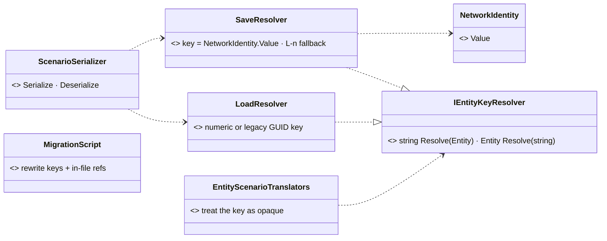
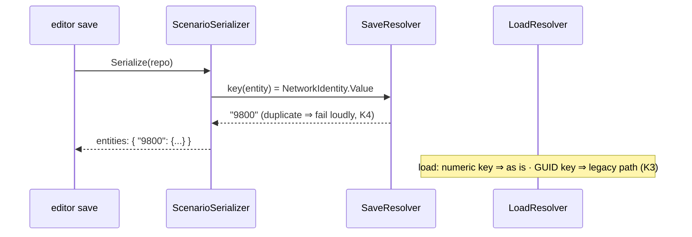

<!--STATUS
state: LIVE
build-state: DESIGN — rev 3 (2026-10-31): ✅ user — make the GUIDs STABLE and keep them (§00, S1–S7); leans for the user on S3; tracker CE-4153 re-scoped
updated: 2026-10-31 (first version)
current-answer: §00 rev 3 — stable GUIDs, the mechanism · §0a measurements · §1 inventory
stale-below: §2–§4 (rev 1, network-id keys — SUPERSEDED)
known-rot: none
known-conflict: none
related-designs:
  - docs/DESIGN_Scenario_Rules.md — §9.3 SR-50 asked for this (scenario macros need short, remappable entity keys; SR-45 remaps macro-local ids)
  - docs/DESIGN_Deterministic_Network_Ids.md — §11b OWNS network id allocation and the per-load re-allocation (old → new map) that makes a file's key file-local either way
  - docs/blueprints/DESIGN_Entity_Reference.md — OWNS EntityRef (a network id) and EntityRefRemap, the load-time remap of references
  - docs/designs/mgmt-1/DESIGN.md — §13.3a: an exercise archive carries a COPY of its scenario ⇒ the loader must keep reading legacy GUID keys
  - docs/DESIGN_Distributed_Scenario_Persistence.md — §4a-§4b OWN the distributed save + merge whose invariant I2 (fresh GUID per save) rev 3 restates (S6)
  - docs/designs/cgf-scn-2/DESIGN.md — the scenario-translator programme that introduced IGuidResolver (VisHierarchyNodeTranslator, InitialHierarchyIntent)
-->

# DESIGN — **scenario entity identity: a STABLE GUID** *(tracker CE-4153; rev 1 proposed network-id keys — superseded)*

## 00. ✅ Rev 3 — make the GUIDs STABLE and keep them *(user, `2026-10-31`)*

> 🔒 *"I still think the GUID in the scenarios are only good if they are stable. And the need for a stable GUID might come later. So we might just
> change the task from retiring the GUIDs to make them stable … if they are not stable, then the network IDs would work equally good. So can we
> make the GUIDs stable? If so, let's keep them."* · reusable references use `RefKey` (`DESIGN_Scenario_Rules.md` SR-63…SR-66), not GUIDs.

| measured | where | consequence |
|---|---|---|
| saving on a cluster is DISTRIBUTED: each node saves the entities it primarily owns as a slice; the orchestrator unions the slices (`ScenarioMergeCore`) | `DESIGN_Distributed_Scenario_Persistence.md` §4a-§4b; `ScenarioMergeCore.cs` | ⭐ the GUID must be known on WHICHEVER node owns the entity at save time — ownership moves (brain hand-over) |
| the merge's invariant **I2** rests on *"the DOM key is a fresh `Guid.NewGuid()` per save"*; a key in two slices is rejected | §4b I2, fail-loud guards | ⭐ still true with stable GUIDs — I1 (one entity → one slice) keeps them disjoint; a duplicate still means a broken save |
| `EntityMaster` (the NED entity descriptor) carries `EntityId`, `TkbType`, `DisType`, `Flags` — no GUID | `Hrot.Network.NED/GenericDescriptors.cs:97-121` | the GUID needs its own way across nodes |
| a new replicated component ≈ 9 places (the `Descent` recipe) | Airborne D-1, commit bdc7827ec | the cost of S3 |

| # | decision | ⭐ lean |
|---|---|---|
| **S1** | the component — ✅ user, `2026-10-31`: *"We need to treat it as optional because there are many lightweight entities that exist at runtime and are never saved to a scenario (like bullets) … it shouldn't be saved back to scenario in the normal way. It should go to the key of the entity and never repeat as a component inside the entity."* | `EntityGuid {Guid}` — OPTIONAL: only entities that come from a scenario (or a scenario macro) or are authored to be saved carry it; bullets, effects, sensor parts never do. `[DataPolicy(NoScenario)]` so the generic serializer never writes it as a component — it is written ONLY as the entity's key |
| **S2** | where a GUID comes from | ⭐ scenario LOAD: the file key → `EntityCreationRequest` (a new optional `Guid`) → the created entity's `EntityGuid`. ⭐ a NEW entity (editor placement, runtime spawn that may be saved): minted ONCE at creation. ⭐ a MACRO-made entity: derived `uuidv5(instance GUID, local GUID)` (deterministic). ⭐ any future duplicate / paste: re-minted, never copied. ⛔ never `NewGuid()` at save again |
| **S3** | how it reaches the saving node | ⭐ lean (a): a small replicated descriptor `EntityGuid {[DdsKey] EntityId, Guid}`, Reliable + TransientLocal, published by the entity's creator — every node knows every entity's GUID, so any owner saves it; it is also RECORDED, which later lets the film director reference by GUID. ⛔ (b) a field on `EntityMaster` — a core descriptor other NED participants read; ⛔ (c) the loading node ships a GUID map in its slice — breaks for entities created after load whose ownership moved |
| **S4** | save | key = `EntityGuid`; an entity without one (created before this change, or by a path that does not mint) gets one minted AND stamped on the live entity, so the next save repeats it |
| **S5** | load of old files | nothing to migrate — every file already has GUID keys; they simply stop changing from the next save |
| **S6** | the merge | I2 restated: keys are unique because each entity has ONE stable GUID and lives in ONE slice; the duplicate-key guard stays and now also catches an aliased GUID |
| **S7** | rails | load → save → load keeps every key · two saves of an unchanged scenario are identical · ownership moved to another node before save keeps the key · a macro instance's entities derive the same GUIDs on two loads |

### 00a. Then why keep the network id in the file? *(user, `2026-10-31`: "Do we still need to use the network ID as saved in the scenario for referencing within the scenario once we have a stable GUID?")*

| measured | where |
|---|---|
| ⭐ scenario load gives EVERY entity a NEW network id — `idAllocator.AllocateId()` per entity, an old → new map | `StagingEntityExtractor.cs:248-261` |
| the file's network id is used ONLY as the reference currency for `EntityRef` (behaviour params JSON + components), rewritten by that map at load (`RemapComponentNetworkIds`, `EntityRefRemap`) — ≈ 76 such references in 39 of 117 scenarios (heuristic: numbers equal to an entity's id, outside `NetworkIdentity`) | `StagingEntityExtractor.cs:344-359`; scan `2026-10-31` |
| component-level references (`VisHierarchyNode`, `UnitSubordinate`, passengers, targets…) ALREADY use the GUID key through the resolver | `DESIGN` §0a (the stopped worker) |
| the old → new table is handed out (`OnRemap`) so runtime-id keyed things survive a reload — watch pins and breakpoints (BP-509) | `StagingEntityExtractor.cs:130-145, :389`; `DESIGN_Variable_Watch_Pinning.md` §5 |

⇒ the file's network id is neither stable (re-allocated every load) nor guaranteed unique (two files, two macro instances), and it is only a
second, numeric reference currency beside the GUID.

| # | decision | ⭐ lean |
|---|---|---|
| **S8** | drop `NetworkIdentity` from the scenario file | ⭐ yes, once S1–S7 are in: the id is allocated at load exactly as today; nothing reads the file's value except the remap |
| **S9** | `EntityRef` in a FILE | its FILE form becomes the target's GUID; its LIVE form stays the network id (orders, the wire, the debug API, `BrainIntent` JSON). The conversion is the existing remap step at the file boundary — save: live id → GUID, load: GUID → new id — ⛔ no second remap mechanism. ⚠ `EntityRef`'s JSON is today *"the bare number"* (R-184) — the remap must write / read a string in the file form |
| **S10** | old files | still load: a numeric `EntityRef` resolves through that file's own `NetworkIdentity` values (the legacy path, as today) |
| **S11** | watch pins / breakpoints across a reload | may key on the GUID instead of the old → new table (BP-509) — a simplification, not required |
| ⛔ open | readers that rely on a reload REPRODUCING the file's ids (the allocator resets to 1000 per world, so a reload often hands out the same numbers) — tests, scripts | measure before S8 |

## 0. ⚠ CANDIDATE (not decided) — raised by the user as a QUESTION, `2026-10-31` (*"It was a question, not a imperative. So let's Analyze if GUIDs are the right answer."*): *"Maybe the GUID is the right answer here. Doesn't need names and is always unique. So not names but GUIDs, and that's the real reason for GUIDs in the scenario file."*

⚠ Measured: today's GUIDs are NOT stable — `ScenarioSerializer.cs:171` writes a fresh `Guid.NewGuid()` per entity on EVERY save; no persistent
entity GUID component exists (graph `.*(EntityGuid|PersistentId|StableId|StableEntity|ScenarioEntityId|AuthoredId|EntityUid).*` = no entity
hit). ⇒ GUIDs can be the cross-scope reference only once they are made persistent.

| # | decision | ⭐ lean |
|---|---|---|
| **G1** | a STABLE identity per authored entity | a saved component `EntityGuid {Guid}` assigned ONCE (when the entity is first created in the editor or first saved) and kept forever: load reads the file key into it, save writes it back — ⛔ never `NewGuid()` on save again |
| **G2** | identity of an entity a MACRO creates | DERIVED, deterministic: `uuidv5(instance.EntityGuid, local EntityGuid)` — the same on every node and every load; nested macros chain it. ⇒ "Rifleman 2 of Blue Platoon" always has the same GUID, without names |
| **G3** | the scenario `entities` key | stays the GUID (now stable) — ⛔ rev 1's network-id key withdrawn: network ids are re-allocated per load and cannot identify a macro-made entity across loads |
| **G4** | a persisted reference to an entity | `EntityRef`'s JSON accepts EITHER today's number (a file-local network id, remapped at load as now) OR a GUID string (a stable identity, resolved to the live network id after expansion) — the editor's map / ORBAT picker writes the GUID when the target is macro-made (or always — open) |
| **G5** | resolving GUIDs at runtime | an index `EntityGuid → entity` on the node that expands / loads; a macro inserted at runtime resolves against the live index |
| **G6** | readability | names stay the human handle (display, checks, director); GUIDs are written by pickers, never typed |

⭐ Trade-off accepted: a GUID survives a RENAME (a name path would break); it breaks if a macro's author deletes and re-creates an entity
(a new GUID) — a name path would survive that. The editor can warn when a saved reference no longer resolves.

### 0a. Measured by the (stopped) CE-4153 worker, `2026-10-31`

| fact | where | for stable GUIDs |
|---|---|---|
| a saveable entity CAN lack `NetworkIdentity` (the selection checks alive · not ignored · owned, never the id); 9 of 1068 repo entities have none | `ScenarioSerializer.cs:614-637`; `BlueprintDemo.scenario.json`, `test-data/scenario-corpus/multi-version/*` | ⭐ a GUID identity does not depend on a network id (rev 1 would have needed an `L<n>` fallback that collides in `ScenarioMergeCore.cs:146-152`) |
| every translator treats the key as OPAQUE (`VisHierarchyNode`, `UnitSubordinate`, `TargetMemory`, `PassengerBuffer`, `IsEmbarkedTag`, `PersonalRouteRef` translators, `FdpAutoSerializer.cs:420`); only `ScenarioSerializer.cs:410-441` and `LoadResolver :716-729` parse it | as cited | ⭐ making GUIDs stable touches the serializer only |
| a GUID DERIVED from a network id already exists: `TransientMasterBuilder` keys with `NetworkIdGuid.From(netVal)` | `TransientMasterBuilder.cs:85, 137, 247` | ⭐ precedent for G2's derived GUIDs |
| the generators mint DETERMINISTIC keys (`prefix-0000-4000-8000-n`) | `scripts/scenario_builder.py:17-20` (+ `gen-ia/rf/ts-scenarios.py`) | ⭐ already stable per regeneration — compatible with G1 |
| ~558 in-file values reference another entity's key; nothing beside `scenario.json` (`checks.json`, `golden.json`, `takes/`) references entity keys | grep | ⭐ no migration needed for rev 2 (the keys stay) |

### 0b. The analysis *(`2026-10-31`; for the user to decide)*

| criterion | stable GUID | name path | network-id key + `{instance, local}` |
|---|---|---|---|
| unique across macro instances | ✅ derived `uuidv5` | ✅ instance name prefixes | ✅ but ids change every load |
| survives a RENAME of the target | ✅ | ⛔ (editor can warn / rename refs) | ✅ |
| survives delete + re-create of the target | ⛔ | ✅ | ⛔ |
| readable in the file, writable by a script / AI / by hand | ⛔ picker only | ✅ — the tooling already names units (checks, director) | ⚠ numbers, no meaning |
| new mechanism | `EntityGuid` component, persist, mint on create, re-mint on any future duplicate / paste (none exists today), derived ids, a GUID→entity index | uniqueness per scope (114 / 117 scenarios already), a path index | a qualified ref type |
| entities that lack the handle today | none (any entity can get one) | 6 of 1015 unnamed | 9 of 1068 without a network id |
| what the reference expresses | *this exact object* | *the thing called X in instance Y* — the macro's names act as its interface | *slot n of instance Y* |

⭐ **Lean: NAME PATHS for authored cross-scope references; the GUID stays what it is today (a file-local key, regenerated per save)** —
⛔ not stable GUIDs. Reasons, in weight order: ① references cross scopes mainly into REUSABLE macros, where the referenced thing is part of
the macro's contract — a name is that contract, a GUID is an accident of when the author created it; ② scenarios here are largely written by
scripts and agents (`scenario_builder.py`, the gen-* scripts, MCP), which can write a name and cannot invent a valid derived GUID; ③ zero new
persistence semantics (a stable GUID must be minted and re-minted correctly forever — a copy / paste / duplicate that copies it silently
aliases two entities). ⚠ What would change the lean: if referenced entities are frequently RENAMED (then GUID, or explicit macro exports).

## ⛔ HISTORY — rev 1 (superseded `2026-10-31`): network ids as keys

> 🔒 **User, `2026-10-31`:** *"Maybe it would be easier to read if the entity was identified by the network ID directly, which is a short number
> and not so long GUID … if there is no good reason for keeping just GUID."* · *"Could we please create the task for retiring the GUIDs from the
> scenario file?"*

## 1. INVENTORY *(measured `2026-10-31`; graph + grep, coverage unchecked)*

| fact | where |
|---|---|
| save keys every entity with a FRESH `Guid.NewGuid()` — regenerated on every save; the key only resolves references inside the one file | `FDP/Toolkits/Fdp.Toolkits/Scenario/ScenarioSerializer.cs:165-173, :239` |
| load parses the keys with `Guid.TryParse` and builds `Dictionary<Guid, Entity>` | `ScenarioSerializer.cs:410-441` |
| `IGuidResolver { string Resolve(Entity); Entity Resolve(string) }` — save and load implementations | `Scenario/IGuidResolver.cs`; `ScenarioSerializer.cs:688-730` |
| `IGuidResolver` appears in 24 production files (17 under `Hrot/Engine/Hrot.EcsNode/Serializers`, 4 in `Fdp.Toolkits/Scenario`, 2 Diagnostics, 1 ReplayBrowser Federation) and 16 test files | grep, `2026-10-31` |
| all 1059 entities of the 127 scenario files carry `NetworkIdentity` | measured over `scenarios/` + `recipes/scenarios/` |
| scenario load RE-ALLOCATES every network id (old → new map, `PreAllocatedNetworkId`) — a file's ids look stable only because the allocator resets to 1000 per world | `StagingEntityExtractor.cs:~245-262`; Network Ids §11b |
| 142 scenario JSON files hold GUID strings; GUID literals also in `Hrot.ClusterRunner.Integration.Tests/TestScripts/*.json` and several integration / SimHost test classes; `checks.json` names units by name (no GUIDs found) | grep |
| an exercise archive carries a copy of its scenario | mgmt-1 §13.3a (CE-3119) |

## 2. Decisions

| # | decision |
|---|---|
| **K1** | the `entities` key = the entity's `NetworkIdentity.Value` as a decimal string (`"9800"`). ⛔ open for the build to MEASURE: can a saveable entity lack `NetworkIdentity` at save time? If yes, key it `"L<n>"` (a file-local counter) — never a bare number, so it cannot collide |
| **K2** | the resolver contract is unchanged in SHAPE (a string key ↔ an `Entity`); only its meaning changes from GUID to entity key. Translators treat the key as OPAQUE — the build verifies none parses it as a `Guid` |
| **K3** | ⭐ load accepts BOTH: a numeric / `L<n>` key, or a legacy GUID key (archives, recordings, old files — mgmt-1 §13.3a). One file never mixes them (refuse a mixed file loudly) |
| **K4** | a duplicate network id among a save's entities ⇒ the save fails loudly naming both entities (it would otherwise silently merge two entities) |
| **K5** | a one-time, idempotent migration script rewrites every scenario JSON in the repo (`scenarios/`, `recipes/scenarios/`, test fixtures, `TestScripts`) — keys AND the in-file references that equal another entity's key — committed with the script; re-running it changes nothing |
| **K6** | rename `IGuidResolver` → `IEntityKeyResolver` with Roslyn (`roslyn_preview_rename` → read → apply; never a text replace), after K1–K5 are green |

## 3. Diagrams

*What the picture shows that prose hid:* only the two resolver implementations and the serializer's key loop change; the 21 translators keep
calling the same interface, which is why the blast radius is small if K2 holds.

## 4. Acceptance

- every repo scenario loads after migration with the SAME entity count and component set as before (a sweep over all files, before vs after);
- save → load → save of every migrated scenario is byte-stable;
- a legacy GUID-keyed file (kept as a test fixture) still loads;
- the serializer, translator and SimHost scenario test classes are green; the integration TestScripts load.
