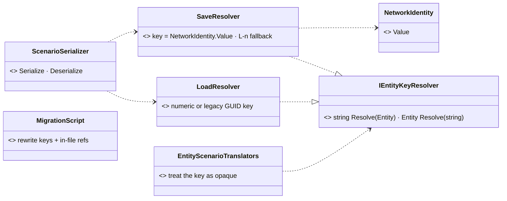
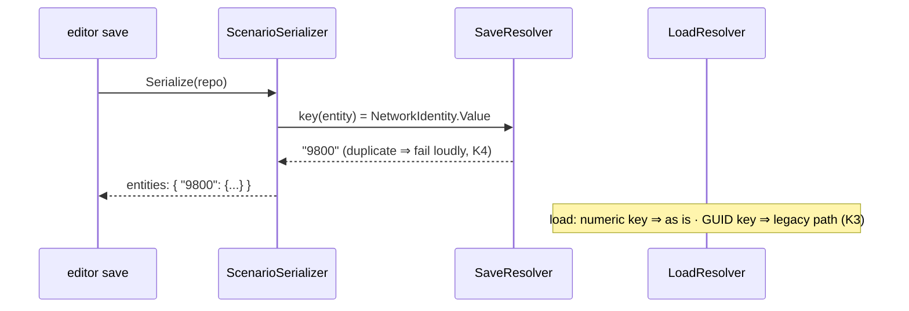

<!--STATUS
state: LIVE
build-state: READY-TO-BUILD (2026-10-31, coordinator; tracker CE-4153)
updated: 2026-10-31 (first version)
current-answer: §2 decisions K1–K6 · §3 diagrams · §4 acceptance
stale-below: nothing
known-rot: none
known-conflict: none
related-designs:
  - docs/DESIGN_Scenario_Rules.md — §9.3 SR-50 asked for this (scenario macros need short, remappable entity keys; SR-45 remaps macro-local ids)
  - docs/DESIGN_Deterministic_Network_Ids.md — §11b OWNS network id allocation and the per-load re-allocation (old → new map) that makes a file's key file-local either way
  - docs/blueprints/DESIGN_Entity_Reference.md — OWNS EntityRef (a network id) and EntityRefRemap, the load-time remap of references
  - docs/designs/mgmt-1/DESIGN.md — §13.3a: an exercise archive carries a COPY of its scenario ⇒ the loader must keep reading legacy GUID keys
  - docs/designs/cgf-scn-2/DESIGN.md — the scenario-translator programme that introduced IGuidResolver (VisHierarchyNodeTranslator, InitialHierarchyIntent)
-->

# DESIGN — **scenario entity keys: the network id, not a fresh GUID** *(tracker CE-4153)*

> 🔒 **User, `2026-10-31`:** *"Maybe it would be easier to read if the entity was identified by the network ID directly, which is a short number
> and not so long GUID … if there is no good reason for keeping just GUID."* · *"Could we please create the task for retiring the GUIDs from the
> scenario file?"*

## 1. INVENTORY *(measured `2026-10-31`; graph + grep, coverage unchecked)*

| fact | where |
|---|---|
| save keys every entity with a FRESH `Guid.NewGuid()` — regenerated on every save; the key only resolves references inside the one file | `FDP/Toolkits/Fdp.Toolkits/Scenario/ScenarioSerializer.cs:165-173, :239` |
| load parses the keys with `Guid.TryParse` and builds `Dictionary<Guid, Entity>` | `ScenarioSerializer.cs:410-441` |
| `IGuidResolver { string Resolve(Entity); Entity Resolve(string) }` — save and load implementations | `Scenario/IGuidResolver.cs`; `ScenarioSerializer.cs:688-730` |
| `IGuidResolver` appears in 24 production files (17 under `Hrot/Engine/Hrot.EcsNode/Serializers`, 4 in `Fdp.Toolkits/Scenario`, 2 Diagnostics, 1 ReplayBrowser Federation) and 16 test files | grep, `2026-10-31` |
| all 1059 entities of the 127 scenario files carry `NetworkIdentity` | measured over `scenarios/` + `recipes/scenarios/` |
| scenario load RE-ALLOCATES every network id (old → new map, `PreAllocatedNetworkId`) — a file's ids look stable only because the allocator resets to 1000 per world | `StagingEntityExtractor.cs:~245-262`; Network Ids §11b |
| 142 scenario JSON files hold GUID strings; GUID literals also in `Hrot.ClusterRunner.Integration.Tests/TestScripts/*.json` and several integration / SimHost test classes; `checks.json` names units by name (no GUIDs found) | grep |
| an exercise archive carries a copy of its scenario | mgmt-1 §13.3a (CE-3119) |

## 2. Decisions

| # | decision |
|---|---|
| **K1** | the `entities` key = the entity's `NetworkIdentity.Value` as a decimal string (`"9800"`). ⛔ open for the build to MEASURE: can a saveable entity lack `NetworkIdentity` at save time? If yes, key it `"L<n>"` (a file-local counter) — never a bare number, so it cannot collide |
| **K2** | the resolver contract is unchanged in SHAPE (a string key ↔ an `Entity`); only its meaning changes from GUID to entity key. Translators treat the key as OPAQUE — the build verifies none parses it as a `Guid` |
| **K3** | ⭐ load accepts BOTH: a numeric / `L<n>` key, or a legacy GUID key (archives, recordings, old files — mgmt-1 §13.3a). One file never mixes them (refuse a mixed file loudly) |
| **K4** | a duplicate network id among a save's entities ⇒ the save fails loudly naming both entities (it would otherwise silently merge two entities) |
| **K5** | a one-time, idempotent migration script rewrites every scenario JSON in the repo (`scenarios/`, `recipes/scenarios/`, test fixtures, `TestScripts`) — keys AND the in-file references that equal another entity's key — committed with the script; re-running it changes nothing |
| **K6** | rename `IGuidResolver` → `IEntityKeyResolver` with Roslyn (`roslyn_preview_rename` → read → apply; never a text replace), after K1–K5 are green |

## 3. Diagrams

*What the picture shows that prose hid:* only the two resolver implementations and the serializer's key loop change; the 21 translators keep
calling the same interface, which is why the blast radius is small if K2 holds.

## 4. Acceptance

- every repo scenario loads after migration with the SAME entity count and component set as before (a sweep over all files, before vs after);
- save → load → save of every migrated scenario is byte-stable;
- a legacy GUID-keyed file (kept as a test fixture) still loads;
- the serializer, translator and SimHost scenario test classes are green; the integration TestScripts load.
