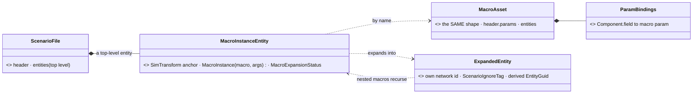
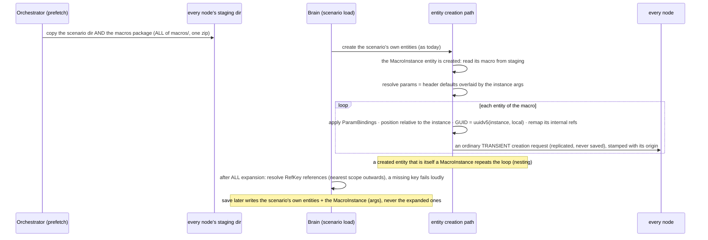
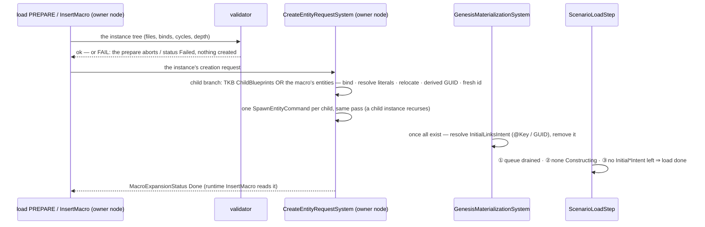
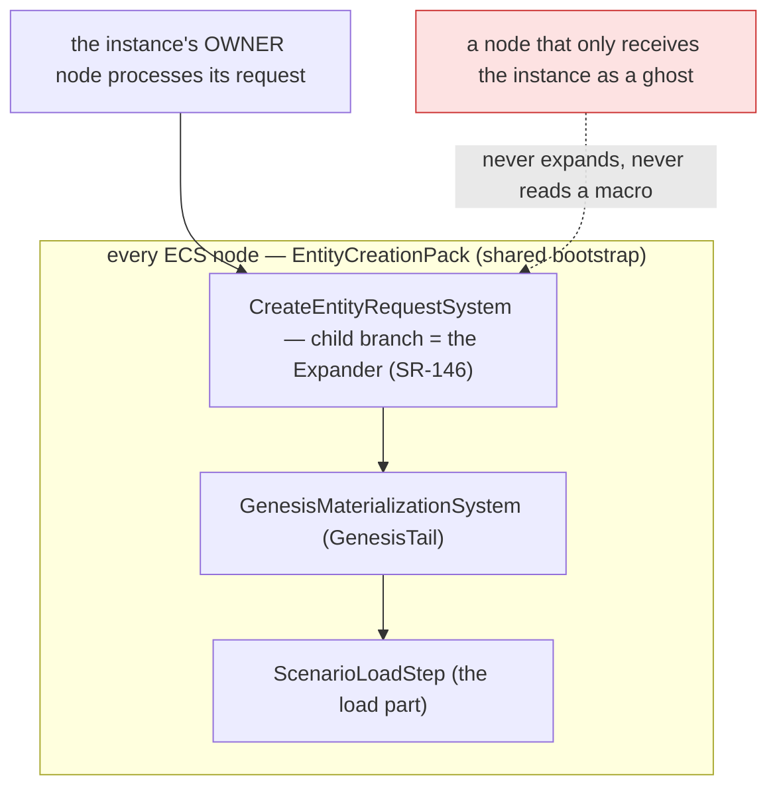
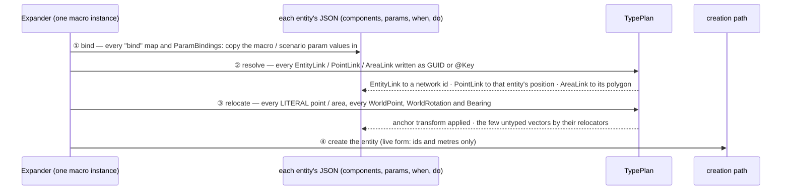

<!--STATUS
state: LIVE
build-state: DESIGN → READY-TO-BUILD once SR-152…SR-157 (§10 relocation) are approved — SR-146…SR-151 ✅ accepted 2026-11-01 (§9.y: the expander is the creation path's child branch) — slice S3 (§1); CE-4153 S9 (GUID file form) still a prerequisite
updated: 2026-11-01 (split out of docs/DESIGN_Scenario_Rules.md §8 / §9.1–§9.7 — a MOVE: every decision id, its wording, its approval and every user quote kept verbatim; no id renumbered)
current-answer: ⭐ §10 relocation (SR-127, SR-131, SR-152…SR-157) · §9.y the gaps closed (SR-146…SR-151) · §0 what a macro is + SR-144 (the founding decision) · §1 the slice (S3) · §2 INVENTORY · §3 the model (class diagram) · §4 params,
  presets and their overrides (SR-27, SR-28, SR-32) · §5 the macro file, the instance, its bindings (SR-38…SR-43, SR-57, SR-69, SR-70) · §6 macro
  entities are full TRANSIENT entities (SR-42′, SR-44, SR-44a, SR-45) · §7 a macro is CLOSED (SR-58, SR-60) · §8 the three reference forms and
  RefKey (SR-63…SR-66, SR-68) · §9 expansion at load — the sequence, SR-80, GAP-1…GAP-5 · §10 relocation + the reference types (still in the
  rules doc §9.8) · §11 the rows that stayed in the rules doc · §12 retired ids · §13 where the old section numbers went
stale-below: nothing
known-rot: ⚠ the moved rows keep their ORIGINAL section references (§8.0, §9.3, §9.7 …) verbatim — those are DESIGN_Scenario_Rules.md's old
  numbers; §13 maps each to its section here (the rules doc's stubs forward them too). Every related design links back (2026-11-01).
known-conflict: none
related-designs:
  - docs/DESIGN_Scenario_Rules.md — the RULES (objectives, triggers, the director, evaluation): the first USER of macros (`InsertMacro`, a director IS a macro — SR-99, a macro insertion reports its own completion — SR-96, bindings in a `do` entry — SR-94); still OWNS §9.8 relocation + the reference / place / orientation types until slice S0 lands, and the objective rows of its §8 / §9 (§11 here)
  - docs/DESIGN_Scenario_Entity_Keys.md — CE-4153 rev 2: STABLE entity GUIDs, derived for macro-made entities — the cross-scope reference (SR-62); its S9 (internal refs of saved components as GUIDs) is S3's prerequisite
  - docs/DESIGN_Node_Features.md — F-19: macro expansion is CORE, ⛔ never behind a feature switch (SR-144)
  - docs/DESIGN_Content_Layout.md — §2 OWNS the content folders (scenarios/, recipes/scenarios/) a macros/ folder joins (SR-38)
  - docs/DESIGN_Artifact_Staging.md — OWNS the prefetch (NAS → every node's staging) that SR-80 extends with the macros package
  - docs/DESIGN_Deterministic_Network_Ids.md — §11b OWNS network id allocation and the per-load re-allocation SR-45 / SR-50 rely on
  - docs/blueprints/Architect_Question_79_One_Ownership_Truth.md — §0.10 OWNS PartMetadata (the multi-instance part); §6 here explains why macro entities are NOT parts
  - docs/DESIGN_Node_Roles_And_Policies.md — §7.3 OWNS IsTransient → ScenarioIgnoreTag (R-140) that macro entities reuse
-->

# DESIGN — **scenario MACROS** *(a general mechanism: scenario-like files inserted as an entity and expanded on the creation path — forces, units, props, objectives, directors)*

> 🔒 **User, `2026-11-01`:** *"Scenario macros are definitely a separate feature."* — split out of `DESIGN_Scenario_Rules.md` (§8, §9.1–§9.7) the same day.

## 0. What a macro is

A **scenario macro** is a scenario-shaped file in `macros/` (`$meta` · `header` with its own `params` · `entities`) that a scenario — or another
macro, or a running trigger — inserts as ONE ordinary entity, the **macro instance** (`MacroInstance {macro, args}` + a `SimTransform` anchor).
Wherever that entity is created, the **Expander** on the entity creation path binds the macro's params into its entities, resolves their
references, relocates their literals to the anchor and creates them as ordinary TRANSIENT entities (own network id, own authority, never
saved); the file keeps only the instance and its args. A scenario with parameters IS a top-level macro — one principle at every level.

⭐ **Founding decision —**

⭐ **SR-144** ✅ `2026-11-01` — **macro expansion is CORE infrastructure, not part of the rules.** 🔒 user: *"Macro expansion is not part of scenario rules, is it? Isn't it a standalone feature which is usable in general, just being used by the rules system? So it should not be gated by scenario.rules. I think this is the core system feature."* ⭐ The `Expander` lives on the entity CREATION path (§9.7) and serves forces, units, props and events alike; the rules are one user of it (`InsertMacro`). ⇒ composed wherever entities are created, ⛔ never gated by `scenario.rules` (`DESIGN_Node_Features.md` F-19), and its slice (S3) does not depend on the rules' slices except for `InsertMacro`

> 🔒 **The quotes that introduced the mechanism** (were at the head of `DESIGN_Scenario_Rules.md` §9):
>
> 🔒 **User, `2026-10-31`:** *"Isn't that SOP name the name of the behavior that should evaluate the objective?"* · *"Could we generalize this
> package parameters into scenario parameters so we can get scenarios with parameters that looks like exactly the same principle as for
> packages."* · *"Scenario editor is now saving the whole scenario and i would keep it like that. Those packages might need to be a special type
> of assets, like scenario macros, stored likely in special folder. I would like to make this macros a general concept that is not used just
> for objective, because it might be used also for inserting whole parts of the scenarios."* · *"We need to store just the reference to the
> macro, which is itself living as an independent scenario-like assets in different folder."*

## 1. The slice — S3 *(copied from `DESIGN_Scenario_Rules.md` §00.6, which now points here)*

| slice | builds | done when | prerequisites | build-state |
|---|---|---|---|---|
| **S3 — macros, variants, the director** | the `MacroInstance` type + `Expander` (bind, resolve, relocate, create — §9.7, §9.8.0); `InsertMacro`; `ParamBindings`; the scenario params + run variants (SR-101) in the picker's run setup (AQ108 D24); `SetSkillAmplifier` (SR-100) | the same platoon macro placed twice, rotated, both play; the counter-attack director is a macro used by two scenarios with different params; variant 3 replays identically | S2; CE-4153 S9 (GUID file form) for references INTO macro-made entities; GAP-1 … GAP-5 (§9.7) | DESIGN — S9 + GAP-1…5 |

⭐ The module picture — who registers the Expander and who calls it (the creation path, at load and at runtime `InsertMacro`) — is
`DESIGN_Scenario_Rules.md` §00.5; the Expander is composed wherever entities are created, ⛔ never behind any switch (there is no rules switch either — SR-145) (SR-144).

## 2. INVENTORY

⭐ The measurements moved with their rows (dated as measured, `2026-10-31`); this split ran no new query — it moved text. ⚠ coverage unchecked —
`check_index_coverage` is not available through the CLI.

### 2.1 Templates and layered params *(was §8.1 — the macro rows; the objective rows stayed in the rules doc §8.1)*

⭐ Queries (as named in §8.1): *(four measurements, `2026-10-31`: graph `.*(Template|Prefab|Recipe|EntityClass|Archetype|Composition).*` Class (35) + `.*(Parent|Hierarchy|ChildOf).*` Class (13) + grep; a throwaway probe; ⚠ coverage unchecked)*

| what exists | where | for objectives |
|---|---|---|
| ⭐⭐ **the TKB type is the one template applied at BOTH scenario load and runtime spawn** — `BehaviorProfileDto.DefaultSop` + `DefaultSopParamsJson`, applied by `BehaviorTkbTranslator.Inject` | `Tkb/Domain/BehaviorProfileDto.cs:44-49`; `BehaviorTkbTranslator.cs:113-125` | ⭐ the carrier of a block's DEFAULTS |
| ⭐⭐ **layered params = the user's principle, built** — DTO initializers ▸ asset `ParamsDefaultJson` ▸ the scenario / order JSON (only the keys it sends); scenario wins by origin rank | `DESIGN_Orders_Params_Entity_Classes.md` §13.10a (R-3001); `InitialBrainMaterializationSystem.cs:16-50` | ⭐ a block inserted with `{area, deadline}` overrides only those |
| ⭐⭐ **per-TYPE child entities, deterministic, rebuilt on every node, not saved** — the sensor pattern (`SensorChildFactory.EnsureTkbChild`, part ids 1000+i) | `PerceptionTkbTranslator.cs:78-80`; `SensorChildFactory.cs:13-44`; Sensors & Doctrine §4, §5.1 | ⭐ the shape for "every member of type X gets its evaluator" AND for expanding a block's template children |
| ⛔ no include / fragment mechanism; recipes are one-time copies | `ContentLayout.cs:91-109`; `DESIGN_Content_Layout.md` §2 | the block TEMPLATE is a new asset kind |

### 2.2 The scenario file and its derived entities *(was §9.1 "Measured")*

| fact | where | so |
|---|---|---|
| a scenario entity = a GUID key → components by name: `SimTransform`, `NetworkIdentity`, **`TkbIdentity {TkbType: 305}`** (the type — ⛔ there is no `Type` attribute), `EntityInfo {Name, ForceId}`, brain slots **`Behavior`** (task) / **`Sop`** as `{Name, Params (a JSON string), Origin}`; the file = `$meta` · `header` · `entities` | `scenarios/uc-urban-battle/scenario.json` | the type is `TkbIdentity`; an objective's evaluator sits in the `Behavior` (task) slot (SR-51) |
| a `.params.json` asset = `{AssetId, Name, Fields: [{Name, TypeId, DefaultJson, Comment}]}` → a generated DTO, defaults as initialisers | `assets/behaviors/Params/Tests/T41Params.params.json`; §13.10a | ⭐ the package / macro params type |
| ⭐⭐ **derived entities are already kept out of saves**: `ScenarioIgnoreTag` (the serializer skips the whole entity; 22 users) + `PartMetadata {ParentEntity, InstanceId}` (the parent + part id, also the wire key) — the sensor children use both (CE-3045: *"rebuilt … on load, so saving it too duplicated it"*) | `Fdp.Toolkits/Scenario/ScenarioIgnoreTag.cs`; `Replication/Components/PartMetadata.cs:14`; `SensorChildFactory.cs` | ⭐⭐ the answer to *"how do we know what came from a macro"* — the save exclusion is BUILT; `PartMetadata` is the wrong carrier for macro entities (§9.3) |

⭐ More measured tables sit beside the decisions they carry: §6 (parts vs transient entities, network ids, `EntityRefRemap`), §7 (names in
scenario tooling), and — for relocation — `DESIGN_Scenario_Rules.md` §9.8.1.

## 3. The model *(was §9.2)*

*What the picture shows that prose hid:* ONE file shape serves a scenario and a macro — both have a params declaration and entities — so a
scenario with parameters IS a top-level macro. What is saved is only the top-level entities and the macro-instance entities; every expanded
entity is created TRANSIENT (SR-42′) and carries the tag the serializer already skips.

## 4. Params, presets and their overrides *(was §8)*

> 🔒 **User, `2026-10-31`:** *"What I would like to avoid is to define the entities per every scenario, because the evaluation criteria might be
> common across multiple scenarios, common across multiple team members … It needs to be simple and reusable."* · *"Such a block, probably at
> every level … should need to come with its own parameters, and those entities and their objective would need to read and use those
> parameters … What is baked in is good as a default, but it always needs to be replaceable when inserted into the final place … This very
> principle is used for using behaviors on entities that the scenario can override the default parameters."* · *"Ticking cost should be no
> issue."* · *"If there are some runtime catalogs missing, we will simply make them a shared code."*

### 4.0 Why the override surface is FLAT *(was §8.0)*

⭐ measured: the existing override layering is FLAT — `BehaviorParams.OverlayFlat` merges top-level keys only (`DESIGN_Orders_Params_Entity_Classes.md` §13.10a). Macro params keep every override at the top level, so the existing mechanism serves unchanged; a deep merge into a child's nested args would be new code and ambiguous (arrays by index).

### 4.1 Decisions *(was §8.3 — SR-31 stayed in the rules doc)*

| # | decision | ⭐ current answer |
|---|---|---|
| **SR-27** | WHO expands — the entity CREATION path, not the scenario loader (`2026-10-31`) | the translator list (`TkbTranslatorSet.Base()`, called by `NetworkSpawningSystem.cs:144` and ghost promotion) runs for scenario load AND runtime spawn alike ⇒ a macro inserted at load, by the instructor mid-run or by a trigger expands the same way, through one path. What it creates: ordinary transient entities (SR-42′). ⛔ rejected: expansion in `ScenarioLoadStep` — a macro spawned at runtime would not expand (two paths) |
| **SR-28** | how a child takes a macro's value (user, `2026-10-31`: *"The objectives inside a package can carry the values on their own, but they should be able to reference a parameter of the whole package instead of hard coding the values inside."*) | a child's value is EITHER a literal (fixed in the macro) OR bound to the enclosing macro's param (SR-40 / SR-57 `ParamBindings`, SR-129 `bind`). ⭐ The OVERRIDE surface is the macro's FLAT param list — exactly the existing `BehaviorParams.OverlayFlat` (DTO default ▸ macro default ▸ instance args, top-level keys only, §8.0) — so overriding never needs a deep merge into a child. ⇒ to make an inner literal overridable, the macro author PROMOTES it to a param. Applied once at expansion; a nested macro receives its args the same way (a binding refers only to the IMMEDIATE macro) |
| **SR-32** | one mechanism for every kind of preset | missions, objective sets, evaluation criteria, triggers / directors are all scenario MACROS (SR-38); a preset of a preset (e.g. `SeizeVillageFast` = `SeizeArea` with `deadline: 30 min` fixed) is a macro containing one macro instance with some args fixed — no inheritance mechanism |

### 4.2 Rejected — one line each *(was §8 — the macro lines; SR-29 / SR-36 and SR-30 stayed in the rules doc)*

- *A block-template asset `*.objective.json` (SR-25) / a package fragment file (SR-34) / a package as its own named behaviour with a package runner* — one scenario-like MACRO file serves every preset (SR-38), opened in the scenario editor.
- *Inserting a block as a `Sop: {"Name": "ObjectiveBlock"}` entry (SR-26)* — a macro instance is an ordinary entity (SR-39a).
- *`"^param"` strings inside typed fields (SR-35's first form)* — a float field cannot hold a string; the binding sits BESIDE the value (SR-57, SR-94, SR-129).
- *Expanded children as sensor-pattern part entities (SR-27's first lean)* — parts have no authority, life or save identity of their own (§9.3).

## 5. The macro file, the instance, its bindings *(was §9.2's rows + SR-57 from §9.4; SR-37 and SR-71 stayed in the rules doc)*

| # | decision | ⭐ current answer |
|---|---|---|
| **SR-38** | a macro asset | `macros/<name>/macro.json` (its own folder in `ContentLayout`, like `scenarios/` and `recipes/scenarios/`) — the SAME shape as `scenario.json` (`$meta` · `header` · `entities`) + `header.params` naming its `.params.json`. Authored by opening it in the scenario editor, which saves the whole file as today |
| **SR-39** | inserting a macro | a top-level scenario entity with a `MacroInstance {macro: "SeizeArea", args: {"area": "@Village", "side": "Blue", "deadline": "10:00"}}` component; the args override the params DTO's defaults key by key (`OverlayFlat`). Editable in the inspector as a params form over the macro's params type |
| **SR-39a** | ✅ the INSTANCE is an ordinary entity (user, `2026-10-31`: *"Couldn't a scenario macro be saved as an entity that gets replaced by the macro? … that would avoid the need for special treatment like insert or delete as adding and deleting entities is handled already. picking the macro file would be an edit on the parameters of that entity, again in the details panel"*) | a "Scenario macro" entity type, placed / deleted / moved / copied like any entity; selecting it shows in Details: the MACRO picker (the scenario picker over `macros/`) + the ARGS form built from the picked macro's `header.params` (defaults shown, overridable). Changing the macro or an arg re-expands that instance; deleting it removes its expanded entities ⇒ ⛔ no special insert / delete command |
| **SR-69** ✅ CONFIRMED `2026-10-31` (user: *"Group A confirmed."*) | positions inside a macro | ⭐ lean: RELATIVE to the instance entity's transform — a macro's entities are authored around its origin and the instance's position + heading place them, so one platoon macro can be dropped anywhere; an objective macro with no geometry ignores it |
| **SR-70** | ✅ CONFIRMED `2026-11-01` (user: *"References and macros approved."*) · the instance entity is on the MAP (user, `2026-10-31`: *"the scenario macro entity needs to have the position component as well to be displayed on the map and clickable from the map"*) | ✅ it carries a `SimTransform` — the anchor SR-69's relative positions use — and a map symbol of its own (a "macro" marker), so it is selected by a click and dragged like any entity; dragging it moves everything it expanded. ⭐ ORBAT: shown (it is on the map), its expanded entities beneath it. ⛔ unmeasured: how a non-unit positioned entity gets its symbol today (the visual family / `EntityClassShapeLibrary` path) |
| **SR-40** | binding a part's field to a macro param | stored as SR-57's `ParamBindings` (typed components) and SR-129's `bind` maps (JSON) — e.g. `"Behavior.Params.area": "area"` = *this entity's task param `area` takes the macro's `area`*. Flat (both sides are top-level names, SR-37's typed DTOs), applied after the literals at expansion |
| **SR-41** | scenario parameters | the scenario `header.params` names a params type; its args live in the header (or are passed by whoever starts the run); top-level entities `Bind` to them exactly as macro parts do ⇒ ONE principle at every level |
| **SR-43** | editing an expanded part in the editor | ⭐ v1: shown under its instance, READ-ONLY, with *"from macro SeizeArea — edit the macro or its args"*. ⏭ later: per-instance overrides of a part's field |
| **SR-57** ✅ CONFIRMED `2026-10-31` (user: *"Group A confirmed."*) | where a macro entity's BINDINGS are saved — user, `2026-10-31`: *"we might need a new field on the behavior intention component for those bindings, correct? Otherwise, they would not be saved in the scenario."* | ⭐ yes, a new saved field — but ⭐ NOT on the brain intent alone: a general macro binds OTHER components too (a unit's `EntityInfo.ForceId` ← `side`, its `SimTransform` position ← `position`, a child's `Behavior` params ← `area`). ⇒ ONE generic per-entity component `ParamBindings {"<Component>.<field path>": "<macro param>"}` (e.g. `"Behavior.Params.area": "area"`, `"EntityInfo.ForceId": "side"`), saved and loaded by its own scenario translator, so it round-trips when a macro file is opened and saved in the scenario editor; the expander applies it when instantiating and does NOT copy it onto the created entities. The brain slot record (`SavedBrainSlot {Name, Params, Origin}`) stays as it is |

**Still to measure before S3 builds:** ① the scenario editor opening and saving a file from `macros/` (SR-38) · ② the entity tree showing
expanded entities under their instance (SR-43) · ③ how a non-unit positioned entity gets its map symbol (SR-70).

## 6. Macro entities are full, TRANSIENT entities, not parts *(was §9.3, `2026-10-31`; SR-47…SR-51 stayed in the rules doc)*

| measured | where | so |
|---|---|---|
| `PartMetadata` IS the ECS side of NED's MULTI-INSTANCE descriptors (turret pose / weapon task, EQS sensor config / results): the key is (parent network id, instance id); instance ids are RANGES agreed in code (mounts 1…N, behaviour sensors 1–999 allocated, TKB sensors 1000+i, turrets 2000+i), not a protocol enum | AQ79 §0.10 (`Architect_Question_79_One_Ownership_Truth.md:206-240`); `BDC_NED_SST_Descriptor_Rules.md:29,49-57`; `TurretParts.cs:15-45` | — |
| a part has NO `NetworkIdentity`; authority resolves to its PARENT (`AuthorityExtensions.cs:23`), ownership recompute skips it (`OwnershipRecomputeSystem.cs:251`), it dies with the parent (`SubEntityCleanupSystem.cs:24`), scenario extraction folds it into the parent (`StagingEntityExtractor.cs:292-310`) | as cited | ⛔⛔ a macro entity (a unit, an objective) built as a part would lose its own authority, life and save identity |
| ⭐⭐ **the save exclusion already works per FULL entity**: `EntityCreationRequest.IsTransient` → `SpawnEntityCommand.IsTransient` → every node stamps `ScenarioIgnoreTag`; TKB children inherit it; save ⇔ primary owner AND NOT `ScenarioIgnoreTag` | `EntityCreationRequest.cs:~95-125`; `NetworkSpawningSystem.cs:199`; `ScenarioSaveCore.cs:16`; Node Roles §7.3 (R-140) | ⭐ macro entities = ordinary entities created TRANSIENT, each with its own network id |
| network ids: ONE allocator per domain (orchestrator), blocks of 100, reset to 1000 per world; ⭐ **scenario load RE-ALLOCATES every id** (old → new map, `PreAllocatedNetworkId`) — the file's ids only look stable because of the reset | `DdsIdAllocatorServer.cs:119-136`; `StagingEntityExtractor.cs:~245-262`; `DESIGN_Deterministic_Network_Ids.md` §11b | a file id is a FILE-LOCAL key either way |
| `EntityRefRemap` rewrites every `EntityRef` (nested, lists) by the old → new map at load; an id not in the map is left as is | `EntityRefRemap.cs:25`; `DESIGN_Entity_Reference.md` | ⚠ a reference to a macro-made entity (never saved) would dangle — or, with ids reset to 1000, hit an unrelated entity |
| the scenario picker enumerates one root recursively | `ScenarioEnumeration.EnumerateRelPaths` | ⭐ macros = a second root |

| # | decision | ⭐ lean |
|---|---|---|
| **SR-42′** | who creates a macro's entities, and what is saved | ⭐ creating a `MacroInstance` entity issues ordinary `EntityCreationRequest`s for its entities with **`IsTransient = true`** (own network ids from the allocator, own authority, own replication, own brain); save writes top-level entities + the instances. ⛔ not `PartMetadata` (above) |
| **SR-44** | macro / scenario params | declared INLINE in the macro's or scenario's `header.params` (rows `{Name, TypeId, Default, Comment}`, the `.params.json` row shape) — ⛔ never compiled: only the expander reads them, copying values into the children's JSON params; each `Bind` is type-checked once against the child's compiled DTO field. the form: SR-44a |
| **SR-44a** | ✅ MEASURED `2026-10-31` — the inline params list IS editable with existing parts (user: *"not an issue if the editor doesn't support the editing without the C# DTO. We will teach the editor"*) | the variable editor already edits ONE value of a runtime-chosen type: `VariableEditModal` wraps it in a generic one-field `ScalarEditBox<T>` (because `CreateLeafBinding` needs a member), then draws only the wrapper's child, renamed, through the public `ComponentEditDrawer.DrawEditNode` (`Hrot.Editor.AiShared/Variables/VariableEditModal.cs:340-380`); `EditNode` / `EditDocument` have public constructors and every per-type editor (`EntityRef` / `PickableGeoPoint` map picking, `FixedString*`, `Guid`, `UtilityDecisionRef`) is a registered `ICustomFieldEditor` that takes ANY `IValueBinding` (`ComponentEditServices.cs:17-27`, `StructEdit.Core/Plugins/ICustomFieldEditor.cs`). ⇒ a macro's params form = one `ScalarEditBox<T>` row per declared param, `T` resolved from its `TypeId` — no generated type, no new editor kind |
| **SR-45** | ids inside a macro | a macro file's network ids are MACRO-LOCAL keys; each instance remaps them to fresh ids through the existing `EntityRefRemap` old → new map, so two instances never collide and refs between a macro's own entities stay right |

**Rejected — one line each:**
- *Macro entities as `PartMetadata` parts (SR-42)* — authority, life and save identity fold into the parent (the rows above).
- *Keying scenario entities by their network id (SR-50)* — the key stays a — now stable — GUID (`DESIGN_Scenario_Entity_Keys.md` rev 2); a network id is re-allocated on every load.

## 7. References across macro scopes — a macro is CLOSED *(was §9.5, `2026-10-31`; SR-61 stayed in the rules doc)*

> 🔒 **User, `2026-10-31`:** *"if in the exercise objective there is a reference to an entity in the scenario, but that entity comes from a
> scenario macro which is using its own internal IDs, and the exercise objective is also a scenario macro using its own scope of IDs. These two
> can never reference each other reliably. Would we use some names for referencing?"*

| measured | where |
|---|---|
| scenario tooling ALREADY names units: the checks verifier (*"no unit named 'X' in <scenario>"*), the film director's anchors and takes (*"no unit named 'X' (alike: …)"*) | `ScenarioVerification.cs:764`; `AnchorBook.cs:226`; `TakeStore.cs:289` |
| `EntityInfo.Name` is unique within 114 of 117 scenarios; duplicates in `hill-attack` / `hill-attack-close` (`M1 Abrams` ×2), `test-fire` (`M2 Bradley IFV` ×2) | measured `2026-10-31` |

| # | decision | ⭐ current answer |
|---|---|---|
| **SR-58** | ✅ CONFIRMED `2026-11-01` (user: *"References and macros approved."*) · a macro is CLOSED | inside a macro, references use its own local ids (remapped per instance, SR-45); ⛔ a macro never reaches OUT — anything outside it comes IN through its params (the exercise macro gets its `subject` / `area` as params) |
| **SR-60** | ✅ CONFIRMED `2026-11-01` (user: *"References and macros approved."*) · names unique per scope | a macro's entity names are unique within the macro; instance names unique within their parent scope; a duplicate that a path references is refused at load with the alike-names hint the director already gives. (Today 3 of 117 scenarios have duplicates — they only matter once a path names them) |

**Rejected — one line each:**
- *Name paths (`Blue Platoon/Squad 1/Rifleman 2`, resolved after expansion through a `MacroOrigin` index, SR-59)* — the user: an entity name is a label, not a stable identifier (SR-63).
- *A stable GUID as THE cross-scope reference (SR-62)* — a GUID is the EXACT form only; a reusable macro needs a key each scenario supplies (SR-63, SR-64).
- *A qualified `{instance, local id}` reference (SR-46)* — ids are file-local and change per load.

⭐ Rejected — **macro EXPORTS** (declared public aliases) for v1: the macro's entity names already are its interface; add exports only if renaming internals breaks references in practice.

## 8. Three reference forms; `RefKey` *(was §9.6 — ✅ user, `2026-10-31`: "ref key is fine. recorded."; SR-67 stayed in the rules doc)*

> 🔒 **User, `2026-10-31`:** *"Entity name is by no means a stable identifier during the authoring."* · *"sometimes the objectives might be written
> in a generic way referencing some subjects that are expected to be in the scenario, but every scenario might have different ones … So the
> entity would need some kind of extra key which is not the entity's label but is used for referencing it."*

| # | decision (✅ approved) |
|---|---|
| **SR-63** | ✅ CONFIRMED `2026-11-01` (user: *"References and macros approved."*) · three reference forms: **exact** (the entity's GUID — *this one entity*) · **key** (`RefKey` — *whatever entity this scenario gives that key*) · **query** (side, class, command chain, `TacticalDesignation` — *the squad leader of @Squad1*, *all members of @BluePlatoon*). ⇒ `EntityInfo.Name` is a LABEL only, never a reference; ⛔ SR-59 (name paths) and SR-62 (GUIDs for cross-scope refs) are superseded |
| **SR-64** | ✅ CONFIRMED `2026-11-01` (user: *"References and macros approved."*) · `RefKey` — an author-assigned attribute on an entity (`"RefKey": "BlueHQ"`), separate from the label, set deliberately, rarely changed, unique within its scope; most entities have none. Precedent: `TacticalDesignation` (`Fdp.Core/CommandHierarchy/TacticalDesignation.cs`) is a role key scoped to one command group, a fixed enum on the wire |
| **SR-65** | ✅ CONFIRMED `2026-11-01` (user: *"References and macros approved."*) · reusable macros reference keys THROUGH PARAMS — `subject` defaults to `"@BlueHQ"`, a scenario with another key overrides it at insertion; lookup is LEXICAL: inside the enclosing macro instance first, then outward to the scenario; from outside, a key inside an instance is qualified by keys only (`@BluePlatoon/SL`) |
| **SR-66** | ✅ CONFIRMED `2026-11-01` (user: *"References and macros approved."*) · a missing key fails LOUDLY: the objective stays inactive with *"no entity with key 'BlueHQ' here"* (the director's *"no unit named …"* shape); duplicate keys in one scope are refused at save and load |
| **SR-68** | ✅ CONFIRMED `2026-11-01` (user: *"References and macros approved."*) · where a macro's (and a scenario's) PARAMS DECLARATION is shown and stored — ⭐ rev `2026-10-31` b (user: *"I am not aware that a scenario has a world entity saved as such. What world entity carries is usually written in the scenario header, and I think the scenario macro parameters should be the same case."*) | measured: the World Environment IS saved as an ENTITY (`ua-weather-regions`, `ua-weather-sensing`, `ua-night-sensing` carry `{NetworkIdentity, ScenarioClock, TkbIdentity, WeatherConditions}`; the others get a default at load and save it next time — Weather W-0 / C-3); the header holds `subsystemType · schemaVersion · terrainName · description` (`ScenarioHeader.cs:33`, `ScenarioHeaderDto.cs`). ⭐ lean (user's model): the declaration is FILE metadata ⇒ `header.params` (rows `{Name, TypeId, Default, Comment}`), by extending `ScenarioHeader` / `ScenarioHeaderDto` — ⛔ not a component on the World Environment entity (a macro file's World Environment would be a never-instantiated oddity). Shown and edited in a **Parameters** map-background Details view (the `DetailsViews.Add` pattern beside *Scenario* / *Zones*, `EditorSubsystem.cs:3141-3200`) with SR-44a's `ScalarEditBox<T>` rows. ⚠ small new code: the header gains an edit path (no view edits the header today — unmeasured) |

⚠ The film director's takes keep naming units in a RECORDING by name for now — a GUID would need to exist at runtime and in the recording; a separate decision.

## 9. Expanding a scenario macro at LOAD — the sequence *(was §9.7, `2026-10-31`; the gaps are marked ⚠ GAP)*

> 🔒 **User, `2026-10-31`:** *"the scenario files are distributed by the orchestrator before the scenario load. And now we will need to distribute
> not just a single scenario file, but also the macros … we distribute all the macro scenarios, because we do not know upfront the whole dependency
> chain. So we might distribute a zipped package of all the macros together with the scenario."*

*Caption:* expansion is NOT a loader step — it happens where the instance entity is created, so a macro inserted at RUNTIME (a trigger's
`InsertMacro`, the instructor) expands by the same path (SR-27). The orchestrator only has to make the macro files present beforehand.

| # | decision / ⚠ GAP | lean — ✅ ACCEPTED by the user `2026-10-31` (*"Gap-X Leans accepted."*) |
|---|---|---|
| **SR-80** | ✅ CONFIRMED `2026-11-01` (user: *"References and macros approved."*) · distributing the macros | the existing prefetch (`StorageGatewayModule.PrefetchScenarioAsync:229`, `DESIGN_Artifact_Staging.md` — *"an artifact a scenario NAMES must arrive before the scenario LOADS"*) also stages the WHOLE `macros/` tree as ONE zip (the TKB already travels as a zip, cached on its timestamp) — ALL macros, because the dependency chain is not known without expanding (user) |
| ⚠ **GAP-1** → closed by **SR-147** (§9.y) | WHEN is expansion finished? | RefKey resolution (step "after ALL expansion") needs an end point, but creation is asynchronous across nodes — lean: hook the load gate that already waits for the scenario's entities to be constructed (CE-4087) and count the expanded entities into it |
| ⚠ **GAP-2** → closed by **SR-148** (§9.y) | which nodes READ the macro files | the Brain (it owns the instances) and the editor (it expands to show the parts read-only) — both are in the prefetch's node set; a node that only receives replicated entities never reads a macro |
| ⚠ **GAP-3** → closed by **SR-149** (§9.y) | a missing macro, a wrong `TypeId` in a binding, a cycle (macro A contains B contains A) | fail the LOAD loudly naming the instance — where the check lives (the creation path or a validation pass before load) is undecided; a cycle needs a depth guard |
| ⚠ **GAP-4** → closed by **SR-150** (§9.y) | editing an instance's args in the editor | re-expand: destroy its parts, create them again — their GUIDs stay the same (derived); undecided whether references from OUTSIDE into those parts survive the re-expansion within one session (they should, by GUID) |
| ⚠ **GAP-5** → closed by **SR-151** (§9.y) | ids | the expanded entities get fresh network ids from the allocator like any creation; a macro's internal ids are only its file-local keys (SR-45) |

### 9.x The completion of an expansion *(moved here from `DESIGN_Scenario_Rules.md` §10.13, `2026-11-01`)*

| # | decision | lean |
|---|---|---|
| **SR-96** | ✅ a macro insertion reports its OWN completion (user, `2026-11-01`: *"maybe this is a process that runs on the brain node and takes care about all its subparts like creating entities and so on, and it reports the completion on its own. So the action that triggers the macro expansion just monitors this final completion signal from the node that executed the macro expansion and doesn't care about the individual subparts inside."* → *"Yes write those two leans down."*) | ⭐ the macro INSTANCE entity (`MacroInstance{macro,args}`) carries a small replicated `MacroExpansionStatus {State: Expanding\|Done\|Failed, Reason}`. ⭐ ONE writer — the node that expands it; it alone tracks its child creation requests (each closed by an `EntityConstructionCompleted` naming its `RequestId`, `LifecycleEvents.cs:114`). ⭐ The `InsertMacro` action (SR-93) only creates the instance and reads that status: `Expanding` ⇒ `Running`, `Done` ⇒ `Success`, `Failed` ⇒ `Failure` with its reason — ⛔ it never counts the parts. ⭐ STATE, not an event: readable on every node, survives save / restore / replay — the objective pattern (*"nobody calls it, everyone reads its status"*). ⚠ amended `2026-11-01` by SR-148: the node that processes the instance's creation request expands — any ECS node may; the original reading (user: *"there is already a concept of finding the least loaded node of certain role … practically there will be just one brain node, that this is where the macro expansion should take place"*): the role's least-loaded node, the existing pick (`RoleGroupOwnershipStrategy.cs:56` → `IClusterStateCache.GetLeastLoadedNode(role)`); in practice ONE Brain node — CGF (+ SimHost split), the all-in-one editor or the server) still describes who USUALLY creates, not a rule |

### 9.y The gaps, closed — the expander IS the creation path's child branch *(✅ ACCEPTED `2026-11-01` — user: *"Approved"*, with the note in SR-148)*

> 🔒 **User, `2026-11-01`:** *"Macro gaps"* (close them before S3) · earlier: *"Gap-X Leans accepted."* (the direction) · *"Macro expansion is
> … a standalone feature … the core system feature."* (SR-144)

**INVENTORY** *(grep `class CreateEntityRequestSystem|GenesisMaterializationSystem|ScenarioLoadStep|EntityCreationPack`, read the bodies; ⚠ coverage unchecked)*

| what exists | where | for the gaps |
|---|---|---|
| ⭐⭐ the creation path ALREADY expands children: a TKB template's `ChildBlueprints` become child `SpawnEntityCommand`s in the SAME pass as the parent — each with per-child overrides (`ChildComponentOverrides` → `(PreAllocatedId, Components)`), a fresh id (`_idAllocator.AllocateId()`) unless pre-allocated, a DERIVED GUID (`WithDerivedGuid(parentGuid, "child:<InstanceId>")`, CE-4153), and the parent's owner, init type, transience and spawn height INHERITED; seat presets use the same pattern (`"seat:<n>"`) | `Hrot.Common/Systems/CreateEntityRequestSystem.cs:296-575` | ⭐ the macro expander is THIS branch with a second SOURCE (SR-146) |
| it processes requests targeted at the LOCAL node (the owner), on every ECS node | the same file's header (Q65: *"processes a request targeted at the LOCAL node regardless of that flag"*); composed by `EntityCreationPack` (`Hrot.Common/EntityCreation/EntityCreationPack.cs:71`) | who reads macro files (SR-148) |
| ⭐ the ONE readiness owner of a scenario load: ① request queue drained · ② nothing `Constructing` · ③ every `Initial*Intent` (passengers, vehicle, hierarchy, targets, route, subordinate) resolved · plus the awaited requested ids | `Hrot.Core/Services/LoadPhase/ScenarioLoadStep.cs:280-305` (`DESIGN_Cluster_Load_Phase.md` — it replaced three drifted handlers) | when expansion is finished (SR-147) |
| ⭐ cross-entity references are resolved AFTER creation by one system, through transient intent DTOs it removes when done | `Hrot.EcsNode/Systems/GenesisMaterializationSystem.cs:31`, registered by `GenesisTail.cs:20` | `@Key` / GUID resolution rides it (SR-147) |
| ⛔ the old GAP-1 lean's anchor | CE-4087 is the MANDATORY-ROLES wait before a load (`ClusterMaster.Bootstrap.cs`), not an entity-construction wait | corrected here |

| # | decision | ⭐ lean |
|---|---|---|
| **SR-146** ✅ `2026-11-01` | ⭐⭐ ONE child-spawn routine, two sources | the `Expander` is `CreateEntityRequestSystem`'s child branch GENERALISED: it takes child definitions from a TKB template's `ChildBlueprints` OR from a macro file's entities, and spawns each the same way — overrides, fresh id, derived GUID (`macro:<local GUID>` beside today's `child:<id>` / `seat:<n>`), owner / init type / transience inherited, plus the macro steps (bind · resolve · relocate, §10). ⛔ never a second spawning loop (one implementation per concept). A nested macro is a child that is itself an instance — the same branch recurses |
| **SR-147** ✅ `2026-11-01` | GAP-1 — when expansion is finished | ⭐ BY CONSTRUCTION: the children are ordinary creation requests issued in the parent's pass, so `ScenarioLoadStep` ①–② already wait for them, as for TKB children today. ⭐ `@Key` / GUID references are carried as one more transient intent (`InitialLinksIntent`) that `GenesisMaterializationSystem` resolves once every entity exists — so condition ③ waits for it too, and a missing key fails there loudly (SR-66). ⭐ A runtime `InsertMacro` reads `MacroExpansionStatus` (SR-96): `Done` when every child's `EntityConstructionCompleted` arrived and its links resolved. ⚠ The one thing to prove with a rail: no frame where the queue is empty and the children's commands are still in flight |
| **SR-148** ✅ `2026-11-01` · amended | GAP-2 — who reads the macro files | the node that PROCESSES the instance's creation request — ⭐ ANY ECS node can create entities, so ANY node may read and expand a macro; ⛔ nothing depends on it being the Brain (user: *"the scenario expansion should not be made dependent on the brain for no good reason"*); the Brain is merely who usually creates (scenario load, a trigger's `InsertMacro`), the editor's world when it creates locally. ⭐ The orchestrator therefore deploys the macros package to EVERY node (SR-80, one zip — user: *"we never know which one we'll need to load them"*); ⛔ a node that only receives ghosts never reads a macro |
| **SR-149** ✅ `2026-11-01` | GAP-3 — a missing macro, a wrong binding type, a cycle | ⭐ a VALIDATOR runs BEFORE anything is created: on a load, inside the creating node's PREPARE (the load is two-phase — a failed prepare aborts it on every node, nothing half-built); on a runtime `InsertMacro`, before the first child request. It walks the instance tree: the macro file exists · every `bind` names a declared param of the right type · no macro appears twice on one path (a cycle) · depth ≤ 8. The reason names the path (*"Blue Platoon / Squad 2: macro 'FireTeam' not found"*). A runtime failure sets `MacroExpansionStatus = Failed` with that reason and creates nothing |
| **SR-150** ✅ `2026-11-01` | GAP-4 — editing an instance's args | ⭐ RECONCILE by derived GUID, not destroy + recreate: a child whose GUID persists KEEPS its entity and network id and gets its components re-applied; a new GUID is created; a vanished one destroyed; a child whose TKB type changed is destroyed and created. ⇒ every reference from outside survives — an authored `EntityLink` by its GUID, an internal `EntityRef` by its unchanged id. The same path serves a live edit (SR-109, this run only) |
| **SR-151** ✅ `2026-11-01` | GAP-5 — ids | ⭐ as TKB children today: a fresh id from the allocator per child, or the override's pre-allocated id; a macro file's own ids are only file-local keys (SR-45); width per CE-4200 (`int32`) |

*What the picture shows that prose hid:* nothing new waits for anything — the load step's existing three conditions cover macros because the
children travel the TKB children's road, and reference resolution is one more intent for the existing resolver.

*Caption:* every node composes the expander (it is the creation path), but only the instance's owner runs it — the red edge is the path that
must stay dead, or a macro would expand once per node.

**Rejected — one line each:**
- *A separate macro-expansion system beside the creation path* — a second spawning loop that would drift from the TKB children's (ids, GUIDs, ownership, transience).
- *A new "expansion finished" barrier* — `ScenarioLoadStep` already waits for exactly this, by construction.
- *Resolving `@Key` in a pass of the expander* — `GenesisMaterializationSystem` already resolves cross-entity references after creation.
- *Validating while creating* — a failure halfway leaves a half-built macro; the prepare / pre-flight leaves nothing.
- *Destroy + recreate on an args edit* — every outside reference would dangle.

## 10. Relocation — placing a macro anywhere *(moved here `2026-11-01`; ⭐ leans SR-152…SR-157 await the user)*

🔒 **User, `2026-11-01`:** *"every node can potentially create entities, so it might mean that every node can potentially read and expand scenario macros if that happens to be performed by that node. It likely doesn't mean anything new for us, just that the scenario expansion should not be made dependent on the brain for no good reason. This is also the reason why the scenario macros should be deployed to every node by the orchestrator as we never know which one we'll need to load them. And the macro relocation should be made part of this design, I guess. Until then, I don't think it's buildable."*

⭐ The TYPES relocation moves (`WorldPoint`, `WorldRotation`, `Bearing`, `PointLink`, `AreaLink`, `EntityLink`) and the ONE walker that finds them are `DESIGN_Scenario_Rules.md` §9.8 (built by slice S0 — its as-built is §9.8.11: the walker is one type plan with three appliers, remap · resolve · **`Relocation`**). This section owns WHEN and HOW a macro is relocated.

### 10.1 The sequence *(moved from `DESIGN_Scenario_Rules.md` §9.8.2)*

*What the picture shows that prose hid:* RESOLVE runs BEFORE RELOCATE, so a point that came from a reference is never moved — that is the
"do not relocate this" switch the user asked for, with no flag. The FILE keeps `@Key` / GUID; only the live copy holds resolved numbers.

### 10.2 What is measured

| fact | where |
|---|---|
| ⭐ the `Relocation` applier is BUILT (S0): translate X / Y, turn about the anchor by the heading difference (compass clockwise), Z by the anchors' height difference, `WorldRotation` pre-multiplied, `Bearing` + turn; a link written as an entity is not moved | `DESIGN_Scenario_Rules.md` §9.8.11 (backend, `2026-11-01`), rails `S0WalkerTests.Relocate_*` |
| route waypoints are absolute world points (`RouteWaypoint.Position` `Vector3`) ⇒ a `WorldPoint` after S0 item 6 ⇒ moved by the walker by type | `Hrot.Core/Components/Map/RoutePlan.cs:14-20, :70-74` |
| ⭐ an area entity's outline is RELATIVE to its `SimTransform` position (`WeatherField` adds the origin, `:207`; S0 as-built: *"an area entity's outline is relative to its SimTransform"*) — but the outline is NOT rotated by `SimTransform.Rotation` | `Fdp.Toolkits/Weather/WeatherField.cs:201-243` |
| the creation path spawns children in the parent's pass and any ECS node can process a creation request targeted at it | `CreateEntityRequestSystem.cs:296-575`; its header (Q65) |

### 10.3 Decisions

| # | decision | ⭐ lean |
|---|---|---|
| **SR-127** *(moved)* | the relocation transform | the macro file records its AUTHORED ANCHOR (position + heading — where it was built, on real terrain); every entity keeps its authored coordinates; placing an instance applies *authored anchor → instance anchor* (translate X / Y, rotate by the heading difference, Z + the anchors' height difference). Heights ABOVE GROUND (`RoutePlan.HeightAgl`) unchanged. Vehicles settle through the existing ground clamp; ⚠ dismounted soldiers — measure with one rail before building. A macro whose plan needs particular buildings declares `relocatable: false`: its instance is pinned at the anchor and the editor refuses the drag, saying why |
| **SR-131** *(moved)* | not relocating a value | ⭐ the user's rule, by construction: a LITERAL point moves with the macro; a REFERENCE does not (resolved first — step ② of the sequence above). A point entity INSIDE the macro moves (it is one of the macro's entities); one OUTSIDE, passed in through a param, stays where it is. ⛔ no `relocate: false` flag per field |
| **SR-152** | where the anchors live | the AUTHORED anchor is in the macro file's header (`anchor: {position: [x,y,z], heading: deg}`, written when the macro is saved — the editor's *Save selection as macro* takes the selection's centre and heading 0); the INSTANCE anchor is the `MacroInstance` entity's `SimTransform` (position + `WorldRotation`'s heading). ⇒ the transform is computed ONCE per instance, at the start of its expansion |
| **SR-153** | when, and by whom | step ③ of the expansion (§10.1), inside the creation path's child branch (SR-146), per child, after bind and resolve — by WHICHEVER node processes the instance's creation request (SR-148 as amended: not the Brain by rule) |
| **SR-154** | what moves | ⭐ by TYPE through the walker: every `WorldPoint` / `WorldRotation` / `Bearing` in a child's components and params (after S0 item 6 that is `SimTransform`, `NavigationIntent.FinalDestination`, `RouteWaypoint.Position`, engagement bearings …) and every LITERAL `PointLink` / `AreaLink`. ⭐ Two relocators, for what the walker cannot see by type: **`EditablePolyline`** — its points are relative to the entity's position, so they only TURN by the heading difference (the position moves with `SimTransform`); **`SimVelocity.Linear`** — a direction, turned only. ⭐ Cleared: `NavState`'s road / trajectory ids (they name terrain features of the authoring place). ⇒ a rail fails on a saved component with a vector member that is neither a typed point nor one of these |
| **SR-155** | nesting | a child that is itself an instance is relocated like any child (its anchor moves with the parent); ITS children are then relocated from its OWN authored anchor to its now-moved instance anchor — the transforms COMPOSE, nothing special |
| **SR-156** | a pinned macro (`relocatable: false`) | the expansion uses the IDENTITY transform whatever the instance's `SimTransform` says, and a load whose instance stands elsewhere is REFUSED loudly by the validator (SR-149: *"macro 'VillageDefence' is pinned at its anchor"*); the editor draws the instance at the anchor and refuses the drag, saying why |
| **SR-157** | moving an instance | the editor's drag or a changed heading is an anchor change ⇒ RECONCILE (SR-150): every child keeps its entity and id and gets its relocated values re-applied. ⭐ A runtime `InsertMacro` names its anchor in its args — `at: PointLink` (coordinates or `@Key`) + `heading: Bearing` (or `facing: PointLink`) — the instance entity is created there and expands like any other. ⚠ Still open, one rail before the build: do dismounted soldiers settle on the ground after a Z change, as vehicles do through `GroundClampWhilePausedSystem` / `GroundClampingConfig`? |

**Rejected — one line each:**
- *Anchors at (0,0) — macros authored around an origin* — authors would build on empty ground or convert coordinates (SR-127).
- *Rotating area outlines by `SimTransform.Rotation` at draw time* — every outline reader would change; turning the stored points once at expansion keeps one frame.
- *A per-field `relocate: false`* — a reference already means the world, not the macro (SR-131).
- *Relocating on the Brain only* — any node that creates the instance expands it (user).

## 11. Rows that stayed in `DESIGN_Scenario_Rules.md` — macro-adjacent, owned by the rules

| id | where | why it stays (and what it says about macros) |
|---|---|---|
| SR-31 | rules §8.3 | the objective state and tree on the wire |
| SR-33 | rules §8.4 | an objective's params are edited by the existing form; a macro INSTANCE's args use SR-44a's rows (§6 here) |
| SR-37, SR-51 | rules §9.2, §9.3 | which brain slot runs an objective's evaluating behaviour |
| SR-47 … SR-49 | rules §9.3 | an objective's two links, replication, position |
| SR-52 … SR-56 | rules §9.4 | the ORBAT, `ObjectiveLinks`, `Parent` (② a macro's ROOT objective), `Subject` (a macro param by default), the Objectives view |
| SR-61 | rules §9.5 | groups by the command chain — a macro's roster can change without touching the objective |
| SR-67 | rules §9.6 | per-member thresholds — nearest enclosing macro instance's `memberArgs` wins, the `RefKey` lexical rule (SR-65) |
| SR-71 | rules §9.2 | the World Environment saved in the header |
| SR-94 | rules §10.13 | a `do` entry carries its OWN `bind` — the rule SR-129 generalises to any JSON object, macro args included |
| SR-96 | rules §10.13 | ⚠ a macro insertion reports its own completion — `MacroExpansionStatus`, ONE writer = the expanding Brain node; macro MECHANISM, kept there for now (its context is `InsertMacro`) — a candidate to move here |
| SR-99 | rules §10.13 | a director IS a macro of objectives + triggers |
| SR-101 | rules §10.13 | run variants — `presence` on a macro instance, `InsertMacro` / a macro choosing ONE of N |
| SR-125 … SR-143 | rules §9.8 | relocation and the reference types (§10 here) |

## 12. Retired decision ids *(macro ids; each also stays listed in `DESIGN_Scenario_Rules.md` §12)*

| id | replaced by |
|---|---|
| SR-25 | SR-38 (the block template `*.objective.json` → a scenario macro) |
| SR-26 | SR-39 / SR-39a (inserting = an ordinary macro-instance entity) |
| SR-34 | SR-38 (the macro file) |
| SR-35 | SR-40 / SR-57 / SR-94 / SR-129 (bindings beside the value) |
| SR-36 | SR-37 (typed kinds; no runtime-typed sub-form) |
| SR-42 | SR-42′ (transient full entities, not `PartMetadata` parts) |
| SR-46 | SR-63 (references by RefKey/GUID, not instance-local ids) |
| SR-50 | `DESIGN_Scenario_Entity_Keys.md` rev 2 (the entity key stays a — now stable — GUID) |
| SR-59 | SR-63 (names are labels; reusable refs use `RefKey`) |
| SR-62 | SR-63 (a GUID is the exact form; cross-scope reuse goes through `RefKey` params) — `DESIGN_Scenario_Entity_Keys.md` rev 2 G1–G6; it was only ever an open question (user: *"It was a question, not a imperative"*) |

## 13. Where the old section numbers went *(the moved rows cite these verbatim)*

| was (`DESIGN_Scenario_Rules.md`) | now |
|---|---|
| §8 intro quote, §8.0 | §4, §4.0 |
| §8.1 (the template / layered-params / child-entity / include rows) | §2.1 |
| §8.3 SR-27, SR-28, SR-32 · §8 rejected (macro lines) | §4.1 · §4.2 |
| §9 intro quotes | §0 |
| §9.1 | §2.2 |
| §9.2 diagram · rows | §3 · §5 |
| §9.3 | §6 |
| §9.4 SR-57 | §5 |
| §9.5 | §7 |
| §9.6 | §8 |
| §9.7 | §9 |
| §9.8 | not moved — still `DESIGN_Scenario_Rules.md` §9.8 (§10 here) |
