<!--STATUS
state: LIVE
build-state: BUILT (slice 1, 2026-10-22, §8) — the ENGINE verifier (§2, §8): a Verify mode of the film director's runner, /director/verify routes, and --verify on the command line. ⛔ The Python proof of concept is SUPERSEDED (user, 2026-10-22: "not as a Python … supported by the engine")
updated: 2026-10-27 (§10-3a / §10-4 re-run after backend's fixes — H5 and H1b green on ua-civ-melee) · 2026-10-27 (§7 the run after the 10-25/26 merges — a layout change at t = 0 hides later drift) · 2026-10-26 (§10-3a H5 built and measured live — the review shows the live run; CE-4056, CE-4057 found) · 2026-10-26 (§4 a per-run request id by meaning — CE-3334, R-4090) · 2026-10-26 (§10-2 the harness after DAR — RH-3 superseded, H1b on the sim axis after P1, H5 the review phase, H2 the wire — R-4086) · 2026-10-26 (§10-1 H1 split: H1a the recording's data now, H1b the control after CE-4051…4053 — R-4085) · 2026-10-26 (§10-0 step 0 measured: RH-3's premise false — CE-4051…CE-4054; H1 stopped pending the user) · 2026-10-26 (§10 approved, R-4084) · 2026-10-26 (§10 — the replay harness H1–H4, CE-4045: the product's replay through the master, a stepped LIVE run as the reference, leans RH-1…RH-10) · 2026-10-25 (§9 approved, R-4077: the gaps land in the shared predicate model) · 2026-10-22 (second pass — the engine owns it: Verify mode, HTTP, command line; R-4066) · 2026-10-22 (first version, coordinator, CE-4042, R-4065)
current-answer: §0 the user's rulings · §1 the picture · §2 classes · §2a one run · §3 the checks grammar · §4 the golden · §5 which scenarios get what · §6 inventory · §7 measured · §8 the build · §9 the grammar's gaps (approved) · §10 the replay harness H1–H4 (APPROVED R-4084, building) · ⭐ §10-2 the re-cut after DAR (R-4086) — read it before §10's RH rows
stale-below: none
known-rot: §10 RH-3 (replay seconds = sim seconds) — SUPERSEDED by R-3056 / R-4086 (the replay clock stays wall; a sim seek is atSimSeconds) · §10-1 "H1b after CE-4051…4053" — those are fixed / ruled; H1b now waits for DAR P1 (§10-2) · §10 RH-1's "EnterReplay through Idle" is no longer the only product path — a REVIEW replays the run in place (H5, §10-2)
known-conflict: blueprints/DESIGN_Smoke_Suite.md says "do not build a DSL" — written for a different shape (one entity, one behaviour, panel checks; the JSON TestScript kept for cluster/DDS/replay). checks.json EXTENDS the film takes' anchor grammar, which is already built and read by the engine (AnchorBook); it is not a new language. Not reconciled with the Smoke Suite's author — named here so a reader sees both.
related-designs:
  - DESIGN_Film_Production.md — §4: the overnight documentation drafts stills from this design's verdicts and the verify runs' recordings
  - DESIGN_Replay_Time_Axis_And_Review.md — OWNS the sim axis (atSimSeconds, ReplayTimeMap) H1b needs, the review (DAR) H5 tests, and §12 the wire H2 checks
  - DESIGN_Http_Control_Through_The_Cluster_Master.md — OWNS replay through the master (R-3053…R-3055: previews never record; the ordinary world replays; the sandbox retired from HTTP) — the path §10's harness tests
  - DESIGN_Replay_Census_H0.md — H0 of the replay harness (CE-4045): which types a recording must / must not hold; the replay mode this verifier grows (H1–H4) reads its verdicts
  - DESIGN_Director_Timeline_Editor.md — OWNS still keys (TE-10): a take's key captured as a PNG artefact by the Verify run; and the anchor kinds cross / enter / leave this design's checks.json may reuse
  - DESIGN_Checkpoint_And_Dry_Run_Restore.md — OWNS R1, the restore-equivalence oracle (§1k): this verifier run twice around a checkpoint written at T1 and restored in a second fresh process
  - DESIGN_Regression_Net.md — OWNS the golden-vs-assertion decision (D7: both, paired), "capture on a FIRST load in a FRESH process" (§6 ④) and "never normalise to hide non-determinism" (N1). This design applies those three rules to whole scenarios
  - TESTING_Harness_And_Goldens.md — OWNS the golden workflow (where goldens live, the <FAMILY>_GOLDEN_CAPTURE switch, "a regenerated golden is a DIFF you must read"); this design's switch is SCENARIO_GOLDEN_CAPTURE
  - DESIGN_Film_Director.md — OWNS the take files, their anchor grammar and AnchorBook (the in-engine per-step cue reader) and the DirectorRunner (load, step once per frame, report); checks.json reuses the grammar, phase 2 reuses both classes
  - blueprints/DESIGN_Paused_And_Stepped_Execution.md — OWNS why a stepped run repeats (CE-3293, R-3036, R-3038; §7e: HTTP-paced = batched stepping) and the open reload leak (CE-3294) that forces a fresh process per scenario
  - DESIGN_Deterministic_Network_Ids.md — OWNS why network ids repeat across runs (§11: the authority resets to 1000 per world), so a golden may name entities by id without masking
  - DESIGN_Utility_AI_Demo_Scenarios.md — OWNS the per-scenario live checks (scripts/utility-demo-check.py, against the --mode all cluster) and their in-process twins; checks.json is where their conditions move as data
-->

# DESIGN — scenario regression: does every scenario still run as it used to?

## 0. The user's rulings (R-4065, R-4066)

🔒 **User, `2026-10-22`:** *"a system that checks whether the scenarios are still running as they used to run before … based on
reproducibility, determinism of stepped scenario execution, and checking that the scenario ends up in the same state as it was recorded
before … define for each scenario what the success conditions are, not just as text, but also as some fixed rule that are automatically
verifiable"* · *"running a new process per scenario is actually a good idea until we fix it. Checking in editor is sufficient for now.
We should make a proof of concept, not on all 94 scenarios, but just a few"* · *"Not all scenario needs one [a golden], because not all
scenarios are checking a concrete feature. Some are just plain demos that mix too many things together."* · **R-4066:** *"this regression
test support is written not as a Python, but it is supported by the engine and can be controlled from AI debug HTTP. As well as started
from a command line."*

| ⭐ decided | |
|---|---|
| **two halves, paired** (Regression_Net D7) | **conditions** say *is it right?* (intent, they survive a re-record); the **golden** says *did anything change?* (behaviour) |
| **the engine runs it** (R-4066) | a **Verify** mode of the film director's `DirectorRunner` — the one place that loads a scenario, enters the preview and steps it once per frame. Three remotes: `POST /director/verify` (AI debug HTTP), `--verify` (command line), and the panel later |
| **the editor's stepped preview** | the run that repeats (R-3035/R-3038). ⛔ The cluster is not judged here — its live checks stay its acceptance |
| **a fresh process per scenario** | until CE-3294 (a system's per-entity state outlives a reload) is fixed. `--verify a,b,c` runs each scenario in a child process of its own |
| **a golden only where a scenario shows ONE feature** | a demo that mixes many things carries conditions only (§5) |

## 1. The picture

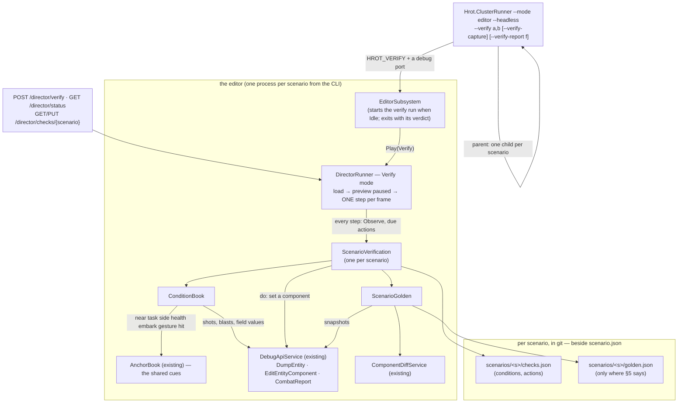

*What the picture shows that prose would hide:* the verifier adds **no second way** to load, step, dump or edit — every arrow into the
world ends in a class that already exists (`DirectorRunner`'s loop, `AnchorBook`'s cues, `DebugApiService`'s dump and edit, `CombatReport`'s
shot rows, `ComponentDiffService`). ⚠ The dump and the edit live in `DebugApiService`, which the editor builds only when a debug port is set
⇒ `--verify` **sets one** (a free port) so the command line needs nothing else, and an HTTP client can watch the run.

## 2. Classes


*What the class picture shows:* `CheckCue` WRAPS the take's `AnchorSpec` — the seven state cues (`near task side health embark gesture
hit`) are judged by `AnchorBook`'s own code (made callable as `HoldsFor`), and the verifier adds only what a take never needed: `field`
(any component value by path), `where` on a shot or blast row, the windows, `never` and `atEnd`. `IVerifyWorld` is the seam the rails fake
(no editor), as `IDirectorHost` is for the runner.

## 2a. One run

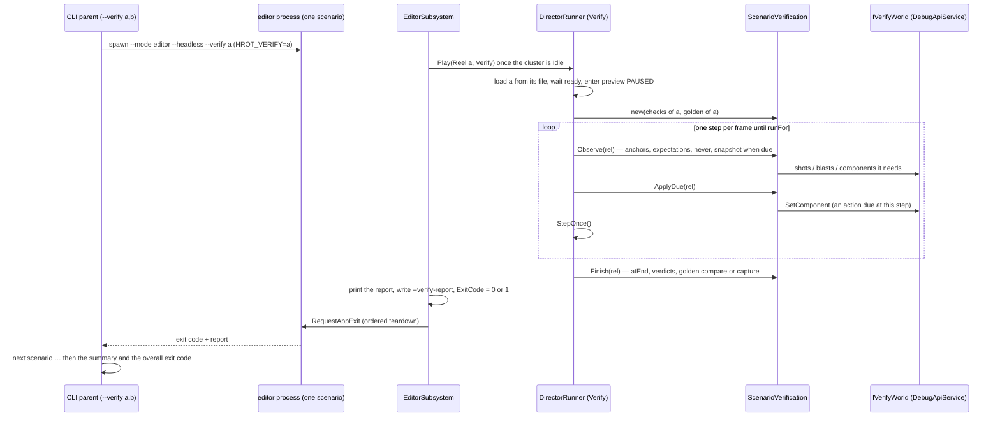

*What the sequence shows:* an action lands on its **exact step** (the runner steps once per frame, so every frame is a step boundary), and
the verdict leaves the process **by its exit code** — the command line and a CI job need nothing but the binary.

## 3. The checks grammar (`scenarios/<s>/checks.json`)

| key | meaning |
|---|---|
| `runFor` | seconds of sim time from the load |
| `golden` | `{"every": s}` — a snapshot every s seconds and at the end; `false` — conditions only (§5) |
| `anchors` | named cues whose first time other entries refer to (`"after": "riot"`, `"at": "contact+2"`) — the take's anchors |
| `do` | `{"name"?, "at": t, "set": {"who", "component", "patch"}}` — what the old live checks did by hand (17 of 81 wound a man or set an attribute); a named action's time is a name too |
| `expect` | `{"name", <cue>, "after"?, "before"?}` holds once in the window · `{"name", "never": <cue>, …}` never holds in it · `{"name", <cue>, "atEnd": true}` holds when the run ends |

| cue `on` | holds when | judged by |
|---|---|---|
| `shot` | the n-th round `by` a unit, `at` a target, that `hit` one, `where` its row matches (`"penetration": [">", 400]`) — at its firing time | `CombatReport.Shots` rows (the `/combat/shots` route's) |
| `blast` | the n-th burst `by` a unit, `where` it matches (`"warheadSource": ["contains", "M67"]`) | `CombatReport.Detonations` rows |
| `field` | `who`'s component value at `path` (`Health.Current`, `CivilianState.Mode`) compares by `op` (`== != < <= > >= in contains`; value `"$now"` = the sim time) — for `any` (default), `all` or `atLeast:n` of the units named | the `/entities/{id}` dump |
| `near` `task` `side` `health` `embark` `gesture` `hit` | as in a take (Film Director §4) | `AnchorBook.HoldsFor` |

A unit is a name or `*part` (any whose name contains it) — the take anchors' rule.

## 4. The golden

| ⭐ rule | why |
|---|---|
| **where** — `scenarios/<s>/golden.json`, beside `checks.json` and `takes/` | it belongs to the scenario (a Save As copies it); ⭐ a capture writes it to the editor's working copy **and** to the source tree when there is one (`CuratedScenarios.TryFindSourceScenariosDirectory`) — ⛔ never only the working copy, which the next launch overwrites (the take-bake trap, PLAN_Feature_Films §6) |
| **what** — the steps taken, every anchor's, action's and expectation's time, every round and burst row, and every named unit every `every` s and at the end: position and health in full, each component as a 64-bit FNV-1a hash (in full under `golden.full`) | the components are what a regression changes first; the rows are the story in one page; the hashes keep it 35–224 KB (§7) |
| ⭐ **a held entity is hashed by MEANING** — every `"[index, vGen]"` the dump writes for an `Entity` field is rewritten to `"@<unit name>"` (`"@?"` unnamed) before hashing; two units with one name are `Name`, `Name #2`, … | ⛔ an index follows allocation order: one entity more renumbers every later holder (`IsEmbarkedTag.VehicleEntity`, passenger slots) and the golden goes red on a change that moved nothing (backend's lean, [reply](blueprints/batches/NOTE_Coordinator_To_Backend_Determinism_Reply.md) §2). Rail `CE4042_AHeldHandle_HashesAsTheUnitItMeans`. ⚠ A network id held as a plain NUMBER still follows allocation order — those goldens are re-recorded with the change that adds an entity |
| ⭐ **a per-run id is hashed by MEANING** *(CE-3334, R-4090)* — a `CreationRequestId` (a fresh `Guid` per run, CE-3323) is rewritten wherever it appears to `"@request:<the first unit, in name order, that carries it>"`; the golden records `"meaning": 2`; a golden captured before (no `"meaning"`) compares with `CreationRequestId` left out until it is re-captured | 📐 measured by backend: every golden failed at t = 0 on the request id alone, whatever the behaviour (CE-3334). ⭐ Not masking (N1): what the id MEANS — which units one request made — is still compared; only the per-run number is not. ⛔ Rejected: a deterministic `Guid` (it must stay unique across a cluster) · skipping `NoScenario` components (that would also drop mission and brain state a regression must see) |
| **compare** — `ComponentDiffService.ComputeTreeDiff` with 0.001 (`/diff/compare`'s tolerance); **nothing masked** | Regression_Net N1. Network ids repeat (Deterministic Network Ids §11) and every run is a first load in a fresh process |
| **the report names the FIRST difference** — times, then rows, then the EARLIEST differing snapshot with its units and values | a red golden must answer *when did it start to differ, and in whom* — that is where the bisect starts |
| **re-record** — `--verify-capture` (or `{"capture": true}`); ⛔ refused when a condition fails | a golden of a failing run would bless the failure; the regenerated file is a diff you READ and ship with the change that moved it (TESTING_Harness_And_Goldens §4) |
| **one platform** | ⛔ not measured whether Linux and Windows runs agree bit for bit. Goldens are recorded and compared on the Linux CI/cloud host; conditions run anywhere |

## 5. Which scenarios get what

**Every scenario can carry conditions; only a feature scenario carries a golden.**

| kind | conditions | golden | why |
|---|---|---|---|
| ⭐ **feature** — one capability, a small cast (`ua-tank-ammo`, `bt-grenade-posture`, `ua-civ-melee`, `ua-posture`) | ✅ | ✅ | a change to its state is a change to that feature, so the golden's red means something |
| **demo** — many systems at once (`pc-defend-house`, `uc-urban-battle`, `demo-city`) | ✅ the chain it must show (*"Red fires, Blue sets a base of fire, Blue assaults or breaks off"*) | ⛔ | nearly every change in any lane moves some of its 40 men, so a golden would be red on every merge and get re-recorded blind — Regression_Net D7's failure mode |
| **a scenario that does not repeat yet** | ✅ | ⛔ until it does | a golden of a run that differs from itself is noise. Proven per scenario: two fresh-process runs must give the same golden (§7) before one is committed |

*Why a scenario might not repeat* (each is a defect, not a property): state that outlives a reload (CE-3294 — avoided by a fresh process),
work still on the wall clock rather than sim time (R-3035 covers perception and slow modules; others may remain), and the first load after
boot differing from a reload (the animation handle and `StanceStatus`, Paused & Stepped §7e) — avoided, every run is a first load.

## 6. INVENTORY (`2026-10-22`)

| query | result |
|---|---|
| keys of every `scenarios/*/scenario.json` | 94 files; keys `$meta`, `header`, `entities`, `TerrainObjects` — ⛔ no checks section anywhere |
| `Judge:` / `Fail:` in the header descriptions | 92 / 91 — the conditions exist, as prose |
| `SCENARIOS` in `scripts/utility-demo-check.py` | 81 scenarios with a live check (cluster, real time); 17 change the world mid-run |
| `search_graph` `.*(Anchor|Take|Director|ShotEvaluator).*` Class | ⚠ 19, none of the director's — the graph predates ui's director merge; grep found `AnchorBook`, `TakeStore`, `ShotEvaluator` (`Hrot.Presentation/Map3D/Director/`), `DirectorRunner`, `ScenarioReadyProbe` (`Hrot.Editor/Director/`) |
| world-state diff | `DebugApiService.CaptureBaseline` / `CompareBaseline` (`/diff/capture`, `/diff/compare`) → `ComponentDiffService.ComputeTreeDiff(…, 0.001)`; the replay browser uses the same service |
| entity dump / component edit / shot rows | `DebugApiService.DumpEntity` (`/entities/{id}`), `EditEntityComponent` (`/entities/{id}/component`), `CombatReport.Shots` / `Detonations` |
| run-to-run identity | `DirectorIdentityRails` (3 scenarios × 3 runs, a gate), `DeterminismRails`, `scripts/determinism-probe.py` |
| existing goldens | `Hrot.SystemTests/Goldens/` (`GoldenStore`, `GoldenCaptureFixture`, `PanelNormalizer`) — panel dumps, `PANEL_GOLDEN_CAPTURE=1` |
| a command-line scenario run | ⚠ `--mode ci --scenario X` exists — it runs a C# `IScenario` (`MinimalCIScenario`) in a bare orchestrator, ⛔ not a `scenario.json` through the editor's load and preview ⇒ does not apply; `--verify` is new |

⚠ Coverage of the graph could not be checked through the CLI (`check_index_coverage` is not available); the lists above are by graph +
grep and are not proof of completeness.

## 7. Measured (`2026-10-22`, the cloud VM, `--mode editor --headless`)

| what | result |
|---|---|
| the pilot from the command line — five scenarios, five fresh processes | ⭐ **4 min 30 s** in all; one process each **7–33 s** wall for the feature scenarios (`bt-grenade-posture` 12 s of sim in 7 s, `ua-tank-ammo` 60 s in 33 s — ⭐ headless verifies FASTER than real time), `pc-defend-house` (40 men) 90 s of sim in 175 s |
| the verdicts | ✅ `ua-tank-ammo` 7/7 (kinetic round at the T-72 8.53 s · the T-72 dead 28 s · soft rounds at the technical 38.7 s and a rifleman 47.9 s · never a kinetic round at a soft target) · ✅ `bt-grenade-posture` 4/4 (the M67 on the ground at 4.75 s · the standing man hurt · the prone man never) · ✅ `ua-civ-melee` 4/4 (riot 0.25 s · knocked down 4.25 s · Hostile 4.25 s) · ✅ `ua-civ-routine-alarm` 5/5 (first shot 1.1 s · near civilians alarmed 1.25 s · far ones never · the wound action at 25 s ⇒ a Casualty at 25.25 s) |
| ⛔ `pc-defend-house` — "Red opens fire before 40 s" FAILED | a REAL finding: in today's build Red holds fire past 25 s (22 rounds, all Blue); the film take's 11.2 s was baked before today's behaviors merges (R-2066, the base of fire). The 40 s was MY window, not the scenario's — its header gives none ⇒ removed. ⭐ It produced the `heldOutsideItsWindowAt` field: a failed expectation now says when its cue did hold |
| ⭐⭐ **do the goldens repeat?** — captured, then compared in fresh processes | ✅ `ua-tank-ammo`, `bt-grenade-posture`, `ua-civ-melee` **SAME** at the first comparison. ⛔ `ua-civ-routine-alarm` **DIFFERENT** at 5 s, one value in the Rifleman — a `golden.full` run named it: `MissionAdapterState.LastPlanVersion` 83239098 · 2673561298 · 1681038897 in three processes ⇒ ⭐ **CE-4043**: it folded `string.GetHashCode()`, which .NET randomises per process. Fixed (the engine's one string hash); re-recorded ⇒ **SAME in two more fresh runs**. ⭐ So the golden found a real determinism defect on its first day, and all four feature scenarios now repeat bit for bit |
| ⭐⭐ **does it catch a regression?** — a mutation: civilians deaf to rifle fire (`CivilianFear.Impulse(SmallArms)` → 0, a CE-4039 look-alike; reverted) | ✅ **both halves red**: the condition *"both near civilians are alarmed within 2.5 s of the first shot"* FAILS, and the golden is DIFFERENT — *"FIRST differing snapshot at t=5 s — 44 values in Hostile, Near Civilian 1, Near Civilian 2, Rifleman"*, naming `CivilianState` and a near civilian 3.6 m from where he stood. ⚠ The other four conditions still passed — the condition says WHAT broke, the golden says WHERE it started |
| `pc-defend-house` with Red's window removed | ✅ 7/7 — Red opens fire at **86.9 s** (Blue's base of fire at 19.5 s, Blue's first round 4.0 s), 120 s of sim in 251 s |
| golden size | a FULL component dump of `ua-tank-ammo` was **1.7 MB** a minute (7 units × 7 snapshots × ~60 components) ⇒ ⭐ positions and health in full, every component a 16-hex hash: **35–224 KB** per scenario |
| the action's step | rail: a `do` at 1.5 s lands on step 90 exactly (the runner steps once per frame, so every frame is a step boundary) |
| `golden.full` | ⭐ added for the run-down above: every component in full instead of its hash (large — for running a difference down, not for git) |
| ⚠ a numeric read trap | `JsonValue.TryGetValue<double>` is false for a value built from a `long` or a `float` (a shot's `seq`, a position) — every row was skipped until `ConditionBook.Num` read every numeric type |
| ⛔ **CE-4044** — `bt-grenade-posture` differs between two fresh runs on a LOADED machine | `MapDisplayComponent` present in one, absent in the other at 2 s: `MapLayerAssignmentSystem` attaches it on a stopwatch budget and rescan (wall clock). Handed to backend (determinism); ⛔ not exempted — the golden stays red until fixed |
| ⚠ HTTP-stepped windowed vs one-step-per-frame headless | the Python proof of concept (HTTP, 15 steps a request, a window under Xvfb) had the M1's first kinetic round at **8.42 s**; the engine verifier (headless, one step per frame) at **8.53 s**. ⛔ Not run down. ⇒ a golden is recorded and compared with the SAME command (`--mode editor --headless --verify`), never across hosts or modes |
| ⭐⭐ **the full run after the lanes' merges** (`2026-10-22`, handles hashed by meaning §4, every scenario a fresh process, two streams in parallel, `--verify-capture`) | **86 pass / 16 fail of 102** (+ `uc-urban-battle`, below) · goldens **68 captured** (61 changed, 7 byte-identical) · 18 passing scenarios carry none (demos, `golden: false`). ⭐ Every red is a behaviour red already handed over: 10 in the [findings note](blueprints/batches/NOTE_Coordinator_To_Behaviors_Scenario_Check_Findings.md), 5 CE-2351, and ONE new — `ua-casualty-care-heavy` (the Medic ordered to carry, never carries; [note 2](blueprints/batches/NOTE_Coordinator_To_Behaviors_Scenario_Check_Findings_2.md)), after its checks were moved to the care DRILL and the embark cue (behaviors put the squad on `SquadHold`). ⚠ A failing scenario keeps its OLDER golden (a capture of a failing run is refused) ⇒ its handle-holding components differ from it once the behaviour is fixed — the fixing commit re-records it (TESTING_Harness_And_Goldens §4) |
| ⛔ the first capture attempt threw on every scenario | *"The node already has a parent"* — the handle rewrite assigned every node back to its own slot; the rail's component held ONLY a handle, so it never met a plain field. Fixed (assign back only a replaced node); the rail now carries a plain field and an array |
| ⚠ a child's wall-clock limit | `uc-urban-battle` (200 s of sim, ~40 men) steps **~9× slower than real time**: 1751 s once, past the 1800 s limit the next ⇒ `--verify-timeout <min>` (default **60**); the CI template's job limit 75 |
| ⭐⭐ **the run on the MERGED tree** (`behaviors@3eb2580fa`, `backend@6e5723798`; three streams) | **88 pass / 15 fail of 103.** Goldens: **only 9 files changed** — the scenarios behaviors' merge moved (CE-2232 vehicle hide: `ua-tank-corner`, `ua-ifv-standoff`, `uc-convoy-hit-ifv`, `ua-javelin-lock`; the surrender demos' rifleman off the roof) + `ua-posture`'s first; ⭐ the other 61 were **byte-identical** to the run before ⇒ a golden repeats across fresh processes AND survives a merge that does not touch it. ⭐⭐ **The first regression caught ACROSS a merge:** `uc-reinforce-dry` — the reserve sent at 40.5 s before, never after ([note](blueprints/batches/NOTE_Coordinator_To_Behaviors_Scenario_Regression_After_Merge.md)). The other 14 reds are behaviors' CE-2351/CE-2352 |
| ⭐ **the run after the 10-25/26 merges** (`coordinator@341da1eec`, one stream, `2026-10-26`) | ⚠ 98 of 103 in the 7000 s limit. **77 pass their own checks / 21 fail** (14 known, 7 new). Goldens: 1 same, 62 different with checks passing. ⭐⭐ **Every different golden differs first at t = 0, on a component's LAYOUT** (`WeaponState` 66 — CE-1358's `Heat`; `SopState` 17 — CE-4046 A; new `CombatTemperament`, `CommandOrderHistory`) ⇒ ⛔ the "first differing snapshot" then names the layout change and HIDES any later snapshot drift; the times / shots / blasts rows are what still show behaviour (33 scenarios moved, e.g. the first round ~0.3 s later). ⇒ a layout change re-captures its goldens in the same commit, or the next behaviour change is masked. [Note to behaviors](blueprints/batches/NOTE_Coordinator_To_Behaviors_Scenario_Regression_2026-10-26.md) |
| ⛔ parallel processes collided on the working copy | every editor boot seeds the curated scenarios into `FDP_Temp/shared`; a sibling capturing a golden there made one boot throw *"used by another process"* (`bc-house-defended`) ⇒ each verify child gets a PRIVATE `FDP_STAGING_ROOT` (deleted after). Rail: 2 parent streams × 5 scenarios in parallel, all pass, goldens same |
| a utility decision's winner | ⛔ not readable as component state — it lives in the behaviour's blackboard bytes, and `UtilityDecisionLog` exists only while `/trace/observe` is on ⇒ `ua-posture` (whose live check reads the winner) is not in the pilot; a `decision` cue needs that log attached at load for the units a check names |

## 8. The build

⭐ **As built `2026-10-22`: ①–⑨ BUILT** (rails: `ScenarioChecksTests` 4, `DirectorRunnerTests.CE4042_*` 1 — all 11 director rails green). Deviations from §2: `Verdict` carries `Outside` (when a failed cue held outside its window — measured need, §7); `golden.full` (§7); ⛔ no `decision` cue (§7). The panel button and the `Hrot.SystemTests` theory are still "later".

| step | what | where |
|---|---|---|
| ① | `ScenarioChecks` + `ChecksJson` (parse, validate names against the cast) | `Hrot.Editor/Director/` |
| ② | `AnchorBook.HoldsFor` — the existing state-cue code made callable (no behaviour change) | `Hrot.Presentation/Map3D/Director/AnchorBook.cs` (ui lane's file, one method) |
| ③ | `ConditionBook`, `ScenarioGolden`, `ScenarioVerification`, `IVerifyWorld` | `Hrot.Editor/Director/` |
| ④ | `DirectorRunner` Verify mode: no cinema, no camera, one step per frame; the verification per item; the report | `DirectorRunner.cs` |
| ⑤ | `TakeStore` loads checks and goldens and saves a golden to the working copy and the source tree | `TakeStore.cs` |
| ⑥ | routes: `POST /director/verify`, `GET/PUT /director/checks/{scenario}`; the verdicts in `/director/status` | `DebugApiHost.Director.cs` |
| ⑦ | `--verify`, `--verify-capture`, `--verify-report`: a parent that runs each scenario in a child; the child sets a debug port and `HROT_VERIFY`, the editor starts the run when Idle and exits with the verdict | `Program.cs`, `EditorSubsystem.cs` |
| ⑧ | rails: grammar, condition windows, the golden compare, the Verify mode on the runner's fake host | `Hrot.Editor.Tests/Director/` |
| ⑨ | the pilot: checks for five scenarios, goldens for the four feature ones, each run twice in fresh processes | `scenarios/*/` |
| ⑩ ✅ | **the Director panel's Verify** (user: *"Verify button ok, per scenario"*) — View › Director › Verify: a scenario with checks · Verify · Re-record golden; each row pass/fail, its verdicts in the tooltip | `DirectorWindow.cs`, `TakeStore.ScenariosWith` |
| ⑪ ✅ | **the nightly** (user: *"Nightly test over every scenario with logging and startable from command line (imagine github running this)"*) — `scripts/scenario-regression.sh [a,b|all]` → `--verify … --verify-out <dir> [--verify-timeout <min>]`: one fresh process per scenario, `<s>.log` + `<s>.json` each, `summary.json`, ⭐ `junit.xml` (the test list a CI server shows). ⭐ A GitHub Actions workflow TEMPLATE runs one scenario per matrix job: [`docs/ci/scenario-regression.workflow.yml`](ci/scenario-regression.workflow.yml) — ⛔ not switched on (it spends runner minutes: the user's call) | `VerifyCommand.cs`, `scripts/`, `docs/ci/` |
| ⑬ ✅ | **verify and re-record over HTTP in a FRESH process** (user: *"Verify and re-record golden must be accessible from ai debug http as well as from command line"*) — `POST /director/verify {scenario, capture?, fresh: true}` starts the command line as a child (`FreshVerifyJobs`), `GET /director/verify/jobs[/{job}]` reads its report. ⛔ **Without `fresh`, a run after the first in one editor is a RELOAD**: it is labelled (`reload: true`) and **refuses to capture** — 📐 measured: an HTTP re-record after a verify in the same editor differed from a first load in `SopState` and `CharacterAnimationDefRuntime` (CE-3294) | `FreshVerifyJobs.cs`, `DebugApiHost.Director.cs`, `IDirectorHost.HasLoadedAScenario` |
| ⑫ | **who writes what** (user: *"You are the lane to write checks"*): the coordinator writes and owns every `checks.json`; behaviors fixes the behaviour on a red and re-records a golden in the same commit as a deliberate change — [NOTE_Coordinator_To_Behaviors_Scenario_Checks](blueprints/batches/NOTE_Coordinator_To_Behaviors_Scenario_Checks.md) §2 | — |
| later | a `Hrot.SystemTests` theory is NOT needed — the nightly IS the test (JUnit); a `decision` cue needs `UtilityDecisionLog` attached at load | — |

## 9. What the grammar cannot say yet — found writing checks for all 103 scenarios (`2026-10-22`)

| gap | where it bit | ⭐ lean |
|---|---|---|
| **a report or an order injected mid-run** (the live checks `POST /entities/{id}/reports` a SPOT, `/attribute`, `/sector`) | the `*-dry` scenarios (`uc-a10-zu23-dry`, `uc-reinforce-dry`, `uc-request-chain-dry`, `pc-attack-dry`, `pc-defend-dry`), `sq-defend-house`, `ld-sentry-surprise`, `cc-platoon-bound` | ⭐ a `do` that calls ANY AI-debug write route in-process: `{"at", "route": "POST /entities/{who}/reports", "body": {…}}` — one mechanism, the routes the live checks already use; ⛔ not one `do` kind per route |
| **a utility decision's winner / ranking** | `ua-posture`, `ua-threat-ranking`, `ua-attack-approach`, `ua-three-hosts`, `ua-casualty-care` (Rescue) | ⭐ attach `UtilityDecisionLog` at load for the units a check's `decision` cue names (the `/trace/observe` component) — then a `decision` cue is a field cue |
| ~~a squad's drill~~ ✅ **CLOSED by measurement** (triage, `2026-10-22`) | — | ⭐ `SquadDrillTrace` (`Active`, `Kind`, `Phase`, `Care.Stage`) IS in the dump: `{"on": "field", "who": "Squad", "path": "SquadDrillTrace.Kind", "value": 11}` (7 SquadHold · 11 CasualtyCare · 12 FireAndMovement); squad contact: `SquadCognitiveState.Contacts.Count` |
| **a squad's report log** (`/squad` reports) | the platoon scenarios | ⭐ the component that holds it, measured first |
| ⚠ **paths that are NOT in the entity dump** (measured) | `IsEmbarkedTag.Mode`, `TargetMemory.Count` | ⭐ use `embark` cues / `IsEmbarkedTag.Seat`, and `TargetMemory.Entries.N.Score` — ⛔ a path missing from the dump reads as null, so a `field` cue on it never holds; probe it in a scratch copy first |
| **a unit spawned at run time has no name** (an ejected pilot, a gas cloud, a door) | `ua-eject`, `ua-shootdown-eject`, `ua-armed-gas-throwback`, `bt-doors` | ⭐ a cue on a unit by its KIND (`"who": {"type": "Pilot"}`) |
| ~~two units with one name~~ ✅ **built** | `hill-attack` (two "M1 Abrams"), `test-fire` | ⭐ a name in a cue matches EVERY unit carrying it (`all` / `any` / `atLeast` decide); the golden keys them `Name`, `Name #2` |
| **a distance from a point known only at run time** (the burst, a landing point) | `ua-armed-bomber`, `ua-airborne-drop` | ⭐ a `near` whose `point` is an anchor's position (`"point": "burst"`) |
| **naming a group of units** ("the rioters") | `ua-civ-*` — `*s` also matched "Police rifle" and "Stone source"; the triage used `*st` (Instigator, Protester 1–4), which is fragile | ⭐ a cue on units by SIDE or KIND (`"who": {"side": "Neutral", "type": "Civilian"}`) — the same addition as the spawned-unit row |
| **"or" across two cues** (stunned OR down) | `ua-armed-self-defence`, `ua-civ-escalation`, `df-civilian-ordered` | ⭐ `"any": [cue, cue]` — one combinator, no more |

⭐ **Approved `2026-10-25` (R-4077) — and they land in the ONE predicate model, not in `AnchorBook`.** 🔒 User: *"predicates, we should share and unify (this is a generic rule everywhere), not duplicate"*. Every condition gap above that is a condition (by side / kind, `any`, a run-time point, a `decision` cue) is built as a `SearchPredicateDto` + `PredicateCompiler` extension ([Predicate-Infrastructure-Capabilities](Predicate-Infrastructure-Capabilities.md)), and `ConditionBook` lowers its cues to predicates — the same lowering TE-3b (R-4074) asks of the film anchors. The injected `do` is an ACTION, not a condition, and stays in the verifier.

⚠ Until these exist, a check encodes only the expressible part and its `$doc` says what was left out — ⛔ never a weaker condition dressed as the Judge point.

## 10. The replay harness — H1–H4 *(CE-4045; coordinator, `2026-10-26`; build-state: READY-TO-BUILD — RH-1…RH-10 APPROVED, R-4084)*

🔒 **User, `2026-10-26`:** *"Harness leans approved."*

🔒 **User, `2026-10-25`** (the census, H0): *"it relies on that snapshots really save what should be saved … are we saving what needs to be
saved to recording? aren't we saving what should not be?"* · on the harness: *"approved"*, *"yes run H0 first"* (CE-4045).

⭐ **The question:** does a recording REPLAY what the live run did — at real scale, scenario by scenario? Nothing answers it today except
`ParallelEpisodes_ReplayMatchesLiveAtTick25` (one vehicle, an FDP example). H0 (the [census](DESIGN_Replay_Census_H0.md)) asked it of every
TYPE; H1–H4 ask it of whole RUNS, with this verifier.

⚠ **What moved since CE-4045 was written (`2026-10-25`), and why the plan changes:** backend ruled the same day that ⛔ a preview is never
recorded (**R-3053**) and that replay is the ORDINARY world, entered and sought through the cluster master on every host — the editor is a
one-node cluster — with the Replay Browser's sandbox retired from HTTP (**R-3054, R-3055**,
[HTTP through the master](DESIGN_Http_Control_Through_The_Cluster_Master.md) §3). ⇒ the run H1 replays must be a **LIVE** run, and the
replay it checks is the **product's** — read by the SAME `IVerifyWorld` the verifier already has. CE-4045's *"an `IVerifyWorld` over
`ReplayBrowserContext.SandboxRepo`"* is superseded by RH-1.

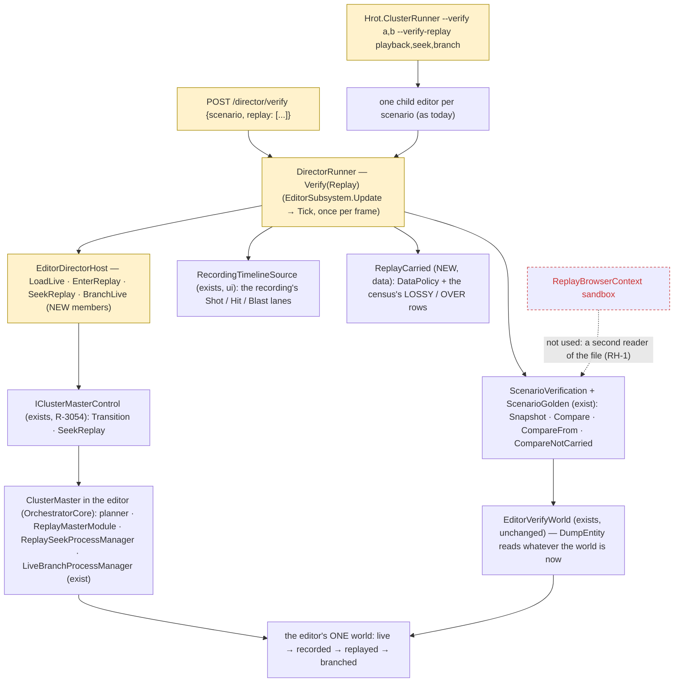
*What the picture shows that prose hid: the harness adds NO world reader and NO replay path. Every arrow into the world goes through the
master the product uses, and every snapshot through the reader the goldens already use — so a difference is the product's, never the test's.
The yellow boxes grow members; the only new types are data (`ReplayCarried`) and the report.*

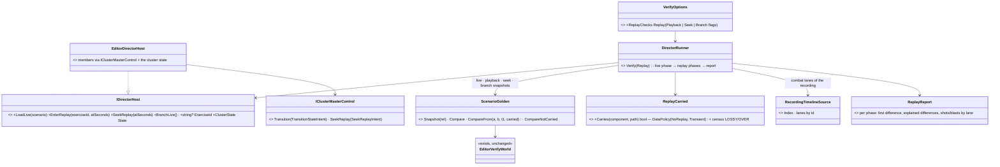

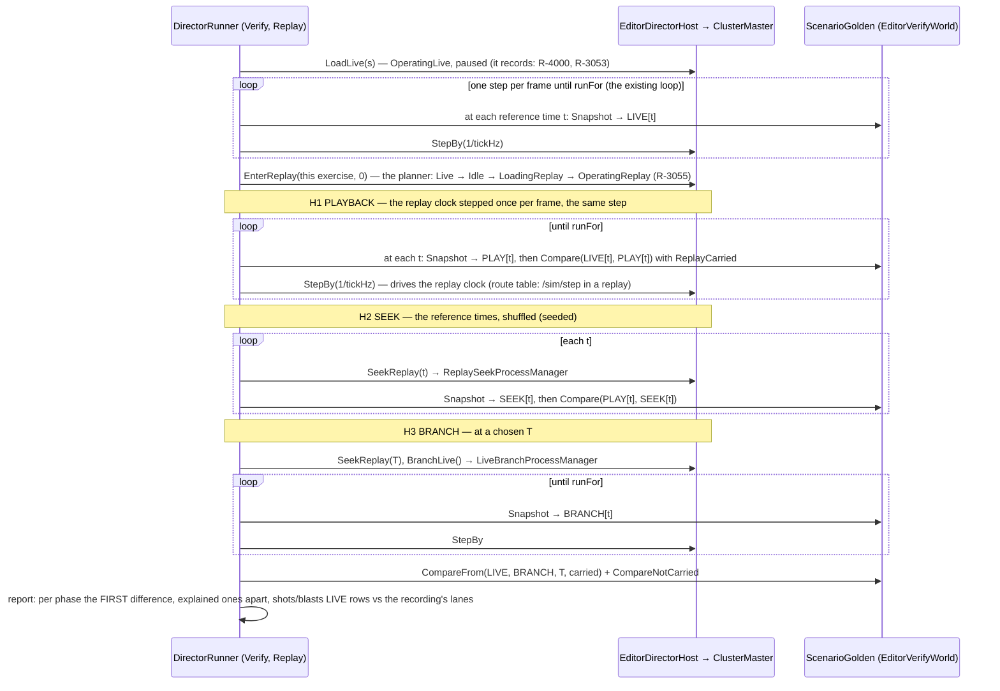
*What the sequence shows: each phase compares against the phase that isolates it — playback against LIVE (does the recording hold the
world?), seek against PLAYBACK (does a seek land where playing gets?), branch against LIVE (does a world rebuilt from the recording run on
as the original did?).*

| # | ⭐ lean | rejected — one line each |
|---|---|---|
| **RH-1** | **test the PRODUCT's replay**: the editor's own world, entered and sought through `IClusterMasterControl` (R-3054), read by the existing `EditorVerifyWorld` | an `IVerifyWorld` over `ReplayBrowserContext.SandboxRepo` (CE-4045's first plan) — a second world reader of a path HTTP no longer serves |
| **RH-2** | **the run is a STEPPED LIVE run** — the runner's loop unchanged (one step per frame), only the load differs (`OperatingLive` instead of the preview); its own snapshots are the reference, no `golden.json` needed. ⭐ Free measurement, not a gate: LIVE vs `golden.json` answers *"does a stepped live run equal the preview?"* | replaying the preview — never recorded (R-3053) |
| **RH-3** | **H1 = playback**: enter the replay paused at 0 and step the replay clock once per frame by the run's step; snapshot at the same sim times. ⭐ A stepped run's recording advances its frame ticks by the fixed step (`SteppingTimeController.cs:60`, `MasterSyncController.cs:357`) ⇒ replay seconds = sim seconds — ⛔ **measured first** (H1 step 0) | seeking in H1 — it would mix two questions (H2 isolates the seek) |
| **RH-4** | **explained differences are DATA, listed apart, never masked** (N1): `ReplayCarried` = the component's `DataPolicy` (`NoReplay`, `Transient` ⇒ not carried) + the census's LOSSY / OVER rows (CE-4046's mutated-in-place types until converted, `SelectionState`, `DebugState` pins, `TerrainAssetLoadState`); the report lists them in `CompareNotCarried`'s shape | an allow-list in the harness — the census is the record; a second list rots apart from it |
| **RH-5** | **shots and blasts from the recording's Combat lanes** — the timeline index (`RecordingTimelineSource`, R-4079) built on THIS recording, compared per lane (count, frame, subject) with the live run's `CombatReport` rows | reading `ShotLog` / `DetonationLog` in replay — they live beside the live world and are not recorded (census, Timeline R0 ②) |
| **RH-6** | **H2 = seek**: the reference times in a shuffled, seeded order through `SeekReplayIntent`, each compared with H1's PLAYBACK snapshot | comparing seeks with LIVE — a playback difference would be blamed on the seek |
| **RH-7** | **H3 = branch from replay**: seek to T, go live through the product's `LiveBranchProcessManager`, run on; `CompareFrom` + `CompareNotCarried` — R1's comparison ([Checkpoint](DESIGN_Checkpoint_And_Dry_Run_Restore.md) §1k) on the replay path. ⚠ It needs a stepped LIVE run to repeat from a rebuilt world — measured for the preview only (§7, R1); a red is a work-list row, as R1's are | a new comparator — R1's exists and already separates what a keyframe does not carry |
| **RH-8** | **H4 = the cluster, designed when H1–H3 are green**: the same phases on a `--mode all` / multi-process cluster through the same master routes (R-3054 — the editor is a one-node cluster, so H1–H3 already run the cluster's path), each node read through its own perspective; reads backend's open findings first (the replay span is `null` on non-master hosts) | designing it now — H1–H3 decide what H4 must still prove |
| **RH-9** | **one replay host for the verifier AND the director**: the `IDirectorHost` members RH-1 adds are what a take needs to play on a recording in the editor's replay. ⇒ the timeline design's `ReplayDirectorHost` (TE-5, over the Replay Browser) and these are ONE implementation over `IClusterMasterControl` — ⛔ to be reconciled with the ui lane before either is built | two replay hosts (R-4078: unify and share) |
| **RH-10** | **entry points**: `--verify-replay playback,seek,branch` on the command line (one child per scenario, as today), `{"replay": [...]}` on `POST /director/verify`; the report gains a section per phase; the CI template unchanged (a flag) | a separate command — the verifier is the harness (CE-4045: *"reuse the verifier, never a second harness"*) |

⭐ **CE-4050 is not a blocker here**: the process that recorded the run replays it, so every component's assembly is loaded. It becomes one
when a recording is replayed by another process (H4, the Replay Browser).

### 10-0. ⭐ Step 0 MEASURED (`2026-10-26`) — ⛔ RH-3's premise is FALSE; H1 is STOPPED pending the user (R-106)

`--mode editor --headless`, `ua-tank-ammo`: load live (paused, recording on) → `/sim/step` ×600 → `/replay {atSeconds: 0}` → `/sim/step` ×60 → `/replay/seek 5`.

| # | question | measured | verdict |
|---|---|---|---|
| ① | a stepped LIVE run records | `recording: true`; 600 steps ⇒ sim clock **10.0 s** (14.6 s wall) | ✅ RH-2 holds |
| ② | the recording's frame ticks advance by the step | **2 230 frames for 600 steps**, gaps **2–19 ms**, span **25.16 s** for 10 s of sim — every rendered frame, paused ones too, on the WALL clock | ⛔ **CE-4053** |
| ③ | `/sim/step` steps the replay clock | ⛔ never landed (*"the master never entered the step barrier"*) | ⛔ **CE-4051** |
| ④ | the replay enters at 0 | ⛔ entered at **3.18 s**; a seek to 5 s landed at **1.20 s** | ⛔ **CE-4052** |
| — | also | `GET /exercises` empty while the run records; `inPreview: true` in live and replay (**CE-4054**); the dumper fails on the recording (**CE-4050**) | — |

⇒ the harness did its job before H1 was written: the product's replay clock is not yet usable for a time-for-time comparison. ⭐ **Lean (for the user):**
**H1 seeks by FRAME, mapped through the recording's OWN sim time per frame** (`GlobalTime.TotalTime` read as the index builder plays — the
same table the timeline needs, Timeline §9b ①) via `/replay/seek {frame}` (Replay Browser design RB-2, resolved for every host) — so H1
runs even before CE-4051…4053 are fixed, and asserts them once they are. ⛔ Rejected: waiting for the fixes — H1 would find nothing until
then; mapping by wall time — CE-4053 says it is not the run's time.

### 10-1. ⭐ H1 split — H1a (the recording's DATA, now) · H1b (the product's replay CONTROL, after CE-4051…4053) *(R-4085)*

🔒 **User, `2026-10-26`:** *"note passed to backend. try doing whatever you can without them before they imple,ment that"*.

📐 **Measured first** (a probe over the step-0 recording, every Hrot/Fdp assembly loaded, `ReplayBrowserContext`): every recorded frame
carries the run's `GlobalTime` — **601 distinct sim frames (0…600)**, 1 629 paused duplicates, `TotalTime` 10.0000 at sim frame 600. ⇒ a
recorded frame can be matched to the live snapshot by its OWN sim frame number, whatever the wall clock says (CE-4053).

| | H1a — NOW | H1b — after the fixes |
|---|---|---|
| asks | does the RECORDING hold the world, applied by the product's player? | does the product's replay CONTROL (enter, seek, step through the master) show it? |
| reads the recording with | `ReplayBrowserContext` → `PlaybackController` / `PlaybackSystem.ApplyFrame` — ⭐ the SAME player the product's `ReplayModule` drives | `POST /replay`, `/replay/seek {frame}`, `/sim/step` (RH-1 as approved) |
| aligned by | the recorded `GlobalTime.FrameNumber` (first frame of each live snapshot's sim frame) | the same, once CE-4052/4053 make time mean sim time |
| where | the verify process itself, after the live run is stopped (the recording is closed) — every assembly is loaded, so CE-4050 cannot bite | the same process |
| compares | `ScenarioGolden.CompareFrom(LIVE, RECORDED, 0, carried)` + `CompareNotCarried` — R1's comparator; `carried` = the recording's OWN schema manifest (`<file>.meta.json`, the reader R1 uses) | the same |

⚠ **RH-1 is not reversed:** RH-1 rejected a sandbox AS the replay under test. H1a tests the recording's data through the product's own
player; H1b still tests the product's control path — the two halves the step-0 findings separate.

```mermaid
classDiagram
  direction LR
  class VerifyOptions { <<exists, grown>> +bool Replay }
  class IDirectorHost { <<exists, grown>> +LoadLive(scenario) +IsOperatingLive +StopLive() +IsIdle +LiveRecordingPath +OpenRecording(path) RecordedRun }
  class EditorDirectorHost { <<exists, grown>> live load / stop through the editor's master (IClusterMasterControl) · the recorder's file path }
  class RecordedRun { <<NEW>> +bool AdvanceToSimFrame(long) +IVerifyWorld World +Dispose() }
  class RecordedRunWorld { <<NEW>> IVerifyWorld over the playback world — the same entity dump as the HTTP route, serializer-backed }
  class VerifyWorldNames { <<NEW, extracted>> Named(repo) · NameOfEntityIndex(repo, i) — shared with EditorVerifyWorld (no copy) }
  class ReplayBrowserContext { <<exists>> LoadRecording · StepForward · SandboxRepo }
  class ScenarioGolden { <<exists, grown>> Snapshot · CompareFrom · CompareNotCarried · +CarriedBy(recording) (moved from VerifyCommand.Carried) }
  class DirectorRunner { <<exists, grown>> Verify(Replay): load LIVE → steps + snapshots → StopLive → OpenRecording → advance + snapshot → compare }
  class EditorVerifyWorld { <<exists>> }
  DirectorRunner --> VerifyOptions
  DirectorRunner --> IDirectorHost
  EditorDirectorHost ..|> IDirectorHost
  IDirectorHost ..> RecordedRun : OpenRecording
  RecordedRun --> ReplayBrowserContext
  RecordedRun --> RecordedRunWorld
  RecordedRunWorld --> VerifyWorldNames
  EditorVerifyWorld --> VerifyWorldNames
  DirectorRunner --> ScenarioGolden : LIVE and RECORDED snapshots
```

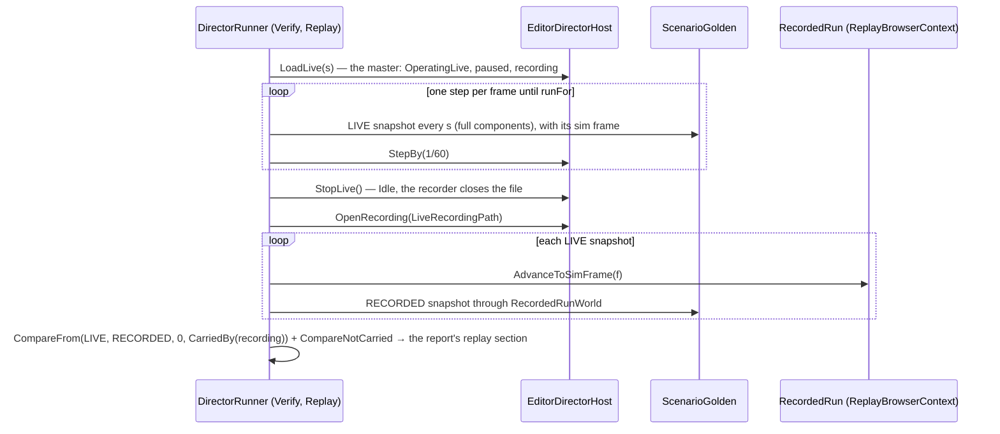
*What it shows: H1a needs NOTHING from the master after the live run — no replay transition, no replay seek, no replay step — so CE-4051…4053
cannot mask a data defect, and a data defect cannot be blamed on them.*

#### 10-1a. As built (`2026-10-26`, coordinator) — where it deviates from the two diagrams above

| diagram says | built | why |
|---|---|---|
| `OpenRecording(path) RecordedRun` | returns **`IRecordedRun`** (`AdvanceToSimFrame`, `SimFrame`, `World`, `Dispose`); `RecordedRun` is its one implementation | the rails compare with no recording file — the same reason `IDirectorHost` and `IVerifyWorld` are interfaces |
| `EditorDirectorHost` grows members | five REQUIRED constructor arguments (`loadLive`, `stopLive`, `state`, `recordingPath`, `openRecording`), wired in `EditorSubsystem` §8a | the silent-default rule: one production caller, and it holds every one |
| `LoadLive` through the master | `DebugApiService.LoadScenarioLive(name, startPaused: true)` — the SAME load as `POST /scenario/load/live` (late-bound, as the verify world is); `StopLive` = an `Idle` transition on `OrchestrationBusMasterControl`; the file = `RecordReplayController.ActiveRecordingModule.FilePath` (read while it records — the recorder forgets it on close) | no second load path |
| `DirectorRunner` Verify(Replay) | a new phase **`Checking`** (after `Playing`): waits for `Idle` and the file to close, then matches ONE live snapshot per frame (the editor stays responsive), then compares | a whole recording in one frame would freeze a windowed editor |
| — | a replay check compares NO `golden.json` (`golden: none`): its reference is the run itself, every component in full, every second at least (finer when `golden.every` is) | RH-2 — a live run is not the preview a golden was recorded from |
| — | the result: `VerifyResult.Replay` (`same` · `different` · `failed`), `ReplayDiff` (the first difference, or why it failed), `ReplayNotCarried` (by the manifest — never the verdict), `ReplaySnapshots`; `Passed` needs `Replay` null or `same` | the report's replay section (RH-10) |
| — | entry points: `--verify-replay` (a switch — H1a is one phase; RH-10's phase list comes with H1b), `POST /director/verify {replay: true}` (also with `fresh`) | RH-10 |
| `ScenarioGolden.CarriedBy` | moved from `VerifyCommand.Carried`, returns null when the file has no manifest (then every component is compared, and the report says so) | one reader for R1's checkpoint and H1a's recording — a checkpoint IS a one-frame recording |
| `VerifyWorldNames` | extracted from `EditorVerifyWorld`; `RecordedRunWorld` dumps through `EntityStateExtractionService(repo, null, serializer)` + `DebugApiService.DumpToJsonNode` (now `internal`) | the recorded snapshot is written exactly as `GET /entities/{id}` writes the live one |

Rail: `DirectorRunnerTests.CE4045_H1a_TheLiveRun_IsComparedWithItsOwnRecording_FrameBySimFrame` (a faithful recording ⇒ same; a recorder
that loses `Health` ⇒ different from t=2 s, naming the unit and the component; a component outside the manifest ⇒ listed apart).
🔴 Red-proof: a snapshot mapped one sim frame late ⇒ `different`.

#### 10-1b. ⭐ H1a MEASURED on the four feature scenarios (`2026-10-26`, `coordinator@3cb5d8889`, fresh process each, `--verify-replay`)

| scenario | replay (snapshots, every 1 s) | listed apart (not in the manifest) | the run's own checks |
|---|---|---|---|
| `ua-tank-ammo` | ✅ **same** (61) | `PendingNetworkAck` on every unit at t=0 | ⛔ 1 red — CE-4055 (also red in the preview, same times) |
| `bt-grenade-posture` | ✅ **same** (13) | `PendingNetworkAck` at t=0 | ⛔ *"the standing man … is hurt"* — see CE-4055 |
| `ua-civ-melee` | ✅ **same** (41) | `PendingNetworkAck` at t=0 | ✅ |
| `ua-posture` | ✅ **same** (61) | `PendingNetworkAck` at t=0 | ✅ |

⇒ ⭐ **the recording HOLDS the run** on all four: every unit, every recorded component in full, at every second, played back by the
product's player — the half of the replay question CE-4051…4053 cannot reach. ⭐ **RH-2's free measurement:** a stepped LIVE run gives
the SAME verdict times as the preview (`ua-tank-ammo`: 8.93 · 28.5 · 39.12 · 51.07 s in both). ⚠ What this does NOT cover yet: the product's
replay CONTROL (H1b, after CE-4051…4053), seek (H2), branch (H3), and shots / blasts (RH-5 — the recording's Combat lanes).
⚠ The not-carried lines print the live side as "golden" and the recorded side as "run" (the comparator's words, shared with R1).

### 10-2. ⭐ The harness after During Action Review *(R-4086, `2026-10-26`)*

🔒 **User, `2026-10-26`:** *"yes write the addendum note, and approved"* — on the re-cut below, after backend's
[DAR design](DESIGN_Replay_Time_Axis_And_Review.md) (R-3056…R-3063). Backend: [NOTE_Coordinator_To_Backend_Review_Harness](blueprints/batches/NOTE_Coordinator_To_Backend_Review_Harness.md).

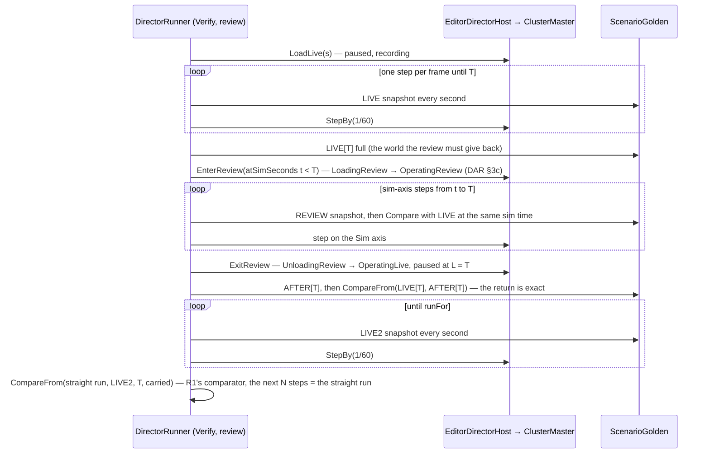
*What the picture shows that prose hid: ONE run answers both of DAR's acceptance questions — does the review show what live was, and does
live come back exact — and the second half is R1's comparator unchanged, so the review is judged by the same rule as a checkpoint restore.*

| # | ⭐ ruled | was | why |
|---|---|---|---|
| ① | **RH-3 SUPERSEDED** — replay seconds are wall seconds for good (R-3056); a sim address is `atSimSeconds` through DAR's `ReplayTimeMap` | RH-3: a stepped run's replay seconds = sim seconds | step 0 measured wall gaps of 2–19 ms per step (CE-4053) |
| ② | ✅ *(BUILT, §10-4)* **H1b waits for DAR P1** (`atSimSeconds`, the Sim-axis step — DAR §8 rows 9, 10, 12), not for CE-4051…4053 (fixed / ruled) | §10-1: H1b after CE-4051…4053 | `/sim/step` in a replay advances wall time, which lands between a stepped run's sim frames |
| ③ | ⭐ **H5 — the review phase** (the picture): live to T, review back to t, compare, return, compare, run on, compare with a straight run. Built by the coordinator once DAR **P3** lands; ⭐ it IS DAR P3's scenario-scale acceptance — backend keeps its unit rails and points P3's report at H5 (one oracle) | — | DAR P3's acceptance is *"R1's oracle reused"* — the verifier already owns that oracle |
| ④ | **H2 gains a WIRE check** once DAR **PW** lands: after each seek the DDS instances alive on a test reader equal the world's owned ids (DAR §12e at scenario scale; CE-3331). ⛔ **AMENDED `2026-10-26` — it lives in H4, not in the editor's verifier:** 📐 the editor builds with `OfflineNetworkFactory` (`OfflineNetworkFactory.cs:16-23` — "no DDS is allocated", a `NullReplicationModule`), so a `--mode editor` run puts nothing on the wire to check; the unit half is backend's `CycloneNetworkCleanupSystemTests` (CE-3331) | H2: world only | R-3062: every world swap disposes its potential zombies on the wire |
| ⑤ | **H1a unchanged**; once v7 lands its `RecordedRun` reads the sim frame from the frame index instead of decoding each frame's `GlobalTime` | — | DAR P0 rows 1–3 |
| ⑥ | **H1 also asserts live lanes = recorded lanes** once ui builds `LiveTimelineSource`: the run's live index equals the index rebuilt from its recording, lane by lane | — | the timeline addendum's item 6 (R-4087) |

Rejected: a review-only harness — cluster replay (H1b) and the branch (H3) are different product paths and keep their phases · waiting for
P3 before re-cutting — ①, ② and ④ do not depend on it · a second scenario oracle in backend — two oracles drift apart (R-4078: unify).

### 10-3. ⭐ H5 — the review check *(coordinator, `2026-10-26`; build-state: BUILT — R-4086 ③; as built §10-3a)*

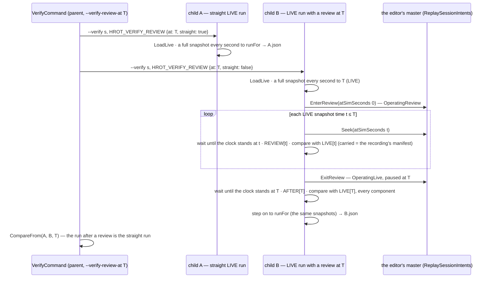
*What the picture shows that the prose hid: three comparisons, three questions — REVIEW vs LIVE (does the review show what live was), AFTER vs
LIVE[T] (does live come back exact), B vs A from T (does live RUN ON as if nothing happened) — and only the third needs a second process,
exactly as R1's restore oracle did, which is why the parent is R1's shape.*

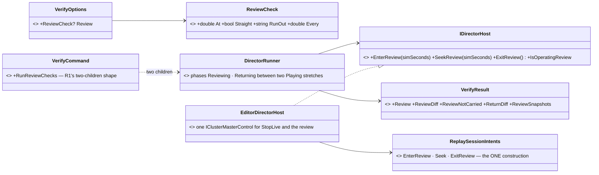
*What the picture shows: no new replay path — the review goes through backend's one intent construction (the same as `/review` and the
facade), and the oracle is the existing `ScenarioGolden.CompareFrom`.*

| rule | why |
|---|---|
| both children run LIVE (`LoadLive`) | the straight run must be the same kind of run as the reviewed one; a preview is never recorded (R-3053) |
| a seek "lands" when the world's clock stands at the target (±½ step) for 3 frames; a miss past the timeout is reported with the landed time, never compared silently | backend measured a review seek landing at 9.895 s for 10 s (§12k of DAR) — the harness says how far it missed |
| REVIEW vs LIVE uses the recording's manifest as `carried`; AFTER vs LIVE[T] compares EVERY component | the review shows the recording; the return is the FULL checkpoint (R-3063) — anything it drops is a finding |
| the runner's checks keep judging the whole live run; the review's frames are not observed | the review is a look back, not part of the run |

#### 10-3a. ✅ As built and MEASURED (`2026-10-26`, `coordinator@cabbffe0a`)

| deviation from the two diagrams | why |
|---|---|
| the review's outcome is kept in the runner and copied into the result at the end of the run | the result exists only at `FinishItem` |
| the review is compared only with the live snapshots at the times it actually STOOD at | ⚠ the comparator pairs snapshots by index — 📐 measured: a review that missed 0 s shifted every later pair by one second |
| the review's entry waits for the step in flight (`retired >= issued`) and snapshots the world it leaves (`atLive`) itself | with the master a frame behind, the live point is one step past the review time |
| `EditorDirectorHost` takes one `IClusterMasterControl` for `StopLive` and the review (the `stopLive` argument is gone) | one master path |

Rail: `DirectorRunnerTests.CE4045_H5_*` (fake editor: review 0/1/2 s, return, run on = straight; a return that drops the health caught
twice) — red-proved (the return compared against the review's last snapshot ⇒ red).

📐 **Live, `ua-civ-melee`, `--verify-review-at 10`** (two fresh processes, 168 s):

| question | measured | verdict |
|---|---|---|
| does the review show the live run? | at 1 … 10 s: **every recorded component equal** (no difference); `PendingNetworkAck` listed apart (not in the manifest) | ✅ |
| does a review enter at 0 s? | ⛔ it never stands at 0: the clock read 4.92, 4.6 and 4.0 s in three runs, though the entry lands on recorded frame 4 (sim 0) | ⛔ **CE-4056** (backend) |
| does live come back exact? | every component equal at L = 10.017 s **except `PendingNetworkAck`** (present at L, gone after the return) | ⛔ **CE-4057** (backend) |
| does live run on as if straight? | first difference at 11 s: `PendingNetworkAck` only (the straight run keeps it) | ⛔ CE-4057 |
| ⭐ **re-run `2026-10-27`** after backend's fixes (`coordinator@290a6ef69`, backend `bad9aa626`) | the review stands at 0 s; **review same, return exact, after same** (51 s) — `PendingNetworkAck` is recorded now and comes back | ✅ CE-4056, CE-4057 fixed |

### 10-4. ✅ H1b as built `2026-10-26` — the product's replay, sought by recorded sim time *(R-4086 ②)*

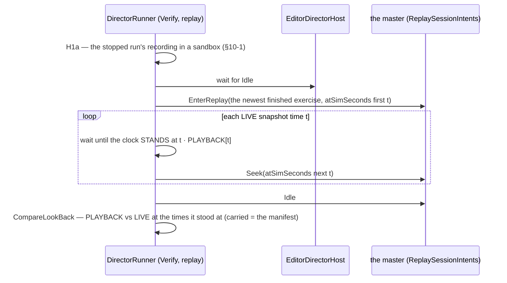
*What the picture shows: H1b is H5's look-back loop with another way in (a replay from Idle) and another way out (Idle) — ONE loop, one
result shape (`LookBackResult`: verdict, snapshots, diff, not-carried, problems), one intent construction.*

| as built | why |
|---|---|
| `--verify-replay` runs H1a THEN H1b in the same child; the JSON gains `"playback"` beside H5's `"review"` (both `LookBackResult`) | one command, two halves of the replay question |
| `ReplaySessionIntents.EnterReplay` added; `DebugApiService.Master` (`POST /replay`, `/replay/seek`, `/review`) now builds through `ReplaySessionIntents` — they had their own inline copies (⚠ cross-lane edit, backend's file) | R-3059: a click, a request and the verifier are the same request |
| a replay is sought with the same `SeekReplayIntent` as a review (`SeekReview` on the host) | one seek path |
| ⚠ not built: leaving a review / replay when the runner is STOPPED or throws | the host would stay in the review / replay — a known gap |

Rail: `DirectorRunnerTests.CE4045_H1b_*` (one entry, one seek per later snapshot by sim time, Idle at the end; a replay that loses the
health ⇒ different from t = 2 s naming Runner / Health) — red-proved (the replay's seeks skipped ⇒ the loop times out).

📐 **Live, `ua-civ-melee`, `--verify-replay`** (`coordinator@b97d9bcec`): H1a ✅ same (41 snapshots); H1b — ✅ **the product's replay
shows the live run at 1 … 40 s, every recorded component equal** (`PendingNetworkAck` listed apart, not recorded); ⛔ the ENTRY at 0 s
never stands there (clock 26.6 s) — ⇒ **CE-4056 is the entry path for a replay as well as a review** (a `TransitionState` with a sim
target), while every `SeekReplay` lands. ⭐ **Re-run `2026-10-27`** after backend's CE-4056 fix (a seek BACK stood one seek behind — the entry was not the cause): H1a and H1b **same**, 41 snapshots, no problem listed.

### 10-5. ✅ H2 as built `2026-10-27` — the replay sought again, shuffled *(RH-6)*

⭐ Part of the replay check (`--verify-replay`): after H1b's in-order look-back, the SAME replay is sought to the same moments in a shuffled
order (seed `ScenarioVerifyRun.SeekShuffleSeed` = 4045, never the in-order walk), and each moment is compared with what **H1b** showed there —
not with live, so a difference can only be the seek's. Backward seeks are the point: 📌 CE-4056 (a seek BACK stood one seek behind) was found
live and only live, because in-order seeks never go back. `VerifyResult.Seek` (`"seek"` in the report, `SEEK` in the print); `Passed` needs it
same. The comparison sorts the visited snapshots by time first (the comparator pairs by index). Rails: `CE4045_H1b_*` (the seeks after H1b are
a shuffled permutation of the four moments; SEEK same) · `CE4045_H2_ShuffledSeeks_CatchASeekBackThatStandsOneSeekBehind` (a fake replay
whose backward seek shows the last seek's world under the new clock: H1a same, H1b same, **H2 different**, the item fails).

### 10-6. H3 step 0 — the branch, measured `2026-10-27` *(RH-7; before building H3)*

📐 `--mode editor --headless`, `ua-civ-melee`: live to 10 s → Idle → `OperatingReplay` → seek `atSimSeconds: 5` (lands) →
`POST /cluster/transition {target: "OperatingLive"}` (the D18 branch, `LiveBranchProcessManager`).

| question | measured | verdict |
|---|---|---|
| does the branch come live? | ✅ OperatingLive in < 1 s; the node: *"Live-from-Replay branch complete (branchedExerciseId=…, history 1465 frame(s))"*; steps run (+1.0 s per 60) | ✅ |
| does it come live at the branch point's SIM time? | ⛔ the clock reads **12.71 s** for a branch at sim 5 s — the WALL seconds of that point (the run was stepped over HTTP: 23.7 s of wall for 10 s of sim) | ⛔ **CE-4065** (backend) |
| `target: "LoadingLive"` | ⚠ accepted, and the cluster PARKS in `LoadingLive` (30 s, clock frozen) — an intermediate state as a target | ⚠ in CE-4065 |

⇒ H3's intent is `TransitionStateIntent(OperatingLive)` from a replay. ⭐ H3 will run its comparison from T on the BRANCH's own run time
(`t0 = clock at the branch − T`), so a clock offset alone does not fail it — what it measures is whether the WORLD goes on as the straight run did.

### 10-7. ✅ H3 as built `2026-10-27` — the replay, branched live at T, runs on as the straight run *(RH-7)*

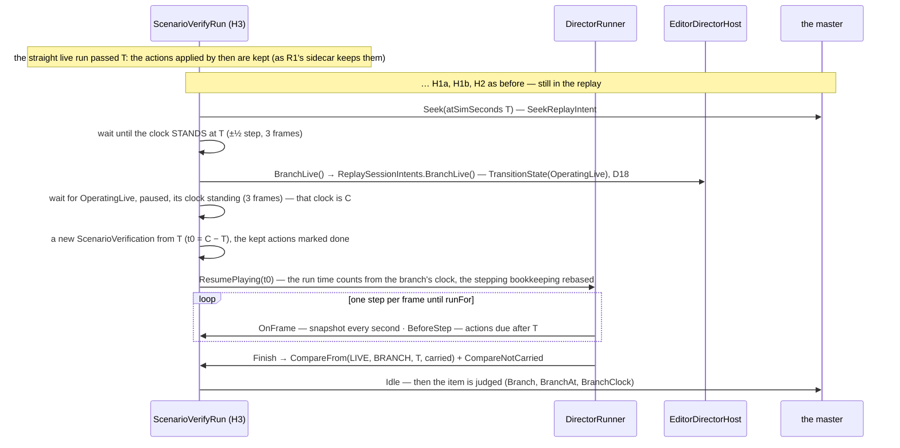
*What the picture shows that prose hid: the branch runs through the RUNNER's own loop again (one step per frame, the same stepping rule) —
the only new seam member is `ResumePlaying(t0)`, because a branch's clock is its own (CE-4065), not the straight run's.*

| as built | why |
|---|---|
| `VerifyOptions.BranchAt` (with `Replay`), `--verify-branch-at T` (implies `--verify-replay`); T snapped UP to the snapshot grid | the branch starts from a live snapshot's world, so T must be one |
| `ReplaySessionIntents.BranchLive()` — one `GoLive()` shared with `ExitReview()`; `POST /review/exit` now builds through it (it had an inline copy — ⚠ cross-lane edit, backend's file) | one construction per intent (R-3059) |
| `IRunContext.ResumePlaying(double? t0)` — ⚠ cross-lane edit (ui's runner, `Hrot.Presentation`) | the run time must count from the branch's clock; without it `masterBehind` holds every step |
| H3 compares on what the recording CARRIES (its manifest), as H1b — not every component | the branch's world is rebuilt from the recording; what it does not carry cannot come back (listed in `notCarried`) |
| `BranchClock` is reported, never compared | 📐 CE-4065 — the clock comes up on wall seconds; H3 measures the WORLD, and the offset going to 0 will show backend's fix |
| ⚠ a check action anchored on a moment BEFORE T is not re-anchored in the branch (its book starts at T) — it shows as an `H3 run:` problem | R1 has the same limit; no scenario measured with one yet |

Rail: `DirectorRunnerTests.CE4045_H3_TheReplay_BranchedLiveAtT_RunsOnAsTheStraightRun` (fake: the branch comes up 7.71 s off; ① same at
2 and 3 s, the 1.5 s action applied once, the clock reported, Idle at the end; ② a branch that drops the health ⇒ different from t = 2 s
naming `Health`, while H1a / H1b / H2 stay same; a branch outside the replay check is refused).

### 10a. Claim table — what the leans rest on

| claim | code — how it IS | design — how it was MEANT |
|---|---|---|
| a preview is never recorded; a live run records on every node | `/recording/start` retired (HTTP-through-master §3 as built) | ✅ R-3053, R-4000 |
| in a replay the ordinary readers read the replayed world | `DebugApiService.Master.cs:94` `EnterReplay` publishes the master's transition; `/entities` reads the host's world | ✅ HTTP-through-master §3 ("reading a replay") |
| the master can enter, seek and branch a replay in the editor | `IClusterMasterControl.Transition` / `SeekReplay` (`IClusterMasterControl.cs:21-24`); `OrchestratorCore.cs:146` builds `LiveBranchProcessManager`; the editor runs that core | ✅ HTTP-through-master §1 (known-conflict: AQ86 measured false) |
| a stepped run's recording ticks advance by the step | ✅ `SteppingTimeController.cs:60` (`TotalWallTicks` = unscaled total time) · `MasterSyncController.cs:357` (`+= fixedDelta`) · `RecorderTickSystem.cs:88` stamps `GlobalTime.TotalWallTicks` | ⚠ mgmt-1 (~l.1300-1430) designs `TotalWallTicks` for continuous play (the PLL); silent on stepping ⇒ RH-3's mapping is MEASURED in H1 step 0 |
| the replay clock steps with `/sim/step` | ⛔ not measured in code here | ✅ HTTP-through-master §3: *"during a replay they drive the replay clock"* |
| the golden's snapshot and compare exist | ✅ `ScenarioGolden.Snapshot` / `Compare` / `CompareFrom` / `CompareNotCarried` (`ScenarioVerification.cs:333-520`) | ✅ §4, Checkpoint §1k |
| shots / blasts are not in a replay as `CombatReport` rows | ✅ `ShotLog.cs:68` per-world side store; the timeline's Combat lanes read the recorded events (`CombatTimelineLanes`) | ✅ census §2; Timeline §9 TL-5, §9d |
| a stepped LIVE run repeats from a rebuilt world | ⛔ not measured — R1 measured the PREVIEW only | ⛔ R-3035 says stepped mode is deterministic; ⚠ load-bearing for H3 only, and H3 measures it |

### 10b. INVENTORY

```
scripts/cbm.sh search_graph name_pattern=".*(Verify|Golden|Replay|Recording|Playback|Sandbox).*" label=Interface
   → 5: IRecordReplayController, IRecordingExportService, IRecordingSearchService, IReplayRestoreGated, IVerifyWorld
scripts/cbm.sh search_graph name_pattern=".*(Verify|Golden|ReplayExtraction|ReplayContext|Sandbox|RecordingStart|RecordingSession|RecordingControl).*" label=Class
   → CommandLineVerify, EditorVerifyWorld, FreshVerifyJobs, ScenarioGolden, VerifyCommand, VerifyOptions, VerifyResult (+ AiGoldenSnapshot,
     EqsGolden* — unrelated goldens)
grep: IClusterMasterControl (+ OrchestrationBusMasterControl), DebugApiService.Master.cs (EnterPreview, EnterReplay, SeekReplayTo, StopReplay,
   GetReplayStatus), ReplayMasterModule, LiveBranchProcessManager, ReplaySeekProcessManager; "ReplayMatchesLive" → only
   ParallelEpisodes_ReplayMatchesLiveAtTick25 (FDP example) and .dev/_DONE/demos-1 (the batch that built it)
docs: DESIGN_Replay_Census_H0.md · DESIGN_Http_Control_Through_The_Cluster_Master.md §3-§4 · DESIGN_Checkpoint_And_Dry_Run_Restore.md §1k ·
   DESIGN_Director_Timeline_Editor.md §9c-§9d · designs/mgmt-1/DESIGN.md (TotalWallTicks) — searched docs/ + .dev/ for "replay fidelity",
   "verify-replay", "replay equals live": none
check_index_coverage is not available through the CLI ⇒ these totals are not proof of completeness
```

### 10c. Build order and acceptance

| step | builds | accepted when |
|---|---|---|
| **0** | measure on one feature scenario (`ua-tank-ammo`): a stepped LIVE run in the editor records; the recording's frame ticks advance by the step; `/sim/step` steps the replay clock by the same step; replay enters at 0 | four numbers in §10a's ⛔ rows, each with its file:line |
| **H1** | `IDirectorHost` live + replay members over `IClusterMasterControl` · Verify(Replay) playback phase · `ReplayCarried` from DataPolicy + the census · the Combat lanes compare · the report | the four feature scenarios: PLAY = LIVE at every reference time except the listed explained differences; shots / blasts per lane equal; a mutation (a component made `NoReplay` that a reader needs) turns it red |
| **H2** | the seek phase | shuffled seeks equal playback on the four |
| **H3** | the branch phase (R1's comparator) | equal, or a work list like R1's |
| **H4** | §10 RH-8, written then | — |

## ⛔ HISTORY

- **First version (2026-10-22, R-4065):** a Python runner over HTTP (`scripts/scenario-check.py`) as phase 1, the engine as phase 2. ⛔
  SUPERSEDED the same day by R-4066 — the engine is the product; the Python runner was deleted once the engine verifier ran (it measured
  the HTTP-stepped pace — ~10 steps a second in a windowed editor — and nothing else of note).
