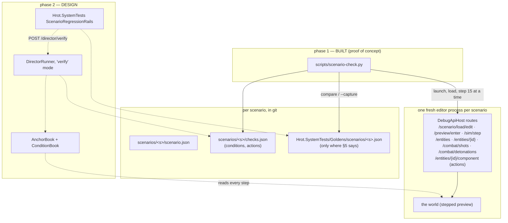
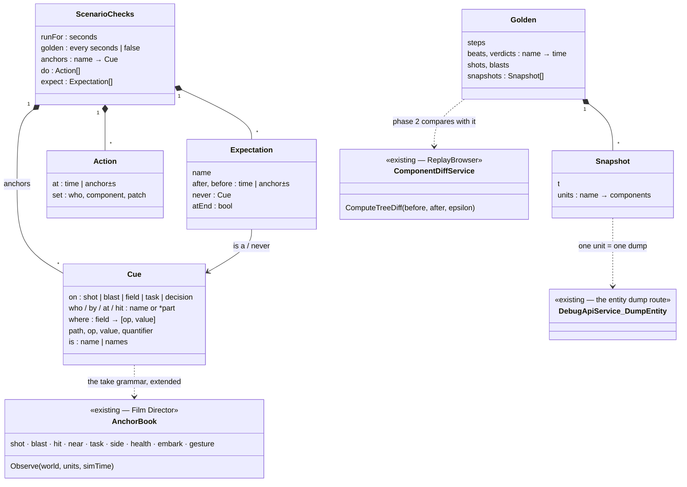
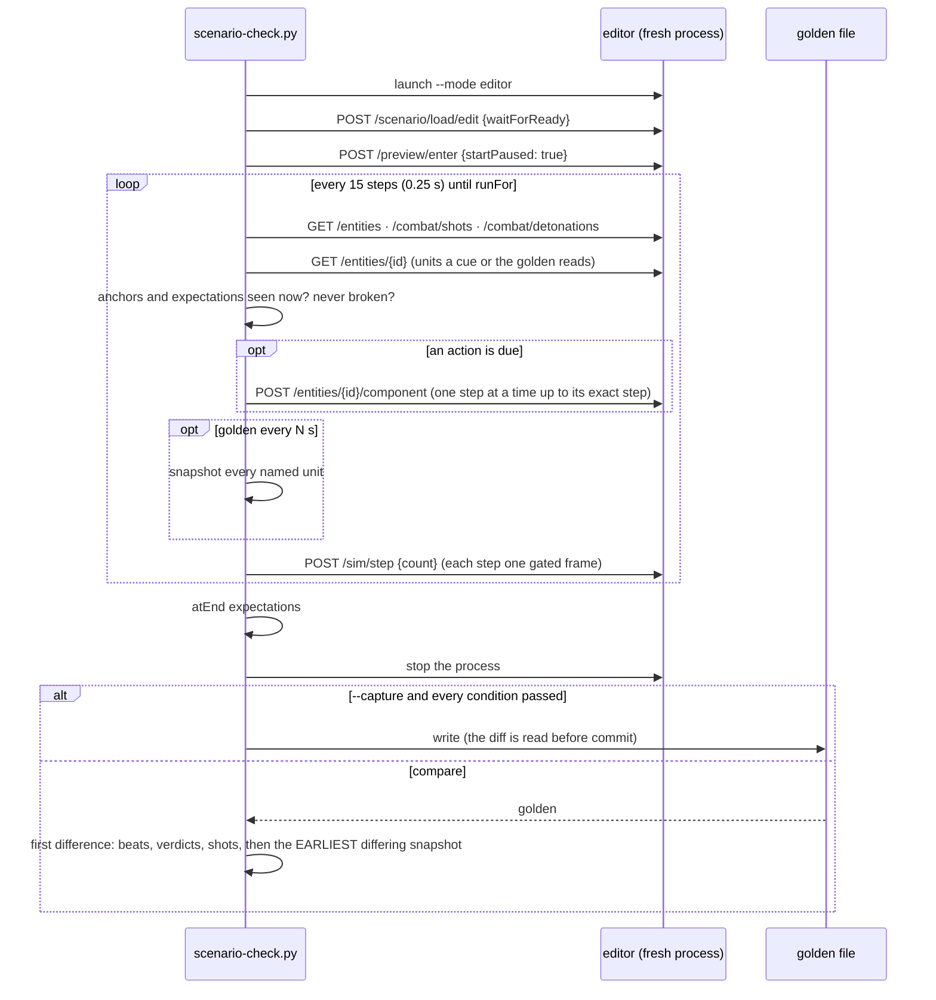

<!--STATUS
state: LIVE
build-state: BUILDING — phase 1 (the proof of concept, a Python runner over the editor's HTTP API) BUILT 2026-10-22 on five scenarios (§7); phase 2 (the runner inside the editor, reusing AnchorBook, and a Hrot.SystemTests rail) is DESIGN (§8)
updated: 2026-10-22 (first version, coordinator, CE-4042, R-4065)
current-answer: §0 the user's ruling · §1 the picture · §2 classes · §3 the checks grammar · §4 the golden · §5 which scenarios get what · §7 what the proof of concept measured · §8 phase 2
stale-below: none
known-rot: none
known-conflict: blueprints/DESIGN_Smoke_Suite.md says "do not build a DSL" — written for a different shape (one entity, one behaviour, panel checks; the JSON TestScript kept for cluster/DDS/replay). checks.json EXTENDS the film takes' anchor grammar, which is already built and read by the engine (AnchorBook); it is not a new language. Not reconciled with the Smoke Suite's author — named here so a reader sees both.
related-designs:
  - DESIGN_Regression_Net.md — OWNS the golden-vs-assertion decision (D7: both, paired), "capture on a FIRST load in a FRESH process" (§6 ④) and "never normalise to hide non-determinism" (N1). This design applies those three rules to whole scenarios
  - TESTING_Harness_And_Goldens.md — OWNS the golden workflow (where goldens live, the <FAMILY>_GOLDEN_CAPTURE switch, "a regenerated golden is a DIFF you must read"); this design's switch is SCENARIO_GOLDEN_CAPTURE
  - DESIGN_Film_Director.md — OWNS the take files, their anchor grammar and AnchorBook (the in-engine per-step cue reader) and the DirectorRunner (load, step once per frame, report); checks.json reuses the grammar, phase 2 reuses both classes
  - blueprints/DESIGN_Paused_And_Stepped_Execution.md — OWNS why a stepped run repeats (CE-3293, R-3036, R-3038; §7e: HTTP-paced = batched stepping) and the open reload leak (CE-3294) that forces a fresh process per scenario
  - DESIGN_Deterministic_Network_Ids.md — OWNS why network ids repeat across runs (§11: the authority resets to 1000 per world), so a golden may name entities by id without masking
  - DESIGN_Utility_AI_Demo_Scenarios.md — OWNS the per-scenario live checks (scripts/utility-demo-check.py, against the --mode all cluster) and their in-process twins; checks.json is where their conditions move as data
-->

# DESIGN — scenario regression: does every scenario still run as it used to?

## 0. The user's ruling (R-4065)

🔒 **User, `2026-10-22`:** *"a system that checks whether the scenarios are still running as they used to run before … based on
reproducibility, determinism of stepped scenario execution, and checking that the scenario ends up in the same state as it was recorded
before … define for each scenario what the success conditions are, not just as text, but also as some fixed rule that are automatically
verifiable"* · *"running a new process per scenario is actually a good idea until we fix it. Checking in editor is sufficient for now.
We should make a proof of concept, not on all 94 scenarios, but just a few"* · *"Not all scenario needs one [a golden], because not all
scenarios are checking a concrete feature. Some are just plain demos that mix too many things together."*

| ⭐ decided | |
|---|---|
| **two halves, paired** (Regression_Net D7) | **conditions** say *is it right?* (intent, survive a re-record); the **golden** says *did anything change?* (behaviour) |
| **the editor's stepped preview** | the run that repeats (R-3035/R-3038). ⛔ The cluster is not judged here — its live checks stay its acceptance |
| **a fresh process per scenario** | until CE-3294 (a system's per-entity state outlives a reload) is fixed; it is also Regression_Net's capture rule |
| **a golden only where a scenario shows ONE feature** | a demo that mixes many things carries conditions only (§5) |

## 1. The picture

*What the picture shows that prose would hide:* phase 1 reads the world only every **sample** (0.25 s) and only through HTTP, so a
condition's time has a 0.25 s resolution and costs a round trip; phase 2 moves the same reading inside the step loop the film director
already owns, where `AnchorBook` reads every step for free. The data files are the contract between the two — phase 2 changes no
`checks.json` and no golden.

## 2. Classes

*What the class picture shows:* `Cue` is the take anchor (`AnchorSpec`) with three additions — `field` (any component value by path),
`decision` (a utility decision's winner) and `where` (filter a shot or a blast by its record's fields) — so phase 2 extends one class, it
does not add a second reader. A `Snapshot` unit is exactly what `GET /entities/{id}` returns, and its comparison is the existing
`ComponentDiffService` with its 0.001 tolerance.

## 2a. One run

*What the sequence shows:* an action lands on an **exact step** (the runner single-steps up to it), so a run with actions still repeats;
and a golden is never written from a failing run — that would bless the failure.

## 3. The checks grammar (`scenarios/<s>/checks.json`)

| key | meaning |
|---|---|
| `runFor` | seconds of sim time from the load |
| `golden` | `{"every": s}` — a snapshot every s seconds and at the end; `false` — conditions only (§5) |
| `anchors` | named cues whose first time other entries refer to (`"after": "riot"`, `"at": "contact+2"`) — the take's anchors |
| `do` | `{"at": t, "set": {"who", "component", "patch"}}` — what the old live checks did by hand (17 of 81 wound a man, set an attribute) |
| `expect` | each `{"name", <cue>, "after"?, "before"?}` holds once in the window · `{"name", "never": <cue>, …}` never holds in it · `{"name", <cue>, "atEnd": true}` holds when the run ends |

| cue `on` | holds when | reads |
|---|---|---|
| `shot` | the n-th round `by` a unit, `at` a target, that `hit` one, `where` its record matches (`"penetration": [">", 400]`) — its own firing time | the shot log |
| `blast` | the n-th burst `by` a unit, `where` it matches (`"warheadSource": ["contains", "M67"]`) | the detonation log |
| `field` | `who`'s component value at `path` (`Health.Current`, `CivilianState.Mode`) compares by `op` (`== != < <= > >= in contains`) — for `any` (default), `all` or `atLeast:n` of the units named | the `/entities/{id}` dump |
| `task` | `who` runs the behaviour `is` (one name or a list — the REGISTRY name) | `/entities/{id}/state` |
| `decision` | `who`'s utility `decision` is won by one of `winner` | `/entities/{id}/utility` |

A unit is a name or `*part` (any whose name contains it) — the take anchors' rule.

## 4. The golden

| ⭐ rule | why |
|---|---|
| **what** — the steps taken, every anchor's and expectation's time, every round (shooter, target, hit, outcome, penetration), every burst, and every named unit's FULL component dump every `every` s and at the end | the components are what a regression changes first; the shot log is the story in one page |
| **compare** — numbers within 0.001 (`/diff/compare`'s tolerance), everything else exactly; **nothing masked** | Regression_Net N1. Network ids repeat (Deterministic Network Ids §11) and each run is a first load in a fresh process, so the "counts up per load" labels do not move |
| **the report names the FIRST difference** — beats and verdicts, then the shot log, then the EARLIEST differing snapshot with its units and values | a red golden must answer *when did it start to differ, and in whom* — that is where the bisect starts |
| **re-record** — `scripts/scenario-check.py --capture <s>` (or `SCENARIO_GOLDEN_CAPTURE=1`); refused when a condition fails | TESTING_Harness_And_Goldens §4: the regenerated golden is a diff you READ and ship with the change that moved it |
| **one platform** | ⛔ not measured whether Linux and Windows runs agree bit for bit. Goldens are recorded and compared on the Linux CI/cloud host; conditions run anywhere |

## 5. Which scenarios get what

**Every scenario can carry conditions; only a feature scenario carries a golden.**

| kind | conditions | golden | why |
|---|---|---|---|
| ⭐ **feature** — one capability, a small cast (`ua-tank-ammo`, `bt-grenade-posture`, `ua-civ-melee`, `ua-posture`) | ✅ | ✅ | a change to its state is a change to that feature, so the golden's red means something |
| **demo** — many systems at once (`pc-defend-house`, `uc-urban-battle`, `demo-city`) | ✅ the chain it must show (*"Red fires, Blue sets a base of fire, Blue assaults or breaks off"*) | ⛔ | nearly every change in any lane moves some of its 40 men, so a golden would be red on every merge and get re-recorded blind — Regression_Net D7's failure mode |
| **a scenario that does not repeat yet** | ✅ | ⛔ until it does | a golden of a run that differs from itself is noise. Proven per scenario: two fresh-process runs must give the same golden (§7) before one is committed |

*Why a scenario might not repeat* (each is a defect, not a property): state that outlives a reload (CE-3294 — avoided here by a fresh
process), work still on the wall clock rather than sim time (R-3035 covers perception and slow modules; others may remain), and the
first load after boot differing from a reload (the animation handle and `StanceStatus`, Paused & Stepped §7e) — avoided, every run is a
first load.

## 6. INVENTORY (`2026-10-22`)

| query | result |
|---|---|
| keys of every `scenarios/*/scenario.json` | 94 files; keys `$meta`, `header`, `entities`, `TerrainObjects` — ⛔ no checks section anywhere |
| `Judge:` / `Fail:` in the header descriptions | 92 / 91 — the conditions exist, as prose |
| `SCENARIOS` in `scripts/utility-demo-check.py` | 81 scenarios with a live check (cluster, real time); 17 change the world mid-run |
| `search_graph` `.*(Anchor|Take|Director|ShotEvaluator).*` Class | ⚠ 19, none of the director's — the graph predates ui's director merge; grep found `AnchorBook`, `TakeStore`, `ShotEvaluator` (`Hrot.Presentation/Map3D/Director/`), `DirectorRunner`, `ScenarioReadyProbe` (`Hrot.Editor/Director/`) |
| world-state diff | `DebugApiService.CaptureBaseline` / `CompareBaseline` (`/diff/capture`, `/diff/compare`) → `ComponentDiffService.ComputeTreeDiff(…, 0.001)`; the replay browser uses the same service |
| run-to-run identity | `DirectorIdentityRails` (3 scenarios × 3 runs, a gate), `DeterminismRails`, `scripts/determinism-probe.py` (`/entities/{id}/state` per id, nothing masked) |
| existing goldens | `Hrot.SystemTests/Goldens/` (`GoldenStore`, `GoldenCaptureFixture`, `PanelNormalizer`) — panel dumps, `PANEL_GOLDEN_CAPTURE=1` |

⚠ Coverage of the graph could not be checked through the CLI (`check_index_coverage` is not available); the lists above are by graph +
grep and are not proof of completeness.

## 7. The proof of concept — what it measured

*(filled from the runs — see below)*

## 8. Phase 2 — the runner inside the editor (DESIGN)

| step | what | reuses |
|---|---|---|
| 2a | `ConditionBook` — `AnchorBook` grown by the three cue additions and the expectation windows; evaluated EVERY step | `AnchorBook` (one reader of cues, ruling 9) |
| 2b | `DirectorRunner` gains a **verify** mode: a scenario with no take, `checks.json` instead; applies `do` at its step; snapshots through the `/entities/{id}` serializer | the director's load → preview → one-step-per-frame loop and `ScenarioReadyProbe` |
| 2c | `POST /director/verify {scenario}` and a View › Director "Verify" button | the director's routes and panel |
| 2d | `Hrot.SystemTests.ScenarioRegressionRails` — a theory over every scenario with a `checks.json`, a fresh editor each (`GoldenCaptureFixture`'s one-load rule), the golden compared with `ComponentDiffService` | `GoldenStore`, `GoldenCaptureFixture` |
| 2e | the tiers: the feature scenarios nightly in the background (T3); a handful in the batch gate (T2) | THE THREE TEST TIERS |

⚠ Phase 2 is the ui lane's code (the director); it is dispatched as a frame when the user approves phase 1's result.
