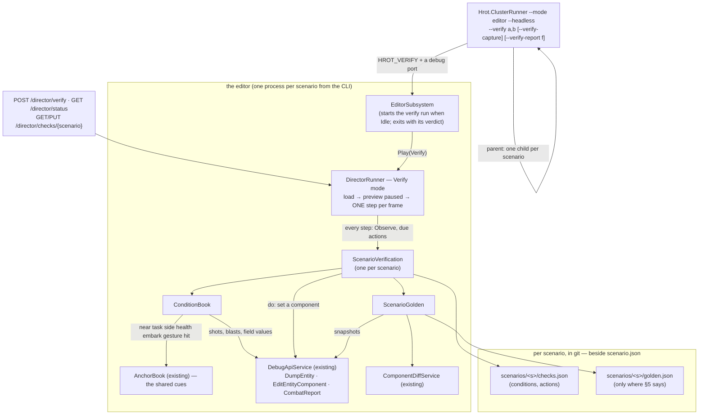
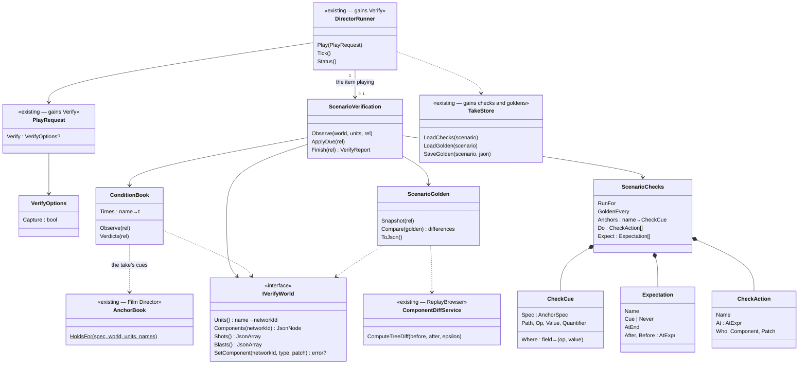
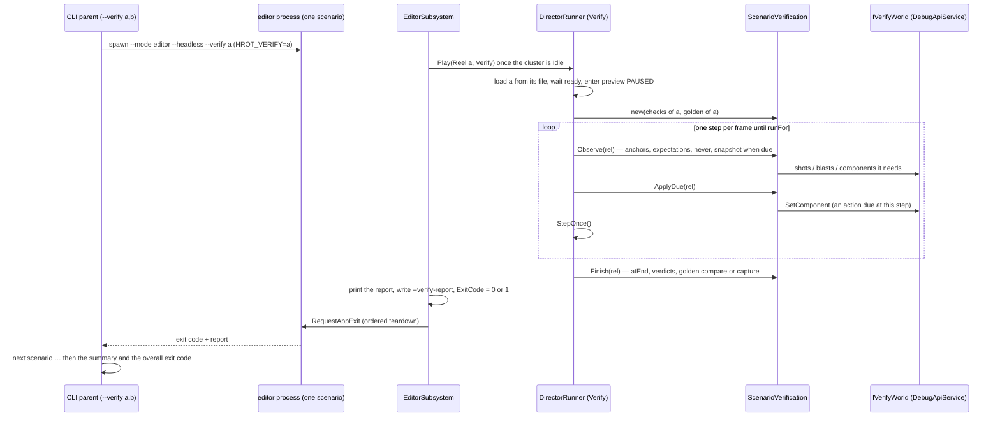

<!--STATUS
state: LIVE
build-state: BUILT (slice 1, 2026-10-22, §8) — the ENGINE verifier (§2, §8): a Verify mode of the film director's runner, /director/verify routes, and --verify on the command line. ⛔ The Python proof of concept is SUPERSEDED (user, 2026-10-22: "not as a Python … supported by the engine")
updated: 2026-10-25 (§9 approved, R-4077: the gaps land in the shared predicate model) · 2026-10-22 (second pass — the engine owns it: Verify mode, HTTP, command line; R-4066) · 2026-10-22 (first version, coordinator, CE-4042, R-4065)
current-answer: §0 the user's rulings · §1 the picture · §2 classes · §2a one run · §3 the checks grammar · §4 the golden · §5 which scenarios get what · §6 inventory · §7 measured · §8 the build · §9 the grammar's gaps (leans)
stale-below: none
known-rot: none
known-conflict: blueprints/DESIGN_Smoke_Suite.md says "do not build a DSL" — written for a different shape (one entity, one behaviour, panel checks; the JSON TestScript kept for cluster/DDS/replay). checks.json EXTENDS the film takes' anchor grammar, which is already built and read by the engine (AnchorBook); it is not a new language. Not reconciled with the Smoke Suite's author — named here so a reader sees both.
related-designs:
  - DESIGN_Director_Timeline_Editor.md — OWNS still keys (TE-10): a take's key captured as a PNG artefact by the Verify run; and the anchor kinds cross / enter / leave this design's checks.json may reuse
  - DESIGN_Checkpoint_And_Dry_Run_Restore.md — OWNS R1, the restore-equivalence oracle (§1k): this verifier run twice around a checkpoint written at T1 and restored in a second fresh process
  - DESIGN_Regression_Net.md — OWNS the golden-vs-assertion decision (D7: both, paired), "capture on a FIRST load in a FRESH process" (§6 ④) and "never normalise to hide non-determinism" (N1). This design applies those three rules to whole scenarios
  - TESTING_Harness_And_Goldens.md — OWNS the golden workflow (where goldens live, the <FAMILY>_GOLDEN_CAPTURE switch, "a regenerated golden is a DIFF you must read"); this design's switch is SCENARIO_GOLDEN_CAPTURE
  - DESIGN_Film_Director.md — OWNS the take files, their anchor grammar and AnchorBook (the in-engine per-step cue reader) and the DirectorRunner (load, step once per frame, report); checks.json reuses the grammar, phase 2 reuses both classes
  - blueprints/DESIGN_Paused_And_Stepped_Execution.md — OWNS why a stepped run repeats (CE-3293, R-3036, R-3038; §7e: HTTP-paced = batched stepping) and the open reload leak (CE-3294) that forces a fresh process per scenario
  - DESIGN_Deterministic_Network_Ids.md — OWNS why network ids repeat across runs (§11: the authority resets to 1000 per world), so a golden may name entities by id without masking
  - DESIGN_Utility_AI_Demo_Scenarios.md — OWNS the per-scenario live checks (scripts/utility-demo-check.py, against the --mode all cluster) and their in-process twins; checks.json is where their conditions move as data
-->

# DESIGN — scenario regression: does every scenario still run as it used to?

## 0. The user's rulings (R-4065, R-4066)

🔒 **User, `2026-10-22`:** *"a system that checks whether the scenarios are still running as they used to run before … based on
reproducibility, determinism of stepped scenario execution, and checking that the scenario ends up in the same state as it was recorded
before … define for each scenario what the success conditions are, not just as text, but also as some fixed rule that are automatically
verifiable"* · *"running a new process per scenario is actually a good idea until we fix it. Checking in editor is sufficient for now.
We should make a proof of concept, not on all 94 scenarios, but just a few"* · *"Not all scenario needs one [a golden], because not all
scenarios are checking a concrete feature. Some are just plain demos that mix too many things together."* · **R-4066:** *"this regression
test support is written not as a Python, but it is supported by the engine and can be controlled from AI debug HTTP. As well as started
from a command line."*

| ⭐ decided | |
|---|---|
| **two halves, paired** (Regression_Net D7) | **conditions** say *is it right?* (intent, they survive a re-record); the **golden** says *did anything change?* (behaviour) |
| **the engine runs it** (R-4066) | a **Verify** mode of the film director's `DirectorRunner` — the one place that loads a scenario, enters the preview and steps it once per frame. Three remotes: `POST /director/verify` (AI debug HTTP), `--verify` (command line), and the panel later |
| **the editor's stepped preview** | the run that repeats (R-3035/R-3038). ⛔ The cluster is not judged here — its live checks stay its acceptance |
| **a fresh process per scenario** | until CE-3294 (a system's per-entity state outlives a reload) is fixed. `--verify a,b,c` runs each scenario in a child process of its own |
| **a golden only where a scenario shows ONE feature** | a demo that mixes many things carries conditions only (§5) |

## 1. The picture

*What the picture shows that prose would hide:* the verifier adds **no second way** to load, step, dump or edit — every arrow into the
world ends in a class that already exists (`DirectorRunner`'s loop, `AnchorBook`'s cues, `DebugApiService`'s dump and edit, `CombatReport`'s
shot rows, `ComponentDiffService`). ⚠ The dump and the edit live in `DebugApiService`, which the editor builds only when a debug port is set
⇒ `--verify` **sets one** (a free port) so the command line needs nothing else, and an HTTP client can watch the run.

## 2. Classes

*What the class picture shows:* `CheckCue` WRAPS the take's `AnchorSpec` — the seven state cues (`near task side health embark gesture
hit`) are judged by `AnchorBook`'s own code (made callable as `HoldsFor`), and the verifier adds only what a take never needed: `field`
(any component value by path), `where` on a shot or blast row, the windows, `never` and `atEnd`. `IVerifyWorld` is the seam the rails fake
(no editor), as `IDirectorHost` is for the runner.

## 2a. One run

*What the sequence shows:* an action lands on its **exact step** (the runner steps once per frame, so every frame is a step boundary), and
the verdict leaves the process **by its exit code** — the command line and a CI job need nothing but the binary.

## 3. The checks grammar (`scenarios/<s>/checks.json`)

| key | meaning |
|---|---|
| `runFor` | seconds of sim time from the load |
| `golden` | `{"every": s}` — a snapshot every s seconds and at the end; `false` — conditions only (§5) |
| `anchors` | named cues whose first time other entries refer to (`"after": "riot"`, `"at": "contact+2"`) — the take's anchors |
| `do` | `{"name"?, "at": t, "set": {"who", "component", "patch"}}` — what the old live checks did by hand (17 of 81 wound a man or set an attribute); a named action's time is a name too |
| `expect` | `{"name", <cue>, "after"?, "before"?}` holds once in the window · `{"name", "never": <cue>, …}` never holds in it · `{"name", <cue>, "atEnd": true}` holds when the run ends |

| cue `on` | holds when | judged by |
|---|---|---|
| `shot` | the n-th round `by` a unit, `at` a target, that `hit` one, `where` its row matches (`"penetration": [">", 400]`) — at its firing time | `CombatReport.Shots` rows (the `/combat/shots` route's) |
| `blast` | the n-th burst `by` a unit, `where` it matches (`"warheadSource": ["contains", "M67"]`) | `CombatReport.Detonations` rows |
| `field` | `who`'s component value at `path` (`Health.Current`, `CivilianState.Mode`) compares by `op` (`== != < <= > >= in contains`; value `"$now"` = the sim time) — for `any` (default), `all` or `atLeast:n` of the units named | the `/entities/{id}` dump |
| `near` `task` `side` `health` `embark` `gesture` `hit` | as in a take (Film Director §4) | `AnchorBook.HoldsFor` |

A unit is a name or `*part` (any whose name contains it) — the take anchors' rule.

## 4. The golden

| ⭐ rule | why |
|---|---|
| **where** — `scenarios/<s>/golden.json`, beside `checks.json` and `takes/` | it belongs to the scenario (a Save As copies it); ⭐ a capture writes it to the editor's working copy **and** to the source tree when there is one (`CuratedScenarios.TryFindSourceScenariosDirectory`) — ⛔ never only the working copy, which the next launch overwrites (the take-bake trap, PLAN_Feature_Films §6) |
| **what** — the steps taken, every anchor's, action's and expectation's time, every round and burst row, and every named unit every `every` s and at the end: position and health in full, each component as a 64-bit FNV-1a hash (in full under `golden.full`) | the components are what a regression changes first; the rows are the story in one page; the hashes keep it 35–224 KB (§7) |
| ⭐ **a held entity is hashed by MEANING** — every `"[index, vGen]"` the dump writes for an `Entity` field is rewritten to `"@<unit name>"` (`"@?"` unnamed) before hashing; two units with one name are `Name`, `Name #2`, … | ⛔ an index follows allocation order: one entity more renumbers every later holder (`IsEmbarkedTag.VehicleEntity`, passenger slots) and the golden goes red on a change that moved nothing (backend's lean, [reply](blueprints/batches/NOTE_Coordinator_To_Backend_Determinism_Reply.md) §2). Rail `CE4042_AHeldHandle_HashesAsTheUnitItMeans`. ⚠ A network id held as a plain NUMBER still follows allocation order — those goldens are re-recorded with the change that adds an entity |
| **compare** — `ComponentDiffService.ComputeTreeDiff` with 0.001 (`/diff/compare`'s tolerance); **nothing masked** | Regression_Net N1. Network ids repeat (Deterministic Network Ids §11) and every run is a first load in a fresh process |
| **the report names the FIRST difference** — times, then rows, then the EARLIEST differing snapshot with its units and values | a red golden must answer *when did it start to differ, and in whom* — that is where the bisect starts |
| **re-record** — `--verify-capture` (or `{"capture": true}`); ⛔ refused when a condition fails | a golden of a failing run would bless the failure; the regenerated file is a diff you READ and ship with the change that moved it (TESTING_Harness_And_Goldens §4) |
| **one platform** | ⛔ not measured whether Linux and Windows runs agree bit for bit. Goldens are recorded and compared on the Linux CI/cloud host; conditions run anywhere |

## 5. Which scenarios get what

**Every scenario can carry conditions; only a feature scenario carries a golden.**

| kind | conditions | golden | why |
|---|---|---|---|
| ⭐ **feature** — one capability, a small cast (`ua-tank-ammo`, `bt-grenade-posture`, `ua-civ-melee`, `ua-posture`) | ✅ | ✅ | a change to its state is a change to that feature, so the golden's red means something |
| **demo** — many systems at once (`pc-defend-house`, `uc-urban-battle`, `demo-city`) | ✅ the chain it must show (*"Red fires, Blue sets a base of fire, Blue assaults or breaks off"*) | ⛔ | nearly every change in any lane moves some of its 40 men, so a golden would be red on every merge and get re-recorded blind — Regression_Net D7's failure mode |
| **a scenario that does not repeat yet** | ✅ | ⛔ until it does | a golden of a run that differs from itself is noise. Proven per scenario: two fresh-process runs must give the same golden (§7) before one is committed |

*Why a scenario might not repeat* (each is a defect, not a property): state that outlives a reload (CE-3294 — avoided by a fresh process),
work still on the wall clock rather than sim time (R-3035 covers perception and slow modules; others may remain), and the first load after
boot differing from a reload (the animation handle and `StanceStatus`, Paused & Stepped §7e) — avoided, every run is a first load.

## 6. INVENTORY (`2026-10-22`)

| query | result |
|---|---|
| keys of every `scenarios/*/scenario.json` | 94 files; keys `$meta`, `header`, `entities`, `TerrainObjects` — ⛔ no checks section anywhere |
| `Judge:` / `Fail:` in the header descriptions | 92 / 91 — the conditions exist, as prose |
| `SCENARIOS` in `scripts/utility-demo-check.py` | 81 scenarios with a live check (cluster, real time); 17 change the world mid-run |
| `search_graph` `.*(Anchor|Take|Director|ShotEvaluator).*` Class | ⚠ 19, none of the director's — the graph predates ui's director merge; grep found `AnchorBook`, `TakeStore`, `ShotEvaluator` (`Hrot.Presentation/Map3D/Director/`), `DirectorRunner`, `ScenarioReadyProbe` (`Hrot.Editor/Director/`) |
| world-state diff | `DebugApiService.CaptureBaseline` / `CompareBaseline` (`/diff/capture`, `/diff/compare`) → `ComponentDiffService.ComputeTreeDiff(…, 0.001)`; the replay browser uses the same service |
| entity dump / component edit / shot rows | `DebugApiService.DumpEntity` (`/entities/{id}`), `EditEntityComponent` (`/entities/{id}/component`), `CombatReport.Shots` / `Detonations` |
| run-to-run identity | `DirectorIdentityRails` (3 scenarios × 3 runs, a gate), `DeterminismRails`, `scripts/determinism-probe.py` |
| existing goldens | `Hrot.SystemTests/Goldens/` (`GoldenStore`, `GoldenCaptureFixture`, `PanelNormalizer`) — panel dumps, `PANEL_GOLDEN_CAPTURE=1` |
| a command-line scenario run | ⚠ `--mode ci --scenario X` exists — it runs a C# `IScenario` (`MinimalCIScenario`) in a bare orchestrator, ⛔ not a `scenario.json` through the editor's load and preview ⇒ does not apply; `--verify` is new |

⚠ Coverage of the graph could not be checked through the CLI (`check_index_coverage` is not available); the lists above are by graph +
grep and are not proof of completeness.

## 7. Measured (`2026-10-22`, the cloud VM, `--mode editor --headless`)

| what | result |
|---|---|
| the pilot from the command line — five scenarios, five fresh processes | ⭐ **4 min 30 s** in all; one process each **7–33 s** wall for the feature scenarios (`bt-grenade-posture` 12 s of sim in 7 s, `ua-tank-ammo` 60 s in 33 s — ⭐ headless verifies FASTER than real time), `pc-defend-house` (40 men) 90 s of sim in 175 s |
| the verdicts | ✅ `ua-tank-ammo` 7/7 (kinetic round at the T-72 8.53 s · the T-72 dead 28 s · soft rounds at the technical 38.7 s and a rifleman 47.9 s · never a kinetic round at a soft target) · ✅ `bt-grenade-posture` 4/4 (the M67 on the ground at 4.75 s · the standing man hurt · the prone man never) · ✅ `ua-civ-melee` 4/4 (riot 0.25 s · knocked down 4.25 s · Hostile 4.25 s) · ✅ `ua-civ-routine-alarm` 5/5 (first shot 1.1 s · near civilians alarmed 1.25 s · far ones never · the wound action at 25 s ⇒ a Casualty at 25.25 s) |
| ⛔ `pc-defend-house` — "Red opens fire before 40 s" FAILED | a REAL finding: in today's build Red holds fire past 25 s (22 rounds, all Blue); the film take's 11.2 s was baked before today's behaviors merges (R-2066, the base of fire). The 40 s was MY window, not the scenario's — its header gives none ⇒ removed. ⭐ It produced the `heldOutsideItsWindowAt` field: a failed expectation now says when its cue did hold |
| ⭐⭐ **do the goldens repeat?** — captured, then compared in fresh processes | ✅ `ua-tank-ammo`, `bt-grenade-posture`, `ua-civ-melee` **SAME** at the first comparison. ⛔ `ua-civ-routine-alarm` **DIFFERENT** at 5 s, one value in the Rifleman — a `golden.full` run named it: `MissionAdapterState.LastPlanVersion` 83239098 · 2673561298 · 1681038897 in three processes ⇒ ⭐ **CE-4043**: it folded `string.GetHashCode()`, which .NET randomises per process. Fixed (the engine's one string hash); re-recorded ⇒ **SAME in two more fresh runs**. ⭐ So the golden found a real determinism defect on its first day, and all four feature scenarios now repeat bit for bit |
| ⭐⭐ **does it catch a regression?** — a mutation: civilians deaf to rifle fire (`CivilianFear.Impulse(SmallArms)` → 0, a CE-4039 look-alike; reverted) | ✅ **both halves red**: the condition *"both near civilians are alarmed within 2.5 s of the first shot"* FAILS, and the golden is DIFFERENT — *"FIRST differing snapshot at t=5 s — 44 values in Hostile, Near Civilian 1, Near Civilian 2, Rifleman"*, naming `CivilianState` and a near civilian 3.6 m from where he stood. ⚠ The other four conditions still passed — the condition says WHAT broke, the golden says WHERE it started |
| `pc-defend-house` with Red's window removed | ✅ 7/7 — Red opens fire at **86.9 s** (Blue's base of fire at 19.5 s, Blue's first round 4.0 s), 120 s of sim in 251 s |
| golden size | a FULL component dump of `ua-tank-ammo` was **1.7 MB** a minute (7 units × 7 snapshots × ~60 components) ⇒ ⭐ positions and health in full, every component a 16-hex hash: **35–224 KB** per scenario |
| the action's step | rail: a `do` at 1.5 s lands on step 90 exactly (the runner steps once per frame, so every frame is a step boundary) |
| `golden.full` | ⭐ added for the run-down above: every component in full instead of its hash (large — for running a difference down, not for git) |
| ⚠ a numeric read trap | `JsonValue.TryGetValue<double>` is false for a value built from a `long` or a `float` (a shot's `seq`, a position) — every row was skipped until `ConditionBook.Num` read every numeric type |
| ⛔ **CE-4044** — `bt-grenade-posture` differs between two fresh runs on a LOADED machine | `MapDisplayComponent` present in one, absent in the other at 2 s: `MapLayerAssignmentSystem` attaches it on a stopwatch budget and rescan (wall clock). Handed to backend (determinism); ⛔ not exempted — the golden stays red until fixed |
| ⚠ HTTP-stepped windowed vs one-step-per-frame headless | the Python proof of concept (HTTP, 15 steps a request, a window under Xvfb) had the M1's first kinetic round at **8.42 s**; the engine verifier (headless, one step per frame) at **8.53 s**. ⛔ Not run down. ⇒ a golden is recorded and compared with the SAME command (`--mode editor --headless --verify`), never across hosts or modes |
| ⭐⭐ **the full run after the lanes' merges** (`2026-10-22`, handles hashed by meaning §4, every scenario a fresh process, two streams in parallel, `--verify-capture`) | **86 pass / 16 fail of 102** (+ `uc-urban-battle`, below) · goldens **68 captured** (61 changed, 7 byte-identical) · 18 passing scenarios carry none (demos, `golden: false`). ⭐ Every red is a behaviour red already handed over: 10 in the [findings note](blueprints/batches/NOTE_Coordinator_To_Behaviors_Scenario_Check_Findings.md), 5 CE-2351, and ONE new — `ua-casualty-care-heavy` (the Medic ordered to carry, never carries; [note 2](blueprints/batches/NOTE_Coordinator_To_Behaviors_Scenario_Check_Findings_2.md)), after its checks were moved to the care DRILL and the embark cue (behaviors put the squad on `SquadHold`). ⚠ A failing scenario keeps its OLDER golden (a capture of a failing run is refused) ⇒ its handle-holding components differ from it once the behaviour is fixed — the fixing commit re-records it (TESTING_Harness_And_Goldens §4) |
| ⛔ the first capture attempt threw on every scenario | *"The node already has a parent"* — the handle rewrite assigned every node back to its own slot; the rail's component held ONLY a handle, so it never met a plain field. Fixed (assign back only a replaced node); the rail now carries a plain field and an array |
| ⚠ a child's wall-clock limit | `uc-urban-battle` (200 s of sim, ~40 men) steps **~9× slower than real time**: 1751 s once, past the 1800 s limit the next ⇒ `--verify-timeout <min>` (default **60**); the CI template's job limit 75 |
| ⭐⭐ **the run on the MERGED tree** (`behaviors@3eb2580fa`, `backend@6e5723798`; three streams) | **88 pass / 15 fail of 103.** Goldens: **only 9 files changed** — the scenarios behaviors' merge moved (CE-2232 vehicle hide: `ua-tank-corner`, `ua-ifv-standoff`, `uc-convoy-hit-ifv`, `ua-javelin-lock`; the surrender demos' rifleman off the roof) + `ua-posture`'s first; ⭐ the other 61 were **byte-identical** to the run before ⇒ a golden repeats across fresh processes AND survives a merge that does not touch it. ⭐⭐ **The first regression caught ACROSS a merge:** `uc-reinforce-dry` — the reserve sent at 40.5 s before, never after ([note](blueprints/batches/NOTE_Coordinator_To_Behaviors_Scenario_Regression_After_Merge.md)). The other 14 reds are behaviors' CE-2351/CE-2352 |
| ⛔ parallel processes collided on the working copy | every editor boot seeds the curated scenarios into `FDP_Temp/shared`; a sibling capturing a golden there made one boot throw *"used by another process"* (`bc-house-defended`) ⇒ each verify child gets a PRIVATE `FDP_STAGING_ROOT` (deleted after). Rail: 2 parent streams × 5 scenarios in parallel, all pass, goldens same |
| a utility decision's winner | ⛔ not readable as component state — it lives in the behaviour's blackboard bytes, and `UtilityDecisionLog` exists only while `/trace/observe` is on ⇒ `ua-posture` (whose live check reads the winner) is not in the pilot; a `decision` cue needs that log attached at load for the units a check names |

## 8. The build

⭐ **As built `2026-10-22`: ①–⑨ BUILT** (rails: `ScenarioChecksTests` 4, `DirectorRunnerTests.CE4042_*` 1 — all 11 director rails green). Deviations from §2: `Verdict` carries `Outside` (when a failed cue held outside its window — measured need, §7); `golden.full` (§7); ⛔ no `decision` cue (§7). The panel button and the `Hrot.SystemTests` theory are still "later".

| step | what | where |
|---|---|---|
| ① | `ScenarioChecks` + `ChecksJson` (parse, validate names against the cast) | `Hrot.Editor/Director/` |
| ② | `AnchorBook.HoldsFor` — the existing state-cue code made callable (no behaviour change) | `Hrot.Presentation/Map3D/Director/AnchorBook.cs` (ui lane's file, one method) |
| ③ | `ConditionBook`, `ScenarioGolden`, `ScenarioVerification`, `IVerifyWorld` | `Hrot.Editor/Director/` |
| ④ | `DirectorRunner` Verify mode: no cinema, no camera, one step per frame; the verification per item; the report | `DirectorRunner.cs` |
| ⑤ | `TakeStore` loads checks and goldens and saves a golden to the working copy and the source tree | `TakeStore.cs` |
| ⑥ | routes: `POST /director/verify`, `GET/PUT /director/checks/{scenario}`; the verdicts in `/director/status` | `DebugApiHost.Director.cs` |
| ⑦ | `--verify`, `--verify-capture`, `--verify-report`: a parent that runs each scenario in a child; the child sets a debug port and `HROT_VERIFY`, the editor starts the run when Idle and exits with the verdict | `Program.cs`, `EditorSubsystem.cs` |
| ⑧ | rails: grammar, condition windows, the golden compare, the Verify mode on the runner's fake host | `Hrot.Editor.Tests/Director/` |
| ⑨ | the pilot: checks for five scenarios, goldens for the four feature ones, each run twice in fresh processes | `scenarios/*/` |
| ⑩ ✅ | **the Director panel's Verify** (user: *"Verify button ok, per scenario"*) — View › Director › Verify: a scenario with checks · Verify · Re-record golden; each row pass/fail, its verdicts in the tooltip | `DirectorWindow.cs`, `TakeStore.ScenariosWith` |
| ⑪ ✅ | **the nightly** (user: *"Nightly test over every scenario with logging and startable from command line (imagine github running this)"*) — `scripts/scenario-regression.sh [a,b|all]` → `--verify … --verify-out <dir> [--verify-timeout <min>]`: one fresh process per scenario, `<s>.log` + `<s>.json` each, `summary.json`, ⭐ `junit.xml` (the test list a CI server shows). ⭐ A GitHub Actions workflow TEMPLATE runs one scenario per matrix job: [`docs/ci/scenario-regression.workflow.yml`](ci/scenario-regression.workflow.yml) — ⛔ not switched on (it spends runner minutes: the user's call) | `VerifyCommand.cs`, `scripts/`, `docs/ci/` |
| ⑬ ✅ | **verify and re-record over HTTP in a FRESH process** (user: *"Verify and re-record golden must be accessible from ai debug http as well as from command line"*) — `POST /director/verify {scenario, capture?, fresh: true}` starts the command line as a child (`FreshVerifyJobs`), `GET /director/verify/jobs[/{job}]` reads its report. ⛔ **Without `fresh`, a run after the first in one editor is a RELOAD**: it is labelled (`reload: true`) and **refuses to capture** — 📐 measured: an HTTP re-record after a verify in the same editor differed from a first load in `SopState` and `CharacterAnimationDefRuntime` (CE-3294) | `FreshVerifyJobs.cs`, `DebugApiHost.Director.cs`, `IDirectorHost.HasLoadedAScenario` |
| ⑫ | **who writes what** (user: *"You are the lane to write checks"*): the coordinator writes and owns every `checks.json`; behaviors fixes the behaviour on a red and re-records a golden in the same commit as a deliberate change — [NOTE_Coordinator_To_Behaviors_Scenario_Checks](blueprints/batches/NOTE_Coordinator_To_Behaviors_Scenario_Checks.md) §2 | — |
| later | a `Hrot.SystemTests` theory is NOT needed — the nightly IS the test (JUnit); a `decision` cue needs `UtilityDecisionLog` attached at load | — |

## 9. What the grammar cannot say yet — found writing checks for all 103 scenarios (`2026-10-22`)

| gap | where it bit | ⭐ lean |
|---|---|---|
| **a report or an order injected mid-run** (the live checks `POST /entities/{id}/reports` a SPOT, `/attribute`, `/sector`) | the `*-dry` scenarios (`uc-a10-zu23-dry`, `uc-reinforce-dry`, `uc-request-chain-dry`, `pc-attack-dry`, `pc-defend-dry`), `sq-defend-house`, `ld-sentry-surprise`, `cc-platoon-bound` | ⭐ a `do` that calls ANY AI-debug write route in-process: `{"at", "route": "POST /entities/{who}/reports", "body": {…}}` — one mechanism, the routes the live checks already use; ⛔ not one `do` kind per route |
| **a utility decision's winner / ranking** | `ua-posture`, `ua-threat-ranking`, `ua-attack-approach`, `ua-three-hosts`, `ua-casualty-care` (Rescue) | ⭐ attach `UtilityDecisionLog` at load for the units a check's `decision` cue names (the `/trace/observe` component) — then a `decision` cue is a field cue |
| ~~a squad's drill~~ ✅ **CLOSED by measurement** (triage, `2026-10-22`) | — | ⭐ `SquadDrillTrace` (`Active`, `Kind`, `Phase`, `Care.Stage`) IS in the dump: `{"on": "field", "who": "Squad", "path": "SquadDrillTrace.Kind", "value": 11}` (7 SquadHold · 11 CasualtyCare · 12 FireAndMovement); squad contact: `SquadCognitiveState.Contacts.Count` |
| **a squad's report log** (`/squad` reports) | the platoon scenarios | ⭐ the component that holds it, measured first |
| ⚠ **paths that are NOT in the entity dump** (measured) | `IsEmbarkedTag.Mode`, `TargetMemory.Count` | ⭐ use `embark` cues / `IsEmbarkedTag.Seat`, and `TargetMemory.Entries.N.Score` — ⛔ a path missing from the dump reads as null, so a `field` cue on it never holds; probe it in a scratch copy first |
| **a unit spawned at run time has no name** (an ejected pilot, a gas cloud, a door) | `ua-eject`, `ua-shootdown-eject`, `ua-armed-gas-throwback`, `bt-doors` | ⭐ a cue on a unit by its KIND (`"who": {"type": "Pilot"}`) |
| ~~two units with one name~~ ✅ **built** | `hill-attack` (two "M1 Abrams"), `test-fire` | ⭐ a name in a cue matches EVERY unit carrying it (`all` / `any` / `atLeast` decide); the golden keys them `Name`, `Name #2` |
| **a distance from a point known only at run time** (the burst, a landing point) | `ua-armed-bomber`, `ua-airborne-drop` | ⭐ a `near` whose `point` is an anchor's position (`"point": "burst"`) |
| **naming a group of units** ("the rioters") | `ua-civ-*` — `*s` also matched "Police rifle" and "Stone source"; the triage used `*st` (Instigator, Protester 1–4), which is fragile | ⭐ a cue on units by SIDE or KIND (`"who": {"side": "Neutral", "type": "Civilian"}`) — the same addition as the spawned-unit row |
| **"or" across two cues** (stunned OR down) | `ua-armed-self-defence`, `ua-civ-escalation`, `df-civilian-ordered` | ⭐ `"any": [cue, cue]` — one combinator, no more |

⭐ **Approved `2026-10-25` (R-4077) — and they land in the ONE predicate model, not in `AnchorBook`.** 🔒 User: *"predicates, we should share and unify (this is a generic rule everywhere), not duplicate"*. Every condition gap above that is a condition (by side / kind, `any`, a run-time point, a `decision` cue) is built as a `SearchPredicateDto` + `PredicateCompiler` extension ([Predicate-Infrastructure-Capabilities](Predicate-Infrastructure-Capabilities.md)), and `ConditionBook` lowers its cues to predicates — the same lowering TE-3b (R-4074) asks of the film anchors. The injected `do` is an ACTION, not a condition, and stays in the verifier.

⚠ Until these exist, a check encodes only the expressible part and its `$doc` says what was left out — ⛔ never a weaker condition dressed as the Judge point.

## ⛔ HISTORY

- **First version (2026-10-22, R-4065):** a Python runner over HTTP (`scripts/scenario-check.py`) as phase 1, the engine as phase 2. ⛔
  SUPERSEDED the same day by R-4066 — the engine is the product; the Python runner was deleted once the engine verifier ran (it measured
  the HTTP-stepped pace — ~10 steps a second in a windowed editor — and nothing else of note).
