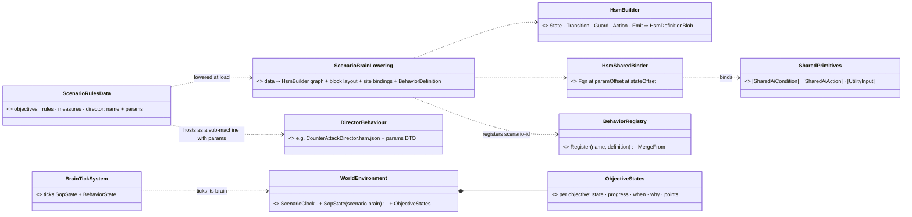
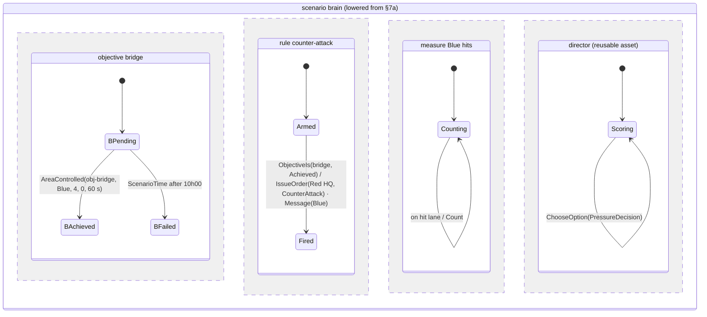
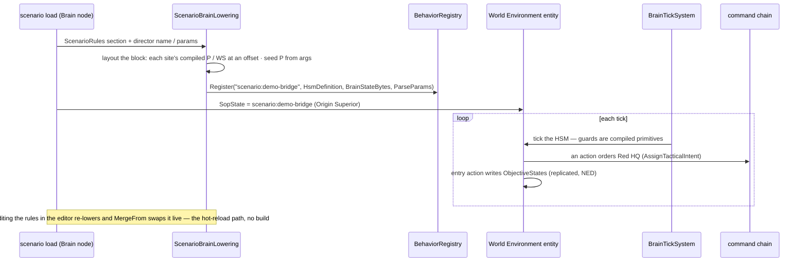
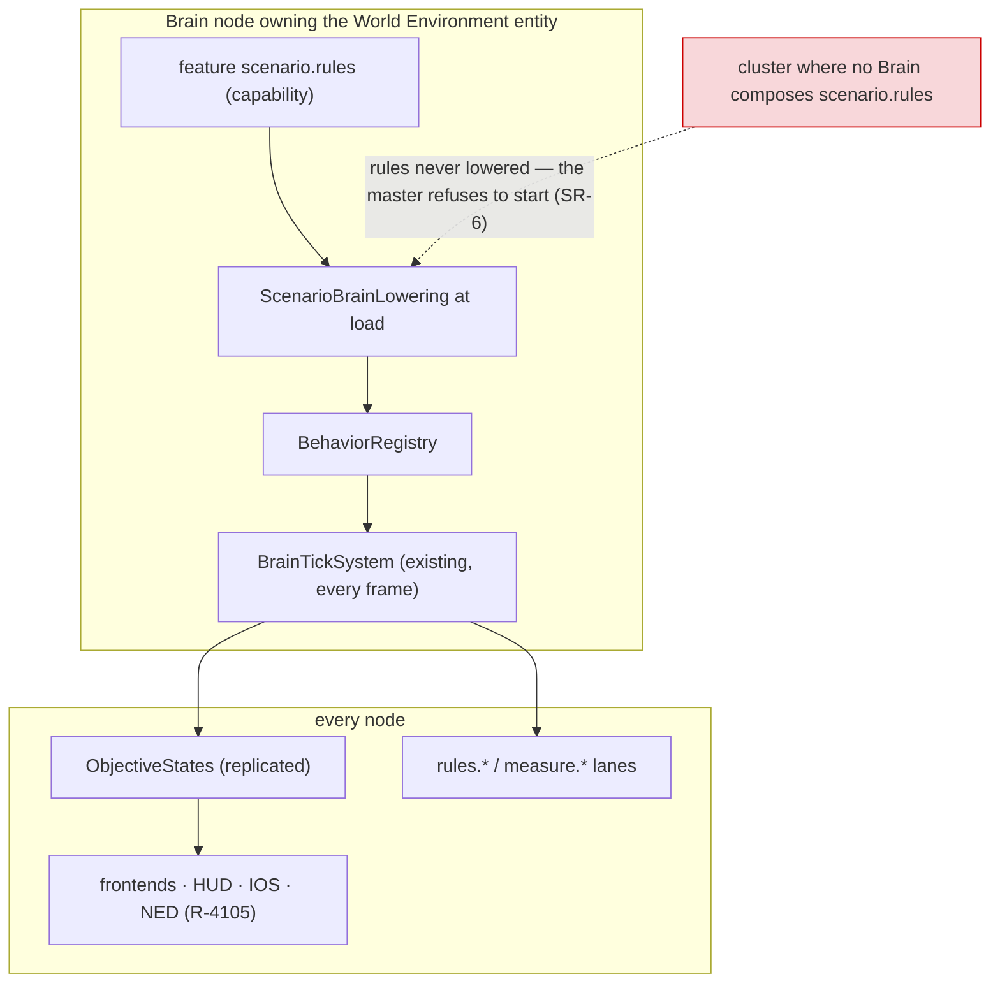

<!--STATUS
state: LIVE
build-state: DESIGN — rev 3a (2026-10-31: SR-15 lowers to a generated .hsm.json + the existing compile / hot-reload path) · rev 3 (2026-10-31): scenario control is a BEHAVIOUR on the World Environment entity's brain, built from data at load by the
  existing HSM / BTree runtime — no rules interpreter (R-4109…R-4111); evaluation (P-4) and the utility director ride the same brain
updated: 2026-10-31 (rev 3 — coordinator)
current-answer: §0b the user's rev-3 ruling · §2 claim table · §3 diagrams · §4 decisions SR-1…SR-20 · §5 what is missing · §6 slices · §7 examples
stale-below: §⛔ HISTORY (rev 2's ScenarioRulesSystem / RuleSet interpreter — superseded by rev 3)
known-rot: none
known-conflict: none
related-designs:
  - docs/PLAN_Training_And_Gameplay_Engine.md — P-1 (the user's top item), P-4 evaluation, P-5 amplifier; R-4105 (data over NED), R-4108 (every element a feature)
  - docs/blueprints/DESIGN_Behavior_Action_Binding.md — §5.7 OWNS HsmSharedBinder (CE-3163): a shared C# method bound to a params / working-state OFFSET of a brain's block — the seam a data-built brain binds through
  - docs/DESIGN_Decision_Layer.md — §3 OWNS utility hosting in BTree / HSM / Blueprint (ChooseOption, IsOption) the director decision uses
  - docs/OVERVIEW_Behaviour_Building_Blocks.md — the map: §3 utility decisions + inputs, §9 orders, the command chain the director orders through
  - docs/designs/group-maneuvers/DESIGN_Command_Chain_Example.md — §3 / §8 OWN orders down + reports up (SetReporting, PIR / FFIR, the picture) the director and the measures use
  - docs/designs/fluent-btree/DESIGN.md — records that trees were once JSON compiled at startup by TreeCompiler.CompileFromJson (the runtime path this design revives for data-built brains)
  - docs/DESIGN_Orders_Params_Entity_Classes.md — params DTOs (R-3002: defaults are C# initializers) a reusable director behaviour declares
  - docs/Predicate-Infrastructure-Capabilities.md — OWNS the data predicate (SearchPredicateDto, R-4077) — one of the condition strategies
  - docs/DESIGN_Scenario_Regression.md — §3 OWNS the checks grammar the rules JSON shares
  - docs/DESIGN_Director_Timeline_Editor.md — §9c–§9e OWN the registered timeline lanes; measures and outcomes become lanes
  - docs/designs/weather/DESIGN_Weather_And_Time.md — W-0 / C-3 OWN the World Environment entity (8810) and ScenarioClock
  - docs/DESIGN_Node_Features.md — every element is a feature (R-4108)
  - docs/DESIGN_Player_Join.md — spawn areas (D-11) and score (D-15) the actions reuse
-->

# DESIGN — **scenario rules** *(objectives, triggers, end of exercise, the director, evaluation — for training and for games)*

> 🔒 **User, `2026-10-31`:** *"The point number one seems to have the most value for me."* — P-1: objectives, end conditions, triggers at
> SCENARIO scope (training: *"secure the bridge by 10:00"*, phase lines, evaluation; game: capture points, time limit, tickets, win / lose).

## 0. ✅ The user's answers, rev 2 (`2026-10-31`)

> 🔒 *"blueprint is just one way of creating some decision logic … authorable also using C# hard-coded methods … best if the rules are data … a
> reusable condition that we can use also in the B3s and HSM guards"* · *"we should have one [evaluator]"* · pause at the end = a switchable
> feature · *"broadcast the event that the mission has finished … not our task to build a nice UI"* · *"define what station is the IOS"* ·
> *"Conditions as names registered. The user never writes expressions"* · *"visibleTo attribute can for sure be added."*

## 0b. ✅ The user's ruling, rev 3 (`2026-10-31`) — **build the brain from data; invent nothing that exists**

> 🔒 *"HSMs and B3s, they are just data as well. They do not need to be compiled. What needs to be compiled is just conditions … they should be
> generic, reusable … we can freely generate the HSM or B3 behaviors for the scenario brain on the fly, basically without recompiling."* ·
> *"What I want to avoid is to create some interpreter of scenario rules if there are already so many different means of how to express these in
> the current engine … avoid developing another type of brain, specifically for scenario control … only if really necessary."* ·
> *"logic like counter attack director can be authored, but it needs to be reusable … usable in multiple exercises in different conditions and
> have enough parameters."* · *"we already created a lot of debugging and monitoring mechanisms. So we should not add one more."* ·
> *"the data basically means that we are building the brain of the entity from the data, procedurally, on the fly, not by hard-coding new
> behaviors. Pretty much the same applies to the performance evaluator. I would rather extend the authoring possibilities of the existing
> features than start inventing something really new."*

**The idea in one line:** the scenario's rules, objectives and measures are DATA that is lowered, at load, into an ordinary **HSM** (or BTree)
— built by the existing runtime builder, with guards and actions that are the existing compiled **shared primitives** — and registered as the
**World Environment entity's brain**; so it runs, hot-swaps, journals and debugs exactly like every unit's brain.

## 1. INVENTORY *(`2026-10-31`; queries named)*

`search_graph` Class `.*(Hsm|BTree|Bt|Fbt|Tree)(Json|Runtime|Loader|Builder|Compiler|Interpreter|Blob|Asset).*` (29 hits) ·
`.*Utility.*` (80, paginated past tests) · `.*(BehaviorRegistry|BehaviorCatalog|HsmRegistry|…).*` · `.*(Measure|Evaluation|Debrief|Score).*`
(no evaluation code — EQS scoring and the measuring gizmo only) · grep for every `[SharedAiCondition]` / `[SharedAiAction]` / `[UtilityInput]`
name. ⚠ `check_index_coverage` is not available through the CLI — absence claims below are graph + grep, coverage unchecked.

| what exists | where | for scenario control |
|---|---|---|
| ⭐ **an HSM built at RUNTIME** — `HsmBuilder` → `StateMachineGraph.Build` → normalise / flatten → `HsmEmitter.Emit` → `HsmDefinitionBlob` | `Fhsm.Compiler/HsmBuilder.cs:14`, `Graph/StateMachineGraph.cs:93`; used at runtime by `Fdp.Examples.UrbanCombat/Brains/ApcHsmSetup.cs` | ⭐ the lowering target — no Roslyn, no dll |
| ⭐ **a BTree compiled from JSON at RUNTIME** — `TreeCompiler.CompileFromJson` → `BehaviorTreeBlob` | `Fbt.Kernel/Serialization/TreeCompiler.cs:12`; fluent-btree DESIGN :26 (*"compiled at startup"*) | ⭐ the BTree alternative |
| ⭐ **a behaviour registered at RUNTIME by name** — `BehaviorRegistry.Register(name, BehaviorDefinition)`; the definition carries `HsmDefinition` / `BTreeInterpreter`, `BrainStateBytes`, `ParseParams`, `BakeDefaults`, `JsonParamsDtoType`; hot-reload `MergeFrom` | `Fdp.Toolkits/Behavior/BehaviorRegistry.cs:147-343, :414` | ⭐ the data-built brain is just another registration |
| ⭐⭐ **a compiled shared method bound to a FIELD OFFSET at runtime** — `HsmSharedBinder.RegisterCondition / RegisterAction / RegisterStateful*` (key `Fqn@paramOffset[@stateOffset]`, a managed delegate whose closure carries the offsets); `RegisterDeactivator(…, nint paramOffset, nint stateOffset)` already takes raw offsets; BTree twin `SharedNodeBinder` | `Fdp.Toolkits/Behavior/HsmSharedBinder.cs:30-132`; `HsmActionDispatcher` managed tables (CE-3163) | ⭐⭐ **the seam**: a data-built brain lays out its block from the primitives' compiled `P` / `WS` types and binds each site at its offset — only a by-offset overload is missing (today's public overloads take a selector) |
| a brain ticks on ANY entity with `SopState` + owned `BehaviorState`; movement / weapon / interaction channels optional | `BrainTickSystem.cs:224, :296-298` | ⭐ the World Environment entity can carry a brain |
| params from the scenario: entity JSON `"Sop": {"Name","Params","Origin"}`; `SopState.JsonParams` | scenario files; `SopState.cs:18` | ⭐ the director's params live in the scenario, like any unit's |
| shared conditions: 104 `[SharedAiCondition]` (e.g. `ElementReported`, `Secured`, `HeldLongEnough`, `AreaQuiet`, `MoreObjectives`) — ALL self-relative (a unit's / commander's view) | `Fbt.Kernel/SharedAiAttributes.cs:14`; `Squad/Command/PictureConditions.cs:181` | reused inside quantifiers; ⛔ none is scenario-scoped |
| shared actions incl. `Action_IssueTacticalIntent`, `OrderSubordinate`, `SetSubordinateReporting`, `SendReport`, `Action_IncrementCounter`, `ChooseOption` / `ChooseOptionOnce` | grep `[SharedAiAction]` | ⭐ the director orders through these |
| utility: `UtilityDecisionBuilder` (runtime), `UtilityScorer.Evaluate(repo, self, def, context…)`, `UtilityInputCtx {Repo, Self, Context, Params}`, 59 `[UtilityInput]` (e.g. `EnemyStrengthRatio`, `SquadStrengthRatio`, `UnderFire`), `UtilityDecisionLog` | `Utility/Core/UtilityDecisionBuilderInfra.cs:219`; `UtilityScorer.cs:15` | ⭐ the adaptive director's choice; ⛔ no scenario-scope input |
| `CommanderUtilityTickSystem` (manoeuvre selection) — built, **no production caller** | OVERVIEW §6 DEAD box | precedent that utility works above unit level; ⛔ not a host |
| command chain: orders down (`AssignTacticalIntentEvent`), reporting demands (`SetReportingEvent` PIR / FFIR / SITREP, `ReportingRequirementsSystem.cs:38`), reports up (`SquadReportNotification`, `ReportInbox`) | Command Chain Example §3, §8 | ⭐ directing goes DOWN this chain; reports are measured |
| debugging that exists: HSM / BTree runtime inspector + overlay, `BrainJournal` (always on, recorded), `UtilityDecisionLog`, the Brain view | `HsmRuntimeInspectorPane`, `BTreeRuntimeOverlayRenderer`, OVERVIEW :480-484 | ⭐ inherited, nothing new |
| timeline lanes as data (`IndexedLaneDefinition`): shot, hit, blast, state lanes | Timeline §9c-§9e | ⭐ measures read and write lanes |
| the World Environment entity (TKB 8810: scenario-level, Brain-owned) with `ScenarioClock`, `WeatherConditions` | `TkbEntityTypes.cs:120`; Weather W-0 / C-3 | ⭐ the host entity |

## 2. Claim table

| the design rests on | code — how it IS | design — how it was MEANT to be |
|---|---|---|
| an HSM can be built and run without compiling | ✅ `StateMachineGraph.cs:93`, `ApcHsmSetup.cs` (registered, ticked by `BrainTickSystem`) | ✅ fluent-btree DESIGN :26 (runtime JSON was the first path) |
| a compiled primitive binds at a runtime-chosen offset | ✅ `HsmSharedBinder.cs:98-132` (offsets are `nint`) | ✅ Behavior Action Binding §5.7 |
| a brain may run on a non-unit entity | ✅ `BrainTickSystem.cs:224, :296` | ⛔ searched, no design names a world-entity brain — this one does |
| the director can act only through orders | ✅ `Action_IssueTacticalIntent`, `SetSubordinateReporting` exist | ✅ Command Chain Example §3 |
| the existing inspectors show a data-built brain | ⛔ **not measured** — the HSM inspector reads `HsmMetadata` / the asset's layout; a data-built brain must supply both (S1 acceptance) | ⛔ not searched |
| an evaluation can be re-run on a recording | ⛔ **not measured** — brains do not tick in replay; see SR-19 | ⛔ open |

## 3. Diagrams



*What the picture shows that prose hid:* ONE new class does real work — the generic loader — and it produces only things the engine already
runs; there is no rules system, no rules tick, no second inspector. The objective state is the HSM's own state, mirrored into one replicated
component so frontends and NED read it without knowing it came from a brain.



*Caption:* each objective, rule, measure and the director is one **parallel region** of an ordinary HSM: an objective is a region whose states
ARE its state; a rule is `Armed → Fired` (or a self-loop when it repeats); a measure is a region whose activity is a stateful primitive (its
working state is the counter); the director is a reusable sub-machine. Entry actions publish into `ObjectiveStates`. ⇒ the HSM inspector draws
it, `BrainJournal` records every transition with its cause.





*Caption:* who calls it each frame is the EXISTING brain tick — the loader runs once per load / edit. The red edge is the silent-dead case: a
cluster whose Brain lacks the feature would load a scenario with no objectives, so the master refuses.

## 4. Decisions (⭐ leans for the user)

| # | decision | ⭐ lean |
|---|---|---|
| **SR-1** | what a rule is | **When** a condition becomes true (optionally within a window) **Do** actions; once or repeat — authored as data (§7a), LOWERED to an HSM region (rev 3) |
| **SR-2** | the condition | a NAMED primitive the author parameterises, never an expression — implemented once as a `[SharedAiCondition]` C# method, a data predicate (R-4077) or a Blueprint hosted as a guard; the same primitive is a BTree condition, an HSM guard, a film cue, a check |
| **SR-3** | scenario-scope primitives | §5 lists them; per-unit ones are reused through a generic quantifier `ForUnits(filter, any / all / atLeast n, condition)` |
| **SR-4 / SR-14** | objectives | first-class records (id · side · title · brief · required / optional · `visibleTo` · success · fail · time limit · points · state · progress · when · why); lowered to a region; mirrored into `ObjectiveStates` |
| **SR-5** | actions | existing shared actions first (`Action_IssueTacticalIntent`, `OrderSubordinate`, `SetSubordinateReporting`, mission commands); new: `Message`, `SpawnGroup`, `AwardPoints`, `EndExercise`, `SetSkillAmplifier` |
| **SR-6** | where it runs | ⭐ rev 3: the **brain of the World Environment entity** on the Brain node that owns it, ticked by the existing `BrainTickSystem`; the feature `scenario.rules` composes the loader; a scenario with rules and no node advertising it ⇒ the master refuses to start |
| **SR-8** | the output | replicated `ObjectiveStates` (NED fact) + lanes `rules.objective`, `rules.outcome`, `measure.*` |
| **SR-9** | the end | `EndExercise` broadcasts **`ExerciseEnded`** with the full result (§7c); pause = feature `scenario.rules.pause-on-end` (lean ON); never an automatic unload; UI only a debug panel `ui.rules-debug-panel` that never pops up |
| **SR-10** | authoring | data in the scenario (the editor's rules section; JSON shaped like `checks.json`); ⭐ rev 3: the lowered HSM opens READ-ONLY in the existing HSM editor view, so the author sees exactly what runs |
| **SR-11** | ONE evaluator | ⭐ rev 3: the evaluator IS the brain runtime — rules, objectives, mission objectives and measures are all guards of a brain; film cues and checks call the same primitives |
| **SR-12** | custom logic | a new condition / action = a shared C# method in `Hrot.AI.Behaviors` or a Blueprint; ⛔ rev 2's world-singleton Blueprint host is dropped (the brain is the host) |
| **SR-13** | the IOS | a composition choice; the server's full UI by default (R-4107) |
| ⭐ **SR-15** | **no interpreter** (R-4109) — ⭐ **rev 3a (`2026-10-31`, user: *"having .NET SDK on the server is no issue at all … why not to use it?"*): the LOWERING TARGET flips to the existing compile path** | the loader turns the rules data into a generated **`.hsm.json` asset** (the editor's own HSM format) and the EXISTING pipeline does the rest: `HsmJsonGenerator` (layout, params `ParseParams`, site seeding, HSM0003 type checks, inspector metadata) → build `Hrot.AI.Behaviors` → `AiHotReloadCoordinator` swaps it. ⭐ More reuse than a runtime builder: the generator is the PRODUCTION path (the runtime `HsmBuilder` is used only by examples), the asset opens EDITABLE in the HSM editor, and S0's inspector question disappears. ⛔ The real costs are not the SDK — S0 measures them: ① the rebuild time at load · ② every node that may own the brain needs the same dll (today the rebuild is per process: `AiBehaviorsRebuild` in the editor; CGF wires the coordinator but no watcher — CE-023) · ③ a recording must replay with the brain it was recorded with (the generated asset is saved with the scenario). The runtime-builder route (SR-16's offset layout) stays the fallback ONLY if ① or ② fails, never both |
| ⭐ **SR-16** | **params and working state without compiling** | each primitive's `P` and `WS` are compiled WITH the primitive; the loader lays the brain's block out as their concatenation (each at its offset) and seeds every site's `P` from its JSON args (System.Text.Json into the compiled type). The scenario-level state (objective state) is HSM state, needing no struct; counters live in generic stateful primitives' `WS`. ⇒ no per-scenario DTO, no per-scenario struct |
| ⭐ **SR-17** | **reusable directors** (R-4110) | a director (counter-attack, reinforcement, pressure) is an authored HSM / BTree **asset** with a params DTO (R-3002 initializers), usable in any exercise; the scenario names it + params; the loader hosts it as a sub-machine of the scenario brain (the existing hosted-HSM path). ⛔ never logic for one exercise |
| ⭐ **SR-18** | **the utility director** | a director asset may hold a utility decision (`ChooseOption` / `IsOption`, DESIGN_Decision_Layer §3) over plays (*Counter-attack · Reinforce · Hold · Ease off*), with `self` = the World Environment entity and `Context` = a candidate (objective, spawn area, side HQ); inputs are scenario-scope `[UtilityInput]`s (§5); the winner is executed as an ORDER down the chain; `UtilityDecisionLog` explains it |
| ⭐ **SR-19** | **performance evaluation (P-4) on the same brain** (R-4111) | a measure = a named stateful primitive (`Count`, `Duration`, `Latency`, `Ratio` over events / lanes / conditions) with a **subject** (scenario · side · team = a command-chain node · trainee = a station / unit); lowered as regions of the same brain; results into `ObjectiveStates`' sibling `Measures` and `measure.*` lanes; live feedback to trainee / instructor as NED facts. ⛔ open: re-evaluating NEW measures on an OLD recording — brains do not tick in replay; lean: an evaluation-only replay mode that ticks only the scenario brain (it writes only its own entity) — measure before designing |
| ⭐ **SR-20** | **facts** | ⛔ no fourth registry. ⭐ The existing registries are adapted: a generic condition `InputAbove(input, threshold)` makes every `[UtilityInput]` a condition; a generic measure `Sample(input)` makes it a measure; a condition is a 0 / 1 input. ⇒ a quantity written once as a `[UtilityInput]` is usable as a condition, a utility input and a measure |

**Rejected — one line each:**
- *A rules interpreter (rev 2's `ScenarioRulesSystem`)* — a second brain runtime beside HSM / BTree with its own debugging (R-4109).
- ⛔ ~~*One generated `.hsm.json` + Roslyn build per scenario*~~ — **withdrawn rev 3a**: the SDK is not a blocker (user) and it is the most-reused path; now SR-15's lean.
- *A world-singleton Blueprint as the scenario host* — the brain already hosts Blueprints as guards / actions; a second host duplicates it.
- *A per-scenario params / working-state struct* — the primitives' compiled `P` / `WS` concatenated cover it (SR-16).
- *Directing by moving units* — duplicates the order chain; the director orders.
- *A separate evaluation engine* — measures are primitives in the same brain.
- *A new "fact registry"* — `[UtilityInput]` + two generic adapters cover it (SR-20).

## 5. What is missing — **as registered primitives** *(everything else exists)*

| kind | missing (scenario scope) | ⭐ note |
|---|---|---|
| conditions | `AreaControlled(area, side, minUnits, maxEnemy, forSeconds)` · `UnitsDestroyed(filter, count)` · `CiviliansHarmed(bySide, atLeast)` · `ScenarioTime(after / before)` · `ObjectiveIs(id, state)` · `AllObjectives(side, required, state)` · `ReportReceived(commander, kind, within)` · `InputAbove(input, threshold)` · `ForUnits(filter, quantifier, condition)` | `EnemyInArea` exists but is PRIVATE to `SquadDefendBehavior` and self-relative; EQS `EntitiesOfForceInArea` is the query `AreaControlled` reuses; `ElementReported` is the commander-relative base of `ReportReceived` |
| actions | `Message(to, text)` · `SpawnGroup(group, area)` · `AwardPoints(side, n)` · `EndExercise(outcome)` · `SetSkillAmplifier(side, tiers)` · `PublishObjective(id, state)` (entry action) | orders, reporting demands, mission commands EXIST |
| utility inputs | `SideStrengthRatio(side, vs)` · `ObjectiveProgress(id)` · `ScenarioTimeRemaining` · `MeasureValue(measure)` | squad-level strength ratios exist (`SquadStrengthRatio`, `EnemyStrengthRatio`) |
| measures | `Count(event / lane, subject)` · `Duration(condition, subject)` · `Latency(trigger → response, subject)` · `Ratio(a, b)` · `Sample(input)` | shot / hit / blast lanes exist; report notifications exist |
| infrastructure | `ScenarioBrainLowering` · a by-offset overload on `HsmSharedBinder` / `SharedNodeBinder` · `ObjectiveStates` (+ `Measures`) component · `ExerciseEnded` · the inspector fed with the lowered brain's metadata | ⛔ nothing else |

## 6. Slices

| slice | builds | done when |
|---|---|---|
| **S0 (measure)** | ① rebuild-and-swap time of `Hrot.AI.Behaviors` with one generated asset · ② how a rebuilt dll reaches the other nodes that may own the brain · ③ a brain ticks on 8810 | three numbers / answers — they decide SR-15 (compile path) vs the runtime-builder fallback |
| **S1** | lowering of objectives + rules; conditions `AreaControlled`, `UnitsDestroyed`, `ScenarioTime`, `ObjectiveIs`, `AllObjectives`, `ForUnits`; actions `Message`, `PublishObjective`, `AwardPoints`, `EndExercise`; `ObjectiveStates`; `ExerciseEnded`; lanes | §7a plays to Blue won on a live cluster, shown in the HSM inspector; editing a rule swaps live |
| **S2** | `SpawnGroup`, orders down the chain, a reusable `CounterAttackDirector` asset with params, the utility director, the editor's rules section | the same director runs in two scenarios with different params |
| **S3** | measures + subjects (P-4), `ReportReceived`, `InputAbove` / `Sample`; SR-19's replay question answered | per-trainee and per-team results in `ExerciseEnded` |

## 7. Examples *(illustrative names)*

### 7a. Authored (`scenario.json`, the World Environment entity's section)

```json
"ScenarioRules": {
  "objectives": [
    { "id": "bridge", "side": "Blue", "title": "Secure the bridge by 10:00", "required": true, "visibleTo": ["Blue"], "points": 100,
      "success": { "cond": "AreaControlled", "args": { "area": "obj-bridge", "side": "Blue", "minUnits": 4, "maxEnemy": 0, "forSeconds": 60 } },
      "fail":    { "cond": "ScenarioTime",   "args": { "after": "10:00" } } },
    { "id": "no-civilians", "side": "Blue", "kind": "constraint", "points": -50,
      "fail": { "cond": "CiviliansHarmed", "args": { "by": "Blue", "atLeast": 1 } } }
  ],
  "rules": [
    { "id": "end", "once": true,
      "when": { "any": [ { "cond": "AllObjectives", "args": { "side": "Blue", "required": true, "is": "Achieved" } },
                         { "cond": "ScenarioTime",  "args": { "after": "10:30" } } ] },
      "do": [ { "act": "EndExercise", "args": { "outcome": "byObjectives" } } ] }
  ],
  "measures": [
    { "id": "blue-hit-rate", "subject": { "side": "Blue", "per": "trainee" }, "kind": "Ratio", "args": { "a": "lane:hit", "b": "lane:shot" } },
    { "id": "contact-report", "subject": { "team": "Blue HQ" }, "kind": "Latency", "args": { "from": "FirstSeenBy(Blue, Red)", "to": "ReportReceived(Blue HQ, Contact)" } }
  ],
  "director": { "name": "CounterAttackDirector",
                "params": { "attacker": "Red HQ", "trigger": "bridge", "waveArea": "red-spawn-east", "maxWaves": 2, "pressure": "adaptive" } }
}
```

### 7b. What it becomes — the lowered brain *(the §3 state diagram)*

`scenario:<id>` registered in `BehaviorRegistry`; one region per objective / rule / measure; the director a hosted sub-machine with its params;
every guard and action a compiled primitive at an offset; `SopState` on 8810 names it. ⇒ no file is written, nothing is compiled.

### 7c. `ExerciseEnded` (the NED fact, R-4105)

```json
{ "outcome": { "Blue": "Won", "Red": "Lost" }, "endedAt": "10:12:31", "reason": "rule end: all required Blue objectives achieved",
  "objectives": [ { "id": "bridge", "state": "Achieved", "at": "09:42:10", "points": 100, "details": "held 60 s, 5 Blue / 0 Red" },
                  { "id": "no-civilians", "state": "Failed", "at": "09:55:02", "points": -50, "details": "civilian 1043 wounded by Blue Rifleman 2" } ],
  "measures": [ { "id": "blue-hit-rate", "by": { "Rifleman 1": 0.31, "Rifleman 2": 0.18 }, "side": 0.24 },
                { "id": "contact-report", "team": "Blue HQ", "seconds": 47 } ],
  "points": { "Blue": 50 } }
```

## ⛔ HISTORY — rev 2 (superseded `2026-10-31` by rev 3, R-4109)

Rev 2 proposed a `ScenarioRulesCapability` registering a `ScenarioRulesSystem` that each tick evaluated a `RuleSet` component's predicates,
ran `RuleAction` classes and wrote a `RuleState` component; a world-singleton Blueprint (`RegisterWorldSingleton`, no production caller) as the
host for custom logic; S3 moving the regression checks onto that evaluator. ⛔ Superseded: that is a second brain runtime with its own tick,
state and (missing) debugging. The objectives record (SR-14), the `ExerciseEnded` payload, the features and the IOS ruling carry over.
