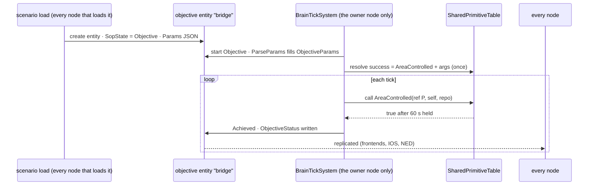
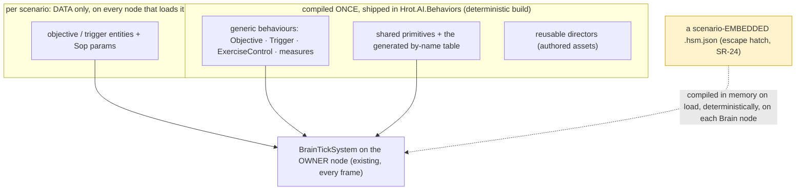
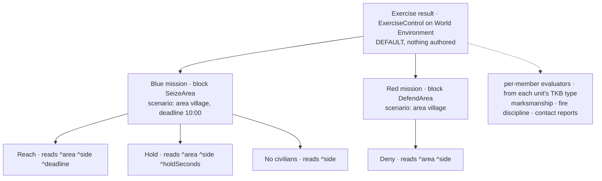
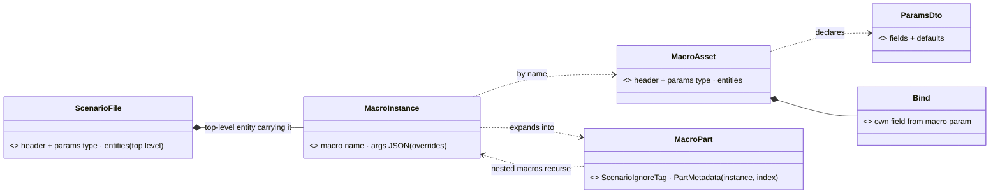
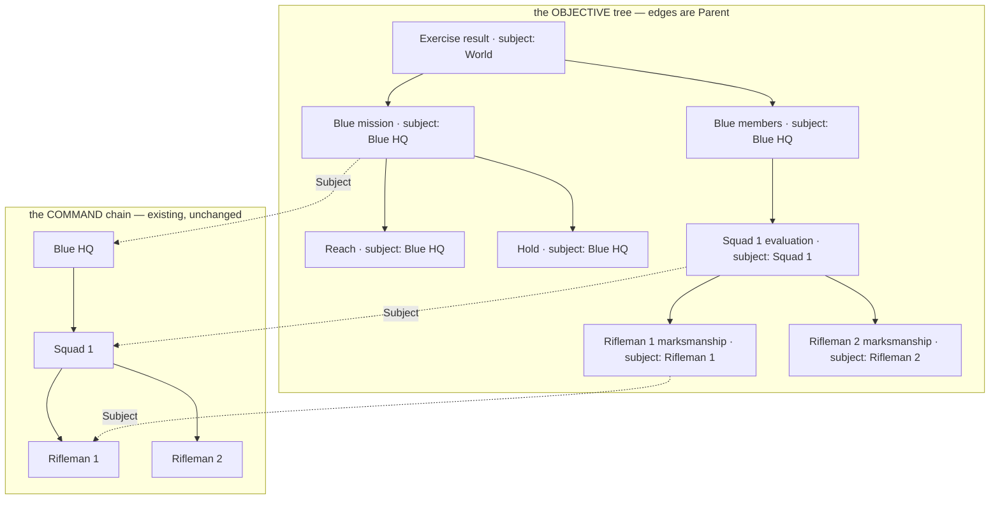

<!--STATUS
state: LIVE
build-state: DESIGN — rev 4 (2026-10-31: objectives / rules = entities running GENERIC behaviours with params, conditions by reference — no per-scenario compile, R-4112) · rev 3b (2026-10-31: S0 ①② measured; SR-16 the generated block; SR-19 no re-evaluation) · rev 3a (2026-10-31: SR-15 lowers to a generated .hsm.json + the existing compile / hot-reload path) · rev 3 (2026-10-31): scenario control is a BEHAVIOUR on the World Environment entity's brain, built from data at load by the
  existing HSM / BTree runtime — no rules interpreter (R-4109…R-4111); evaluation (P-4) and the utility director ride the same brain
updated: 2026-10-31 (rev 3 — coordinator)
current-answer: §9 scenario MACROS (rev 6 draft — the general mechanism) · §8 templates + blocks (rev 5 draft, leans await the user) · §0c the rev-4 ruling · §0b the user's rev-3 ruling · §2 claim table · §3 diagrams · §4 decisions SR-1…SR-20 · §5 what is missing · §6 slices · §7 examples
stale-below: §⛔ HISTORY (rev 3's one-generated-HSM-per-scenario; rev 2's ScenarioRulesSystem / RuleSet interpreter — superseded by rev 3)
known-rot: ⛔ §3, §4 (SR-21 / SR-26 / SR-33), §7b and §8 write the evaluator into the SOP slot (`Sop` / `SopState`) — WRONG, SR-51: it is the TASK slot (`Behavior`)
known-conflict: none
related-designs:
  - docs/PLAN_Training_And_Gameplay_Engine.md — P-1 (the user's top item), P-4 evaluation, P-5 amplifier; R-4105 (data over NED), R-4108 (every element a feature)
  - docs/blueprints/DESIGN_Behavior_Action_Binding.md — §5.7 OWNS HsmSharedBinder (CE-3163): a shared C# method bound to a params / working-state OFFSET of a brain's block — the seam a data-built brain binds through
  - docs/DESIGN_Decision_Layer.md — §3 OWNS utility hosting in BTree / HSM / Blueprint (ChooseOption, IsOption) the director decision uses
  - docs/OVERVIEW_Behaviour_Building_Blocks.md — the map: §3 utility decisions + inputs, §9 orders, the command chain the director orders through
  - docs/designs/group-maneuvers/DESIGN_Command_Chain_Example.md — §3 / §8 OWN orders down + reports up (SetReporting, PIR / FFIR, the picture) the director and the measures use
  - docs/designs/fluent-btree/DESIGN.md — records that trees were once JSON compiled at startup by TreeCompiler.CompileFromJson (the runtime path this design revives for data-built brains)
  - docs/DESIGN_Orders_Params_Entity_Classes.md — params DTOs (R-3002: defaults are C# initializers) a reusable director behaviour declares
  - docs/Predicate-Infrastructure-Capabilities.md — OWNS the data predicate (SearchPredicateDto, R-4077) — one of the condition strategies
  - docs/DESIGN_Scenario_Regression.md — §3 OWNS the checks grammar the rules JSON shares
  - docs/DESIGN_Director_Timeline_Editor.md — §9c–§9e OWN the registered timeline lanes; measures and outcomes become lanes
  - docs/designs/weather/DESIGN_Weather_And_Time.md — W-0 / C-3 OWN the World Environment entity (8810) and ScenarioClock
  - docs/DESIGN_Node_Features.md — every element is a feature (R-4108)
  - docs/DESIGN_Player_Join.md — spawn areas (D-11) and score (D-15) the actions reuse
  - docs/blueprints/Architect_Question_79_One_Ownership_Truth.md — §0.10 OWNS PartMetadata (the multi-instance part); §9.3 explains why macro entities are NOT parts
  - docs/DESIGN_Node_Roles_And_Policies.md — §7.3 OWNS IsTransient → ScenarioIgnoreTag (R-140) that macro entities reuse
  - docs/DESIGN_Deterministic_Network_Ids.md — §11b OWNS network id allocation and the per-load re-allocation SR-45 / SR-50 rely on
  - docs/DESIGN_Scenario_Entity_Keys.md — CE-4153: the scenario entity key becomes the network id (SR-50)
  - docs/DESIGN_Content_Layout.md — §2 OWNS the content folders (scenarios/, recipes/scenarios/) a macros/ folder joins (SR-38)
  - docs/designs/mgmt-1/DESIGN.md — §10 Stories (per-trainee micro-exercises, evaluation filtered by story; unbuilt) — one more evaluation scope
  - docs/DESIGN_Sensors_And_Doctrine.md — §4 / §5.1 OWN the per-TKB-type deterministic child entities (SensorChildFactory) that §8 reuses for blocks and per-member evaluators
-->

# DESIGN — **scenario rules** *(objectives, triggers, end of exercise, the director, evaluation — for training and for games)*

> 🔒 **User, `2026-10-31`:** *"The point number one seems to have the most value for me."* — P-1: objectives, end conditions, triggers at
> SCENARIO scope (training: *"secure the bridge by 10:00"*, phase lines, evaluation; game: capture points, time limit, tickets, win / lose).

## 0. ✅ The user's answers, rev 2 (`2026-10-31`)

> 🔒 *"blueprint is just one way of creating some decision logic … authorable also using C# hard-coded methods … best if the rules are data … a
> reusable condition that we can use also in the B3s and HSM guards"* · *"we should have one [evaluator]"* · pause at the end = a switchable
> feature · *"broadcast the event that the mission has finished … not our task to build a nice UI"* · *"define what station is the IOS"* ·
> *"Conditions as names registered. The user never writes expressions"* · *"visibleTo attribute can for sure be added."*

## 0b. ✅ The user's ruling, rev 3 (`2026-10-31`) — **build the brain from data; invent nothing that exists**

> 🔒 *"HSMs and B3s, they are just data as well. They do not need to be compiled. What needs to be compiled is just conditions … they should be
> generic, reusable … we can freely generate the HSM or B3 behaviors for the scenario brain on the fly, basically without recompiling."* ·
> *"What I want to avoid is to create some interpreter of scenario rules if there are already so many different means of how to express these in
> the current engine … avoid developing another type of brain, specifically for scenario control … only if really necessary."* ·
> *"logic like counter attack director can be authored, but it needs to be reusable … usable in multiple exercises in different conditions and
> have enough parameters."* · *"we already created a lot of debugging and monitoring mechanisms. So we should not add one more."* ·
> *"the data basically means that we are building the brain of the entity from the data, procedurally, on the fly, not by hard-coding new
> behaviors. Pretty much the same applies to the performance evaluator. I would rather extend the authoring possibilities of the existing
> features than start inventing something really new."*

**The idea in one line:** the scenario's rules, objectives and measures are DATA that is lowered, at load, into an ordinary **HSM** (or BTree)
— built by the existing runtime builder, with guards and actions that are the existing compiled **shared primitives** — and registered as the
**World Environment entity's brain**; so it runs, hot-swaps, journals and debugs exactly like every unit's brain.

## 0c. ✅ The user's ruling, rev 4 (`2026-10-31`) — **generic rules, composed by parameters; nothing compiles per scenario**

> 🔒 *"What I would like to achieve is that the rules are generic enough and we just parameterize them using values and compose the mission
> objective from those existing rules … So the scenario doesn't really need to recompile any HSM just because it is using already existing
> rules composed in and parameterized in different ways."* · *"I would like to minimize the need of rebuilding anything per scenario unless
> there is an unavoidable need for that. And if there is, it should be deterministic so that it can be done by any brain node."* ·
> *"maybe it's not necessary at all because the scenarios are distributed to all nodes that need them. So all the nodes can recompile
> whatever is in the scenario."*

⭐ ⇒ SR-21…SR-24: objectives and rules are entities running GENERIC compiled behaviours, parameterised; conditions and actions are referenced
by name in the params; only a scenario that embeds its own HSM compiles, in memory and deterministically, on each Brain node.

## 1. INVENTORY *(`2026-10-31`; queries named)*

`search_graph` Class `.*(Hsm|BTree|Bt|Fbt|Tree)(Json|Runtime|Loader|Builder|Compiler|Interpreter|Blob|Asset).*` (29 hits) ·
`.*Utility.*` (80, paginated past tests) · `.*(BehaviorRegistry|BehaviorCatalog|HsmRegistry|…).*` · `.*(Measure|Evaluation|Debrief|Score).*`
(no evaluation code — EQS scoring and the measuring gizmo only) · grep for every `[SharedAiCondition]` / `[SharedAiAction]` / `[UtilityInput]`
name. ⚠ `check_index_coverage` is not available through the CLI — absence claims below are graph + grep, coverage unchecked.

| what exists | where | for scenario control |
|---|---|---|
| ⭐ **an HSM built at RUNTIME** — `HsmBuilder` → `StateMachineGraph.Build` → normalise / flatten → `HsmEmitter.Emit` → `HsmDefinitionBlob` | `Fhsm.Compiler/HsmBuilder.cs:14`, `Graph/StateMachineGraph.cs:93`; used at runtime by `Fdp.Examples.UrbanCombat/Brains/ApcHsmSetup.cs` | ⭐ the lowering target — no Roslyn, no dll |
| ⭐ **a BTree compiled from JSON at RUNTIME** — `TreeCompiler.CompileFromJson` → `BehaviorTreeBlob` | `Fbt.Kernel/Serialization/TreeCompiler.cs:12`; fluent-btree DESIGN :26 (*"compiled at startup"*) | ⭐ the BTree alternative |
| ⭐ **a behaviour registered at RUNTIME by name** — `BehaviorRegistry.Register(name, BehaviorDefinition)`; the definition carries `HsmDefinition` / `BTreeInterpreter`, `BrainStateBytes`, `ParseParams`, `BakeDefaults`, `JsonParamsDtoType`; hot-reload `MergeFrom` | `Fdp.Toolkits/Behavior/BehaviorRegistry.cs:147-343, :414` | ⭐ the data-built brain is just another registration |
| ⭐⭐ **a compiled shared method bound to a FIELD OFFSET at runtime** — `HsmSharedBinder.RegisterCondition / RegisterAction / RegisterStateful*` (key `Fqn@paramOffset[@stateOffset]`, a managed delegate whose closure carries the offsets); `RegisterDeactivator(…, nint paramOffset, nint stateOffset)` already takes raw offsets; BTree twin `SharedNodeBinder` | `Fdp.Toolkits/Behavior/HsmSharedBinder.cs:30-132`; `HsmActionDispatcher` managed tables (CE-3163) | ⭐⭐ **the seam**: a data-built brain lays out its block from the primitives' compiled `P` / `WS` types and binds each site at its offset — only a by-offset overload is missing (today's public overloads take a selector) |
| a brain ticks on ANY entity with `SopState` + owned `BehaviorState`; movement / weapon / interaction channels optional | `BrainTickSystem.cs:224, :296-298` | ⭐ the World Environment entity can carry a brain |
| params from the scenario: entity JSON `"Sop": {"Name","Params","Origin"}`; `SopState.JsonParams` | scenario files; `SopState.cs:18` | ⭐ the director's params live in the scenario, like any unit's |
| shared conditions: 104 `[SharedAiCondition]` (e.g. `ElementReported`, `Secured`, `HeldLongEnough`, `AreaQuiet`, `MoreObjectives`) — ALL self-relative (a unit's / commander's view) | `Fbt.Kernel/SharedAiAttributes.cs:14`; `Squad/Command/PictureConditions.cs:181` | reused inside quantifiers; ⛔ none is scenario-scoped |
| shared actions incl. `Action_IssueTacticalIntent`, `OrderSubordinate`, `SetSubordinateReporting`, `SendReport`, `Action_IncrementCounter`, `ChooseOption` / `ChooseOptionOnce` | grep `[SharedAiAction]` | ⭐ the director orders through these |
| utility: `UtilityDecisionBuilder` (runtime), `UtilityScorer.Evaluate(repo, self, def, context…)`, `UtilityInputCtx {Repo, Self, Context, Params}`, 59 `[UtilityInput]` (e.g. `EnemyStrengthRatio`, `SquadStrengthRatio`, `UnderFire`), `UtilityDecisionLog` | `Utility/Core/UtilityDecisionBuilderInfra.cs:219`; `UtilityScorer.cs:15` | ⭐ the adaptive director's choice; ⛔ no scenario-scope input |
| `CommanderUtilityTickSystem` (manoeuvre selection) — built, **no production caller** | OVERVIEW §6 DEAD box | precedent that utility works above unit level; ⛔ not a host |
| command chain: orders down (`AssignTacticalIntentEvent`), reporting demands (`SetReportingEvent` PIR / FFIR / SITREP, `ReportingRequirementsSystem.cs:38`), reports up (`SquadReportNotification`, `ReportInbox`) | Command Chain Example §3, §8 | ⭐ directing goes DOWN this chain; reports are measured |
| debugging that exists: HSM / BTree runtime inspector + overlay, `BrainJournal` (always on, recorded), `UtilityDecisionLog`, the Brain view | `HsmRuntimeInspectorPane`, `BTreeRuntimeOverlayRenderer`, OVERVIEW :480-484 | ⭐ inherited, nothing new |
| timeline lanes as data (`IndexedLaneDefinition`): shot, hit, blast, state lanes | Timeline §9c-§9e | ⭐ measures read and write lanes |
| the World Environment entity (TKB 8810: scenario-level, Brain-owned) with `ScenarioClock`, `WeatherConditions` | `TkbEntityTypes.cs:120`; Weather W-0 / C-3 | ⭐ the host entity |
| ⭐ **a params field that names a compiled thing, resolved at runtime** — `UtilityDecisionRef` (CE-2068: JSON = the asset id, the editor offers a picker, the scorer keys on the id); utility inputs dispatched by id through `UtilityInputReaderStore` | `Utility/Core/UtilityDecisionRef.cs:11`; `UtilityScorer.cs:32` | ⭐ the pattern `ConditionRef` / `ActionRef` copy (SR-22) |
| ⭐ **in-memory compile on the node that needs it** — `InMemoryRoslynCompiler` (Roslyn → PE in a collectible ALC), used by Blueprints' `Stage8_RoslynFinalize` and `QuickReloadService` | `Hrot.Blueprints.Compiler/Compiler/Roslyn/InMemoryRoslynCompiler.cs` | the escape hatch for a scenario-embedded HSM (SR-24) |

## 2. Claim table

| the design rests on | code — how it IS | design — how it was MEANT to be |
|---|---|---|
| an HSM can be built and run without compiling | ✅ `StateMachineGraph.cs:93`, `ApcHsmSetup.cs` (registered, ticked by `BrainTickSystem`) | ✅ fluent-btree DESIGN :26 (runtime JSON was the first path) |
| a compiled primitive binds at a runtime-chosen offset | ✅ `HsmSharedBinder.cs:98-132` (offsets are `nint`) | ✅ Behavior Action Binding §5.7 |
| a brain may run on a non-unit entity | ✅ `BrainTickSystem.cs:224, :296` | ⛔ searched, no design names a world-entity brain — this one does |
| the director can act only through orders | ✅ `Action_IssueTacticalIntent`, `SetSubordinateReporting` exist | ✅ Command Chain Example §3 |
| the existing inspectors show the scenario brain | ✅ `HsmAssetProjector.Project(blob, metadata, …)` turns any compiled blob + `MachineMetadata` into an editor asset (how every C#-authored HSM is shown); generated machines carry `HsmMetadata = blob.Metadata` (CE-370) | ✅ user, `2026-10-31` |
| an evaluation can be re-run on a recording | — not needed (user: a finished run is final, SR-19) | — |

## 3. Diagrams *(rev 4 — objectives and rules are ENTITIES running GENERIC compiled behaviours; nothing is compiled per scenario)*

```mermaid
classDiagram
    direction LR
    class ScenarioFile { <<existing>> entities, each with Sop name + Params }
    class ObjectiveEntity { <<new TKB type, the area-entity pattern>> SopState = Objective · ObjectiveStatus (replicated) }
    class TriggerEntity { <<new TKB type>> SopState = Trigger }
    class WorldEnvironment { <<existing entity 8810>> ScenarioClock · SopState = ExerciseControl }
    class Objective { <<new GENERIC behaviour, shipped once>> Pending · Active · Achieved · Failed }
    class Trigger { <<new GENERIC behaviour>> Armed · Fired · repeat }
    class ExerciseControl { <<new GENERIC behaviour>> end condition · ExerciseEnded · hosts a director }
    class ObjectiveParams { <<params DTO, R-3002>> side · title · required · visibleTo · points · timeLimit · success ConditionRef · fail ConditionRef }
    class ConditionRef { <<new, the UtilityDecisionRef pattern>> name + args JSON · resolved at load }
    class ActionRef { <<new, same pattern>> name + args JSON }
    class SharedPrimitiveTable { <<new, GENERATED with the primitives, in the shipped dll>> name to compiled condition / action + its P type }
    class SharedPrimitives { <<existing + new scenario-scope>> SharedAiCondition · SharedAiAction }
    class DirectorAsset { <<authored REUSABLE HSM / BTree, shipped>> CounterAttackDirector + params }
    ScenarioFile *-- ObjectiveEntity
    ScenarioFile *-- TriggerEntity
    ObjectiveEntity ..> Objective : runs
    TriggerEntity ..> Trigger : runs
    WorldEnvironment ..> ExerciseControl : runs
    Objective ..> ObjectiveParams
    ObjectiveParams *-- ConditionRef
    Trigger ..> ConditionRef : when
    Trigger ..> ActionRef : do
    ConditionRef ..> SharedPrimitiveTable : resolved by name
    ActionRef ..> SharedPrimitiveTable
    SharedPrimitiveTable ..> SharedPrimitives
    ExerciseControl ..> DirectorAsset : hosts by name
```



*What the picture shows that prose hid:* a scenario adds only ENTITIES and PARAMS — the behaviours (`Objective`, `Trigger`,
`ExerciseControl`, directors) and the primitives are compiled once into the shipped dll. The one new seam is the reference-by-name
(`ConditionRef` / `ActionRef`), copied from `UtilityDecisionRef` + `UtilityInputReaderStore`, which already resolve by name at runtime.





*Caption:* every frame the existing brain tick runs the generic behaviours on the owner node; nothing scenario-specific is compiled. The
amber edge is the only per-scenario compile, and only for a scenario that embeds its own HSM.

## 4. Decisions (⭐ leans for the user)

| # | decision | ⭐ lean |
|---|---|---|
| **SR-1** | what a rule is | **When** a condition becomes true (optionally within a window) **Do** actions; once or repeat — authored as data (§7a), LOWERED to an HSM region (rev 3) |
| **SR-2** | the condition | a NAMED primitive the author parameterises, never an expression — implemented once as a `[SharedAiCondition]` C# method, a data predicate (R-4077) or a Blueprint hosted as a guard; the same primitive is a BTree condition, an HSM guard, a film cue, a check |
| **SR-3** | scenario-scope primitives | §5 lists them; per-unit ones are reused through a generic quantifier `ForUnits(filter, any / all / atLeast n, condition)` |
| **SR-4 / SR-14** | objectives | first-class records (id · side · title · brief · required / optional · `visibleTo` · success · fail · time limit · points · state · progress · when · why); lowered to a region; mirrored into `ObjectiveStates` |
| **SR-5** | actions | existing shared actions first (`Action_IssueTacticalIntent`, `OrderSubordinate`, `SetSubordinateReporting`, mission commands); new: `Message`, `SpawnGroup`, `AwardPoints`, `EndExercise`, `SetSkillAmplifier` |
| **SR-6** | where it runs | ⭐ rev 3: the **brain of the World Environment entity** on the Brain node that owns it, ticked by the existing `BrainTickSystem`; the feature `scenario.rules` composes the loader; a scenario with rules and no node advertising it ⇒ the master refuses to start |
| **SR-8** | the output | replicated `ObjectiveStates` (NED fact) + lanes `rules.objective`, `rules.outcome`, `measure.*` |
| **SR-9** | the end | `EndExercise` broadcasts **`ExerciseEnded`** with the full result (§7c); pause = feature `scenario.rules.pause-on-end` (lean ON); never an automatic unload; UI only a debug panel `ui.rules-debug-panel` that never pops up |
| **SR-10** | authoring | ⭐ rev 4: objectives and triggers are ENTITIES the editor already places and edits (their Sop params, with a picker for `ConditionRef` / `ActionRef` like `UtilityDecisionRef`'s); the rules JSON of §7a is a compact VIEW of those entities, not a second format |
| **SR-11** | ONE evaluator | ⭐ rev 3: the evaluator IS the brain runtime — rules, objectives, mission objectives and measures are all guards of a brain; film cues and checks call the same primitives |
| **SR-12** | custom logic | a new condition / action = a shared C# method in `Hrot.AI.Behaviors` or a Blueprint; ⛔ rev 2's world-singleton Blueprint host is dropped (the brain is the host) |
| **SR-13** | the IOS | a composition choice; the server's full UI by default (R-4107) |
| ⭐ **SR-21** | **rev 4: objectives and rules are ENTITIES running GENERIC behaviours** (R-4112) | an objective = an entity of a new TKB type (the area-entity pattern) whose `SopState` runs the generic compiled `Objective` behaviour with its params (side · title · required · `visibleTo` · points · time limit · success / fail `ConditionRef`); a rule = a `Trigger` entity (`when` ConditionRef · `do` ActionRef[] · once / repeat); the end of the exercise = `ExerciseControl` on the World Environment entity. ⭐ The scenario is the EXISTING format (entities with `Sop: {Name, Params}`), the editor authors them as entities with params, each has the brain view, the journal and the inspector. ⇒ **a scenario adds data only — nothing compiles per scenario** |
| ⭐ **SR-22** | **a condition / action BY REFERENCE** — the one new seam | `ConditionRef` / `ActionRef` = a primitive's NAME + its args JSON, copied from `UtilityDecisionRef` (CE-2068: a params field naming a decision, a picker in the editor, resolved by id at runtime) and `UtilityInputReaderStore` (inputs dispatched by id). A by-name table of the shared primitives (name → compiled method + its `P` type) is GENERATED with the primitives and ships in the dll; at behaviour start the args are parsed into that `P` once and each tick calls the method. Composition: generic `AnyOf` / `AllOf` / `Not` / `ForUnits` conditions take `ConditionRef[]`. ⛔ not an interpreter: one indirection, the same shape as the HSM action dispatcher's id table |
| ⭐ **SR-23** | **what still compiles, and when** | only NEW PRIMITIVES and new reusable BEHAVIOURS (directors, generic behaviours) — ordinary development, built once into the shipped dll. ⛔ Never a scenario |
| ⭐ **SR-24** | **a scenario that embeds its own HSM** (the escape hatch, authored in the existing HSM editor, saved in the scenario) | ⭐ compiled IN MEMORY on load by every Brain node that needs it — the precedent is Blueprints' `InMemoryRoslynCompiler` (collectible ALC, `QuickReloadService`) — DETERMINISTIC: the same JSON + the same generator + the same referenced dlls ⇒ the same machine, keyed by the JSON's content hash, cached; ⛔ no dll is distributed (the scenario is). ⚠ discouraged by R-4110 (a director belongs in a reusable asset); not in S1 |
| ⭐ **SR-17** | **reusable directors** (R-4110) | a director (counter-attack, reinforcement, pressure) is an authored HSM / BTree **asset** with a params DTO (R-3002 initializers), usable in any exercise; the scenario names it + params; the loader hosts it as a sub-machine of the scenario brain (the existing hosted-HSM path). ⛔ never logic for one exercise |
| ⭐ **SR-18** | **the utility director** | a director asset may hold a utility decision (`ChooseOption` / `IsOption`, DESIGN_Decision_Layer §3) over plays (*Counter-attack · Reinforce · Hold · Ease off*), with `self` = the World Environment entity and `Context` = a candidate (objective, spawn area, side HQ); inputs are scenario-scope `[UtilityInput]`s (§5); the winner is executed as an ORDER down the chain; `UtilityDecisionLog` explains it |
| ⭐ **SR-19** | **performance evaluation (P-4) on the same brain** (R-4111) | a measure = a named stateful primitive (`Count`, `Duration`, `Latency`, `Ratio` over events / lanes / conditions) with a **subject** (scenario · side · team = a command-chain node · trainee = a station / unit); lowered as regions of the same brain; results into `ObjectiveStates`' sibling `Measures` and `measure.*` lanes; live feedback to trainee / instructor as NED facts. ✅ **user, `2026-10-31`: no re-evaluation of a finished run** — *"once the life is over, we do not change anything, we do not re-evaluate based on different criteria"*; slice 1 is the LIVE scenario and its evaluation (re-running new measures on an old recording: a future idea) |
| ⭐ **SR-20** | **facts** | ⛔ no fourth registry. ⭐ The existing registries are adapted: a generic condition `InputAbove(input, threshold)` makes every `[UtilityInput]` a condition; a generic measure `Sample(input)` makes it a measure; a condition is a 0 / 1 input. ⇒ a quantity written once as a `[UtilityInput]` is usable as a condition, a utility input and a measure |

**Rejected — one line each:**
- *A rules interpreter (rev 2's `ScenarioRulesSystem`)* — a second brain runtime beside HSM / BTree with its own debugging (R-4109).
- ⛔ ~~*One generated `.hsm.json` + Roslyn build per scenario*~~ — **withdrawn rev 3a**: the SDK is not a blocker (user) and it is the most-reused path; now SR-15's lean.
- *A world-singleton Blueprint as the scenario host* — the brain already hosts Blueprints as guards / actions; a second host duplicates it.
- *A per-scenario params / working-state struct* — the primitives' compiled `P` / `WS` concatenated cover it (SR-16).
- *Directing by moving units* — duplicates the order chain; the director orders.
- *A separate evaluation engine* — measures are primitives in the same brain.
- *A new "fact registry"* — `[UtilityInput]` + two generic adapters cover it (SR-20).

## 5. What is missing — **as registered primitives** *(everything else exists)*

| kind | missing (scenario scope) | ⭐ note |
|---|---|---|
| conditions | `AreaControlled(area, side, minUnits, maxEnemy, forSeconds)` · `UnitsDestroyed(filter, count)` · `CiviliansHarmed(bySide, atLeast)` · `ScenarioTime(after / before)` · `ObjectiveIs(id, state)` · `AllObjectives(side, required, state)` · `ReportReceived(commander, kind, within)` · `InputAbove(input, threshold)` · `ForUnits(filter, quantifier, condition)` | `EnemyInArea` exists but is PRIVATE to `SquadDefendBehavior` and self-relative; EQS `EntitiesOfForceInArea` is the query `AreaControlled` reuses; `ElementReported` is the commander-relative base of `ReportReceived` |
| actions | `Message(to, text)` · `SpawnGroup(group, area)` · `AwardPoints(side, n)` · `EndExercise(outcome)` · `SetSkillAmplifier(side, tiers)` · `PublishObjective(id, state)` (entry action) | orders, reporting demands, mission commands EXIST |
| utility inputs | `SideStrengthRatio(side, vs)` · `ObjectiveProgress(id)` · `ScenarioTimeRemaining` · `MeasureValue(measure)` | squad-level strength ratios exist (`SquadStrengthRatio`, `EnemyStrengthRatio`) |
| measures | `Count(event / lane, subject)` · `Duration(condition, subject)` · `Latency(trigger → response, subject)` · `Ratio(a, b)` · `Sample(input)` | shot / hit / blast lanes exist; report notifications exist |
| infrastructure | `ScenarioBrainLowering` · a by-offset overload on `HsmSharedBinder` / `SharedNodeBinder` · `ObjectiveStates` (+ `Measures`) component · `ExerciseEnded` · the inspector fed with the lowered brain's metadata | ⛔ nothing else |

## 6. Slices

| slice | builds | done when |
|---|---|---|
| **S0 (measure)** | ✅ **① measured `2026-10-31`** (`dotnet build Hrot.AI.Behaviors --no-restore`, warm, this VM): nothing changed **3.8–4.5 s** (up-to-date check) · one NEW `.hsm.json` added **7.5 s** · the same asset rebuilt again **3.8 s** · a whitespace-only edit **7.4 s** (a file change rebuilds even when the content means the same ⇒ the lowering writes the asset only when its content hash changes) · first build of the session 92 s (cold, not representative). ⚠ the probe was a copy of a small test asset; a scenario with many regions emits more code. Hot-reload SWAP time not measured. ✅ **② measured:** the rebuild + reload route is the editor's (`POST /ai/reload`, `AiBehaviorsRebuild`); no push to other nodes. ③ a brain on 8810: code says yes (`BrainTickSystem.cs:224`), no probe run yet | ③ the first S1 rail |
| **S1** | the generic `Objective`, `Trigger`, `ExerciseControl` behaviours; `ConditionRef` / `ActionRef` + the generated by-name table; conditions `AreaControlled`, `UnitsDestroyed`, `ScenarioTime`, `ObjectiveIs`, `AllObjectives`, `AnyOf` / `AllOf` / `ForUnits`; actions `Message`, `AwardPoints`, `EndExercise`; the objective / trigger entity types; `ObjectiveStatus`; `ExerciseEnded`; lanes; a brain on 8810 (first rail) | §7a plays to Blue won live on a cluster; two scenarios use the SAME behaviours with different params and NOTHING rebuilds |
| **S2** | `SpawnGroup`, orders down the chain, a reusable `CounterAttackDirector` asset with params, the utility director, the editor's rules section | the same director runs in two scenarios with different params |
| **S3** | measures + subjects (P-4), `ReportReceived`, `InputAbove` / `Sample`; SR-19's replay question answered | per-trainee and per-team results in `ExerciseEnded` |

## 7. Examples *(illustrative names)*

### 7a. Authored (`scenario.json`, the World Environment entity's section)

```json
"ScenarioRules": {
  "objectives": [
    { "id": "bridge", "side": "Blue", "title": "Secure the bridge by 10:00", "required": true, "visibleTo": ["Blue"], "points": 100,
      "success": { "cond": "AreaControlled", "args": { "area": "obj-bridge", "side": "Blue", "minUnits": 4, "maxEnemy": 0, "forSeconds": 60 } },
      "fail":    { "cond": "ScenarioTime",   "args": { "after": "10:00" } } },
    { "id": "no-civilians", "side": "Blue", "kind": "constraint", "points": -50,
      "fail": { "cond": "CiviliansHarmed", "args": { "by": "Blue", "atLeast": 1 } } }
  ],
  "rules": [
    { "id": "end", "once": true,
      "when": { "any": [ { "cond": "AllObjectives", "args": { "side": "Blue", "required": true, "is": "Achieved" } },
                         { "cond": "ScenarioTime",  "args": { "after": "10:30" } } ] },
      "do": [ { "act": "EndExercise", "args": { "outcome": "byObjectives" } } ] }
  ],
  "measures": [
    { "id": "blue-hit-rate", "subject": { "side": "Blue", "per": "trainee" }, "kind": "Ratio", "args": { "a": "lane:hit", "b": "lane:shot" } },
    { "id": "contact-report", "subject": { "team": "Blue HQ" }, "kind": "Latency", "args": { "from": "FirstSeenBy(Blue, Red)", "to": "ReportReceived(Blue HQ, Contact)" } }
  ],
  "director": { "name": "CounterAttackDirector",
                "params": { "attacker": "Red HQ", "trigger": "bridge", "waveArea": "red-spawn-east", "maxWaves": 2, "pressure": "adaptive" } }
}
```

### 7b. What it becomes *(rev 4)*

Each objective of §7a is one entity in the scenario — e.g. `{"Type": "Objective", "Name": "bridge", "Sop": {"Name": "Objective", "Params":
{"side":"Blue","title":"Secure the bridge by 10:00","required":true,"points":100,"success":{"cond":"AreaControlled","args":{…}},"fail":{"cond":"ScenarioTime","args":{"after":"10:00"}}}}}`
— the rule `end` is a `Trigger` entity, the director runs under `ExerciseControl` on 8810. ⇒ no file is generated, nothing is compiled.

### 7c. `ExerciseEnded` (the NED fact, R-4105)

```json
{ "outcome": { "Blue": "Won", "Red": "Lost" }, "endedAt": "10:12:31", "reason": "rule end: all required Blue objectives achieved",
  "objectives": [ { "id": "bridge", "state": "Achieved", "at": "09:42:10", "points": 100, "details": "held 60 s, 5 Blue / 0 Red" },
                  { "id": "no-civilians", "state": "Failed", "at": "09:55:02", "points": -50, "details": "civilian 1043 wounded by Blue Rifleman 2" } ],
  "measures": [ { "id": "blue-hit-rate", "by": { "Rifleman 1": 0.31, "Rifleman 2": 0.18 }, "side": 0.24 },
                { "id": "contact-report", "team": "Blue HQ", "seconds": 47 } ],
  "points": { "Blue": 50 } }
```

## 8. Templates, blocks and evaluation scopes *(rev 5 draft, `2026-10-31` — measured, NOT yet buildable: decisions SR-25…SR-31 await the user)*

> 🔒 **User, `2026-10-31`:** *"What I would like to avoid is to define the entities per every scenario, because the evaluation criteria might be
> common across multiple scenarios, common across multiple team members … It needs to be simple and reusable."* · *"Such a block, probably at
> every level … should need to come with its own parameters, and those entities and their objective would need to read and use those
> parameters … What is baked in is good as a default, but it always needs to be replaceable when inserted into the final place … This very
> principle is used for using behaviors on entities that the scenario can override the default parameters."* · *"Ticking cost should be no
> issue."* · *"If there are some runtime catalogs missing, we will simply make them a shared code."*

### 8.0 Why package-level params (rev 5a)

⭐ measured: the existing override layering is FLAT — `BehaviorParams.OverlayFlat` merges top-level keys only (`DESIGN_Orders_Params_Entity_Classes.md` §13.10a). Package params keep every override at the top level, so the existing mechanism serves unchanged; a deep merge into a child's nested args would be new code and ambiguous (arrays by index).

### 8.1 INVENTORY *(four measurements, `2026-10-31`: graph `.*(Template|Prefab|Recipe|EntityClass|Archetype|Composition).*` Class (35) + `.*(Parent|Hierarchy|ChildOf).*` Class (13) + grep; a throwaway probe; ⚠ coverage unchecked)*

| what exists | where | for objectives |
|---|---|---|
| ⭐⭐ **the TKB type is the one template applied at BOTH scenario load and runtime spawn** — `BehaviorProfileDto.DefaultSop` + `DefaultSopParamsJson`, applied by `BehaviorTkbTranslator.Inject` | `Tkb/Domain/BehaviorProfileDto.cs:44-49`; `BehaviorTkbTranslator.cs:113-125` | ⭐ the carrier of a block's DEFAULTS |
| ⭐⭐ **layered params = the user's principle, built** — DTO initializers ▸ asset `ParamsDefaultJson` ▸ the scenario / order JSON (only the keys it sends); scenario wins by origin rank | `DESIGN_Orders_Params_Entity_Classes.md` §13.10a (R-3001); `InitialBrainMaterializationSystem.cs:16-50` | ⭐ a block inserted with `{area, deadline}` overrides only those |
| ⭐⭐ **per-TYPE child entities, deterministic, rebuilt on every node, not saved** — the sensor pattern (`SensorChildFactory.EnsureTkbChild`, part ids 1000+i) | `PerceptionTkbTranslator.cs:78-80`; `SensorChildFactory.cs:13-44`; Sensors & Doctrine §4, §5.1 | ⭐ the shape for "every member of type X gets its evaluator" AND for expanding a block's template children |
| params carry strings, enums, nested structs, ARRAYS (authored DTO) → a `[BehaviorResolver]` packs a fixed unmanaged block (≤ 16096 B) | `BehaviorParams.cs:211-230`; `PlatoonDefendParamsJsonDto.Squads` | ⭐ lists of children / actions fit as fixed-capacity arrays |
| ⛔ managed per-instance working state — not supported (removed) | `DESIGN_Occurrence_Scoped_Storage.md` §30.29 | per-subject results = a fixed unmanaged table (`ThreatMatrixAssignmentState.cs:31` precedent) |
| ⛔ **no runtime call of a condition BY NAME** — every shared method binds per site at compile time | `SharedNodeBinder.cs:243-330`, `HsmActionDispatcher` keyed by binding | ⭐ but the CATALOGUE exists: `ActionSchemaExporter` reflects every `[SharedAiCondition]` with its `MethodInfo` + `ref` params type (`Hrot.Editor.AiShared/Blackboard/ActionSchemaExporter.cs:135-150`), built on CGF and the editor — the user: make it shared code |
| ⭐ behaviours DO run by name + JSON: SOP slot, `AssignTacticalIntent`, missions; brain intent (task / SOP / ROE as JSON) replicates on `dtBrainIntent` | `TacticalIntentResolutionSystem.cs:139-176`; `BrainIntentTranslators.cs:27` | ⭐ an objective's params reach every node already |
| a brain ticks on a bare entity (SopState + BehaviorState only, TKB 8810 too); with `gateOnAuthority` (CGF) it must be OWNED (networked) | probe `2026-10-31` (4/6, the 2 reds = the gate); `BrainTickSystem.cs:150, :224` | ✅ objective entities = networked, Brain-owned (as World Environment) |
| hierarchy: `HierarchyNode` DEAD; `VisHierarchyNode` saved, NOT replicated, unused at runtime; the command chain (`UnitSubordinate`) replicated + used (ORBAT, ROE walk, reports) | `HierarchyNode.cs:11`; `VisHierarchyNodeTranslator.cs:23`; `UnitHierarchySystem.cs:35` | ⛔ none fits: objectives in the command chain would pollute the ORBAT and the ROE walk ⇒ the parent link lives in the objective's own replicated status |
| a new replicated component ≈ 9 places (id · DataPolicy · registry · ownership group · descriptor · DDS topic · translators · mapping · packs) — latest: `Descent` bdc7827ec | `DESIGN_Airborne_Insertion.md` D-1 | `ObjectiveStatus` (state · progress · points · parent · results) |
| ⛔ no include / fragment mechanism; recipes are one-time copies | `ContentLayout.cs:91-109`; `DESIGN_Content_Layout.md` §2 | the block TEMPLATE is a new asset kind |
| Stories (per-trainee micro-exercises, evaluation filtered by story) — designed, NOT built | `docs/designs/mgmt-1/DESIGN.md` §10.0-10.1 | a story = one more evaluation scope (later) |
| the default World Environment is created when a scenario has none | `ScenarioLoadStep.cs:185-243` | ⭐ precedent: a default exercise evaluation with zero authoring |

### 8.2 The structure



*What the picture shows that prose hid:* only the two mission blocks (one line each, with 2 overrides) are authored in the scenario; their
children come from the block TEMPLATE, the exercise node is a default like the World Environment, and the per-member evaluators come from the
units' TKB types — so a scenario with 40 trainees authors 2 entities.

### 8.3 Decisions *(⭐ leans — for the user)*

| # | decision | ⭐ lean |
|---|---|---|
| **SR-25** | the block TEMPLATE | a new asset kind `*.objective.json` (beside behaviour assets): declared params with defaults + a tree of child objectives whose args may name `^param` (the enclosing block's resolved value). ⛔ not a TKB type per block (TKB has no inheritance and one SOP per entity) |
| **SR-26** | inserting a block | ONE scenario entity `{"Type": "Objective", "Sop": {"Name": "ObjectiveBlock", "Params": {"template": "SeizeArea", "args": {"area": "village", "deadline": "10:00"}}}}` — the args override the template defaults key by key (R-3001's layering, unchanged) |
| **SR-27** | expanding the children | the sensor-child pattern: deterministic part entities from the template, rebuilt on every node from the replicated block params, never saved ⇒ a template edit reaches every scenario, and two nodes always agree. ⛔ open: the children's brains run on the owner — confirm the part-entity ownership path (Sensors §5.1) gives them authority there · ⭐ rev 5c (`2026-10-31`): **WHO expands — the entity CREATION path, not the scenario loader.** The sensor-child translator runs from the one translator list (`TkbTranslatorSet.Base()`, called by `NetworkSpawningSystem.cs:144` and ghost promotion) for scenario load AND runtime spawn alike ⇒ a package inserted at load, by the instructor mid-run or by a trigger expands the same way, through one path. ⛔ rejected: expansion in `ScenarioLoadStep` — a package spawned at runtime would not expand (two paths). ⛔ open: the sensor pattern is keyed on the TKB TYPE; a package is named in its params ⇒ a translator keyed on a `ObjectivePackage {template}` component, and whether the children are local parts on every node (status folded into the package's `ObjectiveStatus`) or networked entities owned by the Brain |
| **SR-28** | `^param` resolution — ⭐ rev 5a (user, `2026-10-31`: *"The objectives inside a package can carry the values on their own, but they should be able to reference a parameter of the whole package instead of hard coding the values inside."*) | a child's arg is EITHER a literal (fixed in the preset) OR `^name` (the package's param). ⭐ The OVERRIDE surface is the package's FLAT param list — exactly the existing `BehaviorParams.OverlayFlat` (DTO default ▸ preset default ▸ insertion args, top-level keys only, §13.10a) — so overriding never needs a deep merge into a child. ⇒ to make an inner literal overridable, the preset author PROMOTES it to a package param. Substitution happens once at expansion; a nested package receives its args the same way (`^` refers only to the IMMEDIATE package) |
| **SR-32** | one mechanism for every kind of preset | missions, objective sets, evaluation criteria, triggers / directors are all `*.objective.json` packages; a preset of a preset (e.g. `SeizeVillageFast` = `SeizeArea` with `deadline: 30 min` fixed) is a package containing one package with some args fixed — no inheritance mechanism |
| **SR-29** | conditions by name | a shared runtime `SharedConditionTable` built once at startup from the existing `ActionSchemaExporter` catalogue (moved to shared code): name → `MethodInfo` → a typed delegate (made once per params type) + its `P` type; a `ConditionRef` = name + args JSON (+ optional `subject` = the unit it is evaluated AS — so self-relative conditions like `ElementReported` work) packed into a fixed byte area of the objective's block. ⇒ all 104 conditions usable at once. ⛔ rejected: one behaviour per objective kind — every new condition would need a new behaviour |
| **SR-30** | per-member evaluation | each unit TKB type names its evaluation template(s) (e.g. Rifleman → `RiflemanCriteria`); the sensor-child pattern attaches one evaluator child per member, everywhere, unauthored. Thresholds: template default ▸ the side's mission block (a `memberArgs` override) ▸ the unit's own scenario entry |
| **SR-31** | state and tree on the wire | a new replicated `ObjectiveStatus` (state · progress · points · parent network id · up to N per-subject results) — the ~9-place recipe; ⛔ not the command chain, ⛔ not `VisHierarchyNode` (unreplicated) |

### 8.4 The package format and its editing *(⛔ SR-34 / SR-35 SUPERSEDED by §9 rev 6; SR-33's params-form reuse stands; rev 5b draft, `2026-10-31` — leans for the user)*

> 🔒 **User, `2026-10-31`:** *"I thought I would be able to somehow edit the objective parameters using the existing means in the scenario
> editor … if we are using the behavior infrastructure with existing debug and monitoring tools, we could reuse the editing part as well."*

| measured | where | so |
|---|---|---|
| ONE params form edits every behaviour's params in the scenario editor (AI section task / SOP rows), the mission panel and orders — a StructEdit document over the params TYPE (a CLR type), map-pickable fields by type | `Hrot.Presentation/Behavior/BehaviorParamsForm.cs` (CE-3043 / CE-1023); Sensors & Doctrine §7.6, §7.6b | ⭐ if a package IS a named behaviour with a params DTO, inserting and parameterising it needs NO new editor |
| "pick a condition / action / blueprint, then edit its args as that primitive's own params type" — shared, also on CGF | `Hrot.Editor.AiShared/Inspector/ActionBinding/BehaviorActionBindingEditor.cs`, `ActionBindingSources.cs`, `ActionSchemaExporter` | ⭐ the `ConditionRef` field editor reuses it |
| a params TYPE from data: `.params.json` → a generated DTO (initialisers = defaults) | `ParamsDtoAsset.cs`; §13.10a | ⭐ a package's params, declared once per package (a shared asset, not per scenario — R-4112) |
| ⛔ no schema-driven form (a form over JSON with no CLR type) | graph `.*(Schema\|Dynamic\|JsonNode\|Untyped)(Form\|Binding\|Document\|Editor\|Drawer).*` = 0; grep | ⇒ do NOT invent one: give every package a params type |

| # | decision | ⭐ lean |
|---|---|---|
| **SR-33** | a package IS a named behaviour | a package `SeizeArea` registers under its name with `JsonParamsDtoType` = its params DTO (from its `.params.json`) and the generic package runner as its machine; inserting it = an ordinary scenario entity `Sop: {"Name": "SeizeArea", "Params": {"area": …, "deadline": "10:00"}}` ⇒ the scenario editor's EXISTING AI section and params form edit it, with map picking for the area, unchanged |
| **SR-34** | the package FILE | `assets/objectives/SeizeArea.objective.json` = a scenario FRAGMENT: `{"$meta": {"kind": "objective-package"}, "params": "SeizeAreaParams", "entities": [ …objective entities, each with Sop {Name, Params} exactly as in scenario.json… ]}` ⇒ authored by opening it in the SCENARIO EDITOR (same entity list, inspector, params form) — ⛔ no new editor |
| **SR-35** | binding a child's field to a package param | ⛔ not `"^deadline"` inside a typed field (a float field cannot hold a string). ⭐ A sibling map per entity: `"Sop": {"Name": "Objective", "Params": {…literals…}, "Bind": {"fail.args.after": "deadline"}}` — the form shows a "bound to package param" marker on that field, the precedent being the HSM editor's per-state param bindings (E3b, `EmitStateParamBindings`). Expansion applies `Bind` after the literals |
| **SR-36** | the `ConditionRef` field | one field editor: the condition picker (`ActionSchemaExporter` entries) + a nested StructEdit over the picked entry's params type (a CLR type known at runtime) — ⛔ unmeasured: whether StructEdit nests a runtime-typed sub-document inside a parent document |

**Still to measure before buildable:** ① can the scenario editor open a fragment file (entities + `$meta`) as a document and save it back? · ② can StructEdit
nest a runtime-typed sub-document (SR-36)? · ③ can a field show a "bound" marker (SR-35) without a new drawer? · ④ do expanded child objectives get
authority on the owner (SR-27)?

## 9. Scenario MACROS — the general mechanism *(rev 6 draft, `2026-10-31` — supersedes §8.4's package file, SR-34 / SR-35; leans for the user)*

> 🔒 **User, `2026-10-31`:** *"Isn't that SOP name the name of the behavior that should evaluate the objective?"* · *"Could we generalize this
> package parameters into scenario parameters so we can get scenarios with parameters that looks like exactly the same principle as for
> packages."* · *"Scenario editor is now saving the whole scenario and i would keep it like that. Those packages might need to be a special type
> of assets, like scenario macros, stored likely in special folder. I would like to make this macros a general concept that is not used just
> for objective, because it might be used also for inserting whole parts of the scenarios."* · *"We need to store just the reference to the
> macro, which is itself living as an independent scenario-like assets in different folder."*

### 9.1 Measured

| fact | where | so |
|---|---|---|
| a scenario entity = a GUID key → components by name: `SimTransform`, `NetworkIdentity`, **`TkbIdentity {TkbType: 305}`** (the type — ⛔ there is no `Type` attribute), `EntityInfo {Name, ForceId}`, brain slots **`Behavior`** (task) / **`Sop`** as `{Name, Params (a JSON string), Origin}`; the file = `$meta` · `header` · `entities` | `scenarios/uc-urban-battle/scenario.json` | §8.4's example was wrong on `Type` — corrected below |
| a `.params.json` asset = `{AssetId, Name, Fields: [{Name, TypeId, DefaultJson, Comment}]}` → a generated DTO, defaults as initialisers | `assets/behaviors/Params/Tests/T41Params.params.json`; §13.10a | ⭐ the package / macro params type |
| ⭐⭐ **derived entities are already kept out of saves**: `ScenarioIgnoreTag` (the serializer skips the whole entity; 22 users) + `PartMetadata {ParentEntity, InstanceId}` (the parent + part id, also the wire key) — the sensor children use both (CE-3045: *"rebuilt … on load, so saving it too duplicated it"*) | `Fdp.Toolkits/Scenario/ScenarioIgnoreTag.cs`; `Replication/Components/PartMetadata.cs:14`; `SensorChildFactory.cs` | ⭐⭐ the answer to *"how do we know what came from a macro"* — it is BUILT |

### 9.2 The model



*What the picture shows that prose hid:* ONE file shape serves a scenario and a macro — both have a params type and entities — so a scenario
with parameters IS a top-level macro. What is saved is only the top-level entities and the `MacroInstance` references; every expanded entity
carries the tag the serializer already skips.

| # | decision | ⭐ lean |
|---|---|---|
| **SR-37** | the brain slot names the EVALUATING behaviour (⭐ the TASK slot — SR-51) | ⭐ rev 6: one small generic behaviour per objective KIND — `ReachArea`, `HoldArea`, `ClearArea`, `DestroyUnits`, `ProtectUnits`, `NoCiviliansHarmed`, `ReportWithin`, `HitRatio`, `CompositeObjective` (all / any / weighted over its children) — each with a TYPED params DTO. ⇒ the existing params form edits every field; no `ConditionRef`, no runtime-typed sub-form, no by-name table (SR-29 / SR-36 drop to an optional later `ConditionObjective` for the long tail). ⛔ cost: a new kind = a new reusable behaviour (rare, shared, not per scenario) |
| **SR-38** | a macro asset | `macros/<name>/macro.json` (its own folder in `ContentLayout`, like `scenarios/` and `recipes/scenarios/`) — the SAME shape as `scenario.json` (`$meta` · `header` · `entities`) + `header.params` naming its `.params.json`. Authored by opening it in the scenario editor, which saves the whole file as today |
| **SR-39** | inserting a macro | a top-level scenario entity with a `MacroInstance {macro: "SeizeArea", args: {"area": "<area entity id>", "side": "Blue", "deadline": "10:00"}}` component; the args override the params DTO's defaults key by key (`OverlayFlat`). Editable in the inspector as a params form over the macro's params type |
| **SR-40** | binding a part's field to a macro param (⭐ stored as SR-57's `ParamBindings` component) | per entity in the macro: `"Bind": {"<slot>.<field>": "<macro param>"}` — e.g. `"Behavior.area": "area"` = *this entity's task param `area` takes the macro's `area`*. Flat (both sides are top-level names, SR-37's typed DTOs), applied after the literals at expansion |
| **SR-41** | scenario parameters | the scenario `header.params` names a params type; its args live in the header (or are passed by whoever starts the run); top-level entities `Bind` to them exactly as macro parts do ⇒ ONE principle at every level |
| ~~**SR-42**~~ ⛔ WITHDRAWN rev 6a (§9.3 — parts cannot be full entities) | who expands, and what is saved | the entity CREATION path (SR-27): creating a `MacroInstance` entity creates its parts, each with `PartMetadata {instance, index}` + `ScenarioIgnoreTag`; save writes top-level entities + instances only. Nested macros recurse (a part may carry a `MacroInstance`) |
| **SR-43** | editing an expanded part in the editor | ⭐ v1: shown under its instance, READ-ONLY, with *"from macro SeizeArea — edit the macro or its args"*. ⏭ later: per-instance overrides of a part's field |

**Still to measure before buildable:** ① can a `PartMetadata` part be a FULL entity (a unit with transform, brain, its own replication) or only a light child like a sensor? · ② deterministic network ids for parts across nodes · ③ the scenario editor opening a file from `macros/` · ④ the editor's entity tree showing parts under their instance · ⑤ the expanded objectives' brain authority (SR-27).

### 9.3 Rev 6a (`2026-10-31`) — measured: parts are the WRONG tool; macro entities are full, transient entities

| measured | where | so |
|---|---|---|
| `PartMetadata` IS the ECS side of NED's MULTI-INSTANCE descriptors (turret pose / weapon task, EQS sensor config / results): the key is (parent network id, instance id); instance ids are RANGES agreed in code (mounts 1…N, behaviour sensors 1–999 allocated, TKB sensors 1000+i, turrets 2000+i), not a protocol enum | AQ79 §0.10 (`Architect_Question_79_One_Ownership_Truth.md:206-240`); `BDC_NED_SST_Descriptor_Rules.md:29,49-57`; `TurretParts.cs:15-45` | — |
| a part has NO `NetworkIdentity`; authority resolves to its PARENT (`AuthorityExtensions.cs:23`), ownership recompute skips it (`OwnershipRecomputeSystem.cs:251`), it dies with the parent (`SubEntityCleanupSystem.cs:24`), scenario extraction folds it into the parent (`StagingEntityExtractor.cs:292-310`) | as cited | ⛔⛔ **SR-42's `PartMetadata` is WITHDRAWN** — a macro entity (a unit, an objective) would lose its own authority, life and save identity |
| ⭐⭐ **the save exclusion already works per FULL entity**: `EntityCreationRequest.IsTransient` → `SpawnEntityCommand.IsTransient` → every node stamps `ScenarioIgnoreTag`; TKB children inherit it; save ⇔ primary owner AND NOT `ScenarioIgnoreTag` | `EntityCreationRequest.cs:~95-125`; `NetworkSpawningSystem.cs:199`; `ScenarioSaveCore.cs:16`; Node Roles §7.3 (R-140) | ⭐ macro entities = ordinary entities created TRANSIENT, each with its own network id |
| network ids: ONE allocator per domain (orchestrator), blocks of 100, reset to 1000 per world; ⭐ **scenario load RE-ALLOCATES every id** (old → new map, `PreAllocatedNetworkId`) — the file's ids only look stable because of the reset | `DdsIdAllocatorServer.cs:119-136`; `StagingEntityExtractor.cs:~245-262`; `DESIGN_Deterministic_Network_Ids.md` §11b | a file id is a FILE-LOCAL key either way |
| the GUID entity keys are REGENERATED on every save (`Guid.NewGuid()` per entity) — a file-local key used only to resolve references inside the file (`IGuidResolver`); all 1059 entities of the 127 scenario files carry a `NetworkIdentity` | `ScenarioSerializer.cs:171, :688-730`; measured over `scenarios/` + `recipes/scenarios/` | ⭐ keying by the network id loses nothing — both are file-local; the number is shorter and is what `EntityRef` already uses (R-184) |
| `EntityRefRemap` rewrites every `EntityRef` (nested, lists) by the old → new map at load; an id not in the map is left as is | `EntityRefRemap.cs:25`; `DESIGN_Entity_Reference.md` | ⚠ a reference to a macro-made entity (never saved) would dangle — or, with ids reset to 1000, hit an unrelated entity |
| the scenario picker enumerates one root recursively | `ScenarioEnumeration.EnumerateRelPaths` | ⭐ macros = a second root |

| # | decision | ⭐ lean |
|---|---|---|
| **SR-42′** | who creates a macro's entities, and what is saved | ⭐ rev 6a: creating a `MacroInstance` entity issues ordinary `EntityCreationRequest`s for its entities with **`IsTransient = true`** (own network ids from the allocator, own authority, own replication, own brain); save writes top-level entities + the instances. ⛔ not `PartMetadata` (above) |
| **SR-44** | macro / scenario params | declared INLINE in the macro's or scenario's `header.params` (rows `{Name, TypeId, Default, Comment}`, the `.params.json` row shape) — ⛔ never compiled: only the expander reads them, copying values into the children's JSON params; each `Bind` is type-checked once against the child's compiled DTO field. ⛔ open: a small "N typed fields" form reusing the per-type field editors (whether they work without a containing type is unmeasured) |
| **SR-45** | ids inside a macro | a macro file's network ids are MACRO-LOCAL keys; each instance remaps them to fresh ids through the existing `EntityRefRemap` old → new map, so two instances never collide and refs between a macro's own entities stay right |
| ~~**SR-46**~~ ⛔ SUPERSEDED by SR-59 (§9.5) | a reference INTO a macro from outside | v1: ⛔ refused at save (a saved `EntityRef` must point to a saved entity); later: a qualified ref `{instance: <instance net id>, local: <macro-local id>}` resolved after expansion |
| **SR-47** | two links on an objective | `ObjectiveStatus.Subject: EntityRef` (WHAT it is about — the World Environment = the scenario, a commander = his team, a soldier = that soldier) and `ObjectiveStatus.Parent: EntityRef` (which objective it COMPOSES into). ⭐ They differ in the common case: a per-member criterion's subject is the soldier, its parent is "Blue member evaluation" |
| **SR-48** | objectives replicate | yes — they are full entities: the instructor station and the trainee's HUD sit on other nodes, NED frontends (R-4105), the map on every node, the recording, a brain hand-over to another node |
| **SR-49** | objectives have a position | a `SimTransform` used only for drawing / picking on the map (an area objective at its area's centre); nothing else reads it |
| **SR-50** | scenario entity KEY = the network id | ⭐ lean YES, as part of macros: `"entities": {"9800": {…}}` instead of a fresh GUID per save; file-internal references (`VisHierarchyNode` today via `IGuidResolver`) move to network ids like `EntityRef`. ⛔ cost: the serializer's resolver + a one-time migration of the 127 files + their tests. ⛔ open: any reader keyed on the GUID string (the editor's selection, the director, checks.json) — measure before deciding |
| **SR-51** | WHICH brain slot runs the evaluator — ⭐ rev 6b (user, `2026-10-31`: *"SOP is the standard operational procedure and this is just a default behavior the entity is doing with special handling … there is also one main behavior that can be assigned"*) | ⭐ the **TASK slot** (scenario JSON `"Behavior": {Name, Params, Origin}`; TKB default `BehaviorProfileDto.DefaultBehaviorHash`). Measured why not the SOP slot (`DESIGN_Decision_Layer.md` glossary :1215, rules :1220-1225, §SOP channels :1448-1452): the SOP is the unit's OWN always-ticking logic (what to do when idle + reactions, woken or every 0.2 s), its slot REFUSES channel-writing behaviours and the editor's SOP row offers only SOP-shaped trees (CE-1019); the task is *"what the unit was told to do — one at a time"* — exactly an objective's evaluation, which an instructor may also re-assign. ⇒ every earlier `Sop` in this document reads as `Behavior` (the use of the SOP slot was not intentional). ⭐ Consequence: a soldier's own slots are taken (his orders, his doctrine) ⇒ per-member evaluators are SEPARATE entities with `Subject` = the soldier (SR-47), never a brain on the soldier. ⛔ gap: the TKB default task is a bare HASH (no default params JSON, unlike `DefaultSopParamsJson`) — 🔒 user: *"the anomaly is historical only, not desired"* ⇒ tracker **CE-4151** |

### 9.4 The two links in a hierarchy *(rev 6c draft, `2026-10-31`)*

> 🔒 **User, `2026-10-31`:** *"How will you express the two links, the subject and the parent, for the criterias or objectives in a hierarchy
> structure?"* · *"the ORBAT serves for quick jump to an entity … there shouldn't be any virtual entities that are not seeable on the 3D map. So
> the orbat needs to be parameterized."*



*What the picture shows that prose hid:* two trees, never merged — the objective tree's edges are `Parent`; `Subject` is a CROSS link into the
real world (the command chain, the World Environment). The per-member branch MIRRORS the command chain, which is why its parents can be
DERIVED instead of authored.

| # | decision | ⭐ lean |
|---|---|---|
| **SR-53** | the component | `ObjectiveLinks {Subject: EntityRef, Parent: EntityRef}` on every objective entity — saved for top-level objectives, replicated with `ObjectiveStatus`; both network ids (R-184) |
| **SR-54** | `Parent` — three sources, first wins | ① EXPLICIT — inside a macro, a macro-local id (remapped per instance, SR-45); at the top level, an `EntityRef` · ② the macro's ROOT objective — a macro marks one entity as its root; every other objective without an explicit parent hangs under it, and the root hangs where the instance is plugged in · ③ DERIVED from `Subject` via the command chain — the evaluation whose subject is the nearest COMMANDER up `UnitSubordinate` (Rifleman 1 → Squad 1's evaluation → Blue members), else the side's, else the exercise result. ⇒ per-member evaluators attached by TKB type need no authored parent at all; the command chain is READ, never written (it keeps only units) |
| **SR-55** | `Subject` | a macro param by default (`^subject`, defaulting to the entity the instance is inserted on); a TKB-attached evaluator's subject = the unit it was attached for; the exercise result's = the World Environment |
| **SR-56** | how a user sees them | an **Objectives view** — the tree by `Parent`, each row naming its subject (click = jump to the subject on the map, the ORBAT's own jump); the subject's inspector lists *"objectives about this unit"* (reverse lookup by `Subject`) |
| **SR-52** | the ORBAT | ⭐ the shared ORBAT shows only entities seen on the 3D map — an inclusion policy on `ScenarioOrbatAdapter` (today every `EntityInfo` entity, text filter only, `ScenarioOrbatAdapter.cs:61, :105`): virtual kinds (objectives, triggers, the World Environment, area-only entities as the user decides) excluded by default. Tracker **CE-4152** |
| **SR-57** | where a macro entity's BINDINGS are saved — user, `2026-10-31`: *"we might need a new field on the behavior intention component for those bindings, correct? Otherwise, they would not be saved in the scenario."* | ⭐ yes, a new saved field — but ⭐ NOT on the brain intent alone: a general macro binds OTHER components too (a unit's `EntityInfo.ForceId` ← `side`, its `SimTransform` position ← `position`, a child's `Behavior` params ← `area`). ⇒ ONE generic per-entity component `ParamBindings {"<Component>.<field path>": "<macro param>"}` (e.g. `"Behavior.Params.area": "area"`, `"EntityInfo.ForceId": "side"`), saved and loaded by its own scenario translator, so it round-trips when a macro file is opened and saved in the scenario editor; the expander applies it when instantiating and does NOT copy it onto the created entities. The brain slot record (`SavedBrainSlot {Name, Params, Origin}`) stays as it is |

### 9.5 References across macro scopes — by NAME PATH *(rev 6d draft, `2026-10-31`)*

> 🔒 **User, `2026-10-31`:** *"if in the exercise objective there is a reference to an entity in the scenario, but that entity comes from a
> scenario macro which is using its own internal IDs, and the exercise objective is also a scenario macro using its own scope of IDs. These two
> can never reference each other reliably. Would we use some names for referencing?"*

| measured | where |
|---|---|
| scenario tooling ALREADY names units: the checks verifier (*"no unit named 'X' in <scenario>"*), the film director's anchors and takes (*"no unit named 'X' (alike: …)"*) | `ScenarioVerification.cs:764`; `AnchorBook.cs:226`; `TakeStore.cs:289` |
| `EntityInfo.Name` is unique within 114 of 117 scenarios; duplicates in `hill-attack` / `hill-attack-close` (`M1 Abrams` ×2), `test-fire` (`M2 Bradley IFV` ×2) | measured `2026-10-31` |

```
scenario
 ├─ "Blue Platoon"      MacroInstance(ReinforcedPlatoon)   → creates "Squad 1", "Squad 1/Rifleman 2", …
 └─ "Blue mission"      MacroInstance(SeizeArea, args: { subject: "Blue Platoon", area: "Village" })
                                                             ↑ a PATH, resolved after expansion to a network id
```

| # | decision | ⭐ lean |
|---|---|---|
| **SR-58** | a macro is CLOSED | inside a macro, references use its own local ids (remapped per instance, SR-45); ⛔ a macro never reaches OUT — anything outside it comes IN through its params (the exercise macro gets its `subject` / `area` as params) |
| **SR-59** | a reference that crosses scopes = a NAME PATH | `<instance name>/<entity name>`, nested deeper as macros nest (`Blue Platoon/Squad 1/Rifleman 2`); a top-level entity is just its name. An `EntityRef`-typed param or field accepts a network id OR a path string; the path is resolved ONCE to a network id — after all macros of a load are expanded, or at insertion for a macro added at runtime — through a path index built from a `MacroOrigin {instance, local name}` stamp on every created entity |
| **SR-60** | names unique per scope | a macro's entity names are unique within the macro; instance names unique within their parent scope; a duplicate that a path references is refused at load with the alike-names hint the director already gives. (Today 3 of 117 scenarios have duplicates — they only matter once a path names them) |
| **SR-61** | groups by the command chain, not by lists | an objective about "all of Blue Platoon" names the platoon's path as its `Subject` and quantifies over its members through the command chain (`ForUnits(members of …)`), so a macro's internal roster can change without touching the objective |
| ~~SR-46~~ | ⛔ SUPERSEDED by SR-59 | the qualified `{instance, local id}` reference is replaced by the name path — ids are file-local and change per load; names are what an author reads and what the tooling already uses |

⭐ Rejected — **macro EXPORTS** (declared public aliases) for v1: the macro's entity names already are its interface; add exports only if renaming internals breaks references in practice.

## ⛔ HISTORY — rev 3 / 3a / 3b (superseded `2026-10-31` by rev 4, R-4112)

Rev 3 lowered each scenario's rules into ONE generated HSM (one parallel region per objective / rule / measure): first via the runtime
`HsmBuilder` (3), then as a generated `.hsm.json` compiled by `HsmJsonGenerator` + hot reload (3a / 3b, SR-15 / SR-16). ⛔ Superseded: any
change in WHICH objectives a scenario has would change the generated machine and rebuild. Kept from it: S0's measured rebuild times
(an incremental rebuild ≈ 7.5 s, an unchanged one ≈ 3.8 s; a whitespace edit also rebuilds), the generated `{Asset}_Block` mechanism
(`HsmBridgeEmitCore.cs:853`), and `HsmAssetProjector` showing any compiled machine.

## ⛔ HISTORY — rev 2 (superseded `2026-10-31` by rev 3, R-4109)

Rev 2 proposed a `ScenarioRulesCapability` registering a `ScenarioRulesSystem` that each tick evaluated a `RuleSet` component's predicates,
ran `RuleAction` classes and wrote a `RuleState` component; a world-singleton Blueprint (`RegisterWorldSingleton`, no production caller) as the
host for custom logic; S3 moving the regression checks onto that evaluator. ⛔ Superseded: that is a second brain runtime with its own tick,
state and (missing) debugging. The objectives record (SR-14), the `ExerciseEnded` payload, the features and the IOS ruling carry over.
