<!--STATUS
state: LIVE
build-state: ⭐ CONSOLIDATED 2026-11-01 (§00) — S0 READY-TO-BUILD · S1 READY-TO-BUILD after S0 · S2…S6 DESIGN (gaps named in §00.7) ·
  the rules run on the existing HSM / BTree runtime — no rules interpreter (R-4109…R-4111); evaluation (P-4) and the director ride the same brain
updated: 2026-11-01 (superseded revisions removed — the file states the current design only, every why kept)
current-answer: ⭐ §00 THE BUILD SPEC — read it first. The decision record, by topic: §0 the user's founding rulings · §1–§2 the brain-runtime
  inventory · §4 what a rule is, where it runs, what compiles (SR-1…SR-24) · §8 the objective params rows (SR-31, SR-33) · §9 the objective rows
  §9 carried (SR-37, SR-47…SR-56, SR-61, SR-67, SR-71), §9.4 the two links · ⭐ scenario MACROS — the macro file and instance, params and
  bindings, transient entities, references and RefKey, expansion at load (SR-27, SR-28, SR-32, SR-38…SR-45, SR-57, SR-58, SR-60, SR-63…SR-66,
  SR-68…SR-70, SR-80, GAP-1…5) → docs/DESIGN_Scenario_Macros.md (split 2026-11-01) · §9.8 relocation and the
  reference / place / orientation types (SR-125…SR-143; §9.8.0 the summary, §9.8.8–§9.8.9 the declarations) · §10 objective kinds, measures,
  triggers (T1–T10), actions, the director, variants, injects, views (SR-72…SR-112) · §11 the lifecycle and the wire (SR-113…SR-124) ·
  §12 retired decision ids (what replaced each)
stale-below: nothing — superseded revisions removed 2026-11-01; full history at commit de422e11b (`git show de422e11b:docs/DESIGN_Scenario_Rules.md`)
known-rot: ⚠ §1's inventory was measured for the first approach (one brain built per scenario); its facts stand, but its rows for the runtime
  HSM / BTree build and the missing by-offset binder overload are NOT on the current build path (generic shipped behaviours; the PoC binds
  shared actions by TYPE — SR-108)
known-conflict: none
ui-mockup: ⭐ docs/designs/rules-view/ (4 standalone HTML boards + README) — the rules view, trigger / objective detail tabs, editing while live (SR-109); also on the claude.ai canvas https://claude.ai/artifact/VLfa5GxVGh3Z7nYsGbf65k (the committed copy wins)
proof-of-concept: ⭐⭐ FDP/Toolkits/Fdp.Toolkits.Tests/Behavior/TriggerPoc/ — 38 rails PROVING the trigger machinery (runtime binding of shared actions, per-step occurrence slots, RunActions, BTree host, the when, restore); findings SR-108; the build rows CE-4160…CE-4166. ⛔ A builder STARTS FROM IT — lift its code into production, keep its rails; do not re-derive
related-designs:
  - blueprints/DESIGN_Map_Picking_Unification.md — §6 (CE-4206) the EDITOR FORMS of the authored reference types (EntityLink / PointLink / AreaLink / Bearing): one leaf per type, the live GUID / key scope, the area-shape gizmo
  - docs/DESIGN_Scenario_Macros.md — ⭐ OWNS scenario MACROS (split out of §8 / §9.1–§9.7 on 2026-11-01, user: "Scenario macros are definitely a separate feature."): the macro file and instance, params / overrides / bindings, expansion on the creation path (GAP-1…5), transient entities, RefKey and the reference forms, slice S3 — the rules are one user (InsertMacro, SR-99); §9.8 here is its relocation half until S0 lands
  - docs/DESIGN_Semantic_Value_Types.md — applies §9.8's semantic-type pattern (WorldPoint …) engine-wide: SimInstant / SimDuration, TkbTypeId, NodeId, Angle, StationId, ExerciseId / EpisodeId
  - docs/blueprints/DESIGN_Map_Picking_Unification.md — P5 OWNS "the type makes a location pickable" (PickableGeoPoint); §9.8 SR-125 merges it into WorldPoint
  - docs/SHOWCASE_Scenarios.md — the TARGET as two playable scenarios ("Bridgehead" training, "Crossfire" game): every mechanism here in use, with demo scripts and acceptance checks
  - docs/designs/rules-view/README.md — the rules view's MOCKUP (SR-109): standalone HTML boards
  - docs/EXPLAINER_Scenario_Evaluation_And_Direction.md — the EXPLAINER of this design (objective, trigger … with examples); this file keeps the decisions
  - docs/PLAN_Training_And_Gameplay_Engine.md — P-1 (the user's top item), P-4 evaluation, P-5 amplifier; R-4105 (data over NED), R-4108 (every element a feature)
  - docs/blueprints/DESIGN_Behavior_Action_Binding.md — §5.7 OWNS HsmSharedBinder (CE-3163): a shared C# method bound to a params / working-state OFFSET of a brain's block — the seam a data-built brain binds through
  - docs/DESIGN_Decision_Layer.md — §3 OWNS utility hosting in BTree / HSM / Blueprint (ChooseOption, IsOption) the director decision uses
  - docs/OVERVIEW_Behaviour_Building_Blocks.md — the map: §3 utility decisions + inputs, §9 orders, the command chain the director orders through
  - docs/designs/group-maneuvers/DESIGN_Command_Chain_Example.md — §3 / §8 OWN orders down + reports up (SetReporting, PIR / FFIR, the picture) the director and the measures use
  - docs/designs/fluent-btree/DESIGN.md — records that trees were once JSON compiled at startup by TreeCompiler.CompileFromJson (the runtime path this design revives for data-built brains)
  - docs/DESIGN_Orders_Params_Entity_Classes.md — params DTOs (R-3002: defaults are C# initializers) a reusable director behaviour declares
  - docs/Predicate-Infrastructure-Capabilities.md — OWNS the data predicate (SearchPredicateDto, R-4077) — one of the condition strategies
  - docs/DESIGN_Scenario_Regression.md — §3 OWNS the checks grammar the rules JSON shares
  - docs/DESIGN_Director_Timeline_Editor.md — §9c–§9e OWN the registered timeline lanes; measures and outcomes become lanes · TE-21 / R-4075 ONE timeline panel + ITimelineTrack (editable rows) — the rules view (SR-109/SR-110) is a host of it, extended by TL-X1…X5
  - docs/designs/weather/DESIGN_Weather_And_Time.md — W-0 / C-3 OWN the World Environment entity (8810) and ScenarioClock
  - docs/DESIGN_Node_Features.md — every element is a feature (R-4108)
  - docs/DESIGN_Player_Join.md — spawn areas (D-11) and score (D-15) the actions reuse
  - docs/blueprints/Architect_Question_79_One_Ownership_Truth.md — §0.10 OWNS PartMetadata (the multi-instance part); §9.3 explains why macro entities are NOT parts
  - docs/DESIGN_Node_Roles_And_Policies.md — §7.3 OWNS IsTransient → ScenarioIgnoreTag (R-140) that macro entities reuse
  - docs/DESIGN_Deterministic_Network_Ids.md — §11b OWNS network id allocation and the per-load re-allocation SR-45 / SR-50 rely on
  - docs/DESIGN_Scenario_Entity_Keys.md — CE-4153 rev 2: STABLE entity GUIDs, derived for macro-made entities — the cross-scope reference (SR-62)
  - docs/DESIGN_Artifact_Staging.md — OWNS the prefetch (NAS → every node's staging) that SR-80 extends with the macros package
  - docs/DESIGN_Content_Layout.md — §2 OWNS the content folders (scenarios/, recipes/scenarios/) a macros/ folder joins (SR-38)
  - docs/designs/mgmt-1/DESIGN.md — §10 Stories (per-trainee micro-exercises, evaluation filtered by story; unbuilt) — one more evaluation scope
  - docs/DESIGN_Sensors_And_Doctrine.md — §4 / §5.1 OWN the per-TKB-type deterministic child entities (SensorChildFactory) that §8 reuses for blocks and per-member evaluators
-->

# DESIGN — **scenario rules** *(objectives, triggers, end of exercise, the director, evaluation — for training and for games)*

> 🔒 **User, `2026-10-31`:** *"The point number one seems to have the most value for me."* — P-1: objectives, end conditions, triggers at
> SCENARIO scope (training: *"secure the bridge by 10:00"*, phase lines, evaluation; game: capture points, time limit, tickets, win / lose).

## 00. ⭐⭐ BUILD SPEC — the consolidated design *(`2026-11-01`; READ THIS FIRST — §0 … §11 below are the decision record SR-1 … SR-143)*

> 🔒 **User, `2026-11-01`:** *"Let's please clarify the unclear parts, and then we will proceed to designing the pieces that are not done yet"* →
> the pieces were designed (§11 B3 / B4, §9.8 relocation + types, §9.8.10 orientation) → *"Yes, please."* (consolidate).

### 00.1 What is built — in one breath

A scenario's rules are **entities running generic, shipped behaviours with params** (R-4112: nothing compiles per scenario). An **objective**
is an entity whose task-slot behaviour is its KIND (`HoldArea`, `ReachArea`, …, `Composite`) and writes a replicated **`ObjectiveStatus`**;
a **trigger** is an entity whose behaviour watches a `when` (the existing predicate language + `OnEntity` / `ScenarioTime` leaves) and runs a
`do` list of **shared actions** (one vocabulary, SR-93); a **macro instance** is an entity that expands into ordinary transient entities —
params bound, references resolved, literals relocated (§9.8.0) — the mechanism is [DESIGN_Scenario_Macros.md](DESIGN_Scenario_Macros.md). The **World Environment** carries the **`ExerciseResult`**. A director is a
macro of objectives + triggers (SR-99) — no director entity. Everything runs on the Brain node through the existing `BrainTickSystem`, crosses
to every node as NED state topics, and is debugged by the existing brain inspector / journal (R-4111).

### 00.2 INVENTORY — what is REUSED *(declarations located `2026-11-01` by grep `(class|interface|struct|record) <Name>`; seams found by the graph
queries named in §1, §8.1, §9.8.1, §10.1, §11.1; ⚠ `check_index_coverage` is not available through the CLI — absence claims are graph + grep)*

| seam | file | used for |
|---|---|---|
| `BehaviorRegistry` (runtime registration, params DTO type, hot reload) | `Fdp.Toolkits/Behavior/BehaviorRegistry.cs` | every objective kind, the trigger, the aggregators |
| `BrainTickSystem` — ticks any entity with a brain, `[TickMode(WhenTimeAdvances)]`, `gateOnAuthority` | `Fdp.Toolkits/Behavior/Systems/BrainTickSystem.cs`; created by `CognitiveRuntimeModule` (`…/Modules/CognitiveRuntimeModule.cs:71`) inside `CgfLogicPack` | the ONE per-frame caller of every rule entity |
| `CgfLogicPack` — composed by the Brain node (`CgfNodeBootstrapper.cs:128`, `CgfCapabilities.Brain`) AND the editor (`EditorNodeBootstrapper.cs:278`) | `Hrot.CGF/CgfLogicPack.cs` | the hosts — editor Live / preview and the cluster Brain alike |
| `HsmSharedBinder` / `SharedNodeBinder` (a shared method at a runtime offset) | `Fdp.Toolkits/Behavior/HsmSharedBinder.cs`, `SharedNodeBinder.cs` | the action runners (PoC, SR-108) |
| `OccurrenceWorkingState` + `OccurrenceStoreAccess` (per-step slots, mid-tick append, §34.6) | `Fdp.Toolkits/Behavior/OccurrenceWorkingState.cs`; `Fdp.Toolkits/Blueprints/Partitioning/OccurrenceStoreAccess.cs` | a `do` step's params / working state |
| `BehaviorParams` (`OverlayFlat`, `JsonOptions`) | `Fdp.Toolkits/Behavior/BehaviorParams.cs` | seeding params; the one options object both ways |
| `PredicateCompiler.CompileComponentPredicate` + `SearchPredicateDto` | `Fdp.Toolkits/ReplayBrowser/Search/PredicateCompiler.cs` | a trigger's `when` (⚠ CE-4159 first) |
| `EntityRefRemap` (one type plan) + `ScenarioBehaviorRemapper` | `Fdp.Toolkits/Replication/EntityRefRemap.cs`; `Fdp.Toolkits/Behavior/ScenarioBehaviorRemapper.cs` | generalised into the ONE walker (bind · resolve · relocate) |
| `StagingEntityExtractor` (load-time remap) | `Hrot.CGF/Orchestration/StagingEntityExtractor.cs` | where scenario-load resolution runs |
| `EntityGuid` (stable, derived for macro-made entities — CE-4153 S1–S7 BUILT) | `Fdp.Toolkits/Scenario/EntityGuid.cs` | exact references; macro children's identity |
| `RoleGroupOwnershipStrategy` (least-loaded node of a role) | `Hrot.Network.NED/Routing/RoleGroupOwnershipStrategy.cs` | which Brain node owns a macro instance (SR-96) |
| the per-entity STATE topic shape (`EntityScenarioClock` egress / ingress) registered in `SharedTranslatorPack` | `Hrot.Network.NED/Replication/Map/EntityScenarioClockTranslators.cs`; `Translators/Map/SharedTranslatorPack.cs:179-182` | `EntityObjectiveStatus`, `EntityExerciseResult` |
| the EVENT topic shape (`SquadReport`, `[DdsManaged]`) | `Hrot.Network.NED/SquadReportMessages.cs` | `PlayerMessage` |
| `ScenarioClock` / `ScenarioTime` | `Fdp.Toolkits/Weather/ScenarioClock.cs` | deadlines, the clock leaf, display time |
| `ProficiencyFillSystem` + `CombatProficiency` | `Fdp.Toolkits/Behavior/Systems/ProficiencyFillSystem.cs` | the skill amplifier overlay (SR-100) |
| `ITimelineLaneProvider` · `ITimelineTrack` (the ONE timeline panel) | `Fdp.Toolkits/ReplayBrowser/Timeline/ITimelineLaneProvider.cs`; `Fdp.Presentation/ImGui/Panels/Timeline/ITimelineTrack.cs` | AAR highlights (SR-103), the rules view (SR-105, CE-4167) |
| `IPickerSource` (the generic picker) | `NodeEdit/…/NodeEditor.Core/Interfaces/IPickerRegistry.cs` | the scenario and entity pickers (CE-4168) |
| ⭐ the trigger PoC — 38 rails | `Fdp.Toolkits.Tests/Behavior/TriggerPoc/` | ⛔ a builder STARTS FROM IT (SR-108) |
| ⛔ **not built anywhere** (checked `coordinator`, `backend`, `ui`, `behaviors`): `NodeFeatures` / `FeatureRegistry` | `DESIGN_Node_Features.md` (S1 buildable) | ⛔ NOT a prerequisite here — the rules have no switch (SR-145) |
| ⛔ **not built**: `RefKey` (PoC only), `ObjectiveStatus`, `ExerciseResult`, `PlayerMessage`, `EntityLink` / `PointLink` / `AreaLink` / `WorldPoint` / `WorldRotation` / `Bearing` | — | new |

### 00.3 Classes


*What the picture shows that prose hid:* the only new RUNTIME is behaviours, one shared action and one expander — everything else is
components and types; and every box that DECIDES runs under the one existing `BrainTickSystem`. (`MacroInstance`, `ParamBindings`, `RefKey` and the `Expander` are owned by [DESIGN_Scenario_Macros.md](DESIGN_Scenario_Macros.md))

### 00.4 Sequences

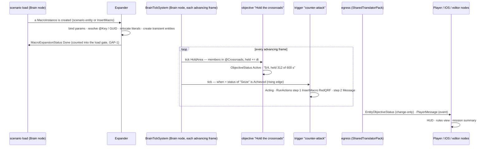

*What the picture shows that prose hid:* expansion is a CREATION-path step (a runtime `InsertMacro` takes the same path as load), and the wire
is fed by the existing egress pass — no rule system pushes anything. The END is §11's sequence (close first, then pause).

### 00.5 Modules — who registers, who calls each frame

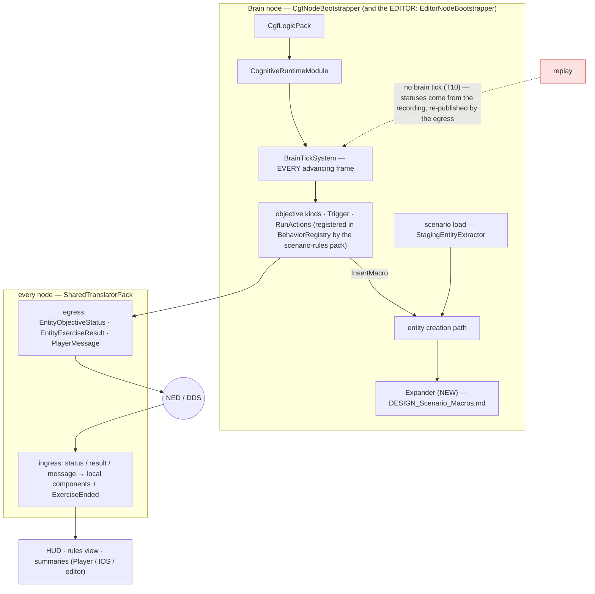

*Caption:* the ONE per-frame caller is the existing `BrainTickSystem`, inside `CgfLogicPack` — so the rules run on the Brain node AND in the
editor, never on a Player node (it does not compose that pack). The red edges are the two things that do NOT run: the feature switch (not
built — a prerequisite) and the brain tick in replay (by design; the egress re-publishes the recorded statuses).

### 00.6 Slices *(build order; each a batch with its own rails — T-1 first: the trigger PoC suite and the feature suites named)*

| slice | builds | done when | prerequisites | build-state |
|---|---|---|---|---|
| **S0 — types and ids** | §9.8.0's types (`WorldPoint`, `WorldRotation`, `Bearing`, `EntityLink`, `PointLink`, `AreaLink`, `RefSpec`) + the type plan walker (resolve, relocate) + the SR-132 / SR-143 rails + `RefKey`; ⭐ in the SAME sweep: CE-4200 (32-bit ids, `TkbTypeId`, `NodeId`) — the files are touched once | the repo's params / components use the types; the rails pass; a scenario round-trips byte-for-byte except the migrated fields; the multiplayer and NED suites pass | CE-4153 S1–S7 ✅ | ⭐ **READY-TO-BUILD** |
| **S1 — objectives + status on the wire** ✅ BUILT `2026-11-02` (§00.8.1) | objective entity type; kinds `ReachArea` / `HoldArea` / `ClearArea` / `DestroyTargets` / `Protect` / `NoHarm`; `Composite` + `WeightedMean` / `AllMustPass`; `ObjectiveStatus` / `ObjectiveLinks`; `EntityObjectiveStatus` translators; `AreaLink.Contains`; a minimal mission summary reading live statuses | Bridgehead's phase-1 objectives, authored by hand as entities (no macros), run LIVE on a cluster; statuses reach a Player node and the IOS; two scenarios use the same kinds with different params and nothing rebuilds | S0; CE-4155 for `NoHarm`'s indirect harm (gunfire + blasts work without it) | ⭐ **READY-TO-BUILD** once S0 lands |
| **S2 — triggers + messages + the end** | CE-4160 … CE-4166 (lift the PoC); `when` leaves `OnEntity` / `ScenarioTime`; actions `Message`, `SetObjectiveActive`, `EndExercise` (multi-tick, §11 SR-116), `Order`, `MissionCommand`; `ExerciseResult` + `EntityExerciseResult`; `PlayerMessage`; subtitle + log on the Player | Bridgehead's counter-attack fires on its edge; the trainee sees the subtitle; the run ends by rule, closes every objective, then pauses; replay shows the same statuses at any seek | S1; CE-4159; CE-4157; ⚠ CE-4164 MEASURE first (the indexed-lane evaluator for area / event / lifecycle `when`s) | ✅ BUILT `2026-11-02` (§00.9, live §00.9.1) |
| **S3 — macros, variants, the director** | ⭐ moved to [DESIGN_Scenario_Macros.md](DESIGN_Scenario_Macros.md) §1 (the row is copied there: the `MacroInstance` type + `Expander`, `InsertMacro`, `ParamBindings`, the scenario params + run variants, `SetSkillAmplifier`) | see there | see there | DESIGN — S9 + GAP-1…5 |
| **S4 — evaluation per member + debrief / HUD** | `MemberEvaluation` (SR-72 / 72a), measures (`HitRatio`, `Count`, `ReportLatency`, `TimeTo`), the SR-20 adapters `InputAbove` / `Sample`, the trainee debrief + training / game HUD (SR-112, mockups `docs/designs/rules-view/`) | per-trainee results on the HUD live and in the debrief | S3; CE-4155 | DESIGN |
| **S5 — the rules view** | CE-4167 (timeline TL-X1 … X5) + the rules view (SR-105, SR-109 / SR-110 mockups) — ui lane | the instructor reads and edits the dependency Gantt live (this run only) | S2 | DESIGN (ui) |
| **S6 — the game profile** | Crossfire: domination, tickets, respawn score (SR-84), the game HUD | `docs/SHOWCASE_Scenarios.md` Crossfire acceptance | S2, S4 | DESIGN |

⭐ **Unrelated prerequisites stated once:** CE-4080 (multiplayer acceptance — in progress) gates every "on a cluster" done-when; CE-4158 (the
cluster integration batch hangs) means a slice's cluster rail runs `--filter`ed, not the full batch; CE-4152 (the ORBAT hides virtual entities)
and CE-4154 (World Environment saved in the header) are needed before S1's objectives are AUTHORED in the editor rather than by hand.

### 00.7 Open gaps — measured or decided BEFORE their slice, never during *(each names its owner slice)*

| gap | slice | how it closes |
|---|---|---|
| CE-4164 — can the per-frame indexed-lane evaluator serve a `when` live? | S2 | one measurement batch |
| SR-93 ③ — move the action catalogue from the test project into runtime | S2 | part of CE-4160 |
| GAP-1 … GAP-5 (DESIGN_Scenario_Macros.md §9: end of expansion, who reads macro files, missing macro / cycle, re-expansion on edit, ids) | S3 | decided in the S3 design pass — leans are written |
| CE-4153 S9′ — references in a file carry their GUID | S3 | ✅ accepted `2026-11-01`: no reverse remap needed after S0 (authored refs are `EntityLink`, incl. `RoutePlan`'s `HoldUnit`; a rail; the migration writes GUIDs) — build right after S0 (`DESIGN_Scenario_Entity_Keys.md` S9′; §9.8's S9 notes are superseded by it) |
| dismounted soldiers settle on the ground after relocation? (SR-127) | S3 | one rail |

### 00.8 S1 — build decisions *(behaviors, `2026-11-02`; the details §00.6 left to the builder — measured on `behaviors` at `d7ff5d8e2`)*

| # | decision | why / measured |
|---|---|---|
| **S1-a** ids | components **425** `ObjectiveStatus`, **426** `ObjectiveLinks` (427 kept for S2's `ExerciseResult`) — behaviors' block 418–433 · ⭐ a RULES descriptor block **171–179**: 171 `dtObjectiveStatus`, 172 `dtExerciseResult` (S2), 173 `dtPlayerMessage` (S2) — ⚠ 170 went to backend's `dtMacroOrigin` the same afternoon (both lanes measured it free); macros and rules share the 170s · ⭐ a RULES TKB block **8860–8869**: 8860 `Objective`, 8861 `Trigger` (S2) (backend's `ScenarioMacro` is 8813) | measured free on `backend`, `ui`, `coordinator`, `behaviors` (424 · 157/160 · 8812/8850 are the highest used); a block, like Traffic's, so two lanes cannot collide |
| **S1-b** where | runtime types + the shared rule maths in `Fdp.Toolkits/ScenarioRules/` (`Fdp.Toolkit.ScenarioRules`); the kinds as C# behaviours in `Hrot.AI.Behaviors/Brains/Objectives/` (the `HoldStanceBehavior` pattern: params DTO in `Hrot.Map.Definitions.Behavior`, `[Behavior]` + `[BTreeDefinition]`); the topic in `Hrot.Network.NED` (`hrot-scenario-rules` IDL, SR-124) | C# trees (user: hard-coded C# trees over JSON assets) |
| **S1-c** ONE owner of the links | `Subject` / `Parent` are PARAMS (`ObjectiveCommon.Subject`, `.Parent`, `EntityLink` — resolved by S0's walker at load); the behaviour copies them into `ObjectiveLinks` (`NoScenario`) each tick | ⭐ SR-53 said *"saved"* — saving a second copy beside the params gives two owners (CLAUDE.md *shared and unified*); the params are already saved, remapped and on the wire (`IntentJson`) |
| **S1-d** "the subject's men" | the subject itself or anyone under it down `UnitSubordinate`, alive, in the fight, with a `SimTransform` — COUNTED AS MEN (`MinMen`; the showcase's *"min 6 men"*). An enemy = `ForceId` hostile to the subject's, in the fight, not neutral (`ThreatDanger`) | a squad commander has no body; counting bodies is what an area check can see |
| **S1-e** lifecycle in S1 | `Pending` · `Active` · `Achieved` · `Failed` · `Inactive` + the deadline (`DeadlineSeconds`, sim s). `activeWhen` waits for S2's `when`; S1 has `StartActive` (default true). ⭐ the OnClose rules (SR-117) are pure functions with rails in S1, CALLED by S2's `EndExercise` | no end exists before S2 |
| **S1-f** harm | `NoHarm` reads `DamageAssessedEvent` (`repo.ReadEvents`, the `HealthApplicationSystem` way) — victim `ForceId` vs `Protected`, `Source`'s side vs the subject's | §10.1: `Source` is set for gunfire, blasts, remote hits, drones and gas clouds (CE-4155 ✅, §00.9); `attribute` = last / original / both |
| **S1-g** the minimal summary | `GET /objectives` (DebugApi, any node — reads the replicated statuses, the tree by `Parent`) + one log line per state change | the HUD / rules view are S4 / S5 (ui) |

```mermaid
classDiagram
    direction LR
    class ObjectiveCommon { <<params, nested in every kind>> Title · Subject · Parent · Required · Scored · Weight · Points · DeadlineSeconds · StartActive · VisibleSides }
    class ObjectiveStatus { <<425, unmanaged, NoScenario>> Role · State · Owner · ProgressCur/Need · Value · Target · Score · Points · ChangedAt · Reason · Title · Kind · Required · Scored · Weight · VisibleSides }
    class ObjectiveLinks { <<426, NoScenario>> Subject · Parent (EntityRef) }
    class ObjectiveRules { <<static, Fdp.Toolkit.ScenarioRules>> Begin · Settle · OnClose · Score · MenOf · EnemiesIn · ChildrenOf }
    class Kinds { <<C# behaviours>> ReachArea · HoldArea · ClearArea · DestroyTargets · Protect · NoHarm }
    class Aggregators { <<C# behaviours>> WeightedMean · AllMustPass }
    class Translators { <<Hrot.Network.NED>> EntityObjectiveStatus egress · ingress (the ScenarioClock shape) }
    Kinds ..> ObjectiveCommon
    Kinds ..> ObjectiveRules
    Aggregators ..> ObjectiveRules : ChildrenOf (ObjectiveLinks.Parent)
    ObjectiveRules ..> ObjectiveStatus : writes
    ObjectiveRules ..> ObjectiveLinks : writes
    ObjectiveStatus ..> Translators
```

*What the picture shows that prose hid:* every kind is a thin behaviour over ONE static rule set — the lifecycle, the score and the census are

#### 00.8.1 ⭐ AS-BUILT — S1 (`2026-11-02`, behaviors)

| piece | where | proof |
|---|---|---|
| `ObjectiveStatus` (425) · `ObjectiveLinks` (426) · TKB `Objective` 8860 (brain only) | `Fdp.Toolkits/ScenarioRules/`; `NedTkbCatalog.cs` | rail `ObjectiveEntity_FromAScenarioRecord_GetsABrainThatTicks` |
| `EntityObjectiveStatus` (**171**, `hrot-scenario-rules`) egress / ingress, Brain group; state changes at once, progress-only ≤ 2 / s | `EntityObjectiveStatusTranslators.cs` | `ObjectiveStatusWireTests` |
| `ObjectiveRules` (Begin · Settle · Score · OnClose · CloseRuleOf) — the ONE lifecycle | `ScenarioRules/ObjectiveRules.cs` | `ObjectiveRulesTests` |
| kinds `ReachArea` · `HoldArea` · `ClearAreaObjective` ⚠ (`ClearArea` is the building-clearing behaviour) · `DestroyTargets` · `Protect` · `NoHarm`; `WeightedMean` · `AllMustPass`; one side rule `KillZone.Hostile(ForceId, ForceId)` | `Hrot.AI.Behaviors/Brains/Objectives/` | `ScenarioRulesTests` 14 |
| `GET /objectives` (`?tree=1`) | `DebugApiService.Objectives.cs` | `TheObjectivesRouteShowsTheTreeTests` |
| ⭐ LIVE `--mode all`, `scenarios/sr-objectives-march` | 5 objectives on a marching squad | far line **Failed** at 61 s (deadline 60) · crossroads **Achieved** 91 s · hold reset when a man stepped out (101 s) · hold **Achieved** 132 s · composite 0.75 Active (NoHarm judged at the end); each change logged ONCE (one brain); read on the editor host |

⚠ Open: a PLAYER node reading the statuses (no Player in `--mode all`) · OnClose is called by S2's `EndExercise` · an unresolved `DestroyTargets` / `Protect` target counts as not destroyed until seen.
written once, so no kind can decide "achieved" differently.

### 00.9 S2 — build decisions *(behaviors, `2026-11-02`; measured on `behaviors` at `5821ec2d1`, after merging `backend`'s binder `3683f1487`)*

📐 Queries: `scripts/cbm.sh search_graph` `.*(ActionSchemaExporter|FailureReason|FailReason|BehaviorFailure|LastFailure).*` Class (9: the editor-side
exporter + 8 test doubles — ⛔ no failure-reason channel exists) · `.*(AssignTacticalIntent|PauseRequest|RequestPause|SimPause).*` (20: the order event,
`CgfClusterDebugTimeController.RequestPause` = the Brain node's cluster pause) · grep of `SearchPredicateDto.cs` (the loop DTOs' fields) and the PoC (1346 lines).
⚠ coverage unchecked (`check_index_coverage` is not in the CLI).

| # | decision | why / measured |
|---|---|---|
| **S2-a** ids | components **427** `ExerciseResult` (unmanaged, NoScenario, World Environment) · **428** `ActionArgs` (managed `sealed record`, init-only, written at assignment only — SR-97 / CLAUDE.md *NEW COMPONENTS*) · **429** `ActionFailure` (unmanaged `FixedString64 Reason` + `int Step`, the reason channel CE-4165) · descriptors **172** `dtExerciseResult` (state) · **173** `dtPlayerMessage` (event) · TKB **8861** `Trigger` | the blocks of §00.8 S1-a |
| **S2-b** ONE compiler, TWO entry points | `IPredicateCompiler.CompileLevelPredicate(dto)` beside `CompileComponentPredicate`: the SAME arms; only the four loop kinds differ — LEVEL arms (`SpatialBounding` → the entity's position inside `Bounds` via `AreaLink.Contains` · `Lifecycle` → the target alive · `Structural` → has the component · `TransientEvent` → an event of that type naming the entity occurred this frame) where the search entry keeps its pass-through. New leaves (both entries): `OnEntity {Ref: EntityLink, Predicate}` · `ScenarioTime {From, To}` (sim s) · `CountMatching {Predicate, Min, Max}` | SR-158; ⛔ changing the existing entry would change `RecordingSearchService` and the breakpoints mid-flight (CE-4205 routes them later) |
| **S2-c** the trigger | an Objective-like entity (TKB 8861) whose task slot runs ONE C# `Trigger` behaviour: params `{common, when, holdFor, delay, repeat, cooldown, maxFires, fireIfTrueWhenArmed, do[]}`. `when` + `do` are kept as JSON strings in the caller's `ActionArgs` (items 0 / 1), the compiled `when` cached per JSON string (process-wide, like the PoC's step list). Its state machine (§10.11) lives in its blackboard; it writes `ObjectiveStatus` with `Role = Trigger`, a NEW byte field `TriggerState` (Disarmed … Done, T8) and `FireCount` / `LastFired`; `State` mirrors it coarsely (Inactive = Disarmed, Achieved = Done after success, Failed = an action failed) so aggregators and the HUD read one shape | SR-88, SR-91, T1–T10; the PoC's `PocTrigger` |
| **S2-d** actions | the PoC lifted into `Fdp.Toolkits/ScenarioRules/Actions/`: `ActionCatalogue` (reflects stateful `[SharedAiAction]`s, one cached runner per type — ⭐ `ActionSchemaExporter`'s runtime discovery CALLS it, no second reflection), `StepRunner<TP,TS>` (seed by `BehaviorParams.OverlayFlat`; an `Entity` field REFUSED loudly — authored refs are `EntityLink`, resolved at seeding, CE-4162), `RunActions` (stateful shared action, step key salted by depth, CE-4161; the lazy-attach seam refuses the root kinds `BTree` / `BlueprintBehavior`), validation at ASSIGNMENT (CE-4163). Verbs v1, each a stateful `[SharedAiAction]` naming its target in its params: `Message` · `SetObjectiveActive {target, active, reset}` · `EndExercise {reason}` · `Order {target, behavior, params}` (publishes `AssignTacticalIntentEvent`; done when the target's active behaviour is it) · `MissionCommand {target, command, task}` | SR-93, SR-97, SR-98, SR-108 |
| **S2-e** the end | `EndExercise` (SR-116): `ExerciseResult.Phase = Closing` → every objective's next tick (`ObjectiveHost.Enter`) sees Closing and runs `ObjectiveRules.OnClose(CloseRuleOf(kind))` → when every status is final (or 2 s sim) it writes per-side outcome, `Phase = Ended` → the ingress raises `ExerciseEnded` once on every node → the Brain node asks for the pause through `CgfClusterDebugTimeController.RequestPause` (the one cluster pause a Brain node has) | SR-116, SR-122; pause-after-close because a paused world runs no brain tick |
| **S2-f** messages | `PlayerMessage` = the `SquadReport` event shape (SR-121): published by the `Message` action, raised as a local `PlayerMessageEvent` on every other node. ⭐ The subtitle + log on the Player is UI — handed to `ui` with the event as the contract | R-4105 |

⭐ **S2-d AS BUILT `2026-11-02`** (`FDP/Toolkits/Fdp.Toolkits/ScenarioRules/Actions/`; the diagram below is unchanged — what it names is now real): `ActionCatalogue.Discover(assembly, alsoVisit)` is THE reflection pass
(the editor's `ActionSchemaExporter` hands its per-method schema logic to it as `alsoVisit`); `ScenarioActions.RunActions` (`{ListRef, Depth}`) slot key `0x7C000001 ^ depth`;
`StepRunner.Kind` = Hsm; `ActionFailure.Set / Stamp / Clear / TryGet`; `ActionList.Get / Validate` (`ActionListException` names step + act); `LiveRefScope.Of(world)` (⭐ task 17: `WorldRefScope` is RETIRED) resolves a step's authored `"@Key"` / GUID
`EntityLink` in the live world. ⚠ **Deviations from the row above:** a duplicate short name and an `Entity`-field params type are recorded on the catalogue entry and refused LOUDLY at lookup / run / Validate — not thrown at
scan, because a scan over every loaded assembly must not be poisoned by two unrelated actions (a short name two actions carry throws at `TryGet(short)` naming both; the full name always works). ⚠ `Validate` checks the TOP-level args
keys only. ~~The PoC folder keeps only P5~~ — the PoC folder is GONE (S2-c, below): its trigger rails live on the production `Trigger`, its compiler rail in `PredicateCompilerLevelTests`.

⭐ **S2-c AS BUILT `2026-11-02`** (`Hrot.AI.Behaviors/Brains/Objectives/TriggerBehavior.cs`; the diagram below is unchanged). **TKB 8861 `Trigger`** (`NedTkbCatalog`, a brain with no body like 8860; `BehaviorCategory.Trigger`, so
`BehaviorCatalog` lists only the `Trigger` behaviour for it). **`TriggerState`** (byte enum in `Fdp.Toolkit.ScenarioRules`: Disarmed · Armed · Holding · Waiting · Acting · Fired · Cooldown · Done) is a new field of
`ObjectiveStatus` AND of the wire topic `EntityObjectiveStatus` (171; a state field ⇒ part of `SameDisplayAndState`, published at once); `GET /objectives` shows `triggerState` (name) + `fireCount` + `lastFired` on Role=Trigger rows.
**`TriggerParamsJsonDto`** (`ObjectiveParamsJsonDtos.cs`): `common` (`scored` defaults FALSE — T8), `when` (`SearchPredicateDto`), `holdFor`, `delay`, `cooldown`, `repeat`, `maxFires`, `fireIfTrueWhenArmed`, `do` (a raw `JsonNode`).
**Validation at assignment** (the `[BehaviorResolver]`): `when` must compile (`TriggerWhen.Get`) and `ActionList.Validate(do)` must pass; a throw makes `BehaviorIngressSystem.ParseIntoShadow` DROP the assignment with a `Warn`
naming the behaviour, the entity and the message (step + act) — ⚠ it is logged, NOT propagated as an exception (`BehaviorIngressSystem.cs:861`, a deliberate "a parse failure must not crash the loop"): the entity keeps no behaviour, no status,
no `ActionArgs`. A good one writes `ActionArgs [whenJson, doJson]` (replaced whole). **`TriggerWhen`**: the compiled LEVEL predicate cached process-wide by the JSON string (a `ConditionalWeakTable` on the very string the entity holds in front of a
content-keyed dictionary). **The tick** (one `[SharedAiAction]`): `ObjectiveHost.Enter` (Role Trigger) then the §10.11 machine over the blackboard (`Phase`, `Prev/PrevKnown`, `EdgeAt`, `WaitUntil`, `CooldownUntil`, the embedded
`RunActionsParams{ListRef=1,Depth=0}` + `RunActionsState`). Objective `State` mirrors it: Inactive = Disarmed (a direct write or, from S2-d's row 8, `SetObjectiveActive`; or the common `deadlineSeconds` passing — T4), Active = Armed … Cooldown,
Achieved = Done, Failed = an action failed (final: the machine rests in Fired). Decisions the §10.11 text left open, pinned by rails: **(a)** `delay` counts from the moment the hold is satisfied (the edge when `holdFor` is 0);
**(b)** `Fired` lasts one tick (so a HUD / the wire can see it), the next tick goes Done or Cooldown; **(c)** a `Disarm` is honoured in Armed / Holding / Waiting / Cooldown, NOT while Acting — a started list finishes
("nothing already done is undone", T7); **(d)** a cooldown re-arms on *cooldown elapsed AND the condition false* (T2) — a drop INSIDE the cooldown does not re-arm early, and a rise that began and ended inside it is not seen;
**(e)** FireCount / LastFired are written when the list ENDS (success or failure). **The editor's schema extractor** (`DtoJsonSchemaExtractor`) got a `JsonNode` arm (free-form JSON, `format: json`) — ⚠ without it `GET /behaviors` STACK-OVERFLOWED on `Trigger.do` (a `JsonNode`'s `Parent` loops back into the tree). **CE-4166 settled:** a condition already true when the trigger arms is NOT an edge (T1's corollary); `fireIfTrueWhenArmed` opts in.

⭐ **S2-d / S2-e / S2-f AS BUILT `2026-11-02` (verbs 1 · 2 · 5 of ⑧; Order · MissionCommand · pause-on-end are the NEXT paragraph, ⑨)** — the diagrams below are unchanged. **The verbs** are static `[SharedAiAction]`s in
`Hrot.AI.Behaviors/Brains/Objectives/Verbs/ScenarioVerbs.cs` (`SetObjectiveActive` · `EndExercise` · `Message`), found by `ActionCatalogue` like any other. **`ExerciseResult`** (427, `FDP/Toolkits/Fdp.Toolkits/ScenarioRules/ExerciseResult.cs`):
`Phase` (`ExercisePhase` Running / Closing / Ended) · `EndedAt` · `Reason` · `SideResult Friend / Hostile / Neutral {Outcome, Points, Score}`; Brain group; registered on every node. **`SetObjectiveActive`**: `ObjectiveRules.SetActive` writes
Inactive / Active directly (progress kept); out of a final state ONLY with `reset`, which sets the NEW local byte `ObjectiveStatus.ResetRequested` (1 = then Active, 2 = then Inactive; not on the wire) — **`ObjectiveHost.Enter` is the ONE place a run is re-begun**
(`Run.Began = 0` → `Begin`, progress cleared) and returns `Frame.Reset`, on which each kind clears its OWN working state (HoldArea timer, NoHarm victims, ClearArea timer, the target kinds' `Seen`, the Trigger's machine). Chosen over re-assigning the behaviour
through the ingress (needs the params JSON back, a second owner of "what is assigned") and over a generic zeroing of the block (params and working state share it). A closed objective takes nothing. **The close**: `ObjectiveHost.Enter` takes a `CloseMode` —
`Own` (every kind: when `ExerciseResult.Phase != Running` run `OnClose(CloseRuleOf(kind, capture))` once) · `Composite` (`AllMustPass` / `WeightedMean`: closed by `CloseComposite` only once EVERY child is Closed, so a composite aggregates its children's final
verdicts instead of being closed Failed before them) · `Hold` (a **Trigger** closes by its OWN rule: one still `Acting` / `Fired` finishes its list — T7 — an unfired one is switched Inactive then Closed, never "failed": it is not an objective). The test is
`Phase != Running`, not `== Closing`, so a status that appears after the end is closed too. **`EndExercise`**: ① finds the World Environment (the entity with `ScenarioClock`; no WE → Failure "no World Environment"), adds `ExerciseResult` if missing, `Phase = Closing`,
`Reason`; Failure "already ended"; ② Running until no Objective / Measure status (Triggers excluded) is open, or 2 s of sim time (`CloseTimeoutSeconds`; the stragglers' titles are logged at Warn); ③ the outcome per side — the ROOT objectives (no `Parent`), the side
of the root's `Subject` (no subject = Neutral), Skipped-unrequired excluded: `Score` = the weight-averaged scores of the scored roots, `Points` = the points of the achieved ones, `Outcome` Win when every REQUIRED root is Achieved (none required: every root), else Lose, None
when the side has no root; `Phase = Ended`, `EndedAt`; **`ExerciseEndedEvent` (unmanaged, `EventId_ExerciseEnded` = 3108 in `BehaviorConstants`'s 31xx run) is raised HERE, on the owner (the action — the one place on the owning node), and by the
`EntityExerciseResult` ingress on every other node, ONCE (`_endedRaised`)**. **Wire**: `dtExerciseResult` = 172 (state, managed topic `EntityExerciseResult`, the `ScenarioClock` QoS, IDL `hrot-scenario-rules`; `EntityExerciseResultTranslators.cs`) and `dtPlayerMessage` = 173
(EVENT topic `PlayerMessage`, `PlayerMessageMessages.cs` + `Translators/PlayerMessageTranslators.cs`, the `SquadReport` shape: egress writes the local `PlayerMessageEvent`s whose `OriginNodeId` is 0, ingress raises them again with the sender's id and skips its own), both in
`SharedTranslatorPack`. **`Message`**: publishes `PlayerMessageEvent` (managed, `Fdp.Toolkit.ScenarioRules`: `MessageId · OriginNodeId · ToKind · ToValue · Text · Seconds=6 · Priority · SentAt · Source`); `MessageParams` implements the NEW `IActionArgsCheck`
(`StepRunner.CheckArgs` calls it with the RAW args at assignment) because a `FixedString128` truncates silently: a text over 127 characters or a `toKind` outside All / Side / Station / Unit / Instructor is refused at ASSIGNMENT. ⚠ **Deviations / limits:**
**(a)** the verbs write the target's status on THIS node — `SetObjectiveActive` on an objective owned by another node is overwritten by the ingress (single Brain node today); likewise `EndExercise` writes the World Environment's `ExerciseResult`, so it must run on the node that owns it
(the Closing phase itself replicates, so objectives owned elsewhere close and the end waits for their replicated `Closed`). **(b)** the `ExerciseEndedEvent` is registered lazily (`Bus.Register`) where raised and in `CognitiveComponentRegistry`. **(c)** ~~NOT built in this commit~~: `Order`,
`MissionCommand`, the `ArgsRef` extension of `ActionList` and **pause-on-end** — built in ⑨ (next paragraph).

⭐ **S2-d / S2-e AS BUILT, ⑨ `2026-11-02` (pause-on-end · `Order` · `MissionCommand` · the `params` lift)** — the diagrams below are unchanged. **Pause-on-end**: `ExercisePauseOnEndSystem` (`Hrot.AI.Behaviors/Brains/Objectives/`, Simulation, EveryFrame,
`[NodeFeature("exercise.pause-on-end")]`) reads `ExerciseEndedEvent` and publishes ONE `PauseTimeIntent` on the node's bus for a frame that carries an end — never a toggle, nothing without an end. The feature is declared ONCE by
`ExercisePauseOnEndSystem.Feature` (a `FeatureDeclaration.Switch`, `Live`, ON for every role) and listed in `Features` of BOTH Brain capabilities (`CgfCapabilities.Brain`, the editor's `EditorCapabilities.Brain`) because `SystemScheduler.ReadFeature`
throws for a system whose id no capability declared; the system is in `CgfLogicPack.SimulationSystems` right after the cognitive runtime (the brain tick that ran `EndExercise`), so every Brain node and the editor carry it. ⚠ **Deviation from the S2-e row**: the
row said the Brain node asks through `CgfClusterDebugTimeController.RequestPause`; that one ALSO halts this node's own sim groups and is gated on a cluster participant (`CgfClusterDebugTimeController.cs:160-181`) — a debugger's halt, not the exercise's end — so the system
publishes the plain intent `ClusterTimeTransportAdapter.TogglePlayPause` and `RequestPause` both end in (`ClusterOpEgressTranslator.cs:55` forwards it; the master's `MasterSyncController.cs:182` handles it). **Two nodes publishing is fine**: a second
`PauseTimeIntent` re-issues `SwitchToDeterministic` (`MasterSyncController.cs:426`) — the same target mode, not a toggle (it is not a literal no-op: it re-sends the mode switch). `PauseTimeIntent` lives in `Fdp.Toolkits` (`Time/Domain/TimeLocalEvents.cs:19`), so the
pack can reference it. **The `params` lift**: `ActionList.ExtractParams(doJson, firstItem)` takes a step's nested `"params"` (any JSON object or string) OUT of its args into an extra string, and seeds the step's `ArgsRef` with `firstItem + position`; generic —
any action whose params struct has an `int ArgsRef` (`StepRunner.TakesArgsRef`) gets it, an action without one refuses `params` naming step and act, `params` together with `ArgsRef` is refused, a list with no `params` comes back as the SAME string. The Trigger's resolver
calls it (`TriggerBehavior.FirstExtraItem = 2`) and writes `ActionArgs [when, do(rewritten), params…]`. **`Order { Target, Behavior, ArgsRef = -1 }`** (`Verbs/CommandVerbs.cs`): publishes `AssignTacticalIntentEvent` (`IntentId` = the behaviour name, `JsonParams` = item `ArgsRef`, Origin Superior — the
`CommanderNodes.cs:80` shape) to the target, Running until the target's `BehaviorState.ActiveBehaviorHash == BehaviorHash.FromName(behavior)`; 10 s of sim time (`AcceptTimeoutSeconds`) ⇒ Failure "not accepted"; no target ⇒ "target not found"; no brain ⇒ "target has no brain"; an unknown
behaviour name (`ParamsDtoRegistry.Default.TryGetBehavior`), a missing or over-63-character name is refused at ASSIGNMENT (`IActionArgsCheck`). It acts on the owner's node only (`TacticalIntentResolutionSystem` skips an entity this node has no `BehaviorState` authority over) — an order to a unit another node owns times out
here; ordering across nodes needs the intent's own wire path (`TacticalIntentEgressTranslator`), not tested here. A target already running that behaviour completes the moment its hash is read (a restart with new params is not awaited). **`MissionCommand { Target, Command, TaskIndex }`**:
publishes `MissionControlIntent` (`Hrot.Core`, `Hrot.Common.Events` — referenced by `Hrot.AI.Behaviors`, so nothing moved) with a fresh `RequestId`, the target's network id, and `CMD_JUMP_TO_TASK` (`TargetTaskId` = `ActiveMissionPlan.TaskOrder[TaskIndex]`, read at issue time; no such task ⇒ Failure "the target's mission has no task N")
or `CMD_ABORT_ALL`; Running until the `MissionControlAckEvent` with that id: `ErrorCode` 0 ⇒ Success, else Failure "mission control error N"; 10 s ⇒ Failure "no mission control ack". ⚠ **Deviation: `Replace` is declared (`MissionCommandKind.Replace`) but REFUSED at assignment** ("needs a full mission plan, which this verb cannot carry yet") — SR-97's
params name no plan, and a `MissionPlan` in JSON would be a second plan format; the `Order` + `params` route (or a later `ArgsRef` plan) is where it would go. The ack is read from the event buffer, so the action must be ticked every frame while Running (`BrainTickSystem` does; a brain tick policy that skipped frames could miss it and time out).
Rails: `ScenarioRulesTests.Verbs.cs` (Order accepted + with params + ordered before the next step; Order timeout and bad targets; Order validation; MissionCommand acked 0 / error / Abort / timeout / far task / Replace; pause once, none without, feature off, pack carries it, a real end) and `ActionListTests` (the lift, the seeding, the refusals).

⭐ **CE-4205 AS BUILT `2026-11-02` (S2-b follow-up: ONE live evaluation of the loop predicates)** — `DataBreakpointManager`'s spatial / lifecycle / structural trackers keep their edge logic and known-sets and replace each private LEVEL test with the delegate from `IPredicateCompiler.CompileLevelPredicate(dto)`, compiled once at mount and stored in the tracker tuple (spatial = inside, lifecycle = matches, structural = has; the structural tracker compiles a copy with `AnyChange` because Removed is an edge there, the level is always "present"). Deleted from the manager: `MatchesLifecycleCriteria`, `ReadEntityName`, `ReadStringField`, `CompileSpatialPositionAccessor(+Generic)`, `ReadPosition2D`, `ReadFloatField`, `ComputeEffectivePresence`. The structural level arm now HONOURS `AuthorityRequirement` (component mask + `AuthorityMask`; it was ignored) so the breakpoint's authority rule lives in the one arm. `RecordingSearchService` keeps its scan loops but its private spatial read and lifecycle test went the same way (structural already shared `StructuralScanner`, CE-1302). Behaviour moves, all to the level arm's reading: a spatial dto with no `PositionComponentType` now reads `SimTransform.Position` (the tracker read (0,0) for everyone), an entity lacking the position component is outside (it read (0,0)), a managed position component is not read, the lifecycle `EcsHandle` arm requires the entity alive. A breakpoint spatial / lifecycle / structural tracker now needs the compiler: both production constructions (`CgfSubsystem`, `EditorSubsystem`) pass one; with none the breakpoint mounts no tracker (as component predicates already do). Rail `P11CorrectnessTests.SpatialTracker_AgreesWithTheCompilersLevelArm` (3 positions, red-proved with the level arm negated: it and 3 existing spatial rails red).

⭐ **CE-2377 step 1 AS BUILT `2026-11-02` (one side-effect-free behaviour-params validation + a sweep; NO load refusal yet).** `BehaviorParamsValidation.Validate(registry, behaviourName, paramsJson)` (`Fdp.Toolkits/Behavior/`) returns the problems: unknown behaviour; the JSON read STRICTLY into the definition's `JsonParamsDtoType` (a copy of `BehaviorParams.JsonOptions` with `UnmappedMemberHandling = Disallow` — an unknown key is a problem; null / blank params are fine; a behaviour with no declared DTO skips this step); then the OPTIONAL `[BehaviorValidator(name)]` static `IEnumerable<string> Validate(string json)` bound in `BehaviorRegistry` (`RegisterValidator` / `TryGetValidator`, carried by `MergeFrom`, cleared by `Clear`). ⛔ no resolver call, no world. ONE discovery, beside the DTO declarations: `BehaviorSchemaDiscovery.BindValidators(registry, assembly)` — a reflection scan of the pinned AI assembly, called by the one loader `CgfBehaviorSetup.LoadFromAiAssembly` and by `AiHotReloadCoordinator` for the rebuilt copy (the `[BehaviorResolver]` source generator is not touched: validators are not codegen). The Trigger's `when` (compiles through `CompileLevelPredicate`) and `do` (`ActionList.Validate`) checks moved OUT of its resolver INTO its validator (`TriggerBehavior.Validate`); `Resolve` calls the same private `ValidateParams` and throws on a problem (one implementation; the CE-4163 refusal rail still holds). Ingress keeps its catch but now logs `Error` and appends the `Validate` problems when they explain the failure. **Sweep** (`BehaviorParamsSweepTests`, Hrot.SimHost.Tests): every `Behavior` / `Sop` slot of every `scenario.json` under `scenarios/`, `recipes/`, `macros/` through `Validate` on the production registry; the findings go to the test output, the count is asserted against `BehaviorParamsSweepAllowList` (group `"behaviour :: problem"` → scenarios; may only shrink). ⭐ **Measured: 601 slots, 0 findings — the allow-list is empty**, so step 2 (the load refusal in `ScenarioLoadStep` prepare) has nothing to wait for. Not swept: mission-plan task params and `test-data/scenario-corpus`. Rails: `BehaviorParamsValidationTests` (unknown name, unknown key, bad Trigger `do` / missing `when`, good params, empty params) — red-proved (strict → `Skip`, and the `ActionList.Validate` call removed: 3 red incl. the existing `ABadDoListOrWhen_FailsAssignment_NotTheFirstFiring`); the sweep red-proved with a bogus problem for one behaviour (9 scenarios named).

⭐ **CE-2377 step 2 AS BUILT `2026-11-02` (the scenario load refuses a behaviour whose params do not validate).** ONE slot walker in production: `ScenarioBehaviorSlots.Enumerate(JsonNode)` (`Fdp.Toolkits/Behavior/`; the sweep test's private copy is deleted and calls it) and `ScenarioBehaviorSlots.Problems(registry, scenario)` = `Validate` over every slot → `"<entity key> <Behavior|Sop> '<name>': <problem>"`. `ScenarioLoadStep.PrepareAsync` runs it on the same `json` right after the macro validation and throws `InvalidOperationException` `"[LoadPhase/Scenario] '<id>' has N behaviour problem(s) — the load is refused:\n - …"` before the args bind / extract, so nothing is created. The registry is a new optional ctor parameter `behaviors`; the ONE production construction (`NodeBootstrapper`) passes `behaviorRemapper?.Registry` — chosen: a public `ScenarioBehaviorRemapper.Registry` getter (the remapper is built from the same registry by `CgfBehaviorSetup.CreateBehaviorRemapper(registry)`, so a host passes it once). ⚠ A params blob carrying a param binding (`"^name"` / a `Bind` map) is only whole after the args apply, so for it only the behaviour NAME is checked at prepare. ⚠ Slots inside macro FILES are NOT walked at prepare (`MacroValidator.CheckInstance` reads the file privately, and macro params carry `^param` forms): covered by the sweep (`macros/`) and by ingress at runtime. **Runtime journal**: the task path already wrote `TaskRefused`/`ParseFailed` (CE-1249); the SOP path (`StartSop`) wrote nothing — it does now, same kind and reason (the AAR / Brain tab shows it). Rails: `ScenarioLoadStepTests.CE2377_…` (typo'd key → throws naming the slot, key; nothing extracted; unknown behaviour; a good slot is not refused; no registry ⇒ skipped), `NodeBootstrapperReplayTests.CE2377_TheBehaviorRegistry_ReachesTheScenarioLoadStep` (forwarding), `SopSlotTests.CE2377_…` (journal, task + SOP path); each red-proved by a compiling mutation.


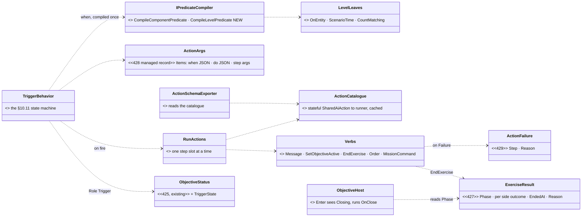

*What the picture shows that prose hid:* the trigger adds ONE behaviour and ONE loop; everything it fires is an ordinary shared action any BTree
can call, and the end reaches every objective through the host they already share — no end-of-exercise system.

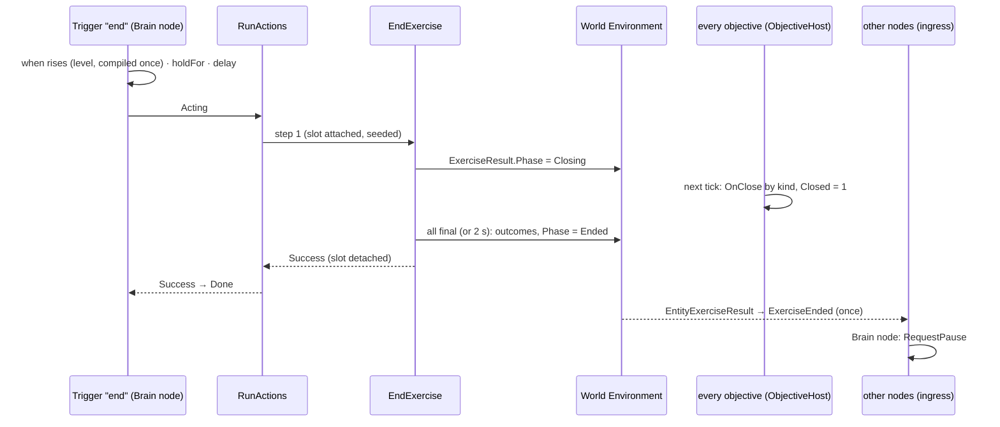

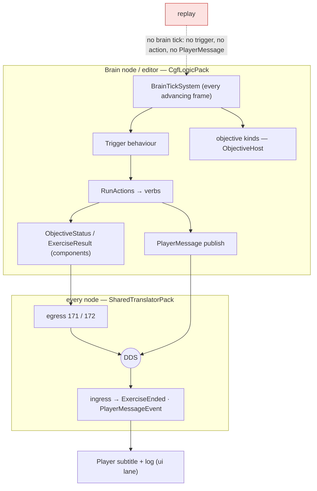

*Caption:* the trigger and its actions run only where `BrainTickSystem` runs (the Brain node and the editor); every other node only RECEIVES — the
status and result topics, the message event. The red edge: replay never fires a trigger (T10).

⭐ **CE-4155 AS BUILT `2026-11-02` (SR-82 — who caused the harm; the S1-f row's "drones / gas wait for CE-4155" is closed).** Measured first: gunfire / blasts / remote hits already set `Source`; ⭐ **drones were already attributed** (the warhead's `DetonationNotification.Shooter` = the drone, `DroneImpactSystem.cs:115`; the sourceless event beside it is the drone's OWN destruction) and **ejection** is the crew leaving their own aircraft (no one's harm) — both now say so in a comment, no change. The two REAL gaps: ① **a gas cloud's pulse** — `AreaEffectCloud` gained `CreatorNetworkId` + `OriginalCreatorNetworkId` (appended; on `EntityAreaEffectCloud` and both translators), written by `AreaEffectSystem.RequestCloud` from the detonation's `Shooter` / `OriginalShooter`, resolved on the node that runs the cloud (`NetworkIdResolver.ResolveNetworkId`) and set as every pulse's `Source` / `OriginalSource`; a canister burning in a man's HAND names him (he is cooking it) with `HeldFuze.OriginalShooter` as the original. ② **a REthrown round** — `OriginalShooter` rides pick-up grant (`PickUpGrantEvent`, crossing as the interaction's `actor`) → `HeldFuze` → `WeaponFireIntent` (cook-off and the deliberate throw back via `ShootAtPoint(originalShooter:)`) → wire `WeaponFireRequest.OriginalShooterEntityId` → `BallisticProjectile` → `DetonationNotification` (`Detonate`, `GuidedRoundSystem`, `HitResolutionSystem`) → `DamageAssessedEvent.OriginalSource` (new; Null = the same as `Source`) → wire `EntityHitDamage.OriginalSourceEntityId`. A round already rethrown keeps ITS first thrower through the next pick-up (grant = round's `OriginalShooter`, else its `Shooter`). `NoHarm` gained `attribute` = `last` (default, `Source`) | `original` (`OriginalSource`, else `Source`) | `both` (`HarmAttribute`, `NoHarmBehavior.Attributed`). Every struct stays unmanaged; every new field is appended. Rails: `AreaEffectCloudTests.CE4155_*`, `RoundPickUpTests.CE4155_*`, `FireProcessingSystemTests.CE4155_*`, `WarheadFlightTests.CE4155_*`, `AreaEffectSystemTests.CE4155_*`, `DamageCalculationSystemTests.CE4155_*`, SimHost `HitDamageAcrossNodesTests` / `DamageAssessedEgressTranslatorTests` / `EntityHitDamageIngressTranslatorTests` / `WeaponFireIntentEgressTranslatorTests` / `InteractionTransportTests` / `BodyPartReplicationTests` / `ScenarioRulesTests.CE4155_NoHarm_Attribute_*`.

#### 00.9.1 ⭐ LIVE — S2 on a cluster (`2026-11-02`, `--mode all`, `scenarios/sr-triggers-march`)

| sim s | what happened |
|---|---|
| 5.0 | `Briefing` (`ScenarioTime ≥ 5`) → Message, Done |
| 61 | `Reach the far line` Failed (deadline 60) |
| 88.9 | `Reach the crossroads` Achieved → `Phase 2: hold` fires → `SetObjectiveActive` turns `Hold the crossroads` ON (it began Inactive) + Message |
| 108.5 | `Hold` Achieved (20 s) → `End` fires → Message + `EndExercise` → Closing |
| 108.7 | every status Closed by its kind: far line Failed · `No harm` Achieved "within limits at the end" · `Squad mission` Achieved 0.75 of 0.50 · ExerciseResult Ended, **Friend Win 0.75** |
| 108.86 | ⭐ the cluster is PAUSED (`exercise.pause-on-end`) — still 108.86 eight seconds later |

📌 The first run did NOT pause: the system published `PauseTimeIntent` on the WORLD bus, while only the node's APPLICATION bus (`HrotNodeContext.EventBus`,
a separate `FdpEventBus`, `HrotNodeBuilder.cs:143`) reaches the master — fixed `878168b5d` (both Brain hosts pass it through `CgfLogicPack`), rail
`PauseOnEnd_GoesOutOnTheNodeBus_NotTheWorldBus_AndThePackForwardsIt`. ⚠ Open: the Player's subtitle / end summary (ui, `NOTE_Behaviors_To_Ui_Player_Messages_And_Exercise_End.md`) ·
CE-2377 (a refused trigger at load is only a Warn) · `MissionCommand Replace` refused (needs a plan format) · `Order` reaches only units the Brain node owns.

### 00.10 The rules view's data — on EVERY node *(behaviors, `2026-11-02`; `HANDOFF_Coordinator_To_Behaviors_Rules_S4_And_View_Data.md` Part A)*

> 🔒 **User, `2026-11-02`:** *"The objective view and the summary panel should be displayable on any node so we need replication for necessary info."*

📐 **A1 measured:** a rule entity's whole definition (`when`, `do`, deadline, delay …) travels as the brain-intent JSON (`EntityBrainIntent.IntentJson`,
`BrainIntentTranslators.cs:69-85`), but its INGRESS is composed only where a behaviour registry is (`CognitiveTranslatorPack.cs:58-62`) ⇒ a Brain / editor
receives it, ⛔ a Player / IG never does — and SR-120 already rejected every HUD parsing JSON. ⇒ the view's data rides the status topic every node has
(`EntityObjectiveStatus`, 171, `SharedTranslatorPack`) as unmanaged fields, written by the owner.

| # | decision | why |
|---|---|---|
| **V-1** links (A1/A2) | `ObjectiveStatus` gains `DependsOn` (≤ 8 net ids — the entities a trigger's `when` names: `OnEntity` refs, recursively) and `ActsOn` (≤ 8 — the targets its `do` names: `SetObjectiveActive` / `Order` / `MissionCommand` targets), written at assignment from the params (the behaviour already parses them) | one shape on one topic; static, so the change-only egress sends them once |
| **V-2** timing (A2) | `ObjectiveStatus` gains `HoldFor`, `Delay`, `Cooldown`, `Deadline` (sim s, 0 = none) and `ExpectedAt` (sim s of the NEXT thing the owner already knows will happen: Waiting ⇒ edge + delay · Holding ⇒ since + holdFor · Cooldown ⇒ its end · an Active objective with a deadline ⇒ the deadline; 0 = unknown) | the view draws dashed expected bars from it; ⛔ the frontend never re-derives timing |
| **V-3** live leaf values (A3) | a STATE topic `EntityRuleLeaves` (descriptor **174**): per trigger ≤ 8 leaves `{ FixedString32 Label, byte Value, float Measured }`, flattened from its `when` (each leaf compiled ONCE through `CompileLevelPredicate`; `Measured` = the property a PropertyMatch reads, else 0/1). Published by the owner at ≤ 2 Hz and ONLY while the node feature `ui.rules-live-values` is on (`AtLoad` off, `Live` on demand) | ⛔ never every frame for every trigger (the handoff) |
| **V-4** runtime control (A4) | a small unmanaged component `RuleControl { byte Request (Fire · Disarm · Rearm · Reset · Activate · Deactivate); int Seq }` written through the EXISTING attribute path (`EntityWriteRouter.For(repo)`: local apply on the owner, a change-request to the owner elsewhere — recorded); `ObjectiveHost.Enter` honours a new `Seq` once and JOURNALS it with its origin (T9, SR-114) | ⛔ no new command transport; one owner of every rule entity's state |

⭐ **S2-d AS BUILT, task 17 `2026-11-02` (a step's `Bind` · ONE live-world ref scope)** — the diagrams are unchanged. **① `do` is typed:** `TriggerParamsJsonDto.Do` is `List<ActionStep>?`; `ActionStep : BindableNode`
(`Actions/ActionList.cs`: `act`, `args` as a `JsonObject`, inherited `bind`). The JSON form is unchanged (a nested `"params"` stays INSIDE `args` — `ExtractParams` lifts it; the brief's top-level `params` member was not needed).
The runtime keeps its JSON string: `TriggerBehavior.ValidateParams` serialises the typed list ONCE with `ActionStep.ToJson` (`BehaviorParams.JsonOptions`) and `ActionList.Validate / Get / ExtractParams` are unchanged — no overload, no
second parser. ⭐ A `Bind` key is a node property OR a **dotted path into a JSON-object property** (`"args.text": "msg"`) — added to the one binder (`ParamBind.Node` / `NodeJson`, backend's file, said in the commit);
a bind naming a missing param is LOUD, as for every node. **② one scope:** `LiveRefScope.Of(world)` — ONE cached instance per world (`ConditionalWeakTable`) for sim callers (`StepRunner`, `RuleLinks`, `MacroExpansionSystem`);
⛔ NO wall-clock window: it rebuilds on a spawn/destroy and whenever `GlobalVersion` (the frame clock) moved, so it is stale only inside one tick — identically live and on replay (the editor's own `new LiveRefScope(repo)` keeps
the 250 ms policy; it never decides a sim outcome). It gained `Ambiguous` (= `WorldRefScope.Ambiguous`). `WorldRefScope.cs` deleted. ⚠ A lookup MISS does not itself force a rebuild — a spawn does (count moved).

⭐ **AS BUILT — V-1 / V-2 (task 14, `2026-11-02`).** `ObjectiveStatus` (425) gained, at the end: `DependsOnCount`+`DependsOn` (`NetIds8`), `ActsOnCount`+`ActsOn`, `HoldFor`, `Delay`, `Cooldown`, `Deadline`, `ExpectedAt`.
**Who writes:** `RuleLinks.Compute` (`Brains/Objectives/RuleLinks.cs`) — DependsOn = every `OnEntity` ref in the `when` JSON (Compound children, an OnEntity's / CountMatching's inner predicate walked); ActsOn = the `target`
key of every `do` step's args (**the step's JSON args**, read as an `EntityLink`, not the action's params type — it never builds a slot; a `"@Key"` target resolves in the live world through `LiveRefScope.Of`). Run at
`TriggerBehavior.Resolve` and kept in the trigger's blackboard (`Block.DependsOn/ActsOn`); a ref not resolvable yet sets `LinksPending` and the tick asks again (≤ 30 tries). `TriggerBehavior.WriteViewData` copies them and
HoldFor/Delay/Cooldown/Deadline into the status every tick and sets `ExpectedAt` (Waiting ⇒ `WaitUntil` = edge + holdFor + delay · Holding ⇒ edge + holdFor · Cooldown ⇒ its end · Armed with a deadline ⇒ the deadline · 0 otherwise / final).
**Every kind:** `ObjectiveRules.Timing` (called from `ObjectiveHost.Enter`) writes `Deadline` and `ExpectedAt` = the deadline while Active; `Settle` / `OnClose` zero `ExpectedAt` once final — ONE place.
**Wire:** `EntityObjectiveStatus` (171) carries them as `[DdsManaged] List<int> DependsOn / ActsOn` (null = none) + `HoldFor/Delay/Cooldown/Deadline` floats + `ExpectedAt` double (the ≤ 8 cap is the component's); all are in `SameDisplayAndState` ⇒ they go
at once. **Route:** `GET /objectives` rows carry `dependsOn`, `actsOn`, `timing{holdFor,delay,cooldown,deadline,expectedAt}`. Rails: `ScenarioRulesTests.ViewData` (links, ExpectedAt while Waiting, objective deadline),
`ObjectiveStatusWireTests` (full round trip + a second world's ingress + ExpectedAt at once), `TheObjectivesRouteShowsTheTreeTests`.

⭐ **AS BUILT — V-4 (task 15, `2026-11-02`).** `RuleControl` (**430**, `Fdp.Toolkit.ScenarioRules/RuleControl.cs`, NoScenario, **brain-local — no descriptor**): `byte Request` (`RuleRequest`: NoRequest · Fire · Disarm · Rearm · Reset · Activate · Deactivate —
⚠ `NoRequest`, not `None`: the assembly's enums share one IDL scope) · `byte Origin` (`RuleOrigin`: Unknown · DebugApi · Instructor) · `int Seq` · `int Done` (the last Seq the owner acted on; written by the owner only). ⚠ Two fields beyond the brief: `Origin`
(the journal text needs it) and `Done` (the once-per-Seq memory). **Attribute path:** three attributes — `Rule.Request` (id 40) · `Rule.Seq` (41) · `Rule.Origin` (42) — declared in `AttributeVocabulary` with `BrainLocal: true` (the precedent: CE-4024's `CivilianState`
fright, so `TheDescriptorMapIsWiredTests` needs no translator), JSON paths in `AttributeCompilerFactory.Build`, binary arm `RuleControlAttributeInstaller` (typed `RegisterHandler<RuleControl>` ⇒ gated on the owner's authority bit). **Atomic** by the router's list write: all three go in ONE
`Write(entity, changes)` ⇒ ONE change-request, so the owner never sees a Seq without its Request. **Who may apply:** `ObjectiveHost.Enter` adds `RuleControl` to the entity AND sets its authority bit on the OWNER (the node whose Brain ticks it); a replica has neither, so the router's local attempt applies nothing and it publishes the request
(rail `OnANodeThatDoesNotOwnTheRule…` applies the published changes through the owner's interpreter). **Honoured once:** `ObjectiveHost.HonourControl` acts on a `Seq` ≠ `Done` — Activate / Deactivate / Disarm / Reset through `ObjectiveRules.SetActive` (the ONE SR-114 implementation, shared with `SetObjectiveActive`); `Fire` / `Rearm`
come back in `Frame.Control` for `TriggerBehavior.Control` (Fire = `StartActing` now, skipping holdFor / delay, only from Armed / Holding / Waiting / Cooldown; Rearm = Armed with `Prev` = the condition as it is now, no edge; a final one refuses — it needs a Reset). A refusal writes the entity's `Reason`.
**Journal:** new `BrainJournalKind.RuleControl` (A = request, B = Seq, Origin, Cause 1 = refused), text "Disarm by Instructor" (`EntityBrainView`). **Route:** `POST /objectives/{networkId}/control {"request":"Disarm"}` → `DebugApiService.ControlObjective` (Seq = the last seen here + 1, or a node-local counter on a replica; answers `route: direct | requested`); RouteDoc `control_objective`,
listed in `WorldChangingRoutes`, tool catalog + SKILL regenerated. Rails: `ScenarioRulesTests.Control` (fire · disarm→rearm · reset · same Seq once + journal · non-owner request), `TheObjectivesRouteShowsTheTreeTests` (owner direct, replica requested), `TheFourRoutingTablesAgreeTests` (the three rows).

⭐ **AS BUILT — V-3 (task 16, `2026-11-02`).** `RuleLeaves` (**431**, `Fdp.Toolkit.ScenarioRules/RuleLeaves.cs`, NoScenario, Brain group): `byte Count` + `Leaf8` (InlineArray of `RuleLeaf { FixedString32 Label; byte Value; float Measured }`) — unmanaged, rewritten twice a second without allocating.
**The plan:** `RuleLeafPlan.Of(when, IPredicateCompiler)` (`ScenarioRules/RuleLeafPlan.cs`; ⚠ the compiler is a parameter — the plan lives in Fdp.Toolkits, the shared compiler instance in `TriggerWhen`) flattens the `when` — descends `Compound` only, every other predicate (an `OnEntity` with its inner one included) is ONE leaf, ≤ 8 (`Truncated` says more existed) —
each leaf compiled ONCE: its test through `CompileLevelPredicate` (the arm the trigger's own condition uses), its number through the NEW `IPredicateCompiler.CompileLeafMeasure` (default-throws like the level entry; `PredicateCompiler.Measure.cs`). **One reader, not two:** the PropertyMatch arms' member-chain walk is now `PredicateCompiler.FieldAccess` (both matchers and the measure use it), `ScenarioTime`'s clock is `ScenarioNow` (the predicate and the number),
`CountMatching`'s counting is `MatchCounter` (the predicate counts up to Max, the number counts all). `Measured`: PropertyMatch ⇒ the numeric / enum / bool value of the property (an `OnEntity` reads it on the entity it resolves to; a non-numeric property ⇒ the 0/1) · ScenarioTime ⇒ now · CountMatching ⇒ the count · everything else ⇒ 0/1. Labels: `Health.Current` · `#9812 Health.Current` / `@Bridge Health.Current` (the target's AUTHORED ref text + the inner leaf) · `ScenarioTime` · `Count Health.Current` · `Spatial` · `Lifecycle` · `Has <Comp>` · `Event <T>`.
**Cache:** `TriggerLeaves.Get(whenJson)` (Hrot.AI.Behaviors) — process-wide by JSON content, beside `TriggerWhen`, sharing its compiler; a `when` that does not compile caches null.
**The sampler:** `RuleLeafSampler` (`Brains/Objectives/RuleLeafSampler.cs`), `[NodeFeature("ui.rules-live-values")]`, `FeatureDeclaration.Switch(…, FeatureChange.Live, _ => false)` ⇒ OFF at load, switched on demand; listed in `CgfCapabilities.Brain.Features` and `EditorCapabilities.Brain.Features` (and the integration `EditorHarness`'s gate), registered in `CgfLogicPack` right after `ExercisePauseOnEndSystem` (pack counts +1: 34 / 41).
While the feature is OFF the scheduler skips the system — nothing is written, nothing flows. ON: at most one pass per `PeriodSeconds` (0.5 s) of SIM time (a clock that went back reopens the window) over every `ObjectiveStatus` with `Role == Trigger` THIS node owns — ⚠ the owner test is **`RuleControl` present + its authority bit** (the one V-4 already gives to the node whose Brain ticks the rule; a replica has neither),
not a second definition — adds `RuleLeaves` when missing and overwrites it from the plan. **When the feature goes off the owner simply stops writing: the last sample STAYS on the entity and on every replica (a viewer shows it greyed; the RouteDoc says so).**
**Wire:** `dtRuleLeaves = 174` → `GlobalComponentIds.RuleLeaves` in the Brain group (`HrotOwnershipGroups`, `NedOwnershipGroupBinding`); topic `EntityRuleLeaves` (key `EntityId`; `[DdsManaged] List<DdsRuleLeaf> Leaves` — null = none; ⚠ no separate `Count`: the list's count IS the count; `DdsRuleLeaf { string Label; byte Value; float Measured }`),
IDL `hrot-scenario-rules`, QoS = `EntityObjectiveStatus`'s. `EntityRuleLeavesEgress/IngressTranslator` (`Replication/Map/EntityRuleLeavesTranslators.cs`): egress change-only, owner only — ⛔ no throttle of its own (the sampler is the throttle); ingress holds a sample for an unknown entity, drops the recorded owner's own; both in `SharedTranslatorPack`; `RuleLeaves` registered in `HrotSharedComponentRegistry`; NED inventory row added (`ned-wire-inventory.py --check` OK).
**Route:** `GET /objectives` trigger rows add `leaves: [{label, value, measured}]` once sampled (absent before; never on a non-trigger). Rails: `ScenarioRulesTests.Leaves` (the plan: nested Compound(OnEntity(PropertyMatch), ScenarioTime, CountMatching) ⇒ 3 labelled leaves, measured values live, cache, ≤ 8 · the sampler: off ⇒ nothing, on ⇒ ≤ 2 Hz, owner only, the last sample stays when off · the pack carries it),
`RuleLeavesWireTests` (round trip · change-only · owner only · a replica's ingress), `TheObjectivesRouteShowsTheTreeTests.ATriggerRow_CarriesItsLeaves…`; red-proofs: `Measured` forced to the 0/1 · `[NodeFeature]` removed · the 0.5 s window removed · `Measured` dropped from the wire form — each red.

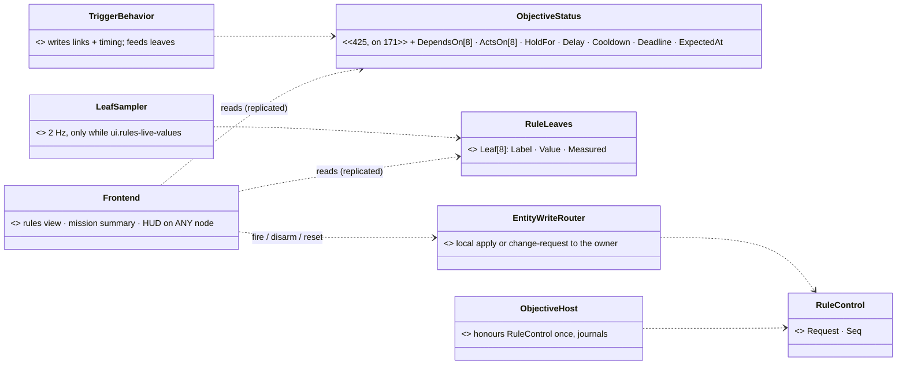

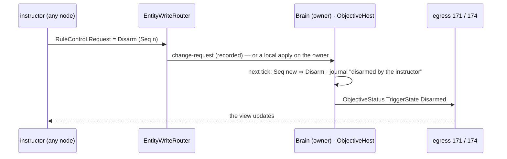

*What the pictures show that prose hid:* every frontend READS two topics and WRITES one attribute — the owner stays the one place a rule's state changes,
so a disarm from a Player-node IOS and from the editor take the same path.

### 00.11 S4 — per-member evaluation: build decisions *(behaviors, `2026-11-02`; handoff Part B; on backend's `InsertMacro` (Macros §16) and CE-4155)*

| # | decision | why / basis |
|---|---|---|
| **E-1** `MemberEvaluation` | an objective KIND (TKB 8860, the task slot) whose `Subject` is a commander; params `{ common, library: "macros/evaluation/<set>", overrides: {key→macro} }`. Each tick it walks the subject's `UnitRoster` (ONE level — a role macro may itself hold a `MemberEvaluation`, SR-72) and, for a member it has not served, picks the macro by SR-81: `overrides[@RefKey]` → `<library>/<RefKey>` → `<library>/<TacticalDesignation>` → `<library>/<entity class>` → `<library>/Default` (first file the node's macro library HAS), and inserts it through the SAME request `InsertMacro` publishes (one helper, `MacroInsertion.Request`) with args `{ subject: <member>, parent: <this evaluation> }`. Served members are remembered in its blackboard (≤ 16 net ids); a casualty's instance STAYS (it keeps its result); a reinforcement gets one | SR-72 / 72a / 81; ⛔ no second insertion path |
| **E-2** measures | kinds with `Role = Measure`, `Value` / `Target`, `Score` by `ObjectiveRules.Score` (clamp Value / Target; a "lower is better" measure declares `lowerIsBetter`): `HitRatio` (hits ÷ shots by the subject's men — `WeaponFireIntent` shooter, `DamageAssessedEvent.Source` on a hostile, CE-4155 `attribute` last / original / both) · `Count { what: shots / hits / kills / fratricide / civiliansHarmed / reports }` · `ReportLatency` (`SquadReportNotification` from the subject: `SentAt − ObservedAt`, the mean of the run so far) · `TimeTo { objective }` (scenario start → that objective's `ChangedAt` when Achieved) · ⭐ SR-20 adapters: `Sample { input, aggregate: mean / max / timeAbove }` reads a registered `[UtilityInput]` on the subject (no fourth registry) and the predicate leaf `InputAbove { input, threshold }` (a `SearchPredicateDto` leaf with a level arm) | SR-20, §10.3 |
| **E-3** roll-up + groups | ⭐ nothing new to aggregate: an evaluation macro's ROOT is a composite (`WeightedMean` by default) with `Parent` = the commander's evaluation, so the tree IS the roll-up up the chain. `ObjectiveCommon` gains `group` (FixedString32: mission · fire · reports · conduct …, from the macro, ⛔ not hard-coded) and it rides the status (171). The per-side HEADLINE = the root composites by subject side (`Score`, pass mark = its `Target`) — read by a frontend from the replicated rows, the same at the end in `ExerciseResult` | SR-75, SR-111 |
| **E-4** history (trend) | ⛔ no new store. Statuses are RECORDED components ⇒ after the run the recording gives any status's value over time (the Replay Browser's index); LIVE, a frontend keeps its own small ring of the replicated `Score` it receives (it is the one viewing). Measure first what the timeline index already offers; build only the gap | the handoff ("prefer the existing timeline index / recording") |
| **E-5** debrief / HUD data | ⭐ comes FROM E-1…E-3: a trainee's standards = the statuses whose `Subject` is him (GO = Achieved, NO-GO = Failed / Skipped-required), his squad / platoon = their evaluations up the `Parent` chain, kills / assists = `Count` measures. ⛔ nothing computed twice; the screens are ui's | SR-112, R-4105 |

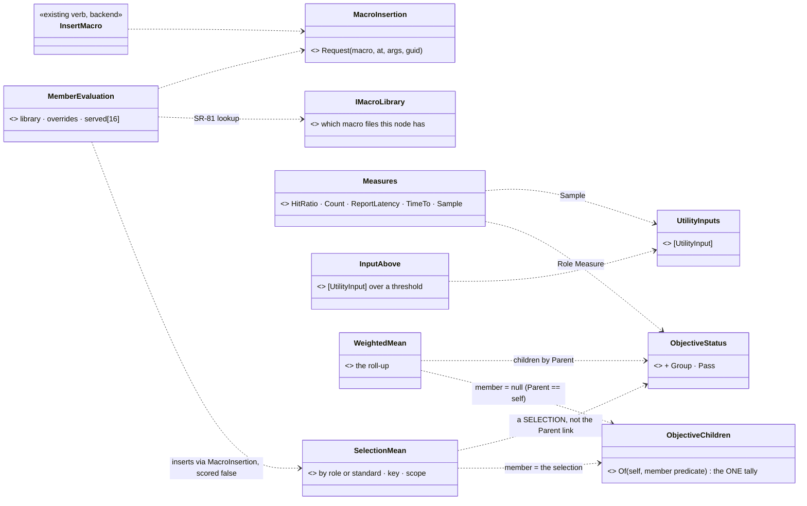

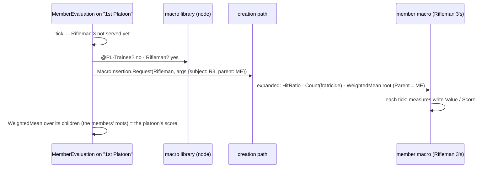

*What the pictures show that prose hid:* S4 adds kinds and one helper — the roll-up, the groups, the debrief and the HUD are READINGS of the status tree
that already replicates to every node.

⭐ **SR-145** ✅ `2026-11-01` — **objectives and triggers have NO feature switch: they are scenario CONTENT, like cars.** 🔒 user, `2026-11-01`: *"The triggers and objectives, they are entities like cars or whatever else, and they are probably a core system feature as well. So is there anything that we can turn on or off? They are either present in the scenario or they don't. And if they are, they should be working, as the system knows how to handle them."* → *"Yes."* to the lean. ⭐ Measured against every reason to switch them off — free play (per scenario: the instructor disarms a trigger / switches an objective off, T9 / `SetObjectiveActive`, or a run variant / param, SR-101), debugging (the same), performance (a handful of entities, one small behaviour each), a node that cannot run them (any Brain node runs every behaviour), replay (brains do not tick, T10), old builds (no backward compatibility) — none holds. ⇒ ⛔ no `scenario.rules` feature; the ONLY check is the behaviour registry's: an unknown kind / action fails the load loudly. Real switches stay where the run is PRESENTED or PLAYED differently (`exercise.pause-on-end`, `hud.*`, `gameplay.team-kill`). Supersedes SR-6's "master refuses to start" clause and `DESIGN_Node_Features.md` F-17's `scenario.rules`.

⭐ **SR-144** ✅ `2026-11-01` — **macro expansion is CORE infrastructure, not part of the rules.** 🔒 user: *"Macro expansion is not part of scenario rules, is it? Isn't it a standalone feature which is usable in general, just being used by the rules system? So it should not be gated by scenario.rules. I think this is the core system feature."* ⭐ The `Expander` lives on the entity CREATION path (§9.7) and serves forces, units, props and events alike; the rules are one user of it (`InsertMacro`). ⇒ composed wherever entities are created, ⛔ never gated by `scenario.rules` (`DESIGN_Node_Features.md` F-19), and its slice (S3) does not depend on the rules' slices except for `InsertMacro`

⭐ **E-1 AS BUILT, task 18 `2026-11-02` (`MemberEvaluation`; no tracker row — S4 has none yet).** The kind: `MemberEvaluationBehavior` (`Brains/Objectives/`, `HoldAreaBehavior` pattern, params `MemberEvaluationParamsJsonDto { common, library, overrides? }`, `BehaviorNames.MemberEvaluation`); its blackboard holds the library FixedString64, `Served` (Ids16 of member NET ids, + count; when full the ids that left the roster make room — a roster holds 16) and `Unmatched`; the overrides JSON lives in `ActionArgs` item 0 (the Trigger's way, written at assignment). **The ONE insertion:** `MacroInsertion.Request(world, self, macro, at, heading, argsJson, out guid, salt)` (`Verbs/MacroInsertion.cs`) is `InsertMacro`'s former body (cross-lane file, backend's `MacroVerbs.cs`, now calls it; behaviour unchanged, its rails green) + `MacroInsertion.State(world, guid, out reason)` (the instance's `MacroExpansionStatus`); ⚠ the GUID derivation gained an optional `salt` (the member's net id) — several insertions by one inserter in one tick would otherwise derive ONE id; empty salt = the old key. **The library reach (a seam added):** the expander's `IMacroLibrary` was private to `MacroExpander`; `MacroExpansionSystem.Execute` now sets it ONCE as a managed world singleton (`GlobalComponentIds.IMacroLibrary` **432**, `[DataPolicy(NoScenario | NoReplay)]` — a service, the `ITkbDatabase` pattern) and the kind reads it — ⛔ no second reader; a node without an expander has none ⇒ the Reason *"this node has no macro library"* and the member is asked again next tick. **Lookup (SR-81):** per member, in order `@RefKey` → role → class → `Default`; at each step the author's override of that name (`"@Key"` / role / class — flat map, a missing macro falls through) THEN `<library>/<name>`, the first the library HAS (`IMacroLibrary.TryRead`). Role = the member's `UnitSubordinate.Designation` (else the roster's parallel slot); class = his TKB template NAME (`ITkbDatabase.GetByType(TkbIdentity.TkbType).Name`, the world singleton). A path is stored WITHOUT the `macros/` prefix (as `InsertMacro` names it). Args `{subject: member GUID, parent: this GUID}` (a member / evaluation with no `EntityGuid` counts as *unmatched* — SR-45); at the member's position, heading 0. **A member no file covers** (not even `Default`) is marked served and counted: the status reads *"N member(s) without a macro"*, never an error. **Verdict:** `WeightedMeanBehavior.Aggregate(world, self, ref s, passScore, now, kind, note)` — the tally / score code EXTRACTED from `WeightedMean.Tick` (which calls it too); pass score = `WeightedMean.DefaultPassScore` 0.6 (no param). ⚠ It serves only while it EVALUATES (Active / Pending, like the other composites): an evaluation whose children are ALL final becomes Achieved / Failed and stops following the chain — fine in practice (a standards root stays Active until the exercise closes), the rail keeps one child open. **The sample library** `macros/evaluation/infantry/` (folder = macro, `Default/scenario.json`, `SquadLeader/scenario.json`; params `subject`, `parent`: `EntityLink`, bound as `"^subject"` / `"^parent"` inside the params JSON): `Default` = a `WeightedMean` root "Member standards" (parent `^parent`) + a required `NoHarm` (Neutral); `SquadLeader` = the same + a nested `MemberEvaluation` over `^subject`'s own roster (library the same folder) — the recursion. Rails (`ScenarioRulesTests.MemberEvaluation.cs`): one per member by role at the member and asks once · a late member gets one, a dead member's instance and result stay · the lookup order (key → role → class → Default, each file removed in turn) · overrides win, a missing override falls through · no macro ⇒ a Reason, no library ⇒ a Reason · the verdict equals a `WeightedMean`'s over the same children · the SHIPPED files through `FileMacroLibrary.ForNode` (the squad leader gets `SquadLeader`, the nested evaluation serves his men).

⭐ **E-2 / E-3 AS BUILT, task 19 `2026-11-02` (no tracker row — S4 has none yet).** **The measures** (`Brains/Objectives/Measures.cs`, role Measure, always Active — they score, never end; the state never goes Failed, so a measure's `required` is display only, ⚠ open): `HitRatio` · `Count` · `ReportLatency` · `TimeTo` · `Sample`, each the `HoldAreaBehavior` pattern with its own `…ParamsJsonDto` (`target` null = the kind's default: HitRatio 0.30 · ReportLatency 60 s · Count 1, 0 for the faults · TimeTo 0 · Sample 1). **ONE evidence reader** (`MeasuresEvidence.cs`, `MeasureEvidence.Update` + `.Reports`) shared by `HitRatio` and `Count`: the men = `ObjectiveCensus.MenOf`; shots = `WeaponFireIntent` with `Shooter` ∈ men and `!IsRemote` (✅ confirmed raised on the BRAIN node: `AimAndFireExecutor` publishes it there and `WeaponFireIntentEgressTranslator` reads it there; ⚠ a countermeasure release is the same event, so flares count as shots); a hit = a `DamageAssessedEvent` whose attributed source ∈ men — the attribute (CE-4155) is read ONCE by `NoHarmBehavior.Sources` (NoHarm's side test now goes through it too) — on a hostile (`KillZone.Hostile`); fratricide = the victim of the subject's own side, not the man himself; civiliansHarmed = a Neutral victim; a KILL = a credited hostile now out of the fight or gone (≤ 16 pending; a corpse shot again is not a second kill, a revived one can be killed again; a later harm by a non-man drops the credit). Reports = `SquadReportNotification` with `FromUnit` ∈ the subject's roster (`ObjectiveCensus.RosterOf`, units and bodies); latency = `SentAt − ObservedAt`, never negative, mean so far. **Scoring:** `ObjectiveRules.Score` / `WriteScore` gained `lowerIsBetter` — 1 when `Value ≤ Target`, else `Target / max(Value, 1e-6)`; used by `Count` fratricide / civiliansHarmed (Target 0), `ReportLatency`, `TimeTo`, a `Sample` with `lowerIsBetter`; ⛔ `CounterBehavior` never asks, its score is unchanged (rail). **No evidence ⇒ Score 0** (no shots · no reports · TimeTo not Achieved yet or never · no reading) — never a pass; HitRatio with 0 shots is Value 0, Active, Score 0. `TimeTo`: Value = the objective's `ChangedAt` once Achieved (frozen), else now. **SR-20:** `UtilityInputReaderStore.TryRead(repo, name, self, ctx, out v)` / `.IsRegistered(name)` (public, `UtilityScorer.cs`) evaluate a `[UtilityInput("name")]` exactly as a consideration does (the same id hash, the same reader) — `Sample { input, aggregate: mean|max|timeAbove, threshold }` reads it on the subject every Active tick (timeAbove = seconds, the first reading has no dt); the leaf `InputAbove { input, threshold }` (`InputAbovePredicateDto`, `PredicateCompiler.Level.cs`, both modes; its number for the rules view = the reading; an unregistered input reads 0, an empty name throws). ⛔ no fourth registry. **E-3 group:** `ObjectiveCommon.Group` (string → `FixedString32`), `ObjectiveStatus.Group`, `EntityObjectiveStatus.Group` (appended; display, goes at once), `GET /objectives` `group`. **A seam fixed on the way:** `ObjectiveChildren.Of` counts a CLOSED measure as final — a composite over measures otherwise never saw all its children final and the exercise's close turned the whole tree "Failed: not achieved by the end" whatever its score (also true for backend's `Counter`). **Sample library** `macros/evaluation/infantry`: `Default` = root + NoHarm (group conduct) + HitRatio (fire) + Count fratricide (conduct, required) + ReportLatency (reports); `SquadLeader` adds Count reports (target 3, reports). Rails: `ScenarioRulesTests.Measures.cs` (HitRatio by attribute · Count every what + kills once · ReportLatency · lowerIsBetter leaves a Counter alone · TimeTo · Sample mean/max/timeAbove + lowerIsBetter + unregistered · group · a tree of measures closes by its score), `ObjectiveRulesTests` (the formula), `PredicateCompilerLevelTests.InputAbove_…`, `ObjectiveStatusWireTests` (group round trip + at once), `TheObjectivesRouteShowsTheTreeTests` (group), the shipped-library rail. ⚠ Open: `required` on a measure does nothing (only a Failed child fails a composite) — decide whether a required lower-is-better measure at score 0 should fail the tree; the lowerIsBetter flag is not on the wire (a frontend shows Value against Target without the direction); `Sample` reads the subject itself, not an aggregate over its men.

⭐ **S4 scores ② / ⑥ AS BUILT, task 21 `2026-11-03` (no tracker row — S4 has none yet).** **Measured first:** `Group` was already on 171 (task 19) — nothing to do; a pass mark existed only on composites, smuggled into `Target`. **② `Pass`** (`ObjectiveStatus.Pass`, 0..1, appended on the 171 wire as `EntityObjectiveStatus.Pass`, a display field that goes at once; `GET /objectives` row `pass`): **GO / NO-GO is the read `Score ≥ Pass`** — ⭐ `Pass` is THE field to read on every status; on a composite `Target` keeps the same number only for old screens. Written in ONE function, `ObjectiveRules.PassOf(kind, role, authored)`, called by `ObjectiveRules.Display` (so by `ObjectiveHost.Enter` for every kind, no per-behaviour copies): an authored `common.pass` (`ObjectiveCommon.Pass`, capped at 1) wins; else `WeightedMean` / `MemberEvaluation` 0.6 (`DefaultCompositePass`), `Counter` 0 (a pool the scenario moves — no verdict), every other kind 1 (a measure's Score is already normalised and lowerIsBetter-folded, so 1 = its target met; an objective is 1 when Achieved; `AllMustPass` 1). `WeightedMean`'s own `passScore` still wins over `common.pass` (its `Resolve` folds it into `Common.Pass`); `MemberEvaluation` aggregates against `s.Pass`. **⑥ `Count assists`** (`CountWhat.Assists`, `assistSeconds` default 10): a hostile a man of the subject hit, whom somebody ELSE then hit (his kill credit superseded — the credit `MeasureEvidence` already keeps), counts ONCE when he goes down within `assistSeconds` of the subject's last hit; the subject's own kill is a kill, never an assist; a hit by the subject after the other's takes the kill back. Built INTO `MeasureEvidence` / `FireTally` (`Assisted` ring of 8 with hit times, `PendingAt`), the same one counting mechanism as kills; the already-scored list (`Killed`) also blocks a second assist. **The per-player inputs backend reads — choice (a):** a per-player `Count` measure (kills · assists · fratricide, `attribute` per CE-4155) inserted by backend's awards macro on each possessed person — no new API, one tally; ⛔ (b) a public static reader rejected: it would be a second tally with no owner and no recording. Note: `behaviors → backend` `NOTE_Behaviors_To_Backend_Player_Score_Inputs.md`. Rails: `ScenarioRulesTests.Measures` (`Pass_OnEveryKind_…`, `Count_Assists_…`), `ObjectiveStatusWireTests` (round trip, `APassChange_GoesAtOnce_…`), `ObjectiveRulesTests.PassOf_…`, `TheObjectivesRouteShowsTheTreeTests` (`pass`) — each red-proved. **ui's S0 rail:** `PlayerMessageEvent.OriginNodeId` is a `Fdp.Core.NodeId` (None = this node); the wire twin stays an `int`, converted in `PlayerMessageIngressTranslator`.

⭐ **S4 scores ① / ⑤ AS BUILT, task 22 `2026-11-03` (no tracker row — S4 has none yet).** **Measured first, and the design it follows:** an objective has ONE `Parent`, and a man's `Member standards` root already belongs to his commander's evaluation, so a role composite cannot ADOPT it (a second parent would count it twice) ⇒ **aggregate by SELECTION, not by parenting.** **The tally:** `ObjectiveChildren.Of(world, self, member = null)` keeps its single body — `member` null is today's `Parent == self`, a predicate is a selection; `WeightedMeanBehavior.Aggregate(…, member)` and `ObjectiveHost.CloseComposite(…, member)` pass it on (a selection mean closes when ITS selected statuses are closed). ⛔ no second tally. **`SelectionMean`** (`Brains/Objectives/SelectionMeanBehavior.cs`; `SelectionMeanParamsJsonDto { common, by: "role"|"standard", key, scope: EntityLink }`; `BehaviorNames.SelectionMean`; `ObjectiveRules.PassOf` gives it 0.6): Score / State / Value from the ONE `Aggregate` over the selected statuses. `by: role` = the roots directly under `scope` (Parent == scope, not a mean) whose subject's role key == `key`; a matched root is REMEMBERED (≤ 16 net ids in the blackboard) so a casualty (his entity gone, the subject link dead) keeps his result in the mean. `by: standard` = `IsStandard`: a status 2–3 levels under `scope` by the Parent chain (the member's root is level 1), not itself a `MemberEvaluation` / mean, whose chain does NOT pass through a nested `MemberEvaluation` (a squad's mean is its own men's) and whose `Title` == `key`. ⚠ A `"^by"` unbound slot validates (the macro files are swept as written). **The role key — ONE function** `MemberEvaluationBehavior.RoleKey(world, member)`: `UnitSubordinate.Designation` else the TKB class name (the same two sources `Pick`'s lookup uses; ⚠ `Pick` still also falls back to the roster's parallel designation slot, which a member with no `UnitSubordinate` may carry — such a man's role KEY is his class name, consistently for both creating and selecting). **`MemberEvaluation` creates them** (`ServeMeans`, after `Serve`): for each live member's role key one `By role` mean titled `All <role>` (group `roles`), and for each distinct title of a standard under its roots one `By standard` mean titled `<title> (mean)` (group = the standard's own) — each inserted ONCE through `MacroInsertion.Request` with the SHIPPED macro `macros/evaluation/selection-mean` (params `by`, `key`, `scope`, `parent`, `title`, `group`; `scored: false`, Parent = the evaluation) ⇒ the evaluation's own score is unchanged. The asked set is two `Ids16` of FNV-1a hashes in the blackboard (`RoleMeans`, `StandardMeans`), **capped at 16 each** (a full set says *"means capped at 16 roles / 16 standards"* in the Reason); a reset clears them. A library WITHOUT the macro gets none (the existing rails' libraries are such). A standard title over 55 characters is skipped (the mean's title adds ` (mean)`; FixedString64). **A standard mean reads like the standard** (`RawMeans`): its `Value` / `Target` are the weighted means of the selected standards' own Value / Target (a role mean keeps Value = Score, Target = Pass); Score = the mean of the normalised scores. ⚠ **Open:** a mean made while its members' standards are not yet there is created from the titles seen so far — a standard added later by a macro gets its mean when it first appears (live), never retroactively removed. **⑤ the PH-6 audit — every field, and what answers it:**

| PH-6 field | answered by | a read? |
|---|---|---|
| per standard: **Value** · **Target** | the man's standard status `Value` / `Target` (a measure: the reading and its goal; a lowerIsBetter flag is not on the wire — open since E-2, the card shows the two numbers) | ✅ read |
| **GO / NO-GO** | `Score ≥ Pass` on the same status (S4 ②) | ✅ read |
| standards **grouped** | `Group` (E-3) | ✅ read |
| the **squad's mean of the same measure** | the `by: standard` SelectionMean titled `<standard title> (mean)` among the CHILDREN of his commander's evaluation (the same `Parent` as his root): its `Value` / `Target` = the means of the standard, `Score` vs its `Pass` = GO for the squad | ✅ read (**new**: the mean's raw Value / Target — the first cut had only the normalised mean, ⇒ `RawMeans`) |
| **his root vs his squad vs his platoon** | his root = the `WeightedMean` "Member standards" whose `Subject` is him; his squad = its `Parent` (the squad leader's evaluation: Score, Pass); the platoon = that evaluation's `Parent` (the squad leader's root in the platoon's evaluation) → its `Parent`, the platoon's evaluation. Each is a `Score` / `Pass` pair | ✅ read (Parent chain) |
| his **role** row ("All riflemen") | the `by: role` mean `All <role>` under the same evaluation | ✅ read (**new**, ①) |
| **went well / work on** | per standard `Score − Pass` (the margin) over his standards — sort, best / worst | ✅ read (computed in the view, ⛔ not stored) |
| the card's **title** for a squad mean | convention: `<title> (mean)` — the reader matches by title among siblings | ✅ read, ⚠ a title match; a standard whose title is over 55 characters has no mean |

⇒ **Everything in PH-6 is a read of the tree after ①; the only additions were the standard mean's raw Value / Target and the means themselves.** Not covered (stated): *his moments* / *replay from my eyes* (PH-6's own ⏳, RV-4 + the film director) and progress across runs (G7). Rails (`ScenarioRulesTests.MemberEvaluation.cs`, each red-proved): one role mean per role with the right members and mean, asked once · a reinforcement joins its role, a new role gets a composite, a casualty stays · the standard mean over the men excluding a nested squad · `scored: false` leaves the evaluation's Score unchanged · the standard mean's Value / Target · a library without the macro inserts none · bad params refused · the SHIPPED macro; `ObjectiveRulesTests.PassOf` (SelectionMean 0.6); `TheObjectivesRouteShowsTheTreeTests` (the means as children — a pin, the route is kind-agnostic).

**Rejected — one line each (the big ones; the rest are in each section):**
- *A rules interpreter / a scenario-control system* — a second brain runtime with its own debugging (R-4109).
- *A director entity* — a macro of objectives and triggers does it (SR-99).
- *Compiling anything per scenario* — R-4112.
- *A big result object on the wire* — the tree is the statuses (SR-122).
- *Building S1 on today's `EntityRef` / polyline areas and migrating later* — the same files twice; S0 first.

### 00.12 S6 — the game profile, v1 *(backend, `2026-11-02`; `HANDOFF_Coordinator_To_Backend_Showcase_Scenarios.md` item ②; ⏳ built on these leans — the user may overturn any G-row)*

🔒 *User, `2026-11-02`: "backend can also add the missing infrastructure, whatever is needed."* ⭐ Crossfire (SHOWCASE §2) needs four things the
rules do not have: a point captured **by outnumbering for N s**, a **ticket pool** that actions and deaths move, a trigger that **fires again
while its condition holds** (the drain *"1 ticket / 10 s per held point"*), and **bots that come back** (respawn waves). Everything else is
data on S1 / S2 / S3. ⛔ Score per player, team-kill −200, awards and the bounty wait for S4's measures (behaviors) and CE-4155; the human
Deploy respawn (D-14) is Player Join S2.

**INVENTORY** *(graph + grep, `2026-11-02`)*: `search_graph` `.*(Ticket|Respawn|Domination).*` Class → **0** · `.*Counter(Behavior|Params|Verbs).*`
→ 3, all test / demo blackboards (`DemoCounterNodes`) — no pool · `HoldAreaBehavior.Capture` (S1) flips `Owner` the instant the subject's men
≥ minMen and enemies ≤ maxEnemy — no time, and it counts the SUBJECT's roster (a respawned bot is in no roster) · `TriggerBehavior.Step`
(S2) re-arms a repeat only when the condition went FALSE again (T2) · `ObjectiveRole.Measure` exists, its score = `Value / Target`
(`ObjectiveRules.Score`), a measure freezes its value at the close · `ObjectiveCensus.IsMan` / `Injury.IsInTheFight` decide "in the fight" ·
`CountMatchingPredicateDto` counts entities in a condition · ⚠ coverage could not be checked through the CLI.

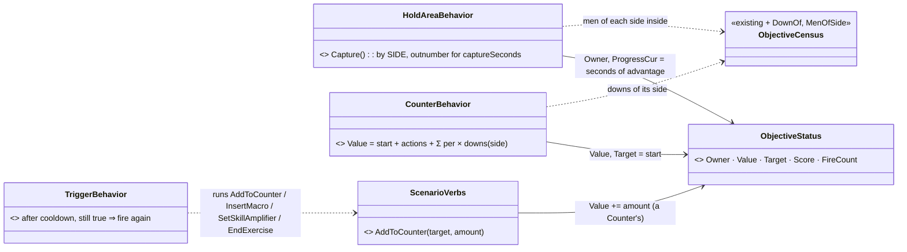

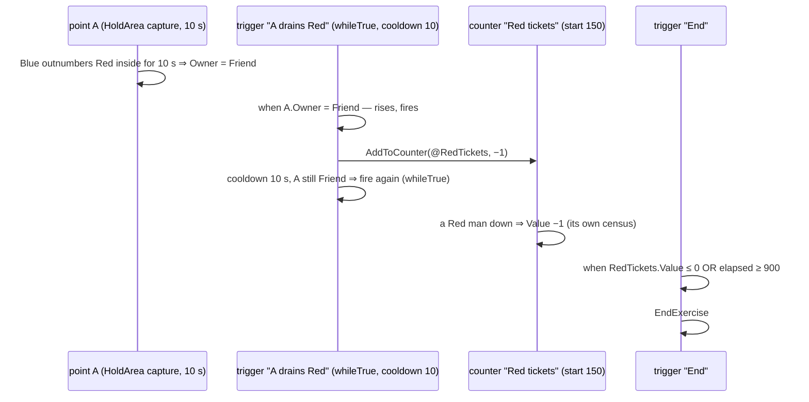

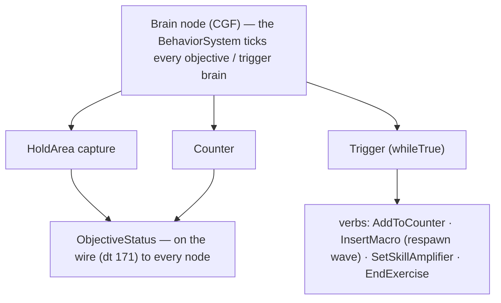

*What the pictures show that prose hid:* nothing new runs anywhere but the Brain's existing objective host; the drain is a TRIGGER (data) moving a
COUNTER (one new measure kind) through ONE new verb — no ticket system, no game-mode code; the respawn wave is a trigger + `InsertMacro`.

| # | decision (⏳ lean, built) | why |
|---|---|---|
| **G-1** | `HoldArea` `capture` + **`captureSeconds` > 0** ⇒ counts men by **SIDE** (every man of the side, not the subject's roster); the side with MORE men inside (≥ `minMen`) than every other side, continuously for `captureSeconds`, becomes `Owner`; the moment another side outnumbers the owner, `Owner` = Neutral (the point is lost) and the outnumbering side's clock starts. `ProgressCur` = the seconds of advantage, `ProgressNeed` = `captureSeconds`. `captureSeconds` 0 = S1's rule unchanged | SHOWCASE §2.6 line 1 (*"captures only with more men for 10 s"*). By side: a game point belongs to a team, and a respawned bot is in no roster |
| **G-2** | a **`Counter`** measure (TKB 8860, role Measure): `Value` starts at `start`; actions add to it; `deaths: [{side, per}]` (at most Friend and Hostile) ADDS `per` for every man of that side newly OUT of the fight (`Injury.IsInTheFight` false, counted once — a revived man does not refund): tickets `[{"side": "Friend", "per": -1}]`, a lead `[{"side": "Hostile", "per": 1}, {"side": "Friend", "per": -1}]`. `Target` = `start` ⇒ score = tickets left / start. `floor` (default 0) / `ceiling` (default none) clamp it | the ticket pool. ⚠ NOT S4's `Count` (*events BY the subject*: shots, kills): a pool is moved BY the scenario. When S4 lands, the deaths input may move to a `Count` measure (SR-20 adapters) — one counter either way |
| **G-3** | verb **`AddToCounter(target, amount)`** — instant; Failure when the target is no Counter, or is closed | SR-93: one shared action; the crate's +15, the drain's −1, the operator's hand edit all use it |
| **G-4** | Trigger **`whileTrue`**: a repeating trigger whose condition is STILL true when its cooldown ends fires again (T2's "goes false again" is waived); `maxFires` still caps it | *"each held point drains 1 ticket / 10 s"* = `when A.Owner = Friend`, `repeat`, `cooldown 10`, `whileTrue` — the periodic rule as data |
| **G-5** | respawn waves for BOTS = data: a trigger `when` *(fewer than N of the side's men in the fight)* `whileTrue`, `cooldown` = the wave interval, `do` `InsertMacro(<one-bot macro>, @<side>Base)` | D-14's bot half with no new runtime; the human half (the Deploy screen) is Player Join S2 |
| **G-6** | domination = a trigger `when` all three points' `Owner` = the side, `holdFor 60` ⇒ `EndExercise` | SR-73: the condition vocabulary is the statuses |
| **G-7** | the comeback boost compares TWO counters ⇒ a third Counter **`Lead`** (`floor` −1000, `deaths` both sides, opposite signs) moved by the same drain actions (Red loses a drained ticket ⇒ Lead +1; Blue ⇒ −1), and the boost triggers on `Lead ≥ 40` / `≤ −40` (`cooldown 120`, repeat) | the predicate language compares one entity's field with a constant; a difference of two is one more counter, not a new operator |

**As built (`backend`, `2026-11-02`) — what the code settled that the rows left open:**
- **G-1** — `HoldAreaBehavior.CaptureBySide`; a leader that already owns the point reads its clock FULL (`ProgressCur` = `ProgressNeed`), no leader / a tie reads 0 and the Owner stays unless outnumbered. `ObjectiveCensus.MenOfSideInside`.
- **G-2** — `CounterBehavior`, `ObjectiveCensus.DownOf`. ⚠ The deaths census **follows** the downs (it is NOT a high-water mark): a corpse that is cleaned up or a man revived lowers it, so the NEXT man to go down counts again — a high mark would swallow every death until the census climbed back over its old peak (respawn waves + corpse cleanup ⇒ a silent pool). Cost: a man revived and downed again counts twice; one revive and one new down inside the SAME tick net to nothing. Men already down when the counter first evaluates are the baseline, not deaths. Value is clamped every evaluate, so an `AddToCounter` past `floor` / `ceiling` is pulled back at the counter's next tick.
- **G-3** — `ScenarioVerbs.AddToCounter` does not clamp; the counter does (above).
- **G-4** — a `whileTrue` re-fire is a fresh edge: `holdFor` then `delay` run again before the next fire.

**Rejected — one line each:**
- *A ticket SYSTEM per game mode* — nothing compiled per scenario (R-4112); a counter + triggers is the same with no new runtime.
- *The drain inside `HoldArea` (`drains: @RedTickets`)* — couples the point to the pool; a trigger keeps it editable and visible in the rules view.
- *Deaths decremented by a trigger per death* — a level condition has no per-death edge; the counter's own census counts each one once.
- *A `Difference` predicate operator* — a language change for one use; G-7's counter is data.

**Not here (named):** personal score, kill feed, team-kill −200, awards, bounty — ⭐ now §00.13 (S7) · the
human respawn (Player Join S2) · the game HUD (ui) · `Message` to one side (the `Side` filter is ui's HUD).

### 00.13 S7 — the per-player game score *(backend, `2026-11-03`; `HANDOFF_Coordinator_To_Backend_Player_Score.md`; ⏳ built on these leans — the user may overturn any P-row)*

🔒 *User, `2026-11-03`: "What node is going to calculate these score tables, where and how stored? How the scoring relates to objectives and
measures?"* → *"Write handoffs to behavior and backend."* ⭐ Settled before this section: **the score IS a set of measures whose subject is the
player's man — one counter, not two** (SR-84, `DESIGN_Player_Join.md` D-15 row) · kills credited once by CE-4155 attribution (SR-82, `Count`,
§00.11 E-2) · an objective's **`points`** is its worth, summed into the exercise result when Achieved (`ExerciseVerbs` result, `ScenarioVerbs.cs:182`).

**INVENTORY** *(`2026-11-03`)*: `search_graph` `.*(Score|Scoreboard|Award|Bounty|Assist|Streak|KillFeed|KillCredit).*` Class → only EQS / utility
scorers (`DistanceScoreTest`, `UtilityScorer`, `ScoreDecisionNode`) — **no game score** · `.*(PlayerSlot|Possess).*` → `PossessedBy` (+ its wire
translators), `PossessionSystem`, `PossessionStation` · `.*(KillCam|Killer|Kill(ed)?Event|Death(Event|Notification)).*` → two FDP example events
only · grep `KillCam|team-kill|TeamKill|PlayerScore|Scoreboard|Bounty` (`*.cs`) → the kill cam takes its killer from `HitFeedback`
(`PossessionStation.cs:597`, a presentation ring — ⛔ not a score source) and `gameplay.team-kill` is the friendly-fire SWITCH (`DESIGN_Node_Features.md`
F-table), not a score · `CountWhat` = shots · hits · kills · fratricide · civiliansHarmed · reports (`ObjectiveParamsJsonDtos.cs:145`) — no assists,
team kills, deaths or captures · `MemberEvaluation` serves a ROSTER only (`MemberEvaluationBehavior.cs:113`) — a respawned bot is in none (G-1) ·
`ObjectiveCommon.Points` / `ObjectiveStatus.Points` exist and replicate (`ObjectiveRules.cs:37`). ⚠ coverage could not be checked through the CLI.

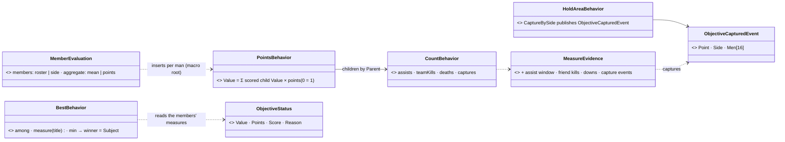

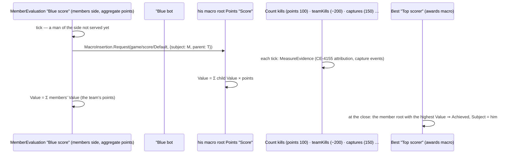

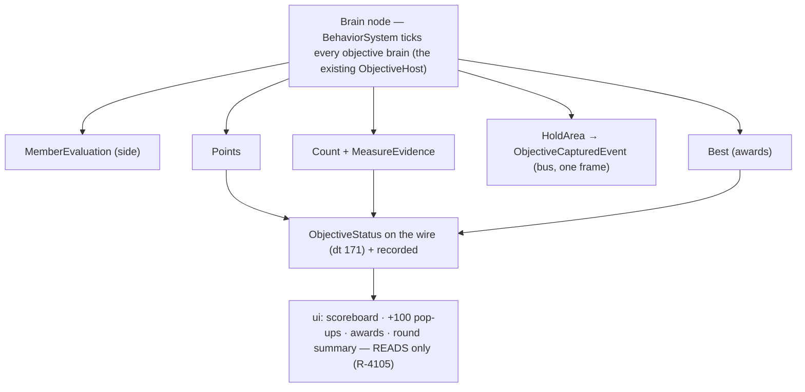

*What the pictures show that prose hid:* the score is not a system — it is a MACRO per man (inserted by the one inserter) of existing measures
under one new summing composite; the only new runtime inputs are four `Count` readings and one bus event; the screens read the status wire.

| # | decision (⏳ lean) | why |
|---|---|---|
| **P-1** | ⭐ the per-player score = a **macro per man** — root **`Points`** (title *"Score"*) + `Count` measures by the man — inserted by **`MemberEvaluation`**; library **`macros/game/score`** (`Default` = kills 100 · assists 50 · captures 150 · team kills −200 · deaths 0, unscored) | SR-84 *"one counter"*; SR-81 lets a scenario swap the table (`game/score-hardcore`) without code |
| **P-2** | **`Points`** (TKB 8860, role **Measure**: always Active, frozen at the close, never Failed): `Value` = Σ over its **scored** children of `Value × points` (`points` 0 = 1, as `weight`); `Score` = `Value / target` (`target` param; none ⇒ 0) | ⭐ `points` already means *"what it is worth"* (`ExerciseResult`); a measure's worth per unit is the same field. Role Measure: a score never fails a tree, and a closed measure is final (`ObjectiveChildren.Of`) |
| **P-3** | `Count` `what` += **`assists`** (he harmed a hostile who went down within **10 s** of his last harm while another man got the kill) · **`teamKills`** (a friend he harmed went down — the kill rule on his own side; ⛔ never a kill, `fratricide` stays harm) · **`deaths`** (his men going out of the fight, once each; a revived man can die again) · **`captures`** (an `ObjectiveCapturedEvent` naming one of his men) | ⛔ one counting mechanism: all four in `MeasureEvidence`, beside kills (behaviors' item ⑥ coordinates — `NOTE_Backend_To_Behaviors_Player_Score.md`) |
| **P-4** | `HoldArea` capture-by-side (G-1) **publishes `ObjectiveCapturedEvent { Point, Side, Men[16], MenCount }`** when `Owner` becomes a side — the men of that side inside at that moment | the point knows its area and the moment; a measure reading areas would duplicate G-1's census |
| **P-5** | `MemberEvaluation` gains **`members: roster` (default) \| `side`** — `side` = every man of the subject's side as he appears (a respawned bot, a deployed player); when its 16 slots are full, ids that are no longer living men of the side make room — and **`aggregate: mean` (default) \| `points`** (the team total = Σ the members' roots' `Value`) | the roster walk misses respawns (G-1's measured gap); ⚠ cross-lane on behaviors' kind |
| **P-6** | v1 scores **per PERSON ENTITY**; a player's score across lives (the player SLOT, D-15) waits for Player Join S2 (the Deploy respawn) | a human respawn does not exist yet; a respawned bot is a new man |
| **P-7** | awards = kind **`Best { among: @Evaluation, measure: "<title>", min, lowerIsBetter }`** — among the measures titled `measure` under `among`'s members, the best `Value` (≥ `min`); at the close: **Achieved, `Subject` = the winner**, `Value` = his value; nobody qualifies ⇒ Failed. The **awards macro** `macros/game/awards` holds them (*Top scorer* · *Most kills* · *Point keeper* = most captures · *Untouchable* = fewest deaths with a kills floor ⏳); ⛔ none in the scenario file | SHOWCASE §2.6 line 5; the winner is a READ (`ObjectiveLinks.Subject`) |
| **P-8** | ⏳ **bounty — not in v1**: needs a `streak` reading and a bounty mark on the man; lean: `Count what: streak` + a trigger in the score macro + `Count what: bountyKills` | the handoff's ③; built after P-1…P-7 |
| **P-9** | ④ the HUD / summary data is **already the wire**: a *+100* pop-up = a child measure's `Value` rising × its `points` (both replicated); the scoreboard = the members' `Points` roots; the best moment = the largest rise of a root's `Value` in the recording (behaviors' score-history lane, their item ④) | R-4105: the engine gathers, ui draws; ⛔ no second store |

**Rejected — one line each:**
- *A score SYSTEM beside the objectives* — two counters (SR-84 says one); the measures already count kills with attribution.
- *Points as a table on the `Points` root keyed by child* — a child's own `points` is the existing field and travels on the wire.
- *Captures read by each measure from the areas* — re-implements G-1's census per man per tick; the point publishes the moment once.
- *A `PlayerScore` component on the man* — a second store, not recorded as a tree, invisible to the rules view.


## 0. ✅ The user's first answers (`2026-10-31`)

> 🔒 *"blueprint is just one way of creating some decision logic … authorable also using C# hard-coded methods … best if the rules are data … a
> reusable condition that we can use also in the B3s and HSM guards"* · *"we should have one [evaluator]"* · pause at the end = a switchable
> feature · *"broadcast the event that the mission has finished … not our task to build a nice UI"* · *"define what station is the IOS"* ·
> *"Conditions as names registered. The user never writes expressions"* · *"visibleTo attribute can for sure be added."*

⭐ What these carry into the current design: ONE evaluator (SR-11) · a condition is PICKED, never typed as an expression (the `when` is built
in the existing predicate builder, SR-95) · the end is broadcast as data, the UI is a frontend's job (SR-9, SR-122, R-4105) · the IOS is a
composition choice (SR-13) · `visibleTo` (SR-120).

## 0b. ✅ The user's ruling (`2026-10-31`) — **build the brain from data; invent nothing that exists**

> 🔒 *"HSMs and B3s, they are just data as well. They do not need to be compiled. What needs to be compiled is just conditions … they should be
> generic, reusable … we can freely generate the HSM or B3 behaviors for the scenario brain on the fly, basically without recompiling."* ·
> *"What I want to avoid is to create some interpreter of scenario rules if there are already so many different means of how to express these in
> the current engine … avoid developing another type of brain, specifically for scenario control … only if really necessary."* ·
> *"logic like counter attack director can be authored, but it needs to be reusable … usable in multiple exercises in different conditions and
> have enough parameters."* · *"we already created a lot of debugging and monitoring mechanisms. So we should not add one more."* ·
> *"the data basically means that we are building the brain of the entity from the data, procedurally, on the fly, not by hard-coding new
> behaviors. Pretty much the same applies to the performance evaluator. I would rather extend the authoring possibilities of the existing
> features than start inventing something really new."*

**The idea in one line:** the scenario's rules, objectives and measures are DATA run by the EXISTING brain runtime — so they run, hot-swap,
journal and debug exactly like every unit's brain (R-4109, R-4111). §0c settled *how*: not one brain generated per scenario, but entities
running generic shipped behaviours with params.

## 0c. ✅ The user's ruling (`2026-10-31`) — **generic rules, composed by parameters; nothing compiles per scenario**

> 🔒 *"What I would like to achieve is that the rules are generic enough and we just parameterize them using values and compose the mission
> objective from those existing rules … So the scenario doesn't really need to recompile any HSM just because it is using already existing
> rules composed in and parameterized in different ways."* · *"I would like to minimize the need of rebuilding anything per scenario unless
> there is an unavoidable need for that. And if there is, it should be deterministic so that it can be done by any brain node."* ·
> *"maybe it's not necessary at all because the scenarios are distributed to all nodes that need them. So all the nodes can recompile
> whatever is in the scenario."*

⭐ ⇒ SR-21…SR-24: objectives and rules are entities running GENERIC compiled behaviours, parameterised; a condition is a typed objective kind
or a predicate (SR-37, SR-95), an action a shared action named in a data list (SR-91, SR-93); only a scenario that embeds its own HSM
compiles, in memory and deterministically, on each Brain node (SR-24).

## 1. INVENTORY *(`2026-10-31`; queries named)*

`search_graph` Class `.*(Hsm|BTree|Bt|Fbt|Tree)(Json|Runtime|Loader|Builder|Compiler|Interpreter|Blob|Asset).*` (29 hits) ·
`.*Utility.*` (80, paginated past tests) · `.*(BehaviorRegistry|BehaviorCatalog|HsmRegistry|…).*` · `.*(Measure|Evaluation|Debrief|Score).*`
(no evaluation code — EQS scoring and the measuring gizmo only) · grep for every `[SharedAiCondition]` / `[SharedAiAction]` / `[UtilityInput]`
name. ⚠ `check_index_coverage` is not available through the CLI — absence claims below are graph + grep, coverage unchecked.

| what exists | where | for scenario control |
|---|---|---|
| ⭐ **an HSM built at RUNTIME** — `HsmBuilder` → `StateMachineGraph.Build` → normalise / flatten → `HsmEmitter.Emit` → `HsmDefinitionBlob` | `Fhsm.Compiler/HsmBuilder.cs:14`, `Graph/StateMachineGraph.cs:93`; used at runtime by `Fdp.Examples.UrbanCombat/Brains/ApcHsmSetup.cs` | ⭐ the lowering target — no Roslyn, no dll |
| ⭐ **a BTree compiled from JSON at RUNTIME** — `TreeCompiler.CompileFromJson` → `BehaviorTreeBlob` | `Fbt.Kernel/Serialization/TreeCompiler.cs:12`; fluent-btree DESIGN :26 (*"compiled at startup"*) | ⭐ the BTree alternative |
| ⭐ **a behaviour registered at RUNTIME by name** — `BehaviorRegistry.Register(name, BehaviorDefinition)`; the definition carries `HsmDefinition` / `BTreeInterpreter`, `BrainStateBytes`, `ParseParams`, `BakeDefaults`, `JsonParamsDtoType`; hot-reload `MergeFrom` | `Fdp.Toolkits/Behavior/BehaviorRegistry.cs:147-343, :414` | ⭐ the data-built brain is just another registration |
| ⭐⭐ **a compiled shared method bound to a FIELD OFFSET at runtime** — `HsmSharedBinder.RegisterCondition / RegisterAction / RegisterStateful*` (key `Fqn@paramOffset[@stateOffset]`, a managed delegate whose closure carries the offsets); `RegisterDeactivator(…, nint paramOffset, nint stateOffset)` already takes raw offsets; BTree twin `SharedNodeBinder` | `Fdp.Toolkits/Behavior/HsmSharedBinder.cs:30-132`; `HsmActionDispatcher` managed tables (CE-3163) | ⭐⭐ **the seam**: a data-built brain lays out its block from the primitives' compiled `P` / `WS` types and binds each site at its offset — only a by-offset overload is missing (today's public overloads take a selector) |
| a brain ticks on ANY entity with `SopState` + owned `BehaviorState`; movement / weapon / interaction channels optional | `BrainTickSystem.cs:224, :296-298` | ⭐ the World Environment entity can carry a brain |
| params from the scenario: entity JSON `"Sop": {"Name","Params","Origin"}`; `SopState.JsonParams` | scenario files; `SopState.cs:18` | ⭐ the director's params live in the scenario, like any unit's |
| shared conditions: 104 `[SharedAiCondition]` (e.g. `ElementReported`, `Secured`, `HeldLongEnough`, `AreaQuiet`, `MoreObjectives`) — ALL self-relative (a unit's / commander's view) | `Fbt.Kernel/SharedAiAttributes.cs:14`; `Squad/Command/PictureConditions.cs:181` | reused inside quantifiers; ⛔ none is scenario-scoped |
| shared actions incl. `Action_IssueTacticalIntent`, `OrderSubordinate`, `SetSubordinateReporting`, `SendReport`, `Action_IncrementCounter`, `ChooseOption` / `ChooseOptionOnce` | grep `[SharedAiAction]` | ⭐ the director orders through these |
| utility: `UtilityDecisionBuilder` (runtime), `UtilityScorer.Evaluate(repo, self, def, context…)`, `UtilityInputCtx {Repo, Self, Context, Params}`, 59 `[UtilityInput]` (e.g. `EnemyStrengthRatio`, `SquadStrengthRatio`, `UnderFire`), `UtilityDecisionLog` | `Utility/Core/UtilityDecisionBuilderInfra.cs:219`; `UtilityScorer.cs:15` | ⭐ the adaptive director's choice; ⛔ no scenario-scope input |
| `CommanderUtilityTickSystem` (manoeuvre selection) — built, **no production caller** | OVERVIEW §6 DEAD box | precedent that utility works above unit level; ⛔ not a host |
| command chain: orders down (`AssignTacticalIntentEvent`), reporting demands (`SetReportingEvent` PIR / FFIR / SITREP, `ReportingRequirementsSystem.cs:38`), reports up (`SquadReportNotification`, `ReportInbox`) | Command Chain Example §3, §8 | ⭐ directing goes DOWN this chain; reports are measured |
| debugging that exists: HSM / BTree runtime inspector + overlay, `BrainJournal` (always on, recorded), `UtilityDecisionLog`, the Brain view | `HsmRuntimeInspectorPane`, `BTreeRuntimeOverlayRenderer`, OVERVIEW :480-484 | ⭐ inherited, nothing new |
| timeline lanes as data (`IndexedLaneDefinition`): shot, hit, blast, state lanes | Timeline §9c-§9e | ⭐ measures read and write lanes |
| the World Environment entity (TKB 8810: scenario-level, Brain-owned) with `ScenarioClock`, `WeatherConditions` | `TkbEntityTypes.cs:120`; Weather W-0 / C-3 | ⭐ the host entity |
| ⭐ **a params field that names a compiled thing, resolved at runtime** — `UtilityDecisionRef` (CE-2068: JSON = the asset id, the editor offers a picker, the scorer keys on the id); utility inputs dispatched by id through `UtilityInputReaderStore` | `Utility/Core/UtilityDecisionRef.cs:11`; `UtilityScorer.cs:32` | ⭐ precedent for a params field naming a compiled thing (the by-name `ConditionRef` it first suggested is retired, §12) |
| ⭐ **in-memory compile on the node that needs it** — `InMemoryRoslynCompiler` (Roslyn → PE in a collectible ALC), used by Blueprints' `Stage8_RoslynFinalize` and `QuickReloadService` | `Hrot.Blueprints.Compiler/Compiler/Roslyn/InMemoryRoslynCompiler.cs` | the escape hatch for a scenario-embedded HSM (SR-24) |

## 2. Claim table

| the design rests on | code — how it IS | design — how it was MEANT to be |
|---|---|---|
| an HSM can be built and run without compiling | ✅ `StateMachineGraph.cs:93`, `ApcHsmSetup.cs` (registered, ticked by `BrainTickSystem`) | ✅ fluent-btree DESIGN :26 (runtime JSON was the first path) |
| a compiled primitive binds at a runtime-chosen offset | ✅ `HsmSharedBinder.cs:98-132` (offsets are `nint`) | ✅ Behavior Action Binding §5.7 |
| a brain may run on a non-unit entity | ✅ `BrainTickSystem.cs:224, :296` | ⛔ searched, no design names a world-entity brain — this one does |
| the director can act only through orders | ✅ `Action_IssueTacticalIntent`, `SetSubordinateReporting` exist | ✅ Command Chain Example §3 |
| the existing inspectors show the scenario brain | ✅ `HsmAssetProjector.Project(blob, metadata, …)` turns any compiled blob + `MachineMetadata` into an editor asset (how every C#-authored HSM is shown); generated machines carry `HsmMetadata = blob.Metadata` (CE-370) | ✅ user, `2026-10-31` |
| an evaluation can be re-run on a recording | — not needed (user: a finished run is final, SR-19) | — |

## 3. Diagrams — ⭐ see §00.3 (classes), §00.4 (the sequence), §00.5 (modules — who calls each frame)

## 4. What a rule is, where it runs, what compiles *(SR-1…SR-24)*

| # | decision | ⭐ current answer |
|---|---|---|
| **SR-1** | what a rule is | **When** a condition rises (T1) **Do** actions, once or repeat — a `Trigger` entity (SR-88): `when` = the existing predicate language (SR-95), `do` = a data list of shared actions (SR-91, SR-93), timing T1–T10 |
| **SR-6** | where it runs | the rule entities run on the Brain node that owns them (the role's least-loaded node, SR-96), ticked by the existing `BrainTickSystem` (§00.5) on every node that composes the Brain capability — no switch (SR-145); a scenario naming an objective kind or action this build does not register fails its LOAD loudly (the behaviour registry's check, as for any behaviour — ⚠ measure in S1 what an unknown behaviour name does today) |
| **SR-9** | the end | `EndExercise` closes every objective, then writes the World Environment's `ExerciseResult` (SR-116, SR-122); the ingress raises **`ExerciseEnded`** once; pause = feature `exercise.pause-on-end` (ON), AFTER the close; never an automatic unload. The engine's obligation is the data on NED (R-4105); our views (SR-105…SR-112) are one frontend over it |
| **SR-10** | authoring | objectives and triggers are ENTITIES the editor already places and edits — their task-slot params through the existing params form (SR-33), the `when` through the existing predicate builder (SR-95), the `do` as a list (SR-109); macros group them (§9). ⛔ no second format |
| **SR-11** | ONE evaluator | the evaluator IS the brain runtime: every objective, measure and trigger is a behaviour ticked by `BrainTickSystem`; the `when` is the condition language data breakpoints, the Blueprint `When` node and the indexed timeline lanes already use (SR-95) |
| **SR-12** | custom logic | a new objective kind = a reusable behaviour (SR-37); a new action = a shared action (SR-93); a custom aggregation = a C# or Blueprint behaviour (SR-78); logic beyond a list = a reusable director asset (SR-99's escape hatch) |
| **SR-13** | the IOS | a composition choice; the server's full UI by default (R-4107) |
| **SR-17** | **reusable directors** (R-4110) | a director (counter-attack, reinforcement, pressure) is authored ONCE with params and used in many exercises — a MACRO of objectives + triggers (SR-99), or, in the escape hatch, a reusable HSM / BTree **asset** with a params DTO (R-3002 initializers) run by a trigger-kind control entity. ⛔ never logic for one exercise |
| **SR-18** | **the utility director** (the escape hatch of SR-99) | a control entity's task slot may run a utility decision (`ChooseOption` / `IsOption`, DESIGN_Decision_Layer §3) over plays (*Counter-attack · Reinforce · Hold · Ease off*), `Context` = a candidate (objective, spawn area, side HQ); its inputs may read any `Score` / `Value` (SR-77); each play is a `RunActions` list (SR-98) whose orders go DOWN the chain; `UtilityDecisionLog` explains it |
| ⭐ **SR-19** | **performance evaluation (P-4) on the same brain** (R-4111) | a measure is an objective with a value and a target (§10.3) — an entity on the same runtime, with a **subject** (SR-47: scenario · side · team = a command-chain node · trainee); results in its `ObjectiveStatus` (SR-120) and on timeline lanes (SR-103); live feedback to trainee / instructor as NED facts. ✅ **user, `2026-10-31`: no re-evaluation of a finished run** — *"once the life is over, we do not change anything, we do not re-evaluate based on different criteria"*; re-running new measures on an old recording is a future idea |
| ⭐ **SR-20** ✅ ASSIGNED TO S4 (user, `2026-11-01`: *"Yes"* to the lean) — `Sample` is a measure | **facts** | ⛔ no fourth registry. ⭐ The existing registries are adapted: a generic condition `InputAbove(input, threshold)` makes every `[UtilityInput]` a condition; a generic measure `Sample(input)` makes it a measure; a condition is a 0 / 1 input. ⇒ a quantity written once as a `[UtilityInput]` is usable as a condition, a utility input and a measure |
| ⭐ **SR-21** | **objectives and rules are ENTITIES running GENERIC behaviours** (R-4112) | an objective = an entity of a new TKB type (the area-entity pattern) whose TASK slot (SR-51) runs a generic compiled KIND (§10.2) with its params; a rule = a `Trigger` entity (SR-88); the end of the exercise = a trigger with `EndExercise` (SR-99). ⭐ The scenario is the EXISTING format (entities with brain slots `{Name, Params}`), the editor authors them as entities with params, each has the brain view, the journal and the inspector. ⇒ **a scenario adds data only — nothing compiles per scenario** |
| ⭐ **SR-23** | **what still compiles, and when** | only NEW PRIMITIVES and new reusable BEHAVIOURS (directors, generic behaviours) — ordinary development, built once into the shipped dll. ⛔ Never a scenario |
| ⭐ **SR-24**  ✅ KEPT as "discouraged, not scheduled" (user, `2026-11-01`: *"Yes"* to the lean) — the one exception R-4112 cites; in no slice since SR-99 made directors macros | **a scenario that embeds its own HSM** (the escape hatch, authored in the existing HSM editor, saved in the scenario) | ⭐ compiled IN MEMORY on load by every Brain node that needs it — the precedent is Blueprints' `InMemoryRoslynCompiler` (collectible ALC, `QuickReloadService`) — DETERMINISTIC: the same JSON + the same generator + the same referenced dlls ⇒ the same machine, keyed by the JSON's content hash, cached; ⛔ no dll is distributed (the scenario is). ⚠ discouraged by R-4110 (a director belongs in a reusable asset); not in S1 |

**Rejected — one line each:**
- *A rules interpreter (`ScenarioRulesSystem` evaluating a `RuleSet` component each tick, `RuleAction` classes, a `RuleState`)* — a second brain runtime beside HSM / BTree with its own tick, state and (missing) debugging (R-4109).
- *One brain generated per scenario (the rules lowered into one HSM, a region per objective / rule / measure — by the runtime `HsmBuilder`, then as a generated `.hsm.json` + hot reload, SR-15 / SR-16)* — any change in WHICH objectives a scenario has changes the machine and rebuilds (R-4112).
- *A per-scenario params / working-state block (the primitives' compiled `P` / `WS` concatenated, `{Asset}_Block`)* — each generic behaviour already carries its own params.
- *A world-singleton Blueprint as the scenario host (`RegisterWorldSingleton`, no production caller)* — the brain already hosts Blueprints as guards / actions; a second host duplicates it.
- *The World Environment entity's brain as THE host (`ExerciseControl`)* — rules are their own entities (SR-21, SR-88); a director is a macro (SR-99).
- *Conditions and actions BY NAME (`ConditionRef` / `ActionRef` + a generated by-name table, copied from `UtilityDecisionRef`)* — typed objective kinds (SR-37) and the existing predicate language (SR-95) cover conditions; actions are shared actions bound from the catalogue (SR-93).
- *Directing by moving units* — duplicates the order chain; the director orders.
- *A separate evaluation engine* — measures are objectives on the same runtime.
- *A new "fact registry"* — `[UtilityInput]` + two generic adapters cover it (SR-20).

## 5. What is missing — ⭐ see §00.2 (the *not built* rows) and §10.2–§10.3 (the kinds and measures)

## 6. Slices — ⭐ see §00.6

📐 The measurement behind *"nothing compiles per scenario"* (R-4112, SR-23), `2026-10-31` (`dotnet build Hrot.AI.Behaviors --no-restore`, warm,
this VM): nothing changed **3.8–4.5 s** (up-to-date check) · one NEW `.hsm.json` added **7.5 s** · the same asset rebuilt again **3.8 s** · a
whitespace-only edit **7.4 s** (a file change rebuilds even when the content means the same) · first build of the session 92 s (cold). The
rebuild + reload route is the editor's (`POST /ai/reload`, `AiBehaviorsRebuild`); no push to other nodes. ⇒ a per-scenario compile is the
exception (SR-24), never the path.

## 7. Examples — ⭐ see §10.9 (the worked example) and [`SHOWCASE_Scenarios.md`](SHOWCASE_Scenarios.md); the result's shape is SR-122

## 8. Params, presets and their overrides *(`2026-10-31`)* — ⭐ the macro params, presets and overrides moved to [DESIGN_Scenario_Macros.md](DESIGN_Scenario_Macros.md) §4 (2026-11-01, user: *"Scenario macros are definitely a separate feature."*); the objective rows stay below

### 8.0 Why the override surface is FLAT — ⭐ see [DESIGN_Scenario_Macros.md](DESIGN_Scenario_Macros.md) §4.0

### 8.1 INVENTORY *(four measurements, `2026-10-31`: graph `.*(Template|Prefab|Recipe|EntityClass|Archetype|Composition).*` Class (35) + `.*(Parent|Hierarchy|ChildOf).*` Class (13) + grep; a throwaway probe; ⚠ coverage unchecked)*

⭐ The template / layered-params / child-entity / include rows of this inventory moved to [DESIGN_Scenario_Macros.md](DESIGN_Scenario_Macros.md) §2.1; the objective rows stay:

| what exists | where | for objectives |
|---|---|---|
| params carry strings, enums, nested structs, ARRAYS (authored DTO) → a `[BehaviorResolver]` packs a fixed unmanaged block (≤ 16096 B) | `BehaviorParams.cs:211-230`; `PlatoonDefendParamsJsonDto.Squads` | ⭐ lists of children / actions fit as fixed-capacity arrays |
| ⛔ managed per-instance working state — not supported (removed) | `DESIGN_Occurrence_Scoped_Storage.md` §30.29 | per-subject results = a fixed unmanaged table (`ThreatMatrixAssignmentState.cs:31` precedent) |
| ⛔ **no runtime call of a condition BY NAME** — every shared method binds per site at compile time | `SharedNodeBinder.cs:243-330`, `HsmActionDispatcher` keyed by binding | ⭐ but the CATALOGUE exists: `ActionSchemaExporter` reflects every `[SharedAiCondition]` with its `MethodInfo` + `ref` params type (`Hrot.Editor.AiShared/Blackboard/ActionSchemaExporter.cs:135-150`), built on CGF and the editor — the user: make it shared code |
| ⭐ behaviours DO run by name + JSON: SOP slot, `AssignTacticalIntent`, missions; brain intent (task / SOP / ROE as JSON) replicates on `dtBrainIntent` | `TacticalIntentResolutionSystem.cs:139-176`; `BrainIntentTranslators.cs:27` | ⭐ an objective's params reach every node already |
| a brain ticks on a bare entity (SopState + BehaviorState only, TKB 8810 too); with `gateOnAuthority` (CGF) it must be OWNED (networked) | probe `2026-10-31` (4/6, the 2 reds = the gate); `BrainTickSystem.cs:150, :224` | ✅ objective entities = networked, Brain-owned (as World Environment) |
| hierarchy: `HierarchyNode` DEAD; `VisHierarchyNode` saved, NOT replicated, unused at runtime; the command chain (`UnitSubordinate`) replicated + used (ORBAT, ROE walk, reports) | `HierarchyNode.cs:11`; `VisHierarchyNodeTranslator.cs:23`; `UnitHierarchySystem.cs:35` | ⛔ none fits: objectives in the command chain would pollute the ORBAT and the ROE walk ⇒ the parent link lives in the objective's own replicated status |
| a new replicated component ≈ 9 places (id · DataPolicy · registry · ownership group · descriptor · DDS topic · translators · mapping · packs) — latest: `Descent` bdc7827ec | `DESIGN_Airborne_Insertion.md` D-1 | `ObjectiveStatus` (state · progress · points · parent · results) |
| Stories (per-trainee micro-exercises, evaluation filtered by story) — designed, NOT built | `docs/designs/mgmt-1/DESIGN.md` §10.0-10.1 | a story = one more evaluation scope (later) |
| the default World Environment is created when a scenario has none | `ScenarioLoadStep.cs:185-243` | ⭐ precedent: a default exercise evaluation with zero authoring |

### 8.2 The structure — ⭐ see §9.4 (the objective tree and its two links) and §10.9 (what an author places)

### 8.3 Decisions

⭐ SR-27, SR-28, SR-32 (who expands, how a child takes a macro's value, one mechanism for every preset) → [DESIGN_Scenario_Macros.md](DESIGN_Scenario_Macros.md) §4.1; SR-31 stays:

| # | decision | ⭐ current answer |
|---|---|---|
| **SR-31** | state and tree on the wire | a replicated `ObjectiveStatus` per objective entity (SR-120); the tree is `ObjectiveLinks.Parent` (SR-53); ⛔ not the command chain (it would pollute the ORBAT and the ROE walk), ⛔ not `VisHierarchyNode` (unreplicated) |

### 8.4 Editing an objective's params with the existing means

> 🔒 **User, `2026-10-31`:** *"I thought I would be able to somehow edit the objective parameters using the existing means in the scenario
> editor … if we are using the behavior infrastructure with existing debug and monitoring tools, we could reuse the editing part as well."*

| measured | where | so |
|---|---|---|
| ONE params form edits every behaviour's params in the scenario editor (AI section task / SOP rows), the mission panel and orders — a StructEdit document over the params TYPE (a CLR type), map-pickable fields by type | `Hrot.Presentation/Behavior/BehaviorParamsForm.cs` (CE-3043 / CE-1023); Sensors & Doctrine §7.6, §7.6b | ⭐ an objective KIND is a named behaviour with a params DTO ⇒ editing it needs NO new editor (SR-33) |
| a params TYPE from data: `.params.json` → a generated DTO (initialisers = defaults) | `ParamsDtoAsset.cs`; §13.10a | ⭐ a kind's params type is a shared asset, not per scenario (R-4112) |
| ⛔ no schema-driven form (a form over JSON with no CLR type) | graph `.*(Schema\|Dynamic\|JsonNode\|Untyped)(Form\|Binding\|Document\|Editor\|Drawer).*` = 0; grep | ⇒ a macro's params form is SR-44a's one-field rows — the editor is taught, no schema form |

| # | decision | ⭐ current answer |
|---|---|---|
| **SR-33** | an objective's params are edited by the EXISTING form | every objective / trigger entity's task-slot behaviour has a typed params DTO (SR-37) ⇒ the scenario editor's existing AI section and `BehaviorParamsForm` edit it, with map picking by type (§9.8), unchanged — ⛔ no new editor; a macro INSTANCE's args use SR-44a's rows |

**Rejected — one line each:**
- *Conditions by name — a `SharedConditionTable` from `ActionSchemaExporter` (SR-29) + a runtime-typed `ConditionRef` sub-form (SR-36)* — every condition then needs a by-name table and a nested runtime-typed editor; typed kinds use the existing form (SR-37) and the `when` uses the predicate language (SR-95).
- *Per-member evaluators named by the unit's TKB type (SR-30)* — the TKB is static; criteria are per scenario (SR-72).
- ⭐ the macro alternatives (SR-25 / SR-34 the block template, SR-26 the `Sop` entry, SR-35 `"^param"`, SR-27's parts lean) → [DESIGN_Scenario_Macros.md](DESIGN_Scenario_Macros.md) §4.2

## 9. Scenario MACROS — ⭐ moved to [DESIGN_Scenario_Macros.md](DESIGN_Scenario_Macros.md) (2026-11-01, user: *"Scenario macros are definitely a separate feature."*) — what stays here: the OBJECTIVE rows §9 carried (SR-37, SR-71 · SR-47…SR-51 · §9.4 · SR-61 · SR-67) and §9.8 (until slice S0 lands)

> 🔒 **User, `2026-10-31`:** *"Isn't that SOP name the name of the behavior that should evaluate the objective?"* (SR-37, SR-51 below; the rest of
> this quote block moved with the macros — DESIGN_Scenario_Macros.md §0)

### 9.1 Measured — ⭐ see [DESIGN_Scenario_Macros.md](DESIGN_Scenario_Macros.md) §2.2

### 9.2 The model — ⭐ the macro model (class diagram, SR-38…SR-43, SR-69, SR-70) is [DESIGN_Scenario_Macros.md](DESIGN_Scenario_Macros.md) §3 + §5; the objective rows stay:

| # | decision | ⭐ current answer |
|---|---|---|
| **SR-37** | the brain slot names the EVALUATING behaviour (⭐ the TASK slot — SR-51) | ⭐ one small generic behaviour per objective KIND (the v1 set: §10.2), each with a TYPED params DTO ⇒ the existing params form edits every field (SR-33); no `ConditionRef`, no runtime-typed sub-form, no by-name table (the long tail may later get an optional `ConditionObjective`). ⛔ cost: a new kind = a new reusable behaviour (rare, shared, not per scenario) |
| **SR-71** | ✅ the World Environment is SAVED IN THE HEADER (user, `2026-10-31`: *"I don't think we should save the world entity state into the scenario as entity. I still think the translator for this entity components should write this into the header of the scenario file."* → *"Yes, please file it and file the task."*) | at RUNTIME it stays an entity (it replicates the clock and global weather — Weather W-0); only its SAVED form moves: save writes its components into `header.world` (one entry per component, by the SAME auto-serializer — a future component such as the rules lands there with no new translator) and skips the entity; load creates the entity from `header.world` (no section ⇒ today's C-3 defaults); the distributed merge takes `header.world` from the slice of its owner (the Brain — invariant I4, one source for globals); the 3 scenarios holding it as an entity are migrated, no compatibility path. Weather REGIONS stay entities. Precedent for a non-entity file section: `TerrainObjects` (`ScenarioMergeCore.cs:40`). Tracker **CE-4154** · ⭐ `2026-11-02` (user): the clock's file form is ONE human-readable ISO-8601 string with offset (`"Start": "2025-06-21T08:00:00+02:00"` = `StartUtcTicks` + `DisplayUtcOffsetMinutes`); the runtime component and the wire are unchanged  · ✅ **AS BUILT `2026-11-02`**: `ScenarioWorldSection` (`Fdp.Toolkits/Scenario/ScenarioWorldSection.cs`) — save: `ScenarioSerializer.Serialize` takes the entity carrying a `ScenarioClock` out of `Entities` and writes its components (identity components `TkbIdentity` / `NetworkIdentity` dropped, the clock as `{ "Start": "<ISO with offset>" }`) into `Header.World`; load: `ScenarioLoadStep.PrepareAsync` turns `Header.World` into a World Environment entity (fixed key `…8810`, FIRST in `Entities` so it wins C-3's one-environment rule) before the existing extractor runs — no section ⇒ the C-3 default as before; merge: `ScenarioMergeCore` takes `Header.World` from the one slice that has it and throws on two (I4). An offset-less `Start` throws `FormatException` and fails the load; `Z` is accepted. The 3 scenarios that held the entity (`ua-night-sensing`, `ua-weather-regions`, `ua-weather-sensing` — the tracker's "5" was 3 when measured; the other `8810` hits are `golden.json` outputs) are migrated, no compatibility. ⚠ Not done: the folding into `DESIGN_Weather_And_Time.md` C-3 |

### 9.3 Measured — macro entities are full, TRANSIENT entities, not parts *(`2026-10-31`)* — ⭐ see [DESIGN_Scenario_Macros.md](DESIGN_Scenario_Macros.md) §6; the objective rows stay:

| # | decision | ⭐ lean |
|---|---|---|
| **SR-47** | two links on an objective | `Subject` (WHAT it is about — the World Environment = the scenario, a commander = his team, a soldier = that soldier) and `Parent` (which objective it COMPOSES into), held in `ObjectiveLinks` (SR-53). ⭐ They differ in the common case: a per-member criterion's subject is the soldier, its parent is "Blue member evaluation" |
| **SR-48** | objectives replicate | yes — they are full entities: the instructor station and the trainee's HUD sit on other nodes, NED frontends (R-4105), the map on every node, the recording, a brain hand-over to another node |
| **SR-49** | objectives have a position | a `SimTransform` used only for drawing / picking on the map (an area objective at its area's centre); nothing else reads it |
| **SR-51** | WHICH brain slot runs the evaluator — (user, `2026-10-31`: *"SOP is the standard operational procedure and this is just a default behavior the entity is doing with special handling … there is also one main behavior that can be assigned"*) | ⭐ the **TASK slot** (scenario JSON `"Behavior": {Name, Params, Origin}`; TKB default `BehaviorProfileDto.DefaultBehaviorHash`). Measured why not the SOP slot (`DESIGN_Decision_Layer.md` glossary :1215, rules :1220-1225, §SOP channels :1448-1452): the SOP is the unit's OWN always-ticking logic (what to do when idle + reactions, woken or every 0.2 s), its slot REFUSES channel-writing behaviours and the editor's SOP row offers only SOP-shaped trees (CE-1019); the task is *"what the unit was told to do — one at a time"* — exactly an objective's evaluation, which an instructor may also re-assign. ⇒ the evaluator is never in the SOP slot (its use in early drafts was not intentional). ⭐ Consequence: a soldier's own slots are taken (his orders, his doctrine) ⇒ per-member evaluators are SEPARATE entities with `Subject` = the soldier (SR-47), never a brain on the soldier. ⛔ gap: the TKB default task is a bare HASH (no default params JSON, unlike `DefaultSopParamsJson`) — 🔒 user: *"the anomaly is historical only, not desired"* ⇒ tracker **CE-4151** |

### 9.4 The two links in a hierarchy *(`2026-10-31`)*

> 🔒 **User, `2026-10-31`:** *"How will you express the two links, the subject and the parent, for the criterias or objectives in a hierarchy
> structure?"* · *"the ORBAT serves for quick jump to an entity … there shouldn't be any virtual entities that are not seeable on the 3D map. So
> the orbat needs to be parameterized."*

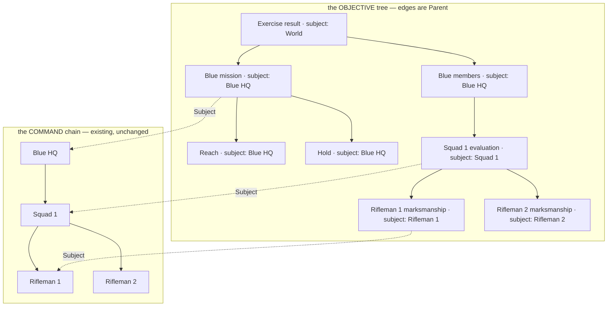

*What the picture shows that prose hid:* two trees, never merged — the objective tree's edges are `Parent`; `Subject` is a CROSS link into the
real world (the command chain, the World Environment). The per-member branch MIRRORS the command chain, which is why its parents can be
DERIVED instead of authored.

| # | decision | ⭐ lean |
|---|---|---|
| **SR-53** | ✅ CONFIRMED `2026-11-01` (user: *"References and macros approved."*) · the component | `ObjectiveLinks {Subject: EntityRef, Parent: EntityRef}` on every objective entity — saved for top-level objectives, replicated with `ObjectiveStatus`; both network ids (R-184) |
| **SR-54** | ✅ CONFIRMED `2026-11-01` (user: *"References and macros approved."*) · `Parent` — three sources, first wins | ① EXPLICIT — inside a macro, a macro-local id (remapped per instance, SR-45); at the top level, an `EntityRef` · ② the macro's ROOT objective — a macro marks one entity as its root; every other objective without an explicit parent hangs under it, and the root hangs where the instance is plugged in · ③ DERIVED from `Subject` via the command chain — the evaluation whose subject is the nearest COMMANDER up `UnitSubordinate` (Rifleman 1 → Squad 1's evaluation → Blue members), else the side's, else the exercise result. ⇒ per-member evaluators attached by TKB type need no authored parent at all; the command chain is READ, never written (it keeps only units) |
| **SR-55** | ✅ CONFIRMED `2026-11-01` (user: *"References and macros approved."*) · `Subject` | a macro param by default (`^subject`, defaulting to the entity the instance is inserted on); a TKB-attached evaluator's subject = the unit it was attached for; the exercise result's = the World Environment |
| **SR-56** | ✅ CONFIRMED `2026-11-01` (user: *"References and macros approved."*) · how a user sees them | an **Objectives view** — the tree by `Parent`, each row naming its subject (click = jump to the subject on the map, the ORBAT's own jump); the subject's inspector lists *"objectives about this unit"* (reverse lookup by `Subject`) |
| **SR-52** ✅ CONFIRMED `2026-10-31` (user: *"Group A confirmed."*) | the ORBAT — ⭐ refined `2026-10-31` (user: *"I have never seen any sensor displayed in the orbat"* · *"Area entities might need their own root in the orbat tree … Orbat item is also used as a landing point for entity picker, which might be a good reason for keeping the areas"*) | measured: the ORBAT lists every entity WITH `EntityInfo` (`ScenarioOrbatAdapter.cs:61`); sensors are absent only because sensor parts carry no `EntityInfo` — an accident of their shape, not a policy. Objective entities WILL carry `EntityInfo` (a label + a side) ⇒ an explicit inclusion policy is needed. ⭐ lean: units and platforms under their sides (as today) · areas under their OWN root (*Areas*) — kept, since the ORBAT is a landing point of the entity picker · objectives, triggers, the World Environment excluded (they live in the Objectives view, SR-56). Tracker **CE-4152** |

⭐ SR-57 (where a macro entity's BINDINGS are saved — `ParamBindings`) → [DESIGN_Scenario_Macros.md](DESIGN_Scenario_Macros.md) §5.

### 9.5 References across macro scopes — a macro is CLOSED *(`2026-10-31`)* — ⭐ see [DESIGN_Scenario_Macros.md](DESIGN_Scenario_Macros.md) §7; SR-61 stays:

| # | decision | ⭐ current answer |
|---|---|---|
| **SR-61** | ✅ CONFIRMED `2026-11-01` (user: *"References and macros approved."*) · groups by the command chain, not by lists | an objective about "all of Blue Platoon" names the platoon (its `RefKey`, SR-64) as its `Subject` and quantifies over its members through the command chain (`ForUnits(members of …)`), so a macro's internal roster can change without touching the objective |

### 9.6 Three reference forms; `RefKey` *(✅ user, `2026-10-31`: "ref key is fine. recorded.")* — ⭐ see [DESIGN_Scenario_Macros.md](DESIGN_Scenario_Macros.md) §8; SR-67 stays:

| # | decision (✅ approved) |
|---|---|
| **SR-67** ✅ CONFIRMED `2026-10-31` (user: *"Group A confirmed."*) | per-member thresholds — who may override a criterion's params | ⭐ nearest wins, walking UP from the evaluator's SUBJECT: the unit's own scenario entry ▸ the nearest enclosing team / squad / platoon macro instance (found up the command chain) that sets that param in its `memberArgs` ▸ the side's ▸ the scenario's ▸ the criterion template's default. Same lexical rule as `RefKey` lookup (SR-65); ⛔ never a global table |

### 9.7 Expanding a scenario macro at LOAD — the sequence *(`2026-10-31`)* — ⭐ see [DESIGN_Scenario_Macros.md](DESIGN_Scenario_Macros.md) §9 (the sequence, SR-80, GAP-1…GAP-5)

### 9.8 Relocating a macro, and ONE way to name a place or an entity *(✅ ACCEPTED `2026-11-01`)*

> 🔒 **User, `2026-11-01`:** *"how can we make the scenario macros relocatable to given location?"* → *"there already are some attributes
> like map pickable point … We need to unify those. I like your naming better … your attribute means both at once relocatability and
> inherently also pickability from map"* · *"The scenario entities might contain various serialized JSON conditions, like the ones for the
> trigger entity in its when part. How could we make the parameter expansion work for those as well? And also the relocation"* · *"macros
> and entities in general might use named points instead of coordinates … third option … reference to an entity whose position serves as
> the desired position"* · *"how to make it possible to reference an entity via different ways while keeping one single parameter name"* ·
> *"if the macro doesn't want the concrete specific parameter to be relocated … the macro should reference a point entity and not use
> coordinates."*

#### 9.8.0 ⭐ CURRENT ANSWER — relocation and the reference types *(✅ ACCEPTED `2026-11-01` — user: *"Yes approved."* — SR-125…SR-143; §9.8.1–§9.8.10 carry the measurements and the reasons)*

> ⭐ **S0 item 5 — AS BUILT `2026-11-01` (backend).** Every authored params / predicate DTO now uses the reference types; `PickableGeoPoint` and `OrderGeo` are **deleted** (no geodetic form inside the engine, SR-135). Gated by `S0AuthoredTypesRailTests` (Fdp.Toolkits.Tests) — a bare `Vector2/3`, a `*NetworkId` integer, a lat/lon float, a Bearing-named float or an `EntityRef` in a `[ParamsDto]` / `SearchPredicateDto` fails it unless `Allowed` names the member WITH a reason (today: `T09Params.HomePosition`, `T41Params.Home` — test-only fixtures whose offsets are pinned).
>
> | was | is | note |
> |---|---|---|
> | `EntityRef` / raw `*NetworkId` long | `EntityLink` | read through `.Ref`; `HullDownAttackParams` 48 → **88 B** (target @32 now 48 B, `GoAt` 40 → 80) — ⭐ **then 88 → 80 B with CE-4200 `2026-11-02`** (`EntityRef` is 4 B now: `EntityLink` 48 → **40**, `GoAt` @72) |
> | `Vector3`, lat/lon pairs, `PickableGeoPoint` | `PointLink` | `MoveToLocation` is ONE `target` (`[x,y,z]` local metres) — `TargetLat/Lon`, `X/Y`, `PickableLocation` gone |
> | `PlatoonDefend.Left/Right` | `Bearing` | |
> | `SpatialBoundingPredicateDto.Bounds` | `AreaLink` | ONE containment (`AreaLink.Contains`) shared by `RecordingSearchService` and `DataBreakpointManager`; `AreaBoxes` converts the replay panel's box |
> | picker seams | key on the TYPE | `IMapPickService.PickLocalAsync` (default derives local metres from `PickLocationAsync`: x = lon field, y = lat field — a host with a frame overrides it); `MapPickBroker` / `MenuOrders` / `OrderMenu.FieldsOf` / `DtoJsonSchemaExtractor` / `PickableLeafFieldEditor` for `PointLink`, `EntityLink`, `AreaLink` |
>
> ⭐ **Blueprint compiler:** the three types are registered (`StaticTypeRegistry`, ⭐ **40** / 48 / 72 B since CE-4200 — `EntityLink` was 48), with TWO coercion rungs — `PointLink → Vector3` (the load-time walker has already resolved the spec into `Local`) and `EntityRef → EntityLink` (a literal fills an authored link); both listed in `CoercionTable_ContainsOnlyLosslessWidenings`' allow-list with the reason. ⛔ No `Int64 ↔ EntityRef` rung (unchanged). `AuthoredPointOps.At(x, y)` builds a point for a baked `FunctionCall` (`SubordinateForEachDemo`).
>
> ⚠ **Found on the way (oracle, fixed):** Roslyn does not expose `StructLayout(Explicit)` / `FieldOffset` on a type loaded from metadata, so `RoslynStructLayout` laid `RefSpec` out Sequential (52 B, not 36) and every blackboard holding a link was mis-sized in the editor-side oracle. `RefSpec` is now in `KnownTypeLayouts`; `StructSizeResolverEnumTests` pins `PointLink` / `EntityLink` / `AreaLink` / `RefSpec` against the CLR.
>
> ✅ **Item 9 (content migration) — DONE, see §9.8.11 "item 9".** ⛔ SUPERSEDED: the list that stood here (three scenarios) was a grep's answer; the type-driven tool found **37 blobs in 25 files**, including `MoveToLocation` params nested inside a blueprint's (`mission-demo-bp`).


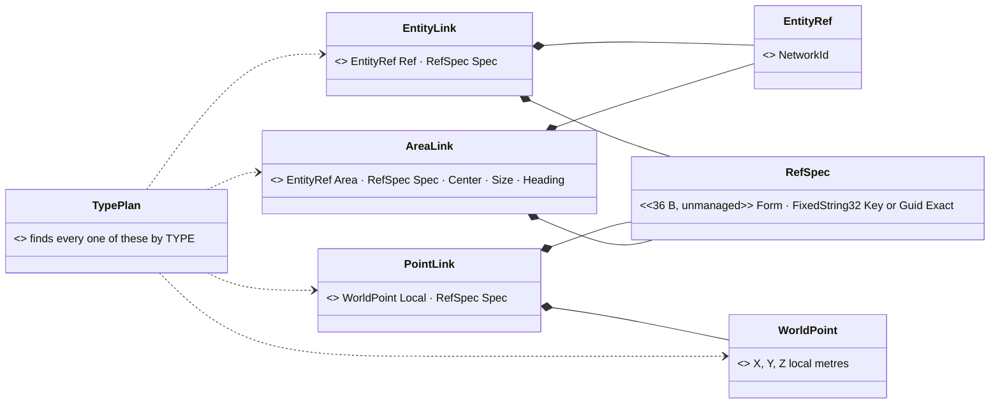

*What the picture shows that prose hid:* every authored type is an internal answer PLUS one shared `RefSpec`; the walker knows them all by type, so
the picker, the "show on map", resolution and relocation need no per-field code.

| | what | where it is used |
|---|---|---|
| **internal** | `EntityRef` (network id) · `WorldPoint` (local metres, Vector3-identical) | everything CODE writes: components, lists, recordings, the wire — no authored data, no size growth |
| **authored** | `EntityLink` · `PointLink` · `AreaLink` = the resolved answer + `RefSpec` (how a person wrote it) | everything a PERSON writes: params DTOs, trigger `when` / `do` args, macro params — saved in the scenario in their authored form |
| **authored forms (JSON)** | entity: GUID (*exact*) · `"@Key"` / `"@Outer/Inner"` (*by key*) · point: `[x, y, z]` or an entity reference (*its position*) · area: `{"circle": …}` · `{"rect": …, "heading": …}` · an area entity | the JSON shape says which — no `kind` field; the editor shows a form switch; resolution keeps the form, so save writes it back |
| **places** | local ENU metres only; ⛔ no lat / lon inside the engine (AQ107 B) — converted at the outer edge | — |

**Relocation, in four steps at expansion (§9.7):** ① **bind** — every `bind` map (on any JSON object) and `ParamBindings` copy the macro /
scenario params in · ② **resolve** — every GUID / `@Key` becomes a network id, a point's or area's entity becomes its position / polygon ·
③ **relocate** — every LITERAL point / area and every bearing is moved by *authored anchor → instance anchor* (translate X / Y, rotate by the
heading difference, Z by the anchors' height difference; heights above ground kept); internal `WorldPoint`s in components move the same way;
rotations and velocities turn; road / nav ids are cleared · ④ **create**. ⭐ Because ② runs before ③, a REFERENCE never moves — the way to keep a
value fixed is to point at an entity outside the macro; a point entity inside the macro moves with it. `relocatable: false` pins a macro that
depends on particular buildings.

**By construction:** a rail fails on a bare `Vector3` point, an internal `EntityRef` in an authored DTO, or a lat / lon in params; tools show
every `WorldPoint` / `EntityRef` / `*Link` on the map. **Open, not this design's:** writing internal `EntityRef`s of SAVED components as GUIDs
(CE-4153 S9) — needed for references to macro-made entities and once S8 drops `NetworkIdentity` from the file.

#### 9.8.1 INVENTORY *(`2026-11-01`; ⚠ coverage unchecked — `check_index_coverage` is not available through the CLI)*

`search_graph` Class `.*(MapPick|Pickable|MapEditable|MapPoint|MapPosition).*` (13) · `.*(Position|Point|Location|Waypoint|Spatial|MapPick|WorldPoint).*Attribute$` (2) ·
`.*(EntityRefRemap|ParamsRemap|RefRemap|Remapper).*` (3) · `.*(Paste|Clipboard|Duplicate|CloneEntit|Copy).*` (32 — ⛔ no scenario-entity copy / paste / group move) ·
`.*(Ground|Terrain).*(Snap|Clamp|Height|Drop).*` (13) · a scan of all 117 `scenarios/*/scenario.json` · grep over the 58 `[ParamsDto]` types.

| what exists | where | for relocation / references |
|---|---|---|
| ⭐⭐ **the TYPE makes a field pickable — the ruled precedent, twice** | `DESIGN_Entity_Reference.md` D5 (`EntityRef`); `DESIGN_Map_Picking_Unification.md` P5 — *"`MapPickableWorldLocationAttribute` (both copies) is deleted … keep the attribute — it marks exactly the members of that type, so it says nothing the type does not"* (rejected) | ⇒ the unified place is a TYPE, not an attribute (SR-125) |
| `PickableGeoPoint {Latitude, Longitude}` — the map-pickable location TYPE, JSON `[lat, lon]` | `Fdp.Toolkits/Behavior/Params/PickableGeoPoint.cs:16-31`; 5 fields (orders, `PlatoonHillAttack`, `AirArmedSearch`) | ⭐ merged into `WorldPoint` |
| ⭐ `EntityRef {NetworkId}` — JSON the bare number; picked, remapped at load and resolved by its TYPE | `Fdp.Toolkits/Replication/EntityRef.cs:26`; 21 fields in the params types | ⭐ gains the other reference forms (SR-126) |
| ⭐⭐ `EntityRefRemap` — ONE type plan per type (members, lists, nested), appliers `RemapJson` / `RemapObject`; `ScenarioBehaviorRemapper` gets every behaviour's contract type from the registry | `EntityRefRemap.cs:25-280`; `ScenarioBehaviorRemapper.cs:33-95` | ⭐⭐ the walker relocation and resolution reuse (SR-128) |
| the params types' locations: **38 `Vector3`** (sim metres — every one a POINT by name: `Position`, `Objective`, `FallBackTo`, `WatchTowards` …), **5 `PickableGeoPoint`**, **2 lat / lon `double` pairs** (`MoveToLocation.TargetLat/Lon`, `CenterLat/Lon`); **2 compass bearings** (`PlatoonDefend.Left/Right`) | grep `[ParamsDto]` | ⭐ three spellings of one concept ⇒ one type |
| raw `long` entity ids in params: `HsmFireActivityParams.TargetNetworkId` (`BlueprintDemoParams.cs:35`), `HillAttackDtos.cs:243 TargetNetworkId`; `HeardId` ×3 / `CachedEqsRequestId` look like WORKING state | grep | ⚠ the audit (SR-131) |
| positions in saved components: `SimTransform` (1012 entities), `EditablePolyline.Points` (11), `RoutePlan.Waypoints` (12, `HeightAgl` = above ground), `NavigationIntent.FinalDestination` / `NavState.FinalDestination` (26); a NON-point vector `SimVelocity.Linear`; terrain ids `NavState.CurrentSegmentId` / `TrajectoryId` | the scenario scan | ⭐ engine structs — relocated by small per-component relocators (SR-128) |
| the condition DTOs: `SearchPredicateDto` tree; one location — `SpatialBoundingPredicateDto.Bounds` (`BoundingBox2D`, an axis-aligned box); no entity field (the `OnEntity` leaf, SR-95, is unbuilt) | `ReplayBrowser/Search/SearchPredicateDto.cs:166-186` | ⚠ an axis-aligned box cannot ROTATE (SR-128) |
| a single-point marker entity type | ⛔ none — `TacGraphic_FireLine 8801`, `_Route 8802`, `_Area 8803` (`TkbEntityTypes.cs:87-89`) | a `TacGraphic_Point` is new (SR-130) |
| ground clamping | `GroundClampWhilePausedSystem`, `GroundClampingConfig`, `TerrainClampBaseline` | ⚠ vehicles measured; dismounted soldiers NOT measured (SR-127) |
| entity references in a FILE become stable GUIDs | `DESIGN_Scenario_Entity_Keys.md` G4 / S9 (⚠ S9 stopped: there is no save-direction remap yet) | ⭐ SR-126 builds on it |

#### 9.8.2 The relocation sequence — ⭐ MOVED to [`DESIGN_Scenario_Macros.md`](DESIGN_Scenario_Macros.md) §10 (2026-11-01, user: *"the macro relocation should be made part of this design"*)

#### 9.8.3 Decisions — places, references, relocation *(SR-125…SR-132)*

| # | decision | ⭐ current answer |
|---|---|---|
| **SR-125** | places are TYPES | ⭐ a TYPE, not an attribute (the D5 / P5 precedent above: the type already makes a field pickable, and an attribute "says nothing the type does not"). Internal: `WorldPoint` · authored: `PointLink` (SR-141), with SR-133's forms — `[x, y, z]` local metres, or an ENTITY'S position (`"@Key"` / a GUID, SR-130); ⛔ no geodetic form (SR-135). It REPLACES `PickableGeoPoint`, the 38 point `Vector3` params fields and the 2 lat / lon pairs: picked on the map by its type (everything P5 built keys on it), relocated by its type, resolved by its type. Compass angles are `Bearing` (SR-143). ⛔ No backward compatibility (CE-4153 S10): the repo's scenarios are migrated by one script in the same change |
| **SR-126** | ONE param name, several ways to point | an authored entity reference is an `EntityLink` (SR-140): its live answer is the network id (orders, the wire, `BrainIntent` JSON unchanged) and its FILE form is a string: a **GUID** = *this exact entity* (stable, `DESIGN_Scenario_Entity_Keys.md` G1 / G2) · **`@Key`** = *whatever entity has that `RefKey` here* (SR-64 / SR-65) · **`@Outer/Inner`** = a key inside a macro instance. The FORM of the value says which — the field name stays one. ⏭ the query form (*"the squad leader of @Squad1"*, SR-63) is a later `EntitySet` / single-result query; not v1 |
| **SR-127** | the relocation transform | ⭐ MOVED to [`DESIGN_Scenario_Macros.md`](DESIGN_Scenario_Macros.md) §10 — relocation is the macro mechanism; the TYPES it moves stay here |
| **SR-128** | the ONE walker | `EntityRefRemap`'s type plan generalised over SR-136's leaves — resolved (`EntityLink`, an entity-form `PointLink` / `AreaLink`), remapped (`EntityRef`), relocated (`WorldPoint`, literal `PointLink` / `AreaLink`, `WorldRotation`, `Bearing`); appliers over JSON and over objects, as today. It walks params, `do` args and the `when` tree alike — the predicate tree is polymorphic, so the plan dispatches on each node's concrete type. ⭐ Because component positions are `WorldPoint`s and rotations `WorldRotation`s (SR-141, SR-142), the type plan finds them in any component; hand-written relocators remain only for what has no type of its own — `SimVelocity` (rotate) and `EditablePolyline`'s 2-D points; `NavState` road / trajectory ids are CLEARED. `SpatialBoundingPredicateDto.Bounds` becomes an `AreaLink` (SR-134) |
| **SR-129** ⚠ AMENDED `2026-11-02` by `DESIGN_Scenario_Macros.md` §5.1 SR-159…SR-163 (an untyped `bind` key is dropped by the typed params form — bindings live in `RefSpec` Param, a typed `Bind` on DTO nodes, or `ParamBindings`) | parameter binding inside nested JSON (the `when`, `do`, macro args) | ⭐ SR-94 generalised: **any JSON object may carry a `bind` map, its paths relative to that object** — a `do` entry, a `when` node, a `macroArgs` object, a behaviour's params. The expander walks the JSON generically and applies each `bind` where it stands; the literal stays as the unbound value. ⇒ ONE rule, no per-DTO code, and moving a node moves its bindings (SR-94's reason). Typed components keep SR-57's `ParamBindings`. A bound param's declared type must match the target member's type — checked at expansion, a mismatch fails loudly (GAP-3) |
| **SR-130** | named points | a NAMED POINT is just an entity whose position is wanted: a `PointLink` written `"@Key"` takes that entity's position — a new `TacGraphic_Point` (a control point, drawn on the map, carrying a `RefKey`), an area (its centroid), or any unit. ⭐ Resolved ONCE when the params are assigned (a snapshot: the behaviour still reads metres, its code unchanged); ⛔ it does not follow the entity — a param that must follow is an `EntityRef` |
| **SR-131** | not relocating a value | ⭐ MOVED to [`DESIGN_Scenario_Macros.md`](DESIGN_Scenario_Macros.md) §10 |
| **SR-132** | the audit that rides the migration | while every params field is retyped, CLASSIFY it: 38 `Vector3` + 5 `PickableGeoPoint` + 2 lat / lon pairs → `PointLink`; 2 → `Bearing`; the 21 `EntityRef` params fields and the 2 raw `long` targets → `EntityLink` if authored (SR-140); `HeardId` / `CachedEqsRequestId` confirmed as working state (not params). ⭐ A RAIL lists every member of every `[ParamsDto]` and predicate DTO and fails on a `Vector2` / `Vector3` / `double` lat-lon / `long` id / `EntityRef` that is not a known type or an explicit allow-list entry; a second rail fails on a scenario-saved component with a vector member that is neither a typed `WorldPoint` / `WorldRotation` / `Bearing`, nor relocated, nor a "not spatial" entry — ⇒ a new behaviour cannot silently be unrelocatable |

**Rejected — one line each:**
- *An attribute (`[WorldPoint]`) on `Vector3` fields* — ruled against twice (D5, P5), and an attribute cannot carry the `@Key` / GUID value forms.
- *Three param names per reference (`targetId`, `targetKey`, `targetGuid`)* — the user's objection; the value's form says which.
- *A `relocate: false` flag per field* — a reference already means "the world, not the macro".
- *Following a named point live* — every behaviour would need world access in its params; that is what `EntityRef` is for.
- *Retyping engine components to a DIFFERENT layout* — hot-path structs; SR-141's `WorldPoint` is byte-identical with implicit conversions, so the ~1023 reads compile unchanged.
- *Inline `"^param"` strings inside typed values* — a typed number field cannot hold a string in the editor; the sibling `bind` keeps the literal typed (SR-55's `^subject` is shorthand for such a `bind` entry).

#### 9.8.4 The authored form, areas, no geodetic params *(SR-133…SR-136)*

> 🔒 **User, `2026-11-01`:** *"the spatial condition should support multiple shapes, either a rotated rectangle or also something else like a
> circle. axis-aligned bounding box is certainly not enough"* · *"the engine was switched recently to using local coordinates, so whenever there
> are latitude, longitude coordinates, these are probably part of the outer API … not meant to be used directly as parameters of behaviors or
> whatever stored in the scenario"* · *"when we are editing this field, we need to store the information what kind of reference it is … how we
> represent this multi way of referencing in the C# DTO."*

| measured | where |
|---|---|
| ✅ the wire is LOCAL ENU metres; `GeoPoint` left it (8 fields, 44 conversions) | `Architect_Question_107_NED_Wire_Frame_And_Names.md` row B (RULED, BUILT `2026-10-27`) |
| the geodetic leftovers in params: 5 `PickableGeoPoint` + 2 lat / lon pairs; `MapPickGeo` calls a mission location *"geodetic by authoring convention"*; `OrderGeo.ToLocal / ToGeo` converts | `MapPickGeo.cs:8`; `Orders/OrderGeo.cs:9-31` |
| the params form HYDRATES the JSON into the params TYPE, edits the object, writes it back | `BehaviorParamsForm.cs:43-55` (`Hydrate`) ⇒ ⭐ the TYPE must hold the authored form, or an edit loses it |
| a params type is often deserialized straight into an UNMANAGED struct (blueprint `ParseParams` honours `[JsonConverter]`) | `DESIGN_Entity_Reference.md` D1 ⇒ ⭐ the reference types must stay unmanaged (no `string`) |
| `EntityRef` fields: 27 in code, mostly JSON DTOs; a few in runtime node structs (`UtilityNodes`, `SensorNodes`, `GenesisIntentComponents`) | grep |
| no authoring area-shape type (graph `.*(Shape\|Circle\|Polygon\|OrientedBox\|Obb\|Rect\|Region\|Zone)$` — 23, none for authoring); areas are `EditablePolyline` entities tested by `PolygonMath.Contains`; `KillZone` is a private radius test | `Terrain/PolygonMath.cs:29`; `TriggerIedBehavior.cs:90` |

| # | decision | ⭐ current answer |
|---|---|---|
| **SR-133** | how one field holds several ways of referencing | ⭐ the value carries its FORM next to its live answer, all unmanaged — the shared `RefSpec` (a `Form` + a `FixedString32` key or a `Guid`, §9.8.8) beside the answer (`EntityRef` / `WorldPoint`). The JSON converter derives the form from the JSON shape — a GUID string ⇒ `Exact`, `"@…"` ⇒ `Key`, a number / `[x, y, z]` ⇒ not authored — and writes it back the same way, so a hand-edited file needs no `"kind"` field. Resolution FILLS the answer and KEEPS the form ⇒ ⭐ save writes the authored form back untouched (for authored values this IS the save direction `DESIGN_Scenario_Entity_Keys.md` S9 lacks — nothing to convert back). Live JSON on the wire (`BrainIntent`, orders) stays the bare number. The editor's leaf shows a form switch *[Exact \| Key]* + the value; the map pick writes `Exact` (the picked entity's GUID), or `Key` when the picked entity has a `RefKey` and a MACRO is being edited |
| **SR-134** | areas — several shapes | ⭐ ONE `AreaLink` (§9.8.8): `Circle` (`{"circle": {"center": [x,y,z], "radius": 50}}`) · `Rectangle`, rotated (`{"rect": {"center": …, "size": [w, h], "heading": 30}}`) · an area ENTITY (`"@Village"` / a GUID — its polygon, `EditablePolyline`). A free polygon IS an area entity (as areas are authored today) — so the type stays unmanaged. ⭐ ONE containment, `AreaLink.Contains(world, point)` (circle / oriented-rectangle maths + `PolygonMath.Contains`), shared by the spatial condition (`SpatialBoundingPredicateDto.Bounds` becomes an `AreaLink`), the area objectives (`ReachArea` / `HoldArea` / `ClearArea`) and any behaviour that tests a zone. Relocation moves `Center` and turns `Heading`; an entity area moves only if that entity is inside the macro |
| **SR-135** | latitude / longitude | ⭐ the inside of the engine is LOCAL METRES (AQ107 B): no geodetic value in a behaviour param, a condition or a scenario file. The 5 `PickableGeoPoint` + 2 lat / lon pairs become `PointLink`s in the migration (SR-132); `PickableGeoPoint` and `OrderGeo`'s conversions are deleted. Geodetic exists only at the OUTER edge — an external gateway, an API that accepts lat / lon — and converts THERE, through the one `IGeographicTransform`. ⚠ not measured: whether an external system sends orders in lat / lon today — if one does, its ingress converts; the type decision does not depend on it |
| **SR-136** | the walker's leaves | internal `EntityRef` · `WorldPoint` · `WorldRotation` · `Bearing`; authored `EntityLink` · `PointLink` · `AreaLink` — all resolved, remapped or relocated by the one type plan (SR-128) |

**Rejected — one line each:**
- *A separate `"kind"` field in the JSON* — the shapes (number / GUID / `@…` / array / object) already tell them apart; a field can disagree with its value.
- *A side table of authored forms keyed by JSON path* — path-fragile (the user's SR-94 objection).
- *Encoding the form in `NetworkId`'s high bits to stay 8 bytes* — no room for a key's TEXT (the editor must show a macro's default `@BlueHQ`); the type split keeps the internal `EntityRef` at 8 bytes anyway (SR-140).
- *An axis-aligned box plus a separate polygon type* — two containment codes; one `AreaLink` covers both plus circle and rectangle.
- *A literal polygon inside the area value* — not unmanaged; an area entity already is a polygon, drawn and editable on the map.

#### 9.8.5 *(no decision of its own — the packed-handle layout, SR-137, is a rejected alternative in §9.8.7)*

#### 9.8.6 What a TOOL sees *(SR-138)*

> 🔒 **User, `2026-11-01`:** *"every log and dumper and debugger are probably using some serializer of the entity ref or world point types
> anyway for better UX. So it's not so unachievable to pack all the fields into a shorter memory layout. might be worth revising."*

| measured | where |
|---|---|
| `EntityRef` already shows itself through its own `ToString()` (`"#" + NetworkId`) and its JSON converter | `EntityRef.cs:76` ⇒ a packed field costs no readability: logs, dumps and the inspector go through the type |

| # | decision | ⭐ current answer |
|---|---|---|
| **SR-138** | what a TOOL sees (AI agents over the debug API / MCP, logs, the inspector, a raw dump) | ⭐ ① **raw memory of the internal values is today's**: `EntityRef` IS the 8-byte network id, `WorldPoint` / `WorldRotation` / `Bearing` are byte-identical to `Vector3` / `Quaternion` / `float` — a hex dump, a blob-offset reader or a trace buffer reads the same id / metres it reads now; an authored `*Link` starts with that same answer at offset 0. ② **every structured reader goes through the TYPE**: the debug API serializes with System.Text.Json (`DebugApiDumpOptions`, `DebugApiService.cs:470`), which honours `[JsonConverter]`; logs and the debugger use `ToString` / `[DebuggerDisplay]` (`@BlueHQ → #9812` / `3f2a… → #9812`). ③ **the converter writes by context, and every output reads back** (the dump is also the PATCH input, HN-002): not authored ⇒ the bare number `9812` (unchanged — every skill doc and client keeps working) · file / save ⇒ the authored text `"@BlueHQ"` · diagnostics (`DebugApiDumpOptions`) ⇒ BOTH: `{"NetworkId": 9812, "Ref": "@BlueHQ"}` — the reader already accepts `{"NetworkId": n}` (`EntityRef.cs:100-108`), extended to read `Ref`. A point: `[x, y, z]` · `"@Key"` · diagnostics `{"Local": [x, y, z], "Ref": "@Key"}`. ④ the ai-debug skill doc (`tools/ai-debug-mcp/SKILL.md`) gets one paragraph on the three forms in the same change. ⭐ Even a REFLECTION dump that ignores converters shows meaning: `RefSpec`'s `Form`, `Key` and `Exact` are plain fields |

#### 9.8.7 The authored form is INLINE and unmanaged *(SR-139)*

> 🔒 **User, `2026-11-01`:** *"The world position was so far used as plain unmanaged structure, and it is saved as such in components, and they
> are recorded as such, and the general desire is to never use managed types. So the optional string in the offered reference seems weird and
> undesired, isn't it?"*

⭐ **Precedent:** `TerrainObjectRef` already references by an inline `FixedString64 Key` (`Fdp.Toolkits/Terrain/TerrainObjectRef.cs:21`);
`EntityInfo.Name` is a `FixedString64` (`Fdp.Core/Components/EntityInfo.cs:15`); `FixedString32` = 31 UTF-8 bytes (`Fdp.Core/FixedString32.cs:13`).

| measured | where |
|---|---|
| ⚠ brain state CROSSES nodes (a brain snapshot on hand-over) and is RECORDED | `BrainSnapshotTranslator` (`Hrot.SimHost.Tests/BrainSnapshotTranslatorTests.cs`); `BehaviorState` recorded (§11 SR-118) ⇒ an authored form must read the same in any process — inline, never a handle into per-process data |

| # | decision | ⭐ current answer |
|---|---|---|
| **SR-139** | the authored form is stored INLINE | ⭐ everything is a plain unmanaged value — no table, no handle, no managed type anywhere — so it is saved, recorded, snapshotted and sent on a brain hand-over AS IS, and reads the same in any process. A key is at most **31 UTF-8 bytes** (a `FixedString32`, SR-140) including a qualified path (`BluePlatoon/SL`) — RefKeys are short identifiers (SR-64); a longer one is refused LOUDLY where it is typed and at load. Strings appear only on demand for display (`ToString`) and in JSON. ⚠ **Cost, stated:** only the AUTHORED types carry it (`EntityLink` 48 B, `PointLink` 48 B, `AreaLink` 72 B — SR-140); the internal `EntityRef` stays 8 B, so lists and recordings do not grow |

**Rejected — one line each:**
- *A packed handle into a per-world managed table (`EntityRef` 16 B / `WorldPoint` 24 B, a 14-bit table tag, SR-137)* — a managed type one level down, plus a tag trap on every hand-over and restore (the user's objection above).
- *A key HASH inline (8 bytes)* — the editor could not show the text of a key that does not exist in the open file (a macro's default `@BlueHQ`).
- *The GUID inline in every `EntityRef` (32 B)* — 2× the size for a value read only by the editor and save.
- *The network id behind the handle too (8 B total)* — every `Resolve` on the hot path would become a table lookup, and a resolved ref would need one table entry per occurrence (a macro-local key resolves differently in each instance).
- *A process-wide table with no tag* — a handle that crossed nodes or a restore would silently read someone else's text.

#### 9.8.8 TWO reference types — the internal `EntityRef` stays small (8 B today, 4 B after CE-4200); the AUTHORED `EntityLink` *(SR-140)*

> 🔒 **User, `2026-11-01`:** *"Couldn't we use the already existing fixed string 32 type instead of breaking the string into the length and the
> array of bytes? What about components that are storing a list of entity references? These are usually not user editable, they are used
> internally, but the byte size of them matters because they will be saved to recordings … Having two types for entity reference, one is for
> internal use and the other is for user editable use, saving the authored information."*

⭐ **Why two types** (an earlier lean rejected them as *"two types for one concept"*): they are TWO concepts. `EntityRef` is a RESOLVED identity (*which* entity — written by code, held in lists, recorded
every frame); `EntityLink` is an AUTHORED intent (*how to find* it — written by a person, kept so save can write it back). The codebase already
separates authored from runtime once (`DESIGN_Entity_Reference.md` D7: authored `EntityRef` vs runtime `Entity`); this is the same cut one level
up. ⭐ `FixedString32` (`Fdp.Core/FixedString32.cs:13`, 31 UTF-8 bytes) is reused for the key, overlaid with the GUID.

```csharp
public enum RefForm : byte { None = 0, Exact = 1, Key = 2, Circle = 3, Rectangle = 4 }

[StructLayout(LayoutKind.Explicit, Size = 36)]
public readonly struct RefSpec                          // 36 B — HOW it was authored; all zero = not authored
{
    [FieldOffset(0)]  public readonly FixedString32 Key; // Form == Key: "BlueHQ", "BluePlatoon/SL" (no '@'), ≤ 31 UTF-8 bytes
    [FieldOffset(0)]  public readonly Guid Exact;        // Form == Exact — overlays the key; one or the other
    [FieldOffset(32)] public readonly RefForm Form;
}

// INTERNAL — what code writes: components, lists, recordings, the wire
public readonly struct EntityRef                        // UNCHANGED in shape — 8 B today, 4 B after CE-4200 (int32 ids)
{
    public readonly long NetworkId;
}
// WorldPoint (12 B, §9.8.9) · WorldRotation (16 B) and Bearing (4 B) (§9.8.10)

// AUTHORED — what a person writes: params DTOs, `when` / `do` args, macro params
public readonly struct EntityLink                       // 48 B
{
    public readonly EntityRef Ref;                      // offset 0 — the resolved answer; behaviour code reads link.Ref
    public readonly RefSpec   Spec;                     // offset 8
}

public readonly struct PointLink                        // 48 B
{
    public readonly WorldPoint Local;                   // offset 0 — local metres, the resolved answer
    public readonly RefSpec    Spec;                    // offset 12 — None = plain coordinates; Exact / Key = that entity's position
}

public readonly struct AreaLink                         // 72 B
{
    public readonly EntityRef  Area;                    // Exact / Key form: the resolved area entity
    public readonly RefSpec    Spec;                    // Circle / Rectangle / Exact / Key
    public readonly WorldPoint Center;
    public readonly Vector2    Size;                    // rectangle w, h · circle: X = radius
    public readonly Bearing    Heading;                 // rectangle, compass degrees (SR-143)
}
```

| # | decision | ⭐ current answer |
|---|---|---|
| **SR-140** | two reference types, and where each goes | ⭐ **`EntityRef` stays exactly as today** (8 bytes, the network id) for everything code writes: components, lists (`PassengerNetworkIds`, buffers, target memories), runtime node structs, the wire, `BrainIntent` JSON — ⇒ recordings do not grow. ⭐ **`EntityLink`** (48 bytes) for everything a PERSON writes: params-DTO fields (the 21 `EntityRef` params fields change type), the `when` / `do` args, macro params. It converts to `EntityRef` (`link.Ref`), so behaviour code changes one member access. `PointLink` and `AreaLink` (SR-141) are authored by nature and carry the same `RefSpec`. ⭐ A RAIL fails on an `EntityRef` member of a `[ParamsDto]` / predicate DTO (it must be `EntityLink`) — the split cannot drift. The picker keys on BOTH types (D5): an `EntityRef` pick writes an id, an `EntityLink` pick writes `Exact` or `Key`. ⚠ What it does NOT solve: an internal `EntityRef` inside a component SAVED to a scenario (`UnitSubordinate`'s parent …) still needs `DESIGN_Scenario_Entity_Keys.md` S9's file-boundary GUID conversion — those components already save through translators keyed by GUID (§0a there), so that is S9's open item, not this one's  ⭐ **AMENDED a second time `2026-11-02` (S9′, `DESIGN_Scenario_Entity_Keys.md` row S9′ as-built; approved - the user's words as relayed by the coordinator: "approved, keep going")**: an authored reference MAY sit in a component when a person authors it (`RoutePlan.Waypoints[].HoldUnit`); the scenario loader resolves it there (`StagingEntityExtractor` fills `.Ref` from the file's GUID). Code-written references stay `EntityRef`. |

⭐ **Why an internal `EntityRef` in a SAVED component is an issue only now** (user: *"It must have been happening all the time till now"*): today it WORKS — the file stores network ids AND each entity's `NetworkIdentity`, and load remaps old → new (`StagingEntityExtractor.cs:344-359`, `EntityRefRemap`). It breaks in exactly two new cases: ① a reference to an entity a MACRO creates — that entity is transient, never saved, and gets a fresh id each load, so no saved number can name it (only its derived GUID can, `DESIGN_Scenario_Entity_Keys.md` G2); ② `DESIGN_Scenario_Entity_Keys.md` S8 drops `NetworkIdentity` from the file — then a saved number has nothing to be remapped against. ⇒ the S9 item (write the target's GUID at save) is needed for ① and ②; a scenario with no macros keeps working as today until S8 lands.

**Rejected — one line each:**
- *One 40–48-byte `EntityRef` everywhere (authored form inline in every reference)* — every internal list and every recorded frame pays for text nobody authored (the user's point).
- *A hand-rolled length + byte array* — `FixedString32` exists (the user's point).
- *`EntityLink` for components too* — components are written by code; an authored form there would always be empty.

#### 9.8.9 An INTERNAL world-point type too; the authored types are `*Link` *(SR-141)*

> 🔒 **User, `2026-11-01`:** *"is using the plain vector 3 for an actual world position internally okay? wouldn't it be better to really invent a new
> type which is the same inside like the vector 3, but its semantic meaning is telling that this is an actual world location that can be shown on
> the map and may be edited as such?"* · *"The debug tools, when seeing such type, can for example show the actual position of that field on the
> map … the user would not need to interpret the location, but the tool will help him by showing the location on the map."*

| measured | where |
|---|---|
| ⚠ `Vector3` is AMBIGUOUS today: 124 `public Vector3` fields in engine / toolkit / core types mix world points (`LastSeen`, `Hide`, `Anchor`, `At`, `Point` …) with non-points (`Velocity`, `LastVelocity`, `LocalPoint` — body-relative, `Value`) | grep `public Vector3 \w+;` over `Fdp.Core`, `Fdp.Toolkits`, `Hrot.Core` |
| `SimTransform.Position` is read ~1023 times; `FinalDestination` 169; 11 `ref …Position` aliases | grep |
| ⛔ no semantic point type exists (graph `^(World\|Local\|Sim\|Map)(Point\|Position\|Pos\|Location\|Vec)\w*$` — fields and enum values only; the NED `WorldPos` is a wire descriptor) | graph |
| ⭐ the TYPE already drives the schema hint for tools: `DtoJsonSchemaExtractor` writes `picker: "worldLocation"` for a location type | `DebugApi/DtoJsonSchemaExtractor.cs:201-202` |

```csharp
// INTERNAL — what code writes; same 12 bytes and JSON as Vector3 ⇒ recordings and scenario files do not change
[JsonConverter(typeof(WorldPointJsonConverter))]            // [x, y, z], exactly Vector3's file form
public struct WorldPoint
{
    public float X, Y, Z;                                    // local ENU metres
    public static implicit operator Vector3(WorldPoint p) => new(p.X, p.Y, p.Z);
    public static implicit operator WorldPoint(Vector3 v) => new() { X = v.X, Y = v.Y, Z = v.Z };
}
// AUTHORED — PointLink / AreaLink, declared in §9.8.8
```

| # | decision | ⭐ lean |
|---|---|---|
| **SR-141** | an internal world-point type | ⭐ YES — `WorldPoint` = a plain 12-byte struct, identical in memory and in JSON to `Vector3`, whose TYPE says *"a place in the world"*. ⭐ The pairs are symmetric: **`EntityRef` / `EntityLink`**, **`WorldPoint` / `PointLink`**, areas **`AreaLink`** (`*Link` = authored, carries `RefSpec`). ⭐ What the type buys, BY CONSTRUCTION: ① **tools show it on the map** — the inspector, the watch, the brain view and the debug API offer *"show on map"* for every `WorldPoint` / `EntityRef` field (the schema hint `DtoJsonSchemaExtractor` already emits by type), so nobody has to interpret coordinates; ② **editable on the map** by its type (D5 / P5); ③ **relocation is generic** — the type plan finds every `WorldPoint` in any component, so the per-component relocators shrink to rotation (`SimTransform.Rotation`, `SimVelocity`) and `EditablePolyline`'s 2-D points; ④ the ambiguity of the 124 `Vector3` fields ends — a direction stays `Vector3`. ⭐ Migration is cheap BECAUSE of the implicit conversions both ways and the `X` / `Y` / `Z` fields: the ~1023 reads of `SimTransform.Position` compile unchanged (`a.Position - b.Position` is a `Vector3`, as a difference of points should be); the 11 `ref` aliases are edited. Recordings, blobs and scenario files are byte-identical. ⭐ A RAIL classifies every `Vector3` field of every component and params type as point (→ `WorldPoint`) or not (an explicit allow-list), so a new position cannot be added as a bare `Vector3` unnoticed. ⏭ the wire structs keep their `double`s (AQ107); translators convert |

**Rejected — one line each:**
- *Plain `Vector3` internally* — first proposed from the user's own *"Sometimes we need to store the coordinates internally without the authored information. I guess here we will use the plain vector 3 for the internal representation"*, then overturned by the user's question above: 124 fields mix points and directions; no tool can tell which to show on the map.
- *Explicit-only conversions* — strict, but ~1000 call sites would change for no runtime benefit; the type's value is MEANING for tools, not arithmetic safety.
- *Keeping the authored name `WorldPoint`* — the internal type deserves the plain name; authored ones read `*Link`, like `EntityLink`.

#### 9.8.10 Orientation — `WorldRotation` and `Bearing` *(✅ ACCEPTED `2026-11-01` — user: *"Yes, approved."* — SR-142…SR-143)*

> 🔒 **User, `2026-11-01`:** *"What about the world orientation of an entity? Wouldn't it deserve also a special type? Or maybe it is already having one?"*

| measured | where |
|---|---|
| ⭐ the CONVENTION exists, once: `SimTransform.Rotation` (`Quaternion`) in local ENU, body-forward = +X; compass heading 0 = north, 90 = east, clockwise — `SimTransformBridgeSystem.HeadingDegToRotation` / `RotationToHeadingDeg` | `Geographic/Systems/SimTransformBridgeSystem.cs:23, :63`; routed to, not copied, by `SimTransformHeadingInstaller` |
| ⭐ the ONE human display: `OrientationDisplay` → `HPR [045.0, 3.2, -1.0] deg, Quat […]` (ddsmonitor, the compass gizmo) | `Replication/Components/OrientationDisplay.cs` |
| ⛔ no orientation TYPE: graph `.*(Heading\|Bearing\|Orientation\|Rotation\|Yaw\|Azimuth\|Attitude\|Pose\|Facing).*` Class (63, paginated) — wire / display / gizmo / pose classes, `NetworkOrientation`, `TurretPose`, none a world-orientation value type | graph |
| world quaternions are few: `SimTransform.Rotation`, `NetworkTransform.LastRotation` (grep `public Quaternion \w+;` over Fdp.Core / Fdp.Toolkits / Hrot.Core) | grep |
| ⚠ compass bearings are plain `float`s with MIXED units in the names: `LeftBearing` / `RightBearing` / `WatchBearing` (`EngagementArea.cs:42-75`), `Bearing`, `LastBearing`, `BearingDeg`, `RunInBearingDeg`, `Azimuth`, `Yaw`, `AngleRad` … beside RELATIVE angles (`SteerAngle`, `HeadingOffset`, `HeadYaw`, `WedgeAngleRad`) | grep `public (float\|double) \w*(Heading\|Yaw\|Bearing\|Azimuth\|Facing\|Direction\|Angle)\w*;` over Fdp.Core, Fdp.Toolkits, Hrot.Core, Hrot.AI.Behaviors |

| # | decision | ⭐ lean |
|---|---|---|
| **SR-142** | a world-orientation type | ⭐ YES, the `WorldPoint` pattern: **`WorldRotation`** = 16 bytes, `Quaternion`-identical in memory and JSON, implicit conversions both ways, `X / Y / Z / W` fields; meaning *"an orientation in the world frame — local ENU, body-forward +X"*. Its members ROUTE to the existing convention (`HeadingDeg` ⇄ `SimTransformBridgeSystem`), `ToString` routes to `OrientationDisplay` (HPR) — ⛔ no second copy of either. Used by `SimTransform.Rotation` and `NetworkTransform.LastRotation`; a body-LOCAL rotation (a turret's, a bone's) stays `Quaternion`. ⇒ tools draw a heading arrow on the map for it; the relocation walker turns it by type (SR-128's hand-written `SimTransform` rotation case goes away). Recordings and files byte-identical |
| **SR-143** | a world compass bearing | ⭐ **`Bearing`** (SR-125's tiny type, now defined): 4 bytes, `float` DEGREES, compass (0 = north, clockwise, [0, 360)) — the same convention; implicit to / from `float`. Used for WORLD directions — `EngagementArea`'s `Left / Right / WatchBearing`, `PlatoonDefend`'s `Left / Right`, the `*BearingDeg` fields, `AreaLink`'s heading — internally AND in params (a bearing needs no authored form: "face toward X" is a `PointLink` param). ⇒ the unit is in the type, not in a name suffix; tools draw it as an arrow at its owner; relocation adds the heading difference. RELATIVE angles (steering, offsets, arcs, body yaw) stay `float` — they do not turn with a macro. ⭐ The SR-132 rail extends: a `float` named `*Bearing*` / `*Heading*` / `*Azimuth*` / `*Yaw*` must be a `Bearing` or on the relative allow-list |

**Rejected — one line each:**
- *Keep `Quaternion` for world rotations* — tools cannot tell a world orientation from a turret's local one, so none can draw it.
- *An authored `BearingLink` (with `RefSpec`)* — a heading "toward an entity" is a point (`PointLink`), not an angle.
- *Bearings in radians, math convention (CCW from east)* — every authored and displayed heading in the engine is compass degrees; one convention.

#### 9.8.11 ⭐ AS-BUILT — S0 (`2026-11-01`, backend; the details step 0 left to the builder)

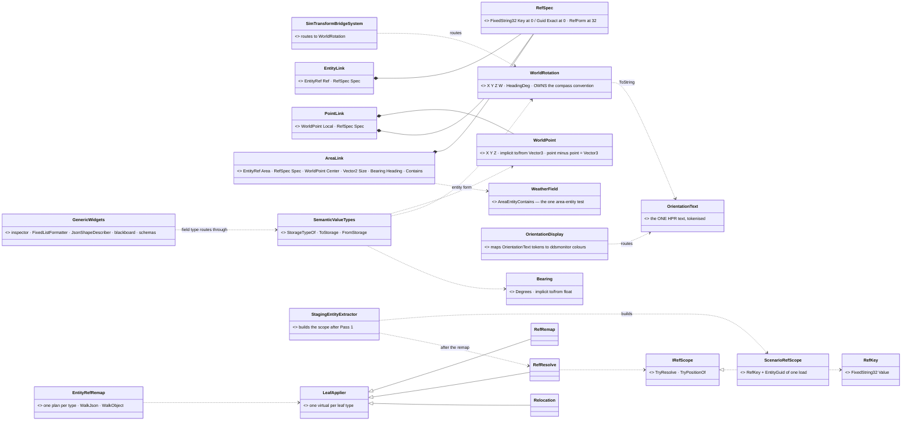

*What the picture shows that the prose hid:* the convention and the text moved DOWN into `Fdp.Core` (the only assembly `WorldPoint`'s users all
reference), and the toolkit copies now route there; and the one walker is one plan with three appliers — remap, resolve and relocate are not three
walkers.

| decided by the builder | as built | why |
|---|---|---|
| assemblies | `WorldPoint` / `WorldRotation` / `Bearing` / `RefSpec` in **Fdp.Core** (`World/`); the `*Link`s beside `EntityRef` in **Fdp.Toolkits** (`Replication/Links.cs`) | `SimTransform` is in Fdp.Core; `EntityRef` in Fdp.Toolkits |
| "`HeadingDeg` / `ToString` ROUTE to `SimTransformBridgeSystem` / `OrientationDisplay`" (§9.8.10) | ⚠ **DEVIATION — the direction is inverted**: the convention's bodies and the HPR text now live in `WorldRotation` / `OrientationText` (Fdp.Core) and the toolkit classes ROUTE to them | Fdp.Core cannot reference Fdp.Toolkits; still ONE copy (`S0TypesTests`, `SimTransformBridgeSystemTests`, `OrientationDisplayTests` green) |
| JSON of the internal types | the converter hands the value to the OPTIONS' own `Vector3` / `Quaternion` / `float` handling | byte-identical by construction in files AND in the debug API's NaN-safe dump — no copy of either converter |
| SR-138 ③ "the converter writes by CONTEXT" (file · wire · diagnostics) | ⚠ **DEVIATION — by the VALUE's state**: not authored ⇒ the bare answer · authored, unresolved ⇒ the text (`"@Key"` / GUID) · authored AND resolved ⇒ both (`{"NetworkId": n, "Ref": "@Key"}`, `{"Local": […], "Ref": …}`, `{"Area": n, "Ref": …}`) | load-time resolution rewrites params JSON in place and the behaviour must still read the answer, so a resolved link must carry it; one converter, no context flag. ⏭ A file saved after a load carries the both-form (it loads back identically — the form wins); writing only the text at save is the file-form applier, left for S3 / CE-4153 S9 |
| `AreaLink` shapes | `Size` = (width across the heading, length along it), circle radius in `Size.X`; `Heading` a `Bearing`; `Center` a `WorldPoint`; an area entity's outline is relative to its `SimTransform` (as weather regions) | the area-entity case reuses `WeatherField.TryOutline` + its even-odd test (new public `WeatherField.AreaEntityContains`) — one containment |
| the walker | `EntityRefRemap` keeps its name and API (`CompileJson`, `RemapObject`, `HoldsRefs` = holds a network id) and gains `WalkJson` / `WalkObject` + `LeafApplier`; a JSON leaf is read and written through its own converter, the string returned untouched when nothing changed; a leaf the type cannot read is left alone (the params parse reports it) | ⛔ no second plan; `RefResolve` throws on a reference that names nothing — the load fails loudly |
| `Relocation` | translate X / Y, turn about the anchor by the heading difference (compass clockwise), Z by the anchors' height difference; `WorldRotation` pre-multiplied by the turn; `Bearing` + turn, normalised; a `PointLink` / `AreaLink` written as an entity is NOT moved | SR-127 / SR-131; rails `S0WalkerTests.Relocate_*` |
| `RefKey` | component **468**, `DataPolicy.Default` (saved), `"RefKey": {"Value": "BlueHQ"}`; the scope is built by `StagingEntityExtractor` after Pass 1 from `RefKey` + `EntityGuid` + `SimTransform`, mapped to the NEW ids; a duplicate key throws; behaviour params resolve through `ScenarioBehaviorRemapper.ResolveJson` (the one contract lookup it shares with `RemapJson`) | rails `StagingEntityExtractorTests.S0_*` |
| item 6 — saved components (`d298cd86d`) | ⭐ `WorldPoint`: `SimTransform.Position`, `NetworkTransform.LastPosition`, `NavState` / `NavigationIntent.FinalDestination`, geographic `Position.Value`, `BallisticProjectile.Muzzle` / `PreviousPosition`, `WeaponTask.Point`, `FakeCrowdAgentState.Target`, `EqsSensor.ContextPoint1`, `EngagementArea.ArcOrigin` · `WorldRotation`: `SimTransform.Rotation`, `NetworkTransform.LastRotation` · `Bearing`: `EngagementArea.Left/Right/WatchBearing`. Everything else vector-shaped is a velocity, a body-relative angle or a 2-D world XY (`FormationTarget.TargetPosition` — no 2-D point type until S3), each named with its reason in `S0ComponentTypesRailTests.NotSpatial` | memory identical ⇒ no golden moved. ⛔ SUPERSEDED by the item 8 row: ~~the rail scans DIRECT fields only and four named assemblies~~ — it now walks nested structs and every engine assembly in the test output |
| the generic-widget seam | ⭐ ONE mapping `SemanticValueTypes` (Fdp.Core: `StorageTypeOf` / `ToStorage` / `FromStorage` / `IsSemantic`) — the inspector (renderer registry fallback, property tree, quaternion editor), `FixedListFormatter`, `JsonShapeDescriber`, the blackboard helpers and schema builders route through it; a schema KEEPS the semantic type name (`format: worldRotation`, `number/bearing`); ⚠ CORRECTED by item 8: ~~the blueprint compiler gains same-bytes rungs~~ — item 6 claimed them and did NOT add them (found when a `WorldPoint` pin failed BP1501); ⭐ item 8 added them: `Vector3↔WorldPoint`, `Quaternion↔WorldRotation`, `Single↔Bearing` both ways, plus `PointLink→WorldPoint` (the authored point read as its `Local`), `WorldRotation` registered (16 B); each in `CoercionTable_ContainsOnlyLosslessWidenings`' allow-list with its reason | rails `SemanticValueTypesTests`, `SemanticValueRoutingTests` |
| ⚠ DEVIATION — `Stage2_Validate` (BP2014) | matches the three types by **full NAME**, not through `SemanticValueTypes` | `Hrot.Blueprints.Compiler` also targets `netstandard2.0`, where `Fdp.Core` is not referenced (the netstandard / net8.0 wall, `BATCH-03-REPORT.md:100`). One check, three names; the cure is a source file linked into both targets |
| ⚠ `NodeEditor.UI` (ExtDep) | `PinDefaultValueEditorRegistry` maps `Fdp.Core.WorldPoint` by type NAME to `VectorPinEditor(3)` | the library cannot reference `Fdp.Core` |
| item 7 — CE-4200 (ids) | ⭐ entity network ids are `int` in the engine AND on the wire; `TkbTypeId` (template id, `long`) and `NodeId` (cluster node, `int`) are types; one refusal guard `NetworkIdLimit.Checked` in every allocator — ⭐ the as-built lives in its owning designs: [`DESIGN_Semantic_Value_Types.md`](DESIGN_Semantic_Value_Types.md) §2.1 (the exclusions with reasons, the deviations) · [`NED_DDS_Protocol.md`](reference/NED_DDS_Protocol.md) (the wire) · AQ107 row E SUPERSEDED | rails `S0IdTypesRailTests`, `EntityMasterTranslatorTests.CE4200_*` |
| item 8 — the rails | ⭐ `S0AuthoredTypesRailTests` (params / predicate DTOs: no bare `Vector3` / lat-lon / `long` id / `EntityRef`) · `S0ComponentTypesRailTests` (saved components: places `WorldPoint`, orientations `WorldRotation`, compass numbers `Bearing`) · `S0IdTypesRailTests` (template ids, node ids) · `CE4200_AnIdAboveInt32_IsRefusedAtTheAllocator` (replaces AQ107 E). ⭐ The component rail now WALKS NESTED STRUCTS of the engine's own and scans every `Fdp.*` / `Hrot.*` assembly in the test's output (not a hand list) — it found 9 more places: `NavigationCorridorPreview`'s `PreviewWaypoint.Position` and `DangerAreaSensor.Settings.RoutePoint` ⇒ both retyped to `WorldPoint` (the danger-area sensor's blueprint pin is now `Fdp.Core.WorldPoint`; `PointLink→WorldPoint` keeps the sample's `Get All Parameters` wire into it legal; `DangerCrossingBp.bp.json` re-baked, golden diff: its one emitted cast `(Vector3)` → `(WorldPoint)` and its persistence-shape line) | ⚠ still out of reach: component assemblies `Fdp.Toolkits.Tests` does not reference (`Hrot.Traffic`, `Hrot.IG`, `Hrot.CGF`, `Hrot.MuscleCharacter.Fake`) — a component there is not scanned |
| item 9 — the content migration | ⭐ `hrot-content-migrate` (`Hrot/Tools/Hrot.Tools.ContentMigrate`, in `HROT.sln`): each params blob's contract from the behaviour registry every host builds (`CgfBehaviorSetup.LoadFromAiAssembly`), its places from the ONE walker (`EntityRefRemap.VisitLeaves` — leaves raw, plus each nested object with its contract type). Moves: a `PointLink` held as `[lat, lon]` → `[x, y, 0]` through the scenario terrain's geo origin (`WGS84Transform`, as `OrderGeo.ToLocal`); a pair that is no lat/lon → the old no-transform fallback `x = second, y = first` (`ua-air-strike`'s `[300,600]` → `[600,300,0]`); renamed keys at ANY depth (`MoveToLocation` `targetLat/targetLon` or `x/y` → `target`, `DefendArea` `CenterLat/CenterLon` → `Center`). Splices only the params string tokens (bytes elsewhere untouched, the file's `\u0022` / `\"` style kept). Ran over `scenarios/` + `recipes/` (`ContentLayout`): **37 blobs, 25 files, 37 lines in / 37 out**; a second run moves 0 | `test-data/scenario-corpus` holds no params (versioned format data) — not a default. Rails `ContentMigrationTests` (the repository's content is migrated AND every blob loads — red before the run, green after) |
| item 9 — ⛔ an old form is a LOUD load error (CE-4153 S10) | `LeafApplier.RefusesOldForms` — `true` only for `RefResolve` (authored content at LOAD, `ScenarioBehaviorRemapper.ResolveJson` / `StagingEntityExtractor`): a leaf its converter cannot read throws `JsonException` naming the key; a key the contract marks `[RetiredJsonKeys]` throws the same. `RefRemap` and every other applier keep the old leniency (a saved blob is remapped, never refused) | ⚠ **why not "unknown keys are errors":** the params parse ignores unknown keys BY DECISION (`BTreeBridgeEmitCore.cs:1526`, pinned) — ⭐ only the keys a migration retired are refused, declared on their contract. Rails `S0WalkerTests.Resolve_AtLoad_RefusesAnOldForm_*`, `VisitLeaves_*` |

## 10. Objective KINDS, measures, triggers, actions, the director, views *(`2026-10-31` … `2026-11-01`)*

### 10.1 The data sources — measured `2026-10-31` (graph `.*(Fire|Hit|Kill|Damage|Destroy|Casualt|Death|Wound).*(Event|Notification|State|Status)$` Class (18) + grep)

| fact | where | feeds |
|---|---|---|
| a SHOT: `WeaponFireIntent {Shooter, Target, WeaponIndex, IsRemote, AtPoint, TargetPoint}` — `IsRemote` ⇒ it is raised on other nodes too | `Fdp.Toolkits/Combat/.../WeaponFireEvents.cs:27-46` | shots per shooter |
| a HIT: `DamageAssessedEvent {HitEntity, TotalDamage, IsRemote, BodyPart, Effect, Source}` — reaches other nodes through `EntityHitDamageIngressTranslator` | `Combat/Events/DetonationEvents.cs:26-54` | hits per shooter, fratricide, civilians harmed |
| destroyed: `Health.Current <= 0` | `Combat/Components/Health.cs:19` | destroyed / survivors |
| a REPORT up the chain: `SquadReportNotification {FromUnit, ToUnit, Subject, SentAt, Report (kind, ObservedAt, …), OriginNodeId}` — raised on EVERY node | `Squad/Command/SquadReportNotification.cs:13-29` | report latency (`SentAt − ObservedAt`), reports made |
| area occupancy: EQS `EntitiesOfForceInArea`, `PolygonMath.Contains`; areas = `EditablePolyline` entities | `EntitiesInAreaGenerator.cs:34, :119`; `PolygonMath.cs:29` | reach / hold / clear |
| the scenario clock | `ScenarioClock` on the World Environment | deadlines, time-to |
| "first seen": the perception contact memory (`KnownCombatantList`, sensor contacts) | OVERVIEW §4 | the start of a report latency |
| ✅ hits reach every node: the hit-damage ingress is in the SHARED translator pack (`SharedTranslatorPack.cs`, `EntityHitDamageIngressTranslator.cs`) · ✅ harm is judged by AFFILIATION: `ForceId {Neutral, Friend, Hostile}` (`Fdp.Core/Components/ForceId.cs:10-20`) — 🔒 user: *"the affiliation is a better indicator than being a civilian or not, because we can have terrorists and other civilian combatants, as well as we do not want the neutral side soldiers be killed"* · ✅ `DamageAssessedEvent.Source` is the SHOOTER for gunfire (`DamageCalculationSystem.cs:~120`), blasts (`AreaEffectSystem.cs:215-225`) and hits from other nodes (`EntityHitDamageIngressTranslator.cs:~101`, `SourceEntityId` mapped); ⚠ drone impacts, gas clouds and ejection carry no source | as cited | — |

### 10.2 Objective kinds v1 — each ONE small generic behaviour in the task slot (SR-37, SR-51)

⭐ Every kind's params begin with the SAME nested block `ObjectiveCommon {title, subject, required, visibleTo, points, weight, deadline, activeWhen, scored}` —
the deadline and the activation are FIELDS, not kinds, so every objective can have them.

| kind | params (besides `ObjectiveCommon`) | achieved when · failed when |
|---|---|---|
| `ReachArea` | area, minUnits = 1 | ≥ minUnits of the subject's units inside · the deadline passes |
| `HoldArea` | area, minUnits = 4, maxEnemy = 0, holdSeconds = 600, `capture` (repeatable: the owner flips) | held continuously for holdSeconds · the deadline passes (capture: never ends, the OWNER is the state) |
| `ClearArea` | area, enemy side, maxEnemy = 0, forSeconds = 30 | no enemy inside for forSeconds · the deadline passes |
| `DestroyTargets` | targets (`RefKey` / query), count | count of them destroyed · the deadline passes |
| `Protect` | targets (`RefKey` / query), minSurvivors | the deadline passes with ≥ minSurvivors · fewer survive |
| `NoHarm` (a constraint) | protected AFFILIATION (`ForceId`: Neutral / Friend / Hostile), by side, maxCount = 0 | the run ends within limits · more harmed than maxCount (fratricide and civilian harm are two uses) |
| `Composite` | mode all / any / weighted | its required children achieved · a required child failed |

### 10.3 Measures v1 — evaluation that SCORES rather than ends (a measure is an objective with a value and a target)

| kind | value | default target |
|---|---|---|
| `HitRatio` | the subject's hits ÷ shots | ≥ 0.30 |
| `Count` | shots · hits · kills · fratricide · civilians harmed · reports made — by the subject | per use (fratricide = 0) |
| `ReportLatency` | first contact seen by the subject's team → its report received by the subject's commander (`SentAt − ObservedAt` on the chain) | ≤ 60 s |
| `TimeTo` | scenario start → a named objective achieved | per scenario |

### 10.4 `ObjectiveStatus` (replicated, SR-31 / SR-48) — one shape for objectives and measures

`State` (Pending · Active · Achieved · Failed) · `Owner` (side, capture only) · `Progress` (current / needed) · `Value` + `Target` (measures) ·
`Points` · `ChangedAt` (scenario time) · `Reason` (a short text: *"held 60 s, 5 Blue / 0 Red"*) · `Subject` · `Parent` (SR-53) — the full wire shape is SR-120 (§11.4).

### 10.5 *(no decision of its own — per-member evaluation is SR-72, §10.7; user: *"Evaluation macro should not come from TKB. TKB is static"*)*

### 10.6 The result — SR-122 (§11.4)

⭐ A GRADE (A–F, %) is NOT computed by the engine — a frontend derives it from points and pass / fail (R-4105).

### 10.7 Assignment by ROLE, triggers on the same statuses, external measurements, weights *(`2026-10-31`)*

> 🔒 **User, `2026-10-31`:** *"Evaluation macro should not come from TKB. TKB is static, but the evaluation criteria and objectives, they need to
> be specifiable per scenario"* · *"how a higher echelon macro scenario objective can specify the objectives for subordinates (likely by referencing
> another macro or some macro library where the objective is selected by member role.) The goal is to assign the objectives more or less
> automatically whenever possible."* · *"we should talk also about the triggers … how to affect the running scenario based on similar conditions"* ·
> *"inputs that are not coming directly from our simulation, but are coming from external world … how much a trainee exposes to an enemy … there
> are some measurement devices providing this information"* · *"Weighting of the criteria might be necessary in case we want to act on some
> triggering condition which is based on the evaluation criteria … the points or some values calculated from the objectives would need to be passed
> to the upper layer, which might be aggregating them and deciding something upon them."*

| measured | where |
|---|---|
| a member's ROLE already exists: `TacticalDesignation` (Commander, SquadLeader, TeamLeader, Medic, AutomaticRifleman, MachineGunner, Grenadier, Marksman, …) on the command link, on the wire | `Fdp.Core/CommandHierarchy/TacticalDesignation.cs`; `UnitSubordinate.cs:25` |
| ⛔ no generic NED topic for an external measurement (graph `.*(External|Telemetry|Measurement|Reading|Instrument|Sensor|Variable|Signal|Value)(Topic|Descriptor|Sample|Message)$` — no topic; the protocol inventory names an external gateway as *"a node like any other"*) | `NED_DDS_Protocol.md` |

| # | decision | ⭐ lean |
|---|---|---|
| **SR-72** | ✅ CONFIRMED `2026-11-01` for the demo (user: *"Evaluation per node is okay, at least for the beginning. I need something to start with. Maybe it will change later."*) · per-member objectives are assigned BY ROLE, per scenario | a `MemberEvaluation` kind placed on a commander (its `Subject`): params `byRole {SquadLeader: "SLCriteria", MachineGunner: "MGCriteria", *: "RiflemanCriteria"}` (role → a macro from a library folder, e.g. `macros/evaluation/`) — it creates ONE macro instance per subordinate down the command chain, chosen by `TacticalDesignation` (or the entity class when no role), `Subject` = that member; a role's macro may itself contain a `MemberEvaluation` (squad → fire teams). It follows the chain LIVE: a reinforcement gets an instance; a casualty's instance stays and keeps its result. ⛔ never from the TKB (static) — SR-30 superseded |
| **SR-73** ✅ CONFIRMED `2026-10-31` (user: *"Group A confirmed."*) | triggers act on the SAME statuses | a `Trigger` kind: `when` = a status of other objectives / measures (*"`bridge` becomes Achieved"*, *"`Blue members` value < 0.5"*, *"`Blue tickets` ≤ 0"*) + an optional delay · `do` = actions. ⭐ ⇒ the CONDITION vocabulary IS the objective kinds: a condition that is not scored is an objective with `scored: false` — no second condition language, nothing called by name |
| **SR-74** ✅ CONFIRMED `2026-10-31` (user: *"Group A confirmed."*) | actions v1 | `Order` (an `AssignTacticalIntent` to a `RefKey` / query subject: behaviour + params) · `SetReporting` · `InsertMacro` (a scenario macro instance created at runtime at a position — waves, reinforcements, an IED event: the SAME macro machinery) · `Message` (to a side / the IOS / a trainee) · `SetObjectiveActive` · `SetSkillAmplifier` (P-5) · `EndExercise` |
| **SR-75** ✅ CONFIRMED `2026-10-31` (user: *"Group A confirmed."*) | values passed UP | every status carries a normalised `Score` (0..1: achieved = 1, failed = 0, a measure = value vs target); a `Composite` aggregates its children by their `weight` into its own `Score` / `Value` ⇒ a trigger or a director watches any level (team, side, exercise) |
| **SR-76** | ✅ `2026-11-01` — RESERVED, NOT in the demo (user: *"External measurements will not be present in the demo. They were mentioned just to reserve the components and the architecture to count with that."*) — keep the component / topic in the architecture, build nothing for it now · EXTERNAL measurements (the physical world) | a small NED topic `ExternalMeasurement {[DdsKey] StationId (int, SR-76a), [DdsKey] Key, Value, Time, SourceId}` (KeepLast per subject + key) published by a device gateway; the ingress keeps the latest per (subject, key) — a measure kind `External {key, aggregate: mean / max / time above threshold, target}` and the same as a trigger condition. Example: `exposure` from a laser / camera rig behind the physical wall → *"time exposed to the enemy > 20 %"* |
| **SR-77** | the director | a director's utility inputs may read any `Score` / `Value` (SR-18) — the adaptive pressure valve rides the same statuses |

### 10.8 Aggregation is overridable, roles OR keys, the station link *(`2026-10-31`)*

> 🔒 **User, `2026-10-31`:** *"The aggregation and weighting of the criteria, these are usually something that changes over time, that we will
> never create something that will fit everyone's needs. So these parts shouldn't be hard coded without the possibility to override them … maybe
> some aggregation logic as a function, either hard-coded and registered as such (eval result aggregator) or defined as a blueprint."* ·
> *"tactical designation is not always sufficient, and we might need to reference via the ref key."* · *"The external measurement device reports
> and provides data for its physical ID … this link between the device and the trainee might live as a component on the trainee entity … stations
> … are usually numbered or have a string name … fixed string 64 for that (or GUID)."*

| # | decision | ⭐ lean |
|---|---|---|
| **SR-78** ✅ CONFIRMED `2026-10-31` (user: *"Group A confirmed."*) | the AGGREGATOR is the composite's BEHAVIOUR | ⛔ no aggregator registry: a `Composite` objective is an entity whose task-slot behaviour IS its aggregation — `WeightedMean`, `AllMustPass`, `RequiredGateThenWeighted` ship; a scenario picks one by name like any behaviour, with its params; a custom one is a C# behaviour OR a Blueprint behaviour reading its children's `ObjectiveStatus` and writing its own `Score` / `Value`. ⇒ the existing behaviour registry, params form, debugging and hot reload serve aggregation too (R-4111) |
| **SR-72a** | the member SELECTOR's lookup order | for each member, first match wins: its `RefKey` (`@PL-Trainee`) → its `TacticalDesignation` (`MachineGunner`) → its entity class → the default — authored as SR-81's library FOLDER (+ `overrides`) |
| **SR-76a** | the device ↔ trainee link | a component on the trainee's entity, `PhysicalStation {Id: int}` (⭐ rev `2026-10-31`, user: *"Station names are unique across the cluster … Please change the fixed string into an integer. The stations use the name just for convenience, but technically they are assigned a unique integer ID as well"* — the name stays a display label, the INTEGER is the key; cluster-unique) — set when the trainee's Player node takes the unit (the node is configured with its station name), cleared when released; `ExternalMeasurement` is keyed by that integer STATION id (the device knows only where it is installed), and the ingress routes it to the entity whose `PhysicalStation` matches. Generic: any device, any key |
| **SR-79** | the GUID descriptor's owner | ✅ accepted as built (`dtEntityGuid` stays with the creator — the Brain creates scenario entities; a Brain crash is non-recoverable today — user) |

### 10.9 Worked example — *"Platoon attack on the village"* *(`2026-10-31`)*

📐 Measured for it: roles in the 117 scenarios — 409 entities have a command link: `Wingman` 284, `SquadLeader` 80, `MachineGunner` 29,
`TeamLeader` 8, `AutomaticRifleman` 4, `Medic` 4 ⇒ most riflemen carry the DEFAULT role, so SR-72a's `*` / class / `RefKey` rules matter.

**What the author places in the scenario** (everything else expands from macros or follows the command chain):

```
entity "Blue Platoon"      Scenario macro → macros/forces/ReinforcedPlatoon   { side: Blue }                       (units, RefKeys @BluePL, @Sq1…)
entity "Red defenders"     Scenario macro → macros/forces/InsurgentCell       { side: Red, count: 12 }
entity "Blue mission"      Scenario macro → macros/missions/SeizeArea          { subject: "@BluePL", area: "@Village", deadline: "10:00" }
entity "Blue evaluation"   Scenario macro → macros/evaluation/PlatoonAttackEval { subject: "@BluePL" }
entity "Red counter"       Scenario macro → macros/directors/CounterAttack     { attacker: "@RedHQ", trigger: "Blue mission/Hold", wave: "macros/forces/RedQRF" }
area   "Village"           RefKey @Village
```

**What `PlatoonAttackEval` contains** (a reusable library macro):

```
Composite "Platoon attack"   behaviour WeightedMean                              (subject ^subject)
 ├─ ObjectiveRef "mission"     weight 40   value: the Blue mission's Score   (via RefKey of the mission macro's root)
 ├─ MemberEvaluation           weight 60   subject ^subject, library "macros/evaluation" — per member, first found (SR-81):
 │      <RefKey>  PL-Trainee     → the platoon-leader trainee's criteria
 │      <Role>    SquadLeader    (itself a MemberEvaluation for its fire team)
 │      <Role>    MachineGunner
 │      Default                  (HitRatio ≥ ^minHit · NoHarm(Friend, Neutral) · ReportLatency ≤ 60 s · External "exposure" ≤ 20 %)
 └─ NoHarm "No fratricide"    weight 0, required   (fails the whole tree)
```

**Triggers in play** (all `Trigger` entities, inside macros):

| trigger | when | do |
|---|---|---|
| `CounterAttack` director | `Blue mission/Hold` becomes Active | `InsertMacro(RedQRF, at the edge of @Village)` + `Order(@RedQRF, Attack @Village)` |
| ease off (in the director) | `Platoon attack` Score < 0.35 after 20 min | `SetSkillAmplifier(Red, −1) (SR-100)` + `Message(IOS, "Red eased")` |
| end | `Blue mission` Achieved OR Failed OR `ScenarioTime > 10:30` | `EndExercise` |

| ⭐ what this shows | |
|---|---|
| six authored entities produce the whole objective tree, per-member evaluation for every soldier and three triggers | reuse across scenarios = swap args / swap the library macro |
| the threshold `^minHit` defaults in `Rifleman`, may be overridden by `PlatoonAttackEval`'s args, a squad's macro, or the unit's own entry | SR-67 nearest wins |
| a trigger's condition is another objective's STATUS; the director reads `Score` | SR-73, SR-75, SR-77 |

### 10.10 The member library, attribution, the trainee's own view *(`2026-10-31`)*

> 🔒 **User, `2026-10-31`:** *"How do we specify the macro library for the subordinate units to pick from by ref key or role?"* · *"we should carry
> the original shooter information for grenades and drones. Note that the grenades can be rethrown … it is not clear who to made responsible"* ·
> *"Showing player's own evaluation on the HUD is a good idea for debugging, at least, and I agree that it should be under a feature switch."*

| # | decision | ⭐ lean |
|---|---|---|
| **SR-81** ✅ CONFIRMED `2026-10-31` (user: *"Group A confirmed."*) | the member LIBRARY | ⭐ a FOLDER, resolved by convention — `MemberEvaluation {library: "macros/evaluation/infantry", overrides: {...}}`: for each member it looks for `<library>/<RefKey>` → `<library>/<Role>` (`TacticalDesignation`) → `<library>/<entity class>` → `<library>/Default`, first file found wins. ⇒ NO table to author for the common case; swapping `library` swaps the whole set (e.g. `infantry-recruit` vs `infantry-veteran`); adding `SquadLeader.macro.json` to the folder covers every squad leader. `overrides` (`{"@PL-Trainee": "macros/evaluation/special/PlatoonLeaderTrainee", "Medic": "…"}`) handles scenario-specific exceptions — a FLAT map, so `OverlayFlat` overrides entry by entry (§8.0). Supersedes SR-72a's ordered rule list as the authored form |
| **SR-82** ✅ CONFIRMED `2026-10-31` (user: *"Group A confirmed."*) | attribution of indirect harm | carry the shooter through every indirect damage source (tracker **CE-4155**). For a REthrown grenade the damage event carries BOTH: `Source` = the LAST thrower (who acted last) and `OriginalSource` = the first. ⭐ the evaluation decides, not the engine: a measure's `attribute: last \| original \| both` param, default `last` (the one who threw it back took the decision); both stay in the result for the debrief |
| **SR-83** | ✅ CONFIRMED `2026-11-01` for the demo — ON by default in the demo profile (user: *"Trainees can see their own evaluation, that's part of the demo … showing it at player screen will demonstrate that it actually working during the exercise run"*); subject to change for production · the trainee sees their own evaluation | feature `hud.own-evaluation` (R-4108), OFF by default — when on, the Player HUD lists the objectives / measures whose `Subject` is the possessed unit (live `Value` vs `Target`); useful for debugging and for training modes that want live feedback; the instructor's view is unaffected |
| **SR-84** | ✅ ACCEPTED `2026-11-01` (user: *"The deploy score and respawn is accepted."*) · the Deploy score and respawn (user, `2026-10-31`) | ✅ the Deploy design's score (D-15) IS a set of evaluation measures with the player's unit as `Subject` — one counter; the respawn delay (D-14) is a scenario parameter with a default (`DESIGN_Player_Join.md` §7b) |

### 10.11 Trigger semantics *(`2026-10-31`; T7 / T8 as proven by the PoC, SR-93 / SR-98 / SR-108)*

📐 Measured: the brain tick runs only when simulation time advances (`[TickMode(WhenTimeAdvances)]`, `BrainTickSystem.cs:58`) ⇒ nothing
evaluates or fires while paused; it walks entities in index order (deterministic within a run); the brain journal is always on and RECORDED
(`DESIGN_Entity_Brain_View.md` BV-16) ⇒ a trigger's HSM transition and its cause land in the recording for free.

```mermaid
stateDiagram-v2
    [*] --> Disarmed
    Disarmed --> Armed : activeWhen holds (or none)
    Armed --> Holding : condition rises false to true
    Holding --> Armed : condition drops before holdFor
    Holding --> Waiting : held for holdFor
    Waiting --> Acting : delay elapsed
    Acting --> Fired : the last action ended or one failed
    Fired --> Cooldown : repeat, below maxFires
    Cooldown --> Armed : cooldown elapsed and condition false again
    Fired --> Done : once, or maxFires reached
    Armed --> Disarmed : activeWhen stops or deadline passes
```

*Caption:* a trigger is a small HSM; every arrow is a journaled transition with its cause, so the AAR can answer *"why did the counter-attack
start at 09:43?"* without new logging. `holdFor` (debounce: the condition must stay true) and `delay` (fire later, even if the condition
drops) are different and both optional.

| # | rule | ⭐ lean |
|---|---|---|
| **T1** | what fires | the RISING EDGE of the condition (false → true) — ⛔ never "every tick while true"; a *while* belongs to an objective's activity. A condition already TRUE when the trigger arms is NOT an edge (PoC finding ⑦, SR-108); *fire if already true when armed* is an opt-in rule setting (CE-4166, SR-109) |
| **T2** | once or repeat | `once` by default; `repeat` re-arms only after the condition has gone FALSE again (a new edge) and after `cooldown`; `maxFires` stops a repeating trigger after N fires (its own `FireCount`, SR-99) |
| **T3** | `holdFor` and `delay` | `holdFor`: the condition must hold continuously that long (debounce) · `delay`: fire that long after the edge, even if the condition drops meanwhile (a scheduled consequence) |
| **T4** | arming | `activeWhen` (ObjectiveCommon) arms it; its `deadline` disarms it; a disarmed trigger never fires |
| **T5** | time | scenario simulation time only (R-126 one time source): paused ⇒ frozen; time scale honoured |
| **T6** | several in one tick | each trigger is independent; a trigger reads other statuses as they are when it ticks ⇒ up to ONE TICK of latency, deterministic (index order). ⭐ where order matters, CHAIN: a trigger's own status (`Fired`, `FireCount`) is a condition another trigger can watch |
| **T7** | its actions | run as a SEQUENCE in their listed order (SR-93, SR-98): each step runs until it ends — `Order` until the unit accepted the intent, `InsertMacro` until its expansion is `Done` (SR-96); instant steps finish in the firing tick; a `Failure` stops the list and is written to the trigger's `Reason` (later actions usually depend on earlier ones); nothing already done is undone |
| **T8** | its status | a trigger carries `ObjectiveStatus` too (state Disarmed / Armed / Holding / Waiting / Acting / Fired / Cooldown / Done, `FireCount`, `LastFired`, `Reason`) — `scored: false` by default; a timeline lane `rules.fired` |
| **T9** | the instructor | may FIRE, DISARM or RE-ARM a trigger by hand (an instructor action, journaled with its origin) |
| **T10** | replay | triggers do not run in replay (brains do not tick there) — what fired is in the recording (journal + status) |

### 10.12 Mission plan × triggers — what was measured *(`2026-10-31`)*

> 🔒 **User, `2026-10-31`:** *"the triggers which are on an entity can steer the entity, not just a scenario … It still looks to me that these are
> the same concepts and that we should somehow unify … I'm not forcing to unify or replace the mission plan concept yet. I need information first."*
> · *"The concept and UI, as perceived by the user who defines the missions, should stay simple. The internal implementation doesn't need to. We
> can also change the wire format if beneficial, no backward compatibility required. No one is using the NED API to mission editing now … Everything
> what uses mission plans is just UIs and scenarios, and we can migrate these if beneficial."*

| measured | where |
|---|---|
| the mission plan is NOT a brain: `MissionDirectorSystem` evaluates the current phase's ONE trigger per entity with a `MissionPlanQueue` (≤ 8 phases) and starts the next task through `AssignTacticalIntent` (origin Superior); commands replace / jump / abort (`MissionControlExecutionSystem`) | `MissionDirectorSystem.cs:153-200`; `REFERENCE_Command_Building_Blocks_Measured.md` |
| the wire trigger is open (`{Type: string, Params: string}`, a LIST per task) but ingress narrows it to 4 kinds, uses only the FIRST, and ⚠ maps an UNKNOWN type to `TimerElapsed(0)` — the phase advances at once, silently | `Hrot.Network.NED/Helpers/MissionTriggerHelper.cs:30-52` |
| a phase change is journaled only as the next behaviour's start — no *"advanced because …"* | grep `Journal` in `MissionDirectorSystem.cs` = none |
| usage: 35 scenarios / 47 entities; trigger kinds used: `BehaviorFinished` 85 · `TimerElapsed` 18 · `UnderAttack` 0 · `HealthCritical` 0; 52 production + 29 test files touch the mission types | scan `2026-10-31` |
| authoring: the editor's Mission panel (five trigger names, `MissionPanel.cs:78`); saved by `MissionPlanTranslator` | as cited |

**Rejected — one line each** (the decision is SR-90):
- *U5 — one step engine: the mission plan rebuilt as a `Sequence` behaviour entity sharing the trigger's steps, conditions and actions* — it retires `MissionPlanQueue` / `MissionDirectorSystem` / `MissionAdapterSystem` and the Mission panel's backing model and migrates 35 scenarios (52 + 29 files) for small gains (user: *"Simplicity matters"*, SR-90).
- *Keep the queue but EXTEND it with a shared step library (SR-89: up to 4 conditions per phase, per-phase actions and objectives)* — the same objection: more complicated than what it is now, while triggers already cover the rich cases.
- *Lowering a mission into one trigger ENTITY per phase* (up to 8 + their objectives per unit) — the same result with many more entities.
- *Triggers as one-step mission plans* — the existing mission occupies its unit's task slot; triggers run in parallel without one.

### 10.13 Where a trigger runs, and the mission plan lean *(`2026-10-31`)*

> 🔒 **User, `2026-10-31`:** *"Where the trigger hsm runs? The behavior on the entity is set by the mission plan items so trigger can not run there."*
> → on the answer: *"trigger runs on sub-entity, not on the entity where the mission is'. I am fine with that."*

| # | | |
|---|---|---|
| **SR-88** | ✅ where a trigger runs | on its OWN entity — conceptually a SUB-entity of the entity it concerns (`Subject`, shown nested under it), technically a full entity with its own brain running the `Trigger` behaviour in ITS task slot (a `PartMetadata` part cannot carry a brain — §9.3). The concerned unit's slots stay its own: the TASK slot = its mission plan / orders, the SOP slot = its doctrine. SR-73 / SR-21 stand |
| **SR-90** | ✅ the mission plan stays AS IT IS (user, `2026-10-31`, on the unification proposals: *"I am still not sure if the unification is worth it, it sounds way more complicated than what it is now. Are the gains significant? Simplicity matters"* → *"Yes"*) | its simple UI, one mission per unit, its own four advance rules. Missions and triggers connect through ONE action — `MissionCommand` (jump / replace / abort): *"when `Clear B4` is achieved, jump Squad 1 to task Withdraw"* is one trigger next to a plain mission. Why: usage is `BehaviourFinished` 85 + `Timer` 18 across 35 scenarios, the rich cases are covered by triggers, and the leftover duplication (four per-phase rules) is small and simple where it is. Only the two defects are fixed — tracker **CE-4157** (strict parsing: an unknown kind is a load error, not a silent `TimerElapsed(0)`; every condition honoured, not only the first). A shared step library stays possible later if a richer mission becomes a real need |
| **SR-91** | ✅ ACCEPTED `2026-11-01` (user: *"The actions vocabulary and how do runs is accepted."*) · how a trigger's `do` is implemented (user, `2026-11-01`: *"Is it a sub-behavior or a blueprint script? … It looks like it is just a plain sequence of actions. Is it?"*) | ⭐ PLAIN DATA — an ordered list of `{act, args, bind}` in the trigger's params, run by the ONE generic compiled `Trigger` behaviour through `RunActions` (SR-98); ⛔ not a sub-behaviour, not a Blueprint, nothing compiled per scenario. The list is held in the managed side record (SR-97; precedent `SopStartRecord.JsonParams`) — no packing of a variable list into the fixed block. Each entry's kind is a shared action from the ONE vocabulary (SR-93). Validated at ASSIGNMENT: an unknown kind or bad args = a loud refusal at load (PoC finding ②, SR-108). A new kind = one more shared action (ordinary development); logic beyond a list = a reusable director / Blueprint ASSET an action starts by name. ⛔ rejected: a closed set of handlers private to the trigger — the verbs must be callable from any behaviour (SR-93) |
| **SR-92** | ✅ `when` may be the scenario clock directly (user, `2026-11-01`: *"The scenario time condition in the when, yes, of course. No need for extra objective just for specifying time condition."*) | the `ScenarioTime` leaf of the predicate language (SR-95) — no objective just for a time |
| **SR-93** | ✅ ACCEPTED `2026-11-01` (user: *"The actions vocabulary and how do runs is accepted."*) · ⭐ PROVEN by the PoC (SR-108; `TriggerPoc/PocCatalogue.cs`) — build: CE-4160 · ⭐ ONE ACTION VOCABULARY (user, `2026-11-01`: *"the actions to cover just the non-self stuff you enumerated, like insert macro, send a message to someone, ask an entity to execute a behavior etc. the sequencing the actions for sure requires that we wait for each to complete … insert macro is something that I would like to be called from basically any behavior as an action … So this is a real unification of action vocabulary."*) | ⭐ the scenario-directing verbs (InsertMacro · Order · MissionCommand · SetReporting · Message · SetObjectiveActive · SetSkillAmplifier · EndExercise) are ordinary **stateful `[SharedAiAction]`s** (`SharedNodeBinder.RegisterStatefulAction`, `SharedNodeBinder.cs:285`) that name their TARGET in their params — `self` is only *who asked*. ⇒ any BTree, HSM, director or trigger calls the same method. ⭐ Each returns `Running` until its effect is established, then `Success`/`Failure`: **InsertMacro** reads its instance's expansion status (SR-96) — any failure ⇒ `Failure` with its reason; **Order** completes when the unit has accepted the intent (waiting for the OUTCOME is a `when`, not the action). ⭐ A trigger's `do` stays a plain data list (SR-91) run as a **sequence** (T7). ⭐ The three things it rests on: ① binding a shared action at RUNTIME from data — ✅ proven (SR-108: one runner per action TYPE via `MakeGenericType` + `Delegate.CreateDelegate`, cached; the binders are generic over the param / working-state types, `SharedNodeBinder.cs:285`, `HsmSharedBinder.cs:109`); ② variable `args` — ✅ SR-97's `ActionArgs` side record (`TParams : unmanaged` cannot hold a list); ③ the catalogue (`ActionSchemaExporter`) is editor-side (`Hrot.Editor.AiShared`) — load-time validation on a cluster node needs it in shared runtime code (§00.7, part of CE-4160) |
| **SR-94** | ✅ a `do` entry carries its OWN bindings (user, `2026-11-01`: *"The parambinding switch references the index of the action inside the action list. It seems pretty fragile. Couldn't we describe the bindings per action as part of its record? Imagine manual editing of the svenario file and the neet to reindex the binding - non practical."* → *"Yes"*) | each entry = `{act, args, bind}`; `bind` maps a path RELATIVE TO ITS OWN `args` to a scenario / macro param — `{"act":"InsertMacro","args":{"macro":"RedQRF","macroArgs":{"size":12}},"bind":{"macro":"qrfMacro","macroArgs.size":"qrfSize"}}`. ⭐ reordering moves the bindings with the entry; the literal stays as the unbound value. ⭐ The rule: **the binding lives NEXT TO the value it binds** — the shape SR-35 first proposed; SR-57's `ParamBindings` stays for ordinary component fields (a typed component cannot hold a sibling map). Applied ONCE at load, like every other binding (SR-44) — scenario params are fixed for a run. Chains unchanged: scenario param → action arg → macro param → a part's field |
| **SR-95** | ⭐ PARTLY PROVEN by the PoC (SR-108; `TriggerPoc/PocTrigger.cs`, `TriggerPocTests.When.cs`) — build: CE-4159, CE-4163, CE-4164 ·  ✅ `when` is the EXISTING condition language, not a new one (user, `2026-11-01`: *"This looks like a special language describing the condition. Couldn't we reuse the existing conditions machinery? … We already have a way how to serialize even rich complex conditions in JSON. This is used for various places like data breakpoint conditions, etc."* → *"Yes"*) | ⭐ `when` = a `SearchPredicateDto` (`Fdp.Toolkits/ReplayBrowser/Search/SearchPredicateDto.cs:35` — Compound And/Or · PropertyMatch · Numeric · String · Lifecycle · TransientEvent · Spatial · BehaviorParam · BlueprintVariable …), compiled ONCE at load by `IPredicateCompiler.CompileComponentPredicate` → `Func<EntityRepository, Entity, bool>` (`IPredicateCompiler.cs:19`; already built on the CGF node, `CgfSubsystem.cs:859`) — the language data breakpoints AND the Blueprint `When` node (`ConditionMetPayload`, `Nodes.cs:800`) already use. ⭐ A trigger is one more **reactive guard** (`ReactiveGuardVocabulary.cs:7` — BTree observer selectors, HSM transition guards, Blueprint `When`): the predicate says WHAT, the trigger adds only the edge and timing (T1–T10). The editor authors it with the existing predicate builder. ⭐ Two ADDITIONS to the language (new `JsonDerivedType`s, not a second language): ① **`OnEntity {Ref, Predicate}`** — re-targets its child at a `RefKey`/GUID entity, so a condition can be about another entity and, nested in a Compound, about several (*"@A Active AND @B Failed"*); ② **`ScenarioTime {Clock: Elapsed\|Utc, Min, Max}`** — 📐 measured: NO component holds the current scenario time; `ScenarioTime.Utc(world)` (`Weather/ScenarioClock.cs:66`) computes it = `ScenarioClock.StartUtcTicks` (World Environment) + `GlobalTime.TotalTime` ⇒ a PropertyMatch cannot express it, a small leaf can. ⛔ `[SharedAiCondition]`s are NOT the `when` language (they need param blocks + runtime binding — SR-93 ①); one may become a predicate leaf later if a real need appears |
| **SR-158** ✅ ACCEPTED `2026-11-01` (CE-4164 measured — user: *"Approved."*) | how a trigger's `when` is EVALUATED each tick | 🔒 user: *"Yes"* (take CE-4164). 📐 **Measured:** ① the ONE compiler, `PredicateCompiler.CompileComponentPredicate`, returns constant TRUE for `Structural / SpatialBounding / Lifecycle / TransientEvent` (*"handled by the service"*, `ReplayBrowser/Search/PredicateCompiler.cs:73-78`); ② their LIVE evaluation exists only PRIVATELY inside `DataBreakpointManager` (spatial trackers with an inside-set, lifecycle trackers with a known-alive set, event scanners — `Hrot.Diagnostics.Breakpoints/DataBreakpointManager.cs:81-110`) and, over a file, in `RecordingSearchService` (`:45-198`); ③ the timeline's per-frame step (`TimelineFrameScanner.Step` over `TimelineLaneCompiler` lanes, `ReplayBrowser/Timeline/TimelineLaneCompiler.cs:34-41`) turns a predicate into lane EVENTS (event · structural · ring · value change · a component predicate's rising edge) and has NO spatial or lifecycle arm; ④ the live index is `HrotNodeContext.Timeline` (a lazily built `LiveTimelineSource`, `HrotNodeContext.cs:250`) — a display index of a lane CATALOGUE, not a per-tick truth value. ⇒ ⭐ **a trigger does NOT subscribe to the live index** (it needs a LEVEL every tick for `holdFor`, the re-arm-after-false rule, T1–T3, and the index emits events for registered lanes). ⭐ **It shares the COMPILER:** every leaf gets a LEVEL arm in `PredicateCompiler` — `SpatialBounding` → *the entity is inside an `AreaLink`* (`AreaLink.Contains`, S0), `Lifecycle` → *exists / alive*, `Structural` → *has the component*, `TransientEvent` → *the event occurred this frame* (through the same `IEventScannerCompiler` the lanes use), plus SR-95's `OnEntity` and `ScenarioTime`, and a quantifier `CountMatching {Predicate, Min, Max}` for *"any / at least n entities"*. The trigger's state machine supplies the edges and timing. ⭐ By construction this also fixes CE-4159 (no silent true), gives the timeline lanes spatial / lifecycle for free (their `RisingEdgeLane` rides the same compiler), and lets `DataBreakpointManager` route its private trackers to it (filed CE-4205 — one implementation). Cost: an `OnEntity` level is O(1); `CountMatching` scans the entities it filters (fine for a handful of triggers; heavy area logic belongs in an objective, SR-73) |
| **SR-96** | ⭐ MOVED to [`DESIGN_Scenario_Macros.md`](DESIGN_Scenario_Macros.md) §9 (2026-11-01) — a macro insertion's completion (`MacroExpansionStatus`) is the macro mechanism; `InsertMacro` (here) only reads it | | | |
| **SR-97** | ✅ an action's VARIABLE arguments live in ONE generic side record (user, `2026-11-01`: *"the managed side record pointed to from the struct sounds reasonable"* → *"Yes write those two leans down."*) | an action's params are a fixed-size `unmanaged` struct at an offset in the behaviour's block (`SharedNodeBinder.cs:288`), so a list cannot live there. ⭐ The struct carries an `int ArgsRef`; the list lives in ONE generic managed component on the CALLING entity — `sealed record ActionArgs { IReadOnlyList<string> Items }` (JSON per item) — and the action reads `world.GetManagedComponentRO<ActionArgs>(self).Items[p.ArgsRef]` (`self` is always the caller, so the record is always found). ⭐ Filled at ASSIGNMENT (after SR-94's bindings are applied), for a trigger's `do` list and a BTree/HSM asset's node args alike; the `do` list itself is held the same way. ⭐ ONE component for every caller and action ⇒ one translator, one saved/restored shape. Precedent: `SopStartRecord.JsonParams` (`Behavior/Components/SopState.cs:86`, a recorded managed record) |
| **SR-98** | ⭐ PROVEN by the PoC (SR-108; `TriggerPoc/PocActions.cs` `PocRunActions`, `PocCatalogue.cs` `PocStepRunner`) — build: CE-4160, CE-4161 · ✅ the action LOOP is itself a shared action (user, `2026-11-01`: *"agreed that the action loop itself is a shared action."*) · ⭐ each step's params live in a blackboard slot made just before it starts and removed when it ends (user proposal, same day: *"Couldn't we create one as a blackboard slit Immediately before given action is to be started, and Delete it once the action completes?"*) | ⭐ `RunActions(listRef)` — a stateful `[SharedAiAction]`; its working state = the current step index; the trigger's `do` is one call to it, and any BTree / HSM / director can run a list the same way. ⭐ NO per-type scenario-loader hook is needed: the `do` list is just the JSON params of the trigger's task-slot behaviour, loaded generically like every brain slot (`SavedBrainSlot {Name, Params}` → `BehaviorStartRecord.JsonParams`); the steps are prepared when `RunActions` STARTS. The only load-time piece is SR-94's binding (a generic JSON-path copy, not per type — ⛔ scenario-param binding is not built yet, SR-41/44). ⚠ A per-component loader extension point exists if ever needed (`IEntityScenarioTranslator.Inject`, `Scenario/IEntityScenarioTranslator.cs:17`). ⭐ Delegates: ONE process-wide cache keyed by the action's key (method), built once per action TYPE from the catalogue — an entity holds only its list (names + `ActionArgs` indices), never delegates. ⭐ Per-step slot: the existing occurrence store already does attach-on-first-use and detach — `OccurrenceWorkingState.ResolveOrAttach<TParams, TWorkingState>` (`Behavior/OccurrenceWorkingState.cs:108`, params + working state in one slot, recorded with the entity) and `OccurrenceStoreAccess.TryDetachSlot` (`Blueprints/Partitioning/OccurrenceStoreAccess.cs:436`) ⇒ only ONE step's bytes exist at a time, nothing is composed for the whole list, and a restore mid-sequence resumes the live step. ⚠ The caller must SEED the params when the slot is freshly attached (that seam's own rule) — `RunActions` does it from the step's `args`. ⭐ the store itself is NOT a constraint (user, `2026-11-01`: *"where did you get that from? Is it true … that it can not be done inside tick?"*): the trigger's FIRST block is created by `BehaviorIngressSystem` when its behaviour is assigned (it declares a stateful slot, so it is provisioned — `DESIGN_Occurrence_Scoped_Storage.md` §27); a step slot that does not fit APPENDS a block, which moves nothing and is allowed mid-tick (§34.6, U-0, rail `O7_R9`). ⚠ the *"never inside a tick"* claim came from a stale doc comment (`OccurrenceWorkingState.cs:27`, now fixed) and §27.1, both overtaken by §34.6 |
| **SR-99** | ✅ NO DIRECTOR ENTITY — a director is a MACRO of objectives + triggers (user, `2026-11-01`: *"I'm just interested if this all can be done on the objectives and trigger entity level, without introducing any new type of director entity."* → *"Yes, record the idea of not needing any special director entity"*) | ⭐ WATCHING = objectives / measures (`Score` 0..1 of a team's `Composite`); REACTING = triggers whose `Subject` is the World Environment (scenario-wide, tied to no side), `when` reads any `Score` / state + the scenario time (SR-95), `do` uses the out-of-world actions (`InsertMacro`, `SetSkillAmplifier` SR-100, `Message`, `EndExercise`). ⭐ Red HQ stays an ordinary COMMANDER fighting from its picture; an inserted force just gets an `Order`. ⭐ Example, a reusable `macros/control/AdaptivePressure {blue, red}`: *Counter-attack* (`@Hold` Active, delay 120 s, once → InsertMacro + Order) · *Ease off* (`Score < 0.35` AND elapsed > 20 min, holdFor 2 min, repeat, cooldown 10 min → SetSkillAmplifier(red, −1) + Message) · *Push harder* (`Score > 0.8` AND elapsed < 30 min, once → InsertMacro + Order). ⭐ T-rule added (lean): **`maxFires`** — a repeating trigger stops after N fires (its own `FireCount`, T8). ⚠ Where triggers get awkward: choosing ONE of several plays (independent triggers can fire in the same tick — exclusive score bands work for 2–3 plays) · a budget SHARED across triggers (a `Count` objective they read) · smooth control (bands, not continuous). ⭐ ESCAPE HATCH, not a new type: the same trigger-kind control entity running a different reusable behaviour in its task slot (`ChooseOption` over plays, `UtilityNodes.cs:64`; each play a `RunActions` list, SR-98). ⇒ `ExerciseControl` hosting (SR-17) is dropped; ending the exercise is a trigger with `EndExercise` |
| **SR-100** | ✅ ACCEPTED `2026-11-01` · the SKILL AMPLIFIER — `SetSkillAmplifier(side, tiers)` · ⚠⚠ OWNED BY **R-4106** + `PLAN_Training_And_Gameplay_Engine.md` **P-5**: AI skill is set PER SIDE as an AMPLIFIER in TIERS (−2 … +2), *"never a leveller"*, a unit at the top stays at the top, set in the scenario and changeable live from the game-master mode; feature `ai.skill-amplifier`; a trigger sets the level, the game-master UI is a slider | ⭐ the user's precise rule (*"when going up … all entities that reach the maximum skill level cannot go higher. But then when we go back again with that slider to some default or normal or average settings, the entities should go to their original one. So the settings should not change the skill level for good. It just needs to be something that applies some coefficient on top of entity's previous state, so we can go back to original state without flattening the skill level of everyone"*): a NON-DESTRUCTIVE overlay — the side's tier offset is held APART from each man's own value (`Authored` / `Unit` / `TypeDefault` are never written by it); his effective proficiency = clamp(own ⊕ offset) computed when read; ⇒ the slider back to 0 restores every man's ORIGINAL level exactly, and a man clipped at the top while the slider was up gets his own level back, not the ceiling. A rail pins it: +2 then 0 ⇒ every man's effective = his original. ⭐ The knob is the EXISTING `CombatProficiency` (user, `2026-11-01`: *"there is for sure skill level somehow encoded already in the parameters of AI entities. We have something like veteran, militia, ordinary unit, but this is per entity only."*) — 📐 measured: `CombatProficiency` (`Behavior/Components/CombatProficiency.cs:21`, CE-2273, `DESIGN_Defend_And_Attack_Position.md` §6 DA-1/DA-2, §8a) — 0..1 with presets Untrained 0.1 · Militia 0.35 · Regular 0.6 · Veteran 0.8 · Elite 0.95; three sources, precedence in the reader `ProficiencyOf.Value` (:67): **Authored** (on the man, OR on a unit entity for every man under it) > **Unit** (the nearest commander's Authored, written onto the man by `ProficiencyFillSystem`) > **TypeDefault** (TKB `BehaviorProfileDto`) > Regular. It drives spread, exposure time, reaction delay, burst discipline and cover discipline (82 non-test references) ⇒ a per-UNIT setting already exists; ⛔ a per-SIDE runtime change does not (this corrects an early *"no skill mechanism exists"* — a `.*Skill.*` search, the wrong word). ⭐ Storage: the side's offset is carried onto each man by `ProficiencyFillSystem` (one more field beside `Unit` — the man stays self-sufficient for the hit model, BR-6) and added in `ProficiencyOf.Value` before the clamp; ⚠ P-5 leans *applied where `CombatProficiency` is READ* — both satisfy the ruling; settle when built. ⭐ NO creation hook is needed (user, `2026-11-01`: *"So something would need to watch for entity creation and adjust its proficiency level accordingly, correct?"*): 📐 `ProficiencyFillSystem.Execute` (`Behavior/Systems/ProficiencyFillSystem.cs:26`) already runs EVERY simulation tick over every man in a command chain (`With<UnitSubordinate>`), writes only on a change, and ADDS the component to a man that has none — so a man inserted by a macro is filled on the next tick, exactly as he gets `Unit` today. ⚠ Two things the offset changes: ① a SIDE target must also reach men with no commander ⇒ the loop's query widens from `UnitSubordinate` to side membership (`EntityInfo.ForceId`); ② one tick at the base value before the fill — harmless. ⛔ rejected: writing `Authored` on Red HQ — a man's own `Authored` wins over it, and a QRF under another commander is missed · ⛔ rejected: a relative `AdjustProficiency(target, delta)` under its own name — P-5's name and amplifier LEVEL win. ⚠ Proficiency only — temperament (willingness, `DESIGN_Temperament_And_Stress.md`) is a separate knob, never merged (the component's own rule) |
| **SR-101** | ✅ ACCEPTED `2026-11-01` (user: *"Variant runs ideas accepted. The random might be the default."*) — the variant and the scenario params are chosen in the picker's RUN SETUP, default random + declared defaults, NO interaction needed (`Architect_Question_108_Run_Mode_Picker.md` D24); variant 0 = as authored (lean kept) · ⭐ VARIATION BETWEEN RUNS (gap G1, `docs/RESEARCH_Exercise_Control_Market_Comparison.md`; user, `2026-11-01`: *"Points 1 and 2 seems to be the most valuable ones for us at this time."*) — leans | 📐 measured: the one sim random source `SimRng` (`Determinism/SimRng.cs:35`, CE-2188) is derived from sim state (`FromSim(entityIndex, salt, simTime)`, :66) and is DELIBERATELY the same every run (user `2026-09-04/05`: *"something repeatable which just looks random … but is actually the same for every scenario run"*). ⭐ Lean: ONE new input, the run's **variant** — an integer chosen at start (`header.variant`, default 0; the instructor picks a number or *"random"*, which draws and SHOWS one), recorded with the run and mixed into the salt of the scenario-level random choices ONLY: ① `presence: 0.6` on an entity or macro instance · ② `InsertMacro` / a macro choosing ONE of N (`"macro": ["RedQRF", "RedArmour"]`, optional weights) · ③ `delay: {min, max}` on a trigger · ④ one of N areas / positions. ⭐ Keyed by the entity's STABLE GUID (CE-4153), not its index, so a variant reproduces regardless of creation order. ⇒ the same variant = the identical run (replay, restore, *"rerun last Tuesday's variant"*); a new variant = a different exercise from the same file. ⛔ Behaviour-level randomness stays as it is (the user's ruling) — the variant does not reseed brains. ⛔ open: whether variant 0 means *"as authored"* (every `presence` = present, the first of N) — lean yes, so the editor shows the authored layout |
| **SR-102** | ✅ ACCEPTED `2026-11-01` (user: *"Injects accepted."*) · ⭐ INJECTS (gap G2, `docs/RESEARCH_Exercise_Control_Market_Comparison.md`) | ⭐ an **inject** is NOT a new kind: it is a trigger (time or condition) + an OPTIONAL **expected response** = an objective linked to it, activated when the trigger fires (`SetObjectiveActive`) and measuring the trainees' reaction (*"report the contact within 5 min"* = `ReportLatency`; *"secure the crash site within 20 min"* = `ReachArea` + deadline). ⭐ No new runtime. ⭐ The instructor sees injects in the RULES VIEW (SR-105) — the inject's state (pending · fired · responded · missed · disarmed) and its expected response under its trigger, fire / disarm by hand (T9); a fixed-time inject is a time-based trigger. ⭐ Authoring: an *Inject* item in the editor (SR-109's **+ Add**) = a trigger with an optional *expected response* sub-form, stored as ordinary entities. ⭐ Delivery to trainees (gap G3) = `Message` (SR-106). ⛔ rejected: the MSEL as a time-stamped TABLE copied from other simulators — times slip; the dependency view replaces it (SR-105) |
| **SR-103** | ✅ ACCEPTED `2026-11-01` as the starting point (user: *"the views section and the designs, they are accepted. Again, that's the case where I need to start with something, and that might be subject to change later."*) · ⭐ AAR HIGHLIGHTS are timeline LANES — cheap (user, `2026-11-01`: *"The automatic highlights in the AR, this is something what the director scout is likdly already doing, isn't it? That could be also a cheap feature."*) | 📐 measured, BUILT: the shared timeline's lanes are REGISTERED by providers (`ITimelineLaneProvider`, `ReplayBrowser/Timeline/ITimelineLaneProvider.cs:48`, R-4078/R-4079, `DESIGN_Director_Timeline_Editor.md` §9c); an INDEXED lane is DATA — a descriptor + a `SearchPredicateDto` `When` + a payload projection (`IndexedLaneDefinition`, :41) — evaluated by the recording's index (the scout, built once per recording and cached, TE-4) and ALSO live (`TimelineLaneContext.Live`, CE-3330). Precedent: `CombatTimelineLanes` (shots, hits, blasts, health / gesture value-change lanes). ⭐ Lean: ONE provider `ScenarioRulesTimelineLanes` with `rules.fired` (a value-change on a trigger's `ObjectiveStatus.State` to Fired), `objective.state` (any objective's state change, coloured by Achieved / Failed), `inject.responded` / `inject.missed` (SR-102), `skill.amplifier` (SR-100). ⇒ the AAR timeline, the film director's moments (its anchors are queries on the same index) and the MSEL view all read the same lanes — nothing new to build but the provider, once `ObjectiveStatus` exists. ⭐ Instructor bookmarks (gap G5) = one more lane whose marks the provider holds (`Marks`) — a later item |
| **SR-104** | ✅ ACCEPTED `2026-11-01` as the starting point (user: *"the views section and the designs, they are accepted. Again, that's the case where I need to start with something, and that might be subject to change later."*) · ⭐ the GAME-MASTER ("Zeus") mode — what exists and what it adds (gap G4 / B5; user, `2026-11-01`: *"it might need some improvement in the instructor's UI to easily insert something … this is a great demo feature showing the easiness of how to change the exercise at runtime"*) — leans | ⭐ OWNED BY **R-4107** (*"the game-master mode is the server's default UI"* — the CGF / SimHost full UI) + P-2 (*"no new design: a feature set of the server's UI"*). 📐 measured, ALREADY LIVE while running: Add Entity ▸ side ▸ type → click to place (`MapInteractionPack.cs:386`, one path into `EntityCreation.RequestEntityCreation` via `ScenarioSpawnAdapter.Request`, `ScenarioSpawnAdapter.cs:190`) · unit right-click orders + RTS command mode, all through `EntityOrders` (`EntityOrders.cs:48`, origin Operator) · Brain tab settings · attribute edits routed to the owner (`EntityWriteRouter.cs:28`) · cluster time control · the HTTP API (`DebugApiHost.cs:142`). ExCon is retired (R-3067). ⭐ What the mode ADDS, each a Node Feature (R-4108): **Z1** *Add Entity ▸ Macro ▸ <library>* — the same placement tool places a macro instance at the click (`InsertMacro`, SR-96 status; needs macros built) · **Z2** the MSEL / triggers panel — fire · disarm · re-arm (T9), each inject's state (SR-102) · **Z3** run ANY shared action by hand on the selection or a side (the SR-93 vocabulary: `Order` exists, `Message`, `SetSkillAmplifier` …) — one action palette, nothing separate · **Z4** the per-side skill slider (P-5) · **Z5** Brain-tab settings made CLUSTER-SAFE — today a LOCAL write that only works on the node running the brain (`BrainSettings.cs:155`, R-1036) ⇒ route through `EntityWriteRouter` like attributes · **Z6** a rule for entities added LIVE — ⭐ lean: transient (`IsTransient` → `ScenarioIgnoreTag`, like macro expansions): recorded and journaled, never written into the scenario file · **Z7** a headless server + a REMOTE game-master station (R-4107 requires it) — map orders and Add Entity do nothing on a headless node, and the Player (IG) lost its authoring tools with ExCon ⇒ ⛔ open: the station is a windowed cluster node with the shared UI whose requests travel the existing paths (creation requests are NED; orders and attribute writes must be checked) — to MEASURE before design. ⭐ Demo order: Z1 + Z3 + Z4 on the server UI need no Z7 |
| **SR-105** | ✅ the RULES VIEW — the instructor's viewer of objectives and triggers, by DEPENDENCY, not by clock (user, `2026-11-01`: *"what we are missing now is a view on the objectives and triggers in our scenario, which makes it easy for the instructor to see what they are and what is going to happen"* · *"the slipping issue could be solved by presenting some view that shows how the objectives and triggers are chained, instead of being forced to start at some concrete time. Something similar to how gantt diagram is showing the dependencies between tasks in Microsoft project"* · *"instead of taking the MSEL as is from the other simulator, I would adopt it to our objectives and triggers … basically make it a viewer of objectives and triggers. Scenario time fixed injections are still possible via time-based trigger condition."*) | ⭐ a Gantt-like view: one ROW per objective / trigger (grouped by its macro / subject), a horizontal sim-time axis with a NOW line. ⭐ EDGES are DERIVED, never authored twice: a trigger's `when` names the objectives / triggers it waits on (the entity refs inside its `SearchPredicateDto` — `OnEntity`, statuses) ⇒ an edge *predecessor → trigger*; its `do` names what it starts (`SetObjectiveActive`, `InsertMacro`, `Order` targets) ⇒ an edge *trigger → successor*. ⭐ BARS: the PAST at their actual times (activated → achieved / failed; fired; its `delay` / `holdFor` as the bar's length); the FUTURE placed AFTER their predecessors (an *expected* position, not a promise) — a condition on the scenario clock pins a bar at its time, so fixed-time injects are just time-based triggers. ⭐ State colours (pending · armed · waiting · fired · active · achieved · failed · disarmed), the `Score` on an objective's bar, the inject's expected response under its trigger. ⭐ Acts from the row: fire · disarm · re-arm (T9), activate an objective — journaled. ⭐ Rides the SR-103 lanes for the past (the same data the AAR timeline shows). ⛔ No wall-clock MSEL, no role-player / media / phone injects (user) |
| **SR-106** | ✅ MESSAGES TO PLAYERS — an in-exercise briefing that steers them (user, same day: *"It would be enoigh to deliver a message to certain players, for example as a time limited subtitle shown on their screen (with the possibility to show the older messages again when the player wants)"* · *"something that tell them that there is a new challenge in front of them, that something has changed in the scenario and they need to react. It's some way of briefing them during the exercise and steering their actions. This is not just training consideration, this is something that makes a multiplayer game interesting by introducing some situations during the scenario or in the arena."*) | ⭐ `Message(to, text, seconds)` — `to` = a player / a unit (whoever possesses it) / a side / everyone; delivered as a TIME-LIMITED SUBTITLE on the player's screen (the possession HUD overlay, `PossessionStation.DrawOverlay`, `Map3D/PossessionStation.cs:369`, drawn with the one HUD / film text path `HudText`); ⭐ every message kept in the player's MESSAGE LOG, recallable on a key; the instructor's view shows what went to whom. ⭐ It travels as a NED fact (R-4105), so any frontend (a game UI, a web client) can show it too; recorded ⇒ the AAR shows it on a lane. ⭐ A feature (`hud.messages`, R-4108) — on in games and training. ⛔ No channels / senders / role-players (user) |
| **SR-107** | ✅ the PERFORMANCE VIEWS — the instructor's RESULT ANALYSIS and the player's live HUD (user, same day: *"we are missing the result analysis view for the instructor as well as the during action display of player performance on his hud"*) | ⭐ **instructor**: a results view over `ObjectiveStatus` — per side · team · player (the SR-72 member evaluation), each objective's state and `Score` with its measures and thresholds, the composite tree drillable, the moment it changed linked to the timeline (SR-103) — live during the run and after it (from the recording). ⭐ **player**: the `hud.own-evaluation` feature (SR-83) — the objectives and measures whose `Subject` is the possessed unit (or its team), their state and `Score`, on the possession HUD beside SR-106's subtitles. ⭐ Both read the SAME replicated statuses; nothing is computed twice. ⚠ R-4105: the data is the engine's obligation (gathered, aggregated, on NED); these views are OUR frontend over it — another frontend may draw its own |
| **SR-108** | 📐 the TRIGGER PoC — what was PROVEN and what it found (`2026-11-01`; `FDP/Toolkits/Fdp.Toolkits.Tests/Behavior/TriggerPoc/`, 38 rails, test project only, no production change) | ✅ **runtime binding** (SR-93 ①): a minimal runtime catalogue reflects `[SharedAiAction]` stateful methods; `MakeGenericType(SharedNodeStatefulAction<,>)` + `Delegate.CreateDelegate` builds ONE runner per action TYPE, cached (`PocCatalogue.cs:70`) ⇒ ActionSchemaExporter's discovery is all a runtime catalogue needs (SR-93 ③ = move it) · ✅ **per-step slots** (SR-98): `ResolveOrAttach<TP,TS>` + seeding with the EXISTING JSON→DTO rule `BehaviorParams.OverlayFlat` (initialisers, case-insensitive, strict enums, FixedString) + `TryDetachSlot`; one step slot at a time, freed bytes reused with a zeroed working state; the OUTER loop's `ref` stays valid across attach / detach / a mid-tick block APPEND (the store never moves a slot); bad args leave no half-seeded slot · ✅ **the loop as a shared action**: Running stays, Success detaches and starts the next IN THE SAME TICK (instant steps take one tick), Failure stops and records step + reason · ✅ **from a real BTree** through `BrainTickSystem`, the store provisioned by INGRESS (sized exactly: a 256-byte first block) — a fat step appends inside the ambient tick view · ✅ **the `when`**: JSON `SearchPredicateDto` compiled once, ZERO allocation per evaluation; rising edge, delay in sim seconds (survives the condition dropping), once · ✅ **restore mid-step** (`EntityRepository.SyncFrom`): the slots' bytes come across and the list resumes at the same step. ⛔ FINDINGS: ① an `Entity`-typed param is SILENTLY not seeded from JSON (`Entity` is a readonly struct; it stays `Entity.Null`) ⇒ entity args travel as RefKey / GUID and are RESOLVED at step start — and the seeding must refuse an entity field loudly · ② an unknown action name fails only when REACHED, after earlier steps ran ⇒ validation at ASSIGNMENT is required (SR-91 confirmed) · ③ a step slot must carry `OccurrenceKind.Hsm` (or Blueprint): ingress's behaviour-change sweep frees only those; kind BTree LEAKS the orphaned slot · ④ `NodeStatus` carries no reason ⇒ a failing action needs a reason channel (the PoC used a component by convention) · ⑤ ⛔⛔ the predicate compiler compiles an UNKNOWN DTO to constant TRUE, silently — and `Structural / SpatialBounding / Lifecycle / TransientEvent` are constant true on the per-entity path BY DESIGN (the search service's frame loop handles them) ⇒ **CE-4159**; ⭐ so a trigger `when` on an area or an event must be evaluated by the SAME per-frame step the INDEXED timeline lanes use live (`TimelineLaneContext.Live`, SR-103), not by `CompileComponentPredicate` alone — the next measurement · ⑥ `OnEntity` needs a `[JsonDerivedType]` + a compiler arm (a closed polymorphic list) · ⑦ a condition already TRUE when the trigger arms is not an edge (a choice the T-rules did not state — now pinned; lean: keep) · ⑧ a NESTED list needs a depth-salted step-slot key |
| **SR-109** | ✅ ACCEPTED `2026-11-01` as the starting point (user: *"the views section and the designs, they are accepted. Again, that's the case where I need to start with something, and that might be subject to change later."*) · ⭐ the RULES VIEW's UI — mockup + how it works (user, `2026-11-01`: *"It looks awesome"*; mockup: ⭐ [`docs/designs/rules-view/`](designs/rules-view/README.md) — 4 standalone HTML boards, open in a browser; also the claude.ai canvas [Rules View Mockup](https://claude.ai/artifact/VLfa5GxVGh3Z7nYsGbf65k)) — leans | ⭐ **the window** (SR-105): left = the objectives / triggers tree grouped by macro / subject / side, each row's state in words (*Active 6:10*, *Acting 2/3*, *Cooldown · 1/2*); centre = the sim-time Gantt with a NOW line (past at actual times, the future as dashed EXPECTED bars after their predecessors, clock-pinned triggers as diamonds, delay / cooldown hatched, acting = *do n/N*, fired = a diamond, dependencies = connectors derived from `when` / `do`); a **Coming up** strip (the next things and what they wait for); toolbar = Timeline · Graph · List, group-by, side filter, follow-now, search, **+ Add**. ⭐ **the Details panel** — trigger tabs **Overview · When · Do · Rules · History · Bindings** (When = the EXISTING condition builder with each leaf's live value + a *true over time* strip; Do = the SR-93 action list, drag to reorder, inline args, ⛓ chips for SR-94 bindings, live step progress; Rules = holdFor · delay · once / repeat · cooldown · maxFires · active from · *fire if already true when armed* (CE-4166); History = the journal, instructor edits included, each time a timeline link); objective tabs **Status · Settings · Results · History** (+ the player-HUD preview, SR-106 / SR-107). ⭐ **editing at ANY run state** — the existing convention: nothing is restricted to edit-mode-at-time-zero: **+ Add** (objective kind ▸ · trigger · inject · from library ▸ · message players now · run an action now); **drag to connect** = writes a condition into the target's `when` (the picture and the data stay ONE thing); a live edit's effect: pending / armed ⇒ used when it starts / next evaluates · an active objective ⇒ applies now, progress kept · a running delay or step ⇒ finishes with the old values · a trigger that fired ⇒ offers *Re-arm with these rules* · delete active ⇒ asks, deactivates, history kept · EVERY edit journaled (who, when) and drawn on the timeline. ✅ decided `2026-11-01` — a LIVE edit is FOR THIS RUN ONLY (user: *"Edits made during the scenario shouldn't come by default to the scenario. That would lead to changing the scenarios unintentionally during their life run. So the editing should be saved primarily in the edit mode, not in live mode."*): the scenario file is changed in EDIT mode only — consistent with the picker's D22 (`POST /scenario/save` is refused in Live / AAR) and D2 (Live starts from the scenario's beginning); to keep a live change, take a checkpoint and make a scenario from it (the existing path) or redo it in edit mode; every live edit is journaled and on the timeline. ⭐ **built ON the shared timeline, never a copy** — SR-110 |
| **SR-110** | ✅ ACCEPTED `2026-11-01` as the starting point (user: *"the views section and the designs, they are accepted. Again, that's the case where I need to start with something, and that might be subject to change later."*) · ⭐ the rules view EXTENDS the ONE shared timeline (user, `2026-11-01`: *"Can the existing timeline be extended to support all that, or do we need to create an independent copy of it?"*) | 📐 measured: **R-4075** (`DESIGN_Director_Timeline_Editor.md` TE-21) already rules *ONE panel — two timelines rejected* ("the same time axis, scrub and seek twice"); the panel `TimelinePanel` (`Fdp.Presentation/ImGui/Panels/Timeline/`) already draws READ-ONLY lanes from the index (`ITimelineLaneProvider`, glyphs Dot · Diamond · **Bar**) AND EDITABLE rows (`ITimelineTrack`, `ITimelineTrack.cs:26` — items = keys or `From…To` segments in SIM seconds, own colour, select, drag the body or an edge with preview + commit, keys, right-click menu with the clicked time — built for the director's Camera / Time tracks, CE-1364), plus fit / zoom / follow / range / snapping (CE-3330, §10b) and live-mode rules (a left click only selects, arrows move the selection, R-4087). ⇒ ⭐ the rules view = ONE `ITimelineTrack` per objective / trigger row (its items: past spans, the expected span, the delay / cooldown, fired keys; a drag of an expected bar = edit its delay; the right-click menu = fire / disarm / re-arm / add) + SR-103's lanes for the recorded past, drawn by the SAME panel in a *Rules* host. ⛔ What the panel LACKS — extensions of it, owned by its owners (ui lane): **TL-X1** dependency CONNECTORS between items on different rows (an optional `Links` list on a track: from item → to item) · **TL-X2** item STYLES beyond Key / Segment (expected = dashed, delay / cooldown = hatched, pinned = diamond) — one more field on `TimelineTrackItem` · **TL-X3** row HEADERS that are a TREE with a status text and an icon (today a track has a flat `Label`) · **TL-X4** drag-from-handle onto another row (the *connect* gesture) · **TL-X5** a *Coming up* summary below (a view over the same items). ⭐ Each is general — the director's tracks and the trace lanes gain them too |
| **SR-111** | ✅ ACCEPTED `2026-11-01` as the starting point (user: *"the views section and the designs, they are accepted. Again, that's the case where I need to start with something, and that might be subject to change later."*) · ⭐ the MISSION SUMMARY — a read-only, aggregated view of the whole exercise at every level (user, `2026-11-01`: *"what i mean is some aggregated, summarized output of the whole scenario mission, with scoring at different levels. Intended for the overview of the mission status and not for editing objectives."*) — leans; mockup [`docs/designs/rules-view/mockup/MissionSummary.html`](designs/rules-view/mockup/MissionSummary.html) | ⭐ **headline cards** per side: the overall `Score` with its trend and the pass mark · required objectives n / N (each state) · forces (strength, casualties, inserted forces) · ATTENTION items = measures past their threshold and required objectives at risk. ⭐ **scores by level** — one table, three groupings: **command chain** (side ▸ platoon ▸ squad ▸ person — the SR-72 member evaluation rolled up the `UnitSubordinate` chain, a node's score = the aggregation its evaluation macro declares, default the mean of its members), **objectives** (the composite tree), **roles** (all riflemen, all MGs); columns = the score + a trend + the top-level measure groups (mission · fire · reports …, taken from the evaluation's own groups, not hard-coded); a row selected ⇒ **why this score** (each measure, its value vs threshold, its weight) + *show the moments on the timeline* (SR-103 lanes). ⭐ **mission objectives** list and **key events** (state changes, trigger fires, casualties — each a timeline link). ⭐ Strictly READ-ONLY — editing lives in the rules view (SR-109); ⭐ the same view opens on a RECORDING for the debrief, and **Export report** writes it out (the R-4105 data is on NED, so an external debrief tool can draw its own). ⭐ Nothing computed twice: every number is a replicated `ObjectiveStatus` or a measure the evaluation already publishes; trends come from the recorded statuses. ✅ decided `2026-11-01` — the pass mark is a PARAMETER of the evaluation macro with a DEFAULT (user: *"Pass mark could be a default of the scenario macro parameter."*); a scenario overrides it through the macro instance's params / a scenario-param binding (SR-94) |
| **SR-112** | ✅ ACCEPTED `2026-11-01` as the starting point (user: *"the views section and the designs, they are accepted. Again, that's the case where I need to start with something, and that might be subject to change later."*) · ⭐ what the PLAYER sees — the DEBRIEF after and the HUD during, in a TRAINING and a GAME profile (user, `2026-11-01`: *"design the resulting summary view for the trainee to be shown to him as part of the debriefing, and then also what to show on his head-up display panel during the play. It's not just about the training, it could be part of the fun gameplay as well. I guess there could be two versions for fun gameplay, when players are killing each other and competing, and different one for serious military training."*) — leans; mockups [`docs/designs/rules-view/mockup/`](designs/rules-view/README.md) TraineeDebrief · GameSummary · HudTraining · HudGame | ⭐ **ONE data model, TWO profiles** — the same replicated statuses and measures (SR-72 member evaluation, SR-75 Score, CE-4155 attribution for kills / assists); the profile only CHOOSES and STYLES. ⭐ Every element is its own **Node Feature** (R-4108, R-4114 — game feedback is features only), so a scenario / cluster picks a profile = a feature set: **training** — `hud.objectives` (my mission objectives + progress) · `hud.own-evaluation` (SR-83: my standards, value vs target) · `hud.coaching` (a live hint when a measure is breaking — *you are in the open*; OFF by default) · `hud.messages` (SR-106); **game** — `game.tickets` + `game.capture-points` + `game.round-timer` (top bar) · `hud.kill-feed` · `hud.hit-marker` · `hud.score-popups` (*+100 elimination, streak ×3*) · `hud.messages`. ⭐ **debrief, training**: GO / NO-GO per standard (a standard = an objective / measure with its threshold, SR-67), own score vs squad and platoon, each standard as a card with its facts, the player's OWN moments (SR-103 lanes filtered to him) with *replay from my eyes* (the film director / review, from his possession view), *went well / work on* GENERATED from the measures (passed with the best margin · failed with the worst), the instructor's note, progress across runs (⛔ needs the trainee record, gap G7). ⭐ **debrief, game** (end of round): winner + team scores, a scoreboard (K / D / A / points / score; AI-driven units listed as bots), *your round* stats, AWARDS (= named measures crossing a threshold — *Bridge keeper* = longest on a capture point, *Sharpshooter* = accuracy, *First aid*), *your best moment* (a clip the film director cuts automatically from the round's lanes — the highest-scoring burst of events), level / XP (⛔ persistent progression needs the same per-person record as G7). ⭐ Both debriefs are views over a RECORDING, so they also open later; the data is on NED (R-4105) so a game frontend can draw its own. ✅ decided `2026-11-01` (user: *"You are correct that the instructor should see it first and add notes before the trainee sees it, but we are in a demo stage, so it would be better if the information comes up without the need of any interaction and are basically always available. And for production use, we will add these 'correct process' details later. Reusable awards macro sounds good"*): ① **DEMO: the debrief is ALWAYS AVAILABLE, no release step** — it shows the moment the run ends (and on any recording); the instructor's note is optional and appears when written; the release-by-instructor process is a LATER production item · ② **awards are a reusable AWARDS MACRO** of measures (the evaluation-library pattern) — a scenario names it with params; never authored per scenario |

## 11. B3 + B4 — the objective LIFECYCLE and the WIRE *(✅ ACCEPTED `2026-11-01` — user: *"Ok approved"* — SR-113…SR-124)*

### 11.1 INVENTORY *(queries run `2026-11-01`; ⚠ `check_index_coverage` is not available through the CLI — absence claims are graph + grep, coverage unchecked)*

`search_graph` Class `.*(Objective|Exercise|PlayerMessage|Subtitle|Score).*` (33 — ⛔ no objective status, no exercise result, no player
message: only `PlatoonAttackBehavior.AttackObjectives`, `ExerciseBranch` / `ExerciseRetention` (orchestration), the film's subtitles) ·
`.*(Chat|Notice|Announcement|Broadcast|Toast|Alert|TextMessage|Message)(Topic|Event|Notification|Sample|Descriptor)?$` (3 — ⛔ no text-to-players
topic) · `.*(Weather|ScenarioClock|WorldEnvironment).*(Translator|Topic|Descriptor).*` (4) · grep `ExerciseEnded` (docs only).

| what exists | where | used for |
|---|---|---|
| ⭐ a per-entity STATE topic from the owner, change-only, Reliable + TransientLocal + KeepLast 1, wiped on `WorldEpoch` (dispose every instance), released on hand-over | `EntityScenarioClockTranslators.cs:22-78`; `SimDescriptors.cs:158-171` | `EntityObjectiveStatus`, `EntityExerciseResult` copy it |
| ⭐ an EVENT topic with managed fields: published once by the raising node, raised again as the local event on every other node, `OriginNodeId` skips its own | `SquadReportMessages.cs:5-58` (`[DdsManaged]`) | `PlayerMessage` copies it |
| strings on the wire | `MissionDescriptors.cs:30-45` (`string`), `BrainIntentMessages.cs:26` (`IntentJson`) | `Title`, `Reason`, `Text` |
| ⭐ the brain's params already reach every node: `EntityBrainIntent.IntentJson` | `BrainIntentMessages.cs:19-26` | the source of the display fields (§11.4) |
| the brain ticks only when sim time advances | `BrainTickSystem.cs:58` `[TickMode(WhenTimeAdvances)]` | ⚠ shapes the end (SR-116): a paused world runs no closing tick |
| replay: owners restore recorded chunks; the egress re-publishes them; brains do not tick | `mgmt-1/DESIGN.md` §8.10; T10 | statuses are right at any seek with no new code |
| `DataPolicy.NoScenario` — recorded, not saved into the scenario | `Fdp.Core/DataPolicyAttribute.cs:48` | runtime status is never authored data |
| a multi-tick action (`Running` until done) | the PoC, `TriggerPoc/PocActions.cs` (SR-108) | `EndExercise` waits for the close (SR-116) |

### 11.2 Claim table

| the design rests on | code — how it IS | design — how it was MEANT to be |
|---|---|---|
| a status topic per entity is the established shape | ✅ `EntityScenarioClockTranslators.cs:22-78` | ✅ R-4105 (data over NED); Weather W-4 |
| nothing pauses-and-closes today | ✅ `BrainTickSystem.cs:58` (no tick while paused) | ⛔ searched `docs/`+`.dev/` for an end-of-exercise close, none found |
| replay needs no status code | ✅ §8.10 egress re-floods restored state | ✅ `mgmt-1` §8.10; T10 |
| the brain's working state restores mid-step | ✅ PoC restore rails (SR-108) | ✅ SR-98 |
| a late joiner needs current statuses, not history | ✅ every state topic is TransientLocal KeepLast 1 | ✅ SR-48 |
| message history after a late join | ⛔ not measured — the lean (SR-121) does NOT depend on it | — |

### 11.3 The lifecycle

```mermaid
stateDiagram-v2
    [*] --> Pending
    Pending --> Active : activeWhen holds (or none)
    Active --> Achieved : success condition
    Active --> Failed : fail condition or deadline
    Active --> Inactive : SetObjectiveActive false
    Pending --> Inactive : SetObjectiveActive false
    Inactive --> Active : SetObjectiveActive true
    Achieved --> Active : SetObjectiveActive true with reset
    Failed --> Active : SetObjectiveActive true with reset
    Active --> Closed : exercise closing
    Pending --> Closed : exercise closing
    Closed --> [*]
```

*What the picture shows that prose hid:* only an ACTION (or the instructor) leaves a terminal state, and every state reaches `Closed` through
ONE door — the exercise closing — so the result never waits on a behaviour that is still undecided.

```mermaid
sequenceDiagram
    participant T as trigger "end" (Acting)
    participant WE as World Environment · ExerciseResult
    participant O as every objective / measure / trigger
    participant N as every node
    T->>WE: EndExercise · Phase = Closing · reason
    Note over T: returns Running (a multi-tick action)
    O->>O: next tick sees Closing · runs its OnClose rule · State final
    T->>O: each tick: all statuses final? (or 2 s passed)
    T->>WE: Phase = Ended · outcome per side · totals
    WE-->>N: EntityExerciseResult (state topic)
    N->>N: ingress raises ExerciseEnded once · pause-on-end · summaries open
```

*What the picture shows that prose hid:* the pause comes AFTER the close, because a paused world runs no brain tick (`BrainTickSystem.cs:58`);
`EndExercise` is the existing multi-tick action shape, so no end-of-exercise system is added.

| # | decision | ⭐ lean |
|---|---|---|
| **SR-113** ✅ ACCEPTED `2026-11-01` | the states | `Pending` (waiting for `activeWhen`) · `Active` · `Achieved` · `Failed` · `Inactive` (switched off by an action or the instructor; `activeWhen` is ignored until switched on) · `Closed`-with-a-final-state (below). ⭐ `Capture` (HoldArea `capture`) never leaves `Active` — its `Owner` is the state |
| **SR-114** ✅ ACCEPTED `2026-11-01` | switching off and on | `SetObjectiveActive(id, false)` keeps the working state (progress frozen); `true` resumes it. A hold timer that needs continuity restarts anyway (continuity was broken). `reset: true` clears the working state — the only way out of `Achieved` / `Failed` (a repeated drill). ⛔ nothing else leaves a terminal state |
| **SR-115** ✅ ACCEPTED `2026-11-01` | a composite | its state is its children's: `Pending` until any child is active, then its aggregation behaviour's verdict (SR-78) |
| **SR-116** ✅ ACCEPTED `2026-11-01` | the end | `EndExercise` is multi-tick: ① writes `ExerciseResult.Phase = Closing`; ② every objective's next tick runs its kind's **OnClose** rule; ③ when every status is final (or after a 2 s sim-time timeout, logged with the stragglers), it writes the outcome per side, `Phase = Ended`; ④ only then pause-on-end (SR-9). ⭐ the instructor's *End* button fires the default evaluation macro's `instructor-end` trigger (SR-111), so it takes the same path |
| **SR-117** ✅ ACCEPTED `2026-11-01` | OnClose per kind | `Protect` / `NoHarm` (judged at the end) → `Achieved` if within limits, else `Failed` · every other `Active` → `Failed`, reason *"not achieved by the end"* · `Pending` / `Inactive` → **`Skipped`**: excluded from aggregation unless `required` (then it counts as failed) · measures freeze their value · a capture objective freezes its `Owner` |
| **SR-118** ✅ ACCEPTED `2026-11-01` | restore, replay, branch | statuses and brain working state are RECORDED (`DataPolicy` default) and `NoScenario` (never saved into the scenario). Replay: brains do not tick (T10); the owner's restored chunks are re-published, so every HUD and view is right at any seek with no new code. Branching to live from a checkpoint: brains continue from the restored working state (proved, SR-108). A late joiner gets the current statuses (TransientLocal) |
| **SR-119** ✅ ACCEPTED `2026-11-01` | a live edit (SR-109) | this run only; a changed param reaches the behaviour through the existing params path and the state is KEPT; the edit dialog offers *"restart this objective"* = `SetObjectiveActive(true, reset)` |

### 11.4 The wire *(B4)*

```mermaid
classDiagram
    direction LR
    class ScenarioClockTopic { <<existing>> EntityScenarioClock · the per-entity state shape }
    class SquadReportTopic { <<existing>> SquadReport · the event shape, managed fields }
    class EntityBrainIntent { <<existing>> IntentJson · the params, on every node }
    class ObjectiveStatus { <<new component>> on objective, measure and trigger entities · NoScenario }
    class ExerciseResult { <<new component>> on the World Environment · NoScenario }
    class EntityObjectiveStatus { <<new state topic>> key EntityId }
    class EntityExerciseResult { <<new state topic>> key EntityId }
    class PlayerMessage { <<new event topic>> To · Text · Seconds }
    class ExternalMeasurement { <<RESERVED, not built — SR-76>> }
    class ExerciseEnded { <<new local event>> raised once by the ingress }
    ObjectiveStatus ..> EntityObjectiveStatus : egress, owner only
    ExerciseResult ..> EntityExerciseResult : egress, owner only
    EntityObjectiveStatus ..|> ScenarioClockTopic : same shape
    EntityExerciseResult ..|> ScenarioClockTopic : same shape
    PlayerMessage ..|> SquadReportTopic : same shape
    EntityExerciseResult ..> ExerciseEnded : ingress, Phase becomes Ended
    EntityBrainIntent ..> ObjectiveStatus : display fields projected from the params
```

*What the picture shows that prose hid:* three new topics, each a COPY of a shape that ships today — no new transport mechanism; the objective
TREE is not on the result topic, it is the statuses (one owner per fact).

```mermaid
graph TD
    subgraph brain["Brain node (owns the rule entities)"]
        BT["BrainTickSystem — every advancing frame"] --> OS["ObjectiveStatus / ExerciseResult written"]
        ACT["Message action"] --> PM["PlayerMessage published"]
        OS --> EG["egress translators — ExportSystemGroup, every frame"]
    end
    EG --> W(("DDS"))
    PM --> W
    W --> IG["ingress on Player / IOS / editor nodes"]
    IG --> HUD["HUD · rules view · summaries · ExerciseEnded"]
    REP["replay: owner restores chunks"] --> EG
    REP -. "no brain tick, no Message action" .-> PMX["no PlayerMessage in replay"]:::dead
    classDef dead fill:#fde2e2,stroke:#c33
```

*Caption:* in replay the status path still runs (the egress re-publishes restored state), but the message path does not — a message is an
ACTION, and actions do not run in replay; the red edge is that dead path, and SR-121 says where the AAR gets messages instead.

| # | decision | ⭐ lean |
|---|---|---|
| **SR-120** ✅ ACCEPTED `2026-11-01` | `EntityObjectiveStatus` | key `EntityId` · `Role` (Objective / Measure / Trigger) · `State` (per role: SR-113 or T8's) · `Owner` (side) · `ProgressCur`, `ProgressNeed` · `Value`, `Target`, `Score` (0..1) · `Points` · `ChangedAt` (sim s) · `Reason` (string) · `Subject`, `Parent` (net ids) · `FireCount`, `LastFired` (triggers) · ⭐ the DISPLAY fields `Title`, `Kind`, `Required`, `Scored`, `Weight`, `VisibleSides` (a mask) — a PROJECTION of the params (which already reach every node in `EntityBrainIntent`), so a HUD reads one topic and never parses JSON; ⛔ never written back. Egress: a state change at once; progress-only changes at most 2 per second |
| **SR-121** ✅ ACCEPTED `2026-11-01` | `PlayerMessage` | the `SquadReport` event shape: `MessageId`, `OriginNodeId`, `ToKind` (All / Side / Station / Unit / Instructor) + `ToValue`, `Text`, `Seconds` (subtitle duration), `Priority`, `SentAt`, `Source` (the trigger's net id). Each Player node shows the ones addressed to its station, its side or the unit it holds, as a subtitle, and appends them to its log; the IOS shows all. ⭐ the AAR takes messages from the trigger's JOURNAL (recorded), not from the topic; a late joiner does not get old messages (accepted for the demo) |
| **SR-122** ✅ ACCEPTED `2026-11-01` | `EntityExerciseResult` | state on the World Environment: `Phase` (Running / Closing / Ended) · per side `{Side, Outcome, Points, Score}` · `EndedAt` · `Reason`. The ingress raises the local `ExerciseEnded` event ONCE when `Phase` becomes `Ended` (pause-on-end, summaries). ⭐ the tree is the statuses — no big result object (rejected below) |
| **SR-123** ✅ ACCEPTED `2026-11-01` | `ExternalMeasurement` | RESERVED (SR-76): the shape stays in this design; ⛔ no topic, no ordinal until it is built |
| **SR-124** ✅ ACCEPTED `2026-11-01` | ids and files | one IDL file `hrot-scenario-rules`; descriptor ordinals and component ids allocated at build time from the building lane's block. ⚠ `visibleTo` is filtered on the RECEIVER — fine for training, ⛔ not anti-cheat for competitive games |

**Rejected — one line each:**
- *An end-of-exercise system* — `EndExercise` as a multi-tick action does it with what the PoC proved.
- *Pause first, then close* — a paused world runs no brain tick (`BrainTickSystem.cs:58`), so the close would never run.
- *The full result tree in `ExerciseEnded`* — it copies every status into a second owner.
- *Display fields parsed from `IntentJson` on each frontend* — every HUD would parse JSON; a projection on the status costs bytes, not owners.
- *`PlayerMessage` as a state topic (late joiners see history)* — it needs an id-keyed history and disposal; the journal already gives the AAR its history.

## 12. Retired decision ids *(other documents cite them; each line says what replaced it)*

| id | replaced by |
|---|---|
| SR-2 | SR-73 + SR-95 — a condition is an objective kind's status or a predicate built in the existing builder (the user still never writes an expression) |
| SR-3 | SR-37 / §10.2 (the kinds) + SR-95 (the `OnEntity` / `ScenarioTime` leaves); groups are quantified through the command chain (SR-61) |
| SR-4 | SR-21 (objectives are entities) + `ObjectiveCommon` (§10.2) + SR-120 (the status) |
| SR-5 | SR-74 + SR-93 (the ONE action vocabulary; `SpawnGroup` → `InsertMacro`, `AwardPoints` → the status's `Points`) |
| SR-8 | SR-103 (the lanes) + SR-120 (`EntityObjectiveStatus`) |
| SR-14 | as SR-4 |
| SR-15 | SR-21…SR-24 — one generated `.hsm.json` per scenario + hot reload rejected (R-4112, §4) |
| SR-16 | SR-21 — a per-scenario block from the primitives' `P` / `WS` rejected; each generic behaviour carries its own params |
| SR-22 | SR-37 + SR-95 (conditions), SR-93 (actions) — no `ConditionRef` / `ActionRef` by name |
| SR-25 | SR-38 (the block template `*.objective.json` → a scenario macro) → DESIGN_Scenario_Macros.md |
| SR-26 | SR-39 / SR-39a (inserting = an ordinary macro-instance entity) → DESIGN_Scenario_Macros.md |
| SR-29 | SR-37 + SR-95 (no `SharedConditionTable`) |
| SR-30 | SR-72 (by role, per scenario — the TKB is static) |
| SR-34 | SR-38 (the macro file) → DESIGN_Scenario_Macros.md |
| SR-35 | SR-40 / SR-57 / SR-94 / SR-129 (bindings beside the value) → DESIGN_Scenario_Macros.md |
| SR-36 | SR-37 (typed kinds; no runtime-typed sub-form) → DESIGN_Scenario_Macros.md |
| SR-42 | SR-42′ (transient full entities, not `PartMetadata` parts) → DESIGN_Scenario_Macros.md |
| SR-46 | SR-63 (references by RefKey/GUID, not instance-local ids) → DESIGN_Scenario_Macros.md |
| SR-50 | `DESIGN_Scenario_Entity_Keys.md` rev 2 (the entity key stays a — now stable — GUID) → DESIGN_Scenario_Macros.md |
| SR-59 | SR-63 (names are labels; reusable refs use `RefKey`) → DESIGN_Scenario_Macros.md |
| SR-62 | SR-63 (a GUID is the exact form; cross-scope reuse goes through `RefKey` params) — `DESIGN_Scenario_Entity_Keys.md` rev 2 G1–G6; it was only ever an open question (user: *"It was a question, not a imperative"*) → DESIGN_Scenario_Macros.md |
| SR-89 | SR-90 (the mission plan stays as it is) |
| SR-125′ | SR-125 + SR-141 (the authored point is `PointLink`, coordinates or an entity's position) + SR-135 (no geodetic form) |
| SR-137 | SR-139 + SR-140 (the authored form inline in `RefSpec`, no table; the internal `EntityRef` stays small — 4 B after CE-4200) |
