<!--STATUS
state: LIVE
build-state: ⭐ CONSOLIDATED 2026-11-01 (§00) — S0 READY-TO-BUILD · S1 READY-TO-BUILD after S0 · S2…S6 DESIGN (gaps named in §00.7) · prior: rev 4 … rev 7 + §9.8 / §11 decisions (the record)
  existing HSM / BTree runtime — no rules interpreter (R-4109…R-4111); evaluation (P-4) and the utility director ride the same brain
updated: 2026-11-01 (§00 consolidated build spec — coordinator)
current-answer: ⭐ §00 THE BUILD SPEC (what is built, inventory, classes, sequences, modules, slices S0…S6, open gaps) — read it first; §0…§11 are the decision record (SR-1…SR-143): §9.8.0 the reference types, §11 the lifecycle + wire
stale-below: §⛔ HISTORY (rev 3's one-generated-HSM-per-scenario; rev 2's ScenarioRulesSystem / RuleSet interpreter — superseded by rev 3) · ⭐ every §0…§11 statement that §00 restates is OWNED by §00 for building; a section conflicting with §00 is history
known-rot: ⛔ §7c / §10.6's one big ExerciseEnded result object is SUPERSEDED by §11 SR-122 (a small EntityExerciseResult; the tree is the statuses) · ⛔ §3, §4 (SR-21 / SR-26 / SR-33), §7b and §8 write the evaluator into the SOP slot (`Sop` / `SopState`) — WRONG, SR-51: it is the TASK slot (`Behavior`)
known-conflict: none
ui-mockup: ⭐ docs/designs/rules-view/ (4 standalone HTML boards + README) — the rules view, trigger / objective detail tabs, editing while live (SR-109); also on the claude.ai canvas https://claude.ai/artifact/VLfa5GxVGh3Z7nYsGbf65k (the committed copy wins)
proof-of-concept: ⭐⭐ FDP/Toolkits/Fdp.Toolkits.Tests/Behavior/TriggerPoc/ — 38 rails PROVING the trigger machinery (runtime binding of shared actions, per-step occurrence slots, RunActions, BTree host, the when, restore); findings SR-108; the build rows CE-4160…CE-4166. ⛔ A builder STARTS FROM IT — lift its code into production, keep its rails; do not re-derive
related-designs:
  - docs/DESIGN_Semantic_Value_Types.md — applies §9.8's semantic-type pattern (WorldPoint …) engine-wide: SimInstant / SimDuration, TkbTypeId, NodeId, Angle, StationId, ExerciseId / EpisodeId
  - docs/blueprints/DESIGN_Map_Picking_Unification.md — P5 OWNS "the type makes a location pickable" (PickableGeoPoint); §9.8 SR-125 merges it into WorldPoint
  - docs/SHOWCASE_Scenarios.md — the TARGET as two playable scenarios ("Bridgehead" training, "Crossfire" game): every mechanism here in use, with demo scripts and acceptance checks
  - docs/designs/rules-view/README.md — the rules view's MOCKUP (SR-109): standalone HTML boards
  - docs/EXPLAINER_Scenario_Evaluation_And_Direction.md — the EXPLAINER of this design (objective, trigger … with examples); this file keeps the decisions
  - docs/PLAN_Training_And_Gameplay_Engine.md — P-1 (the user's top item), P-4 evaluation, P-5 amplifier; R-4105 (data over NED), R-4108 (every element a feature)
  - docs/blueprints/DESIGN_Behavior_Action_Binding.md — §5.7 OWNS HsmSharedBinder (CE-3163): a shared C# method bound to a params / working-state OFFSET of a brain's block — the seam a data-built brain binds through
  - docs/DESIGN_Decision_Layer.md — §3 OWNS utility hosting in BTree / HSM / Blueprint (ChooseOption, IsOption) the director decision uses
  - docs/OVERVIEW_Behaviour_Building_Blocks.md — the map: §3 utility decisions + inputs, §9 orders, the command chain the director orders through
  - docs/designs/group-maneuvers/DESIGN_Command_Chain_Example.md — §3 / §8 OWN orders down + reports up (SetReporting, PIR / FFIR, the picture) the director and the measures use
  - docs/designs/fluent-btree/DESIGN.md — records that trees were once JSON compiled at startup by TreeCompiler.CompileFromJson (the runtime path this design revives for data-built brains)
  - docs/DESIGN_Orders_Params_Entity_Classes.md — params DTOs (R-3002: defaults are C# initializers) a reusable director behaviour declares
  - docs/Predicate-Infrastructure-Capabilities.md — OWNS the data predicate (SearchPredicateDto, R-4077) — one of the condition strategies
  - docs/DESIGN_Scenario_Regression.md — §3 OWNS the checks grammar the rules JSON shares
  - docs/DESIGN_Director_Timeline_Editor.md — §9c–§9e OWN the registered timeline lanes; measures and outcomes become lanes · TE-21 / R-4075 ONE timeline panel + ITimelineTrack (editable rows) — the rules view (SR-109/SR-110) is a host of it, extended by TL-X1…X5
  - docs/designs/weather/DESIGN_Weather_And_Time.md — W-0 / C-3 OWN the World Environment entity (8810) and ScenarioClock
  - docs/DESIGN_Node_Features.md — every element is a feature (R-4108)
  - docs/DESIGN_Player_Join.md — spawn areas (D-11) and score (D-15) the actions reuse
  - docs/blueprints/Architect_Question_79_One_Ownership_Truth.md — §0.10 OWNS PartMetadata (the multi-instance part); §9.3 explains why macro entities are NOT parts
  - docs/DESIGN_Node_Roles_And_Policies.md — §7.3 OWNS IsTransient → ScenarioIgnoreTag (R-140) that macro entities reuse
  - docs/DESIGN_Deterministic_Network_Ids.md — §11b OWNS network id allocation and the per-load re-allocation SR-45 / SR-50 rely on
  - docs/DESIGN_Scenario_Entity_Keys.md — CE-4153 rev 2: STABLE entity GUIDs, derived for macro-made entities — the cross-scope reference (SR-62)
  - docs/DESIGN_Artifact_Staging.md — OWNS the prefetch (NAS → every node's staging) that SR-80 extends with the macros package
  - docs/DESIGN_Content_Layout.md — §2 OWNS the content folders (scenarios/, recipes/scenarios/) a macros/ folder joins (SR-38)
  - docs/designs/mgmt-1/DESIGN.md — §10 Stories (per-trainee micro-exercises, evaluation filtered by story; unbuilt) — one more evaluation scope
  - docs/DESIGN_Sensors_And_Doctrine.md — §4 / §5.1 OWN the per-TKB-type deterministic child entities (SensorChildFactory) that §8 reuses for blocks and per-member evaluators
-->

# DESIGN — **scenario rules** *(objectives, triggers, end of exercise, the director, evaluation — for training and for games)*

> 🔒 **User, `2026-10-31`:** *"The point number one seems to have the most value for me."* — P-1: objectives, end conditions, triggers at
> SCENARIO scope (training: *"secure the bridge by 10:00"*, phase lines, evaluation; game: capture points, time limit, tickets, win / lose).

## 00. ⭐⭐ BUILD SPEC — the consolidated design *(`2026-11-01`; READ THIS FIRST — §0 … §11 below are the decision record SR-1 … SR-143)*

> 🔒 **User, `2026-11-01`:** *"Let's please clarify the unclear parts, and then we will proceed to designing the pieces that are not done yet"* →
> the pieces were designed (§11 B3 / B4, §9.8 relocation + types, §9.8.10 orientation) → *"Yes, please."* (consolidate).

### 00.1 What is built — in one breath

A scenario's rules are **entities running generic, shipped behaviours with params** (R-4112: nothing compiles per scenario). An **objective**
is an entity whose task-slot behaviour is its KIND (`HoldArea`, `ReachArea`, …, `Composite`) and writes a replicated **`ObjectiveStatus`**;
a **trigger** is an entity whose behaviour watches a `when` (the existing predicate language + `OnEntity` / `ScenarioTime` leaves) and runs a
`do` list of **shared actions** (one vocabulary, SR-93); a **macro instance** is an entity that expands into ordinary transient entities —
params bound, references resolved, literals relocated (§9.8.0). The **World Environment** carries the **`ExerciseResult`**. A director is a
macro of objectives + triggers (SR-99) — no director entity. Everything runs on the Brain node through the existing `BrainTickSystem`, crosses
to every node as NED state topics, and is debugged by the existing brain inspector / journal (R-4111).

### 00.2 INVENTORY — what is REUSED *(declarations located `2026-11-01` by grep `(class|interface|struct|record) <Name>`; seams found by the graph
queries named in §1, §8.1, §9.8.1, §10.1, §11.1; ⚠ `check_index_coverage` is not available through the CLI — absence claims are graph + grep)*

| seam | file | used for |
|---|---|---|
| `BehaviorRegistry` (runtime registration, params DTO type, hot reload) | `Fdp.Toolkits/Behavior/BehaviorRegistry.cs` | every objective kind, the trigger, the aggregators |
| `BrainTickSystem` — ticks any entity with a brain, `[TickMode(WhenTimeAdvances)]`, `gateOnAuthority` | `Fdp.Toolkits/Behavior/Systems/BrainTickSystem.cs`; created by `CognitiveRuntimeModule` (`…/Modules/CognitiveRuntimeModule.cs:71`) inside `CgfLogicPack` | the ONE per-frame caller of every rule entity |
| `CgfLogicPack` — composed by the Brain node (`CgfNodeBootstrapper.cs:128`, `CgfCapabilities.Brain`) AND the editor (`EditorNodeBootstrapper.cs:278`) | `Hrot.CGF/CgfLogicPack.cs` | the hosts — editor Live / preview and the cluster Brain alike |
| `HsmSharedBinder` / `SharedNodeBinder` (a shared method at a runtime offset) | `Fdp.Toolkits/Behavior/HsmSharedBinder.cs`, `SharedNodeBinder.cs` | the action runners (PoC, SR-108) |
| `OccurrenceWorkingState` + `OccurrenceStoreAccess` (per-step slots, mid-tick append, §34.6) | `Fdp.Toolkits/Behavior/OccurrenceWorkingState.cs`; `Fdp.Toolkits/Blueprints/Partitioning/OccurrenceStoreAccess.cs` | a `do` step's params / working state |
| `BehaviorParams` (`OverlayFlat`, `JsonOptions`) | `Fdp.Toolkits/Behavior/BehaviorParams.cs` | seeding params; the one options object both ways |
| `PredicateCompiler.CompileComponentPredicate` + `SearchPredicateDto` | `Fdp.Toolkits/ReplayBrowser/Search/PredicateCompiler.cs` | a trigger's `when` (⚠ CE-4159 first) |
| `EntityRefRemap` (one type plan) + `ScenarioBehaviorRemapper` | `Fdp.Toolkits/Replication/EntityRefRemap.cs`; `Fdp.Toolkits/Behavior/ScenarioBehaviorRemapper.cs` | generalised into the ONE walker (bind · resolve · relocate) |
| `StagingEntityExtractor` (load-time remap) | `Hrot.CGF/Orchestration/StagingEntityExtractor.cs` | where scenario-load resolution runs |
| `EntityGuid` (stable, derived for macro-made entities — CE-4153 S1–S7 BUILT) | `Fdp.Toolkits/Scenario/EntityGuid.cs` | exact references; macro children's identity |
| `RoleGroupOwnershipStrategy` (least-loaded node of a role) | `Hrot.Network.NED/Routing/RoleGroupOwnershipStrategy.cs` | which Brain node owns a macro instance (SR-96) |
| the per-entity STATE topic shape (`EntityScenarioClock` egress / ingress) registered in `SharedTranslatorPack` | `Hrot.Network.NED/Replication/Map/EntityScenarioClockTranslators.cs`; `Translators/Map/SharedTranslatorPack.cs:179-182` | `EntityObjectiveStatus`, `EntityExerciseResult` |
| the EVENT topic shape (`SquadReport`, `[DdsManaged]`) | `Hrot.Network.NED/SquadReportMessages.cs` | `PlayerMessage` |
| `ScenarioClock` / `ScenarioTime` | `Fdp.Toolkits/Weather/ScenarioClock.cs` | deadlines, the clock leaf, display time |
| `ProficiencyFillSystem` + `CombatProficiency` | `Fdp.Toolkits/Behavior/Systems/ProficiencyFillSystem.cs` | the skill amplifier overlay (SR-100) |
| `ITimelineLaneProvider` · `ITimelineTrack` (the ONE timeline panel) | `Fdp.Toolkits/ReplayBrowser/Timeline/ITimelineLaneProvider.cs`; `Fdp.Presentation/ImGui/Panels/Timeline/ITimelineTrack.cs` | AAR highlights (SR-103), the rules view (SR-105, CE-4167) |
| `IPickerSource` (the generic picker) | `NodeEdit/…/NodeEditor.Core/Interfaces/IPickerRegistry.cs` | the scenario and entity pickers (CE-4168) |
| ⭐ the trigger PoC — 38 rails | `Fdp.Toolkits.Tests/Behavior/TriggerPoc/` | ⛔ a builder STARTS FROM IT (SR-108) |
| ⛔ **not built anywhere** (checked `coordinator`, `backend`, `ui`, `behaviors`): `NodeFeatures` / `FeatureRegistry` | `DESIGN_Node_Features.md` (DESIGN) | the `scenario.rules` switch (R-4108) — a PREREQUISITE |
| ⛔ **not built**: `RefKey` (PoC only), `ObjectiveStatus`, `ExerciseResult`, `PlayerMessage`, `EntityLink` / `PointLink` / `AreaLink` / `WorldPoint` / `WorldRotation` / `Bearing` | — | new |

### 00.3 Classes

```mermaid
classDiagram
    direction LR
    class ObjectiveEntity { <<NEW TKB type>> task slot = an objective KIND · ObjectiveLinks · ObjectiveStatus }
    class TriggerEntity { <<NEW TKB type>> task slot = Trigger · ActionArgs · ObjectiveStatus (role Trigger) }
    class MacroInstance { <<NEW TKB type>> SimTransform anchor · macro name + args · MacroExpansionStatus }
    class WorldEnvironment { <<existing 8810>> ScenarioClock · ExerciseResult }
    class ObjectiveKinds { <<NEW behaviours, shipped>> ReachArea · HoldArea · ClearArea · DestroyTargets · Protect · NoHarm · measures }
    class Aggregators { <<NEW behaviours>> WeightedMean · AllMustPass · RequiredGateThenWeighted }
    class Trigger { <<NEW behaviour, from the PoC>> Disarmed · Armed · Holding · Waiting · Acting · Fired · Cooldown · Done }
    class RunActions { <<NEW shared action, PoC>> one step at a time, a per-step occurrence slot }
    class SharedActions { <<existing + NEW>> Order · SetReporting · InsertMacro · Message · SetObjectiveActive · SetSkillAmplifier · EndExercise · MissionCommand }
    class ObjectiveStatus { <<NEW component, NoScenario>> Role · State · Progress · Value · Target · Score · Points · Reason · display fields }
    class ObjectiveLinks { <<NEW component>> Subject EntityRef · Parent EntityRef }
    class ExerciseResult { <<NEW component, NoScenario>> Phase · per side outcome · EndedAt · Reason }
    class ActionArgs { <<NEW managed record>> the do list + variable args (SR-97) }
    class ParamBindings { <<NEW component, saved>> Component.field to macro param (SR-57) }
    class RefKey { <<NEW component, saved>> FixedString32 }
    class EntityGuid { <<existing, CE-4153>> stable · derived for macro children }
    class Links { <<NEW types §9.8>> EntityLink · PointLink · AreaLink over EntityRef · WorldPoint · RefSpec }
    class Expander { <<NEW, on the creation path>> bind · resolve · relocate · create }
    class BrainTickSystem { <<existing>> }
    ObjectiveEntity ..> ObjectiveKinds : runs
    ObjectiveEntity ..> Aggregators : runs (Composite)
    TriggerEntity ..> Trigger : runs
    Trigger ..> RunActions
    RunActions ..> SharedActions
    SharedActions ..> MacroInstance : InsertMacro creates
    SharedActions ..> ExerciseResult : EndExercise writes
    ObjectiveKinds ..> ObjectiveStatus : writes
    Trigger ..> ObjectiveStatus : writes
    ObjectiveEntity *-- ObjectiveLinks
    MacroInstance ..> Expander : expands through
    Expander ..> ParamBindings
    Expander ..> RefKey : resolves @Key
    Expander ..> EntityGuid : exact + derived
    ObjectiveKinds ..> Links : params use
    BrainTickSystem ..> ObjectiveEntity : ticks
    BrainTickSystem ..> TriggerEntity : ticks
```

*What the picture shows that prose hid:* the only new RUNTIME is behaviours, one shared action and one expander — everything else is
components and types; and every box that DECIDES runs under the one existing `BrainTickSystem`.

### 00.4 Sequences

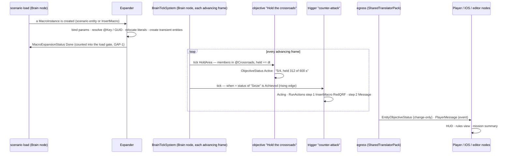

*What the picture shows that prose hid:* expansion is a CREATION-path step (a runtime `InsertMacro` takes the same path as load), and the wire
is fed by the existing egress pass — no rule system pushes anything. The END is §11's sequence (close first, then pause).

### 00.5 Modules — who registers, who calls each frame

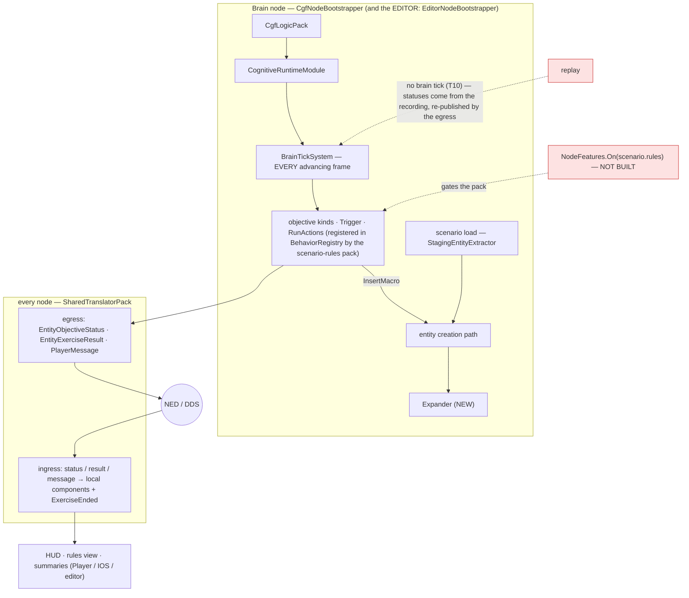

*Caption:* the ONE per-frame caller is the existing `BrainTickSystem`, inside `CgfLogicPack` — so the rules run on the Brain node AND in the
editor, never on a Player node (it does not compose that pack). The red edges are the two things that do NOT run: the feature switch (not
built — a prerequisite) and the brain tick in replay (by design; the egress re-publishes the recorded statuses).

### 00.6 Slices *(build order; each a batch with its own rails — T-1 first: the trigger PoC suite and the feature suites named)*

| slice | builds | done when | prerequisites | build-state |
|---|---|---|---|---|
| **S0 — types and ids** | §9.8.0's types (`WorldPoint`, `WorldRotation`, `Bearing`, `EntityLink`, `PointLink`, `AreaLink`, `RefSpec`) + the type plan walker (resolve, relocate) + the SR-132 / SR-143 rails + `RefKey`; ⭐ in the SAME sweep: CE-4200 (32-bit ids, `TkbTypeId`, `NodeId`) — the files are touched once | the repo's params / components use the types; the rails pass; a scenario round-trips byte-for-byte except the migrated fields; the multiplayer and NED suites pass | CE-4153 S1–S7 ✅ | ⭐ **READY-TO-BUILD** |
| **S1 — objectives + status on the wire** | objective entity type; kinds `ReachArea` / `HoldArea` / `ClearArea` / `DestroyTargets` / `Protect` / `NoHarm`; `Composite` + `WeightedMean` / `AllMustPass`; `ObjectiveStatus` / `ObjectiveLinks`; `EntityObjectiveStatus` translators; `AreaLink.Contains`; a minimal mission summary reading live statuses | Bridgehead's phase-1 objectives, authored by hand as entities (no macros), run LIVE on a cluster; statuses reach a Player node and the IOS; two scenarios use the same kinds with different params and nothing rebuilds | S0; `NodeFeatures` S1 (`DESIGN_Node_Features.md`) for the `scenario.rules` switch; CE-4155 for `NoHarm`'s indirect harm (gunfire + blasts work without it) | ⭐ **READY-TO-BUILD** once S0 lands |
| **S2 — triggers + messages + the end** | CE-4160 … CE-4166 (lift the PoC); `when` leaves `OnEntity` / `ScenarioTime`; actions `Message`, `SetObjectiveActive`, `EndExercise` (multi-tick, §11 SR-116), `Order`, `MissionCommand`; `ExerciseResult` + `EntityExerciseResult`; `PlayerMessage`; subtitle + log on the Player | Bridgehead's counter-attack fires on its edge; the trainee sees the subtitle; the run ends by rule, closes every objective, then pauses; replay shows the same statuses at any seek | S1; CE-4159; CE-4157; ⚠ CE-4164 MEASURE first (the indexed-lane evaluator for area / event / lifecycle `when`s) | DESIGN — CE-4164's measurement |
| **S3 — macros, variants, the director** | the `MacroInstance` type + `Expander` (bind, resolve, relocate, create — §9.7, §9.8.0); `InsertMacro`; `ParamBindings`; the scenario params + run variants (SR-101) in the picker's run setup (AQ108 D24); `SetSkillAmplifier` (SR-100) | the same platoon macro placed twice, rotated, both play; the counter-attack director is a macro used by two scenarios with different params; variant 3 replays identically | S2; CE-4153 S9 (GUID file form) for references INTO macro-made entities; GAP-1 … GAP-5 (§9.7) | DESIGN — S9 + GAP-1…5 |
| **S4 — evaluation per member + debrief / HUD** | `MemberEvaluation` (SR-72 / 72a), measures (`HitRatio`, `Count`, `ReportLatency`, `TimeTo`), the trainee debrief + training / game HUD (SR-112, mockups `docs/designs/rules-view/`) | per-trainee results on the HUD live and in the debrief | S3; CE-4155 | DESIGN |
| **S5 — the rules view** | CE-4167 (timeline TL-X1 … X5) + the rules view (SR-105, SR-109 / SR-110 mockups) — ui lane | the instructor reads and edits the dependency Gantt live (this run only) | S2 | DESIGN (ui) |
| **S6 — the game profile** | Crossfire: domination, tickets, respawn score (SR-84), the game HUD | `docs/SHOWCASE_Scenarios.md` Crossfire acceptance | S2, S4 | DESIGN |

⭐ **Unrelated prerequisites stated once:** CE-4080 (multiplayer acceptance — in progress) gates every "on a cluster" done-when; CE-4158 (the
cluster integration batch hangs) means a slice's cluster rail runs `--filter`ed, not the full batch; CE-4152 (the ORBAT hides virtual entities)
and CE-4154 (World Environment saved in the header) are needed before S1's objectives are AUTHORED in the editor rather than by hand.

### 00.7 Open gaps — measured or decided BEFORE their slice, never during *(each names its owner slice)*

| gap | slice | how it closes |
|---|---|---|
| CE-4164 — can the per-frame indexed-lane evaluator serve a `when` live? | S2 | one measurement batch |
| SR-93 ③ — move the action catalogue from the test project into runtime | S2 | part of CE-4160 |
| GAP-1 … GAP-5 (§9.7: end of expansion, who reads macro files, missing macro / cycle, re-expansion on edit, ids) | S3 | decided in the S3 design pass — leans are written |
| CE-4153 S9 — internal `EntityRef`s of saved components written as GUIDs | S3 | its own item (stopped: no save-direction remap yet) |
| `NodeFeatures` not built | S1 | `DESIGN_Node_Features.md` S1 |
| dismounted soldiers settle on the ground after relocation? (SR-127) | S3 | one rail |

**Rejected — one line each (the big ones; the rest are in each section):**
- *A rules interpreter / a scenario-control system* — a second brain runtime with its own debugging (R-4109).
- *A director entity* — a macro of objectives and triggers does it (SR-99).
- *Compiling anything per scenario* — R-4112.
- *A big result object on the wire* — the tree is the statuses (SR-122).
- *Building S1 on today's `EntityRef` / polyline areas and migrating later* — the same files twice; S0 first.

## 0. ✅ The user's answers, rev 2 (`2026-10-31`)

> 🔒 *"blueprint is just one way of creating some decision logic … authorable also using C# hard-coded methods … best if the rules are data … a
> reusable condition that we can use also in the B3s and HSM guards"* · *"we should have one [evaluator]"* · pause at the end = a switchable
> feature · *"broadcast the event that the mission has finished … not our task to build a nice UI"* · *"define what station is the IOS"* ·
> *"Conditions as names registered. The user never writes expressions"* · *"visibleTo attribute can for sure be added."*

## 0b. ✅ The user's ruling, rev 3 (`2026-10-31`) — **build the brain from data; invent nothing that exists**

> 🔒 *"HSMs and B3s, they are just data as well. They do not need to be compiled. What needs to be compiled is just conditions … they should be
> generic, reusable … we can freely generate the HSM or B3 behaviors for the scenario brain on the fly, basically without recompiling."* ·
> *"What I want to avoid is to create some interpreter of scenario rules if there are already so many different means of how to express these in
> the current engine … avoid developing another type of brain, specifically for scenario control … only if really necessary."* ·
> *"logic like counter attack director can be authored, but it needs to be reusable … usable in multiple exercises in different conditions and
> have enough parameters."* · *"we already created a lot of debugging and monitoring mechanisms. So we should not add one more."* ·
> *"the data basically means that we are building the brain of the entity from the data, procedurally, on the fly, not by hard-coding new
> behaviors. Pretty much the same applies to the performance evaluator. I would rather extend the authoring possibilities of the existing
> features than start inventing something really new."*

**The idea in one line:** the scenario's rules, objectives and measures are DATA that is lowered, at load, into an ordinary **HSM** (or BTree)
— built by the existing runtime builder, with guards and actions that are the existing compiled **shared primitives** — and registered as the
**World Environment entity's brain**; so it runs, hot-swaps, journals and debugs exactly like every unit's brain.

## 0c. ✅ The user's ruling, rev 4 (`2026-10-31`) — **generic rules, composed by parameters; nothing compiles per scenario**

> 🔒 *"What I would like to achieve is that the rules are generic enough and we just parameterize them using values and compose the mission
> objective from those existing rules … So the scenario doesn't really need to recompile any HSM just because it is using already existing
> rules composed in and parameterized in different ways."* · *"I would like to minimize the need of rebuilding anything per scenario unless
> there is an unavoidable need for that. And if there is, it should be deterministic so that it can be done by any brain node."* ·
> *"maybe it's not necessary at all because the scenarios are distributed to all nodes that need them. So all the nodes can recompile
> whatever is in the scenario."*

⭐ ⇒ SR-21…SR-24: objectives and rules are entities running GENERIC compiled behaviours, parameterised; conditions and actions are referenced
by name in the params; only a scenario that embeds its own HSM compiles, in memory and deterministically, on each Brain node.

## 1. INVENTORY *(`2026-10-31`; queries named)*

`search_graph` Class `.*(Hsm|BTree|Bt|Fbt|Tree)(Json|Runtime|Loader|Builder|Compiler|Interpreter|Blob|Asset).*` (29 hits) ·
`.*Utility.*` (80, paginated past tests) · `.*(BehaviorRegistry|BehaviorCatalog|HsmRegistry|…).*` · `.*(Measure|Evaluation|Debrief|Score).*`
(no evaluation code — EQS scoring and the measuring gizmo only) · grep for every `[SharedAiCondition]` / `[SharedAiAction]` / `[UtilityInput]`
name. ⚠ `check_index_coverage` is not available through the CLI — absence claims below are graph + grep, coverage unchecked.

| what exists | where | for scenario control |
|---|---|---|
| ⭐ **an HSM built at RUNTIME** — `HsmBuilder` → `StateMachineGraph.Build` → normalise / flatten → `HsmEmitter.Emit` → `HsmDefinitionBlob` | `Fhsm.Compiler/HsmBuilder.cs:14`, `Graph/StateMachineGraph.cs:93`; used at runtime by `Fdp.Examples.UrbanCombat/Brains/ApcHsmSetup.cs` | ⭐ the lowering target — no Roslyn, no dll |
| ⭐ **a BTree compiled from JSON at RUNTIME** — `TreeCompiler.CompileFromJson` → `BehaviorTreeBlob` | `Fbt.Kernel/Serialization/TreeCompiler.cs:12`; fluent-btree DESIGN :26 (*"compiled at startup"*) | ⭐ the BTree alternative |
| ⭐ **a behaviour registered at RUNTIME by name** — `BehaviorRegistry.Register(name, BehaviorDefinition)`; the definition carries `HsmDefinition` / `BTreeInterpreter`, `BrainStateBytes`, `ParseParams`, `BakeDefaults`, `JsonParamsDtoType`; hot-reload `MergeFrom` | `Fdp.Toolkits/Behavior/BehaviorRegistry.cs:147-343, :414` | ⭐ the data-built brain is just another registration |
| ⭐⭐ **a compiled shared method bound to a FIELD OFFSET at runtime** — `HsmSharedBinder.RegisterCondition / RegisterAction / RegisterStateful*` (key `Fqn@paramOffset[@stateOffset]`, a managed delegate whose closure carries the offsets); `RegisterDeactivator(…, nint paramOffset, nint stateOffset)` already takes raw offsets; BTree twin `SharedNodeBinder` | `Fdp.Toolkits/Behavior/HsmSharedBinder.cs:30-132`; `HsmActionDispatcher` managed tables (CE-3163) | ⭐⭐ **the seam**: a data-built brain lays out its block from the primitives' compiled `P` / `WS` types and binds each site at its offset — only a by-offset overload is missing (today's public overloads take a selector) |
| a brain ticks on ANY entity with `SopState` + owned `BehaviorState`; movement / weapon / interaction channels optional | `BrainTickSystem.cs:224, :296-298` | ⭐ the World Environment entity can carry a brain |
| params from the scenario: entity JSON `"Sop": {"Name","Params","Origin"}`; `SopState.JsonParams` | scenario files; `SopState.cs:18` | ⭐ the director's params live in the scenario, like any unit's |
| shared conditions: 104 `[SharedAiCondition]` (e.g. `ElementReported`, `Secured`, `HeldLongEnough`, `AreaQuiet`, `MoreObjectives`) — ALL self-relative (a unit's / commander's view) | `Fbt.Kernel/SharedAiAttributes.cs:14`; `Squad/Command/PictureConditions.cs:181` | reused inside quantifiers; ⛔ none is scenario-scoped |
| shared actions incl. `Action_IssueTacticalIntent`, `OrderSubordinate`, `SetSubordinateReporting`, `SendReport`, `Action_IncrementCounter`, `ChooseOption` / `ChooseOptionOnce` | grep `[SharedAiAction]` | ⭐ the director orders through these |
| utility: `UtilityDecisionBuilder` (runtime), `UtilityScorer.Evaluate(repo, self, def, context…)`, `UtilityInputCtx {Repo, Self, Context, Params}`, 59 `[UtilityInput]` (e.g. `EnemyStrengthRatio`, `SquadStrengthRatio`, `UnderFire`), `UtilityDecisionLog` | `Utility/Core/UtilityDecisionBuilderInfra.cs:219`; `UtilityScorer.cs:15` | ⭐ the adaptive director's choice; ⛔ no scenario-scope input |
| `CommanderUtilityTickSystem` (manoeuvre selection) — built, **no production caller** | OVERVIEW §6 DEAD box | precedent that utility works above unit level; ⛔ not a host |
| command chain: orders down (`AssignTacticalIntentEvent`), reporting demands (`SetReportingEvent` PIR / FFIR / SITREP, `ReportingRequirementsSystem.cs:38`), reports up (`SquadReportNotification`, `ReportInbox`) | Command Chain Example §3, §8 | ⭐ directing goes DOWN this chain; reports are measured |
| debugging that exists: HSM / BTree runtime inspector + overlay, `BrainJournal` (always on, recorded), `UtilityDecisionLog`, the Brain view | `HsmRuntimeInspectorPane`, `BTreeRuntimeOverlayRenderer`, OVERVIEW :480-484 | ⭐ inherited, nothing new |
| timeline lanes as data (`IndexedLaneDefinition`): shot, hit, blast, state lanes | Timeline §9c-§9e | ⭐ measures read and write lanes |
| the World Environment entity (TKB 8810: scenario-level, Brain-owned) with `ScenarioClock`, `WeatherConditions` | `TkbEntityTypes.cs:120`; Weather W-0 / C-3 | ⭐ the host entity |
| ⭐ **a params field that names a compiled thing, resolved at runtime** — `UtilityDecisionRef` (CE-2068: JSON = the asset id, the editor offers a picker, the scorer keys on the id); utility inputs dispatched by id through `UtilityInputReaderStore` | `Utility/Core/UtilityDecisionRef.cs:11`; `UtilityScorer.cs:32` | ⭐ the pattern `ConditionRef` / `ActionRef` copy (SR-22) |
| ⭐ **in-memory compile on the node that needs it** — `InMemoryRoslynCompiler` (Roslyn → PE in a collectible ALC), used by Blueprints' `Stage8_RoslynFinalize` and `QuickReloadService` | `Hrot.Blueprints.Compiler/Compiler/Roslyn/InMemoryRoslynCompiler.cs` | the escape hatch for a scenario-embedded HSM (SR-24) |

## 2. Claim table

| the design rests on | code — how it IS | design — how it was MEANT to be |
|---|---|---|
| an HSM can be built and run without compiling | ✅ `StateMachineGraph.cs:93`, `ApcHsmSetup.cs` (registered, ticked by `BrainTickSystem`) | ✅ fluent-btree DESIGN :26 (runtime JSON was the first path) |
| a compiled primitive binds at a runtime-chosen offset | ✅ `HsmSharedBinder.cs:98-132` (offsets are `nint`) | ✅ Behavior Action Binding §5.7 |
| a brain may run on a non-unit entity | ✅ `BrainTickSystem.cs:224, :296` | ⛔ searched, no design names a world-entity brain — this one does |
| the director can act only through orders | ✅ `Action_IssueTacticalIntent`, `SetSubordinateReporting` exist | ✅ Command Chain Example §3 |
| the existing inspectors show the scenario brain | ✅ `HsmAssetProjector.Project(blob, metadata, …)` turns any compiled blob + `MachineMetadata` into an editor asset (how every C#-authored HSM is shown); generated machines carry `HsmMetadata = blob.Metadata` (CE-370) | ✅ user, `2026-10-31` |
| an evaluation can be re-run on a recording | — not needed (user: a finished run is final, SR-19) | — |

## 3. Diagrams *(rev 4 — objectives and rules are ENTITIES running GENERIC compiled behaviours; nothing is compiled per scenario)*

```mermaid
classDiagram
    direction LR
    class ScenarioFile { <<existing>> entities, each with Sop name + Params }
    class ObjectiveEntity { <<new TKB type, the area-entity pattern>> SopState = Objective · ObjectiveStatus (replicated) }
    class TriggerEntity { <<new TKB type>> SopState = Trigger }
    class WorldEnvironment { <<existing entity 8810>> ScenarioClock · SopState = ExerciseControl }
    class Objective { <<new GENERIC behaviour, shipped once>> Pending · Active · Achieved · Failed }
    class Trigger { <<new GENERIC behaviour>> Armed · Fired · repeat }
    class ExerciseControl { <<new GENERIC behaviour>> end condition · ExerciseEnded · hosts a director }
    class ObjectiveParams { <<params DTO, R-3002>> side · title · required · visibleTo · points · timeLimit · success ConditionRef · fail ConditionRef }
    class ConditionRef { <<new, the UtilityDecisionRef pattern>> name + args JSON · resolved at load }
    class ActionRef { <<new, same pattern>> name + args JSON }
    class SharedPrimitiveTable { <<new, GENERATED with the primitives, in the shipped dll>> name to compiled condition / action + its P type }
    class SharedPrimitives { <<existing + new scenario-scope>> SharedAiCondition · SharedAiAction }
    class DirectorAsset { <<authored REUSABLE HSM / BTree, shipped>> CounterAttackDirector + params }
    ScenarioFile *-- ObjectiveEntity
    ScenarioFile *-- TriggerEntity
    ObjectiveEntity ..> Objective : runs
    TriggerEntity ..> Trigger : runs
    WorldEnvironment ..> ExerciseControl : runs
    Objective ..> ObjectiveParams
    ObjectiveParams *-- ConditionRef
    Trigger ..> ConditionRef : when
    Trigger ..> ActionRef : do
    ConditionRef ..> SharedPrimitiveTable : resolved by name
    ActionRef ..> SharedPrimitiveTable
    SharedPrimitiveTable ..> SharedPrimitives
    ExerciseControl ..> DirectorAsset : hosts by name
```

*What the picture shows that prose hid:* a scenario adds only ENTITIES and PARAMS — the behaviours (`Objective`, `Trigger`,
`ExerciseControl`, directors) and the primitives are compiled once into the shipped dll. The one new seam is the reference-by-name
(`ConditionRef` / `ActionRef`), copied from `UtilityDecisionRef` + `UtilityInputReaderStore`, which already resolve by name at runtime.

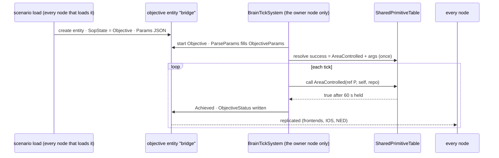

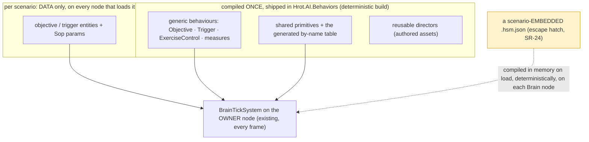

*Caption:* every frame the existing brain tick runs the generic behaviours on the owner node; nothing scenario-specific is compiled. The
amber edge is the only per-scenario compile, and only for a scenario that embeds its own HSM.

## 4. Decisions (⭐ leans for the user)

| # | decision | ⭐ lean |
|---|---|---|
| **SR-1** | what a rule is | **When** a condition becomes true (optionally within a window) **Do** actions; once or repeat — authored as data (§7a), LOWERED to an HSM region (rev 3) |
| **SR-2** | the condition | a NAMED primitive the author parameterises, never an expression — implemented once as a `[SharedAiCondition]` C# method, a data predicate (R-4077) or a Blueprint hosted as a guard; the same primitive is a BTree condition, an HSM guard, a film cue, a check |
| **SR-3** | scenario-scope primitives | §5 lists them; per-unit ones are reused through a generic quantifier `ForUnits(filter, any / all / atLeast n, condition)` |
| **SR-4 / SR-14** | objectives | first-class records (id · side · title · brief · required / optional · `visibleTo` · success · fail · time limit · points · state · progress · when · why); lowered to a region; mirrored into `ObjectiveStates` |
| **SR-5** | actions | existing shared actions first (`Action_IssueTacticalIntent`, `OrderSubordinate`, `SetSubordinateReporting`, mission commands); new: `Message`, `SpawnGroup`, `AwardPoints`, `EndExercise`, `SetSkillAmplifier` |
| **SR-6** | where it runs | ⭐ rev 3: the **brain of the World Environment entity** on the Brain node that owns it, ticked by the existing `BrainTickSystem`; the feature `scenario.rules` composes the loader; a scenario with rules and no node advertising it ⇒ the master refuses to start |
| **SR-8** | the output | replicated `ObjectiveStates` (NED fact) + lanes `rules.objective`, `rules.outcome`, `measure.*` |
| **SR-9** | the end | `EndExercise` broadcasts **`ExerciseEnded`** with the full result (§7c); pause = feature `scenario.rules.pause-on-end` (lean ON); never an automatic unload; UI only a debug panel `ui.rules-debug-panel` that never pops up |
| **SR-10** | authoring | ⭐ rev 4: objectives and triggers are ENTITIES the editor already places and edits (their Sop params, with a picker for `ConditionRef` / `ActionRef` like `UtilityDecisionRef`'s); the rules JSON of §7a is a compact VIEW of those entities, not a second format |
| **SR-11** | ONE evaluator | ⭐ rev 3: the evaluator IS the brain runtime — rules, objectives, mission objectives and measures are all guards of a brain; film cues and checks call the same primitives |
| **SR-12** | custom logic | a new condition / action = a shared C# method in `Hrot.AI.Behaviors` or a Blueprint; ⛔ rev 2's world-singleton Blueprint host is dropped (the brain is the host) |
| **SR-13** | the IOS | a composition choice; the server's full UI by default (R-4107) |
| ⭐ **SR-21** | **rev 4: objectives and rules are ENTITIES running GENERIC behaviours** (R-4112) | an objective = an entity of a new TKB type (the area-entity pattern) whose `SopState` runs the generic compiled `Objective` behaviour with its params (side · title · required · `visibleTo` · points · time limit · success / fail `ConditionRef`); a rule = a `Trigger` entity (`when` ConditionRef · `do` ActionRef[] · once / repeat); the end of the exercise = `ExerciseControl` on the World Environment entity. ⭐ The scenario is the EXISTING format (entities with `Sop: {Name, Params}`), the editor authors them as entities with params, each has the brain view, the journal and the inspector. ⇒ **a scenario adds data only — nothing compiles per scenario** |
| ⭐ **SR-22** | **a condition / action BY REFERENCE** — the one new seam | `ConditionRef` / `ActionRef` = a primitive's NAME + its args JSON, copied from `UtilityDecisionRef` (CE-2068: a params field naming a decision, a picker in the editor, resolved by id at runtime) and `UtilityInputReaderStore` (inputs dispatched by id). A by-name table of the shared primitives (name → compiled method + its `P` type) is GENERATED with the primitives and ships in the dll; at behaviour start the args are parsed into that `P` once and each tick calls the method. Composition: generic `AnyOf` / `AllOf` / `Not` / `ForUnits` conditions take `ConditionRef[]`. ⛔ not an interpreter: one indirection, the same shape as the HSM action dispatcher's id table |
| ⭐ **SR-23** | **what still compiles, and when** | only NEW PRIMITIVES and new reusable BEHAVIOURS (directors, generic behaviours) — ordinary development, built once into the shipped dll. ⛔ Never a scenario |
| ⭐ **SR-24** | **a scenario that embeds its own HSM** (the escape hatch, authored in the existing HSM editor, saved in the scenario) | ⭐ compiled IN MEMORY on load by every Brain node that needs it — the precedent is Blueprints' `InMemoryRoslynCompiler` (collectible ALC, `QuickReloadService`) — DETERMINISTIC: the same JSON + the same generator + the same referenced dlls ⇒ the same machine, keyed by the JSON's content hash, cached; ⛔ no dll is distributed (the scenario is). ⚠ discouraged by R-4110 (a director belongs in a reusable asset); not in S1 |
| ⚠ **SR-17** — HOSTING SUPERSEDED by SR-99 (a director is a macro of triggers; no `ExerciseControl` host) | **reusable directors** (R-4110) | a director (counter-attack, reinforcement, pressure) is an authored HSM / BTree **asset** with a params DTO (R-3002 initializers), usable in any exercise; the scenario names it + params; the loader hosts it as a sub-machine of the scenario brain (the existing hosted-HSM path). ⛔ never logic for one exercise |
| ⚠ **SR-18** — `self` = World Environment SUPERSEDED by SR-99 (the escape hatch runs on a trigger-kind control entity; the utility choice itself stands) | **the utility director** | a director asset may hold a utility decision (`ChooseOption` / `IsOption`, DESIGN_Decision_Layer §3) over plays (*Counter-attack · Reinforce · Hold · Ease off*), with `self` = the World Environment entity and `Context` = a candidate (objective, spawn area, side HQ); inputs are scenario-scope `[UtilityInput]`s (§5); the winner is executed as an ORDER down the chain; `UtilityDecisionLog` explains it |
| ⭐ **SR-19** | **performance evaluation (P-4) on the same brain** (R-4111) | a measure = a named stateful primitive (`Count`, `Duration`, `Latency`, `Ratio` over events / lanes / conditions) with a **subject** (scenario · side · team = a command-chain node · trainee = a station / unit); lowered as regions of the same brain; results into `ObjectiveStates`' sibling `Measures` and `measure.*` lanes; live feedback to trainee / instructor as NED facts. ✅ **user, `2026-10-31`: no re-evaluation of a finished run** — *"once the life is over, we do not change anything, we do not re-evaluate based on different criteria"*; slice 1 is the LIVE scenario and its evaluation (re-running new measures on an old recording: a future idea) |
| ⭐ **SR-20** | **facts** | ⛔ no fourth registry. ⭐ The existing registries are adapted: a generic condition `InputAbove(input, threshold)` makes every `[UtilityInput]` a condition; a generic measure `Sample(input)` makes it a measure; a condition is a 0 / 1 input. ⇒ a quantity written once as a `[UtilityInput]` is usable as a condition, a utility input and a measure |

**Rejected — one line each:**
- *A rules interpreter (rev 2's `ScenarioRulesSystem`)* — a second brain runtime beside HSM / BTree with its own debugging (R-4109).
- ⛔ ~~*One generated `.hsm.json` + Roslyn build per scenario*~~ — **withdrawn rev 3a**: the SDK is not a blocker (user) and it is the most-reused path; now SR-15's lean.
- *A world-singleton Blueprint as the scenario host* — the brain already hosts Blueprints as guards / actions; a second host duplicates it.
- *A per-scenario params / working-state struct* — the primitives' compiled `P` / `WS` concatenated cover it (SR-16).
- *Directing by moving units* — duplicates the order chain; the director orders.
- *A separate evaluation engine* — measures are primitives in the same brain.
- *A new "fact registry"* — `[UtilityInput]` + two generic adapters cover it (SR-20).

## 5. What is missing — **as registered primitives** *(everything else exists)*

| kind | missing (scenario scope) | ⭐ note |
|---|---|---|
| conditions | `AreaControlled(area, side, minUnits, maxEnemy, forSeconds)` · `UnitsDestroyed(filter, count)` · `CiviliansHarmed(bySide, atLeast)` · `ScenarioTime(after / before)` · `ObjectiveIs(id, state)` · `AllObjectives(side, required, state)` · `ReportReceived(commander, kind, within)` · `InputAbove(input, threshold)` · `ForUnits(filter, quantifier, condition)` | `EnemyInArea` exists but is PRIVATE to `SquadDefendBehavior` and self-relative; EQS `EntitiesOfForceInArea` is the query `AreaControlled` reuses; `ElementReported` is the commander-relative base of `ReportReceived` |
| actions | `Message(to, text)` · `SpawnGroup(group, area)` · `AwardPoints(side, n)` · `EndExercise(outcome)` · `SetSkillAmplifier(side, tiers)` · `PublishObjective(id, state)` (entry action) | orders, reporting demands, mission commands EXIST |
| utility inputs | `SideStrengthRatio(side, vs)` · `ObjectiveProgress(id)` · `ScenarioTimeRemaining` · `MeasureValue(measure)` | squad-level strength ratios exist (`SquadStrengthRatio`, `EnemyStrengthRatio`) |
| measures | `Count(event / lane, subject)` · `Duration(condition, subject)` · `Latency(trigger → response, subject)` · `Ratio(a, b)` · `Sample(input)` | shot / hit / blast lanes exist; report notifications exist |
| infrastructure | `ScenarioBrainLowering` · a by-offset overload on `HsmSharedBinder` / `SharedNodeBinder` · `ObjectiveStates` (+ `Measures`) component · `ExerciseEnded` · the inspector fed with the lowered brain's metadata | ⛔ nothing else |

## 6. Slices

| slice | builds | done when |
|---|---|---|
| **S0 (measure)** | ✅ **① measured `2026-10-31`** (`dotnet build Hrot.AI.Behaviors --no-restore`, warm, this VM): nothing changed **3.8–4.5 s** (up-to-date check) · one NEW `.hsm.json` added **7.5 s** · the same asset rebuilt again **3.8 s** · a whitespace-only edit **7.4 s** (a file change rebuilds even when the content means the same ⇒ the lowering writes the asset only when its content hash changes) · first build of the session 92 s (cold, not representative). ⚠ the probe was a copy of a small test asset; a scenario with many regions emits more code. Hot-reload SWAP time not measured. ✅ **② measured:** the rebuild + reload route is the editor's (`POST /ai/reload`, `AiBehaviorsRebuild`); no push to other nodes. ③ a brain on 8810: code says yes (`BrainTickSystem.cs:224`), no probe run yet | ③ the first S1 rail |
| **S1** | the generic `Objective`, `Trigger`, `ExerciseControl` behaviours; `ConditionRef` / `ActionRef` + the generated by-name table; conditions `AreaControlled`, `UnitsDestroyed`, `ScenarioTime`, `ObjectiveIs`, `AllObjectives`, `AnyOf` / `AllOf` / `ForUnits`; actions `Message`, `AwardPoints`, `EndExercise`; the objective / trigger entity types; `ObjectiveStatus`; `ExerciseEnded`; lanes; a brain on 8810 (first rail) | §7a plays to Blue won live on a cluster; two scenarios use the SAME behaviours with different params and NOTHING rebuilds |
| **S2** | `SpawnGroup`, orders down the chain, a reusable `CounterAttackDirector` asset with params, the utility director, the editor's rules section | the same director runs in two scenarios with different params |
| **S3** | measures + subjects (P-4), `ReportReceived`, `InputAbove` / `Sample`; SR-19's replay question answered | per-trainee and per-team results in `ExerciseEnded` |

## 7. Examples *(illustrative names)*

### 7a. Authored (`scenario.json`, the World Environment entity's section)

```json
"ScenarioRules": {
  "objectives": [
    { "id": "bridge", "side": "Blue", "title": "Secure the bridge by 10:00", "required": true, "visibleTo": ["Blue"], "points": 100,
      "success": { "cond": "AreaControlled", "args": { "area": "obj-bridge", "side": "Blue", "minUnits": 4, "maxEnemy": 0, "forSeconds": 60 } },
      "fail":    { "cond": "ScenarioTime",   "args": { "after": "10:00" } } },
    { "id": "no-civilians", "side": "Blue", "kind": "constraint", "points": -50,
      "fail": { "cond": "CiviliansHarmed", "args": { "by": "Blue", "atLeast": 1 } } }
  ],
  "rules": [
    { "id": "end", "once": true,
      "when": { "any": [ { "cond": "AllObjectives", "args": { "side": "Blue", "required": true, "is": "Achieved" } },
                         { "cond": "ScenarioTime",  "args": { "after": "10:30" } } ] },
      "do": [ { "act": "EndExercise", "args": { "outcome": "byObjectives" } } ] }
  ],
  "measures": [
    { "id": "blue-hit-rate", "subject": { "side": "Blue", "per": "trainee" }, "kind": "Ratio", "args": { "a": "lane:hit", "b": "lane:shot" } },
    { "id": "contact-report", "subject": { "team": "Blue HQ" }, "kind": "Latency", "args": { "from": "FirstSeenBy(Blue, Red)", "to": "ReportReceived(Blue HQ, Contact)" } }
  ],
  "director": { "name": "CounterAttackDirector",
                "params": { "attacker": "Red HQ", "trigger": "bridge", "waveArea": "red-spawn-east", "maxWaves": 2, "pressure": "adaptive" } }
}
```

### 7b. What it becomes *(rev 4)*

Each objective of §7a is one entity in the scenario — e.g. `{"Type": "Objective", "Name": "bridge", "Sop": {"Name": "Objective", "Params":
{"side":"Blue","title":"Secure the bridge by 10:00","required":true,"points":100,"success":{"cond":"AreaControlled","args":{…}},"fail":{"cond":"ScenarioTime","args":{"after":"10:00"}}}}}`
— the rule `end` is a `Trigger` entity, the director runs under `ExerciseControl` on 8810. ⇒ no file is generated, nothing is compiled.

### 7c. `ExerciseEnded` (the NED fact, R-4105)

```json
{ "outcome": { "Blue": "Won", "Red": "Lost" }, "endedAt": "10:12:31", "reason": "rule end: all required Blue objectives achieved",
  "objectives": [ { "id": "bridge", "state": "Achieved", "at": "09:42:10", "points": 100, "details": "held 60 s, 5 Blue / 0 Red" },
                  { "id": "no-civilians", "state": "Failed", "at": "09:55:02", "points": -50, "details": "civilian 1043 wounded by Blue Rifleman 2" } ],
  "measures": [ { "id": "blue-hit-rate", "by": { "Rifleman 1": 0.31, "Rifleman 2": 0.18 }, "side": 0.24 },
                { "id": "contact-report", "team": "Blue HQ", "seconds": 47 } ],
  "points": { "Blue": 50 } }
```

## 8. Templates, blocks and evaluation scopes *(rev 5 draft, `2026-10-31` — measured, NOT yet buildable: decisions SR-25…SR-31 await the user)*

> 🔒 **User, `2026-10-31`:** *"What I would like to avoid is to define the entities per every scenario, because the evaluation criteria might be
> common across multiple scenarios, common across multiple team members … It needs to be simple and reusable."* · *"Such a block, probably at
> every level … should need to come with its own parameters, and those entities and their objective would need to read and use those
> parameters … What is baked in is good as a default, but it always needs to be replaceable when inserted into the final place … This very
> principle is used for using behaviors on entities that the scenario can override the default parameters."* · *"Ticking cost should be no
> issue."* · *"If there are some runtime catalogs missing, we will simply make them a shared code."*

### 8.0 Why package-level params (rev 5a)

⭐ measured: the existing override layering is FLAT — `BehaviorParams.OverlayFlat` merges top-level keys only (`DESIGN_Orders_Params_Entity_Classes.md` §13.10a). Package params keep every override at the top level, so the existing mechanism serves unchanged; a deep merge into a child's nested args would be new code and ambiguous (arrays by index).

### 8.1 INVENTORY *(four measurements, `2026-10-31`: graph `.*(Template|Prefab|Recipe|EntityClass|Archetype|Composition).*` Class (35) + `.*(Parent|Hierarchy|ChildOf).*` Class (13) + grep; a throwaway probe; ⚠ coverage unchecked)*

| what exists | where | for objectives |
|---|---|---|
| ⭐⭐ **the TKB type is the one template applied at BOTH scenario load and runtime spawn** — `BehaviorProfileDto.DefaultSop` + `DefaultSopParamsJson`, applied by `BehaviorTkbTranslator.Inject` | `Tkb/Domain/BehaviorProfileDto.cs:44-49`; `BehaviorTkbTranslator.cs:113-125` | ⭐ the carrier of a block's DEFAULTS |
| ⭐⭐ **layered params = the user's principle, built** — DTO initializers ▸ asset `ParamsDefaultJson` ▸ the scenario / order JSON (only the keys it sends); scenario wins by origin rank | `DESIGN_Orders_Params_Entity_Classes.md` §13.10a (R-3001); `InitialBrainMaterializationSystem.cs:16-50` | ⭐ a block inserted with `{area, deadline}` overrides only those |
| ⭐⭐ **per-TYPE child entities, deterministic, rebuilt on every node, not saved** — the sensor pattern (`SensorChildFactory.EnsureTkbChild`, part ids 1000+i) | `PerceptionTkbTranslator.cs:78-80`; `SensorChildFactory.cs:13-44`; Sensors & Doctrine §4, §5.1 | ⭐ the shape for "every member of type X gets its evaluator" AND for expanding a block's template children |
| params carry strings, enums, nested structs, ARRAYS (authored DTO) → a `[BehaviorResolver]` packs a fixed unmanaged block (≤ 16096 B) | `BehaviorParams.cs:211-230`; `PlatoonDefendParamsJsonDto.Squads` | ⭐ lists of children / actions fit as fixed-capacity arrays |
| ⛔ managed per-instance working state — not supported (removed) | `DESIGN_Occurrence_Scoped_Storage.md` §30.29 | per-subject results = a fixed unmanaged table (`ThreatMatrixAssignmentState.cs:31` precedent) |
| ⛔ **no runtime call of a condition BY NAME** — every shared method binds per site at compile time | `SharedNodeBinder.cs:243-330`, `HsmActionDispatcher` keyed by binding | ⭐ but the CATALOGUE exists: `ActionSchemaExporter` reflects every `[SharedAiCondition]` with its `MethodInfo` + `ref` params type (`Hrot.Editor.AiShared/Blackboard/ActionSchemaExporter.cs:135-150`), built on CGF and the editor — the user: make it shared code |
| ⭐ behaviours DO run by name + JSON: SOP slot, `AssignTacticalIntent`, missions; brain intent (task / SOP / ROE as JSON) replicates on `dtBrainIntent` | `TacticalIntentResolutionSystem.cs:139-176`; `BrainIntentTranslators.cs:27` | ⭐ an objective's params reach every node already |
| a brain ticks on a bare entity (SopState + BehaviorState only, TKB 8810 too); with `gateOnAuthority` (CGF) it must be OWNED (networked) | probe `2026-10-31` (4/6, the 2 reds = the gate); `BrainTickSystem.cs:150, :224` | ✅ objective entities = networked, Brain-owned (as World Environment) |
| hierarchy: `HierarchyNode` DEAD; `VisHierarchyNode` saved, NOT replicated, unused at runtime; the command chain (`UnitSubordinate`) replicated + used (ORBAT, ROE walk, reports) | `HierarchyNode.cs:11`; `VisHierarchyNodeTranslator.cs:23`; `UnitHierarchySystem.cs:35` | ⛔ none fits: objectives in the command chain would pollute the ORBAT and the ROE walk ⇒ the parent link lives in the objective's own replicated status |
| a new replicated component ≈ 9 places (id · DataPolicy · registry · ownership group · descriptor · DDS topic · translators · mapping · packs) — latest: `Descent` bdc7827ec | `DESIGN_Airborne_Insertion.md` D-1 | `ObjectiveStatus` (state · progress · points · parent · results) |
| ⛔ no include / fragment mechanism; recipes are one-time copies | `ContentLayout.cs:91-109`; `DESIGN_Content_Layout.md` §2 | the block TEMPLATE is a new asset kind |
| Stories (per-trainee micro-exercises, evaluation filtered by story) — designed, NOT built | `docs/designs/mgmt-1/DESIGN.md` §10.0-10.1 | a story = one more evaluation scope (later) |
| the default World Environment is created when a scenario has none | `ScenarioLoadStep.cs:185-243` | ⭐ precedent: a default exercise evaluation with zero authoring |

### 8.2 The structure

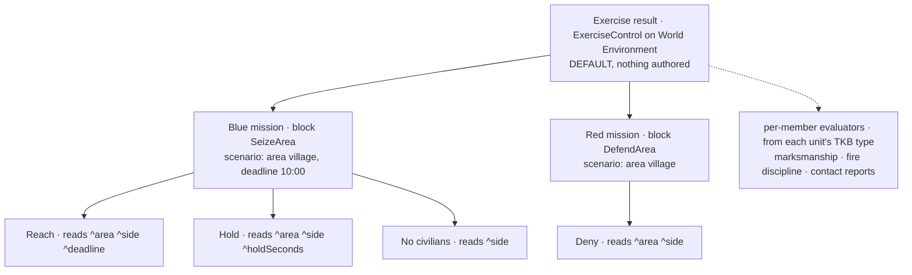

*What the picture shows that prose hid:* only the two mission blocks (one line each, with 2 overrides) are authored in the scenario; their
children come from the block TEMPLATE, the exercise node is a default like the World Environment, and the per-member evaluators come from the
units' TKB types — so a scenario with 40 trainees authors 2 entities.

### 8.3 Decisions *(⭐ leans — for the user)*

| # | decision | ⭐ lean |
|---|---|---|
| **SR-25** | the block TEMPLATE | a new asset kind `*.objective.json` (beside behaviour assets): declared params with defaults + a tree of child objectives whose args may name `^param` (the enclosing block's resolved value). ⛔ not a TKB type per block (TKB has no inheritance and one SOP per entity) |
| **SR-26** | inserting a block | ONE scenario entity `{"Type": "Objective", "Sop": {"Name": "ObjectiveBlock", "Params": {"template": "SeizeArea", "args": {"area": "village", "deadline": "10:00"}}}}` — the args override the template defaults key by key (R-3001's layering, unchanged) |
| **SR-27** | expanding the children | the sensor-child pattern: deterministic part entities from the template, rebuilt on every node from the replicated block params, never saved ⇒ a template edit reaches every scenario, and two nodes always agree. ⛔ open: the children's brains run on the owner — confirm the part-entity ownership path (Sensors §5.1) gives them authority there · ⭐ rev 5c (`2026-10-31`): **WHO expands — the entity CREATION path, not the scenario loader.** The sensor-child translator runs from the one translator list (`TkbTranslatorSet.Base()`, called by `NetworkSpawningSystem.cs:144` and ghost promotion) for scenario load AND runtime spawn alike ⇒ a package inserted at load, by the instructor mid-run or by a trigger expands the same way, through one path. ⛔ rejected: expansion in `ScenarioLoadStep` — a package spawned at runtime would not expand (two paths). ⛔ open: the sensor pattern is keyed on the TKB TYPE; a package is named in its params ⇒ a translator keyed on a `ObjectivePackage {template}` component, and whether the children are local parts on every node (status folded into the package's `ObjectiveStatus`) or networked entities owned by the Brain |
| **SR-28** | `^param` resolution — ⭐ rev 5a (user, `2026-10-31`: *"The objectives inside a package can carry the values on their own, but they should be able to reference a parameter of the whole package instead of hard coding the values inside."*) | a child's arg is EITHER a literal (fixed in the preset) OR `^name` (the package's param). ⭐ The OVERRIDE surface is the package's FLAT param list — exactly the existing `BehaviorParams.OverlayFlat` (DTO default ▸ preset default ▸ insertion args, top-level keys only, §13.10a) — so overriding never needs a deep merge into a child. ⇒ to make an inner literal overridable, the preset author PROMOTES it to a package param. Substitution happens once at expansion; a nested package receives its args the same way (`^` refers only to the IMMEDIATE package) |
| **SR-32** | one mechanism for every kind of preset | missions, objective sets, evaluation criteria, triggers / directors are all `*.objective.json` packages; a preset of a preset (e.g. `SeizeVillageFast` = `SeizeArea` with `deadline: 30 min` fixed) is a package containing one package with some args fixed — no inheritance mechanism |
| **SR-29** | conditions by name | a shared runtime `SharedConditionTable` built once at startup from the existing `ActionSchemaExporter` catalogue (moved to shared code): name → `MethodInfo` → a typed delegate (made once per params type) + its `P` type; a `ConditionRef` = name + args JSON (+ optional `subject` = the unit it is evaluated AS — so self-relative conditions like `ElementReported` work) packed into a fixed byte area of the objective's block. ⇒ all 104 conditions usable at once. ⛔ rejected: one behaviour per objective kind — every new condition would need a new behaviour |
| **SR-30** | per-member evaluation | each unit TKB type names its evaluation template(s) (e.g. Rifleman → `RiflemanCriteria`); the sensor-child pattern attaches one evaluator child per member, everywhere, unauthored. Thresholds: template default ▸ the side's mission block (a `memberArgs` override) ▸ the unit's own scenario entry |
| **SR-31** | state and tree on the wire | a new replicated `ObjectiveStatus` (state · progress · points · parent network id · up to N per-subject results) — the ~9-place recipe; ⛔ not the command chain, ⛔ not `VisHierarchyNode` (unreplicated) |

### 8.4 The package format and its editing *(⛔ SR-34 / SR-35 SUPERSEDED by §9 rev 6; SR-33's params-form reuse stands; rev 5b draft, `2026-10-31` — leans for the user)*

> 🔒 **User, `2026-10-31`:** *"I thought I would be able to somehow edit the objective parameters using the existing means in the scenario
> editor … if we are using the behavior infrastructure with existing debug and monitoring tools, we could reuse the editing part as well."*

| measured | where | so |
|---|---|---|
| ONE params form edits every behaviour's params in the scenario editor (AI section task / SOP rows), the mission panel and orders — a StructEdit document over the params TYPE (a CLR type), map-pickable fields by type | `Hrot.Presentation/Behavior/BehaviorParamsForm.cs` (CE-3043 / CE-1023); Sensors & Doctrine §7.6, §7.6b | ⭐ if a package IS a named behaviour with a params DTO, inserting and parameterising it needs NO new editor |
| "pick a condition / action / blueprint, then edit its args as that primitive's own params type" — shared, also on CGF | `Hrot.Editor.AiShared/Inspector/ActionBinding/BehaviorActionBindingEditor.cs`, `ActionBindingSources.cs`, `ActionSchemaExporter` | ⭐ the `ConditionRef` field editor reuses it |
| a params TYPE from data: `.params.json` → a generated DTO (initialisers = defaults) | `ParamsDtoAsset.cs`; §13.10a | ⭐ a package's params, declared once per package (a shared asset, not per scenario — R-4112) |
| ⛔ no schema-driven form (a form over JSON with no CLR type) | graph `.*(Schema\|Dynamic\|JsonNode\|Untyped)(Form\|Binding\|Document\|Editor\|Drawer).*` = 0; grep | ⇒ do NOT invent one: give every package a params type |

| # | decision | ⭐ lean |
|---|---|---|
| **SR-33** | a package IS a named behaviour | a package `SeizeArea` registers under its name with `JsonParamsDtoType` = its params DTO (from its `.params.json`) and the generic package runner as its machine; inserting it = an ordinary scenario entity `Sop: {"Name": "SeizeArea", "Params": {"area": …, "deadline": "10:00"}}` ⇒ the scenario editor's EXISTING AI section and params form edit it, with map picking for the area, unchanged |
| **SR-34** | the package FILE | `assets/objectives/SeizeArea.objective.json` = a scenario FRAGMENT: `{"$meta": {"kind": "objective-package"}, "params": "SeizeAreaParams", "entities": [ …objective entities, each with Sop {Name, Params} exactly as in scenario.json… ]}` ⇒ authored by opening it in the SCENARIO EDITOR (same entity list, inspector, params form) — ⛔ no new editor |
| **SR-35** | binding a child's field to a package param | ⛔ not `"^deadline"` inside a typed field (a float field cannot hold a string). ⭐ A sibling map per entity: `"Sop": {"Name": "Objective", "Params": {…literals…}, "Bind": {"fail.args.after": "deadline"}}` — the form shows a "bound to package param" marker on that field, the precedent being the HSM editor's per-state param bindings (E3b, `EmitStateParamBindings`). Expansion applies `Bind` after the literals |
| **SR-36** | the `ConditionRef` field | one field editor: the condition picker (`ActionSchemaExporter` entries) + a nested StructEdit over the picked entry's params type (a CLR type known at runtime) — ⛔ unmeasured: whether StructEdit nests a runtime-typed sub-document inside a parent document |

**Still to measure before buildable:** ① can the scenario editor open a fragment file (entities + `$meta`) as a document and save it back? · ② can StructEdit
nest a runtime-typed sub-document (SR-36)? · ③ can a field show a "bound" marker (SR-35) without a new drawer? · ④ do expanded child objectives get
authority on the owner (SR-27)?

## 9. Scenario MACROS — the general mechanism *(rev 6 draft, `2026-10-31` — supersedes §8.4's package file, SR-34 / SR-35; leans for the user)*

> 🔒 **User, `2026-10-31`:** *"Isn't that SOP name the name of the behavior that should evaluate the objective?"* · *"Could we generalize this
> package parameters into scenario parameters so we can get scenarios with parameters that looks like exactly the same principle as for
> packages."* · *"Scenario editor is now saving the whole scenario and i would keep it like that. Those packages might need to be a special type
> of assets, like scenario macros, stored likely in special folder. I would like to make this macros a general concept that is not used just
> for objective, because it might be used also for inserting whole parts of the scenarios."* · *"We need to store just the reference to the
> macro, which is itself living as an independent scenario-like assets in different folder."*

### 9.1 Measured

| fact | where | so |
|---|---|---|
| a scenario entity = a GUID key → components by name: `SimTransform`, `NetworkIdentity`, **`TkbIdentity {TkbType: 305}`** (the type — ⛔ there is no `Type` attribute), `EntityInfo {Name, ForceId}`, brain slots **`Behavior`** (task) / **`Sop`** as `{Name, Params (a JSON string), Origin}`; the file = `$meta` · `header` · `entities` | `scenarios/uc-urban-battle/scenario.json` | §8.4's example was wrong on `Type` — corrected below |
| a `.params.json` asset = `{AssetId, Name, Fields: [{Name, TypeId, DefaultJson, Comment}]}` → a generated DTO, defaults as initialisers | `assets/behaviors/Params/Tests/T41Params.params.json`; §13.10a | ⭐ the package / macro params type |
| ⭐⭐ **derived entities are already kept out of saves**: `ScenarioIgnoreTag` (the serializer skips the whole entity; 22 users) + `PartMetadata {ParentEntity, InstanceId}` (the parent + part id, also the wire key) — the sensor children use both (CE-3045: *"rebuilt … on load, so saving it too duplicated it"*) | `Fdp.Toolkits/Scenario/ScenarioIgnoreTag.cs`; `Replication/Components/PartMetadata.cs:14`; `SensorChildFactory.cs` | ⭐⭐ the answer to *"how do we know what came from a macro"* — it is BUILT |

### 9.2 The model

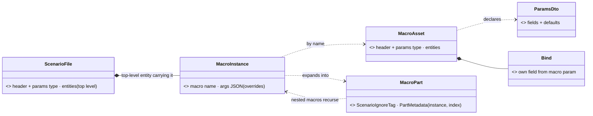

*What the picture shows that prose hid:* ONE file shape serves a scenario and a macro — both have a params type and entities — so a scenario
with parameters IS a top-level macro. What is saved is only the top-level entities and the `MacroInstance` references; every expanded entity
carries the tag the serializer already skips.

| # | decision | ⭐ lean |
|---|---|---|
| **SR-37** | the brain slot names the EVALUATING behaviour (⭐ the TASK slot — SR-51) | ⭐ rev 6: one small generic behaviour per objective KIND — `ReachArea`, `HoldArea`, `ClearArea`, `DestroyUnits`, `ProtectUnits`, `NoCiviliansHarmed`, `ReportWithin`, `HitRatio`, `CompositeObjective` (all / any / weighted over its children) — each with a TYPED params DTO. ⇒ the existing params form edits every field; no `ConditionRef`, no runtime-typed sub-form, no by-name table (SR-29 / SR-36 drop to an optional later `ConditionObjective` for the long tail). ⛔ cost: a new kind = a new reusable behaviour (rare, shared, not per scenario) |
| **SR-38** | a macro asset | `macros/<name>/macro.json` (its own folder in `ContentLayout`, like `scenarios/` and `recipes/scenarios/`) — the SAME shape as `scenario.json` (`$meta` · `header` · `entities`) + `header.params` naming its `.params.json`. Authored by opening it in the scenario editor, which saves the whole file as today |
| **SR-39** | inserting a macro | a top-level scenario entity with a `MacroInstance {macro: "SeizeArea", args: {"area": "<area entity id>", "side": "Blue", "deadline": "10:00"}}` component; the args override the params DTO's defaults key by key (`OverlayFlat`). Editable in the inspector as a params form over the macro's params type |
| **SR-39a** | ✅ the INSTANCE is an ordinary entity (user, `2026-10-31`: *"Couldn't a scenario macro be saved as an entity that gets replaced by the macro? … that would avoid the need for special treatment like insert or delete as adding and deleting entities is handled already. picking the macro file would be an edit on the parameters of that entity, again in the details panel"*) | a "Scenario macro" entity type, placed / deleted / moved / copied like any entity; selecting it shows in Details: the MACRO picker (the scenario picker over `macros/`) + the ARGS form built from the picked macro's `header.params` (defaults shown, overridable). Changing the macro or an arg re-expands that instance; deleting it removes its expanded entities ⇒ ⛔ no special insert / delete command |
| **SR-69** ✅ CONFIRMED `2026-10-31` (user: *"Group A confirmed."*) | positions inside a macro | ⭐ lean: RELATIVE to the instance entity's transform — a macro's entities are authored around its origin and the instance's position + heading place them, so one platoon macro can be dropped anywhere; an objective macro with no geometry ignores it |
| **SR-70** | ✅ CONFIRMED `2026-11-01` (user: *"References and macros approved."*) · the instance entity is on the MAP (user, `2026-10-31`: *"the scenario macro entity needs to have the position component as well to be displayed on the map and clickable from the map"*) | ✅ it carries a `SimTransform` — the anchor SR-69's relative positions use — and a map symbol of its own (a "macro" marker), so it is selected by a click and dragged like any entity; dragging it moves everything it expanded. ⭐ ORBAT: shown (it is on the map), its expanded entities beneath it. ⛔ unmeasured: how a non-unit positioned entity gets its symbol today (the visual family / `EntityClassShapeLibrary` path) |
| **SR-71** | ✅ the World Environment is SAVED IN THE HEADER (user, `2026-10-31`: *"I don't think we should save the world entity state into the scenario as entity. I still think the translator for this entity components should write this into the header of the scenario file."* → *"Yes, please file it and file the task."*) | at RUNTIME it stays an entity (it replicates the clock and global weather — Weather W-0); only its SAVED form moves: save writes its components into `header.world` (one entry per component, by the SAME auto-serializer — a future component such as the rules lands there with no new translator) and skips the entity; load creates the entity from `header.world` (no section ⇒ today's C-3 defaults); the distributed merge takes `header.world` from the slice of its owner (the Brain — invariant I4, one source for globals); the 3 scenarios holding it as an entity are migrated, no compatibility path. Weather REGIONS stay entities. Precedent for a non-entity file section: `TerrainObjects` (`ScenarioMergeCore.cs:40`). Tracker **CE-4154** |
| **SR-40** | binding a part's field to a macro param (⭐ stored as SR-57's `ParamBindings` component) | per entity in the macro: `"Bind": {"<slot>.<field>": "<macro param>"}` — e.g. `"Behavior.area": "area"` = *this entity's task param `area` takes the macro's `area`*. Flat (both sides are top-level names, SR-37's typed DTOs), applied after the literals at expansion |
| **SR-41** | scenario parameters | the scenario `header.params` names a params type; its args live in the header (or are passed by whoever starts the run); top-level entities `Bind` to them exactly as macro parts do ⇒ ONE principle at every level |
| ~~**SR-42**~~ ⛔ WITHDRAWN rev 6a (§9.3 — parts cannot be full entities) | who expands, and what is saved | the entity CREATION path (SR-27): creating a `MacroInstance` entity creates its parts, each with `PartMetadata {instance, index}` + `ScenarioIgnoreTag`; save writes top-level entities + instances only. Nested macros recurse (a part may carry a `MacroInstance`) |
| **SR-43** | editing an expanded part in the editor | ⭐ v1: shown under its instance, READ-ONLY, with *"from macro SeizeArea — edit the macro or its args"*. ⏭ later: per-instance overrides of a part's field |

**Still to measure before buildable:** ① can a `PartMetadata` part be a FULL entity (a unit with transform, brain, its own replication) or only a light child like a sensor? · ② deterministic network ids for parts across nodes · ③ the scenario editor opening a file from `macros/` · ④ the editor's entity tree showing parts under their instance · ⑤ the expanded objectives' brain authority (SR-27).

### 9.3 Rev 6a (`2026-10-31`) — measured: parts are the WRONG tool; macro entities are full, transient entities

| measured | where | so |
|---|---|---|
| `PartMetadata` IS the ECS side of NED's MULTI-INSTANCE descriptors (turret pose / weapon task, EQS sensor config / results): the key is (parent network id, instance id); instance ids are RANGES agreed in code (mounts 1…N, behaviour sensors 1–999 allocated, TKB sensors 1000+i, turrets 2000+i), not a protocol enum | AQ79 §0.10 (`Architect_Question_79_One_Ownership_Truth.md:206-240`); `BDC_NED_SST_Descriptor_Rules.md:29,49-57`; `TurretParts.cs:15-45` | — |
| a part has NO `NetworkIdentity`; authority resolves to its PARENT (`AuthorityExtensions.cs:23`), ownership recompute skips it (`OwnershipRecomputeSystem.cs:251`), it dies with the parent (`SubEntityCleanupSystem.cs:24`), scenario extraction folds it into the parent (`StagingEntityExtractor.cs:292-310`) | as cited | ⛔⛔ **SR-42's `PartMetadata` is WITHDRAWN** — a macro entity (a unit, an objective) would lose its own authority, life and save identity |
| ⭐⭐ **the save exclusion already works per FULL entity**: `EntityCreationRequest.IsTransient` → `SpawnEntityCommand.IsTransient` → every node stamps `ScenarioIgnoreTag`; TKB children inherit it; save ⇔ primary owner AND NOT `ScenarioIgnoreTag` | `EntityCreationRequest.cs:~95-125`; `NetworkSpawningSystem.cs:199`; `ScenarioSaveCore.cs:16`; Node Roles §7.3 (R-140) | ⭐ macro entities = ordinary entities created TRANSIENT, each with its own network id |
| network ids: ONE allocator per domain (orchestrator), blocks of 100, reset to 1000 per world; ⭐ **scenario load RE-ALLOCATES every id** (old → new map, `PreAllocatedNetworkId`) — the file's ids only look stable because of the reset | `DdsIdAllocatorServer.cs:119-136`; `StagingEntityExtractor.cs:~245-262`; `DESIGN_Deterministic_Network_Ids.md` §11b | a file id is a FILE-LOCAL key either way |
| the GUID entity keys are REGENERATED on every save (`Guid.NewGuid()` per entity) — a file-local key used only to resolve references inside the file (`IGuidResolver`); all 1059 entities of the 127 scenario files carry a `NetworkIdentity` | `ScenarioSerializer.cs:171, :688-730`; measured over `scenarios/` + `recipes/scenarios/` | ⭐ keying by the network id loses nothing — both are file-local; the number is shorter and is what `EntityRef` already uses (R-184) |
| `EntityRefRemap` rewrites every `EntityRef` (nested, lists) by the old → new map at load; an id not in the map is left as is | `EntityRefRemap.cs:25`; `DESIGN_Entity_Reference.md` | ⚠ a reference to a macro-made entity (never saved) would dangle — or, with ids reset to 1000, hit an unrelated entity |
| the scenario picker enumerates one root recursively | `ScenarioEnumeration.EnumerateRelPaths` | ⭐ macros = a second root |

| # | decision | ⭐ lean |
|---|---|---|
| **SR-42′** | who creates a macro's entities, and what is saved | ⭐ rev 6a: creating a `MacroInstance` entity issues ordinary `EntityCreationRequest`s for its entities with **`IsTransient = true`** (own network ids from the allocator, own authority, own replication, own brain); save writes top-level entities + the instances. ⛔ not `PartMetadata` (above) |
| **SR-44** | macro / scenario params | declared INLINE in the macro's or scenario's `header.params` (rows `{Name, TypeId, Default, Comment}`, the `.params.json` row shape) — ⛔ never compiled: only the expander reads them, copying values into the children's JSON params; each `Bind` is type-checked once against the child's compiled DTO field. ⛔ open: a small "N typed fields" form reusing the per-type field editors (whether they work without a containing type is unmeasured) |
| **SR-44a** | ✅ MEASURED `2026-10-31` — the inline params list IS editable with existing parts (user: *"not an issue if the editor doesn't support the editing without the C# DTO. We will teach the editor"*) | the variable editor already edits ONE value of a runtime-chosen type: `VariableEditModal` wraps it in a generic one-field `ScalarEditBox<T>` (because `CreateLeafBinding` needs a member), then draws only the wrapper's child, renamed, through the public `ComponentEditDrawer.DrawEditNode` (`Hrot.Editor.AiShared/Variables/VariableEditModal.cs:340-380`); `EditNode` / `EditDocument` have public constructors and every per-type editor (`EntityRef` / `PickableGeoPoint` map picking, `FixedString*`, `Guid`, `UtilityDecisionRef`) is a registered `ICustomFieldEditor` that takes ANY `IValueBinding` (`ComponentEditServices.cs:17-27`, `StructEdit.Core/Plugins/ICustomFieldEditor.cs`). ⇒ a macro's params form = one `ScalarEditBox<T>` row per declared param, `T` resolved from its `TypeId` — no generated type, no new editor kind |
| **SR-45** | ids inside a macro | a macro file's network ids are MACRO-LOCAL keys; each instance remaps them to fresh ids through the existing `EntityRefRemap` old → new map, so two instances never collide and refs between a macro's own entities stay right |
| ~~**SR-46**~~ ⛔ SUPERSEDED by SR-59 (§9.5) | a reference INTO a macro from outside | v1: ⛔ refused at save (a saved `EntityRef` must point to a saved entity); later: a qualified ref `{instance: <instance net id>, local: <macro-local id>}` resolved after expansion |
| **SR-47** | two links on an objective | `ObjectiveStatus.Subject: EntityRef` (WHAT it is about — the World Environment = the scenario, a commander = his team, a soldier = that soldier) and `ObjectiveStatus.Parent: EntityRef` (which objective it COMPOSES into). ⭐ They differ in the common case: a per-member criterion's subject is the soldier, its parent is "Blue member evaluation" |
| **SR-48** | objectives replicate | yes — they are full entities: the instructor station and the trainee's HUD sit on other nodes, NED frontends (R-4105), the map on every node, the recording, a brain hand-over to another node |
| **SR-49** | objectives have a position | a `SimTransform` used only for drawing / picking on the map (an area objective at its area's centre); nothing else reads it |
| ~~**SR-50**~~ ⛔ SUPERSEDED (`DESIGN_Scenario_Entity_Keys.md` rev 2: the key stays a — now stable — GUID) | scenario entity KEY = the network id | ⭐ lean YES, as part of macros: `"entities": {"9800": {…}}` instead of a fresh GUID per save; file-internal references (`VisHierarchyNode` today via `IGuidResolver`) move to network ids like `EntityRef`. ⛔ cost: the serializer's resolver + a one-time migration of the 127 files + their tests. ⛔ open: any reader keyed on the GUID string (the editor's selection, the director, checks.json) — measure before deciding |
| **SR-51** | WHICH brain slot runs the evaluator — ⭐ rev 6b (user, `2026-10-31`: *"SOP is the standard operational procedure and this is just a default behavior the entity is doing with special handling … there is also one main behavior that can be assigned"*) | ⭐ the **TASK slot** (scenario JSON `"Behavior": {Name, Params, Origin}`; TKB default `BehaviorProfileDto.DefaultBehaviorHash`). Measured why not the SOP slot (`DESIGN_Decision_Layer.md` glossary :1215, rules :1220-1225, §SOP channels :1448-1452): the SOP is the unit's OWN always-ticking logic (what to do when idle + reactions, woken or every 0.2 s), its slot REFUSES channel-writing behaviours and the editor's SOP row offers only SOP-shaped trees (CE-1019); the task is *"what the unit was told to do — one at a time"* — exactly an objective's evaluation, which an instructor may also re-assign. ⇒ every earlier `Sop` in this document reads as `Behavior` (the use of the SOP slot was not intentional). ⭐ Consequence: a soldier's own slots are taken (his orders, his doctrine) ⇒ per-member evaluators are SEPARATE entities with `Subject` = the soldier (SR-47), never a brain on the soldier. ⛔ gap: the TKB default task is a bare HASH (no default params JSON, unlike `DefaultSopParamsJson`) — 🔒 user: *"the anomaly is historical only, not desired"* ⇒ tracker **CE-4151** |

### 9.4 The two links in a hierarchy *(rev 6c draft, `2026-10-31`)*

> 🔒 **User, `2026-10-31`:** *"How will you express the two links, the subject and the parent, for the criterias or objectives in a hierarchy
> structure?"* · *"the ORBAT serves for quick jump to an entity … there shouldn't be any virtual entities that are not seeable on the 3D map. So
> the orbat needs to be parameterized."*

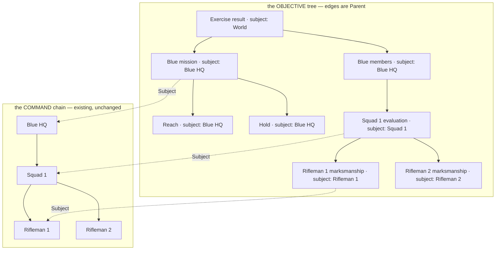

*What the picture shows that prose hid:* two trees, never merged — the objective tree's edges are `Parent`; `Subject` is a CROSS link into the
real world (the command chain, the World Environment). The per-member branch MIRRORS the command chain, which is why its parents can be
DERIVED instead of authored.

| # | decision | ⭐ lean |
|---|---|---|
| **SR-53** | ✅ CONFIRMED `2026-11-01` (user: *"References and macros approved."*) · the component | `ObjectiveLinks {Subject: EntityRef, Parent: EntityRef}` on every objective entity — saved for top-level objectives, replicated with `ObjectiveStatus`; both network ids (R-184) |
| **SR-54** | ✅ CONFIRMED `2026-11-01` (user: *"References and macros approved."*) · `Parent` — three sources, first wins | ① EXPLICIT — inside a macro, a macro-local id (remapped per instance, SR-45); at the top level, an `EntityRef` · ② the macro's ROOT objective — a macro marks one entity as its root; every other objective without an explicit parent hangs under it, and the root hangs where the instance is plugged in · ③ DERIVED from `Subject` via the command chain — the evaluation whose subject is the nearest COMMANDER up `UnitSubordinate` (Rifleman 1 → Squad 1's evaluation → Blue members), else the side's, else the exercise result. ⇒ per-member evaluators attached by TKB type need no authored parent at all; the command chain is READ, never written (it keeps only units) |
| **SR-55** | ✅ CONFIRMED `2026-11-01` (user: *"References and macros approved."*) · `Subject` | a macro param by default (`^subject`, defaulting to the entity the instance is inserted on); a TKB-attached evaluator's subject = the unit it was attached for; the exercise result's = the World Environment |
| **SR-56** | ✅ CONFIRMED `2026-11-01` (user: *"References and macros approved."*) · how a user sees them | an **Objectives view** — the tree by `Parent`, each row naming its subject (click = jump to the subject on the map, the ORBAT's own jump); the subject's inspector lists *"objectives about this unit"* (reverse lookup by `Subject`) |
| **SR-52** ✅ CONFIRMED `2026-10-31` (user: *"Group A confirmed."*) | the ORBAT — ⭐ refined `2026-10-31` (user: *"I have never seen any sensor displayed in the orbat"* · *"Area entities might need their own root in the orbat tree … Orbat item is also used as a landing point for entity picker, which might be a good reason for keeping the areas"*) | measured: the ORBAT lists every entity WITH `EntityInfo` (`ScenarioOrbatAdapter.cs:61`); sensors are absent only because sensor parts carry no `EntityInfo` — an accident of their shape, not a policy. Objective entities WILL carry `EntityInfo` (a label + a side) ⇒ an explicit inclusion policy is needed. ⭐ lean: units and platforms under their sides (as today) · areas under their OWN root (*Areas*) — kept, since the ORBAT is a landing point of the entity picker · objectives, triggers, the World Environment excluded (they live in the Objectives view, SR-56). Tracker **CE-4152** |
| **SR-57** ✅ CONFIRMED `2026-10-31` (user: *"Group A confirmed."*) | where a macro entity's BINDINGS are saved — user, `2026-10-31`: *"we might need a new field on the behavior intention component for those bindings, correct? Otherwise, they would not be saved in the scenario."* | ⭐ yes, a new saved field — but ⭐ NOT on the brain intent alone: a general macro binds OTHER components too (a unit's `EntityInfo.ForceId` ← `side`, its `SimTransform` position ← `position`, a child's `Behavior` params ← `area`). ⇒ ONE generic per-entity component `ParamBindings {"<Component>.<field path>": "<macro param>"}` (e.g. `"Behavior.Params.area": "area"`, `"EntityInfo.ForceId": "side"`), saved and loaded by its own scenario translator, so it round-trips when a macro file is opened and saved in the scenario editor; the expander applies it when instantiating and does NOT copy it onto the created entities. The brain slot record (`SavedBrainSlot {Name, Params, Origin}`) stays as it is |

### 9.5 References across macro scopes — by NAME PATH *(rev 6d draft, `2026-10-31`)*

> 🔒 **User, `2026-10-31`:** *"if in the exercise objective there is a reference to an entity in the scenario, but that entity comes from a
> scenario macro which is using its own internal IDs, and the exercise objective is also a scenario macro using its own scope of IDs. These two
> can never reference each other reliably. Would we use some names for referencing?"*

| measured | where |
|---|---|
| scenario tooling ALREADY names units: the checks verifier (*"no unit named 'X' in <scenario>"*), the film director's anchors and takes (*"no unit named 'X' (alike: …)"*) | `ScenarioVerification.cs:764`; `AnchorBook.cs:226`; `TakeStore.cs:289` |
| `EntityInfo.Name` is unique within 114 of 117 scenarios; duplicates in `hill-attack` / `hill-attack-close` (`M1 Abrams` ×2), `test-fire` (`M2 Bradley IFV` ×2) | measured `2026-10-31` |

```
scenario
 ├─ "Blue Platoon"      MacroInstance(ReinforcedPlatoon)   → creates "Squad 1", "Squad 1/Rifleman 2", …
 └─ "Blue mission"      MacroInstance(SeizeArea, args: { subject: "Blue Platoon", area: "Village" })
                                                             ↑ a PATH, resolved after expansion to a network id
```

| # | decision | ⭐ lean |
|---|---|---|
| **SR-58** | ✅ CONFIRMED `2026-11-01` (user: *"References and macros approved."*) · a macro is CLOSED | inside a macro, references use its own local ids (remapped per instance, SR-45); ⛔ a macro never reaches OUT — anything outside it comes IN through its params (the exercise macro gets its `subject` / `area` as params) |
| ~~**SR-59**~~ ⛔ SUPERSEDED by SR-63 (names are labels; reusable refs use `RefKey`) | a reference that crosses scopes = a NAME PATH | `<instance name>/<entity name>`, nested deeper as macros nest (`Blue Platoon/Squad 1/Rifleman 2`); a top-level entity is just its name. An `EntityRef`-typed param or field accepts a network id OR a path string; the path is resolved ONCE to a network id — after all macros of a load are expanded, or at insertion for a macro added at runtime — through a path index built from a `MacroOrigin {instance, local name}` stamp on every created entity |
| **SR-60** | ✅ CONFIRMED `2026-11-01` (user: *"References and macros approved."*) · names unique per scope | a macro's entity names are unique within the macro; instance names unique within their parent scope; a duplicate that a path references is refused at load with the alike-names hint the director already gives. (Today 3 of 117 scenarios have duplicates — they only matter once a path names them) |
| **SR-61** | ✅ CONFIRMED `2026-11-01` (user: *"References and macros approved."*) · groups by the command chain, not by lists | an objective about "all of Blue Platoon" names the platoon's path as its `Subject` and quantifies over its members through the command chain (`ForUnits(members of …)`), so a macro's internal roster can change without touching the objective |
| ~~**SR-62**~~ ⛔ SUPERSEDED by SR-63 | ⚠ was OPEN — the user ASKED whether GUIDs are the answer (*"It was a question, not a imperative"*); analysis in `DESIGN_Scenario_Entity_Keys.md` §0b, lean: name paths (SR-59) — candidate: a STABLE GUID | every authored entity keeps one `EntityGuid` for life; a macro-made entity's is derived `uuidv5(instance, local)` — so the exercise macro's `subject` param holds the GUID of *Blue Platoon's Squad 1* that the editor's picker wrote, resolved to the live network id after expansion. SR-58 (macros are closed, refs come in as params) and SR-61 (groups via the command chain) stand. 📄 [`DESIGN_Scenario_Entity_Keys.md`](DESIGN_Scenario_Entity_Keys.md) rev 2 G1–G6 |
| ~~SR-46~~ | ⛔ SUPERSEDED by SR-59 | the qualified `{instance, local id}` reference is replaced by the name path — ids are file-local and change per load; names are what an author reads and what the tooling already uses |

⭐ Rejected — **macro EXPORTS** (declared public aliases) for v1: the macro's entity names already are its interface; add exports only if renaming internals breaks references in practice.

### 9.6 Three reference forms; `RefKey` *(✅ user, `2026-10-31`: "ref key is fine. recorded.")*

> 🔒 **User, `2026-10-31`:** *"Entity name is by no means a stable identifier during the authoring."* · *"sometimes the objectives might be written
> in a generic way referencing some subjects that are expected to be in the scenario, but every scenario might have different ones … So the
> entity would need some kind of extra key which is not the entity's label but is used for referencing it."*

| # | decision (✅ approved) |
|---|---|
| **SR-63** | ✅ CONFIRMED `2026-11-01` (user: *"References and macros approved."*) · three reference forms: **exact** (the entity's GUID — *this one entity*) · **key** (`RefKey` — *whatever entity this scenario gives that key*) · **query** (side, class, command chain, `TacticalDesignation` — *the squad leader of @Squad1*, *all members of @BluePlatoon*). ⇒ `EntityInfo.Name` is a LABEL only, never a reference; ⛔ SR-59 (name paths) and SR-62 (GUIDs for cross-scope refs) are superseded |
| **SR-64** | ✅ CONFIRMED `2026-11-01` (user: *"References and macros approved."*) · `RefKey` — an author-assigned attribute on an entity (`"RefKey": "BlueHQ"`), separate from the label, set deliberately, rarely changed, unique within its scope; most entities have none. Precedent: `TacticalDesignation` (`Fdp.Core/CommandHierarchy/TacticalDesignation.cs`) is a role key scoped to one command group, a fixed enum on the wire |
| **SR-65** | ✅ CONFIRMED `2026-11-01` (user: *"References and macros approved."*) · reusable macros reference keys THROUGH PARAMS — `subject` defaults to `"@BlueHQ"`, a scenario with another key overrides it at insertion; lookup is LEXICAL: inside the enclosing macro instance first, then outward to the scenario; from outside, a key inside an instance is qualified by keys only (`@BluePlatoon/SL`) |
| **SR-66** | ✅ CONFIRMED `2026-11-01` (user: *"References and macros approved."*) · a missing key fails LOUDLY: the objective stays inactive with *"no entity with key 'BlueHQ' here"* (the director's *"no unit named …"* shape); duplicate keys in one scope are refused at save and load |
| **SR-67** ✅ CONFIRMED `2026-10-31` (user: *"Group A confirmed."*) | per-member thresholds — who may override a criterion's params | ⭐ nearest wins, walking UP from the evaluator's SUBJECT: the unit's own scenario entry ▸ the nearest enclosing team / squad / platoon macro instance (found up the command chain) that sets that param in its `memberArgs` ▸ the side's ▸ the scenario's ▸ the criterion template's default. Same lexical rule as `RefKey` lookup (SR-65); ⛔ never a global table |
| **SR-68** | ✅ CONFIRMED `2026-11-01` (user: *"References and macros approved."*) · where a macro's (and a scenario's) PARAMS DECLARATION is shown and stored — ⭐ rev `2026-10-31` b (user: *"I am not aware that a scenario has a world entity saved as such. What world entity carries is usually written in the scenario header, and I think the scenario macro parameters should be the same case."*) | measured: the World Environment IS saved as an ENTITY (`ua-weather-regions`, `ua-weather-sensing`, `ua-night-sensing` carry `{NetworkIdentity, ScenarioClock, TkbIdentity, WeatherConditions}`; the others get a default at load and save it next time — Weather W-0 / C-3); the header holds `subsystemType · schemaVersion · terrainName · description` (`ScenarioHeader.cs:33`, `ScenarioHeaderDto.cs`). ⭐ lean (user's model): the declaration is FILE metadata ⇒ `header.params` (rows `{Name, TypeId, Default, Comment}`), by extending `ScenarioHeader` / `ScenarioHeaderDto` — ⛔ not a component on the World Environment entity (a macro file's World Environment would be a never-instantiated oddity). Shown and edited in a **Parameters** map-background Details view (the `DetailsViews.Add` pattern beside *Scenario* / *Zones*, `EditorSubsystem.cs:3141-3200`) with SR-44a's `ScalarEditBox<T>` rows. ⚠ small new code: the header gains an edit path (no view edits the header today — unmeasured) |

⚠ The film director's takes keep naming units in a RECORDING by name for now — a GUID would need to exist at runtime and in the recording; a separate decision.

### 9.7 Expanding a scenario macro at LOAD — the sequence *(`2026-10-31`; the gaps are marked ⚠ GAP)*

> 🔒 **User, `2026-10-31`:** *"the scenario files are distributed by the orchestrator before the scenario load. And now we will need to distribute
> not just a single scenario file, but also the macros … we distribute all the macro scenarios, because we do not know upfront the whole dependency
> chain. So we might distribute a zipped package of all the macros together with the scenario."*

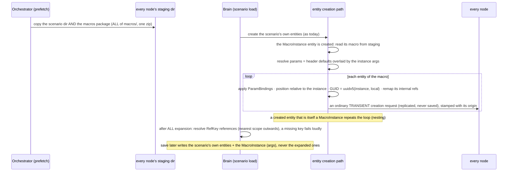

*Caption:* expansion is NOT a loader step — it happens where the instance entity is created, so a macro inserted at RUNTIME (a trigger's
`InsertMacro`, the instructor) expands by the same path (SR-27). The orchestrator only has to make the macro files present beforehand.

| # | decision / ⚠ GAP | lean — ✅ ACCEPTED by the user `2026-10-31` (*"Gap-X Leans accepted."*) |
|---|---|---|
| **SR-80** | ✅ CONFIRMED `2026-11-01` (user: *"References and macros approved."*) · distributing the macros | the existing prefetch (`StorageGatewayModule.PrefetchScenarioAsync:229`, `DESIGN_Artifact_Staging.md` — *"an artifact a scenario NAMES must arrive before the scenario LOADS"*) also stages the WHOLE `macros/` tree as ONE zip (the TKB already travels as a zip, cached on its timestamp) — ALL macros, because the dependency chain is not known without expanding (user) |
| ⚠ **GAP-1** | WHEN is expansion finished? | RefKey resolution (step "after ALL expansion") needs an end point, but creation is asynchronous across nodes — lean: hook the load gate that already waits for the scenario's entities to be constructed (CE-4087) and count the expanded entities into it |
| ⚠ **GAP-2** | which nodes READ the macro files | the Brain (it owns the instances) and the editor (it expands to show the parts read-only) — both are in the prefetch's node set; a node that only receives replicated entities never reads a macro |
| ⚠ **GAP-3** | a missing macro, a wrong `TypeId` in a binding, a cycle (macro A contains B contains A) | fail the LOAD loudly naming the instance — where the check lives (the creation path or a validation pass before load) is undecided; a cycle needs a depth guard |
| ⚠ **GAP-4** | editing an instance's args in the editor | re-expand: destroy its parts, create them again — their GUIDs stay the same (derived); undecided whether references from OUTSIDE into those parts survive the re-expansion within one session (they should, by GUID) |
| ⚠ **GAP-5** | ids | the expanded entities get fresh network ids from the allocator like any creation; a macro's internal ids are only its file-local keys (SR-45) |

### 9.8 Relocating a macro, and ONE way to name a place or an entity *(draft `2026-11-01` — leans SR-125…SR-132 await the user)*

> 🔒 **User, `2026-11-01`:** *"how can we make the scenario macros relocatable to given location?"* → *"there already are some attributes
> like map pickable point … We need to unify those. I like your naming better … your attribute means both at once relocatability and
> inherently also pickability from map"* · *"The scenario entities might contain various serialized JSON conditions, like the ones for the
> trigger entity in its when part. How could we make the parameter expansion work for those as well? And also the relocation"* · *"macros
> and entities in general might use named points instead of coordinates … third option … reference to an entity whose position serves as
> the desired position"* · *"how to make it possible to reference an entity via different ways while keeping one single parameter name"* ·
> *"if the macro doesn't want the concrete specific parameter to be relocated … the macro should reference a point entity and not use
> coordinates."*

#### 9.8.0 ⭐ CURRENT ANSWER — relocation and the reference types *(✅ ACCEPTED `2026-11-01` — user: *"Yes approved."* — SR-125…SR-141; the summary of rev a–f; read THIS, the subsections below are the record)*

> ⭐ **S0 item 5 — AS BUILT `2026-11-01` (backend).** Every authored params / predicate DTO now uses the reference types; `PickableGeoPoint` and `OrderGeo` are **deleted** (no geodetic form inside the engine, SR-135). Gated by `S0AuthoredTypesRailTests` (Fdp.Toolkits.Tests) — a bare `Vector2/3`, a `*NetworkId` integer, a lat/lon float, a Bearing-named float or an `EntityRef` in a `[ParamsDto]` / `SearchPredicateDto` fails it unless `Allowed` names the member WITH a reason (today: `T09Params.HomePosition`, `T41Params.Home` — test-only fixtures whose offsets are pinned).
>
> | was | is | note |
> |---|---|---|
> | `EntityRef` / raw `*NetworkId` long | `EntityLink` | read through `.Ref`; `HullDownAttackParams` 48 → **88 B** (target @32 now 48 B, `GoAt` 40 → 80) |
> | `Vector3`, lat/lon pairs, `PickableGeoPoint` | `PointLink` | `MoveToLocation` is ONE `target` (`[x,y,z]` local metres) — `TargetLat/Lon`, `X/Y`, `PickableLocation` gone |
> | `PlatoonDefend.Left/Right` | `Bearing` | |
> | `SpatialBoundingPredicateDto.Bounds` | `AreaLink` | ONE containment (`AreaLink.Contains`) shared by `RecordingSearchService` and `DataBreakpointManager`; `AreaBoxes` converts the replay panel's box |
> | picker seams | key on the TYPE | `IMapPickService.PickLocalAsync` (default derives local metres from `PickLocationAsync`: x = lon field, y = lat field — a host with a frame overrides it); `MapPickBroker` / `MenuOrders` / `OrderMenu.FieldsOf` / `DtoJsonSchemaExtractor` / `PickableLeafFieldEditor` for `PointLink`, `EntityLink`, `AreaLink` |
>
> ⭐ **Blueprint compiler:** the three types are registered (`StaticTypeRegistry`, 48 / 48 / 72 B), with TWO coercion rungs — `PointLink → Vector3` (the load-time walker has already resolved the spec into `Local`) and `EntityRef → EntityLink` (a literal fills an authored link); both listed in `CoercionTable_ContainsOnlyLosslessWidenings`' allow-list with the reason. ⛔ No `Int64 ↔ EntityRef` rung (unchanged). `AuthoredPointOps.At(x, y)` builds a point for a baked `FunctionCall` (`SubordinateForEachDemo`).
>
> ⚠ **Found on the way (oracle, fixed):** Roslyn does not expose `StructLayout(Explicit)` / `FieldOffset` on a type loaded from metadata, so `RoslynStructLayout` laid `RefSpec` out Sequential (52 B, not 36) and every blackboard holding a link was mis-sized in the editor-side oracle. `RefSpec` is now in `KnownTypeLayouts`; `StructSizeResolverEnumTests` pins `PointLink` / `EntityLink` / `AreaLink` / `RefSpec` against the CLR.
>
> ⏭ **Item 9 (content migration, NOT done):** `scenarios/ua-hill-attack`, `hill-attack-close` (`firingLineStart/End`, `baselineStart/End` as `[lat, lon]`), `scenarios/tt-nav-los` (`targetLat` / `targetLon` on a MoveToLocation task) — each needs `[x, y, z]` local metres; `hill-attack`, `test-move` held no old-shape key.


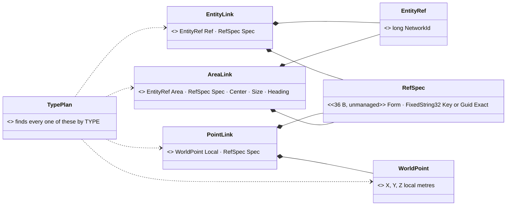

*What the picture shows that prose hid:* every authored type is an internal answer PLUS one shared `RefSpec`; the walker knows them all by type, so
the picker, the "show on map", resolution and relocation need no per-field code.

| | what | where it is used |
|---|---|---|
| **internal** | `EntityRef` (network id) · `WorldPoint` (local metres, Vector3-identical) | everything CODE writes: components, lists, recordings, the wire — no authored data, no size growth |
| **authored** | `EntityLink` · `PointLink` · `AreaLink` = the resolved answer + `RefSpec` (how a person wrote it) | everything a PERSON writes: params DTOs, trigger `when` / `do` args, macro params — saved in the scenario in their authored form |
| **authored forms (JSON)** | entity: GUID (*exact*) · `"@Key"` / `"@Outer/Inner"` (*by key*) · point: `[x, y, z]` or an entity reference (*its position*) · area: `{"circle": …}` · `{"rect": …, "heading": …}` · an area entity | the JSON shape says which — no `kind` field; the editor shows a form switch; resolution keeps the form, so save writes it back |
| **places** | local ENU metres only; ⛔ no lat / lon inside the engine (AQ107 B) — converted at the outer edge | — |

**Relocation, in four steps at expansion (§9.7):** ① **bind** — every `bind` map (on any JSON object) and `ParamBindings` copy the macro /
scenario params in · ② **resolve** — every GUID / `@Key` becomes a network id, a point's or area's entity becomes its position / polygon ·
③ **relocate** — every LITERAL point / area and every bearing is moved by *authored anchor → instance anchor* (translate X / Y, rotate by the
heading difference, Z by the anchors' height difference; heights above ground kept); internal `WorldPoint`s in components move the same way;
rotations and velocities turn; road / nav ids are cleared · ④ **create**. ⭐ Because ② runs before ③, a REFERENCE never moves — the way to keep a
value fixed is to point at an entity outside the macro; a point entity inside the macro moves with it. `relocatable: false` pins a macro that
depends on particular buildings.

**By construction:** a rail fails on a bare `Vector3` point, an internal `EntityRef` in an authored DTO, or a lat / lon in params; tools show
every `WorldPoint` / `EntityRef` / `*Link` on the map. **Open, not this design's:** writing internal `EntityRef`s of SAVED components as GUIDs
(CE-4153 S9) — needed for references to macro-made entities and once S8 drops `NetworkIdentity` from the file.

#### 9.8.1 INVENTORY *(`2026-11-01`; ⚠ coverage unchecked — `check_index_coverage` is not available through the CLI)*

`search_graph` Class `.*(MapPick|Pickable|MapEditable|MapPoint|MapPosition).*` (13) · `.*(Position|Point|Location|Waypoint|Spatial|MapPick|WorldPoint).*Attribute$` (2) ·
`.*(EntityRefRemap|ParamsRemap|RefRemap|Remapper).*` (3) · `.*(Paste|Clipboard|Duplicate|CloneEntit|Copy).*` (32 — ⛔ no scenario-entity copy / paste / group move) ·
`.*(Ground|Terrain).*(Snap|Clamp|Height|Drop).*` (13) · a scan of all 117 `scenarios/*/scenario.json` · grep over the 58 `[ParamsDto]` types.

| what exists | where | for relocation / references |
|---|---|---|
| ⭐⭐ **the TYPE makes a field pickable — the ruled precedent, twice** | `DESIGN_Entity_Reference.md` D5 (`EntityRef`); `DESIGN_Map_Picking_Unification.md` P5 — *"`MapPickableWorldLocationAttribute` (both copies) is deleted … keep the attribute — it marks exactly the members of that type, so it says nothing the type does not"* (rejected) | ⇒ the unified place is a TYPE, not an attribute (SR-125) |
| `PickableGeoPoint {Latitude, Longitude}` — the map-pickable location TYPE, JSON `[lat, lon]` | `Fdp.Toolkits/Behavior/Params/PickableGeoPoint.cs:16-31`; 5 fields (orders, `PlatoonHillAttack`, `AirArmedSearch`) | ⭐ merged into `WorldPoint` |
| ⭐ `EntityRef {NetworkId}` — JSON the bare number; picked, remapped at load and resolved by its TYPE | `Fdp.Toolkits/Replication/EntityRef.cs:26`; 21 fields in the params types | ⭐ gains the other reference forms (SR-126) |
| ⭐⭐ `EntityRefRemap` — ONE type plan per type (members, lists, nested), appliers `RemapJson` / `RemapObject`; `ScenarioBehaviorRemapper` gets every behaviour's contract type from the registry | `EntityRefRemap.cs:25-280`; `ScenarioBehaviorRemapper.cs:33-95` | ⭐⭐ the walker relocation and resolution reuse (SR-128) |
| the params types' locations: **38 `Vector3`** (sim metres — every one a POINT by name: `Position`, `Objective`, `FallBackTo`, `WatchTowards` …), **5 `PickableGeoPoint`**, **2 lat / lon `double` pairs** (`MoveToLocation.TargetLat/Lon`, `CenterLat/Lon`); **2 compass bearings** (`PlatoonDefend.Left/Right`) | grep `[ParamsDto]` | ⭐ three spellings of one concept ⇒ one type |
| raw `long` entity ids in params: `HsmFireActivityParams.TargetNetworkId` (`BlueprintDemoParams.cs:35`), `HillAttackDtos.cs:243 TargetNetworkId`; `HeardId` ×3 / `CachedEqsRequestId` look like WORKING state | grep | ⚠ the audit (SR-131) |
| positions in saved components: `SimTransform` (1012 entities), `EditablePolyline.Points` (11), `RoutePlan.Waypoints` (12, `HeightAgl` = above ground), `NavigationIntent.FinalDestination` / `NavState.FinalDestination` (26); a NON-point vector `SimVelocity.Linear`; terrain ids `NavState.CurrentSegmentId` / `TrajectoryId` | the scenario scan | ⭐ engine structs — relocated by small per-component relocators (SR-128) |
| the condition DTOs: `SearchPredicateDto` tree; one location — `SpatialBoundingPredicateDto.Bounds` (`BoundingBox2D`, an axis-aligned box); no entity field (the `OnEntity` leaf, SR-95, is unbuilt) | `ReplayBrowser/Search/SearchPredicateDto.cs:166-186` | ⚠ an axis-aligned box cannot ROTATE (SR-128) |
| a single-point marker entity type | ⛔ none — `TacGraphic_FireLine 8801`, `_Route 8802`, `_Area 8803` (`TkbEntityTypes.cs:87-89`) | a `TacGraphic_Point` is new (SR-130) |
| ground clamping | `GroundClampWhilePausedSystem`, `GroundClampingConfig`, `TerrainClampBaseline` | ⚠ vehicles measured; dismounted soldiers NOT measured (SR-127) |
| entity references in a FILE become stable GUIDs | `DESIGN_Scenario_Entity_Keys.md` G4 / S9 (⚠ S9 stopped: there is no save-direction remap yet) | ⭐ SR-126 builds on it |

#### 9.8.2 The model

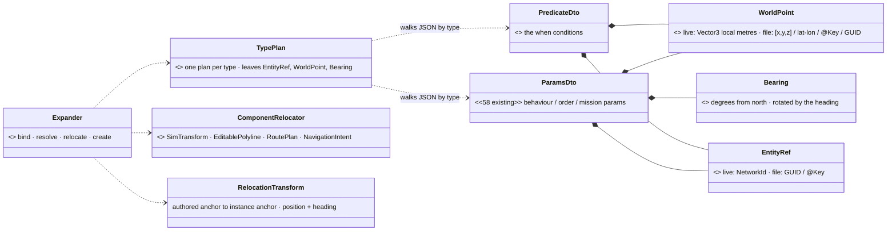

*What the picture shows that prose hid:* every place and every entity reference is ONE type with ONE walker over it — the picker, the
load-time remap, the reference resolution and the relocation all key on the same three types; only the engine's own components need
explicit relocators.

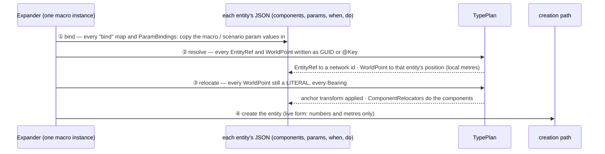

*What the picture shows that prose hid:* RESOLVE runs BEFORE RELOCATE, so a point that came from a reference is never moved — that is the
"do not relocate this" switch the user asked for, with no flag. The FILE keeps `@Key` / GUID; only the live copy holds resolved numbers.

#### 9.8.3 Decisions

| # | decision | ⭐ lean |
|---|---|---|
| **SR-125** ⚠ AMENDED by §9.8.4 SR-125′ / SR-135 (no geodetic form) | ONE place type — `WorldPoint` | ⭐ a TYPE, not an attribute (the D5 / P5 precedent above: the type already makes a field pickable, and an attribute "says nothing the type does not"). It REPLACES `PickableGeoPoint`, the 38 point `Vector3` fields and the 2 lat / lon pairs: picked on the map by its type (everything P5 built keys on it), relocated by its type, resolved by its type. Live form = local metres (`Vector3`, unmanaged, 12 bytes — behaviour code reads `.Local`); FILE forms: `[x, y, z]` (local metres) · `{"lat": …, "lon": …}` (geodetic, converted through the host's `IGeographicTransform`) · `"@Key"` / a GUID string (an ENTITY'S position, SR-130). A tiny `Bearing` type for compass angles (2 fields today). ⛔ No backward compatibility (CE-4153 S10): the repo's scenarios are migrated by one script in the same change |
| **SR-126** ⚠ the C# shape is §9.8.4 SR-133 | ONE entity reference type, ONE param name, several ways to point | `EntityRef` keeps its live form (the network id — orders, the wire, `BrainIntent` JSON unchanged) and its FILE form becomes a string: a **GUID** = *this exact entity* (stable, `DESIGN_Scenario_Entity_Keys.md` G1 / G2) · **`@Key`** = *whatever entity has that `RefKey` here* (SR-64 / SR-65) · **`@Outer/Inner`** = a key inside a macro instance. The FORM of the value says which — the field name stays one. ⏭ the query form (*"the squad leader of @Squad1"*, SR-63) is a later `EntitySet` / single-result query; not v1 |
| **SR-127** | the relocation transform | the macro file records its AUTHORED ANCHOR (position + heading — where it was built, on real terrain); every entity keeps its authored coordinates; placing an instance applies *authored anchor → instance anchor* (translate X / Y, rotate by the heading difference, Z + the anchors' height difference). Heights ABOVE GROUND (`RoutePlan.HeightAgl`) unchanged. Vehicles settle through the existing ground clamp; ⚠ dismounted soldiers — measure with one rail before building. A macro whose plan needs particular buildings declares `relocatable: false`: its instance is pinned at the anchor and the editor refuses the drag, saying why |
| **SR-128** ⚠ AMENDED by §9.8.4 SR-134 / SR-136 (areas are a `WorldArea`; the box clause is moot) | the ONE walker | `EntityRefRemap`'s type plan generalised: leaves `EntityRef` (remap, resolve), `WorldPoint` (resolve, relocate), `Bearing` (rotate); appliers over JSON and over objects, as today. It walks params, `do` args and the `when` tree alike — the predicate tree is polymorphic, so the plan dispatches on each node's concrete type. ⭐ The engine COMPONENTS keep their `Vector3`s (hot-path structs, a type change would touch physics everywhere) and get one small relocator each: `SimTransform` (position + rotation), `EditablePolyline`, `RoutePlan`, `NavigationIntent`; `SimVelocity` rotates only; `NavState` road / trajectory ids are CLEARED. ⚠ `SpatialBoundingPredicateDto.Bounds` is an axis-aligned box: translated, and a rotated instance fails the expansion LOUDLY naming it — the fix is to name an AREA entity instead |
| **SR-129** | parameter binding inside nested JSON (the `when`, `do`, macro args) | ⭐ SR-94 generalised: **any JSON object may carry a `bind` map, its paths relative to that object** — a `do` entry, a `when` node, a `macroArgs` object, a behaviour's params. The expander walks the JSON generically and applies each `bind` where it stands; the literal stays as the unbound value. ⇒ ONE rule, no per-DTO code, and moving a node moves its bindings (SR-94's reason). Typed components keep SR-57's `ParamBindings`. A bound param's declared type must match the target member's type — checked at expansion, a mismatch fails loudly (GAP-3) |
| **SR-130** | named points | a NAMED POINT is just an entity whose position is wanted: a `WorldPoint` written `"@Key"` takes that entity's position — a new `TacGraphic_Point` (a control point, drawn on the map, carrying a `RefKey`), an area (its centroid), or any unit. ⭐ Resolved ONCE when the params are assigned (a snapshot: the behaviour still reads metres, its code unchanged); ⛔ it does not follow the entity — a param that must follow is an `EntityRef` |
| **SR-131** | not relocating a value | ⭐ the user's rule, by construction: a LITERAL point moves with the macro; a REFERENCE does not (resolved first — step ② of the sequence above). A point entity INSIDE the macro moves (it is one of the macro's entities); one OUTSIDE, passed in through a param, stays where it is. ⛔ no `relocate: false` flag per field |
| **SR-132** | the audit that rides the migration | while every params field is retyped, CLASSIFY it: 38 `Vector3` + 5 `PickableGeoPoint` + 2 lat / lon pairs → `WorldPoint`; 2 → `Bearing`; the 2 raw `long` targets → `EntityRef` if authored; `HeardId` / `CachedEqsRequestId` confirmed as working state (not params). ⭐ A RAIL lists every member of every `[ParamsDto]` and predicate DTO and fails on a `Vector2` / `Vector3` / `double` lat-lon / `long` id that is not a known type or an explicit allow-list entry; a second rail fails on a scenario-saved component with a vector member but no relocator and no "not spatial" entry — ⇒ a new behaviour cannot silently be unrelocatable |

**Rejected — one line each:**
- *An attribute (`[WorldPoint]`) on `Vector3` fields* — ruled against twice (D5, P5), and an attribute cannot carry the `@Key` / GUID / lat-lon value forms.
- *Three param names per reference (`targetId`, `targetKey`, `targetGuid`)* — the user's objection; the value's form says which.
- *A `relocate: false` flag per field* — a reference already means "the world, not the macro".
- *Following a named point live* — every behaviour would need world access in its params; that is what `EntityRef` is for.
- *Retyping the engine components too* — hot-path structs; four relocators cost less.
- *Inline `"^param"` strings inside typed values* — a typed number field cannot hold a string in the editor; the sibling `bind` keeps the literal typed (SR-55's `^subject` is shorthand for such a `bind` entry).

#### 9.8.4 Rev b (`2026-11-01`) — the C# shape of a multi-way reference, areas, no geodetic params *(leans SR-133…SR-136 await the user; amends SR-125 / SR-126 / SR-128)*

> 🔒 **User, `2026-11-01`:** *"the spatial condition should support multiple shapes, either a rotated rectangle or also something else like a
> circle. axis-aligned bounding box is certainly not enough"* · *"the engine was switched recently to using local coordinates, so whenever there
> are latitude, longitude coordinates, these are probably part of the outer API … not meant to be used directly as parameters of behaviors or
> whatever stored in the scenario"* · *"when we are editing this field, we need to store the information what kind of reference it is … how we
> represent this multi way of referencing in the C# DTO."*

| measured | where |
|---|---|
| ✅ the wire is LOCAL ENU metres; `GeoPoint` left it (8 fields, 44 conversions) | `Architect_Question_107_NED_Wire_Frame_And_Names.md` row B (RULED, BUILT `2026-10-27`) |
| the geodetic leftovers in params: 5 `PickableGeoPoint` + 2 lat / lon pairs; `MapPickGeo` calls a mission location *"geodetic by authoring convention"*; `OrderGeo.ToLocal / ToGeo` converts | `MapPickGeo.cs:8`; `Orders/OrderGeo.cs:9-31` |
| the params form HYDRATES the JSON into the params TYPE, edits the object, writes it back | `BehaviorParamsForm.cs:43-55` (`Hydrate`) ⇒ ⭐ the TYPE must hold the authored form, or an edit loses it |
| a params type is often deserialized straight into an UNMANAGED struct (blueprint `ParseParams` honours `[JsonConverter]`) | `DESIGN_Entity_Reference.md` D1 ⇒ ⭐ the reference types must stay unmanaged (no `string`) |
| `EntityRef` fields: 27 in code, mostly JSON DTOs; a few in runtime node structs (`UtilityNodes`, `SensorNodes`, `GenesisIntentComponents`) | grep |
| no authoring area-shape type (graph `.*(Shape\|Circle\|Polygon\|OrientedBox\|Obb\|Rect\|Region\|Zone)$` — 23, none for authoring); areas are `EditablePolyline` entities tested by `PolygonMath.Contains`; `KillZone` is a private radius test | `Terrain/PolygonMath.cs:29`; `TriggerIedBehavior.cs:90` |

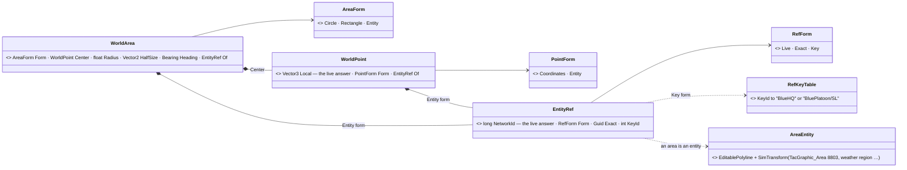

*What the picture shows that prose hid:* the authored FORM is a FIELD of the value, beside the live answer — so hydrate → edit → write loses
nothing, and the three types nest: a point may BE an entity's position, an area may BE an area entity, and both use the one `EntityRef`.

| # | decision | ⭐ lean |
|---|---|---|
| **SR-133** ⚠ LAYOUT SUPERSEDED by §9.8.5 SR-137 (packed, 16 bytes); the forms, the converter and resolve-keeps-the-form STAND | how one field holds several ways of referencing — the C# shape | ⭐ the value carries its FORM next to its live answer, all unmanaged: `EntityRef { long NetworkId; RefForm Form; Guid Exact; int KeyId }` (`Form`: `Live` = only a network id · `Exact` = a stable GUID · `Key` = a `RefKey`, the text interned in a process-wide `RefKeyTable`). The JSON converter derives the form from the JSON shape — a GUID string ⇒ `Exact`, `"@…"` ⇒ `Key`, a number ⇒ `Live` — and writes it back the same way, so a hand-edited file needs no `"kind"` field. Resolution FILLS `NetworkId` and KEEPS the form ⇒ ⭐ save writes the authored form back untouched (this is also the missing save direction of `DESIGN_Scenario_Entity_Keys.md` S9 — nothing to convert back). Live JSON on the wire (`BrainIntent`, orders) stays the bare number. The editor's leaf shows a form switch *[Exact \| Key]* + the value; the map pick writes `Exact` (the picked entity's GUID), or `Key` when the picked entity has a `RefKey` and a MACRO is being edited. Cost: `EntityRef` grows 8 → 32 bytes (blob layouts regenerate) |
| **SR-125′** | `WorldPoint` *(amends SR-125)* | `WorldPoint { Vector3 Local; PointForm Form; EntityRef Of }` — `Coordinates` (JSON `[x, y, z]`, local metres; relocated) or `Entity` (JSON `"@Key"` / GUID — that entity's position, resolved into `Local`; NOT relocated, SR-131). ⛔ the geodetic form is DROPPED (SR-135) |
| **SR-134** | areas — several shapes | ⭐ ONE `WorldArea { AreaForm Form; WorldPoint Center; float Radius; Vector2 HalfSize; Bearing Heading; EntityRef Of }`: `Circle` (`{"circle": {"center": [x,y,z], "radius": 50}}`) · `Rectangle`, rotated (`{"rect": {"center": …, "size": [w, h], "heading": 30}}`) · `Entity` (`"@Village"` — an area entity's polygon, `EditablePolyline`). A free polygon IS an area entity (as areas are authored today) — so the type stays unmanaged. ⭐ ONE containment, `WorldArea.Contains(world, point)` (circle / oriented-rectangle maths + `PolygonMath.Contains`), shared by the spatial condition (`SpatialBoundingPredicateDto.Bounds` becomes a `WorldArea`), the area objectives (`ReachArea` / `HoldArea` / `ClearArea`) and any behaviour that tests a zone. Relocation moves `Center` and turns `Heading`; an `Entity` area moves only if that entity is inside the macro. ⇒ ⛔ SR-128's "a rotated axis-aligned box fails loudly" is moot |
| **SR-135** | latitude / longitude | ⭐ the inside of the engine is LOCAL METRES (AQ107 B): no geodetic value in a behaviour param, a condition or a scenario file. The 5 `PickableGeoPoint` + 2 lat / lon pairs become `WorldPoint`s in the migration (SR-132); `PickableGeoPoint` and `OrderGeo`'s conversions are deleted. Geodetic exists only at the OUTER edge — an external gateway, an API that accepts lat / lon — and converts THERE, through the one `IGeographicTransform`. ⚠ not measured: whether an external system sends orders in lat / lon today — if one does, its ingress converts; the type decision does not depend on it |
| **SR-136** | the walker's leaves *(amends SR-128)* | `EntityRef` · `WorldPoint` · `WorldArea` · `Bearing` — all resolved and relocated by the one type plan |

**Rejected — one line each:**
- *A separate `"kind"` field in the JSON* — the shapes (number / GUID / `@…` / array / object) already tell them apart; a field can disagree with its value.
- *A side table of authored forms keyed by JSON path* — path-fragile (the user's SR-94 objection).
- ~~*Encoding the form in `NetworkId`'s high bits to stay 8 bytes* — opaque in every debugger and log~~ ⛔ withdrawn by §9.8.5 (user: the types print themselves) — a packed layout is SR-137.
- *An axis-aligned box plus a separate polygon type* — two containment codes; one `WorldArea` covers both plus circle and rectangle.
- *A literal polygon inside the area value* — not unmanaged; an area entity already is a polygon, drawn and editable on the map.

#### 9.8.5 Rev c (`2026-11-01`) — PACKED layouts *(⛔ SUPERSEDED by §9.8.7 rev d — the managed table is withdrawn; supersedes SR-133's 32-byte layout — its JSON forms and behaviour stand)*

> 🔒 **User, `2026-11-01`:** *"every log and dumper and debugger are probably using some serializer of the entity ref or world point types
> anyway for better UX. So it's not so unachievable to pack all the fields into a shorter memory layout. might be worth revising."*

| measured | where |
|---|---|
| `EntityRef` already shows itself through its own `ToString()` (`"#" + NetworkId`) and its JSON converter | `EntityRef.cs:76` ⇒ a packed field costs no readability: logs, dumps and the inspector go through the type |
| ⚠ brain state CROSSES nodes (a brain snapshot on hand-over) and is RECORDED | `BrainSnapshotTranslator` (`Hrot.SimHost.Tests/BrainSnapshotTranslatorTests.cs`); `BehaviorState` recorded (§11 SR-118) ⇒ a packed handle may be read in another process — it must fail SAFE there |

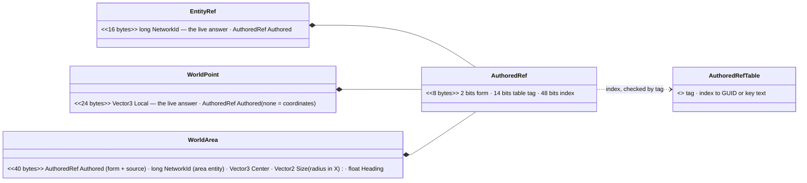

*What the picture shows that prose hid:* the live answer stays INLINE (no lookup on the hot path); only the authored form — read by the
editor and by save — goes through a table, and a `WorldPoint` needs no network id at all (its position is already in `Local`).

| # | decision | ⭐ lean |
|---|---|---|
| **SR-137** | the packed layouts | ⭐ `EntityRef` = **16 bytes**: `long NetworkId` (inline, so `Resolve` is unchanged and costs nothing) + `AuthoredRef` (8 bytes: 2 bits form — none / exact / key · 14 bits table tag · 48 bits index into the world's `AuthoredRefTable`, which interns each distinct GUID or key text ONCE). `WorldPoint` = **24 bytes**: `Vector3 Local` + `AuthoredRef` (none ⇒ coordinates; a GUID / key ⇒ that entity's position, already resolved into `Local`). `WorldArea` = **40 bytes**: `AuthoredRef` (also carries circle / rectangle / entity) · `long NetworkId` (the area entity) · `Vector3 Center` · `Vector2 Size` (a circle's radius in X) · `float Heading`. ⭐ **Fail-safe by construction:** a handle read in a world whose table has another tag (another node after a hand-over, a recording restored in a new process) reads as "no authored form" — the live `NetworkId` / `Local` still works; only the editor's round-trip of THAT copy is lost, and the editor always edits the scenario's authored copy, never a live blob. The table is a per-world managed singleton, recorded with the world. Readability: `ToString`, `[DebuggerDisplay]` and the JSON converter print `@BlueHQ → #9812` / `3f2a… → #9812` |

**Rejected — one line each:**
- *SR-133's 32-byte struct (GUID inline)* — 2× the size for a value read only by the editor and save.
- *8 bytes, the network id behind the handle too* — every `Resolve` on the hot path would become a table lookup, and a resolved ref would need one table entry per occurrence (a macro-local key resolves differently in each instance).
- *A process-wide table with no tag* — a handle that crossed nodes or a restore would silently read someone else's text.

#### 9.8.6 The declarations, and how a TOOL reads them *(⛔ the DECLARATIONS are SUPERSEDED by §9.8.7; SR-138's rules ①–④ stand)*

```csharp
public enum AuthoredForm : byte { None = 0, Exact = 1, Key = 2, Shape = 3 }   // Shape: WorldArea's circle / rectangle

[StructLayout(LayoutKind.Sequential)]
public readonly struct AuthoredRef                    // 8 bytes; default (0) = NOT authored
{
    private readonly ulong _bits;                     // [63..62] form · [61..48] table tag · [47..0] index
    public AuthoredForm Form  => (AuthoredForm)(_bits >> 62);
    public ushort       Tag   => (ushort)((_bits >> 48) & 0x3FFF);
    public long         Index => (long)(_bits & 0xFFFF_FFFF_FFFF);
    public bool         IsNone => _bits == 0;
    public string?      Text  => AuthoredRefTables.TryText(this);   // "@BlueHQ" / "3f2a…"; null if the tag is not this world's
    public override string ToString() => Text ?? (IsNone ? "" : "(authored elsewhere)");
}

[StructLayout(LayoutKind.Sequential)]
[JsonConverter(typeof(EntityRefJsonConverter)), DebuggerDisplay("{ToString()}")]
public readonly struct EntityRef                      // 16 bytes
{
    public readonly long        NetworkId;            // offset 0 — EXACTLY today's 8 bytes; 0 = none / unresolved
    public readonly AuthoredRef Authored;             // offset 8 — 0 when not authored
    public override string ToString() => Authored.IsNone ? (NetworkId == 0 ? "(none)" : "#" + NetworkId)
                                                         : $"{Authored} → " + (NetworkId == 0 ? "unresolved" : "#" + NetworkId);
}

[StructLayout(LayoutKind.Sequential)]
[JsonConverter(typeof(WorldPointJsonConverter)), DebuggerDisplay("{ToString()}")]
public readonly struct WorldPoint                     // 24 bytes (12 + 4 padding + 8)
{
    public readonly Vector3     Local;                // offset 0 — metres, local ENU; the live answer
    public readonly AuthoredRef Authored;             // offset 16 — 0 = plain coordinates
}

[StructLayout(LayoutKind.Sequential)]
[JsonConverter(typeof(WorldAreaJsonConverter)), DebuggerDisplay("{ToString()}")]
public readonly struct WorldArea                      // 40 bytes (8 + 8 + 12 + 8 + 4)
{
    public readonly long        AreaNetworkId;        // offset 0  — Entity form: the area entity (the live answer)
    public readonly AuthoredRef Authored;             // offset 8  — the SHAPE lives here: Form Shape + index 0 circle / 1 rectangle;
                                                      //             Form Exact / Key = an area entity ("@Village" / GUID)
    public readonly Vector3     Center;               // offset 16 — circle / rectangle, local metres
    public readonly Vector2     Size;                 // offset 28 — rectangle w, h · circle: X = radius
    public readonly float       HeadingDeg;           // offset 36 — rectangle, degrees from north, clockwise
    public AreaShape Shape => Authored.Form == AuthoredForm.Shape ? (AreaShape)Authored.Index : AreaShape.Entity;
}
```

| # | decision | ⭐ lean |
|---|---|---|
| **SR-138** | what a TOOL sees (AI agents over the debug API / MCP, logs, the inspector, a raw dump) | ⭐ ① **raw memory in the default form is today's**: an unauthored `EntityRef` is the network id at offset 0 followed by eight zero bytes; a `WorldPoint` is three floats followed by zeros — a hex dump, a blob-offset reader or a trace buffer reads the same id / metres it reads now. ② **every structured reader goes through the TYPE**: the debug API serializes with System.Text.Json (`DebugApiDumpOptions`, `DebugApiService.cs:470`), which honours `[JsonConverter]`; logs and the debugger use `ToString` / `[DebuggerDisplay]`. ③ **the converter writes by context, and every output reads back** (the dump is also the PATCH input, HN-002): not authored ⇒ the bare number `9812` (unchanged — every skill doc and client keeps working) · file / save ⇒ the authored text `"@BlueHQ"` · diagnostics (`DebugApiDumpOptions`) ⇒ BOTH: `{"NetworkId": 9812, "Ref": "@BlueHQ"}` — the reader already accepts `{"NetworkId": n}` (`EntityRef.cs:100-108`), extended to read `Ref`. `WorldPoint`: `[x, y, z]` · `"@Key"` · diagnostics `{"Local": [x, y, z], "Ref": "@Key"}`. ④ the ai-debug skill doc (`tools/ai-debug-mcp/SKILL.md`) gets one paragraph on the three forms in the same change. ⚠ The one opaque case: a REFLECTION dump that ignores converters and `ToString` would print `Authored._bits` as a number — the type exposes `Form` / `Text` as properties so even that shows meaning |

#### 9.8.7 Rev d (`2026-11-01`) — the authored form INLINE, fully unmanaged, no table *(⚠ the INLINE + unmanaged ruling stands; its DECLARATIONS and single-type choice are SUPERSEDED by §9.8.8 rev e; supersedes §9.8.5 SR-137's handle + table and §9.8.6's declarations; SR-138's tool rules ①–④ stand)*

> 🔒 **User, `2026-11-01`:** *"The world position was so far used as plain unmanaged structure, and it is saved as such in components, and they
> are recorded as such, and the general desire is to never use managed types. So the optional string in the offered reference seems weird and
> undesired, isn't it?"*

⛔ **What was wrong with rev c:** the struct was unmanaged, but its authored form lived in a MANAGED per-world table — the managed type was only
moved one level down, and it is what forced the 14-bit tag guard for hand-over and restore. ⭐ **Precedent for the fix:** `TerrainObjectRef`
already references by an inline `FixedString64 Key` (`Fdp.Toolkits/Terrain/TerrainObjectRef.cs:21`); `EntityInfo.Name` is a `FixedString64`
(`Fdp.Core/Components/EntityInfo.cs:15`); `FixedString32` = 31 UTF-8 bytes (`Fdp.Core/FixedString32.cs:13`).

```csharp
public enum AuthoredForm : byte { None = 0, Exact = 1, Key = 2, Circle = 3, Rectangle = 4 }

[StructLayout(LayoutKind.Explicit, Size = 32)]
public readonly unsafe struct AuthoredRef              // 32 bytes, unmanaged; all zero = not authored
{
    [FieldOffset(0)]  public readonly AuthoredForm Form;
    [FieldOffset(1)]  private readonly byte _keyLength;          // Form == Key
    [FieldOffset(2)]  private readonly fixed byte _key[30];      // Form == Key: UTF-8, "BlueHQ" or "BluePlatoon/SL" (no '@')
    [FieldOffset(16)] public readonly Guid Exact;                // Form == Exact (overlaps the key's tail — one or the other)
    public ReadOnlySpan<byte> KeyUtf8 => …;                      // no allocation
    public override string ToString() => …;                      // "@BlueHQ" / "3f2a…" / "" — built on demand, for display only
}

public readonly struct EntityRef                        // 40 bytes
{
    public readonly long        NetworkId;              // offset 0 — exactly today's 8 bytes
    public readonly AuthoredRef Authored;               // offset 8
}

public readonly struct WorldPoint                       // 44 bytes
{
    public readonly Vector3     Local;                  // offset 0 — local metres
    public readonly AuthoredRef Authored;               // offset 12 — None = plain coordinates
}

public readonly struct WorldArea                        // 64 bytes
{
    public readonly long        AreaNetworkId;          // offset 0  — Exact / Key form: the resolved area entity
    public readonly AuthoredRef Authored;               // offset 8  — Circle / Rectangle / Exact / Key
    public readonly Vector3     Center;                 // offset 40
    public readonly Vector2     Size;                   // offset 52 — rectangle w, h · circle: X = radius
    public readonly float       HeadingDeg;             // offset 60
}
```

| # | decision | ⭐ lean |
|---|---|---|
| **SR-139** | the authored form is stored INLINE | ⭐ everything is a plain unmanaged value — no table, no handle, no managed type anywhere — so it is saved, recorded, snapshotted and sent on a brain hand-over AS IS, and reads the same in any process. ⭐ The default (unauthored) form is unchanged in meaning: the id / metres at offset 0, zeros after. A key is at most **30 UTF-8 bytes** including a qualified path (`BluePlatoon/SL`) — RefKeys are short identifiers (SR-64); a longer one is refused LOUDLY where it is typed and at load. Strings appear only on demand for display (`ToString`) and in JSON. ⚠ **Cost, stated:** `EntityRef` 8 → 40 bytes, `WorldPoint` 12 → 44, a new `WorldArea` 64. 📐 `EntityRef` is a field in 27 places, mostly params DTOs; the 45 location fields are params — none is a hot per-frame array. Blob layouts regenerate. ⇒ ⭐ the rev-c tag guard, the table and its recording are DROPPED |

**Rejected — one line each:**
- *Rev c's handle into a per-world managed table* — a managed type one level down, plus a tag trap on every hand-over and restore (the user's objection).
- *A key HASH inline (8 bytes)* — the editor could not show the text of a key that does not exist in the open file (a macro's default `@BlueHQ`).
- *Two types — an 8-byte runtime ref and a 40-byte authored ref* — two types for one concept; the authored form must survive in the editor's live world, which IS where save reads from.

#### 9.8.8 Rev e (`2026-11-01`) — TWO types: the internal `EntityRef` stays 8 bytes; an AUTHORED `EntityLink` for edited params *(lean SR-140 awaits the user; supersedes §9.8.7's declarations and its "two types" rejection)*

> 🔒 **User, `2026-11-01`:** *"Couldn't we use the already existing fixed string 32 type instead of breaking the string into the length and the
> array of bytes? What about components that are storing a list of entity references? These are usually not user editable, they are used
> internally, but the byte size of them matters because they will be saved to recordings … Having two types for entity reference, one is for
> internal use and the other is for user editable use, saving the authored information."*

⭐ **Why two types is right after all** (rev d rejected it as *"two types for one concept"* — wrong): they are TWO concepts. `EntityRef` is a
RESOLVED identity (*which* entity — written by code, held in lists, recorded every frame); `EntityLink` is an AUTHORED intent (*how to find*
it — written by a person, kept so save can write it back). The codebase already separates authored from runtime once (`DESIGN_Entity_Reference.md`
D7: authored `EntityRef` vs runtime `Entity`); this is the same cut one level up. ⭐ `FixedString32` (`Fdp.Core/FixedString32.cs:13`, 31 UTF-8
bytes) is reused for the key, overlaid with the GUID.

```csharp
public enum RefForm : byte { None = 0, Exact = 1, Key = 2, Circle = 3, Rectangle = 4 }

[StructLayout(LayoutKind.Explicit, Size = 36)]
public readonly struct RefSpec                          // 36 B — HOW it was authored; all zero = not authored
{
    [FieldOffset(0)]  public readonly FixedString32 Key; // Form == Key: "BlueHQ", "BluePlatoon/SL" (no '@'), ≤ 31 UTF-8 bytes
    [FieldOffset(0)]  public readonly Guid Exact;        // Form == Exact — overlays the key; one or the other
    [FieldOffset(32)] public readonly RefForm Form;
}

public readonly struct EntityRef                        // 8 B — UNCHANGED: internal, lists, components, the wire
{
    public readonly long NetworkId;
}

public readonly struct EntityLink                       // 48 B — an AUTHORED reference (params, `when` / `do` args)
{
    public readonly EntityRef Ref;                      // offset 0 — the resolved answer; behaviour code reads link.Ref
    public readonly RefSpec   Spec;                     // offset 8
}

public readonly struct WorldPoint                       // 48 B — authored by nature (params only)
{
    public readonly Vector3 Local;                      // offset 0 — metres
    public readonly RefSpec Spec;                       // offset 12 — None = plain coordinates
}

public readonly struct WorldArea                        // 72 B — authored by nature
{
    public readonly EntityRef Area;                     // Exact / Key form: the resolved area entity
    public readonly RefSpec   Spec;                     // Circle / Rectangle / Exact / Key
    public readonly Vector3   Center;
    public readonly Vector2   Size;                     // rectangle w, h · circle: X = radius
    public readonly float     HeadingDeg;
}
```

| # | decision | ⭐ lean |
|---|---|---|
| **SR-140** | two reference types, and where each goes | ⭐ **`EntityRef` stays exactly as today** (8 bytes, the network id) for everything code writes: components, lists (`PassengerNetworkIds`, buffers, target memories), runtime node structs, the wire, `BrainIntent` JSON — ⇒ recordings do not grow. ⭐ **`EntityLink`** (48 bytes) for everything a PERSON writes: params-DTO fields (the 21 `EntityRef` params fields change type), the `when` / `do` args, macro params. It converts to `EntityRef` (`link.Ref`), so behaviour code changes one member access. `WorldPoint` and `WorldArea` are authored by nature and carry the same `RefSpec`. ⭐ A RAIL fails on an `EntityRef` member of a `[ParamsDto]` / predicate DTO (it must be `EntityLink`) — the split cannot drift. The picker keys on BOTH types (D5): an `EntityRef` pick writes an id, an `EntityLink` pick writes `Exact` or `Key`. ⚠ What it does NOT solve: an internal `EntityRef` inside a component SAVED to a scenario (`UnitSubordinate`'s parent …) still needs `DESIGN_Scenario_Entity_Keys.md` S9's file-boundary GUID conversion — those components already save through translators keyed by GUID (§0a there), so that is S9's open item, not this one's |

⭐ **The same cut for places** (user, `2026-11-01`: *"Sometimes we need to store the coordinates internally without the authored information. I guess here we will use the plain vector 3 for the internal representation"*): ⛔ WITHDRAWN by §9.8.9 SR-141 (an internal `WorldPoint` type; the authored one is renamed `PointLink`) — ~~internal positions stay plain `Vector3` (`SimTransform`, `NavigationIntent`, `RoutePlan` …, the engine's local metres); `WorldPoint` / `WorldArea` exist only where a person authors. ⇒ no third type. The saved components' `Vector3`s are relocated by the per-component relocators (SR-128).~~

⭐ **Why an internal `EntityRef` in a SAVED component is an issue only now** (user: *"It must have been happening all the time till now"*): today it WORKS — the file stores network ids AND each entity's `NetworkIdentity`, and load remaps old → new (`StagingEntityExtractor.cs:344-359`, `EntityRefRemap`). It breaks in exactly two new cases: ① a reference to an entity a MACRO creates — that entity is transient, never saved, and gets a fresh id each load, so no saved number can name it (only its derived GUID can, `DESIGN_Scenario_Entity_Keys.md` G2); ② `DESIGN_Scenario_Entity_Keys.md` S8 drops `NetworkIdentity` from the file — then a saved number has nothing to be remapped against. ⇒ the S9 item (write the target's GUID at save) is needed for ① and ②; a scenario with no macros keeps working as today until S8 lands.

**Rejected — one line each:**
- *One 40–48-byte `EntityRef` everywhere (rev d)* — every internal list and every recorded frame pays for text nobody authored (the user's point).
- *A hand-rolled length + byte array* — `FixedString32` exists (the user's point).
- *`EntityLink` for components too* — components are written by code; an authored form there would always be empty.

#### 9.8.9 Rev f (`2026-11-01`) — an INTERNAL world-point type too; authored types renamed `*Link` *(lean SR-141 awaits the user; amends §9.8.8: "internal positions stay plain `Vector3`" is WITHDRAWN)*

> 🔒 **User, `2026-11-01`:** *"is using the plain vector 3 for an actual world position internally okay? wouldn't it be better to really invent a new
> type which is the same inside like the vector 3, but its semantic meaning is telling that this is an actual world location that can be shown on
> the map and may be edited as such?"* · *"The debug tools, when seeing such type, can for example show the actual position of that field on the
> map … the user would not need to interpret the location, but the tool will help him by showing the location on the map."*

| measured | where |
|---|---|
| ⚠ `Vector3` is AMBIGUOUS today: 124 `public Vector3` fields in engine / toolkit / core types mix world points (`LastSeen`, `Hide`, `Anchor`, `At`, `Point` …) with non-points (`Velocity`, `LastVelocity`, `LocalPoint` — body-relative, `Value`) | grep `public Vector3 \w+;` over `Fdp.Core`, `Fdp.Toolkits`, `Hrot.Core` |
| `SimTransform.Position` is read ~1023 times; `FinalDestination` 169; 11 `ref …Position` aliases | grep |
| ⛔ no semantic point type exists (graph `^(World\|Local\|Sim\|Map)(Point\|Position\|Pos\|Location\|Vec)\w*$` — fields and enum values only; the NED `WorldPos` is a wire descriptor) | graph |
| ⭐ the TYPE already drives the schema hint for tools: `DtoJsonSchemaExtractor` writes `picker: "worldLocation"` for a location type | `DebugApi/DtoJsonSchemaExtractor.cs:201-202` |

```csharp
// INTERNAL — what code writes; same 12 bytes and JSON as Vector3 ⇒ recordings and scenario files do not change
[JsonConverter(typeof(WorldPointJsonConverter))]            // [x, y, z], exactly Vector3's file form
public struct WorldPoint
{
    public float X, Y, Z;                                    // local ENU metres
    public static implicit operator Vector3(WorldPoint p) => new(p.X, p.Y, p.Z);
    public static implicit operator WorldPoint(Vector3 v) => new() { X = v.X, Y = v.Y, Z = v.Z };
}
// AUTHORED — what a person writes (§9.8.8, renamed for symmetry with EntityRef / EntityLink)
public readonly struct PointLink { public readonly WorldPoint Local; public readonly RefSpec Spec; }   // was "WorldPoint" in §9.8.2–9.8.8
public readonly struct AreaLink  { … }                                                                  // was "WorldArea"
```

| # | decision | ⭐ lean |
|---|---|---|
| **SR-141** | an internal world-point type | ⭐ YES — `WorldPoint` = a plain 12-byte struct, identical in memory and in JSON to `Vector3`, whose TYPE says *"a place in the world"*. ⭐ The pairs are symmetric: **`EntityRef` / `EntityLink`**, **`WorldPoint` / `PointLink`**, areas **`AreaLink`** (`*Link` = authored, carries `RefSpec`). ⭐ What the type buys, BY CONSTRUCTION: ① **tools show it on the map** — the inspector, the watch, the brain view and the debug API offer *"show on map"* for every `WorldPoint` / `EntityRef` field (the schema hint `DtoJsonSchemaExtractor` already emits by type), so nobody has to interpret coordinates; ② **editable on the map** by its type (D5 / P5); ③ **relocation is generic** — the type plan finds every `WorldPoint` in any component, so the per-component relocators shrink to rotation (`SimTransform.Rotation`, `SimVelocity`) and `EditablePolyline`'s 2-D points; ④ the ambiguity of the 124 `Vector3` fields ends — a direction stays `Vector3`. ⭐ Migration is cheap BECAUSE of the implicit conversions both ways and the `X` / `Y` / `Z` fields: the ~1023 reads of `SimTransform.Position` compile unchanged (`a.Position - b.Position` is a `Vector3`, as a difference of points should be); the 11 `ref` aliases are edited. Recordings, blobs and scenario files are byte-identical. ⭐ A RAIL classifies every `Vector3` field of every component and params type as point (→ `WorldPoint`) or not (an explicit allow-list), so a new position cannot be added as a bare `Vector3` unnoticed. ⏭ the wire structs keep their `double`s (AQ107); translators convert |

**Rejected — one line each:**
- *Plain `Vector3` internally (§9.8.8)* — 124 fields mix points and directions; no tool can tell which to show on the map (the user's point).
- *Explicit-only conversions* — strict, but ~1000 call sites would change for no runtime benefit; the type's value is MEANING for tools, not arithmetic safety.
- *Keeping the authored name `WorldPoint`* — the internal type deserves the plain name; authored ones read `*Link`, like `EntityLink`.

#### 9.8.10 Orientation — `WorldRotation` and `Bearing` *(✅ ACCEPTED `2026-11-01` — user: *"Yes, approved."* — SR-142…SR-143)*

> 🔒 **User, `2026-11-01`:** *"What about the world orientation of an entity? Wouldn't it deserve also a special type? Or maybe it is already having one?"*

| measured | where |
|---|---|
| ⭐ the CONVENTION exists, once: `SimTransform.Rotation` (`Quaternion`) in local ENU, body-forward = +X; compass heading 0 = north, 90 = east, clockwise — `SimTransformBridgeSystem.HeadingDegToRotation` / `RotationToHeadingDeg` | `Geographic/Systems/SimTransformBridgeSystem.cs:23, :63`; routed to, not copied, by `SimTransformHeadingInstaller` |
| ⭐ the ONE human display: `OrientationDisplay` → `HPR [045.0, 3.2, -1.0] deg, Quat […]` (ddsmonitor, the compass gizmo) | `Replication/Components/OrientationDisplay.cs` |
| ⛔ no orientation TYPE: graph `.*(Heading\|Bearing\|Orientation\|Rotation\|Yaw\|Azimuth\|Attitude\|Pose\|Facing).*` Class (63, paginated) — wire / display / gizmo / pose classes, `NetworkOrientation`, `TurretPose`, none a world-orientation value type | graph |
| world quaternions are few: `SimTransform.Rotation`, `NetworkTransform.LastRotation` (grep `public Quaternion \w+;` over Fdp.Core / Fdp.Toolkits / Hrot.Core) | grep |
| ⚠ compass bearings are plain `float`s with MIXED units in the names: `LeftBearing` / `RightBearing` / `WatchBearing` (`EngagementArea.cs:42-75`), `Bearing`, `LastBearing`, `BearingDeg`, `RunInBearingDeg`, `Azimuth`, `Yaw`, `AngleRad` … beside RELATIVE angles (`SteerAngle`, `HeadingOffset`, `HeadYaw`, `WedgeAngleRad`) | grep `public (float\|double) \w*(Heading\|Yaw\|Bearing\|Azimuth\|Facing\|Direction\|Angle)\w*;` over Fdp.Core, Fdp.Toolkits, Hrot.Core, Hrot.AI.Behaviors |

| # | decision | ⭐ lean |
|---|---|---|
| **SR-142** | a world-orientation type | ⭐ YES, the `WorldPoint` pattern: **`WorldRotation`** = 16 bytes, `Quaternion`-identical in memory and JSON, implicit conversions both ways, `X / Y / Z / W` fields; meaning *"an orientation in the world frame — local ENU, body-forward +X"*. Its members ROUTE to the existing convention (`HeadingDeg` ⇄ `SimTransformBridgeSystem`), `ToString` routes to `OrientationDisplay` (HPR) — ⛔ no second copy of either. Used by `SimTransform.Rotation` and `NetworkTransform.LastRotation`; a body-LOCAL rotation (a turret's, a bone's) stays `Quaternion`. ⇒ tools draw a heading arrow on the map for it; the relocation walker turns it by type (SR-128's hand-written `SimTransform` rotation case goes away). Recordings and files byte-identical |
| **SR-143** | a world compass bearing | ⭐ **`Bearing`** (SR-125's tiny type, now defined): 4 bytes, `float` DEGREES, compass (0 = north, clockwise, [0, 360)) — the same convention; implicit to / from `float`. Used for WORLD directions — `EngagementArea`'s `Left / Right / WatchBearing`, `PlatoonDefend`'s `Left / Right`, the `*BearingDeg` fields, `AreaLink`'s heading — internally AND in params (a bearing needs no authored form: "face toward X" is a `PointLink` param). ⇒ the unit is in the type, not in a name suffix; tools draw it as an arrow at its owner; relocation adds the heading difference. RELATIVE angles (steering, offsets, arcs, body yaw) stay `float` — they do not turn with a macro. ⭐ The SR-132 rail extends: a `float` named `*Bearing*` / `*Heading*` / `*Azimuth*` / `*Yaw*` must be a `Bearing` or on the relative allow-list |

**Rejected — one line each:**
- *Keep `Quaternion` for world rotations* — tools cannot tell a world orientation from a turret's local one, so none can draw it.
- *An authored `BearingLink` (with `RefSpec`)* — a heading "toward an entity" is a point (`PointLink`), not an angle.
- *Bearings in radians, math convention (CCW from east)* — every authored and displayed heading in the engine is compass degrees; one convention.

#### 9.8.11 ⭐ AS-BUILT — S0 (`2026-11-01`, backend; the details step 0 left to the builder)


*What the picture shows that the prose hid:* the convention and the text moved DOWN into `Fdp.Core` (the only assembly `WorldPoint`'s users all
reference), and the toolkit copies now route there; and the one walker is one plan with three appliers — remap, resolve and relocate are not three
walkers.

| decided by the builder | as built | why |
|---|---|---|
| assemblies | `WorldPoint` / `WorldRotation` / `Bearing` / `RefSpec` in **Fdp.Core** (`World/`); the `*Link`s beside `EntityRef` in **Fdp.Toolkits** (`Replication/Links.cs`) | `SimTransform` is in Fdp.Core; `EntityRef` in Fdp.Toolkits |
| "`HeadingDeg` / `ToString` ROUTE to `SimTransformBridgeSystem` / `OrientationDisplay`" (§9.8.10) | ⚠ **DEVIATION — the direction is inverted**: the convention's bodies and the HPR text now live in `WorldRotation` / `OrientationText` (Fdp.Core) and the toolkit classes ROUTE to them | Fdp.Core cannot reference Fdp.Toolkits; still ONE copy (`S0TypesTests`, `SimTransformBridgeSystemTests`, `OrientationDisplayTests` green) |
| JSON of the internal types | the converter hands the value to the OPTIONS' own `Vector3` / `Quaternion` / `float` handling | byte-identical by construction in files AND in the debug API's NaN-safe dump — no copy of either converter |
| SR-138 ③ "the converter writes by CONTEXT" (file · wire · diagnostics) | ⚠ **DEVIATION — by the VALUE's state**: not authored ⇒ the bare answer · authored, unresolved ⇒ the text (`"@Key"` / GUID) · authored AND resolved ⇒ both (`{"NetworkId": n, "Ref": "@Key"}`, `{"Local": […], "Ref": …}`, `{"Area": n, "Ref": …}`) | load-time resolution rewrites params JSON in place and the behaviour must still read the answer, so a resolved link must carry it; one converter, no context flag. ⏭ A file saved after a load carries the both-form (it loads back identically — the form wins); writing only the text at save is the file-form applier, left for S3 / CE-4153 S9 |
| `AreaLink` shapes | `Size` = (width across the heading, length along it), circle radius in `Size.X`; `Heading` a `Bearing`; `Center` a `WorldPoint`; an area entity's outline is relative to its `SimTransform` (as weather regions) | the area-entity case reuses `WeatherField.TryOutline` + its even-odd test (new public `WeatherField.AreaEntityContains`) — one containment |
| the walker | `EntityRefRemap` keeps its name and API (`CompileJson`, `RemapObject`, `HoldsRefs` = holds a network id) and gains `WalkJson` / `WalkObject` + `LeafApplier`; a JSON leaf is read and written through its own converter, the string returned untouched when nothing changed; a leaf the type cannot read is left alone (the params parse reports it) | ⛔ no second plan; `RefResolve` throws on a reference that names nothing — the load fails loudly |
| `Relocation` | translate X / Y, turn about the anchor by the heading difference (compass clockwise), Z by the anchors' height difference; `WorldRotation` pre-multiplied by the turn; `Bearing` + turn, normalised; a `PointLink` / `AreaLink` written as an entity is NOT moved | SR-127 / SR-131; rails `S0WalkerTests.Relocate_*` |
| `RefKey` | component **468**, `DataPolicy.Default` (saved), `"RefKey": {"Value": "BlueHQ"}`; the scope is built by `StagingEntityExtractor` after Pass 1 from `RefKey` + `EntityGuid` + `SimTransform`, mapped to the NEW ids; a duplicate key throws; behaviour params resolve through `ScenarioBehaviorRemapper.ResolveJson` (the one contract lookup it shares with `RemapJson`) | rails `StagingEntityExtractorTests.S0_*` |
| item 6 — saved components (`d298cd86d`) | ⭐ `WorldPoint`: `SimTransform.Position`, `NetworkTransform.LastPosition`, `NavState` / `NavigationIntent.FinalDestination`, geographic `Position.Value`, `BallisticProjectile.Muzzle` / `PreviousPosition`, `WeaponTask.Point`, `FakeCrowdAgentState.Target`, `EqsSensor.ContextPoint1`, `EngagementArea.ArcOrigin` · `WorldRotation`: `SimTransform.Rotation`, `NetworkTransform.LastRotation` · `Bearing`: `EngagementArea.Left/Right/WatchBearing`. Everything else vector-shaped is a velocity, a body-relative angle or a 2-D world XY (`FormationTarget.TargetPosition` — no 2-D point type until S3), each named with its reason in `S0ComponentTypesRailTests.NotSpatial` | memory identical ⇒ no golden moved. ⚠ The rail scans a saved component's DIRECT fields only (nested structs such as `WeaponPosture.Point` are not reached) and only the assemblies `Fdp.Toolkits.Tests` references (not `Hrot.MuscleCharacter.*`, whose `FakeAnimBackendState.WorldAimPoint` is a bare `Vector3`) — ⏭ item 8 |
| the generic-widget seam | ⭐ ONE mapping `SemanticValueTypes` (Fdp.Core: `StorageTypeOf` / `ToStorage` / `FromStorage` / `IsSemantic`) — the inspector (renderer registry fallback, property tree, quaternion editor), `FixedListFormatter`, `JsonShapeDescriber`, the blackboard helpers and schema builders route through it; a schema KEEPS the semantic type name (`format: worldRotation`, `number/bearing`); the blueprint compiler gains same-bytes rungs `WorldPoint↔Vector3`, `WorldRotation↔Quaternion`, `Bearing↔Single` | rails `SemanticValueTypesTests`, `SemanticValueRoutingTests` |
| ⚠ DEVIATION — `Stage2_Validate` (BP2014) | matches the three types by **full NAME**, not through `SemanticValueTypes` | `Hrot.Blueprints.Compiler` also targets `netstandard2.0`, where `Fdp.Core` is not referenced (the netstandard / net8.0 wall, `BATCH-03-REPORT.md:100`). One check, three names; the cure is a source file linked into both targets |
| ⚠ `NodeEditor.UI` (ExtDep) | `PinDefaultValueEditorRegistry` maps `Fdp.Core.WorldPoint` by type NAME to `VectorPinEditor(3)` | the library cannot reference `Fdp.Core` |

## 10. Objective KINDS, measures, status, the result *(rev 7 draft, `2026-10-31` — leans for the user)*

### 10.1 The data sources — measured `2026-10-31` (graph `.*(Fire|Hit|Kill|Damage|Destroy|Casualt|Death|Wound).*(Event|Notification|State|Status)$` Class (18) + grep)

| fact | where | feeds |
|---|---|---|
| a SHOT: `WeaponFireIntent {Shooter, Target, WeaponIndex, IsRemote, AtPoint, TargetPoint}` — `IsRemote` ⇒ it is raised on other nodes too | `Fdp.Toolkits/Combat/.../WeaponFireEvents.cs:27-46` | shots per shooter |
| a HIT: `DamageAssessedEvent {HitEntity, TotalDamage, IsRemote, BodyPart, Effect, Source}` — reaches other nodes through `EntityHitDamageIngressTranslator` | `Combat/Events/DetonationEvents.cs:26-54` | hits per shooter, fratricide, civilians harmed |
| destroyed: `Health.Current <= 0` | `Combat/Components/Health.cs:19` | destroyed / survivors |
| a REPORT up the chain: `SquadReportNotification {FromUnit, ToUnit, Subject, SentAt, Report (kind, ObservedAt, …), OriginNodeId}` — raised on EVERY node | `Squad/Command/SquadReportNotification.cs:13-29` | report latency (`SentAt − ObservedAt`), reports made |
| area occupancy: EQS `EntitiesOfForceInArea`, `PolygonMath.Contains`; areas = `EditablePolyline` entities | `EntitiesInAreaGenerator.cs:34, :119`; `PolygonMath.cs:29` | reach / hold / clear |
| the scenario clock | `ScenarioClock` on the World Environment | deadlines, time-to |
| "first seen": the perception contact memory (`KnownCombatantList`, sensor contacts) | OVERVIEW §4 | the start of a report latency |
| ✅ hits reach every node: the hit-damage ingress is in the SHARED translator pack (`SharedTranslatorPack.cs`, `EntityHitDamageIngressTranslator.cs`) · ✅ harm is judged by AFFILIATION: `ForceId {Neutral, Friend, Hostile}` (`Fdp.Core/Components/ForceId.cs:10-20`) — 🔒 user: *"the affiliation is a better indicator than being a civilian or not, because we can have terrorists and other civilian combatants, as well as we do not want the neutral side soldiers be killed"* · ✅ `DamageAssessedEvent.Source` is the SHOOTER for gunfire (`DamageCalculationSystem.cs:~120`), blasts (`AreaEffectSystem.cs:215-225`) and hits from other nodes (`EntityHitDamageIngressTranslator.cs:~101`, `SourceEntityId` mapped); ⚠ drone impacts, gas clouds and ejection carry no source | as cited | — |

### 10.2 Objective kinds v1 — each ONE small generic behaviour in the task slot (SR-37, SR-51)

⭐ Every kind's params begin with the SAME nested block `ObjectiveCommon {title, subject, required, visibleTo, points, weight, deadline, activeWhen, scored}` —
the deadline and the activation are FIELDS, not kinds, so every objective can have them.

| kind | params (besides `ObjectiveCommon`) | achieved when · failed when |
|---|---|---|
| `ReachArea` | area, minUnits = 1 | ≥ minUnits of the subject's units inside · the deadline passes |
| `HoldArea` | area, minUnits = 4, maxEnemy = 0, holdSeconds = 600, `capture` (repeatable: the owner flips) | held continuously for holdSeconds · the deadline passes (capture: never ends, the OWNER is the state) |
| `ClearArea` | area, enemy side, maxEnemy = 0, forSeconds = 30 | no enemy inside for forSeconds · the deadline passes |
| `DestroyTargets` | targets (`RefKey` / query), count | count of them destroyed · the deadline passes |
| `Protect` | targets (`RefKey` / query), minSurvivors | the deadline passes with ≥ minSurvivors · fewer survive |
| `NoHarm` (a constraint) | protected AFFILIATION (`ForceId`: Neutral / Friend / Hostile), by side, maxCount = 0 | the run ends within limits · more harmed than maxCount (fratricide and civilian harm are two uses) |
| `Composite` | mode all / any / weighted | its required children achieved · a required child failed |

### 10.3 Measures v1 — evaluation that SCORES rather than ends (a measure is an objective with a value and a target)

| kind | value | default target |
|---|---|---|
| `HitRatio` | the subject's hits ÷ shots | ≥ 0.30 |
| `Count` | shots · hits · kills · fratricide · civilians harmed · reports made — by the subject | per use (fratricide = 0) |
| `ReportLatency` | first contact seen by the subject's team → its report received by the subject's commander (`SentAt − ObservedAt` on the chain) | ≤ 60 s |
| `TimeTo` | scenario start → a named objective achieved | per scenario |

### 10.4 `ObjectiveStatus` (replicated, SR-31 / SR-48) — one shape for objectives and measures

`State` (Pending · Active · Achieved · Failed) · `Owner` (side, capture only) · `Progress` (current / needed) · `Value` + `Target` (measures) ·
`Points` · `ChangedAt` (scenario time) · `Reason` (a short text: *"held 60 s, 5 Blue / 0 Red"*) · `Subject` · `Parent` (SR-53).

### 10.5 ⛔ SUPERSEDED by §10.7 SR-72 (user: *"Evaluation macro should not come from TKB. TKB is static"*) — per-member evaluation from the TKB type (SR-30)

A unit TKB type names an evaluation MACRO (e.g. Rifleman → `RiflemanCriteria` = `HitRatio` + `Count(fratricide) = 0` + `ReportLatency`); every
unit of that type gets one instance with itself as `Subject` and its commander's evaluation as `Parent` (SR-54 ③); thresholds by SR-67.

### 10.6 `ExerciseEnded` (NED, R-4105)

The outcome per side · end time + reason · the objective TREE (each node: key, title, kind, subject, state, value / target, points, when,
reason) · totals per side. ⭐ A GRADE (A–F, %) is NOT computed by the engine — a frontend derives it from points and pass / fail (R-4105).

### 10.7 Rev 7a (`2026-10-31`) — assignment by ROLE, triggers on the same statuses, external measurements, weights

> 🔒 **User, `2026-10-31`:** *"Evaluation macro should not come from TKB. TKB is static, but the evaluation criteria and objectives, they need to
> be specifiable per scenario"* · *"how a higher echelon macro scenario objective can specify the objectives for subordinates (likely by referencing
> another macro or some macro library where the objective is selected by member role.) The goal is to assign the objectives more or less
> automatically whenever possible."* · *"we should talk also about the triggers … how to affect the running scenario based on similar conditions"* ·
> *"inputs that are not coming directly from our simulation, but are coming from external world … how much a trainee exposes to an enemy … there
> are some measurement devices providing this information"* · *"Weighting of the criteria might be necessary in case we want to act on some
> triggering condition which is based on the evaluation criteria … the points or some values calculated from the objectives would need to be passed
> to the upper layer, which might be aggregating them and deciding something upon them."*

| measured | where |
|---|---|
| a member's ROLE already exists: `TacticalDesignation` (Commander, SquadLeader, TeamLeader, Medic, AutomaticRifleman, MachineGunner, Grenadier, Marksman, …) on the command link, on the wire | `Fdp.Core/CommandHierarchy/TacticalDesignation.cs`; `UnitSubordinate.cs:25` |
| ⛔ no generic NED topic for an external measurement (graph `.*(External|Telemetry|Measurement|Reading|Instrument|Sensor|Variable|Signal|Value)(Topic|Descriptor|Sample|Message)$` — no topic; the protocol inventory names an external gateway as *"a node like any other"*) | `NED_DDS_Protocol.md` |

| # | decision | ⭐ lean |
|---|---|---|
| **SR-72** | ✅ CONFIRMED `2026-11-01` for the demo (user: *"Evaluation per node is okay, at least for the beginning. I need something to start with. Maybe it will change later."*) · per-member objectives are assigned BY ROLE, per scenario | a `MemberEvaluation` kind placed on a commander (its `Subject`): params `byRole {SquadLeader: "SLCriteria", MachineGunner: "MGCriteria", *: "RiflemanCriteria"}` (role → a macro from a library folder, e.g. `macros/evaluation/`) — it creates ONE macro instance per subordinate down the command chain, chosen by `TacticalDesignation` (or the entity class when no role), `Subject` = that member; a role's macro may itself contain a `MemberEvaluation` (squad → fire teams). It follows the chain LIVE: a reinforcement gets an instance; a casualty's instance stays and keeps its result. ⛔ never from the TKB (static) — SR-30 superseded |
| **SR-73** ✅ CONFIRMED `2026-10-31` (user: *"Group A confirmed."*) | triggers act on the SAME statuses | a `Trigger` kind: `when` = a status of other objectives / measures (*"`bridge` becomes Achieved"*, *"`Blue members` value < 0.5"*, *"`Blue tickets` ≤ 0"*) + an optional delay · `do` = actions. ⭐ ⇒ the CONDITION vocabulary IS the objective kinds: a condition that is not scored is an objective with `scored: false` — no second condition language, nothing called by name |
| **SR-74** ✅ CONFIRMED `2026-10-31` (user: *"Group A confirmed."*) | actions v1 | `Order` (an `AssignTacticalIntent` to a `RefKey` / query subject: behaviour + params) · `SetReporting` · `InsertMacro` (a scenario macro instance created at runtime at a position — waves, reinforcements, an IED event: the SAME macro machinery) · `Message` (to a side / the IOS / a trainee) · `SetObjectiveActive` · `SetSkillAmplifier` (P-5) · `EndExercise` |
| **SR-75** ✅ CONFIRMED `2026-10-31` (user: *"Group A confirmed."*) | values passed UP | every status carries a normalised `Score` (0..1: achieved = 1, failed = 0, a measure = value vs target); a `Composite` aggregates its children by their `weight` into its own `Score` / `Value` ⇒ a trigger or a director watches any level (team, side, exercise) |
| **SR-76** | ✅ `2026-11-01` — RESERVED, NOT in the demo (user: *"External measurements will not be present in the demo. They were mentioned just to reserve the components and the architecture to count with that."*) — keep the component / topic in the architecture, build nothing for it now · EXTERNAL measurements (the physical world) | a small NED topic `ExternalMeasurement {[DdsKey] StationId (int, SR-76a), [DdsKey] Key, Value, Time, SourceId}` (KeepLast per subject + key) published by a device gateway; the ingress keeps the latest per (subject, key) — a measure kind `External {key, aggregate: mean / max / time above threshold, target}` and the same as a trigger condition. Example: `exposure` from a laser / camera rig behind the physical wall → *"time exposed to the enemy > 20 %"* |
| **SR-77** | the director | a director's utility inputs may read any `Score` / `Value` (SR-18) — the adaptive pressure valve rides the same statuses |

### 10.8 Rev 7b (`2026-10-31`) — aggregation is overridable, roles OR keys, the station link

> 🔒 **User, `2026-10-31`:** *"The aggregation and weighting of the criteria, these are usually something that changes over time, that we will
> never create something that will fit everyone's needs. So these parts shouldn't be hard coded without the possibility to override them … maybe
> some aggregation logic as a function, either hard-coded and registered as such (eval result aggregator) or defined as a blueprint."* ·
> *"tactical designation is not always sufficient, and we might need to reference via the ref key."* · *"The external measurement device reports
> and provides data for its physical ID … this link between the device and the trainee might live as a component on the trainee entity … stations
> … are usually numbered or have a string name … fixed string 64 for that (or GUID)."*

| # | decision | ⭐ lean |
|---|---|---|
| **SR-78** ✅ CONFIRMED `2026-10-31` (user: *"Group A confirmed."*) | the AGGREGATOR is the composite's BEHAVIOUR | ⛔ no aggregator registry: a `Composite` objective is an entity whose task-slot behaviour IS its aggregation — `WeightedMean`, `AllMustPass`, `RequiredGateThenWeighted` ship; a scenario picks one by name like any behaviour, with its params; a custom one is a C# behaviour OR a Blueprint behaviour reading its children's `ObjectiveStatus` and writing its own `Score` / `Value`. ⇒ the existing behaviour registry, params form, debugging and hot reload serve aggregation too (R-4111) |
| **SR-72a** | the member SELECTOR | `MemberEvaluation`'s table is an ordered list of rules, first match wins: a `RefKey` (`@PL-Trainee` → `PlatoonLeaderCriteria`), a `TacticalDesignation` (`MachineGunner` → `MGCriteria`), an entity class, `*` |
| **SR-76a** | the device ↔ trainee link | a component on the trainee's entity, `PhysicalStation {Id: int}` (⭐ rev `2026-10-31`, user: *"Station names are unique across the cluster … Please change the fixed string into an integer. The stations use the name just for convenience, but technically they are assigned a unique integer ID as well"* — the name stays a display label, the INTEGER is the key; cluster-unique) — set when the trainee's Player node takes the unit (the node is configured with its station name), cleared when released; `ExternalMeasurement` is keyed by that integer STATION id (the device knows only where it is installed), and the ingress routes it to the entity whose `PhysicalStation` matches. Generic: any device, any key |
| **SR-79** | the GUID descriptor's owner | ✅ accepted as built (`dtEntityGuid` stays with the creator — the Brain creates scenario entities; a Brain crash is non-recoverable today — user) |

### 10.9 Worked example — *"Platoon attack on the village"* *(`2026-10-31`)*

📐 Measured for it: roles in the 117 scenarios — 409 entities have a command link: `Wingman` 284, `SquadLeader` 80, `MachineGunner` 29,
`TeamLeader` 8, `AutomaticRifleman` 4, `Medic` 4 ⇒ most riflemen carry the DEFAULT role, so SR-72a's `*` / class / `RefKey` rules matter.

**What the author places in the scenario** (everything else expands from macros or follows the command chain):

```
entity "Blue Platoon"      Scenario macro → macros/forces/ReinforcedPlatoon   { side: Blue }                       (units, RefKeys @BluePL, @Sq1…)
entity "Red defenders"     Scenario macro → macros/forces/InsurgentCell       { side: Red, count: 12 }
entity "Blue mission"      Scenario macro → macros/missions/SeizeArea          { subject: "@BluePL", area: "@Village", deadline: "10:00" }
entity "Blue evaluation"   Scenario macro → macros/evaluation/PlatoonAttackEval { subject: "@BluePL" }
entity "Red counter"       Scenario macro → macros/directors/CounterAttack     { attacker: "@RedHQ", trigger: "Blue mission/Hold", wave: "macros/forces/RedQRF" }
area   "Village"           RefKey @Village
```

**What `PlatoonAttackEval` contains** (a reusable library macro):

```
Composite "Platoon attack"   behaviour WeightedMean                              (subject ^subject)
 ├─ ObjectiveRef "mission"     weight 40   value: the Blue mission's Score   (via RefKey of the mission macro's root)
 ├─ MemberEvaluation           weight 60   subject ^subject, rules (first match wins):
 │      @PL-Trainee      → macros/evaluation/PlatoonLeader
 │      SquadLeader      → macros/evaluation/SquadLeader       (itself a MemberEvaluation for its fire team)
 │      MachineGunner    → macros/evaluation/MachineGunner
 │      *                → macros/evaluation/Rifleman           (HitRatio ≥ ^minHit · NoHarm(Friend, Neutral) · ReportLatency ≤ 60 s · External "exposure" ≤ 20 %)
 └─ NoHarm "No fratricide"    weight 0, required   (fails the whole tree)
```

**Triggers in play** (all `Trigger` entities, inside macros):

| trigger | when | do |
|---|---|---|
| `CounterAttack` director | `Blue mission/Hold` becomes Active | `InsertMacro(RedQRF, at the edge of @Village)` + `Order(@RedQRF, Attack @Village)` |
| ease off (in the director) | `Platoon attack` Score < 0.35 after 20 min | `SetSkillAmplifier(Red, −1) (SR-100)` + `Message(IOS, "Red eased")` |
| end | `Blue mission` Achieved OR Failed OR `ScenarioTime > 10:30` | `EndExercise` |

| ⭐ what this shows | |
|---|---|
| six authored entities produce the whole objective tree, per-member evaluation for every soldier and three triggers | reuse across scenarios = swap args / swap the library macro |
| the threshold `^minHit` defaults in `Rifleman`, may be overridden by `PlatoonAttackEval`'s args, a squad's macro, or the unit's own entry | SR-67 nearest wins |
| a trigger's condition is another objective's STATUS; the director reads `Score` | SR-73, SR-75, SR-77 |

### 10.10 Rev 7c (`2026-10-31`) — the member library, attribution, the trainee's own view

> 🔒 **User, `2026-10-31`:** *"How do we specify the macro library for the subordinate units to pick from by ref key or role?"* · *"we should carry
> the original shooter information for grenades and drones. Note that the grenades can be rethrown … it is not clear who to made responsible"* ·
> *"Showing player's own evaluation on the HUD is a good idea for debugging, at least, and I agree that it should be under a feature switch."*

| # | decision | ⭐ lean |
|---|---|---|
| **SR-81** ✅ CONFIRMED `2026-10-31` (user: *"Group A confirmed."*) | the member LIBRARY | ⭐ a FOLDER, resolved by convention — `MemberEvaluation {library: "macros/evaluation/infantry", overrides: {...}}`: for each member it looks for `<library>/<RefKey>` → `<library>/<Role>` (`TacticalDesignation`) → `<library>/<entity class>` → `<library>/Default`, first file found wins. ⇒ NO table to author for the common case; swapping `library` swaps the whole set (e.g. `infantry-recruit` vs `infantry-veteran`); adding `SquadLeader.macro.json` to the folder covers every squad leader. `overrides` (`{"@PL-Trainee": "macros/evaluation/special/PlatoonLeaderTrainee", "Medic": "…"}`) handles scenario-specific exceptions — a FLAT map, so `OverlayFlat` overrides entry by entry (§8.0). Supersedes SR-72a's ordered rule list as the authored form |
| **SR-82** ✅ CONFIRMED `2026-10-31` (user: *"Group A confirmed."*) | attribution of indirect harm | carry the shooter through every indirect damage source (tracker **CE-4155**). For a REthrown grenade the damage event carries BOTH: `Source` = the LAST thrower (who acted last) and `OriginalSource` = the first. ⭐ the evaluation decides, not the engine: a measure's `attribute: last \| original \| both` param, default `last` (the one who threw it back took the decision); both stay in the result for the debrief |
| **SR-83** | ✅ CONFIRMED `2026-11-01` for the demo — ON by default in the demo profile (user: *"Trainees can see their own evaluation, that's part of the demo … showing it at player screen will demonstrate that it actually working during the exercise run"*); subject to change for production · the trainee sees their own evaluation | feature `hud.own-evaluation` (R-4108), OFF by default — when on, the Player HUD lists the objectives / measures whose `Subject` is the possessed unit (live `Value` vs `Target`); useful for debugging and for training modes that want live feedback; the instructor's view is unaffected |
| **SR-84** | ✅ ACCEPTED `2026-11-01` (user: *"The deploy score and respawn is accepted."*) · the Deploy score and respawn (user, `2026-10-31`) | ✅ the Deploy design's score (D-15) IS a set of evaluation measures with the player's unit as `Subject` — one counter; the respawn delay (D-14) is a scenario parameter with a default (`DESIGN_Player_Join.md` §7b) |

### 10.11 Trigger semantics *(B1, `2026-10-31` — leans for the user)*

📐 Measured: the brain tick runs only when simulation time advances (`[TickMode(WhenTimeAdvances)]`, `BrainTickSystem.cs:58`) ⇒ nothing
evaluates or fires while paused; it walks entities in index order (deterministic within a run); the brain journal is always on and RECORDED
(`DESIGN_Entity_Brain_View.md` BV-16) ⇒ a trigger's HSM transition and its cause land in the recording for free.

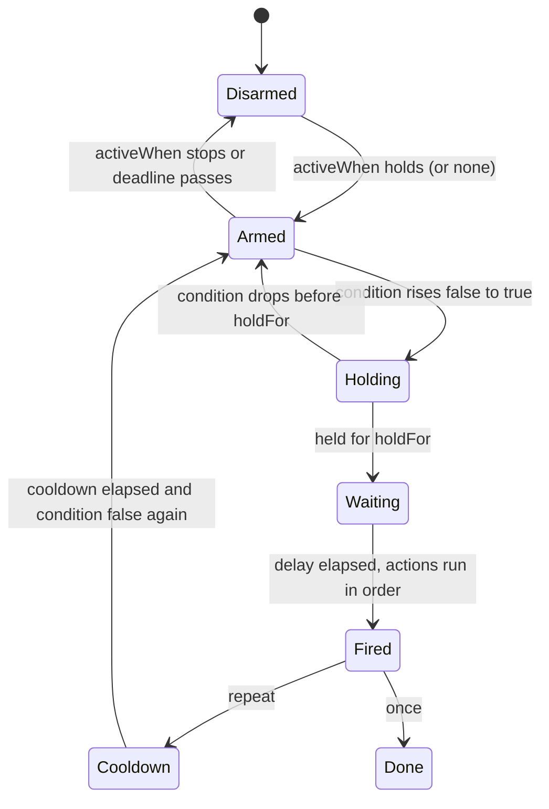

*Caption:* a trigger is a small HSM; every arrow is a journaled transition with its cause, so the AAR can answer *"why did the counter-attack
start at 09:43?"* without new logging. `holdFor` (debounce: the condition must stay true) and `delay` (fire later, even if the condition
drops) are different and both optional.

| # | rule | ⭐ lean |
|---|---|---|
| **T1** | what fires | the RISING EDGE of the condition (false → true) — ⛔ never "every tick while true"; a *while* belongs to an objective's activity |
| **T2** | once or repeat | `once` by default; `repeat` re-arms only after the condition has gone FALSE again (a new edge) and after `cooldown` |
| **T3** | `holdFor` and `delay` | `holdFor`: the condition must hold continuously that long (debounce) · `delay`: fire that long after the edge, even if the condition drops meanwhile (a scheduled consequence) |
| **T4** | arming | `activeWhen` (ObjectiveCommon) arms it; its `deadline` disarms it; a disarmed trigger never fires |
| **T5** | time | scenario simulation time only (R-126 one time source): paused ⇒ frozen; time scale honoured |
| **T6** | several in one tick | each trigger is independent; a trigger reads other statuses as they are when it ticks ⇒ up to ONE TICK of latency, deterministic (index order). ⭐ where order matters, CHAIN: a trigger's own status (`Fired`, `FireCount`) is a condition another trigger can watch |
| **T7** | its actions | run in their listed order within the firing tick; actions with a duration (`Order`, `InsertMacro`) are fire-and-forget; an action that fails (an order refused) is logged in the trigger's `Reason` and does NOT undo the others |
| **T8** | its status | a trigger carries `ObjectiveStatus` too (state Disarmed / Armed / Holding / Waiting / Fired / Cooldown / Done, `FireCount`, `LastFired`, `Reason`) — `scored: false` by default; a timeline lane `rules.fired` |
| **T9** | the instructor | may FIRE, DISARM or RE-ARM a trigger by hand (an instructor action, journaled with its origin) |
| **T10** | replay | triggers do not run in replay (brains do not tick there) — what fired is in the recording (journal + status) |

### 10.12 Mission plan × triggers — information and a unification proposal *(`2026-10-31`; NOT decided — the user wants information first)*

> 🔒 **User, `2026-10-31`:** *"the triggers which are on an entity can steer the entity, not just a scenario … It still looks to me that these are
> the same concepts and that we should somehow unify … I'm not forcing to unify or replace the mission plan concept yet. I need information first."*
> · *"The concept and UI, as perceived by the user who defines the missions, should stay simple. The internal implementation doesn't need to. We
> can also change the wire format if beneficial, no backward compatibility required. No one is using the NED API to mission editing now … Everything
> what uses mission plans is just UIs and scenarios, and we can migrate these if beneficial."*

| measured | where |
|---|---|
| the mission plan is NOT a brain: `MissionDirectorSystem` evaluates the current phase's ONE trigger per entity with a `MissionPlanQueue` (≤ 8 phases) and starts the next task through `AssignTacticalIntent` (origin Superior); commands replace / jump / abort (`MissionControlExecutionSystem`) | `MissionDirectorSystem.cs:153-200`; `REFERENCE_Command_Building_Blocks_Measured.md` |
| the wire trigger is open (`{Type: string, Params: string}`, a LIST per task) but ingress narrows it to 4 kinds, uses only the FIRST, and ⚠ maps an UNKNOWN type to `TimerElapsed(0)` — the phase advances at once, silently | `Hrot.Network.NED/Helpers/MissionTriggerHelper.cs:30-52` |
| a phase change is journaled only as the next behaviour's start — no *"advanced because …"* | grep `Journal` in `MissionDirectorSystem.cs` = none |
| usage: 35 scenarios / 47 entities; trigger kinds used: `BehaviorFinished` 85 · `TimerElapsed` 18 · `UnderAttack` 0 · `HealthCritical` 0; 52 production + 29 test files touch the mission types | scan `2026-10-31` |
| authoring: the editor's Mission panel (five trigger names, `MissionPanel.cs:78`); saved by `MissionPlanTranslator` | as cited |

**The proposal (U5) — ⛔ SUPERSEDED by §10.13 SR-89 (keep the queue, share the step library) — ONE step engine, two SHAPES, the user's concept unchanged:**

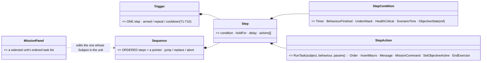

*Caption:* a mission plan IS an ordered list of steps (*"do task 1 until it finishes, then task 2 for 30 s, then …"*); a trigger is ONE unordered
step. Same conditions, same semantics (T1–T5), same actions, same journal and status, same entity shape — the user still sees *"the unit's
mission: a list"*.

| | effect |
|---|---|
| ⭐ the user concept | unchanged: the Mission panel shows the selected unit's list (task · until · next) — it edits the `Sequence` whose `Subject` is that unit |
| ⭐ removed duplication | one condition vocabulary (the mission's 4 built-ins join `ScenarioTime` / `ObjectiveState` in ONE shared set, usable by triggers too); one action vocabulary; one semantics; one journal (a step advance is a journaled transition WITH its cause) |
| ⭐ gained by missions | richer conditions (*"until `Clear B4` achieved"*), a mission step can carry an objective (its outcome scored), several conditions per step, the instructor's jump / re-arm from the same UI |
| ⚠ retired | `MissionPlanQueue`, `MissionDirectorSystem`, `MissionAdapterSystem`, the ingress narrowing (and its silent fallback), `EntityMission` / `MissionControlRequest` as they are — the wire becomes the replicated params + `ObjectiveStatus` of the `Sequence` entity (+ a generic step-control message) |
| ⚠ cost | migrate 35 scenarios (47 plans, all `BehaviorFinished` / `TimerElapsed` — mechanical), the Mission panel's backing model, 52 + 29 files |
| ⚠ open | a unit's mission moves from a component ON the unit to its own entity (subject = the unit) — the Mission panel and the ORBAT must find "the unit's mission" by `Subject`; one sequence per unit, or several (e.g. an instructor's overlay plan)? |

⭐ Rejected — **lowering a mission into one trigger ENTITY per phase** (up to 8 + their objectives per unit): the same result with many more entities; the `Sequence` shape keeps one entity per plan.
⭐ Rejected — **triggers as one-step mission plans**: the existing mission occupies its unit's task slot; triggers run in parallel without one — U5's `Sequence` does not occupy the slot either (it ORDERS the unit, as the mission director does today).

### 10.13 Where a trigger runs, and the mission plan lean *(`2026-10-31`)*

> 🔒 **User, `2026-10-31`:** *"Where the trigger hsm runs? The behavior on the entity is set by the mission plan items so trigger can not run there."*
> → on the answer: *"trigger runs on sub-entity, not on the entity where the mission is'. I am fine with that."*

| # | | |
|---|---|---|
| **SR-88** | ✅ where a trigger runs | on its OWN entity — conceptually a SUB-entity of the entity it concerns (`Subject`, shown nested under it), technically a full entity with its own brain running the `Trigger` behaviour in ITS task slot (a `PartMetadata` part cannot carry a brain — §9.3). The concerned unit's slots stay its own: the TASK slot = its mission plan / orders, the SOP slot = its doctrine. SR-73 / SR-21 stand |
| ~~**SR-89**~~ ⛔ WITHDRAWN by SR-90 (user: *"I am still not sure if the unification is worth it, it sounds way more complicated than what it is now. Are the gains significant? Simplicity matters"*) — the mission plan | KEEP the mission queue on the unit (one mission per unit, the simple concept) and EXTEND it with a SHARED step library — `StepCondition` (Timer · BehaviourFinished · UnderAttack · HealthCritical · ScenarioTime · ObjectiveState(ref)), `StepState` (T1–T5 edge / holdFor / delay), `StepAction` (RunTask · Order · InsertMacro · Message · MissionCommand · SetObjectiveActive · SetSkillAmplifier · EndExercise): `MissionDirectorSystem` evaluates the current phase's up-to-4 conditions with it; the `Trigger` behaviour binds the same library through thin `[SharedAiCondition]` / `[SharedAiAction]` methods — ONE implementation, two hosts. Per phase: optional extra actions and an optional objective. Fixed: strict parsing (an unknown kind = a load error, today it silently fires `TimerElapsed(0)`), every condition honoured (today only the first), a journaled advance. ⛔ supersedes U5 (§10.12). ⚠ unmeasured: whether `MissionPhase` can carry ~4 conditions in its fixed layout |
| **SR-90** | ✅ the mission plan stays AS IT IS (user, `2026-10-31`: *"Yes"*) | its simple UI, one mission per unit, its own four advance rules. Missions and triggers connect through ONE action — `MissionCommand` (jump / replace / abort): *"when `Clear B4` is achieved, jump Squad 1 to task Withdraw"* is one trigger next to a plain mission. Why: usage is `BehaviourFinished` 85 + `Timer` 18 across 35 scenarios, the rich cases are covered by triggers, and the leftover duplication (four per-phase rules) is small and simple where it is. Only the two defects are fixed — tracker **CE-4157**. A shared step library stays possible later if a richer mission becomes a real need |
| **SR-91** | ✅ ACCEPTED `2026-11-01` (user: *"The actions vocabulary and how do runs is accepted."*) · how a trigger's `do` is implemented (user, `2026-11-01`: *"Is it a sub-behavior or a blueprint script? … It looks like it is just a plain sequence of actions. Is it?"*) | ⭐ PLAIN DATA — an ordered list of `{act: <kind>, args: {…}}` in the trigger's params, run by ONE generic compiled `Trigger` behaviour; ⛔ not a sub-behaviour, not a Blueprint, nothing compiled per scenario. The list stays JSON in the assignment's managed start record (precedent `SopStartRecord.JsonParams`) — no packing of a variable list into the fixed block; at fire time the behaviour walks it in order and hands each entry to a compiled handler chosen by its kind — a small CLOSED set (InsertMacro · Order · MissionCommand · SetReporting · Message · SetObjectiveActive · SetSkillAmplifier · EndExercise), each publishing the existing event. Validated at ASSIGNMENT: an unknown kind or bad args = a loud refusal at load. A new kind = one more compiled handler (ordinary development); logic beyond a list = a reusable director / Blueprint ASSET an action starts by name |
| **SR-93** | ✅ ACCEPTED `2026-11-01` (user: *"The actions vocabulary and how do runs is accepted."*) · ⭐ PROVEN by the PoC (SR-108; `TriggerPoc/PocCatalogue.cs`) — build: CE-4160 ·  ⭐ ONE ACTION VOCABULARY — supersedes SR-91's *closed handler set* (user, `2026-11-01`: *"the actions to cover just the non-self stuff you enumerated, like insert macro, send a message to someone, ask an entity to execute a behavior etc. the sequencing the actions for sure requires that we wait for each to complete … insert macro is something that I would like to be called from basically any behavior as an action … So this is a real unification of action vocabulary."*) | ⭐ the scenario-directing verbs (InsertMacro · Order · MissionCommand · SetReporting · Message · SetObjectiveActive · SetSkillAmplifier · EndExercise) are ordinary **stateful `[SharedAiAction]`s** (`SharedNodeBinder.RegisterStatefulAction`, `SharedNodeBinder.cs:285`) that name their TARGET in their params — `self` is only *who asked*. ⇒ any BTree, HSM, director or trigger calls the same method. ⭐ Each returns `Running` until its effect is established, then `Success`/`Failure`: **InsertMacro** keeps its creation request ids in its working state and completes when every one has an `EntityConstructionCompleted` naming it (`LifecycleEvents.cs:114` carries `RequestId`, AQ107/CE-3323) — any `Succeeded=false` ⇒ `Failure` with its reason; **Order** completes when the unit has accepted the intent (waiting for the OUTCOME is a `when`, not the action). ⭐ A trigger's `do` stays a plain data list (SR-91 keeps that half) and runs as a **sequence**: tick the current action until it ends; `Failure` stops the list and is written to `Reason` (T8 revised — later actions usually depend on earlier ones, e.g. `Order @RedQRF` needs the macro inserted). ⛔ **Not yet buildable — owed measurements:** ① bind a shared action at RUNTIME from data — the binders are generic over the param/working-state TYPES (`SharedNodeBinder.cs:285`, `HsmSharedBinder.cs:109` already turns a `MethodInfo` into a delegate), but today only generated code supplies those types (`Hrot.AiEditor.Persistence/Emit/SharedAiBindings.cs`); a data list needs the same call made with types looked up from the catalogue (`MakeGenericMethod`, once at load); ② ~~`TParams : unmanaged` — InsertMacro's variable `args` cannot live in the block~~ ⇒ ✅ settled by SR-97 (`ActionArgs` side record); ③ the catalogue (`ActionSchemaExporter`) is editor-side (`Hrot.Editor.AiShared`) — load-time validation on a cluster node needs it in shared runtime code |
| **SR-94** | ✅ a `do` entry carries its OWN bindings (user, `2026-11-01`: *"The parambinding switch references the index of the action inside the action list. It seems pretty fragile. Couldn't we describe the bindings per action as part of its record? Imagine manual editing of the svenario file and the neet to reindex the binding - non practical."* → *"Yes"*) | each entry = `{act, args, bind}`; `bind` maps a path RELATIVE TO ITS OWN `args` to a scenario / macro param — `{"act":"InsertMacro","args":{"macro":"RedQRF","macroArgs":{"size":12}},"bind":{"macro":"qrfMacro","macroArgs.size":"qrfSize"}}`. ⭐ reordering moves the bindings with the entry; the literal stays as the unbound value. ⭐ The rule: **the binding lives NEXT TO the value it binds** — the shape SR-35 first proposed; SR-57's `ParamBindings` stays for ordinary component fields (a typed component cannot hold a sibling map). Applied ONCE at load, like every other binding (SR-44) — scenario params are fixed for a run. Chains unchanged: scenario param → action arg → macro param → a part's field |
| **SR-95** | ⭐ PARTLY PROVEN by the PoC (SR-108; `TriggerPoc/PocTrigger.cs`, `TriggerPocTests.When.cs`) — build: CE-4159, CE-4163, CE-4164 ·  ✅ `when` is the EXISTING condition language, not a new one (user, `2026-11-01`: *"This looks like a special language describing the condition. Couldn't we reuse the existing conditions machinery? … We already have a way how to serialize even rich complex conditions in JSON. This is used for various places like data breakpoint conditions, etc."* → *"Yes"*) | ⭐ `when` = a `SearchPredicateDto` (`Fdp.Toolkits/ReplayBrowser/Search/SearchPredicateDto.cs:35` — Compound And/Or · PropertyMatch · Numeric · String · Lifecycle · TransientEvent · Spatial · BehaviorParam · BlueprintVariable …), compiled ONCE at load by `IPredicateCompiler.CompileComponentPredicate` → `Func<EntityRepository, Entity, bool>` (`IPredicateCompiler.cs:19`; already built on the CGF node, `CgfSubsystem.cs:859`) — the language data breakpoints AND the Blueprint `When` node (`ConditionMetPayload`, `Nodes.cs:800`) already use. ⭐ A trigger is one more **reactive guard** (`ReactiveGuardVocabulary.cs:7` — BTree observer selectors, HSM transition guards, Blueprint `When`): the predicate says WHAT, the trigger adds only the edge and timing (T1–T10). The editor authors it with the existing predicate builder. ⭐ Two ADDITIONS to the language (new `JsonDerivedType`s, not a second language): ① **`OnEntity {Ref, Predicate}`** — re-targets its child at a `RefKey`/GUID entity, so a condition can be about another entity and, nested in a Compound, about several (*"@A Active AND @B Failed"*); ② **`ScenarioTime {Clock: Elapsed\|Utc, Min, Max}`** — 📐 measured: NO component holds the current scenario time; `ScenarioTime.Utc(world)` (`Weather/ScenarioClock.cs:66`) computes it = `ScenarioClock.StartUtcTicks` (World Environment) + `GlobalTime.TotalTime` ⇒ a PropertyMatch cannot express it, a small leaf can. ⛔ `[SharedAiCondition]`s are NOT the `when` language (they need param blocks + runtime binding — SR-93 ①); one may become a predicate leaf later if a real need appears |
| **SR-96** | ✅ a macro insertion reports its OWN completion (user, `2026-11-01`: *"maybe this is a process that runs on the brain node and takes care about all its subparts like creating entities and so on, and it reports the completion on its own. So the action that triggers the macro expansion just monitors this final completion signal from the node that executed the macro expansion and doesn't care about the individual subparts inside."* → *"Yes write those two leans down."*) | ⭐ the macro INSTANCE entity (`MacroInstance{macro,args}`) carries a small replicated `MacroExpansionStatus {State: Expanding\|Done\|Failed, Reason}`. ⭐ ONE writer — the node that expands it; it alone tracks its child creation requests (each closed by an `EntityConstructionCompleted` naming its `RequestId`, `LifecycleEvents.cs:114`). ⭐ The `InsertMacro` action (SR-93) only creates the instance and reads that status: `Expanding` ⇒ `Running`, `Done` ⇒ `Success`, `Failed` ⇒ `Failure` with its reason — ⛔ it never counts the parts. ⭐ STATE, not an event: readable on every node, survives save / restore / replay — the objective pattern (*"nobody calls it, everyone reads its status"*). ✅ decided `2026-11-01` — the BRAIN node expands (user: *"there is already a concept of finding the least loaded node of certain role … practically there will be just one brain node, that this is where the macro expansion should take place"*): the role's least-loaded node, the existing pick (`RoleGroupOwnershipStrategy.cs:56` → `IClusterStateCache.GetLeastLoadedNode(role)`); in practice ONE Brain node — CGF (+ SimHost split), the all-in-one editor or the server |
| **SR-97** | ✅ an action's VARIABLE arguments live in ONE generic side record (user, `2026-11-01`: *"the managed side record pointed to from the struct sounds reasonable"* → *"Yes write those two leans down."*) | an action's params are a fixed-size `unmanaged` struct at an offset in the behaviour's block (`SharedNodeBinder.cs:288`), so a list cannot live there. ⭐ The struct carries an `int ArgsRef`; the list lives in ONE generic managed component on the CALLING entity — `sealed record ActionArgs { IReadOnlyList<string> Items }` (JSON per item) — and the action reads `world.GetManagedComponentRO<ActionArgs>(self).Items[p.ArgsRef]` (`self` is always the caller, so the record is always found). ⭐ Filled at ASSIGNMENT (after SR-94's bindings are applied), for a trigger's `do` list and a BTree/HSM asset's node args alike; the `do` list itself is held the same way. ⭐ ONE component for every caller and action ⇒ one translator, one saved/restored shape. Precedent: `SopStartRecord.JsonParams` (`Behavior/Components/SopState.cs:86`, a recorded managed record) |
| **SR-98** | ⭐ PROVEN by the PoC (SR-108; `TriggerPoc/PocActions.cs` `PocRunActions`, `PocCatalogue.cs` `PocStepRunner`) — build: CE-4160, CE-4161 ·  ✅ the action LOOP is itself a shared action (user, `2026-11-01`: *"agreed that the action loop itself is a shared action."*) · ⭐ each step's params live in a blackboard slot made just before it starts and removed when it ends (user proposal, same day: *"Couldn't we create one as a blackboard slit Immediately before given action is to be started, and Delete it once the action completes?"* — lean YES, pending confirmation) | ⭐ `RunActions(listRef)` — a stateful `[SharedAiAction]`; its working state = the current step index; the trigger's `do` is one call to it, and any BTree / HSM / director can run a list the same way. ⭐ NO per-type scenario-loader hook is needed: the `do` list is just the JSON params of the trigger's task-slot behaviour, loaded generically like every brain slot (`SavedBrainSlot {Name, Params}` → `BehaviorStartRecord.JsonParams`); the steps are prepared when `RunActions` STARTS. The only load-time piece is SR-94's binding (a generic JSON-path copy, not per type — ⛔ scenario-param binding is not built yet, SR-41/44). ⚠ A per-component loader extension point exists if ever needed (`IEntityScenarioTranslator.Inject`, `Scenario/IEntityScenarioTranslator.cs:17`). ⭐ Delegates: ONE process-wide cache keyed by the action's key (method), built once per action TYPE from the catalogue — an entity holds only its list (names + `ActionArgs` indices), never delegates. ⭐ Per-step slot: the existing occurrence store already does attach-on-first-use and detach — `OccurrenceWorkingState.ResolveOrAttach<TParams, TWorkingState>` (`Behavior/OccurrenceWorkingState.cs:108`, params + working state in one slot, recorded with the entity) and `OccurrenceStoreAccess.TryDetachSlot` (`Blueprints/Partitioning/OccurrenceStoreAccess.cs:436`) ⇒ only ONE step's bytes exist at a time, nothing is composed for the whole list, and a restore mid-sequence resumes the live step. ⚠ The caller must SEED the params when the slot is freshly attached (that seam's own rule) — `RunActions` does it from the step's `args`. ⭐ the store itself is NOT a constraint (corrected `2026-11-01`, user: *"where did you get that from? Is it true … that it can not be done inside tick?"*): the trigger's FIRST block is created by `BehaviorIngressSystem` when its behaviour is assigned (it declares a stateful slot, so it is provisioned — `DESIGN_Occurrence_Scoped_Storage.md` §27); a step slot that does not fit APPENDS a block, which moves nothing and is allowed mid-tick (§34.6, U-0, rail `O7_R9`). ⚠ An earlier version of this row said *"never inside a tick"* — quoted from a stale doc comment (`OccurrenceWorkingState.cs:27`, now fixed) and §27.1, both overtaken by §34.6 |
| **SR-99** | ✅ NO DIRECTOR ENTITY — a director is a MACRO of objectives + triggers (user, `2026-11-01`: *"I'm just interested if this all can be done on the objectives and trigger entity level, without introducing any new type of director entity."* → *"Yes, record the idea of not needing any special director entity"*) | ⭐ WATCHING = objectives / measures (`Score` 0..1 of a team's `Composite`); REACTING = triggers whose `Subject` is the World Environment (scenario-wide, tied to no side), `when` reads any `Score` / state + the scenario time (SR-95), `do` uses the out-of-world actions (`InsertMacro`, `SetSkillAmplifier` SR-100, `Message`, `EndExercise`). ⭐ Red HQ stays an ordinary COMMANDER fighting from its picture; an inserted force just gets an `Order`. ⭐ Example, a reusable `macros/control/AdaptivePressure {blue, red}`: *Counter-attack* (`@Hold` Active, delay 120 s, once → InsertMacro + Order) · *Ease off* (`Score < 0.35` AND elapsed > 20 min, holdFor 2 min, repeat, cooldown 10 min → SetSkillAmplifier(red, −1) + Message) · *Push harder* (`Score > 0.8` AND elapsed < 30 min, once → InsertMacro + Order). ⭐ T-rule added (lean): **`maxFires`** — a repeating trigger stops after N fires (its own `FireCount`, T8). ⚠ Where triggers get awkward: choosing ONE of several plays (independent triggers can fire in the same tick — exclusive score bands work for 2–3 plays) · a budget SHARED across triggers (a `Count` objective they read) · smooth control (bands, not continuous). ⭐ ESCAPE HATCH, not a new type: the same trigger-kind control entity running a different reusable behaviour in its task slot (`ChooseOption` over plays, `UtilityNodes.cs:64`; each play a `RunActions` list, SR-98). ⇒ `ExerciseControl` hosting (SR-17) is dropped; ending the exercise is a trigger with `EndExercise` |
| **SR-100** | ✅ ACCEPTED `2026-11-01` with the user's precise rule (*"when going up … all entities that reach the maximum skill level cannot go higher. But then when we go back again with that slider to some default or normal or average settings, the entities should go to their original one. So the settings should not change the skill level for good. It just needs to be something that applies some coefficient on top of entity's previous state, so we can go back to original state without flattening the skill level of everyone"*): ⭐ the amplifier is a NON-DESTRUCTIVE overlay — the side's tier offset is held APART from each man's own value (`Authored` / `Unit` / `TypeDefault` are never written by it); his effective proficiency = clamp(own ⊕ offset) computed when read (or carried in its own field by the fill system — either way never folded into his own value); ⇒ the slider back to 0 restores every man's ORIGINAL level exactly, and a man clipped at the top while the slider was up gets his own level back, not the ceiling. A rail pins it: +2 then 0 ⇒ every man's effective = his original · ⚠⚠ OWNED BY **R-4106** + `PLAN_Training_And_Gameplay_Engine.md` **P-5** (found `2026-11-01` — this row first missed them): AI skill is set PER SIDE as an AMPLIFIER in TIERS (−2 … +2), *"never a leveller"*, a unit at the top stays at the top, set in the scenario and changeable live from the game-master mode; feature `ai.skill-amplifier`. ⇒ the action keeps P-5's name **`SetSkillAmplifier(side, tiers)`** (an absolute amplifier LEVEL, relative to each unit's own) — `AdjustProficiency` below is withdrawn as a name; a trigger sets the level, the game-master UI is a slider. ⚠ P-5 leans *applied where `CombatProficiency` is READ*; the fill-system storage below keeps the man self-sufficient (BR-6) — an implementation choice that satisfies the ruling either way, to settle when built · the "skill" knob a director turns = the EXISTING `CombatProficiency` (user, `2026-11-01`: *"there is for sure skill level somehow encoded already in the parameters of AI entities. We have something like veteran, militia, ordinary unit, but this is per entity only."*) — ⚠ corrects the lead's *"no skill mechanism exists"* (a `.*Skill.*` search, the wrong word) | 📐 measured: `CombatProficiency` (`Behavior/Components/CombatProficiency.cs:21`, CE-2273, `DESIGN_Defend_And_Attack_Position.md` §6 DA-1/DA-2, §8a) — 0..1 with presets Untrained 0.1 · Militia 0.35 · Regular 0.6 · Veteran 0.8 · Elite 0.95; three sources, precedence in the reader `ProficiencyOf.Value` (:67): **Authored** (on the man, OR on a unit entity for every man under it) > **Unit** (the nearest commander's Authored, written onto the man by `ProficiencyFillSystem`) > **TypeDefault** (TKB `BehaviorProfileDto`) > Regular. It drives spread, exposure time, reaction delay, burst discipline and cover discipline (82 non-test references). ⇒ ⭐ a per-UNIT setting already exists; ⛔ a per-SIDE runtime change does not. ⭐ Lean: the action is **`AdjustProficiency(target: side \| unit ref, delta)`** — a RELATIVE offset (± tiers or a value), so a veteran stays better than a militiaman and later-inserted forces are covered too; stored as an offset on the target, carried onto each man by `ProficiencyFillSystem` (one more field beside `Unit` — the man stays self-sufficient for the hit model, BR-6), added in `ProficiencyOf.Value` before the clamp. ⭐ NO creation hook is needed (user, `2026-11-01`: *"So something would need to watch for entity creation and adjust its proficiency level accordingly, correct?"*): 📐 `ProficiencyFillSystem.Execute` (`Behavior/Systems/ProficiencyFillSystem.cs:26`) already runs EVERY simulation tick over every man in a command chain (`With<UnitSubordinate>`), writes only on a change, and ADDS the component to a man that has none — so a man inserted by a macro is filled on the next tick, exactly as he gets `Unit` today. ⚠ Two things the offset changes: ① a SIDE target must also reach men with no commander ⇒ the loop's query widens from `UnitSubordinate` to side membership (`EntityInfo.ForceId`); ② one tick at the base value before the fill — harmless. ⛔ rejected: writing `Authored` on Red HQ — a man's own `Authored` wins over it, and a QRF under another commander is missed. ⚠ Proficiency only — temperament (willingness, `DESIGN_Temperament_And_Stress.md`) is a separate knob, never merged (the component's own rule). Replaces the name `SetSkillAmplifier` |
| **SR-101** | ✅ ACCEPTED `2026-11-01` (user: *"Variant runs ideas accepted. The random might be the default."*) — the variant and the scenario params are chosen in the picker's RUN SETUP, default random + declared defaults, NO interaction needed (`Architect_Question_108_Run_Mode_Picker.md` D24); variant 0 = as authored (lean kept) · ⭐ VARIATION BETWEEN RUNS (gap G1, `docs/RESEARCH_Exercise_Control_Market_Comparison.md`; user, `2026-11-01`: *"Points 1 and 2 seems to be the most valuable ones for us at this time."*) — leans | 📐 measured: the one sim random source `SimRng` (`Determinism/SimRng.cs:35`, CE-2188) is derived from sim state (`FromSim(entityIndex, salt, simTime)`, :66) and is DELIBERATELY the same every run (user `2026-09-04/05`: *"something repeatable which just looks random … but is actually the same for every scenario run"*). ⭐ Lean: ONE new input, the run's **variant** — an integer chosen at start (`header.variant`, default 0; the instructor picks a number or *"random"*, which draws and SHOWS one), recorded with the run and mixed into the salt of the scenario-level random choices ONLY: ① `presence: 0.6` on an entity or macro instance · ② `InsertMacro` / a macro choosing ONE of N (`"macro": ["RedQRF", "RedArmour"]`, optional weights) · ③ `delay: {min, max}` on a trigger · ④ one of N areas / positions. ⭐ Keyed by the entity's STABLE GUID (CE-4153), not its index, so a variant reproduces regardless of creation order. ⇒ the same variant = the identical run (replay, restore, *"rerun last Tuesday's variant"*); a new variant = a different exercise from the same file. ⛔ Behaviour-level randomness stays as it is (the user's ruling) — the variant does not reseed brains. ⛔ open: whether variant 0 means *"as authored"* (every `presence` = present, the first of N) — lean yes, so the editor shows the authored layout |
| **SR-102** | ✅ ACCEPTED `2026-11-01` (user: *"Injects accepted."*) — an inject = a trigger + an optional expected-response objective · ⚠ the MSEL TABLE shape is SUPERSEDED by SR-105 (a dependency view, not a time-stamped list) and its delivery by SR-106; the inject = trigger + expected-response objective STANDS · ⭐ INJECTS and the MSEL VIEW (gap G2; same user line) — leans | ⭐ an **inject** is NOT a new kind: it is a trigger (time or condition) + an OPTIONAL **expected response** = an objective linked to it, activated when the trigger fires (`SetObjectiveActive`) and measuring the trainees' reaction (*"report the contact within 5 min"* = `ReportLatency`; *"secure the crash site within 20 min"* = `ReachArea` + deadline). ⭐ The **MSEL view** = a TABLE over the scenario's triggers (and the time line lane of SR-103): when (planned time or condition) · to whom · what it does · expected response · state (pending · fired · responded · missed · disarmed) · fire / disarm by hand (T9). ⭐ No new runtime — a VIEW over trigger + objective statuses. ⭐ Authoring: an *Inject* item in the editor = a trigger with an optional *expected response* sub-form, so the MSEL is written as a list (the instructors' mental model) and stored as ordinary entities. ⚠ An inject that MESSAGES trainees needs `Message` to reach trainee stations / units over in-sim comms (gap G3) — today it reaches the instructor only |
| **SR-103** | ✅ ACCEPTED `2026-11-01` as the starting point (user: *"the views section and the designs, they are accepted. Again, that's the case where I need to start with something, and that might be subject to change later."*) · ⭐ AAR HIGHLIGHTS are timeline LANES — cheap (user, `2026-11-01`: *"The automatic highlights in the AR, this is something what the director scout is likdly already doing, isn't it? That could be also a cheap feature."*) | 📐 measured, BUILT: the shared timeline's lanes are REGISTERED by providers (`ITimelineLaneProvider`, `ReplayBrowser/Timeline/ITimelineLaneProvider.cs:48`, R-4078/R-4079, `DESIGN_Director_Timeline_Editor.md` §9c); an INDEXED lane is DATA — a descriptor + a `SearchPredicateDto` `When` + a payload projection (`IndexedLaneDefinition`, :41) — evaluated by the recording's index (the scout, built once per recording and cached, TE-4) and ALSO live (`TimelineLaneContext.Live`, CE-3330). Precedent: `CombatTimelineLanes` (shots, hits, blasts, health / gesture value-change lanes). ⭐ Lean: ONE provider `ScenarioRulesTimelineLanes` with `rules.fired` (a value-change on a trigger's `ObjectiveStatus.State` to Fired), `objective.state` (any objective's state change, coloured by Achieved / Failed), `inject.responded` / `inject.missed` (SR-102), `skill.amplifier` (SR-100). ⇒ the AAR timeline, the film director's moments (its anchors are queries on the same index) and the MSEL view all read the same lanes — nothing new to build but the provider, once `ObjectiveStatus` exists. ⭐ Instructor bookmarks (gap G5) = one more lane whose marks the provider holds (`Marks`) — a later item |
| **SR-104** | ✅ ACCEPTED `2026-11-01` as the starting point (user: *"the views section and the designs, they are accepted. Again, that's the case where I need to start with something, and that might be subject to change later."*) · ⭐ the GAME-MASTER ("Zeus") mode — what exists and what it adds (gap G4 / B5; user, `2026-11-01`: *"it might need some improvement in the instructor's UI to easily insert something … this is a great demo feature showing the easiness of how to change the exercise at runtime"*) — leans | ⭐ OWNED BY **R-4107** (*"the game-master mode is the server's default UI"* — the CGF / SimHost full UI) + P-2 (*"no new design: a feature set of the server's UI"*). 📐 measured, ALREADY LIVE while running: Add Entity ▸ side ▸ type → click to place (`MapInteractionPack.cs:386`, one path into `EntityCreation.RequestEntityCreation` via `ScenarioSpawnAdapter.Request`, `ScenarioSpawnAdapter.cs:190`) · unit right-click orders + RTS command mode, all through `EntityOrders` (`EntityOrders.cs:48`, origin Operator) · Brain tab settings · attribute edits routed to the owner (`EntityWriteRouter.cs:28`) · cluster time control · the HTTP API (`DebugApiHost.cs:142`). ExCon is retired (R-3067). ⭐ What the mode ADDS, each a Node Feature (R-4108): **Z1** *Add Entity ▸ Macro ▸ <library>* — the same placement tool places a macro instance at the click (`InsertMacro`, SR-96 status; needs macros built) · **Z2** the MSEL / triggers panel — fire · disarm · re-arm (T9), each inject's state (SR-102) · **Z3** run ANY shared action by hand on the selection or a side (the SR-93 vocabulary: `Order` exists, `Message`, `SetSkillAmplifier` …) — one action palette, nothing separate · **Z4** the per-side skill slider (P-5) · **Z5** Brain-tab settings made CLUSTER-SAFE — today a LOCAL write that only works on the node running the brain (`BrainSettings.cs:155`, R-1036) ⇒ route through `EntityWriteRouter` like attributes · **Z6** a rule for entities added LIVE — ⭐ lean: transient (`IsTransient` → `ScenarioIgnoreTag`, like macro expansions): recorded and journaled, never written into the scenario file · **Z7** a headless server + a REMOTE game-master station (R-4107 requires it) — map orders and Add Entity do nothing on a headless node, and the Player (IG) lost its authoring tools with ExCon ⇒ ⛔ open: the station is a windowed cluster node with the shared UI whose requests travel the existing paths (creation requests are NED; orders and attribute writes must be checked) — to MEASURE before design. ⭐ Demo order: Z1 + Z3 + Z4 on the server UI need no Z7 |
| **SR-105** | ✅ the RULES VIEW — the instructor's viewer of objectives and triggers, by DEPENDENCY, not by clock (user, `2026-11-01`: *"what we are missing now is a view on the objectives and triggers in our scenario, which makes it easy for the instructor to see what they are and what is going to happen"* · *"the slipping issue could be solved by presenting some view that shows how the objectives and triggers are chained, instead of being forced to start at some concrete time. Something similar to how gantt diagram is showing the dependencies between tasks in Microsoft project"* · *"instead of taking the MSEL as is from the other simulator, I would adopt it to our objectives and triggers … basically make it a viewer of objectives and triggers. Scenario time fixed injections are still possible via time-based trigger condition."*) | ⭐ a Gantt-like view: one ROW per objective / trigger (grouped by its macro / subject), a horizontal sim-time axis with a NOW line. ⭐ EDGES are DERIVED, never authored twice: a trigger's `when` names the objectives / triggers it waits on (the entity refs inside its `SearchPredicateDto` — `OnEntity`, statuses) ⇒ an edge *predecessor → trigger*; its `do` names what it starts (`SetObjectiveActive`, `InsertMacro`, `Order` targets) ⇒ an edge *trigger → successor*. ⭐ BARS: the PAST at their actual times (activated → achieved / failed; fired; its `delay` / `holdFor` as the bar's length); the FUTURE placed AFTER their predecessors (an *expected* position, not a promise) — a condition on the scenario clock pins a bar at its time, so fixed-time injects are just time-based triggers. ⭐ State colours (pending · armed · waiting · fired · active · achieved · failed · disarmed), the `Score` on an objective's bar, the inject's expected response under its trigger. ⭐ Acts from the row: fire · disarm · re-arm (T9), activate an objective — journaled. ⭐ Rides the SR-103 lanes for the past (the same data the AAR timeline shows). ⛔ No wall-clock MSEL, no role-player / media / phone injects (user) |
| **SR-106** | ✅ MESSAGES TO PLAYERS — an in-exercise briefing that steers them (user, same day: *"It would be enoigh to deliver a message to certain players, for example as a time limited subtitle shown on their screen (with the possibility to show the older messages again when the player wants)"* · *"something that tell them that there is a new challenge in front of them, that something has changed in the scenario and they need to react. It's some way of briefing them during the exercise and steering their actions. This is not just training consideration, this is something that makes a multiplayer game interesting by introducing some situations during the scenario or in the arena."*) | ⭐ `Message(to, text, seconds)` — `to` = a player / a unit (whoever possesses it) / a side / everyone; delivered as a TIME-LIMITED SUBTITLE on the player's screen (the possession HUD overlay, `PossessionStation.DrawOverlay`, `Map3D/PossessionStation.cs:369`, drawn with the one HUD / film text path `HudText`); ⭐ every message kept in the player's MESSAGE LOG, recallable on a key; the instructor's view shows what went to whom. ⭐ It travels as a NED fact (R-4105), so any frontend (a game UI, a web client) can show it too; recorded ⇒ the AAR shows it on a lane. ⭐ A feature (`hud.messages`, R-4108) — on in games and training. ⛔ No channels / senders / role-players (user) |
| **SR-107** | ✅ the PERFORMANCE VIEWS — the instructor's RESULT ANALYSIS and the player's live HUD (user, same day: *"we are missing the result analysis view for the instructor as well as the during action display of player performance on his hud"*) | ⭐ **instructor**: a results view over `ObjectiveStatus` — per side · team · player (the SR-72 member evaluation), each objective's state and `Score` with its measures and thresholds, the composite tree drillable, the moment it changed linked to the timeline (SR-103) — live during the run and after it (from the recording). ⭐ **player**: the `hud.own-evaluation` feature (SR-83) — the objectives and measures whose `Subject` is the possessed unit (or its team), their state and `Score`, on the possession HUD beside SR-106's subtitles. ⭐ Both read the SAME replicated statuses; nothing is computed twice. ⚠ R-4105: the data is the engine's obligation (gathered, aggregated, on NED); these views are OUR frontend over it — another frontend may draw its own |
| **SR-108** | 📐 the TRIGGER PoC — what was PROVEN and what it found (`2026-11-01`; `FDP/Toolkits/Fdp.Toolkits.Tests/Behavior/TriggerPoc/`, 38 rails, test project only, no production change) | ✅ **runtime binding** (SR-93 ①): a minimal runtime catalogue reflects `[SharedAiAction]` stateful methods; `MakeGenericType(SharedNodeStatefulAction<,>)` + `Delegate.CreateDelegate` builds ONE runner per action TYPE, cached (`PocCatalogue.cs:70`) ⇒ ActionSchemaExporter's discovery is all a runtime catalogue needs (SR-93 ③ = move it) · ✅ **per-step slots** (SR-98): `ResolveOrAttach<TP,TS>` + seeding with the EXISTING JSON→DTO rule `BehaviorParams.OverlayFlat` (initialisers, case-insensitive, strict enums, FixedString) + `TryDetachSlot`; one step slot at a time, freed bytes reused with a zeroed working state; the OUTER loop's `ref` stays valid across attach / detach / a mid-tick block APPEND (the store never moves a slot); bad args leave no half-seeded slot · ✅ **the loop as a shared action**: Running stays, Success detaches and starts the next IN THE SAME TICK (instant steps take one tick), Failure stops and records step + reason · ✅ **from a real BTree** through `BrainTickSystem`, the store provisioned by INGRESS (sized exactly: a 256-byte first block) — a fat step appends inside the ambient tick view · ✅ **the `when`**: JSON `SearchPredicateDto` compiled once, ZERO allocation per evaluation; rising edge, delay in sim seconds (survives the condition dropping), once · ✅ **restore mid-step** (`EntityRepository.SyncFrom`): the slots' bytes come across and the list resumes at the same step. ⛔ FINDINGS: ① an `Entity`-typed param is SILENTLY not seeded from JSON (`Entity` is a readonly struct; it stays `Entity.Null`) ⇒ entity args travel as RefKey / GUID and are RESOLVED at step start — and the seeding must refuse an entity field loudly · ② an unknown action name fails only when REACHED, after earlier steps ran ⇒ validation at ASSIGNMENT is required (SR-91 confirmed) · ③ a step slot must carry `OccurrenceKind.Hsm` (or Blueprint): ingress's behaviour-change sweep frees only those; kind BTree LEAKS the orphaned slot · ④ `NodeStatus` carries no reason ⇒ a failing action needs a reason channel (the PoC used a component by convention) · ⑤ ⛔⛔ the predicate compiler compiles an UNKNOWN DTO to constant TRUE, silently — and `Structural / SpatialBounding / Lifecycle / TransientEvent` are constant true on the per-entity path BY DESIGN (the search service's frame loop handles them) ⇒ **CE-4159**; ⭐ so a trigger `when` on an area or an event must be evaluated by the SAME per-frame step the INDEXED timeline lanes use live (`TimelineLaneContext.Live`, SR-103), not by `CompileComponentPredicate` alone — the next measurement · ⑥ `OnEntity` needs a `[JsonDerivedType]` + a compiler arm (a closed polymorphic list) · ⑦ a condition already TRUE when the trigger arms is not an edge (a choice the T-rules did not state — now pinned; lean: keep) · ⑧ a NESTED list needs a depth-salted step-slot key |
| **SR-109** | ✅ ACCEPTED `2026-11-01` as the starting point (user: *"the views section and the designs, they are accepted. Again, that's the case where I need to start with something, and that might be subject to change later."*) · ⭐ the RULES VIEW's UI — mockup + how it works (user, `2026-11-01`: *"It looks awesome"*; mockup: ⭐ [`docs/designs/rules-view/`](designs/rules-view/README.md) — 4 standalone HTML boards, open in a browser; also the claude.ai canvas [Rules View Mockup](https://claude.ai/artifact/VLfa5GxVGh3Z7nYsGbf65k)) — leans | ⭐ **the window** (SR-105): left = the objectives / triggers tree grouped by macro / subject / side, each row's state in words (*Active 6:10*, *Acting 2/3*, *Cooldown · 1/2*); centre = the sim-time Gantt with a NOW line (past at actual times, the future as dashed EXPECTED bars after their predecessors, clock-pinned triggers as diamonds, delay / cooldown hatched, acting = *do n/N*, fired = a diamond, dependencies = connectors derived from `when` / `do`); a **Coming up** strip (the next things and what they wait for); toolbar = Timeline · Graph · List, group-by, side filter, follow-now, search, **+ Add**. ⭐ **the Details panel** — trigger tabs **Overview · When · Do · Rules · History · Bindings** (When = the EXISTING condition builder with each leaf's live value + a *true over time* strip; Do = the SR-93 action list, drag to reorder, inline args, ⛓ chips for SR-94 bindings, live step progress; Rules = holdFor · delay · once / repeat · cooldown · maxFires · active from · *fire if already true when armed* (CE-4166); History = the journal, instructor edits included, each time a timeline link); objective tabs **Status · Settings · Results · History** (+ the player-HUD preview, SR-106 / SR-107). ⭐ **editing at ANY run state** — the existing convention: nothing is restricted to edit-mode-at-time-zero: **+ Add** (objective kind ▸ · trigger · inject · from library ▸ · message players now · run an action now); **drag to connect** = writes a condition into the target's `when` (the picture and the data stay ONE thing); a live edit's effect: pending / armed ⇒ used when it starts / next evaluates · an active objective ⇒ applies now, progress kept · a running delay or step ⇒ finishes with the old values · a trigger that fired ⇒ offers *Re-arm with these rules* · delete active ⇒ asks, deactivates, history kept · EVERY edit journaled (who, when) and drawn on the timeline. ✅ decided `2026-11-01` — a LIVE edit is FOR THIS RUN ONLY (user: *"Edits made during the scenario shouldn't come by default to the scenario. That would lead to changing the scenarios unintentionally during their life run. So the editing should be saved primarily in the edit mode, not in live mode."*): the scenario file is changed in EDIT mode only — consistent with the picker's D22 (`POST /scenario/save` is refused in Live / AAR) and D2 (Live starts from the scenario's beginning); to keep a live change, take a checkpoint and make a scenario from it (the existing path) or redo it in edit mode; every live edit is journaled and on the timeline. ⭐ **built ON the shared timeline, never a copy** — SR-110 |
| **SR-110** | ✅ ACCEPTED `2026-11-01` as the starting point (user: *"the views section and the designs, they are accepted. Again, that's the case where I need to start with something, and that might be subject to change later."*) · ⭐ the rules view EXTENDS the ONE shared timeline (user, `2026-11-01`: *"Can the existing timeline be extended to support all that, or do we need to create an independent copy of it?"*) | 📐 measured: **R-4075** (`DESIGN_Director_Timeline_Editor.md` TE-21) already rules *ONE panel — two timelines rejected* ("the same time axis, scrub and seek twice"); the panel `TimelinePanel` (`Fdp.Presentation/ImGui/Panels/Timeline/`) already draws READ-ONLY lanes from the index (`ITimelineLaneProvider`, glyphs Dot · Diamond · **Bar**) AND EDITABLE rows (`ITimelineTrack`, `ITimelineTrack.cs:26` — items = keys or `From…To` segments in SIM seconds, own colour, select, drag the body or an edge with preview + commit, keys, right-click menu with the clicked time — built for the director's Camera / Time tracks, CE-1364), plus fit / zoom / follow / range / snapping (CE-3330, §10b) and live-mode rules (a left click only selects, arrows move the selection, R-4087). ⇒ ⭐ the rules view = ONE `ITimelineTrack` per objective / trigger row (its items: past spans, the expected span, the delay / cooldown, fired keys; a drag of an expected bar = edit its delay; the right-click menu = fire / disarm / re-arm / add) + SR-103's lanes for the recorded past, drawn by the SAME panel in a *Rules* host. ⛔ What the panel LACKS — extensions of it, owned by its owners (ui lane): **TL-X1** dependency CONNECTORS between items on different rows (an optional `Links` list on a track: from item → to item) · **TL-X2** item STYLES beyond Key / Segment (expected = dashed, delay / cooldown = hatched, pinned = diamond) — one more field on `TimelineTrackItem` · **TL-X3** row HEADERS that are a TREE with a status text and an icon (today a track has a flat `Label`) · **TL-X4** drag-from-handle onto another row (the *connect* gesture) · **TL-X5** a *Coming up* summary below (a view over the same items). ⭐ Each is general — the director's tracks and the trace lanes gain them too |
| **SR-111** | ✅ ACCEPTED `2026-11-01` as the starting point (user: *"the views section and the designs, they are accepted. Again, that's the case where I need to start with something, and that might be subject to change later."*) · ⭐ the MISSION SUMMARY — a read-only, aggregated view of the whole exercise at every level (user, `2026-11-01`: *"what i mean is some aggregated, summarized output of the whole scenario mission, with scoring at different levels. Intended for the overview of the mission status and not for editing objectives."*) — leans; mockup [`docs/designs/rules-view/mockup/MissionSummary.html`](designs/rules-view/mockup/MissionSummary.html) | ⭐ **headline cards** per side: the overall `Score` with its trend and the pass mark · required objectives n / N (each state) · forces (strength, casualties, inserted forces) · ATTENTION items = measures past their threshold and required objectives at risk. ⭐ **scores by level** — one table, three groupings: **command chain** (side ▸ platoon ▸ squad ▸ person — the SR-72 member evaluation rolled up the `UnitSubordinate` chain, a node's score = the aggregation its evaluation macro declares, default the mean of its members), **objectives** (the composite tree), **roles** (all riflemen, all MGs); columns = the score + a trend + the top-level measure groups (mission · fire · reports …, taken from the evaluation's own groups, not hard-coded); a row selected ⇒ **why this score** (each measure, its value vs threshold, its weight) + *show the moments on the timeline* (SR-103 lanes). ⭐ **mission objectives** list and **key events** (state changes, trigger fires, casualties — each a timeline link). ⭐ Strictly READ-ONLY — editing lives in the rules view (SR-109); ⭐ the same view opens on a RECORDING for the debrief, and **Export report** writes it out (the R-4105 data is on NED, so an external debrief tool can draw its own). ⭐ Nothing computed twice: every number is a replicated `ObjectiveStatus` or a measure the evaluation already publishes; trends come from the recorded statuses. ✅ decided `2026-11-01` — the pass mark is a PARAMETER of the evaluation macro with a DEFAULT (user: *"Pass mark could be a default of the scenario macro parameter."*); a scenario overrides it through the macro instance's params / a scenario-param binding (SR-94) |
| **SR-112** | ✅ ACCEPTED `2026-11-01` as the starting point (user: *"the views section and the designs, they are accepted. Again, that's the case where I need to start with something, and that might be subject to change later."*) · ⭐ what the PLAYER sees — the DEBRIEF after and the HUD during, in a TRAINING and a GAME profile (user, `2026-11-01`: *"design the resulting summary view for the trainee to be shown to him as part of the debriefing, and then also what to show on his head-up display panel during the play. It's not just about the training, it could be part of the fun gameplay as well. I guess there could be two versions for fun gameplay, when players are killing each other and competing, and different one for serious military training."*) — leans; mockups [`docs/designs/rules-view/mockup/`](designs/rules-view/README.md) TraineeDebrief · GameSummary · HudTraining · HudGame | ⭐ **ONE data model, TWO profiles** — the same replicated statuses and measures (SR-72 member evaluation, SR-75 Score, CE-4155 attribution for kills / assists); the profile only CHOOSES and STYLES. ⭐ Every element is its own **Node Feature** (R-4108, R-4114 — game feedback is features only), so a scenario / cluster picks a profile = a feature set: **training** — `hud.objectives` (my mission objectives + progress) · `hud.own-evaluation` (SR-83: my standards, value vs target) · `hud.coaching` (a live hint when a measure is breaking — *you are in the open*; OFF by default) · `hud.messages` (SR-106); **game** — `game.tickets` + `game.capture-points` + `game.round-timer` (top bar) · `hud.kill-feed` · `hud.hit-marker` · `hud.score-popups` (*+100 elimination, streak ×3*) · `hud.messages`. ⭐ **debrief, training**: GO / NO-GO per standard (a standard = an objective / measure with its threshold, SR-67), own score vs squad and platoon, each standard as a card with its facts, the player's OWN moments (SR-103 lanes filtered to him) with *replay from my eyes* (the film director / review, from his possession view), *went well / work on* GENERATED from the measures (passed with the best margin · failed with the worst), the instructor's note, progress across runs (⛔ needs the trainee record, gap G7). ⭐ **debrief, game** (end of round): winner + team scores, a scoreboard (K / D / A / points / score; AI-driven units listed as bots), *your round* stats, AWARDS (= named measures crossing a threshold — *Bridge keeper* = longest on a capture point, *Sharpshooter* = accuracy, *First aid*), *your best moment* (a clip the film director cuts automatically from the round's lanes — the highest-scoring burst of events), level / XP (⛔ persistent progression needs the same per-person record as G7). ⭐ Both debriefs are views over a RECORDING, so they also open later; the data is on NED (R-4105) so a game frontend can draw its own. ✅ decided `2026-11-01` (user: *"You are correct that the instructor should see it first and add notes before the trainee sees it, but we are in a demo stage, so it would be better if the information comes up without the need of any interaction and are basically always available. And for production use, we will add these 'correct process' details later. Reusable awards macro sounds good"*): ① **DEMO: the debrief is ALWAYS AVAILABLE, no release step** — it shows the moment the run ends (and on any recording); the instructor's note is optional and appears when written; the release-by-instructor process is a LATER production item · ② **awards are a reusable AWARDS MACRO** of measures (the evaluation-library pattern) — a scenario names it with params; never authored per scenario |
| **SR-92** | ✅ `when` may be the scenario clock directly (user, `2026-11-01`: *"The scenario time condition in the when, yes, of course. No need for extra objective just for specifying time condition."*) | ⚠ the SHAPE below is SUPERSEDED by SR-95 (the decision stands — the clock is a `when` leaf, no extra objective): ~~`when: {scenarioTime: ">= 09:30"}` beside `when: {status: "@X", is: "Active"}`~~ |

## 11. B3 + B4 — the objective LIFECYCLE and the WIRE *(✅ ACCEPTED `2026-11-01` — user: *"Ok approved"* — SR-113…SR-124)*

### 11.1 INVENTORY *(queries run `2026-11-01`; ⚠ `check_index_coverage` is not available through the CLI — absence claims are graph + grep, coverage unchecked)*

`search_graph` Class `.*(Objective|Exercise|PlayerMessage|Subtitle|Score).*` (33 — ⛔ no objective status, no exercise result, no player
message: only `PlatoonAttackBehavior.AttackObjectives`, `ExerciseBranch` / `ExerciseRetention` (orchestration), the film's subtitles) ·
`.*(Chat|Notice|Announcement|Broadcast|Toast|Alert|TextMessage|Message)(Topic|Event|Notification|Sample|Descriptor)?$` (3 — ⛔ no text-to-players
topic) · `.*(Weather|ScenarioClock|WorldEnvironment).*(Translator|Topic|Descriptor).*` (4) · grep `ExerciseEnded` (docs only).

| what exists | where | used for |
|---|---|---|
| ⭐ a per-entity STATE topic from the owner, change-only, Reliable + TransientLocal + KeepLast 1, wiped on `WorldEpoch` (dispose every instance), released on hand-over | `EntityScenarioClockTranslators.cs:22-78`; `SimDescriptors.cs:158-171` | `EntityObjectiveStatus`, `EntityExerciseResult` copy it |
| ⭐ an EVENT topic with managed fields: published once by the raising node, raised again as the local event on every other node, `OriginNodeId` skips its own | `SquadReportMessages.cs:5-58` (`[DdsManaged]`) | `PlayerMessage` copies it |
| strings on the wire | `MissionDescriptors.cs:30-45` (`string`), `BrainIntentMessages.cs:26` (`IntentJson`) | `Title`, `Reason`, `Text` |
| ⭐ the brain's params already reach every node: `EntityBrainIntent.IntentJson` | `BrainIntentMessages.cs:19-26` | the source of the display fields (§11.4) |
| the brain ticks only when sim time advances | `BrainTickSystem.cs:58` `[TickMode(WhenTimeAdvances)]` | ⚠ shapes the end (SR-116): a paused world runs no closing tick |
| replay: owners restore recorded chunks; the egress re-publishes them; brains do not tick | `mgmt-1/DESIGN.md` §8.10; T10 | statuses are right at any seek with no new code |
| `DataPolicy.NoScenario` — recorded, not saved into the scenario | `Fdp.Core/DataPolicyAttribute.cs:48` | runtime status is never authored data |
| a multi-tick action (`Running` until done) | the PoC, `TriggerPoc/PocActions.cs` (SR-108) | `EndExercise` waits for the close (SR-116) |

### 11.2 Claim table

| the design rests on | code — how it IS | design — how it was MEANT to be |
|---|---|---|
| a status topic per entity is the established shape | ✅ `EntityScenarioClockTranslators.cs:22-78` | ✅ R-4105 (data over NED); Weather W-4 |
| nothing pauses-and-closes today | ✅ `BrainTickSystem.cs:58` (no tick while paused) | ⛔ searched `docs/`+`.dev/` for an end-of-exercise close, none found |
| replay needs no status code | ✅ §8.10 egress re-floods restored state | ✅ `mgmt-1` §8.10; T10 |
| the brain's working state restores mid-step | ✅ PoC restore rails (SR-108) | ✅ SR-98 |
| a late joiner needs current statuses, not history | ✅ every state topic is TransientLocal KeepLast 1 | ✅ SR-48 |
| message history after a late join | ⛔ not measured — the lean (SR-121) does NOT depend on it | — |

### 11.3 The lifecycle

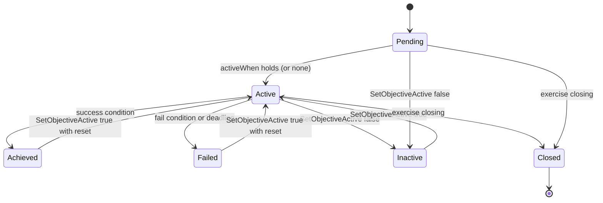

*What the picture shows that prose hid:* only an ACTION (or the instructor) leaves a terminal state, and every state reaches `Closed` through
ONE door — the exercise closing — so the result never waits on a behaviour that is still undecided.

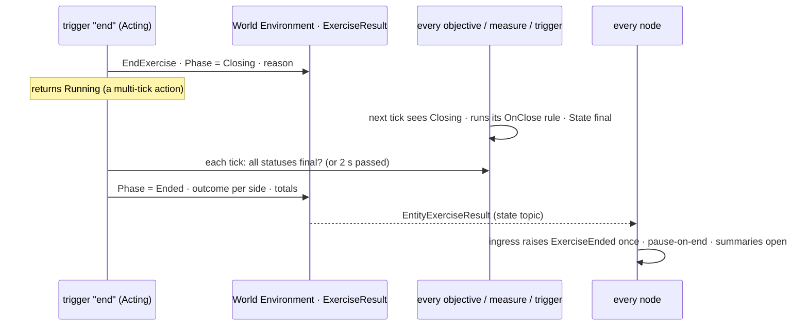

*What the picture shows that prose hid:* the pause comes AFTER the close, because a paused world runs no brain tick (`BrainTickSystem.cs:58`);
`EndExercise` is the existing multi-tick action shape, so no end-of-exercise system is added.

| # | decision | ⭐ lean |
|---|---|---|
| **SR-113** ✅ ACCEPTED `2026-11-01` | the states | `Pending` (waiting for `activeWhen`) · `Active` · `Achieved` · `Failed` · `Inactive` (switched off by an action or the instructor; `activeWhen` is ignored until switched on) · `Closed`-with-a-final-state (below). ⭐ `Capture` (HoldArea `capture`) never leaves `Active` — its `Owner` is the state |
| **SR-114** ✅ ACCEPTED `2026-11-01` | switching off and on | `SetObjectiveActive(id, false)` keeps the working state (progress frozen); `true` resumes it. A hold timer that needs continuity restarts anyway (continuity was broken). `reset: true` clears the working state — the only way out of `Achieved` / `Failed` (a repeated drill). ⛔ nothing else leaves a terminal state |
| **SR-115** ✅ ACCEPTED `2026-11-01` | a composite | its state is its children's: `Pending` until any child is active, then its aggregation behaviour's verdict (SR-78) |
| **SR-116** ✅ ACCEPTED `2026-11-01` | the end | `EndExercise` is multi-tick: ① writes `ExerciseResult.Phase = Closing`; ② every objective's next tick runs its kind's **OnClose** rule; ③ when every status is final (or after a 2 s sim-time timeout, logged with the stragglers), it writes the outcome per side, `Phase = Ended`; ④ only then pause-on-end (SR-9). ⭐ the instructor's *End* button fires the default evaluation macro's `instructor-end` trigger (SR-111), so it takes the same path |
| **SR-117** ✅ ACCEPTED `2026-11-01` | OnClose per kind | `Protect` / `NoHarm` (judged at the end) → `Achieved` if within limits, else `Failed` · every other `Active` → `Failed`, reason *"not achieved by the end"* · `Pending` / `Inactive` → **`Skipped`**: excluded from aggregation unless `required` (then it counts as failed) · measures freeze their value · a capture objective freezes its `Owner` |
| **SR-118** ✅ ACCEPTED `2026-11-01` | restore, replay, branch | statuses and brain working state are RECORDED (`DataPolicy` default) and `NoScenario` (never saved into the scenario). Replay: brains do not tick (T10); the owner's restored chunks are re-published, so every HUD and view is right at any seek with no new code. Branching to live from a checkpoint: brains continue from the restored working state (proved, SR-108). A late joiner gets the current statuses (TransientLocal) |
| **SR-119** ✅ ACCEPTED `2026-11-01` | a live edit (SR-109) | this run only; a changed param reaches the behaviour through the existing params path and the state is KEPT; the edit dialog offers *"restart this objective"* = `SetObjectiveActive(true, reset)` |

### 11.4 The wire *(B4)*

```mermaid
classDiagram
    direction LR
    class ScenarioClockTopic { <<existing>> EntityScenarioClock · the per-entity state shape }
    class SquadReportTopic { <<existing>> SquadReport · the event shape, managed fields }
    class EntityBrainIntent { <<existing>> IntentJson · the params, on every node }
    class ObjectiveStatus { <<new component>> on objective, measure and trigger entities · NoScenario }
    class ExerciseResult { <<new component>> on the World Environment · NoScenario }
    class EntityObjectiveStatus { <<new state topic>> key EntityId }
    class EntityExerciseResult { <<new state topic>> key EntityId }
    class PlayerMessage { <<new event topic>> To · Text · Seconds }
    class ExternalMeasurement { <<RESERVED, not built — SR-76>> }
    class ExerciseEnded { <<new local event>> raised once by the ingress }
    ObjectiveStatus ..> EntityObjectiveStatus : egress, owner only
    ExerciseResult ..> EntityExerciseResult : egress, owner only
    EntityObjectiveStatus ..|> ScenarioClockTopic : same shape
    EntityExerciseResult ..|> ScenarioClockTopic : same shape
    PlayerMessage ..|> SquadReportTopic : same shape
    EntityExerciseResult ..> ExerciseEnded : ingress, Phase becomes Ended
    EntityBrainIntent ..> ObjectiveStatus : display fields projected from the params
```

*What the picture shows that prose hid:* three new topics, each a COPY of a shape that ships today — no new transport mechanism; the objective
TREE is not on the result topic, it is the statuses (one owner per fact).

```mermaid
graph TD
    subgraph brain["Brain node (owns the rule entities)"]
        BT["BrainTickSystem — every advancing frame"] --> OS["ObjectiveStatus / ExerciseResult written"]
        ACT["Message action"] --> PM["PlayerMessage published"]
        OS --> EG["egress translators — ExportSystemGroup, every frame"]
    end
    EG --> W(("DDS"))
    PM --> W
    W --> IG["ingress on Player / IOS / editor nodes"]
    IG --> HUD["HUD · rules view · summaries · ExerciseEnded"]
    REP["replay: owner restores chunks"] --> EG
    REP -. "no brain tick, no Message action" .-> PMX["no PlayerMessage in replay"]:::dead
    classDef dead fill:#fde2e2,stroke:#c33
```

*Caption:* in replay the status path still runs (the egress re-publishes restored state), but the message path does not — a message is an
ACTION, and actions do not run in replay; the red edge is that dead path, and SR-121 says where the AAR gets messages instead.

| # | decision | ⭐ lean |
|---|---|---|
| **SR-120** ✅ ACCEPTED `2026-11-01` | `EntityObjectiveStatus` | key `EntityId` · `Role` (Objective / Measure / Trigger) · `State` (per role: SR-113 or T8's) · `Owner` (side) · `ProgressCur`, `ProgressNeed` · `Value`, `Target`, `Score` (0..1) · `Points` · `ChangedAt` (sim s) · `Reason` (string) · `Subject`, `Parent` (net ids) · `FireCount`, `LastFired` (triggers) · ⭐ the DISPLAY fields `Title`, `Kind`, `Required`, `Scored`, `Weight`, `VisibleSides` (a mask) — a PROJECTION of the params (which already reach every node in `EntityBrainIntent`), so a HUD reads one topic and never parses JSON; ⛔ never written back. Egress: a state change at once; progress-only changes at most 2 per second |
| **SR-121** ✅ ACCEPTED `2026-11-01` | `PlayerMessage` | the `SquadReport` event shape: `MessageId`, `OriginNodeId`, `ToKind` (All / Side / Station / Unit / Instructor) + `ToValue`, `Text`, `Seconds` (subtitle duration), `Priority`, `SentAt`, `Source` (the trigger's net id). Each Player node shows the ones addressed to its station, its side or the unit it holds, as a subtitle, and appends them to its log; the IOS shows all. ⭐ the AAR takes messages from the trigger's JOURNAL (recorded), not from the topic; a late joiner does not get old messages (accepted for the demo) |
| **SR-122** ✅ ACCEPTED `2026-11-01` | `EntityExerciseResult` | state on the World Environment: `Phase` (Running / Closing / Ended) · per side `{Side, Outcome, Points, Score}` · `EndedAt` · `Reason`. The ingress raises the local `ExerciseEnded` event ONCE when `Phase` becomes `Ended` (pause-on-end, summaries). ⭐ it replaces §7c's big result object: the tree is the statuses |
| **SR-123** ✅ ACCEPTED `2026-11-01` | `ExternalMeasurement` | RESERVED (SR-76): the shape stays in this design; ⛔ no topic, no ordinal until it is built |
| **SR-124** ✅ ACCEPTED `2026-11-01` | ids and files | one IDL file `hrot-scenario-rules`; descriptor ordinals and component ids allocated at build time from the building lane's block. ⚠ `visibleTo` is filtered on the RECEIVER — fine for training, ⛔ not anti-cheat for competitive games |

**Rejected — one line each:**
- *An end-of-exercise system* — `EndExercise` as a multi-tick action does it with what the PoC proved.
- *Pause first, then close* — a paused world runs no brain tick (`BrainTickSystem.cs:58`), so the close would never run.
- *The full result tree in `ExerciseEnded`* — it copies every status into a second owner.
- *Display fields parsed from `IntentJson` on each frontend* — every HUD would parse JSON; a projection on the status costs bytes, not owners.
- *`PlayerMessage` as a state topic (late joiners see history)* — it needs an id-keyed history and disposal; the journal already gives the AAR its history.

## ⛔ HISTORY — rev 3 / 3a / 3b (superseded `2026-10-31` by rev 4, R-4112)

Rev 3 lowered each scenario's rules into ONE generated HSM (one parallel region per objective / rule / measure): first via the runtime
`HsmBuilder` (3), then as a generated `.hsm.json` compiled by `HsmJsonGenerator` + hot reload (3a / 3b, SR-15 / SR-16). ⛔ Superseded: any
change in WHICH objectives a scenario has would change the generated machine and rebuild. Kept from it: S0's measured rebuild times
(an incremental rebuild ≈ 7.5 s, an unchanged one ≈ 3.8 s; a whitespace edit also rebuilds), the generated `{Asset}_Block` mechanism
(`HsmBridgeEmitCore.cs:853`), and `HsmAssetProjector` showing any compiled machine.

## ⛔ HISTORY — rev 2 (superseded `2026-10-31` by rev 3, R-4109)

Rev 2 proposed a `ScenarioRulesCapability` registering a `ScenarioRulesSystem` that each tick evaluated a `RuleSet` component's predicates,
ran `RuleAction` classes and wrote a `RuleState` component; a world-singleton Blueprint (`RegisterWorldSingleton`, no production caller) as the
host for custom logic; S3 moving the regression checks onto that evaluator. ⛔ Superseded: that is a second brain runtime with its own tick,
state and (missing) debugging. The objectives record (SR-14), the `ExerciseEnded` payload, the features and the IOS ruling carry over.
